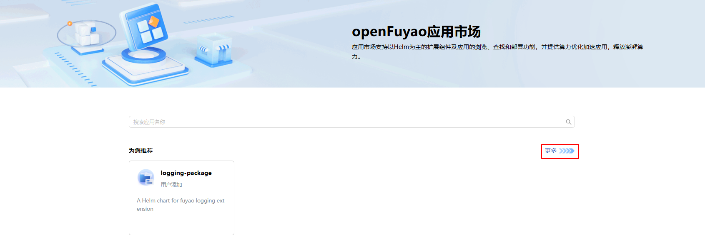
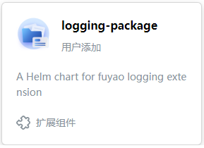
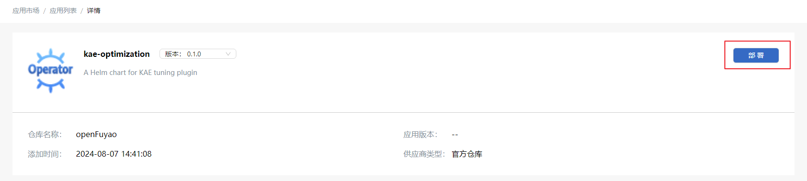
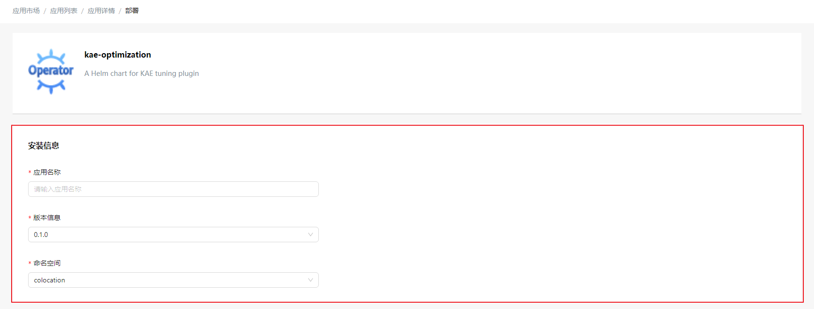
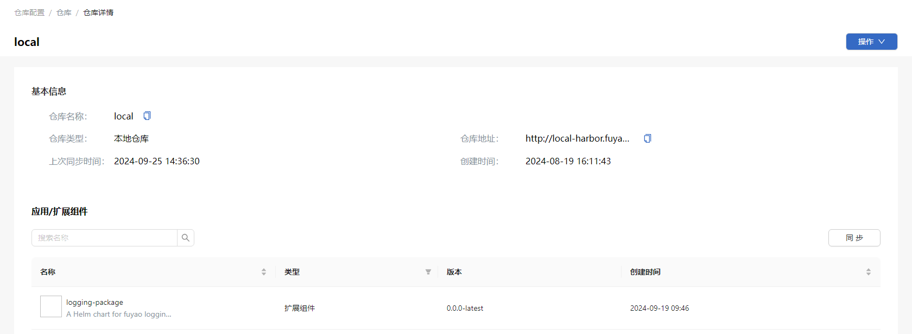
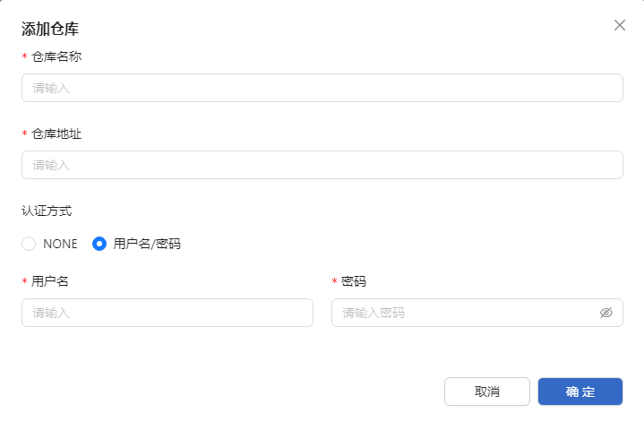
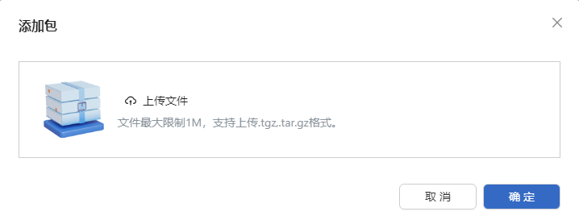

# 应用市场

## 特性介绍

openFuyao应用市场主要支持展示应用并管理应用仓库，为平台提供扩展能力和组件的便捷部署服务。

### 应用场景

openFuyao应用市场广泛用于用户和管理人员的仓库管理和应用部署操作，提供多种实际应用场景：

- 平台扩展能力：通过部署openFuyao扩展组件，显著增强平台的整体功能。

- 快速部署：用户可以直接将Helm包上传至openFuyao平台，实现快速部署和测试操作。

### 能力范围

- 应用部署：用户可以在应用市场中选择所需应用进行部署，并在后续管理中查看部署状态。

- 扩展能力部署：通过应用市场选择扩展组件，帮助平台增强功能和性能。

- 仓库管理：支持添加、删除和管理应用仓库，方便快速接入新的应用仓库，灵活选择可部署的应用。

- 本地仓库：支持多应用、多版本上传至本地，而无需将包上传至仓库中。

### 亮点特征

- Helm包支持：支持以Helm包为主的包格式，便于管理和部署容器化应用。

- 本地仓库管理：无需外部依赖，支持在本地上传、管理多个版本应用。

- 灵活部署：用户可以根据需要选择不同的应用版本和扩展组件，快速进行平台扩展和部署。

- 应用与扩展分离：应用市场区分了常规应用部署和扩展组件部署，明确了功能定位。

### 实现原理

基于Helm包管理和应用仓库管理机制，实现应用部署与扩展组件选择的快速响应。Helm包提供了标准化的应用部署方式，仓库管理实现了不同版本和不同应用的灵活切换与使用。

### 与相关特性的关系

- 应用市场发起RPC服务，发送Helm包。
- 应用管理的RPC服务接收并响应应用市场发送的Helm包。

## 概览

左侧导航栏选择“应用市场 > 概览”，进入“概览”界面。
“概览”界面可根据类型对应用进行筛选，也可以在搜索框输入关键字筛选。单击“更多”查看完整应用列表。

**图 1** 应用市场概览页
   
   

## 使用应用列表

### 查看应用

#### 前提条件

- 集群已安装Kubernetes 1.28以及Helm 3.14.2。
- 集群中marketplace-service运行正常。

#### 背景信息

Helm是Kubernetes集群中的包管理器。类似在Ubuntu中使用的apt，CentOS中使用的yum，能够方便快捷地安装Helm应用。

#### 使用限制

当前只支持已安装软件的查看。

#### 操作步骤

1. “概览”界面单击“更多”或左侧导航栏选择“应用市场 > 应用列表”可查看完整应用列表。
    
2. 单击应用卡片，进入应用“详情”界面，可查看应用版本及详细信息。
    
    **图 2** 应用卡片

   

3. 在应用“详情”界面单击“版本”选择器，选择应用版本。

4. 选择“详细信息”标签页，查看该应用的详细信息。

5. 选择“默认参数”标签页，查看该应用的YAML格式信息。该YAML文件支持导出。

### 部署应用

#### 前提条件

- 集群已安装Kubernetes 1.28以及Helm 3.14.2。
- 集群中marketplace-service运行正常。

#### 背景信息

用于在openFuyao平台通过应用市场部署应用或扩展组件，支持基于Kubernetes集群的Helm Charts部署。

#### 使用限制

在部署时，用户需正确配置Values.yaml文件中的Helm Charts参数。配置错误可能导致部署失败或应用无法正常运行。

#### 操作步骤

1. 左侧导航栏选择“应用市场 > 应用列表”，进入“应用列表”界面。
2. 单击应用卡片，进入应用“详情”界面。
3. 单击“部署”，进入“部署”界面。
   
   **图 3** 部署应用
   
   

   > **说明：** 
   > - openFuyao平台不对用户上传以及通过第三方仓库添加的应用进行安全性校验，请用户确保其安全性。
   > - 用户应用中的敏感信息需要自行保障安全使用与存储，openFuyao本身不会对应用中的敏感信息进行扫描、识别、屏蔽等。推荐使用Kubernetes Secret进行存储，并参照Kubernetes静态加密机密数据的指导配置Kubernetes，避免Secret在etcd数据库中的明文存储。

4. 在安装信息中填写应用名称，选择应用版本信息和命名空间。

   > **说明：** 
   > - 扩展组件在平台内只能安装一次，安装完成后，应用详情内的扩展组件“部署”会变成“管理”，单击“管理”会跳转至对应的“扩展组件管理”中。
   > - 部分应用名称以数字开头在部署时可能出错，具体情况见日志。
   
   **图 4** 部署应用安装信息
   
   

5. 在Values.yaml中填写helm-charts的values信息。

6. 单击“部署”完成部署。

7. 部署好的应用，根据其类型在左侧导航栏“应用管理”或“扩展组件管理”中进行管理。

> **说明：** 
>
> 1. 扩展组件在平台内只能安装一次，安装完成后，应用详情内的扩展组件“部署”会变成“管理”，单击“管理”会跳转至对应的“扩展组件管理”中。
> 2. Kubernetes集群中的各节点上能运行的Pod数量受限，默认为110个，所有节点上的Pod均达到限制数量后，新的待创建Pod将无法调度一直处于Pending状态，请及时清理或扩容节点。因为Kubernetes没有限制Pending状态Pod数量的机制，所以用户需要及时关注，避免Pending状态的Pod无限增加，消耗系统CPU与内存资源，最终影响集群的正常响应。

## 使用仓库配置

左侧导航栏中选择“应用市场 > 仓库配置”，默认进入“仓库配置”界面。

> **说明：** openFuyao完整安装的情况下，初始配置两个默认仓库，其中local为用户本地仓库，openFuyao为官方仓库，及时同步官方仓库即可获取最新版本官方应用与扩展组件。

### 查看仓库

#### 前提条件

- 集群已安装Kubernetes 1.28以及Helm 3.14.2。
- 集群中marketplace-service运行正常。

#### 背景信息

仓库用于存储和管理应用及扩展组件，提供集中化的资源管理入口。支持通过“仓库详情”界面查看基本信息（如名称、类型、地址）及仓库内包含的资源（如应用或扩展组件）。

#### 使用限制

只能查看已添加的仓库及其资源，支持对仓库进行管理操作（如添加、删除、同步）。

#### 操作步骤

1. 在“仓库配置”标签页单击“仓库名称”进入仓库“详情”界面，可查看仓库基本信息及仓库内的应用或扩展组件。
   
   **图 5** 仓库详情
   
   

### 同步仓库

#### 前提条件

- 已正常配置仓库。
- 已正确配置仓库地址、认证信息等。

#### 背景信息

用于更新仓库中的应用或扩展组件信息，确保资源信息是最新的。

#### 使用限制

仓库已添加且状态正常，若仓库地址不可用或认证信息不正确，同步操作会失败。

#### 操作步骤

同步仓库可同步仓库的应用或扩展组件。

入口1：在“仓库配置”标签页单击操作列，选择“同步仓库”。

入口2：在仓库“详情”界面单击“同步”。

### 添加仓库

#### 前提条件

- 目标仓库已正确部署并处于可用状态。
- 目标仓库需要认证，需提前备好正确的用户名和密码。

#### 背景信息

添加仓库功能用于将新的应用或扩展组件仓库接入openFuyao平台，以便openFuyao统一管理，同时也可以接入多种类型的资源。

#### 使用限制

- 仓库名称唯一，不能与平台中已有的仓库名称重复。
- 认证方式需确保用户名和密码正确。

#### 操作步骤

1. 单击“添加仓库”弹出添加仓库窗口，输入仓库名称、仓库地址。

2. 可选择认证方式，默认使用“用户名/密码”方式，请输入用户名和密码。选择“NONE”认证方式时，按照风险提示进行确认。
   
   **图 6** 添加仓库
   
   

3. 单击“确定”完成添加。

#### 相关操作

您可以在列表页面单击操作列或在详情页面单击右上角的“操作”，按需修改和删除仓库。

## 使用包管理

在“仓库配置”界面选择“包管理”标签页。

### 管理包版本

#### 前提条件

无。

#### 背景信息

包管理用于在openFuyao平台内对包进行版本管理，包括添加新版本或删除旧版本。

#### 使用限制

无。

#### 操作步骤

1. 在“包管理”标签页单击卡片进入包“详情”页面，可查看包版本信息。
2. 单击“添加版本”，弹出窗口。
3. 单击“上传文件”，选择需要上传的文件。

   > **说明：**
   >
   > - 上传的文件最大限制为1M，支持上传.tgz、.tar.gz格式。
   > - openFuyao平台不对用户上传的应用进行安全性校验，请用户确保上传应用的安全性。

4. 单击“确定”完成添加版本。

5. 单击表格列，选择“删除”，弹出删除窗口。勾选“已了解删除操作无法恢复”，单击“删除”完成删除。

### 添加包

#### 前提条件

无。

#### 背景信息

用于在平台中上传新的应用包或组件包，为后续版本管理和资源部署提供支持。

#### 使用限制

确保包名称的唯一性。

#### 操作步骤

1. 在“包管理”标签页单击“添加包”，弹出窗口。
   
   **图 7** 添加包
   
   

2. 单击“上传文件”，选择需要上传的文件。

   > **说明：** 
   > 文件最大限制1M，支持上传.tgz、.tar.gz格式。

3. 单击“确定”完成添加包。

#### 相关操作

您可以在“包管理”标签页单击右侧的“同步”，按需进行同步到本地仓库。

**表 1** 相关操作说明

|操作|说明|
|---|---|
|同步|由于网络波动等原因，可能导致添加包和删除操作同步不及时，需要手动同步。|

#### 后续操作

您可以在“包管理”标签页单击卡片中的“删除”，按需进行删除包。
