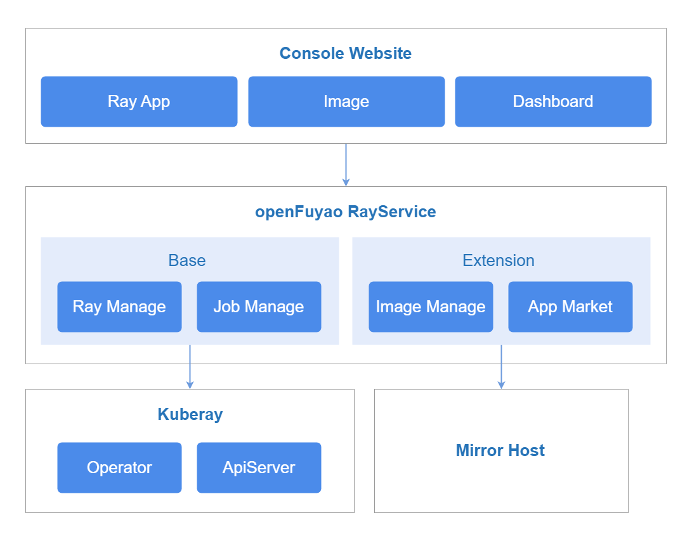
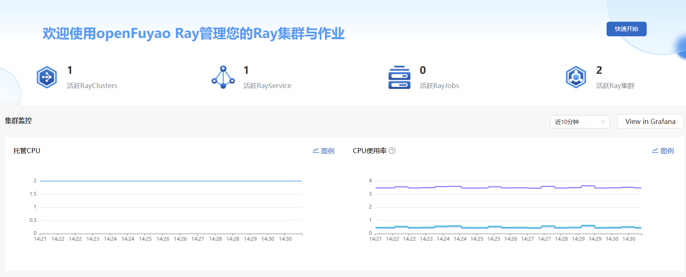
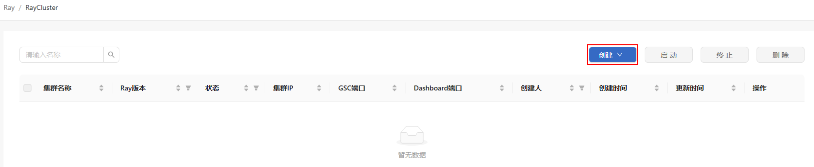

# openFuyao Ray

## 特性介绍

Ray是一款支持异构算力函数级按需调度的分布式计算框架，适用于通算、智算以及通智融合等场景，提供高效、易用的多语言API，提升算力占空比，优化算力综合利用率。Ray支持以RayCluster、RayJob、RayService等多种作业形态，集群中往往会部署多个Ray集群分别处理不同租户、应用的计算作业。该特性提供Ray集群及作业的管理能力，降低运维成本，并增强集群可观测性、故障诊断及优化实践，构建基于云原生架构的算力管理解决方案，提升算力利用效率。

### 应用场景

Ray广泛应用于机器学习、超参数优化、大数据处理、强化学习和模型部署。

### 能力范围

- 资源管理
  
  - 支持RayCluster、RayJob、RayService资源的创建、查询、删除、启动、终止，实现灵活的计算资源管理。
  - 提供文件或文本配置方式进行RayCluster、RayJob、RayService资源创建与修改，适应不同部署需求。
  - 展示RayCluster、RayJob、RayService资源详情，YAML和日志。

- 全局Ray资源监控

  - 展示RayCluster、RayJob、RayService的活跃数量，以及所有活跃Ray集群的总数。
  - 展示所有Ray集群合计占用的物理及逻辑资源总量，按照Pod的request值进行计数。
  - 展示Ray集群使用的物理及逻辑资源总量的统计数据，按照物理资源监控数据及Ray逻辑资源数据进行汇总。

### 亮点特征

提供简洁高效的Ray资源管理与全局监控能力，支持RayCluster、RayJob、RayService的便捷配置与灵活调度，简化计算资源管理流程，提升集群可观测性与算力利用率。

### 与相关特性的关系

依赖Prometheus提供监控能力。

### 实现原理

**图 1** 实现原理



openFuyao Ray按照业务层次分为前端服务、后端服务和组件服务，各层级原理如下。

**前端服务**

ray-website为用户提供RayCluster、RayJob、RayService的资源管理可视化界面，支持大规模集群管理，提升Ray计算任务的可视化管理能力，同时集成数据可视化，展示任务执行状态、资源占用情况、调度日志等关键监控信息。

**后端服务**

ray-service以微服务的形式部署提供一些核心能力，包括指标查询、RayCluster、RayJob、RayService资源的创建、查询、删除、启动和终止。

**组件服务**

- KubeRay: KubeRay是Ray社区为Kubernetes提供的Operator，它通过Kubernetes的自定义资源定义（CRD）来管理Ray集群。

- Prometheus: 负责采集Ray集群的监控数据，包括RayCluster、RayJob、RayService的数量、资源使用率（CPU/GPU/内存）等关键指标，并存储这些数据供查询和分析。

- Grafana: 基于Prometheus采集的数据，提供Ray集群运行状态、计算资源占用、任务执行情况等可视化仪表盘。

## 安装

### 前提条件

- Kubernetes v1.21及以上。
- MindX DL 5.0.1及以上。

### 开始安装

#### openFuyao平台

1. 在openFuyao平台的左侧导航栏选择“应用市场 > 应用列表”，进入“应用列表”界面。
2. 勾选左侧类型“扩展组件”，查看所有扩展组件。或在搜索框中输入“ray-package”。
3. 单击“ray-package”卡片，进入Ray扩展组件“详情”界面。
4. 单击“部署”进入“部署”界面。
5. 输入应用名称、选择安装版本和命名空间。
6. 在参数配置的“values.yaml”中输入要部署的values信息。
7. 单击“确认”完成部署。
8. 在左侧导航栏单击“扩展组件管理”，管理Ray组件。

#### 独立部署

1. 获取Ray Helm包。

   ```bash
   helm pull oci://helm.openfuyao.cn/charts/ray-package --version xxx
   ```

   将其中的xxx替换成需要拉取的helm镜像版本，例如：0.0.0-latest

2. 在参数配置的“values.yaml”中输入要部署的values信息。
   - 配置`ray-service.grafana.grafana.ini.server.domain`，指定Grafana访问的域名或IP地址。
   - 将`ray-service.grafana.service.type`设置为`NodePort`确保服务在所有节点上通过指定端口号暴露。
   - 配置`ray-service.grafana.service.nodePort`，使用一个`30000-32767`范围内的端口号。
   - 将`ray-service.grafana.openFuyao`和`ray-website.openFuyao`都设置为`false`。
   - 将`ray-website.enableOAuth`设置为`false`。
   - 将`ray-website.service.type`设置为`NodePort`确保服务在所有节点上通过指定端口号暴露。
   - 配置`ray-website.service.nodePort`，使用一个`30000-32767`范围内的端口号。
   - 配置`ray-website.backend.monitoring`指向正确的`Prometheus`地址。
     
     ```text
     http://<prometheus-service-name>.<namespace>.svc:<port>
     ```

3. 使用Helm部署。

   ```bash
   tar -zxf ray-package-xxx.tgz
   helm install openFuyao-ray -n default ./ray-package
   ```

4. 验证安装成功与访问。

   - 确认openFuyao Ray已经成功部署。

     ```bash
     kubectl get pods -n vcjob
     kubectl get pods -n default
     ```

   - 确认服务已经暴露。

     ```bash
     kubectl get svc -n default | grep ray-website
     ```
   
   - 访问ray-website界面。
     
     ```text
     http://<Node_IP>:<ray-website.service.nodePort>
     ```

   > **说明：**<br />
   > 在首次访问Grafana时，请使用默认用户名`admin`和密码`admin`登录Grafana，登录后请尽快修改密码以确保安全性。

## 查看概览

### 前提条件

已在应用市场部署“ray-package”扩展组件。

### 背景信息

概览界面主要展示所有Ray应用，包括以下内容。

- RayCluster、RayJob、RayService的活跃数量，以及所有活跃Ray集群的总数。
- 所有Ray集群的物理和逻辑资源总量，基于Pod Request资源请求值进行统计。
- 所有Ray集群的实际物理和逻辑资源使用情况，基于物理资源监控数据及Ray逻辑资源数据进行汇总。

### 使用限制

无。

### 操作步骤

1. 在openFuyao平台界面左侧导航栏的“算力优化中心”中，选择“openFuyao Ray > 概览”，进入“概览”界面。

   **图 2** 概览

   

   - 选择时间范围（可选）：在概览界面，用户可以通过时间筛选，查看近10分钟、30分钟、1小时等内的Ray计算资源状态及使用情况。
   - 查看Ray资源监控数据：概览界面直观展示RayCluster、RayJob、RayService的活跃数量，以及计算资源分配和使用情况。
2. 跳转至Grafana（可选）：在概览界面“集群监控”区域右侧，单击“View in Grafana”，跳转至Grafana监控面板，查看Ray计算集群的详细监控数据。

## 使用RayCluster

在openFuyao平台界面左侧导航栏的“算力优化中心”中，选择“openFuyao Ray > RayCluster”，进入“RayCluster”界面。

**图 3** RayCluster


该界面支持以下功能。

- RayCluster名称模糊搜索：在搜索框中输入部分或完整的RayCluster名称，系统会自动筛选匹配的RayCluster实例。
- 列表排序：支持对RayCluster列表进行升序/降序排序。
- 筛选功能：支持按Ray版本、资源类型（模版/实例）、状态、创建人进行筛选。
- 资源管理：支持RayCluster资源的创建、查询、删除、启动和终止。

### 查看RayCluster详情

#### 前提条件

已在应用市场部署“ray-package”扩展组件。

#### 背景信息

展示当前RayCluster的基本信息、YAML配置、运行日志以及监控详情。

#### 使用限制

无。

#### 操作步骤

1. 在“RayCluster”界面单击“集群名称”列的任意一个RayCluster，进入RayCluster详情界面。
   详情界面支持以下功能。
   
   - 在“详情”界面，可查看RayCluster的基本信息、算法框架、head节点规格配置和worker节点规格配置。
   - 在“YAML”页签，可查看和导出RayCluster的YAML配置。
   - 在“日志”页签，可查看RayCluster运行日志，便于调试和故障排查。
   - 在“集群健康信息”页签，可查看RayCluster集群健康情况，便于了解集群压力情况。
  
     - GCS事件压力：gcs_server任务队列压力情况，gcs_server为ray集群调度中心，如果耗时过长，将会导致集群出现卡顿超时等情况。
     - 节点健康检查：ray集群有两种健康检查，分别是raylet和GCS健康检查，如果健康检查发生故障，则在一段时间后，会重启该故障节点。
     - Job事件压力：分别对应job及日志的get，delete，post耗时情况，频繁的事件请求可能产生较高负载，建议适当调节请求频率缓解集群压力。
     - Dashboard压力：dashboard接口压力反映head节点网络、gcs_server进程、dashboard进程压力情况，前端页面卡顿时需关注该接口压力。

2. 单击“Ray Dashboard”，可跳转至Ray Dashboard，查看集群的任务执行情况、资源使用率和调度信息。
3. 单击右侧“操作”下拉菜单。支持按需选择对RayCluster进行“启动”、“终止”以及“删除”操作。

### 创建RayCluster

#### 前提条件

已在应用市场部署“ray-package”扩展组件。

#### 背景信息

当用户需要运行Ray计算任务时，需要创建RayCluster，以便在集群中自动调度计算资源。

#### 使用限制

登录用户具有“platform admin”或“cluster admin”角色。

#### 操作步骤

1. 单击“RayCluster”列表界面右侧的“创建”。

   **图 4** RayCluster创建

   

2. 按需选择创建方式。

   **表1** 创建方式 
   
   |创建方式|操作步骤|
   |:------|:---|
   |方式一|1. 下拉菜单中选择“创建配置”。<br/> 2. 切换页签选择“表单创建”或者“YAML创建”。|
   |方式二|1. 下拉菜单选择“上传配置”。<br/> 2. “上传配置”弹窗中单击“选择文件”，上传包含RayCluster配置的YAML文件。<br/>3. 单击“上传并部署”完成RayCluster的创建。|
   
   - 表单创建：底层与KubeRay原生YAML配置保持一致，通过可视化表单配置RayCluster参数（如集群名称、镜像版本、计算资源分配、Worker副本数等），适用于用户无需手动编辑YAML的场景。
      
      1. 镜像地址可填写开源Ray镜像（如`docker.io/library/ray`）。
      2. 镜像地址可填写openFuyao-Ray镜像。
      3. 镜像地址可填写自定义镜像：如需引入额外依赖（如自定义Python、VLLM或特定硬件驱动），建议基于上述镜像构建自定义镜像后使用。
    
   - YAML创建：直接编辑YAML配置文件，适用于熟悉RayCluster CRD规范的用户，可自定义更高级的参数。

3. 单击“创建”或“创建并启动”完成创建。创建YAML样例请参见[创建RayCluster的yaml样例](#创建raycluster的yaml样例)。
   
   如果需要开启健康可观测功能，请使用下述配置：
   
   当前仅支持通过YAML创建集群健康度观测功能，用户需先手动创建[ConfigMap配置](#开启健康可观测功能的配置文件)，再创建携带引用的RayCluster。需要注意的是，RayCluster和ConfigMap必须位于同一命名空间，否则配置不会生效。

### 删除RayCluster

#### 前提条件

已在应用市场部署“ray-package”扩展组件。

#### 背景信息

当不再需要某个RayCluster，或者希望释放计算资源时，可以执行删除操作，清理Ray Head、工作节点及相关资源，避免不必要的资源占用。

#### 使用限制

- 登录用户具有“platform admin”或“cluster admin”角色。

- 除了运行中的其他状态。

#### 操作步骤

- 批量删除

  1. 在“RayCluster”列表界面勾选需要删除的RayCluster。
  2. 单击列表右侧的“删除”。
  3. 弹窗单击“确认”，完成删除所选RayCluster。

- 单个删除
  
  1. 入口一：在“RayCluster”列表界面单击对应“操作”列。
     
     入口二：在“RayCluster”详情界面单击右侧“操作”。
  2. 下拉菜单选择“删除”。
  3. 弹窗单击“确认”，完成删除。

#### 相关操作

您可以单击列表界面右侧的“启动”或者“终止”，或者单击详情界面“操作”列的选择“启动”或者“终止”，按需进行RayCluster的相关操作。

**表 1** 相关操作说明

|操作|说明|
|:---|:---|
|启动|如果RayCluster处于终止或未启动状态，用户可以启动RayCluster以恢复计算能力，使其能够重新运行RayJob和RayService任务，并在集群中正常调度资源。|
|终止|当计算任务完成或不再需要时，为了释放计算资源、优化集群利用率，可以终止RayCluster，从而防止不必要的资源占用。|

#### 后续操作

您可以参考“RayCluster”的相关操作步骤来使用RayService和RayJob，如创建、查询、删除、启动和终止的操作。

## 附录

### 开启健康可观测功能的配置文件

```yaml
apiVersion: v1
kind: ConfigMap
metadata:
  name: fluentbit-config
  namespace: default                                  #所有命名空间下的raycluster都需要部署这个ConfigMap
data:
  script.lua: |-
    function process_log(tag, timestamp, record)
      local filename = record["filename"]
      local cache_path = "/tmp/last_value.dat"

      local function load_last_value()
        local file = io.open(cache_path, "r")
        if not file then return 0 end
        local content = file:read("*a")
        file:close()
        return tonumber(content) or 0
      end

      local function save_last_value(value)
        local file = io.open(cache_path, "w")
        if file then
            file:write(tostring(value))
            file:close()
        end
      end
      
      if filename == "/tmp/ray/session_latest/logs/gcs_server.out" then
        local log_msg = record.log
        local current_str_1 = log_msg:match("Main%sservice%sEvent%sstats:")

        if current_str_1 then
          local current_str_2, current_str_3 = log_msg:match("Global%sstats:%s+(%d+)%s+total%s+%((%d+)%s+active%)")
          if current_str_2 and current_str_3 then
            local last_value = load_last_value()
            local current_value = tonumber(current_str_2)

            record["result"] = current_value - last_value
            save_last_value(current_value)
            record["result1"] = current_str_3
          end
          local value, unit = log_msg:match("Queueing%stime:%smean%s=%s([%d%.]+)%s([mun]?s)")
          if value and unit then
            local num = tonumber(value)
            local conversion = {
                ["ns"] = 0.001,
                ["us"] = 0.001,
                ["ms"] = 1,
                ["s"]  = 1000
            }
            unit = unit:gsub("μs", "us"):lower()
            record["result2"] = num * (conversion[unit] or 1)
          end
        end

        if record["result"] or record["result2"] then
          return 2, timestamp, record
        else
          return -1, nil, nil
        end
      end

      if filename == "/tmp/ray/session_latest/logs/dashboard.log" or 
          filename == "/tmp/ray/session_latest/logs/dashboard_agent.log" then
        local log_msg = record.log
        local value_str, unit = log_msg:match("bytes%s+(%d+)%s+(%a+)")
        if value_str and unit then
            local value = tonumber(value_str)
            local new_value, new_unit
            if unit == "us" then
                new_value = value / 1000
                new_unit = "ms"
            elseif unit == "ms" then
                new_value = value
                new_unit = "ms"
            elseif unit == "s" then
                new_value = value * 1000
                new_unit = "ms"
            else
                return 1, timestamp, record
            end

            local formatted_value = string.format("%.3f", new_value):gsub("0+$", ""):gsub("%.$", "")

            local new_log, count = log_msg:gsub(
                "bytes%s+"..value_str.."%s+"..unit,
                "bytes "..formatted_value.." "..new_unit,
                1
            )
            if count > 0 then
                record.log = new_log
                if record["filename"] == "/tmp/ray/session_latest/logs/dashboard_agent.log" then
                    record[host] = tonumber(new_value) * 1.0
                end
                return 2, timestamp, record
            end
        end
      end

      return 1, timestamp, record
    end
  parsers.conf: |
    [MULTILINE_PARSER]
      Name          multiline_log
      Type          regex
      Rule          "start_state" "/^\[.*?Main service Event stats:\s*$/" "cont"
      Rule          "cont"        "/^(?!\[).*(?<!Main service Event stats:)$/" "cont"
      #Rule          "start_state" "/^$[0-9]{4}-[0-9]{2}-[0-9]{2}\s[0-9]{2}:[0-9]{2}:[0-9]{2},[0-9]{3}\sI\s[0-9]+\s[0-9]+$\s$gcs_server$\sgcs_server\.cc:[0-9]+:\sMain\sservice\sEvent\sstats:/" "cont"
      #Rule          "cont"        "/^(?!$[0-9]{4}-[0-9]{2}-[0-9]{2}\s[0-9]{2}:[0-9]{2}:[0-9]{2},[0-9]{3}\sI\s[0-9]+\s[0-9]+$\s$gcs_server$)/" "cont"

  fluent-bit.conf: |
    [SERVICE]
      Log_Level      info
      Parsers_File   /etc/fluent-bit/conf/parsers.conf

    [INPUT]
      Name              tail
      Path              /tmp/ray/session_latest/logs/*.*
      Path_Key          filename
      Buffer_Max_Size   50MB
      Skip_Long_Lines   On
      Refresh_Interval  10
      Read_from_Head    true
      #Multiline         On
      #Multiline.Parser  multiline_gcs
      #Parser_Firstline  gcs_docker_parser
      Tag               all_log

    [INPUT]
      Name              tail
      Path              /tmp/ray/session_latest/logs/gcs_server.out
      Path_Key          filename
      Refresh_Interval  10
      Read_from_Head    true
      Tag               gcs_log
    [INPUT]
      Name              tail
      Path              /tmp/ray/session_latest/logs/raylet.out
      Path_Key          filename
      Refresh_Interval  10
      Read_from_Head    true
      Tag               raylet_log

    [FILTER]
      name                  multiline
      match                 gcs_log
      multiline.key_content log
      multiline.parser      multiline_log
    [FILTER]
      name                  multiline
      match                 raylet_log
      multiline.key_content log
      multiline.parser      multiline_log

    [FILTER]
      name lua
      Match *
      Script /etc/fluent-bit/scripts/script.lua
      Call process_log

    [OUTPUT]
      name        loki
      match       *
      host        ray-loki.monitoring
      port        3100            
      labels      job=${RAY_JOB_NAME}       # RAY_JOB_NAME对应raycluster的fluentbit容器的环境变量RAY_JOB_NAME
      Label_Keys  $filename
```

### 创建RayCluster的YAML样例

创建RayCluster的YAML样例文件如下所示。

```yaml
apiVersion: ray.io/v1
kind: RayCluster
metadata:
  name: raycluster-kuberay-test-x86
spec:
  rayVersion: '2.41.0'
  headGroupSpec:
    serviceType: NodePort
    rayStartParams:
      num-cpus: "0" # not allowed
    template:
      spec:
        volumes:
        - name: ray-logs
          emptyDir: {}
        - name: parsers
          configMap:
            name: fluentbit-config
            items:
              - key: parsers.conf
                path: parsers.conf
        - name: fluentbit-config
          configMap:
            name: fluentbit-config
            items:
              - key: fluent-bit.conf
                path: fluent-bit.conf
        - name: scripts-volume
          configMap:
            name: fluentbit-config
            items:
              - key: script.lua
                path: script.lua
        containers:
        - name: ray-head
          image: docker.io/rayproject/ray:2.41.0 # 在ARM架构下，tag为2.41.0-aarch64
          resources:
            requests:
              cpu: "500m"
              memory: "500Mi"
            limits:
              cpu: "1000m"
              memory: "2000Mi"
          ports:
          - containerPort: 6379
            name: gcs-server
          - containerPort: 8265
            name: dashboard
          - containerPort: 10001
            name: client
          volumeMounts:
          - mountPath: /tmp/ray
            name: ray-logs
        - name: fluentbit                             # 如果需要启动loki，则需要添加该容器
          image: docker.io/fluent/fluent-bit:2.0.5
          imagePullPolicy: IfNotPresent
          resources:
            requests:
              cpu: "100m"
              memory: "1G"
            limits:
              cpu: "100m"
              memory: "1G"
          volumeMounts:
          - mountPath: /tmp/ray
            name: ray-logs
          - mountPath: /etc/fluent-bit/conf/parsers.conf
            subPath: parsers.conf
            name: parsers
          - mountPath: /fluent-bit/etc/fluent-bit.conf
            subPath: fluent-bit.conf
            name: fluentbit-config
          - name: scripts-volume
            mountPath: /etc/fluent-bit/scripts/
          env:
          - name: RAY_JOB_NAME
            value: raycluster-kuberay-test-x86        # 该value需要对应raycluster的名字，也就是 metadata.name 的值
  workerGroupSpecs:
    - replicas: 1
      minReplicas: 0
      maxReplicas: 2
      groupName: workergroup
      rayStartParams: {}
      template:
        spec:
          volumes:
          - name: ray-logs
            emptyDir: {}
          - name: parsers
            configMap:
              name: fluentbit-config
              items:
                - key: parsers.conf
                  path: parsers.conf
          - name: fluentbit-config
            configMap:
              name: fluentbit-config
              items:
                - key: fluent-bit.conf
                  path: fluent-bit.conf
          - name: scripts-volume
            configMap:
              name: fluentbit-config
              items:
                - key: script.lua
                  path: script.lua
          containers:
            - name: ray-worker
              image: docker.io/rayproject/ray:2.41.0 # 在ARM架构下，tag为2.41.0-aarch64
              resources:
                requests:
                  cpu: "500m"
                  memory: "500Mi"
                limits:
                  cpu: "1000m"
                  memory: "2000Mi"
              volumeMounts:
              - mountPath: /tmp/ray
                name: ray-logs
            - name: fluentbit
              image: docker.io/fluent/fluent-bit:2.0.5
              imagePullPolicy: IfNotPresent
              resources:
                requests:
                  cpu: "100m"
                  memory: "1G"
                limits:
                  cpu: "100m"
                  memory: "1G"
              volumeMounts:
              - mountPath: /tmp/ray
                name: ray-logs
              - mountPath: /etc/fluent-bit/conf/parsers.conf
                subPath: parsers.conf
                name: parsers
              - mountPath: /fluent-bit/etc/fluent-bit.conf
                subPath: fluent-bit.conf
                name: fluentbit-config
              - name: scripts-volume
                mountPath: /etc/fluent-bit/scripts/
              env:
              - name: RAY_JOB_NAME
                value: raycluster-kuberay-test-x86    # 该value需要对应raycluster的名字，也就是metadata.name的值
```
