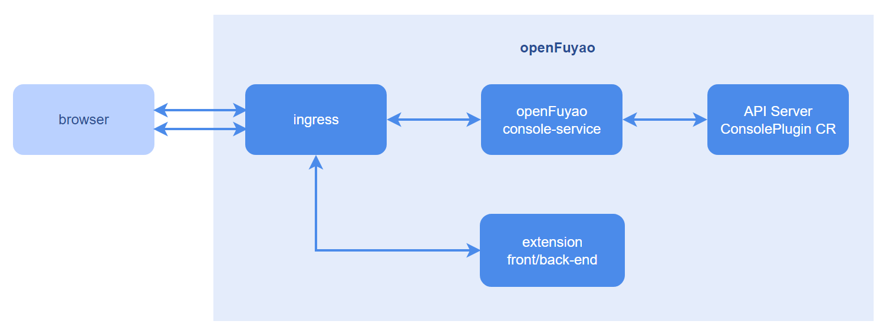
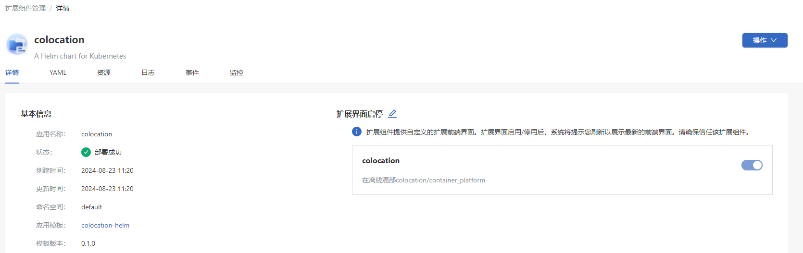
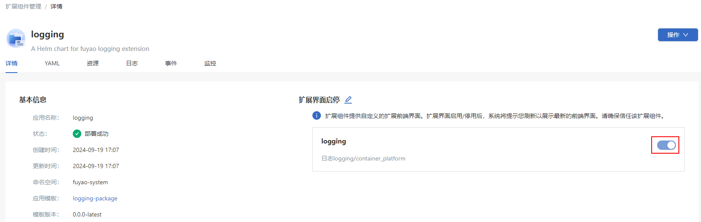

# 扩展组件管理

## 特性介绍

为了支持日渐丰富的云原生使用场景，openFuyao允许用户通过组件的形式，扩展openFuyao前端管理面的能力，为用户提供更高效、灵活、定制化的云原生使用体验。用户可依据自身需求安装、卸载、或启停组件，以管理openFuyao前端与后台扩展功能。此外，openFuyao还提供相应的接口与模板，支持用户自行接入或开发第三方扩展组件。

### 应用场景

扩展组件管理基于应用管理，针对扩展组件的运维支持以下应用场景。

- 扩展组件信息获取：以列表形式获取扩展组件名称、状态、启停界面数量、更新时间信息，并支持筛选与排序，同时详情页提供YAML、资源列表、事件、监控等更多信息。

- 扩展组件生命周期管理：对集群中安装的各扩展组件进行安装、卸载、升级与回退的操作。

- 扩展界面启停：动态配置是否将组件的扩展界面挂载至openFuyao前端管理面。

### 能力范围

为openFuyao前端管理面提供扩展的前端界面以及后台能力，可以根据用户需求动态装卸与启停，并提供接口与模板支持用户自行开发。

### 亮点特征

openFuyao的可插拔架构提供标准扩展发现与挂载机制，允许开发者以扩展组件的形式，在不对openFuyao核心代码进行修改的前提下，动态扩展平台的前后端能力，并按需升级、回退以及启停已安装的扩展组件。

### 实现原理

**扩展组件构成**

  扩展组件基于Helm应用实现，相比标准Helm应用，需要额外包含openFuyao自定义资源ConsolePlugin。其中，该资源记录了该扩展组件的前端界面的名称、路由、挂载位置等前端渲染配置，以及扩展组件相关后端接口的转发规则。ConsolePlugin资源的配置请参见[开发步骤](../developer_guide/extension_development_guide.md#开发步骤)。

**前端发现**

  当浏览器加载openFuyao前端管理面时，界面将向openFuyao扩展管理服务（plugin-management-service）请求所有的ConsolePlugin资源，并根据每一个ConsolePlugin实例中的前端配置信息，动态的添加或挂载扩展组件的相关前端元素，并配置相应的前端路由。

**前端加载**

  扩展组件的前端将打包为统一的ES Module，前端根据ConsolePlugin中的前端信息获取请求路径，动态地将模块加载到openFuyao前端管理面中。

**扩展组件请求分发**

  扩展组件相关的请求分为两类：前端资源的获取和扩展后端接口的调用。当浏览器发送扩展组件的请求时，请求将通过Ingress根据请求路径的前缀匹配相应的扩展组件，并将请求转发到相应的扩展组件服务上。

**图 1** 扩展组件管理实现原理

### 与相关特性的关系

应用管理：扩展组件基于应用管理特性实现安装卸载、升级回退等能力，同时基于ConsolePlugin CRD相关字段，支持运维人员启停前端扩展界面。

### 相关实例

openFuyao日志扩展组件。

- 请参见[日志组件后端](https://gitcode.com/openfuyao/logging-operator)
- 请参见[日志组件前端](https://gitcode.com/openfuyao/logging-website)

安装后，openFuyao平台在左侧导航栏显示“日志”菜单，用户可进入日志相关界面进行使用。

## 使用扩展组件管理

左侧导航栏单击“扩展组件管理”，进入“扩展组件管理”界面。可查看已部署的扩展组件实例，包含应用的名称、状态、启动/停止界面数、更新时间，且支持按照名称和更新时间排序，以及按照安装状态进行筛选。

单击“扩展组件名称”，进入扩展组件“详情”界面，可查看扩展组件的详细信息，包括详情、YAML、资源、事件、监控。

**图 2** 扩展组件详情

### 启停扩展界面

#### 前提条件

- 集群已安装Kubernetes 1.28以及Helm 3.14.2。
- 集群中plugin-management-service运行正常。

#### 背景信息

openFuyao主界面通过集群中ConsolePlugin自定义资源发现扩展组件，扩展界面以ES Module引入。上述请求均在openFuyao主界面初始化加载时获取，当发生扩展组件安装、卸载、升级、回退、界面启停时，需要刷新页面重新获取扩展组件状态，才可见扩展组件相关的前端更新。

#### 使用限制

待安装软件格式为Helm Chart，当前仅支持上传到仓库软件的安装。

#### 操作步骤

1. 入口1：在“扩展组件管理 > 详情”界面，单击“操作”选择“扩展界面启停”，进入扩展界面启停编辑状态。

   入口2：在“扩展组件管理 > 详情”界面，单击扩展界面启停，进入扩展界面启停编辑状态。

2. 单击开关，切换扩展界面启动/停止状态。
   
   **图 3** 扩展界面启停
   
   

3. 单击“保存”保存操作。

#### 相关操作

您可以在列表页面单击操作列或在详情页面单击右上角的“操作”，按需升级、回退或卸载扩展组件。

**表 1** 相关操作说明

|操作|说明 |
|:---|:---     |
|升级|升级之后需要刷新openFuyao管理面，扩展界面才会更新。        |
|回退| 回退之后需要刷新openFuyao管理面，扩展界面才会更新。         |
|卸载| 卸载扩展组件后，如果扩展组件启用了扩展界面，需要刷新openFuyao管理面，扩展界面才会消失。                   |
