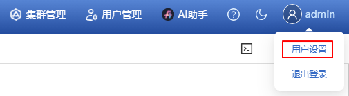
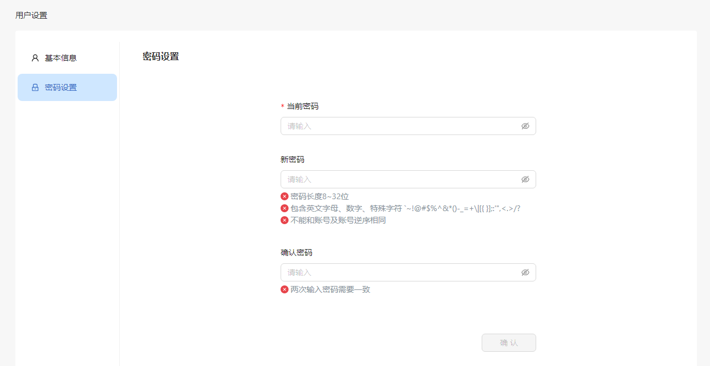

# 开始使用

## 顶部栏快捷操作

通过顶部栏右侧操作按钮进行快捷操作。

**表 1** 顶部栏快捷操作说明

| 图标                                           | 说明                                          |
| :---------------------------------------------- | :--------------------------------------------- |
|  | 应用部署，进入YAML界面快捷部署应用。          |
|      | 告警通知，展示当前告警统计和最新5条告警信息。 |
|   | 切换皮肤按钮，支持白天黑夜两种模式。 |
|       | 帮助文档，查看openFuyao平台帮助文档。         |
|      | 支持“用户设置”和“退出登录”。                  |
|   |Web Terminal工具使用入口。|

## 用户设置

### 基本信息

单击“用户名”，选择“用户设置”，进入“用户设置”界面的“基本信息”标签页，可查看用户头像及用户名。

### 修改密码

1. 选择“密码设置”标签页，进入“密码设置”界面。
2. 输入当前密码及新密码，单击“确认”完成修改。密码格式必须符合规范。

> **说明：** 
> 为了提高系统安全性，请定期（如六个月）修改密码，以防出现密码被暴力破解等安全风险。

### 首页

用户成功登录，进入openFuyao平台后，单击左上角openFuyao的LOGO可切换展示首页。首页展示三个模块的快捷入口卡片。

- 极简安装部署：“应用市场”和“零成本应用迁移”的快捷入口。
- 极智运维交互：“可插拔架构”和“应用管理”的快捷入口。
- 极致可观测性：“监控看板”和“集群总览”的快捷入口。
