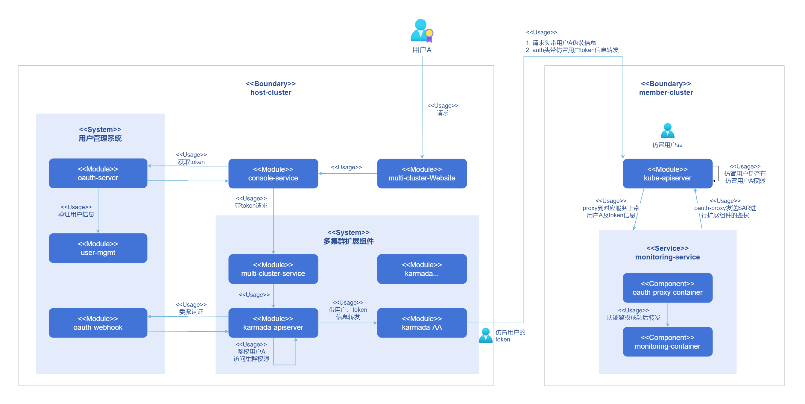
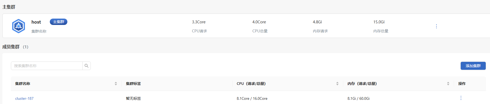
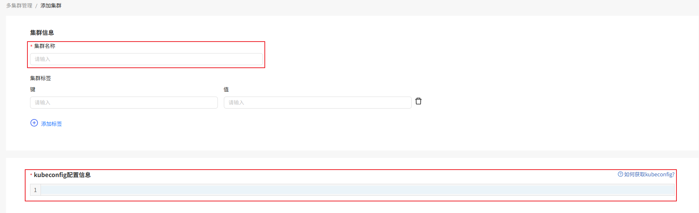

# 多集群管理

## 特性介绍

随着云原生技术的发展和普及，越来越多的企业采用Kubernetes作为其容器编排和管理平台。为满足更复杂的业务需求和提升系统的可靠性与弹性，企业面临着从单一集群到多集群环境的转变。这种转变带来了一系列的挑战，包括集群的管理、监控、安全、合规性以及跨集群资源的优化分配等。多集群管理插件的出现是对现代企业在技术和业务需求快速发展下的一种应对策略，旨在通过技术创新来解决运维复杂性、成本控制、安全性和合规性等挑战。

openFuyao多集群管理作为扩展组件旨在提供高效、灵活的Kubernetes集群跨环境管理，可以通过应用市场安装到openFuyao平台。可支持：

- 集群列表，提供集群列表界面查看和管理所有集群的状态和基本信息。
- 集群生命周期管理，简化集群的扩展和销毁过程，支持用户纳管新集群，调整现有集群的规模，更新集群配置，或安全的取消纳管不再需要的集群。
- 查看集群凭证：支持用户使用集群凭证进行集群的快速访问。
- 集群标签管理，支持用户快速编辑集群标签等操作。
- 跨集群访问，提供跨集群安全访问等功能。

### 应用场景

- 多云管理：openFuyao多集群管理提供了一个统一的平台来管理所有Kubernetes集群。
- 敏捷开发和测试：开发团队能够在隔离的多个集群环境中快速迭代和测试应用，不会影响到生产环境。

### 能力范围

- 集群纳管与解除纳管：支持在主集群上添加成员集群的kubeconfig信息来纳管成员集群，要求主集群可以直接访问成员集群的Kubernetes API服务；支持主集群将添加进入的成员集群解除纳管。
- 添加集群标签：通过为集群增加标签信息便于对集群进行管理。
- 查看集群凭证：提供被纳管集群的集群凭证，便于对集群的快速访问。
- 提供集群基本监控指标：提供每个集群的CPU和内存的使用量信息。
- 集群访问权限控制：在主集群的karmada-apiserver上进行统一的用户认证，只有被邀请到集群中的用户有权限访问该集群的容器平台。
- 使用主集群统一入口访问集群容器平台：用户可以在主集群界面借助karmada多集群管理组件访问任意一个openFuyao成员集群，其体验和直接访问成员集群开放的端口完全一致。

### 实现原理

- 集群纳管和解除纳管

纳管和解除纳管部分的逻辑由multi-cluster-service控制，multi-cluster-service会根据当前用户是否具有纳管集群权限来进行访问控制。

Multi-cluster-service会收集必要的集群信息将其注册到karmada的中心控制平面，一旦集群被纳管，成员集群会定期同步集群的状态信息，如健康状况和资源使用情况，确保karmada的中心控制平面能准确掌握各集群的实时数据。解除纳管是反向操作，multi-cluster-service会从karmada的中心控制平面删除集群的所有记录，并清理与该集群相关的配置，以确保其不再受到karmada管控面的任何管理活动。

- 集群访问链路

安装多集群扩展组件之后，用户访问集群的路由会由原本从console-service直接转发给各个服务变为由karmada-apiserver进行转发，首先转发到成员集群kube-apiserver，之后再转发给成员集群的具体服务。

**图 1** 多集群管理系统实现原理

### 与相关特性的关系

作为扩展组件部署到openFuyao系统中，在使用时需要和用户管理系统进行通信，为不同角色用户赋予操作集群的不同权限。

### 相关实例

代码链接：

- 前端：[openFuyao/multi-cluster-website (gitcode.com)](https://gitcode.com/openfuyao/multi-cluster-website)

- 后端：[openFuyao/multi-cluster-service (gitcode.com)](https://gitcode.com/openfuyao/multi-cluster-service)

## 安装

### 前提条件

多集群管理组件作为扩展组件安装至openFuyao平台，对硬件、软件以及网络要求与openFuyao平台整体安装要求一致。

### 开始安装

1. 登录openFuyao平台管理面。
2. 在openFuyao平台左侧导航栏选择“应用市场 > 应用列表”，进入“应用列表”界面。
3. 勾选左侧应用类型“扩展组件”，查看所有扩展组件。或在“搜索框”中输入“multi-cluster-service”。
4. 单击“multi-cluster-service”卡片，进入扩展组件“详情”界面。
5. 单击“部署”进入“部署”界面。
6. 输入“应用名称”、选择“安装版本”和“命名空间”。
7. 在参数配置的Values.yaml中输入要部署的values信息。
8. 单击“部署”完成安装。
9. 在左侧导航栏单击“扩展组件管理”，管理多集群扩展组件。

> **注意：**
>
> - 在集群节点重启后，可能导致karmada服务不可用，请谨慎操作节点重启。
> - 若节点重启导致karmada服务不可用，请卸载多集群组件重新安装即可。

## 查看集群列表

### 前提条件

无。

### 背景信息

无。

### 使用限制

您只能查看自己权限之内的集群信息。

### 操作步骤

1. 在openFuyao平台的上方导航栏，单击“多集群管理”，进入集群列表界面。

   **图 2** 集群列表页面

   

2. 单击“集群名称”可查看该集群的详细信息。

### 相关操作

您可以在列表页面单击操作列，选择“查看凭证”，按需查看集群凭证信息。

## 纳管集群

### 前提条件

用户具有“platform admin”角色。

### 背景信息

随着Kubernetes的广泛使用，大部分企业面临着管理多个集群的需求。将现有的Kubernetes集群纳入统一的管理平台将实现多集群的统一管理。通过纳管集群，可以简化集群的监控和管理。

### 使用限制

openFuyao平台提供的纳管集群仅支持纳管可访问网段的openFuyao集群。

### 操作步骤

1. 在“集群列表”界面，单击“添加集群”，进入“添加集群”界面。

2. 按照提示输入纳管集群的信息。标记红色*号的为必填信息。

   **图 3** 添加集群

   

3. 单击“确定”完成集群纳管。

4. 纳管的集群将出现在成员集群列表中。

## 修改集群标签

### 前提条件

用户具有“platform admin”角色。

### 背景信息

为了提供一种简单的方式来指定集群对象，通过标签（键值对）的方式，附加到集群资源上，使用户能够更加高效地管理资源。

### 使用限制

集群标签的设置需要满足[Kubernetes标签设置规范](https://kubernetes.io/zh-cn/docs/concepts/overview/working-with-objects/labels/)。

### 操作步骤

1. 在“集群列表”界面，单击操作列，选择“编辑标签”，弹出“编辑标签”窗口。
2. 按照提示键入集群标签的相关信息。
3. 单击“确定”完成集群标签修改。

### 相关操作

您可以在列表页面单击操作列，按需解除纳管。

### 后续操作

在“集群列表”界面，单击“集群名称”进入集群管理平台，默认进入集群“总览”界面。用户可以通过单击左侧导航栏进入界面，对集群进行管理操作。
