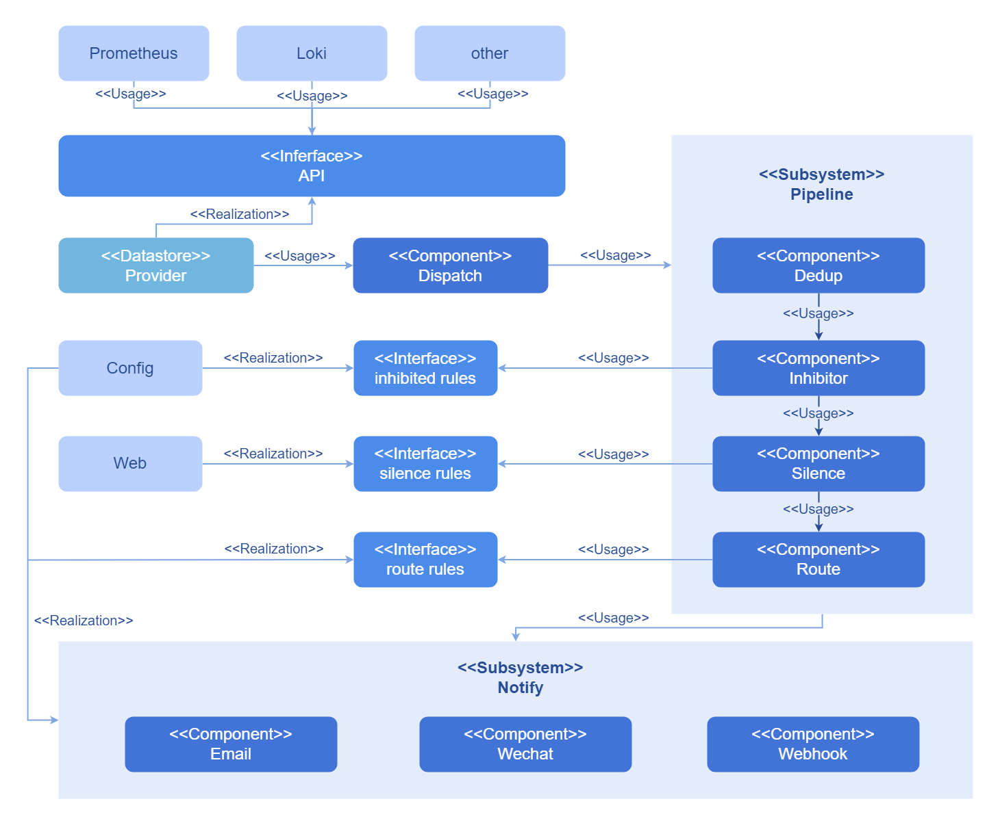
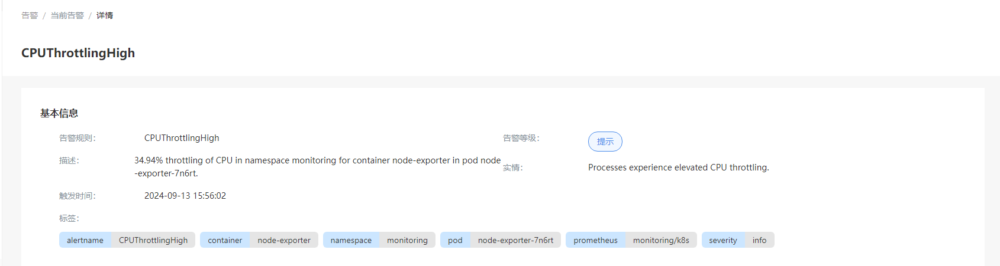
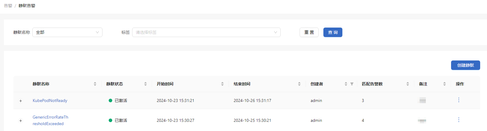

# 告警

告警系统支持对接入的告警源预设好的告警规则快速实现告警的通知，通过告警名称、告警等级、持续时间、标签对告警进行筛选，通过配置静默规则来屏蔽指定告警。

## 特性介绍

openFuyao告警系统主要负责处理和调度平台各种警报，有效降低了管理复杂度，提高了处理效率。

该告警系统具有以下功能：

- 告警查看，通过不同告警源配置的规则，将平台的告警按照告警名称，告警等级，持续时间等进行分组显示。
- 告警静默，通过配置静默规则来暂时屏蔽相关告警。
- 高可用性，支持高可用部署配置，运行多个实例来防止单点故障。
- 提供告警详情，帮助快速定位触发告警的问题。

### 应用场景

openFuyao告警系统常用于容器平台基础设施的故障管理，确保所有重要的系统警报能够被及时响应和处理，拥有多个应用场景。

- 系统性能监控：系统资源如CPU、内存、磁盘空间使用率超过预设阈值时触发告警，帮助系统运维人员及时发现并解决可能导致性能下降的问题。
- 服务健康检测：对基础设施服务等关键应用组件的可用性和响应时间进行监控。一旦服务出现异常，即刻触发警报。
- 日志记录识别：通过日志内容来识别异常模式或错误信息，从而触发告警，帮助运维人员迅速采取措施并进行修复或优化。

### 能力范围

- 告警信息实时展示：查看当前告警信息。
- 告警静默基础配置：配置告警信息静默方式。
- 告警源信息查看：查看已配置好的告警源。

### 亮点特征

- 多标签筛选：openFuyao的告警系统提供对告警多标签筛选的能力，支持从不同维度，如告警等级、告警名称、持续时间、告警源和告警标签来快速筛选告警。
- 静默功能：支持用户配置静默规则，暂时抑制告警通知。
- 高可用性：告警系统是高可用部署，运行了多个实例来避免单点故障。

### 实现原理

告警组件的运行方式由一系列pipeline组成，这些共同完成了告警系统所需要的能力。

告警系统会接收到来自各个告警源的告警信息，这些告警信息会由内部进行重新分组，以组为单位，去除重复上报的告警信息。根据所配置的告警抑制规则和告警静默规则，对满足特定条件的告警信息进行丢弃，保留剩下的告警信息。最后将这些告警按照配置好的告警路由，以不同的推送方式推送给各自对应的接收方，如[图1](#figure000123)所示。

在openFuyao平台，告警分为三类等级：严重，警告和提示，并且每类告警的数目会各自统计并展示。

**图 1** 告警系统实现原理

### 与相关特性的关系

目前集群中配置的告警源有监控组件和日志组件（选配）。通过这两个组件的协作，极大地增强了基础设施的监控和日志的管理能力，从而维护系统的稳定性和可靠性。

- 监控：持续监控关键性能指标，一旦检测到异常行为或性能指标超过设定的阈值，系统将立即发出通知。
- 日志：系统持续收集日志，一旦触发根据设定的告警规则，系统会立即发出通知将告警发送给告警组件。

## 使用当前告警

在openFuyao平台界面的左侧导航栏“观测中心”中选择“告警 > 当前告警”，进入“当前告警”界面。

- 根据“告警名称”、“告警等级”、“持续时间”、“告警源”、“标签”对当前告警进行查询。

- 单击“告警名称”进入告警“详情”界面，查看告警的基本信息。
   
   **图 2** 告警详情
   
   

### 设置静默告警

将告警信息设置为静默告警。设置后在静默持续时间内，告警信息将在静默告警显示。

#### 前提条件

仅针对该条告警设置静默规则。

#### 背景信息

针对某条告警快速设置静默规则，来抑制该条告警的通知。

#### 使用限制

无。

#### 操作步骤

1. 单击操作列图标，弹出设置静默告警窗口。

2. 输入静默开始时间、静默持续时间、备注。

3. 单击“确定”完成设置。

## 使用静默告警

在openFuyao平台界面的左侧导航栏“观测中心”中选择“告警 > 静默告警”，进入“静默告警”界面。

**图 3** 静默告警

### 创建静默告警

#### 前提条件

确保添加的标签是告警所具有的标签。

#### 背景信息

适用于管理已知问题或维护期间不希望接收到的警报，即临时停止对特定警报的通知，这非常有利于系统维护或者升级期间。

#### 使用限制

- 时间同步：静默规则的生效非常依赖于系统时间的准确同步，如果告警实例与其他系统组件的时间不同步，可能导致静默规则在不正确的时间被激活或停用。
- 静默规则管理：在大型环境中，大量的静默规则会使得管理变复杂；过时或不再相关的静默规则需要在后台定期清理。

#### 操作步骤

1. 单击“创建静默”，弹出创建静默窗口。

2. 输入静默开始时间、静默持续时间、标签、创建者和备注。

3. 单击“确定”完成静默规则配置。

#### 相关操作

- 查看已静默告警：您可以单击“静默名称”左侧的图标变为，按需查看已静默告警。单击“静默名称”可以查看基本信息和已静默告警。

- 修改删除静默告警：您也可以在列表页面单击操作列或在详情页面单击右上角的“操作”，按需修改和删除静默告警。
