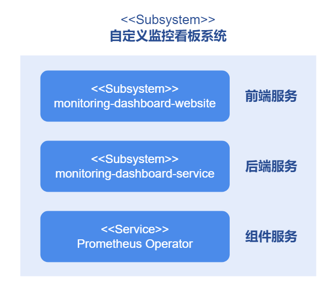
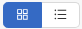
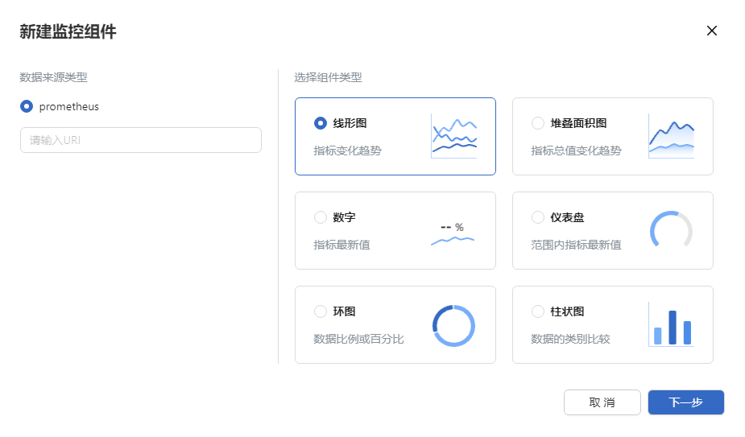
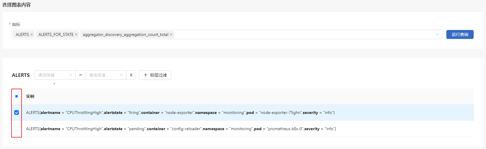

# 自定义监控看板

## 特性介绍

自定义监控看板专为满足企业对高度可定制与可扩展监控系统的需求而设计。它提供一个全面的解决方案，使用户能够监控各种性能指标，并且支持用户根据自身业务需求定制监控指标，实现精准的数据观测和分析。监控看板是监控组件的集合，支持用户根据自身需求将不同监控用途的监控组件进行组合。

### 应用场景

自定义监控看板支持用户根据自身业务需求对Kubernetes环境进行细粒度监控。用户可以自由创建包含多个监控实例的监控组件，并通过监控看板统一查看监控组件，从而聚焦业务重点。自定义监控看板的应用场景主要包括以下内容。

- 集群状态监控：自定义监控看板支持用户监控各个节点的CPU、内存、磁盘、网络等关键性能指标，帮助用户直观了解集群的健康状态和性能瓶颈。
- Pod和容器监控：自定义监控看板支持用户监控Pod和容器的内存请求率、网络请求量等关键指标，帮助用户快速确认Pod和容器状态。
- 服务监控：自定义监控看板支持用户监控Kubernetes中服务的响应时间、吞吐量、错误率等关键业务指标，帮助用户可视化查看服务的运行状况。
- 自定义监控指标：自定义监控看板可以获取并展示用户暴露给数据采集器（如Prometheus）的自定义指标，进一步满足用户个性化的监控需求。

### 能力范围

自定义监控看板为openFuyao前端管理提供监控界面以及后台能力，支持用户根据业务需求自定义监控内容。特性能力主要包括以下内容。

- 自定义数据图表：支持线形图、堆叠面积图、仪表盘、数字、直方图和环图共6种数据图表，为用户提供丰富的指标可视化选择。
- 自定义时间区间：支持看板数据自动更新，同时支持指定时间区间查询，为用户提供丰富的时间查询维度。
- 自定义监控指标：支持监控指标高效筛选，并且允许非同类指标同图展示，为用户提供更大的自定义空间，满足更加复杂的监控需求。
- 自定义监控看板：支持用户管理多个自定义监控看板，单个监控看板内监控组件自由组合，用户可以打造最适合自身业务的监控界面。

### 亮点特征

- 高度定制化：在系统管理方面，支持用户定制系统日常运维看板，协助用户快速识别系统问题；在数据分析方面，支持用户定制应用程序数据看板，助力用户优化决策。
- 高度可扩展：在系统管理方面，支持用户自由调整系统监控范围，从而快速适应业务内容变化；在数据分析方面，支持用户针对重点业务扩展监控内容，为用户增强业务洞察的深度与广度。

### 实现原理

自定义监控看板按照业务层次分为前端服务、后端服务和组件服务，各层级原理如下：

**图 1** 自定义监控看板实现原理



**前端服务**
monitoring-dashboard-website为用户提供可视化监控界面，支持用户自由组合监控组件。

**后端服务**
monitoring-dashboard-service以微服务的形式支撑监控业务，包括监控看板与监控组件的创建与管理、监控指标的筛选与查询等功能。后端服务从外部数据采集器获取原始指标数据，目前支持通过Prometheus获取集群和系统数据，并支持扩展其他数据采集器。

**组件服务**
Prometheus Operator为数据采集器，负责从系统中采集原始指标数据，并通过提供API接口等方式支持外部查询和获取数据。

### 与相关特性的关系

自定义监控看板相对独立，不依赖其他特性。

## 安装

### 前提条件

- 已部署Kubernetes v1.21及以上。
- 已部署Prometheus。

### 开始安装

#### openFuyao平台

1. 登录openFuyao管理面。
2. 左侧导航栏选择“应用市场 > 应用列表”跳转到“应用市场”界面。
3. 勾选左侧应用类型“扩展组件”，查看所有扩展组件。或通过搜索框输入“monitoring-dashboard”。
4. 单击“monitoring-dashboard”卡片，进入自定义监控看板扩展组件“详情”界面。
5. 单击“部署”。
6. 输入应用名称、版本信息和命名空间。
7. 在参数配置的Values.yaml中输入要部署的values信息。
8. 单击“确认”完成部署。

在左侧导航栏单击“扩展组件管理”，可管理已部署的自定义监控看板扩展组件。

#### 独立部署

除了openFuyao平台安装部署，本扩展组件还提供独立部署功能，有以下两种途径：

- 从openFuyao官方镜像仓库获取项目安装包
  
1. 拉取项目安装包
   
   ```
   helm pull oci://harbor.openfuyao.com/openfuyao-catalog/charts/monitoring-dashboard --version xxx
   ```

   其中`xxx`需替换为具体项目安装包版本，如`0.0.0-latest`。拉取得到的安装包为压缩包形式。

2. 解压安装包
   
   ```bash
   tar -zxvf monitoring-dashboard
   ```

3. 安装部署

   在monitoring-dashboard同级目录下执行如下命令：

   ```
   helm install --generate-name ./monitoring-dashboard
   ```

- 从openFuyao GitCode仓库获取：

1. 从仓库拉取项目

   ```
   git clone https://gitcode.com/openFuyao/monitoring-dashboard-website.git
   ```

2. 安装部署
   
   在monitoring-dashboard-website同级目录下执行如下命令：

   ```
   helm install --generate monitoring-dashboard-website/charts/monitoring-dashboard
   ```
部署完成后，同样可以在openFuyao管理面的左侧导航栏单击“扩展组件管理”，并对自定义监控看板进行操作。

## 使用自定义监控看板

在左侧导航栏“观测中心”中单击“自定义监控看板”，进入“自定义监控看板”界面。
“自定义监控看板”界面展示用户创建的所有监控看板，可进行查看监控看板、创建监控看板、修改监控看板以及删除监控看板操作。
监控看板默认以卡片形式展示，单击图标切换卡片/表格展示形式。
在监控看板上方，您可以根据筛选框选择按需查看监控数据。筛选框说明如下表。

**表 1** 筛选框说明

|筛选框|说明|
|:---|:---|
|时间范围|可选择指定时间范围的监控数据。|
|结束时间|可指定监控数据的截止时间。|
|自动刷新间隔|可指定监控数据的刷新时间间隔，监控数据会在指定时间间隔后自动刷新。|
||手动刷新监控数据。|

### 创建监控看板

#### 前提条件

登录用户具有“platform admin”或“cluster admin”角色。

#### 背景信息

创建监控看板功能支持用户从业务等宏观角度出发创建监控看板，创建后监控看板会被持久化存储。

#### 使用限制

无。

#### 操作步骤

1. 在“自定义监控看板”界面，单击“创建监控看板”，弹出“创建监控看板”窗口。

2. 在“监控看板名称”输入框中输入“监控看板名称”。
  
3. 单击“确定”完成创建。

#### 相关操作

您可以在列表页面单击操作列或在详情页面单击右上角的“操作”，按需修改和删除监控看板。

## 使用监控组件

- 每个监控看板可以同时存在多个监控组件，以满足用户多样化自由监控的需求。

- 每个监控组件以图例的形式支持用户监控最多8个监控实例（“堆叠面积图”类型监控组件最多支持3个监控实例）。监控实例是Kubernetes上可被监控的最小颗粒对象，每个监控实例由键值对组合Metric唯一标识。

### 查看监控组件

#### 前提条件

登录用户至少具有“platform viewer”角色。

#### 背景信息

查看监控组件功能支持用户在监控看板内查看监控组件。

#### 使用限制

- 监控组件的存在依赖于监控看板，因此只能在监控看板内才可查看监控组件，不支持对监控组件单独进行查看。
- 监控组件内的监控实例可能失效，失效后的监控实例将不会在监控组件上显示。

#### 注意事项

用户查看监控指标信息时可能会存在客户端与服务端的时间差，会导致监控指标查询结果不准确。

- 若服务端时间慢于客户端，则用户查询结果向未来偏移，无法获取数据的时间戳，在页面上显示数据为0。
- 若服务端时间快于客户端，则用户查询结果向过去偏移。

#### 操作步骤

在“监控看板”界面可以查看当前监控看板拥有的所有监控组件。监控组件以卡片形式展示，每个监控组件包括监控组件名称和图表。

### 创建监控组件

#### 前提条件

登录用户具有“platform admin”或“cluster admin”角色。

#### 背景信息

创建监控组件功能支持用户根据需求组合监控指标，创建后监控组件及其包含的监控指标都会被持久化存储。

#### 使用限制

- 创建监控组件前已创建好监控看板，当删除监控组件时，监控看板不受影响，但是当删除监控看板时，在监控看板上创建的监控组件也会被删除。
- 创建监控组件时需要填写有效的数据采集器URL，目前仅支持Prometheus Operator作为数据采集器。
- 创建监控组件时每个监控组件最多只能选取8个监控实例，当图标类型为堆叠面积图时最多只能选取3个监控实例。

#### 操作步骤

1. 在“xx监控看板”详情界面单击“新建监控组件”，弹出“新建监控组件”窗口。

   **图 2** 新建组件

   

2. “新建监控组件”窗口中，输入组件基本信息。

    2.1 单击“数据来源类型”选择器选择数据来源的类型，并在“请输入URL”输入框中输入数据来源的资源请求路径。

    2.2 选择用于展示数据的图表类型。

    2.3 单击“下一步”，进入“添加监控组件”界面。

3. 进入“添加监控组件”界面，在“组件名称”输入框中输入监控组件的名称。

4. 单击“指标”下拉框，选择需要监控的指标（支持字符串模糊匹配指标选项）。选择指标后，下方会出现指标卡片。

   >  **说明：**<br /> 支持同时选择最多8个指标（“堆叠面积图”类型监控组件最多支持3个监控指标）。被选中的指标会在“指标”下拉框下方以卡片的形式展示。

5. 每个指标卡片会显示自身包含的所有监控实例，选择需要监控的监控实例。
   
    5.1 指标卡片支持筛选监控实例。单击“请选择键”下拉框展示当前指标包含的所有“键”信息。选择目标“键”后指标卡片将显示包含目标“键”的监控实例（支持字符串模糊匹配键选项）。

    5.2 单击“请选择值”下拉框展示目标“键”包含的所有“值”，选择目标“值”后指标卡片将显示“键”等于“值”的监控实例（支持字符串模糊匹配值选项）。

    5.3 支持多个标签过滤，单击“+标签过滤”，增加过滤条件。

    5.4 单击监控实例左侧复选框选中需要监控的监控实例，支持同时选中最多8个实例（“堆叠面积图”类型监控组件最多支持3个监控实例）。

   **图 3** 新建组件实例

   

6. 界面顶部选择查询的时间范围。

7. 单击“运行查询”，界面上方会显示当前所选监控实例的图表预览。

8. 单击“创建”完成组件创建。

#### 相关操作

您可以在列表页面单击操作列，按需修改和删除监控组件。
