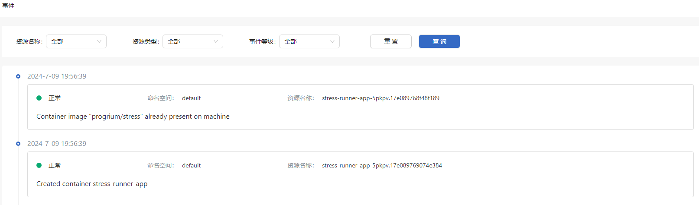

# 事件

## 特性介绍

事件（Event）会反映Pod、Deployment、StatefulSet等Kubernetes原生资源发生的变化。

### 应用场景

查询资源的事件信息。

### 能力范围

openFuyao平台记录了资源各种运行状态变化的事件，并且提供了查询和可视化能力，当集群、节点、Pod等资源出现异常情况时，可通过事件分析具体原因。

### 亮点特征

实时生成资源状态变化的事件，并且可以通过`kubectl get events`或其他工具进行查看和分析。

### 实现原理

当Kubernetes集群中资源对象的状态发生变化时，控制器（如kube-scheduler、kubelet）会生成事件，并通过API服务器存储到etcd。

### 与相关特性的关系

与Prometheus等监控系统集成，可以通过kube-state-metrics来暴露事件的状态和频率，从而实现集群的状态监控和告警。

## 查看事件

### 前提条件

访问权限：用户需要具备get和list权限查看Kubernetes中的事件（Event）资源。通常可以通过RBAC授权实现这些权限。

kubectl配置：确保kubectl已正确配置并能够连接到目标集群。

### 背景信息

事件是Kubernetes中用于记录集群中资源状态变化的日志信息。事件可以帮助用户理解集群中资源（如Pod、节点等）的状态变更、错误信息和调度情况。事件在调试和排查问题时，可以快速定位资源的创建、调度、运行中发生的异常等。

### 使用限制

- 非持久化存储：事件数据存储在etcd中，但并非设计用于持久化。对于重要事件或长时间的日志记录需求，建议将事件导出到日志管理系统。

- 命名空间隔离：事件是命名空间级别的资源，用户只能查看他们有权限的命名空间中的事件。跨命名空间的事件需要额外的权限配置。

### 操作步骤

左侧导航栏“观测中心”中单击“事件”，进入“事件”界面。

在“事件”界面可查看Pod、Deployment、StatefulSet等Kubernetes原生资源的事件信息，支持根据“资源名称”、“资源类型”、“事件等级”进行事件查询。

**图 1** 查看事件

