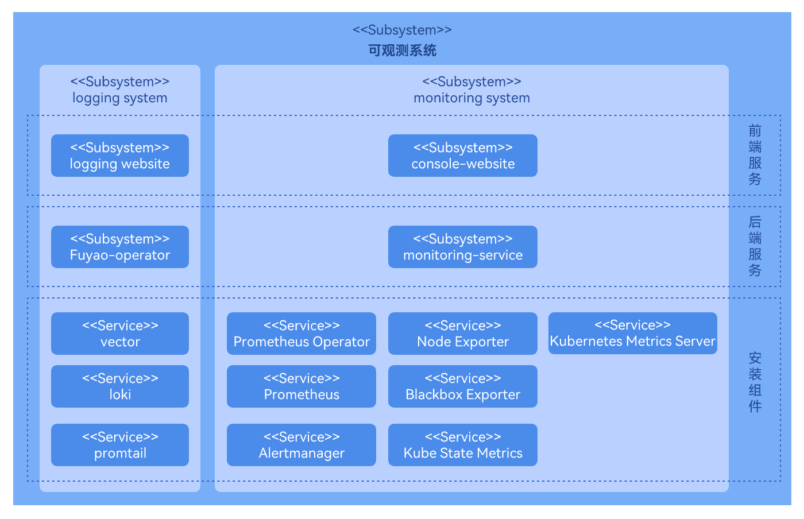
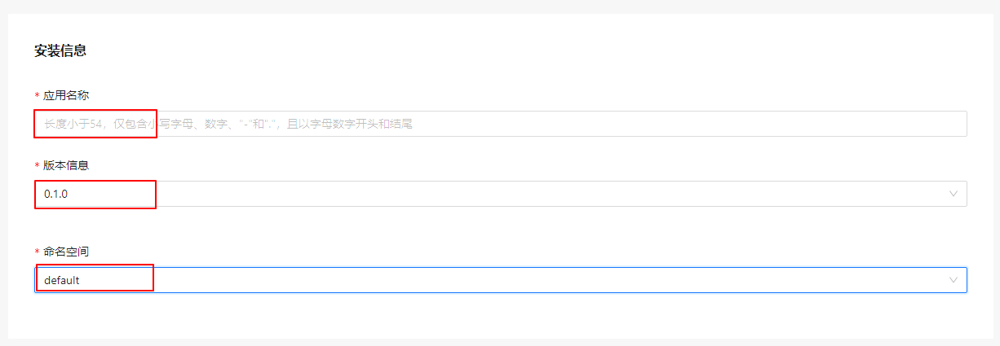
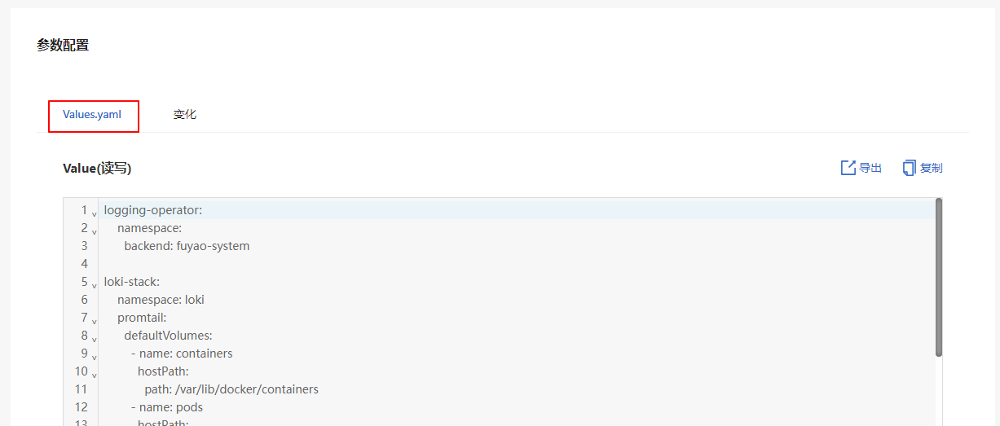
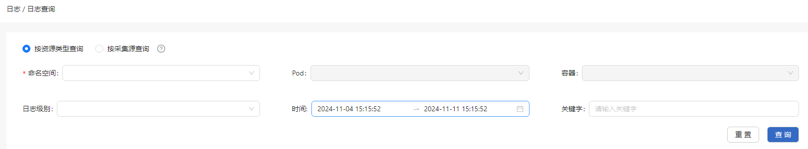
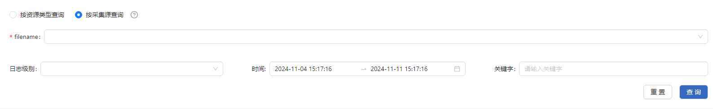
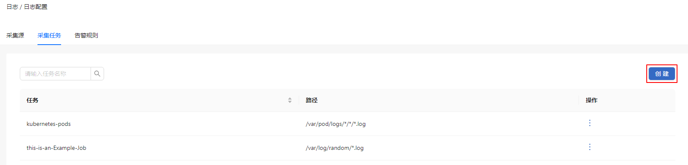
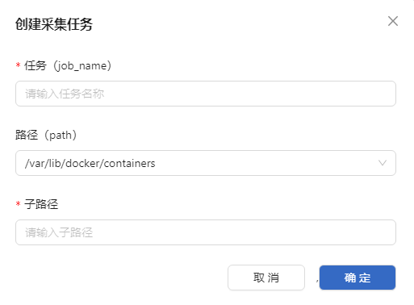
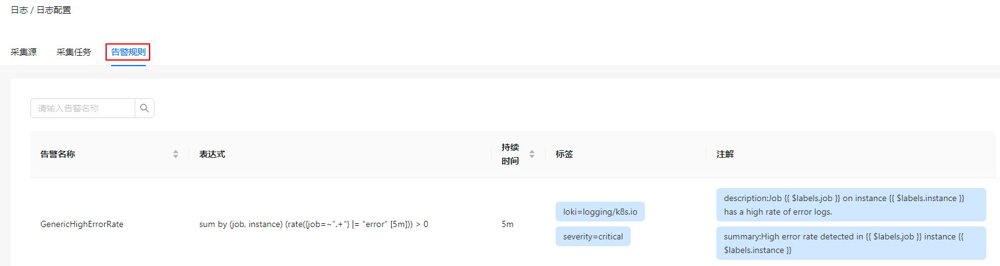

# 日志

## 特性介绍

日志作为扩展组件可通过应用市场安装到openFuyao平台。可查看Pod、容器的日志信息，并且支持配置日志的采集源、采集任务及告警规则。openFuyao日志系统能够有效提升平台识别错误的效率，增强整个平台的监控能力。

### 应用场景

openFuyao日志系统常用于容器平台基础设施的日志管理，运维人员可以通过日志系统查询、分析以及快速定位问题，具有以下应用场景。

- 查询故障应用，因素追溯：当容器平台中有某个应用或服务出现报错时，可以通过查询其出错时间以及具体容器名称来定位到具体的错误日志片段，从而帮助运维人员快速的定位到具体的错误根源并及时修复。
- 自定义应用的日志查询与筛选：当用户创建的应用不是Kubernetes原生应用时，通过命令行指令较难获取到这部分的日志。
可以通过自定义日志采集源路径实现这一需求。日志系统会自动采集用户添加的自定义路径。
- 日志记录识别：通过对日志内容来识别异常模式或错误信息，从而触发告警，帮助运维人员迅速采取措施并进行修复或优化。

### 能力范围

- 查看日志：用户可以根据命名空间，容器名，日志采集路径等基本筛选信息查看对应的日志。

- 日志告警：当集群中的日志触发日志告警规则的条件时，日志系统会将对应的告警信息发送到告警组件。

- 高可用性：支持高可用部署配置，运行多个实例来防止单点故障。

- 支持自定义日志采集源：用户可以添加或删除日志采集源，增加日志以及平台的适配性和灵活性。

- 自定义查询区间与关键字筛选：用户可以迅速查询到期望的筛选结果，包括但不限于关键字搜索，时间区间限制，日志等级分类等。

### 亮点特征

**高效的日志收集和管理能力**

  支持用户根据自定义的筛选条件对各种服务和容器进行实时日志数据收集和查询。自定义的筛选条件包括但不限于命名空间、服务名称、容器名称、关键字、筛选时间、日志采集路径文件名称以及日志类型级别等。用户可以自行组合多种条件实现精准的查询能力。

**精准的日志定位能力**

  支持用户在选定某个确定的日志源后（例如具体的容器，具体的日志路径等），精准定位一段细粒度时间跨度的所有日志。提供通过自定义时间查询上下文日志功能，使用户在定位到某个关键日志后，可以根据自身需求查询上下文日志。

**多元的日志采集能力**

  支持用户设置日志采集路径从而实现对用户自定义应用所产生的日志进行采集。在不更改默认配置的情况下新增日志采集源。用户可以自定义日志采集工作，允许日志采集组件在用户指定的路径进行日志采集，并可以通过具体的“路径+文件名称”的方式在查询界面感知到该应用的日志。

**敏感的日志告警能力**

  支持用户安装日志组件时，创建日志告警规则，并提供日志告警规则模板以及预置的日志告警规则。在系统采集的日志触发该告警规则后将告警发送给告警组件，实现日志监控+告警+定位的一站式故障检测系统。

**日志导出/下载能力**

  支持用户在日志组件中导出用户想要保存的日志内容。当前版本支持用户在进行一系列筛选操作后导出筛选结果的日志，支持用户通过日志详情界面时间筛选得到单个容器的详情日志。

### 实现原理

日志组件作为openFuyao的生态扩展组件由三部分组成：日志后端层，日志UI层，开源软件层。

**日志后端层**

  logging-operator后端以微服务的形式部署在集群中。后端组件提供日志的查询筛选接口、日志采集源的查询接口、日志告警规则的查询接口、日志采集工作的增删改查接口、日志详情上下文的查询接口等，为日志扩展组件提供核心能力。

  logging-operator的后端处理逻辑是接收到前台的调用请求后，根据具体的请求内容创建Loki组件使用的查询语句LogQL，并且将这个LogQL拼接成调用Loki http接口的查询请求，从而获得Loki中的查询和筛选结果。之后再根据具体的返回逻辑进行拼接等操作，并最终返回给原调用接口。采集源的配置功能是通过调用K8s的client-go接口来对K8s集群资源进行增删改查等操作。

**日志UI层**

  日志的前端UI组件作为一个具有扩展性的可插拔组件独立部署在openFuyao平台中。UI界面在openFuyao平台中进行安装部署之后，日志部分的界面会自动集成在console-website的侧边工具导航栏中。用户可以直接通过平台管理面界面的左树菜单导航栏选择进行日志组件的使用。当集群中没有安装openFuyao平台时，日志UI也可以和日志后端，日志开源软件集成部署为独立日志应用，这种情况下日志UI层是一个独立的界面。

**日志开源软件层**

  日志的开源软件主要为日志系统提供底层的支撑能力，主要由日志采集组件（promtail）和日志存储组件（Loki）组成。日志采集组件以DaemonSet的方式部署在每一个节点上，根据采集规则将采集源中的日志发送到日志存储组件。日志存储组件Loki接收到http接口后，在日志数据库中执行查询语句并给出查询结果。

**图 1** 日志扩展组件实现原理

 

### 与相关特性的关系

告警：告警系统通过配置不同的告警源（Prometheus、Loki等）和相关的告警规则，实现告警的通知。

## 安装

### openFuyao平台

1. 登录openFuyao平台，默认进入“总览”界面。在左侧导航栏选择“应用市场 > 应用列表”，进入“应用列表”界面。
2. 在左侧的“类型”下面选中“扩展组件”。
3. 单击应用名称为“logging-package”的应用卡片，进入该应用的详情页。
4. 在详情页中单击右上角的“部署”。
5. 在部署界面的“安装信息”模块中输入“应用名称”，“版本信息”和“命名空间”。其中命名空间指定在default即可。 
   
   **图 2** 安装信息
   
   

6. 在“参数配置”模块中，Values.yaml的预览界面中可以看到具体的每一个用户可配字段的配置。 
    
    **图 3** Yaml配置
   
   

7. 单击“确认”，即可成功部署该组件。

### 独立部署

1. 安装

   1.1 获取logging-package Helm包。
    ```
    wget https://harbor.openfuyao.com/chartrepo/openfuyao-catalog/charts/logging-package-0.13.0.tgz
    ```
   1.2 在参数配置的“values.yaml”中输入要部署的values信息。

   1.3 使用Helm部署。
   ```
   tar -zxf logging-package-0.13.0.tgz
   helm install logging -n default ./logging-package
   ```
   1.4 验证安装成功与访问。
   - 确认logging package已经成功部署。
     ```
     kubectl get pods -n default
     kubectl get pods -n openfuyao-system
     kubectl get pods -n loki
     ```

   - 确认服务已经暴露。
     ```
     kubectl get svc -n default | grep logging
     ```

   - 访问logging-website界面。
     ```
     http://<Node_IP>:<logging.service.nodePort>
     ```

2. 配置被采集日志从创建到现在时长限制与日志存储更新时间策略。
   - reject_old_samples_max_age: 该字段指日志采集器支持的日志最大时间跨度为168小时（默认配置），即从日志创建到当前时间的最长时长。当选择默认配置时，代表一个容器的日志创建超过7天之后，该日志就不会被采集组件采集到。

   - retention_deletes_enabled: 该字段指是否开启日志自动删除老数据的功能，默认配置为false。当选择默认配置时，代表被采集到的日志会永久保存，并不会进行自动删除旧日志的策略。

   - retention_period: 该字段指只有当retention_deletes_enabled开启的状态下才会生效，该配置定义了被采集日志在存储中储存超过一定时间单位后会被清除掉。

   ```yaml
   loki-stack:
     loki:
       config:
         limits_config:
           reject_old_samples_max_age: 168h
         table_manager:
           retention_deletes_enabled: false
           retention_period: 0s
   ```

3. 配置日志的采集源配置。

   该项配置定义了日志采集源的详细配置，明确了采集器工作的根目录路径。用户在配置时需要同时配置defaultVolumes和defaultVolumeMounts，要确定这两个值中的path和mountpath一致，填写的采集源路径是一个可读路径，如果路径不可读则会使该配置不生效。
   >  **说明：**<br />采集源配置生效后，不可更改。

   需要配置的内容如下:

   ```yaml
   loki-stack:
     namespace: loki
     promtail:
       defaultVolumes:
         - name: containers
           hostPath:
             path: /var/lib/docker/containers
         - name: pods
           hostPath:
             path: /var/log/pods
         - name: random
           hostPath:
             path: /var/log/random

       defaultVolumeMounts:
         - name: containers
           mountPath: /var/lib/docker/containers
           readOnly: true
         - name: pods
           mountPath: /var/log/pods
           readOnly: true
         - name: random
           mountPath: /var/log/random
           readOnly: true
   ```

   如下介绍一个案例，该案例展示了添加一个新的名为new_example采集源的信息，删除了已有的采集源random:

   ```yaml
   loki-stack:
     namespace: loki
     promtail:
       defaultVolumes:
         - name: containers
           hostPath:
             path: /var/lib/docker/containers
         - name: pods
           hostPath:
             path: /var/log/pods
         - name: new_example
           hostPath:
             path: /var/tem/my-application

       defaultVolumeMounts:
         - name: containers
           mountPath: /var/lib/docker/containers
           readOnly: true
         - name: pods
           mountPath: /var/log/pods
           readOnly: true
         - name: new_example
           mountPath: /var/tem/my-application
           readOnly: true
   ```

4. 配置日志告警的自定义告警触发规则。

   配置日志告警规则时，要按照案例中的格式配置即可生效。如果配置格式不正确则无法被组件正常感知，在日志配置界面中将无法看到未生效的告警规则。如需创建新的告警规则，需要完整地配置alerting_groups的一个子项，创建告警详情时请遵循下列的缩进结构，具体配置项包括:

- name: 告警规则的名称。
- rules: 具体告警规则详情。
   - alerts: 规则名称，与name保持一致。
   - expr: 告警规则表达式，如果无效则该配置不生效。告警规则表达式配置规范请参见[告警规则表达式官方配置说明](https://prometheus.io/docs/prometheus/latest/configuration/alerting_rules/)。
   - for: 告警持续时间。
   - labels: 告警规则的标签，以key:value的形式出现在该项中。
   - annotations: 告警规则的注解，以key:value的形式出现，value需要以字符串的形式出现。

   ```yaml
   loki-stack:
     loki:
       alerting_groups:
         - name: GenericHighErrorRate
           rules:
             - alert: GenericHighErrorRate
               expr: |
                 sum by (job, instance) (rate({job=~".+"} |= "error" [5m])) > 0
               for: 5m
               labels:
                 severity: critical
                 loki: logging/k8s.io
               annotations:
                 summary: "High error rate detected in {{ $labels.job }} instance {{ $labels.instance }}"
                 description: "Job {{ $labels.job }} on instance {{ $labels.instance }} has a high rate of error logs."

         - name: GenericExceptionDetected
           rules:
             - alert: GenericExceptionDetected
               expr: |
                 sum by (job, instance) (rate({job=~".+"} |= "Exception" [5m])) > 0
               for: 5m
               labels:
                 severity: warning
                 loki: logging/k8s.io
               annotations:
                 summary: "Exception detected in {{ $labels.job }} instance {{ $labels.instance }}"
                 description: "Job {{ $labels.job }} on instance {{ $labels.instance }} has logs containing 'Exception'."

         - name: GenericLogVolumeSpike
           rules:
             - alert: GenericLogVolumeSpike
               expr: |
                 sum by (job, instance) (rate({job=~".+"}[5m])) > 1
               for: 5m
               labels:
                 severity: warning
                 loki: logging/k8s.io
               annotations:
                 summary: "Log volume spike detected in {{ $labels.job }} instance {{ $labels.instance }}"
                 description: "Job {{ $labels.job }} on instance {{ $labels.instance }} has a spike in log volume."

         - name: GenericErrorRateThresholdExceeded
           rules:
          - alert: GenericErrorRateThresholdExceeded
            expr: |
              (sum by (job, instance) (rate({job=~".+"} |= "error" [5m])) / sum by (job, instance) (rate({job=~".+"}[5m]))) > 0.05
               for: 5m
               labels:
                 severity: critical
                 loki: logging/k8s.io
               annotations:
                 summary: "High error rate threshold exceeded in {{ $labels.job }} instance {{ $labels.instance }}"
                 description: "Job {{ $labels.job }} on instance {{ $labels.instance }} has an error rate exceeding the threshold."
         - name: GenericServiceUnavailable
           rules:
             - alert: GenericServiceUnavailable
               expr: |
                 sum by (job, instance) (rate({job=~".+"} |= "service unavailable" [5m])) > 0
               for: 5m
               labels:
                 severity: critical
                 loki: logging/k8s.io
               annotations:
                 summary: "Service unavailable detected in {{ $labels.job }} instance {{ $labels.instance }}"
                 description: "Job {{ $labels.job }} on instance {{ $labels.instance }} has logs indicating 'service unavailable'."
         - name: GenericApplicationStartupFailure
           rules:
             - alert: GenericApplicationStartupFailure
               expr: |
                 sum by (job, instance) (rate({job=~".+"} |= "startup failure" [5m])) > 0
               for: 5m
               labels:
                 severity: critical
                 loki: logging/k8s.io
               annotations:
                 summary: "Application startup failure detected in {{ $labels.job }} instance {{ $labels.instance }}"
                 description: "Job {{ $labels.job }} on instance {{ $labels.instance }} has logs indicating 'startup failure'."
   ```   

5. 如何配置你的应用。

   5.1 Kubernetes原生应用。

   Kubernetes的原生应用在打印日志时，对于containerd的容器运行时环境，会把日志打印到默认路径下：`/var/log/pods/{namespace}_{pod_name}_{pod_id}/{container_name}/0.log`。这种情况用户无需对日志打印的设置有任何修改。日志采集系统会自动捕捉到这个路径下的日志，并保存到日志存储组件中。

   5.2 用户自定义应用。

   用户自定义的应用会在其容器内部打印日志，并有一个日志打印的详细路径。用户需要将该容器内路径映射到宿主机内的hostPath中，这个hostPath就代表着用户自定的应用打印日志的位置。将这个hostPath按照步骤三的配置日志的采集源配置中配置，实现对该路径进行采集。安装部署完成后，在采集工作的配置中详细配置该路径下的文件名和应用任务名称即可。

      ```
       volumeMounts:
       - name: log-volume
         mountPath: /var/log
       volumes:
       - name: log-volume
        hostPath:
          path: /var/log/xxxx/xxxx
      ```

## 使用日志查询

### 前提条件

已部署并配置好Loki和Loki-Promtail，确保日志采集与存储服务正常运行。

### 背景信息

日志查询系统可以帮助用户快速定位问题、监控系统运行状态以及进行故障排查。通过标签、关键字、时间范围等条件的过滤，能够从大量日志数据中筛选出需要的内容，以便加快问题的定位和分析。

### 使用限制

日志查询系统可能对查询复杂度和数据量有一定的限制，防止系统资源被过度占用。频繁或复杂查询可能会被限制。

### 操作步骤

1. 在openFuyao平台左侧导航栏“观测中心”中选择“日志 > 日志查询”，进入“日志查询”界面。
   
   **图 3** 日志查询

   

2. 按资源类型查询

   > **说明：**<br />日志组件中的Loki组件有并发数限制，避免过高并发调用查询接口。

   2.1 在“日志查询”界面，选择“按资源类型查询”。可根据“命名空间”（必选项）、“Pod”、“容器”进行查询。

   2.2 单击“日志级别”下拉框，可选择日志级别，分为error、warning、info、debug、critical。

   2.3 单击“时间”选择器，可选择时间范围。

   2.4 单击“关键字”输入框，可输入关键字进行模糊查询。

   2.5 单击“查询”，查询指定类型资源的日志。

3. 按采集源查询
 
   3.1 在“日志查询”界面，选择“按采集源查询”。输入“filename”（必选项）进行查询。
      
      **图 3** 按采集源查询

      
      
   3.2 单击“日志级别”选择器，可选择日志级别，分为error、warning、info、debug、critical。

   3.3 单击“时间”选择器，可选择时间范围。

   3.4 单击“关键字”输入框，可输入关键字进行模糊查询。

   3.5 单击“查询”，查询指定类型资源的日志。

## 使用日志配置

在openFuyao平台界面的左侧导航栏“观测中心”中选择“日志 > 日志配置”，进入“日志配置”界面，可选择不同的标签页选择查看日志的“采集源”、“采集任务”以及“告警规则”信息。

### 创建采集任务

#### 前提条件

- 已部署并配置好Loki和Loki-Promtail，并且日志采集与存储服务正常进行。
- 宿主机上已创建待采集的日志目录，并且具有读取权限。

#### 背景信息

采集任务通过Loki-Promtail实现日志的收集和推送至Loki，从而实现对日志的实时监控与存储分析，创建采集任务后，可对不同路径的日志文件进行监控，支持后续的查询和报警。

#### 使用限制

- 采集路径应明确具体文件或目录，以避免采集大量无关文件影响系统性能。
- 大规模采集任务可能会消耗较多的资源，建议合理分配采集任务的优先级和频率。

#### 操作步骤

1. 在“采集任务”标签页单击“创建”，弹出创建采集任务窗口。

   **图 4** 创建

   

2. 输入采集任务命名。

3. 选择采集源路径，输入路径。
  
   **图 5** 创建采集任务

   

4. 单击“确定”完成创建。

#### 相关操作

您可以在列表页面单击操作列，按需修改和删除采集任务。

#### 后续操作

在“告警规则”标签页查看告警规则的详细信息。

**图 6** 告警规则


