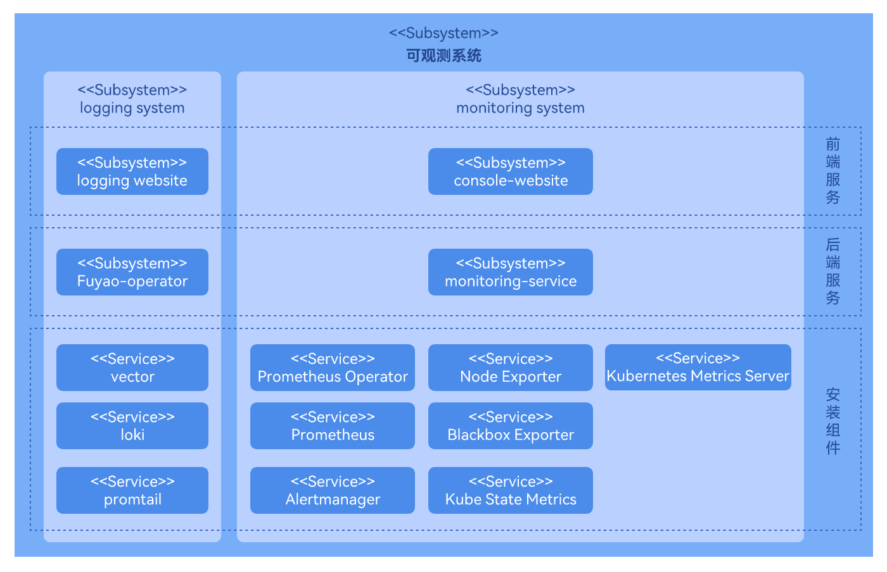
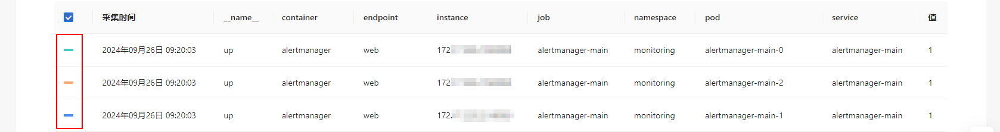
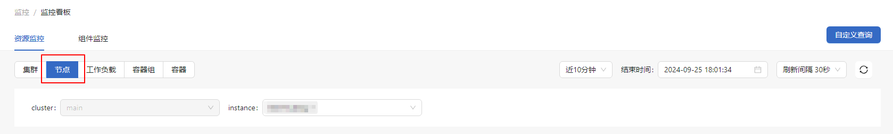
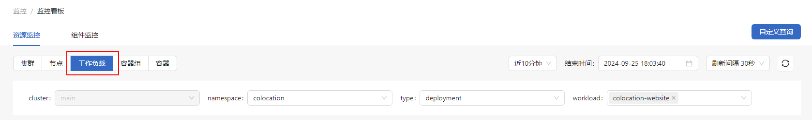
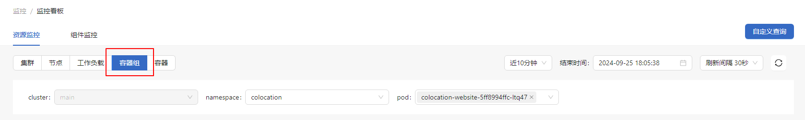
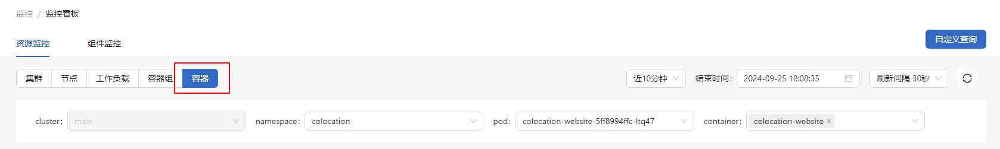
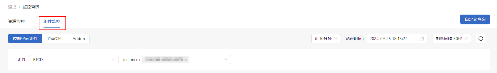
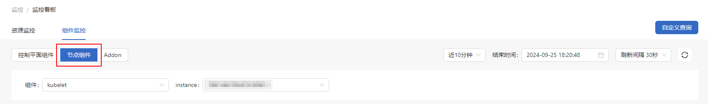
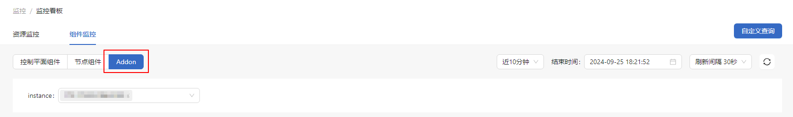

# 监控

## 特性介绍

openFuyao配置了Prometheus作为默认的监控组件，支持对不同组件、资源进行实时监控，并且支持查看监控目标及告警规则。

### 应用场景

openFuyao监控系统应用于容器平台管理，提升系统的稳定性和性能。典型应用场景包括以下内容。

- 资源监控与容量管理：实时跟踪集群及节点的CPU、内存等资源使用情况，预防资源瓶颈，支持容量规划与优化。
- 服务健康监控：监控关键服务或应用组件的可用性和响应时间，及时发现异常并进行修复。
- 性能调优：通过自定义查询深入分析资源使用情况，识别性能瓶颈并优化配置。
- 定制化监控目标：灵活配置监控目标，确保不同场景下重要资源的状态能够被持续监控和分析。
- 故障排查与报警：通过监控指标和告警配置，快速发现系统异常或潜在故障，及时响应并降低异常退出风险。

### 能力范围

openFuyao监控系统提供多层资源监控，支持灵活查询、监控目标配置与告警配置，实时掌握系统运行状态。主要包括以下内容。

- 实时监控：直观展示各类资源的实时状态，包括CPU、内存、磁盘、网络等多项指标。
- 自定义查询：支持PromQL查询，可基于特定需求进行深度查询分析，帮助识别和定位性能瓶颈或异常情况。
- 灵活配置：提供监控时间范围、刷新频率等配置选项，满足多样化需求。
- 监控目标配置：通过ServiceMonitor资源灵活配置监控目标，确保对集群服务、应用服务、控制平面组件等所需监控的资源进行全面覆盖。
- 告警配置：支持灵活的告警规则配置，允许自定义触发条件，快速接收系统异常的告警通知。

### 实现原理

监控系统按照业务层次分为UI层、后端层、组件层。

- UI层

    - 用户可以在console-website上进行监控操作。

- 后端层

    - monitoring-service以微服务的形式部署提供一些核心能力，包括指标查询、监控目标配置和告警规则配置。
    - monitoring-service内置关键指标的预定义PromQL查询语句。前台向后台发送请求时，会传递需要查询的指标名称以及其他相关参数。后台接收到请求后，先根据提供的指标名称，选择相应的预定义PromQL查询语句。再根据传递的参数，对所选查询语句进行整合。最后使用Prometheus原生API进行数据查询。

    内置关键指标的预定义PromQL查询语句的原因是，原生数据无法满足我们的需求，需要通过额外的处理或者转换来得到所需的内容。这可能涉及到过滤、聚合等操作，预定义的PromQL查询接口可以提供这些额外的处理。

- 组件层

    - 组件层主要为监控层提供关键数据的支持。监控不同的目标，收集关于整个集群系统的各种度量指标，以便于后续的查询，分析和告警。

**图 1** 监控系统实现原理

### 与相关特性的关系

告警：告警系统通过配置不同的告警源（Prometheus、Loki等）和相关的告警规则，实现告警的通知。

## 使用监控看板

在openFuyao平台界面的左侧导航栏“观测中心”中选择“监控 > 监控看板”，进入“监控看板”界面。在监控看板上方，您可以根据筛选框的选择按需查看监控数据。筛选框说明如[表1](#table123456)。

**表 1** 筛选框说明 

|筛选框|说明|
|:---|:---|
|时间范围|可选择指定时间范围的监控数据。|
|结束时间|可指定监控数据的截止时间。|
|自动刷新间隔|可指定监控数据的刷新时间间隔，监控数据会在指定时间间隔后自动刷新。|
||手动刷新监控数据。|

### 自定义查询

#### 前提条件

- 具备基本的Prometheus表达式查询知识，以便编写正确的查询语句。
- 安装并正确配置监控组件，监控数据正常采集和更新。

#### 背景信息

openFuyao监控系统提供自定义查询功能，允许用户基于特定需求深入分析监控数据。通过输入Prometheus查询表达式，可以自定义监控视图，更加精准地获取指标数据并进行分析。

#### 使用限制

- 查询表达式的复杂度可能影响系统性能，建议避免不必要的长时间或高频率查询。
- 监控图表刷新频率过高可能会导致系统资源消耗增加，建议适当调整刷新频率。

#### 操作步骤

1. 单击“自定义查询”，进入“自定义查询”界面。

2. 在输入框中输入Prometheus表达式。

3. 单击“查询”，查看相关监控信息图。

4. 单击图例，可控制数据是否在监控图中展示。

   **图 2** 自定义查询数据
   

5. 单击“添加查询”，可添加多条查询语句查看监控信息图。
 
### 查看集群资源监控

#### 前提条件

安装并正确配置监控组件，监控数据正常采集和更新。

#### 背景信息

openFuyao监控系统提供内置的监控看板，覆盖了Kubernetes核心组件、集群、节点、工作负载、容器组和容器。每个层级的监控数据都被实时采集和展示，帮助用户深入了解集群健康状况、资源消耗和性能表现。

#### 使用限制

监控图表刷新频率过高可能会导致系统资源消耗增加，建议适当调整刷新频率。

#### 操作步骤

 在“资源监控”标签页，单击分段控制器选择“集群”的监控信息。

 监控看板显示所选集群的信息，包括集群节点统计、CPU、内存、包速率、丢包率等。

### 查看节点资源监控

 在“资源监控”标签页，单击分段控制器选择“节点”的监控信息。

- 支持“instance”选择。

- 监控看板显示所选节点的信息，包括集群CPU、内存、磁盘等。
   
**图 3** 节点资源监控

### 查看工作负载资源监控

在“资源监控”标签页，单击分段控制器选择“工作负载”的监控信息。

- 支持“namespace”、“type”、“workload”选择。

- 监控看板显示所选工作负载的信息，包括CPU、内存、包速率、丢包率等。
  
**图 4** 工作负载资源监控

### 查看容器组监控

 在“资源监控”标签页，单击分段控制器选择“容器组”的监控信息。

- 支持“namespace”、“pod”选择。
- 监控看板显示所选容器组的信息，包括CPU、内存、包速率、丢包率、存储读写等。

**图 5** 容器组监控

### 查看容器监控

在“资源监控”标签页，单击分段控制器选择“容器”的监控信息。

- 支持“namespace”、“Pod”、“container”选择。
- 监控看板显示所选容器的信息，包括CPU、内存、包速率、丢包率、存储读写等。
  
**图 6** 容器监控

### 查看控制平面组件监控

在“组件监控”标签页，单击分段控制器选择“控制平面组件”的监控信息。

- “组件”选择器选择查看的组件。
- “etcd”组件，支持“instance”选择。监控看板显示所选实例的信息包括etcd leader状态、存活状态、资源分析、磁盘大小等。
- “kube-apiserver”组件，支持“resource”、“verb”选择。监控看板显示所选实例的信息包括QPS&时延、资源分析等。
- “kube-scheduler”组件，支持“instance”选择。监控看板显示所选实例的信息包括概览、Kube API请求QPS、资源分析等。
- “kube-controller-manager”组件，支持“instance”选择。监控看板显示所选实例的信息包括Kube API请求QPS、资源分析等。

**图 7** 控制平面组件监控

### 查看节点组件监控

 在“组件监控”标签页，单击分段控制器选择“节点组件”的监控信息。

- “kubelet”组件，支持“instance”选择。监控看板显示所选实例的信息包括kubelet_storage_operation、kubelet_pleg_relist_interval、资源分析等。
- “kube-proxy”组件，支持“instance”选择。监控看板显示所选实例的信息包括network_programming_rate、kube_proxy_kube_api_request_rate、资源分析等。

**图 8** 节点组件监控

### 查看Addon组件监控

在“组件监控”标签页，单击分段控制器选择“Addon组件”的监控信息。

支持“instance”选择。监控看板显示所选实例的信息包括Requests、Response、coredns_cache。

**图 9** Addon组件监控

## 使用监控目标

在openFuyao平台左侧导航栏“观测中心”中选择“监控 > 监控目标”，进入“监控目标”界面。

### 创建ServiceMonitor

#### 前提条件

- Prometheus Operator已安装，并配置为支持ServiceMonitor资源。
- 目标服务已创建，并已配置为Kubernetes Service资源。
- 服务端点已配置，确保目标服务在特定端口上暴露Prometheus格式的指标。

#### 背景信息

ServiceMonitor是Prometheus Operator提供的一个自定义资源，用于定义Prometheus应如何发现并监控Kubernetes中的服务。通过ServiceMonitor可以灵活地设置需要监控的服务，指标端点，筛选标签，抓取间隔等，从而实现自动化地监控配置。

#### 使用限制

- 依赖Prometheus Operator。
- 依赖Kubernetes服务发现，因此集群的DNS和网络配置需要正常，确保Prometheus可以访问定义的服务端点。

#### 操作步骤

1. 在“监控目标”界面单击“ServiceMonitor实例”，进入“ServiceMonitor实例”界面。

2. 单击“创建实例”，进入YAML创建页面。

3. 编辑YAML。

4. 单击“确定”完成创建。

#### 相关操作

您可以在“监控目标”界面单击“ServiceMonitor实例”或者单击“ServiceMonitor名称”，可按需查看ServiceMonitor的基本信息和ServiceMonitor详情。

## 告警规则

告警系统通过不同的告警源（Prometheus、Loki等）和相关的告警规则，实现告警的通知。

您可以在openFuyao平台左侧导航栏“观测中心”中选择“监控 > 告警规则”，按需根据“告警组”、“告警等级”、“告警状态”对告警规则进行查询。也可以单击“告警组名称”查看告警规则信息。
