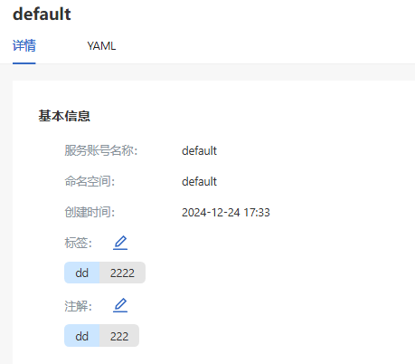
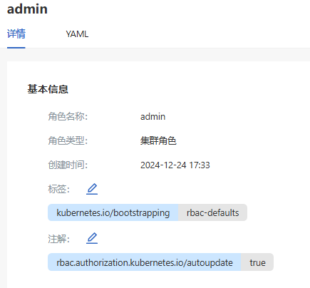
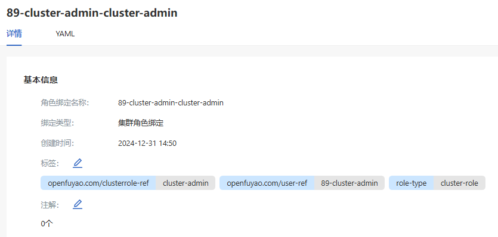

# RBAC管理

## 特性介绍

openFuyao的RBAC管理是基于Kubernetes的角色访问控制（RBAC），通过设置服务账号（ServiceAccount）、角色（Role）、角色绑定（RoleBinding）来实现对集群各资源的权限控制。

### 应用场景

RBAC（基于角色的访问控制）在Kubernetes中用于管理集群的访问权限。有以下应用场景：

- 多租户环境：在同一集群中隔离不同团队或项目的访问权限，防止不同团队之间的资源冲突。

- 精细化权限管理：根据用户的职责设置不同的权限，以控制用户对资源的操作权限，避免因误操作引起的安全问题。

- 安全合规需求：RBAC满足对集群进行安全审计的需求，可以确保不同用户或服务只能访问授权的资源，提升集群的安全性。

### 能力范围

用户和服务账户管理：支持基于用户（user）和服务账户（service account）设置权限。

- 资源级别控制：支持对Pod、Service、Deployment等资源进行权限控制。

- 操作级别控制：可以指定用户对资源的具体操作权限（如查看、创建、删除等）。

- 命名空间隔离：RBAC规则可以限制用户对特定命名空间内资源的访问权限，实现资源隔离。

- 权限继承和绑定：通过角色（Role）和角色绑定（RoleBinding）实现权限分配和继承。

### 亮点特征

- 灵活的权限分配：可以基于角色进行权限分配，满足不同用户或应用的访问需求。

- 支持命名空间级和集群级权限：支持在命名空间或集群级别设置角色，满足不同层次的权限需求。

- 精细化权限控制：RBAC可以设置细粒度的资源操作权限，确保用户只能执行特定的操作。

- 动态权限管理：RBAC配置支持动态更新，无需重启集群即可生效，便于权限的灵活调整。

- 易于集成：RBAC可与其他安全工具（如OIDC、IAM）集成，以实现统一的身份管理和访问控制。

### 实现原理

RBAC基于以下四个核心组件实现权限控制。

- Role：在命名空间内定义权限，描述可以对哪些资源执行哪些操作。

- ClusterRole：定义集群范围的权限，可作用于所有命名空间或集群级资源。

- RoleBinding：将ClusterRole绑定用户、服务账户或用户组，使其在整个集群范围内具有相应的权限。

- RBAC使用基于规则的模型来控制对API资源的访问，每个Role或ClusterRole都包含若干规则，每个规则指定可以对哪些资源执行哪些操作。

### 与相关特性的关系

- ServiceAccount：服务账户用于在集群中为Pod授权。通过与RBAC绑定，可以控制服务账户对资源的访问权限。

- NetworkPolicy：RBAC控制的是对API资源的访问权限，而NetworkPolicy控制的是Pod之间的网络访问权限，两者可以配合实现全面的安全控制。

## 使用服务账号

左侧导航栏“权限管理”中选择“RBAC管理 > 服务账号”，进入“服务账号”界面。

### 查看服务账号

#### 前提条件

用户需要具有查看服务账户的权限，通常通过配置适当的Role或ClusterRole实现。

#### 背景信息

服务账户（ServiceAccount）是Kubernetes中用于授权Pod访问API的身份对象。每个服务账户对应一个令牌，可以通过RBAC为服务账户分配权限，以限制其对API的访问。

#### 使用限制

- 权限管理：服务账户的权限需要通过RBAC管理，不配置RBAC的服务账户可能无法访问集群资源。

- 令牌有效期：默认情况下，服务账户的令牌无有效期限制，需要确保集群安全配置以防止滥用。

#### 操作步骤

1. 单击“服务账号名称”进入“服务账号详情”界面，可查看服务账号的基本信息。
   
   **图 1** 服务账号详情
   
   

2. 单击“YAML”标签页，查看该服务账号的YAML格式信息。支持导出该YAML文件。

### 创建服务账号

#### 前提条件

服务账户在已有命名空间中创建。

#### 背景信息

服务账户为运行在Pod中的应用提供认证身份。创建服务账户后，可以将其与Pod关联，使应用能够以服务账户的身份访问Kubernetes API。

#### 使用限制

- 访问控制：服务账户的权限需要通过RBAC设置，默认情况下新建的服务账户没有任何权限。

- 安全性：需要定期检查和更新服务账户权限，防止出现过高权限或不必要权限。

#### 操作步骤

1. 单击“创建”，进入服务账号的“创建”界面。

2. 编辑YAML。

3. 单击“确定”完成创建。

#### 相关操作

您可以在列表页面单击操作列或在详情页面单击右上角的“操作”，按需修改和删除服务账号。

## 使用角色

左侧导航栏“权限管理”中选择“RBAC管理 > 角色”，进入“角色”界面。

### 查看角色

#### 前提条件

- kubectl配置：确保kubectl已正确配置，可以访问目标集群。

- 权限要求：用户需具有查看角色的权限。

#### 背景信息

角色（Role）和集群角色（ClusterRole）是Kubernetes RBAC中定义权限的基本单元。通过查看角色，可以了解用户或服务账户的权限范围，确保权限配置符合安全要求。

#### 使用限制

- 命名空间限制：Role是命名空间级别的，仅适用于特定命名空间内的资源。

- 权限检查：查看角色不会改变权限配置，但需要具有get和list权限来查看Kubernetes中的资源。

#### 操作步骤

1. 单击“角色名称”进入角色“详情”界面，可查看角色的基本信息。
    
    **图 2** 角色名称详情
   
   

2. 单击“YAML”标签页，可查看该角色的YAML格式信息。支持导出该YAML文件。

### 创建角色

#### 前提条件

- 创建的角色（Role）只能在指定命名空间内生效。

- 明确定义需要访问的资源和操作权限。

#### 背景信息

角色（Role）定义了用户或服务账户在命名空间中的操作权限。创建角色并绑定到用户或服务账户后，能够控制其对资源的操作权限，避免过高权限。

#### 使用限制

- 命名空间限制：Role仅在特定命名空间内生效，无法跨命名空间访问。

- 权限配置：需要合理配置角色的权限，避免因配置错误导致权限不足或者权限过高。

#### 操作步骤

1. 单击“创建”下拉，可按需选择角色“创建”或集群角色“创建”。

2. 编辑YAML。

3. 单击“确定”完成创建。

   >  **说明：**  创建角色的操作步骤同样适用创建集群角色，仅资源类型不同。

#### 相关操作

您可以在列表页面单击操作列或在详情页面单击右上角的“操作”，按需修改和删除角色。

## 使用角色绑定

左侧导航栏“权限管理”中选择“RBAC管理 > 角色绑定”，进入“角色绑定”界面。

### 查看角色绑定

#### 前提条件

- 访问权限：用户需要具备get和list权限查看资源。可以通过RBAC授予这些权限，以便用户能够查看指定命名空间或整个集群中的角色绑定。

- kubectl配置：确保kubectl已正确配置并能够连接到目标集群。

#### 背景信息

角色绑定（RoleBinding或ClusterRoleBinding）用于将权限角色（Role或ClusterRole）赋予特定的用户、组或服务账户。RoleBinding将Role限制在特定命名空间内，而ClusterRoleBinding则将ClusterRole应用于整个集群范围内。通过角色绑定，可以灵活地控制用户和服务账户对Kubernetes资源的访问权限。

#### 使用限制

- 命名空间限制：RoleBinding仅对绑定的命名空间内生效，用户需要确保绑定的角色和权限只在特定命名空间使用。

- 权限控制：在查看角色绑定时，需要确保用户具有足够的权限，否则可能无法查看绑定的详细信息。

- 权限继承：ClusterRoleBinding会赋予用户集群范围的权限，在多租户环境中应谨慎使用，以免过度赋权。

#### 操作步骤

1. 单击“绑定名称”进入角色绑定“详情”界面，可查看角色绑定的基本信息。
    
    **图 3** 角色绑定详情
   
   

2. 单击“YAML”标签页，查看该角色绑定的YAML格式信息。支持导出该YAML文件。

### 创建角色绑定

#### 前提条件

- 权限要求：用户需要具备create权限来创建资源。通常只有集群管理员或具备相应权限的用户才能创建角色绑定。

- 命名空间存在：如果是创建RoleBinding，需要确保目标命名空间已存在。ClusterRoleBinding不受命名空间限制。

#### 背景信息

角色绑定用于将权限角色（Role或ClusterRole）赋予用户、组或服务账户。在Kubernetes RBAC（基于角色的访问控制）模型中，RoleBinding和ClusterRoleBinding是资源访问的核心组件。RoleBinding绑定的是命名空间级权限，适用于特定的命名空间。而ClusterRoleBinding绑定的是集群级权限，适用于跨命名空间或集群范围的权限要求。

#### 使用限制

- 最小权限原则：在创建角色绑定时，应遵循最小权限原则。

- 命名空间隔离：RoleBinding仅在特定命名空间内有效，无法跨命名空间使用，ClusterRoleBinding则作用于整个集群。

- 敏感权限控制：在为用户创建ClusterRoleBinding时，应注意避免将高权限角色赋予非管理员用户，以防止潜在的安全风险。

#### 操作步骤

1. 单击“创建”下拉菜单，按需选择角色绑定“创建”或者集群角色绑定“创建”。

2. 编辑YAML。

3. 单击“确定”完成创建。

#### 相关操作

您可以在列表页面单击操作列或在详情页面单击右上角的“操作”，按需修改和删除角色绑定。
