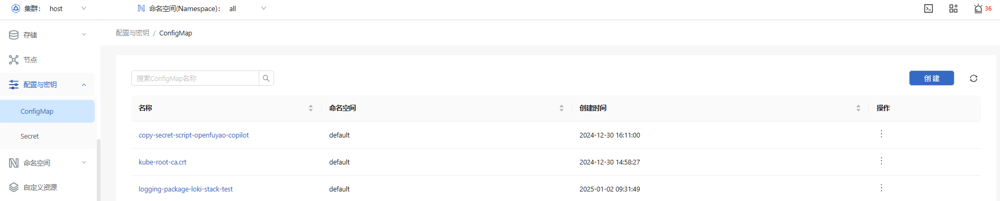
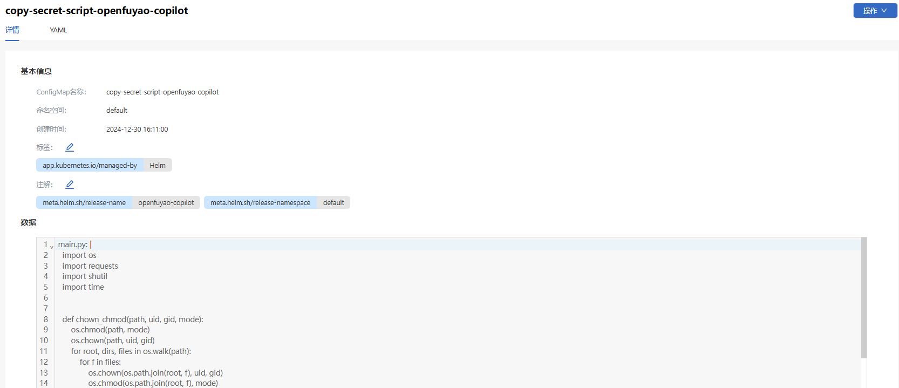
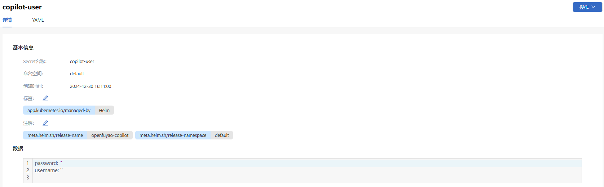

# 配置与密钥

## 特性介绍

配置资源将数据保存到键值对中，使用时，Pod可以将其用作环境变量、命令行参数或存储卷中的配置文件。

### 应用场景

ConfigMap是Kubernetes中用于存储非敏感配置信息的资源类型。ConfigMap可以将配置数据以键值对的形式存储，供应用程序在运行时动态加载。

- 环境配置管理：在不同环境中使用不同的配置数据，无需更改应用代码。

- 应用配置管理：将应用的配置与镜像分离，支持配置的动态更新，避免硬编码配置。

- 共享配置：ConfigMap可以在多个Pod之间共享相同的配置，便于统一管理。

### 能力范围

- 配置数据存储：支持存储简单的键值对，Json配置、Yaml配置或文件内容，适合用来管理非敏感配置。

- 动态配置挂载：ConfigMap可以以文件或环境变量的形式挂载到Pod中，应用程序可以读取这些配置数据。

- 集中化配置管理：ConfigMap支持多个应用共享同一个文件，可以集中管理配置信息。

- 命名空间隔离：ConfigMap属于命名空间级资源，每个命名空间中的ConfigMap互相隔离。

### 亮点特征

灵活性：ConfigMap是Kubernetes API资源类型之一，存储在etcd数据库中。用户可以通过创建ConfigMap Yaml文件或命令行kubectl create configmap来定义配置。ConfigMap可以通过Kubernetes API或者kubectl命令动态更新，Pod在启动时会加载这些配置，并根据需要以环境变量或挂载卷的方式提供给应用。

### 实现原理

ConfigMap是一种非敏感的键值对存储，用于存储应用程序的配置数据，例如环境变量、配置文件路径等。Secret与ConfigMap类似，但用于存储敏感信息（如密码、API密钥、证书）。Secret数据以Base64编码存储在etcd中，以防止敏感数据直接暴露。

### 与相关特性的关系

- Secret：ConfigMap主要用于非敏感配置，Secret则用于敏感数据，两者在结构上类似，但应用场景不同。

- Volume：ConfigMap可以通过Volume挂载到Pod的文件系统，使应用程序可以在文件中读取配置信息。

- 环境变量：ConfigMap可以作为环境变量挂载到容器中，支持应用直接使用环境变量读取配置。

- Deployment和Pod：ConfigMap通常与Deployment或Pod配置结合使用，通过动态加载配置实现环境适配。

## 使用ConfigMap

ConfigMap用来将非敏感数据保存到键值对中。使用时，Pod可以将其用作环境变量、命令行参数或存储卷中的配置文件。

左侧导航栏“资源管理”中选择“配置与密钥 > ConfigMap”，进入“ConfigMap”界面。

**图 1** ConfigMap列表页

### 查看ConfigMap

#### 前提条件

- 访问权限：用户需要具备对ConfigMap资源的get和list权限，通常通过RBAC授权实现。

- kubectl配置：已正确配置kubectl，可以成功连接到目标集群。

#### 背景信息

ConfigMap是Kubernetes用于存储非敏感配置信息的对象。通过ConfigMap可以将配置与应用分离，支持应用动态加载配置。ConfigMap可以通过kubectl命令查看，便于用户检查配置信息的正确性。

#### 使用限制

- 非敏感数据限制：ConfigMap设计用于存储非敏感数据，不适合存储密码或密钥等敏感信息。敏感数据应存储在Secret中。

- 命名空间限制：ConfigMap是命名空间级别的资源，仅能在创建的命名空间内使用。

- 数据大小限制：每个ConfigMap的数据大小限制为1MB，不适合存储大型配置文件。

#### 操作步骤

1. 单击“ConfigMap名称”，进入ConfigMap“详情”界面，查看ConfigMap的基本信息及数据。
   
   **图 2** ConfigMap详情页
   
   

2. 选择“YAML”标签页，查看该ConfigMap的YAML格式信息。支持导出该YAML文件。

### 创建ConfigMap

#### 前提条件

- 命名空间存在：ConfigMap在指定的命名空间创建，确保命名空间已存在。

- 权限要求：用户需要具备创建ConfigMap的权限，通常通过RBAC配置create权限来实现。

#### 背景信息

ConfigMap是Kubernetes中的一种配置管理工具，用于将配置信息与应用程序的容器镜像分离。通过ConfigMap，管理员可以在不修改容器镜像的情况下更新应用配置，并实现应用的动态配置管理。

#### 使用限制

- 非敏感数据限制：ConfigMap不适用于存储敏感数据，敏感数据应使用Secret资源。

- 数据大小限制：ConfigMap单个条目的大小不能超过1MB。如果需要更大的配置，建议分块存储或使用挂载文件的方式。

- 应用更新：ConfigMap更新后，应用可能需要重启才能加载最新的配置（除非应用程序支持实时读取配置文件更新）。

#### 操作步骤

1. 在ConfigMap单击右上角的“创建”，进入YAML创建页面。

2. 编辑YAML。

3. 单击“确定”完成创建。

#### 相关操作

您可以在列表页面单击操作列或在详情页面单击右上角的“操作”，按需修改和删除ConfigMap。

> **说明：** 在ConfigMap“详情”界面“YAML”标签页，单击图标，也可以修改ConfigMap。

## 使用Secret

### 查看Secret

#### 前提条件

- 访问权限：用户具备对Secret资源的get和list权限，通常通过RBAC进行配置。例如，可以为用户创建一个Role或ClusterRole，赋予get和list权限。

- kubectl配置：确保kubectl已正确配置，并能够访问目标集群。

#### 背景信息

Secret是Kubernetes中用于存储敏感数据（如密码、令牌、证书等）的资源。通过将敏感信息存储在Secret中，应用可以安全地从Kubernetes API读取配置，避免将敏感数据暴露在Pod配置文件中。Secret在集群中是以Base64编码形式存储的，可以通过挂载或环境变量的方式供Pod使用。

#### 使用限制

- 敏感数据保护：尽管Secret使用Base64编码，但未加密存储，因此应在Kubernetes集群上启用加密功能来保护Secret数据。

- 权限管理：Secret是敏感资源，应严格限制其查看权限。仅必要的用户和服务账户应具备查看Secret权限。

- 命名空间隔离：Secret是命名空间级资源，仅能在创建的命名空间中使用，无法跨命名空间访问。

#### 操作步骤

1. 在"Secret"界面单击“Secret名称”，进入Secret“详情”界面，可查看Secret的基本信息及数据。
   
   **图 3** Secret列表页
   
   

2. 选择“YAML”标签页，查看该Secret的YAML格式信息。支持导出该YAML文件。

### 创建Secret

#### 前提条件

- 命名空间存在：Secret在指定的命名空间中创建，确保命名空间已存在。

- 权限要求：用户需要具备创建Secret的权限，通常通过赋予create和update权限实现。

#### 背景信息

Secret用于存储敏感的配置信息，避免将敏感数据直接暴露在应用配置中。Secret支持多种类型，例如Opaque（默认类型）、docker-registry（用于私有镜像仓库认证）、TLS（用于存储TLS证书）。在创建Secret时，可以将数据以键值对形式存储，也可以通过文件直接导入。

#### 使用限制

- 安全性要求：建议开启Secret的加密存储，以提高安全性。特别是在生产环境中，敏感信息应避免以明文形式存在。

- 大小限制：每个Secret的数据大小限制为1MB，不适合存储大文件或大量数据。

- 生命周期管理：Secret的生命周期与Pod独立，需定期检查和更新过期或失效的Secret，以确保系统安全。

#### 操作步骤

1. 在“Secret”界面单击右上角的“创建”，进入YAML创建页面。

2. 编辑YAML。

3. 单击“确定”完成创建。

#### 相关操作

您可以在列表页面单击操作列或在详情页面单击右上角的“操作”，按需修改和删除Secret。

> **说明：** 在Secret“详情”界面“YAML”标签页，单击图标，也可以修改Secret。
