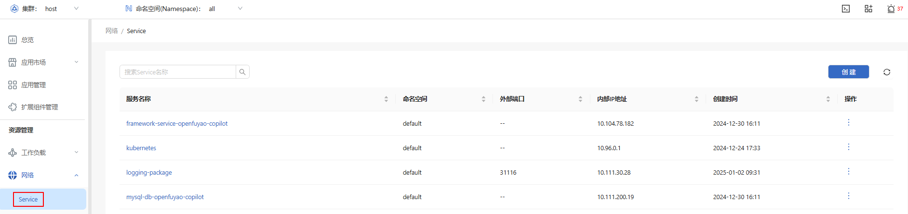
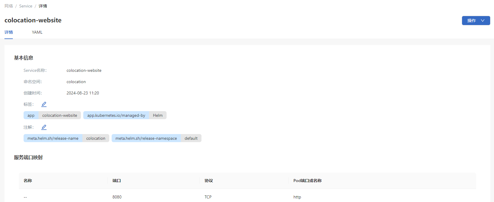
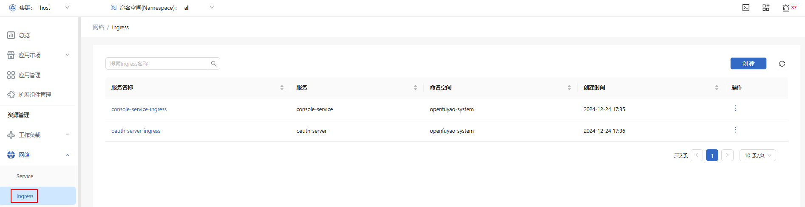
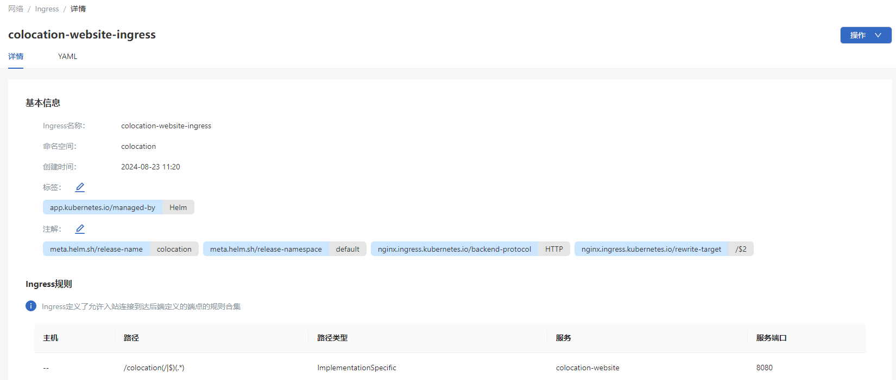

# 网络

## 特性介绍

在Kubernetes集群中，每个Pod都有自己独有的IP地址。Pod能够与所有节点上的Pod通信，节点上的代理可以和节点上的所有Pod通信。

通过Service允许向外暴露Pod中运行的应用以支持来自集群外的访问，也可发布仅供集群内部使用的服务。

Ingress提供专门用于暴露HTTP应用程序、网站和API的额外功能。

### 应用场景

Kubernetes的网络系统为Pod之间以及集群外部的通信渠道。在微服务架构中，应用程序通常分解为多个服务单元，网络连接的高效管理至关重要。Kubernetes网络提供的灵活性和自动化特性，有利于大规模容器化应用的通信需求。

### 能力范围

- 统一的IP寻址和通信机制：在Kubernetes中，每个Pod都有一个独立的IP地址，可以直接与集群内的其他Pod通信，不需要NAT。

- 服务发现和DNS：Kubernetes提供内置的DNS解析服务，使服务发现自动化。每Service都可以通过DNS名称访问。

- 网络隔离和访问控制：NetworkPolicy提供了基于IP和端口的网络访问控制，允许用户限制不同Pod之间的访问。

- 外部流量管理：通过Ingress，可以为应用配置HTTP/HTTPS路由规则，并且支持域名和TLS。

### 亮点特征

可以精细控制不同Pod之间的通信权限，提升集群的安全性。集成不同的网络插件（如Calico、Flannel、Weave等），并支持基于CNI（容器网络接口）的自定义插件，满足不同网络需求。

### 实现原理

在Kubernetes中，网络是一种抽象资源，用于将集群中的一组Pod组合成一个逻辑服务单元，并提供稳定的访问接口。网络实现了负载均衡和服务发现，使应用程序可以通过DNS名称或IP地址访问其他应用的服务，不涉及具体的PodIP。

### 与相关特性的关系

无。

## 使用Service

Service是将运行在一个或一组Pod上的网络应用程序公开为网络服务的方法。

左侧导航栏“资源管理”中选择“网络 > Service”，进入“Service”界面。

**图 1** Service列表

### 查看Service

#### 前提条件

用户具有资源查看权限。

#### 背景信息

Service是Kubernetes中的关键组件，用于暴露一组Pod以持续访问能力。

#### 使用限制

NodePort类型的Service需要在Kubernetes节点上开放特定的端口。

#### 操作步骤

1. 单击“Service名称”，进入Service“详情”界面，查看Service的基本信息及服务端口映射。
   
   **图 2** Service详情
   
   

2. 选择“YAML”标签页，查看该Service的YAML格式信息。支持导出该YAML文件。

### 创建Service

#### 前提条件

用户具有资源创建权限。

#### 背景信息

Service是Kubernetes提供的服务发现和负载均衡机制，适用于在集群内外部访问应用。Service可以定义为ClusterIP、NodePort或LoadBalancer类型，以满足不同的访问需求。

#### 使用限制

NodePort类型Service端口范围有限，可能会受防火墙规则的限制。

#### 操作步骤

1. 在service列表页单击右上角的“创建”，进入YAML创建页面。

2. 编辑YAML。

3. 单击“确定”完成创建。

#### 相关操作

您可以在列表页面单击操作列或在详情页面单击右上角的“操作”，按需修改和删除Service。

> **说明：** 在Service“详情”界面“YAML”标签页，单击图标，也可以修改Service。

## 使用Ingress

Ingress提供从集群外部到集群内服务的HTTP和HTTPS路由。流量路由由Ingress资源所定义的规则来控制。

左侧导航栏“资源管理”中选择“网络 > Ingress”，进入“Ingress”界面。

**图 3** Ingress列表

### 查看Ingress

#### 前提条件

集群中已部署Ingress Controller，并且应用通过Ingress对外暴露。

#### 背景信息

Ingress是Kubernetes中用于HTTP和HTTPS流量管理的资源对象。它通过配置路由规则来暴露应用服务，还可以设置域名、TLS和负载均衡策略。

#### 使用限制

Ingress需要依赖Ingress Controller（如NGINX、Traefik、HAProxy）进行流量转发。

#### 操作步骤

1. 单击“Ingress名称”，进入Ingress“详情”界面，查看Ingress的基本信息及Ingress规则。
   
   **图 4** Ingress详情
   
   

2. 选择“YAML”标签页，查看该Ingress的YAML格式信息。支持导出该YAML文件。

### 创建Ingress

#### 前提条件

集群中已部署支持Ingress的应用服务，并且有一个运行中的Ingress Controller。

#### 背景信息

Ingress提供基于路由的外部访问方式，通常用于管理多个服务的HTTP/HTTPS入口。通过Ingress，可以为应用配置统一的域名访问，并提供TLS支持。

#### 使用限制

Ingress需要Ingress Controller的支持，不能在没有Controller的集群中生效。

#### 操作步骤

1. 在Ingress界面单击右上角的“创建”，进入YAML创建页面。

2. 编辑YAML。

3. 单击“确定”完成创建。

#### 相关操作

您可以在列表页面单击操作列或在详情页面单击右上角的“操作”，按需修改和删除Ingress。

> **说明：** 在Ingress“详情”界面“YAML”标签页，单击图标，也可以修改Ingress。
