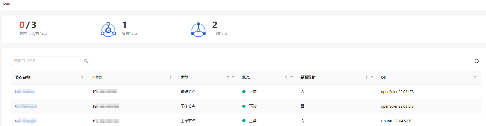
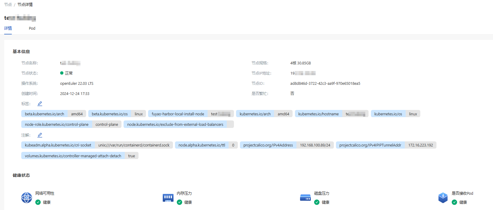

# 节点

## 特性介绍

节点是Kubernetes集群中的工作节点，它可以是物理机或虚拟机。每个节点上运行着Kubernetes的代理程序kubelet，用于管理容器的生命周期。

### 应用场景

节点用于承载容器化应用程序的运行。通过添加或删除节点，可以扩展或缩减集群的计算资源。

### 能力范围

节点具有计算资源和存储资源，可以运行容器和提供服务。

### 亮点特征

节点可以通过标签和选择器进行分类和选择，从而灵活地进行应用部署和调度。

### 实现原理

工作节点通过与Master节点通信，接受集群管理指令，并向Master节点汇报自身的状态。

### 与相关特性的关系

节点是Kubernetes集群中的计算资源提供者，负责运行和管理Pod、ReplicaSet、Deployment、Service以及与持久化存储相关的资源。节点与这些资源的关系是通过调度和管理来实现的，确保它们能够在合适的Node上运行并相互通信。

## 查看节点

1. 在openFuyao平台界面的左侧导航栏“资源管理”中单击“节点”，进入“节点”界面。

   **图 1** 节点

  
  
2. 单击“节点名称”进入节点“详情”界面，可查看节点的基本信息、健康状态、资源配额详情。
   
   **图 2** 节点详情

  

3. 选择“Pod”标签页，可查看该节点上调度的所有Pod信息。
