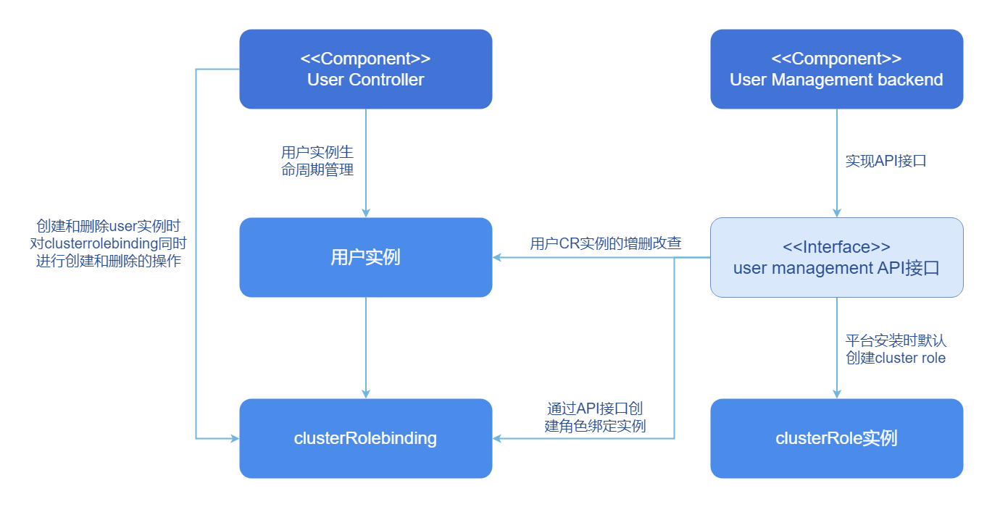
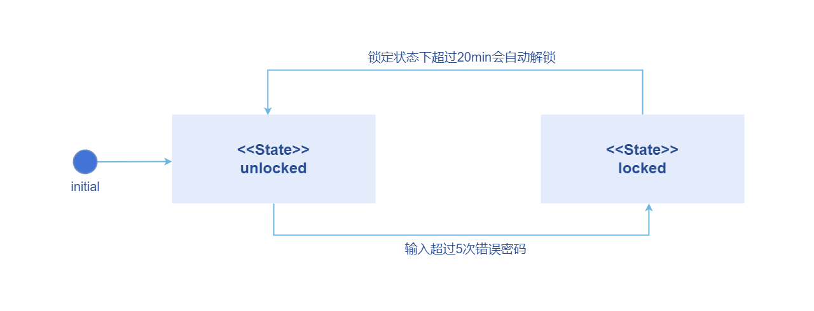
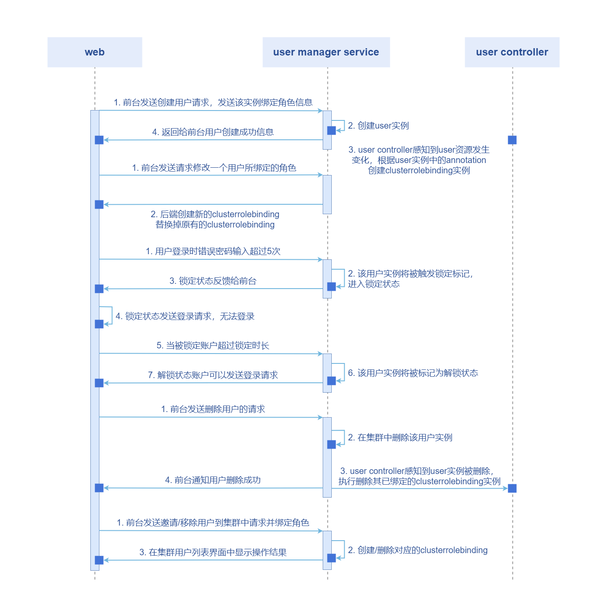
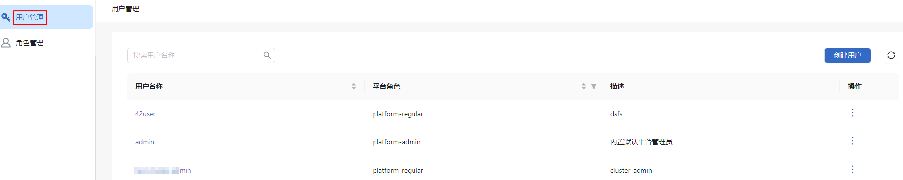
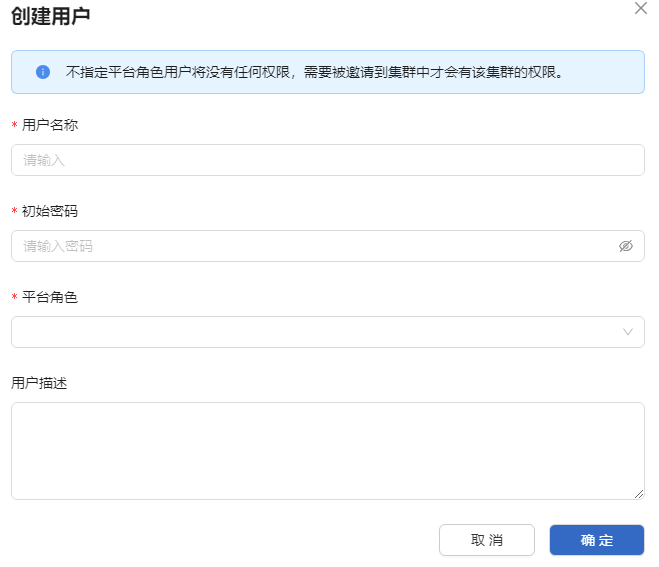
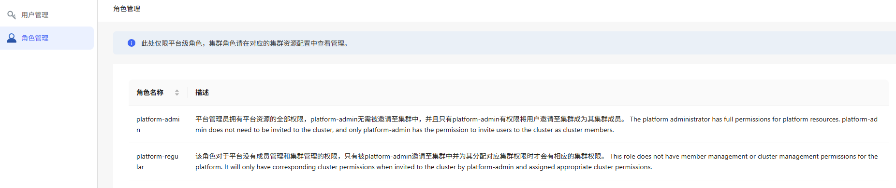
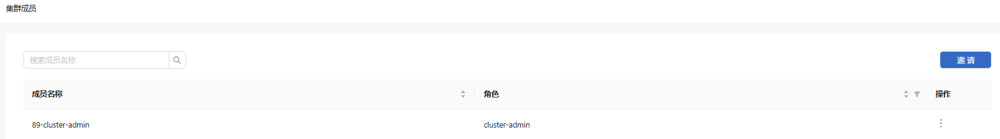

# 用户管理

## 特性介绍

用户管理组件作为openFuyao核心组件，为容器平台提供了一整套灵活的用户和角色管理功能。该系统支持用户的增删改查以及角色的分配，查看与解除绑定等。

- 管理员可以为平台用户分配合适的角色，实现精细的权限控制。
- 支持集群成员的邀请、移除和集群角色的绑定，管理员能够为不同集群中的用户设置不同的权限。
- 支持平台级和集群级的角色分配，确保用户在多集群场景下操作时拥有正确的权限，满足多集群环境下的访问控制需求。

openFuyao平台通过该系统能够提升用户管理的效率和安全性，保证资源的合理分配与使用。

### 应用场景

**角色与权限的分配**

当需要为不同团队的成员分配访问权限时，管理员可以使用用户的增删改查功能来管理用户账户，并通过角色分配功能为每个用户分配相应的权限，用户只能访问权限内的特定资源。在对于openFuyao平台的使用来说，会为用户提供最小权限来访问平台和对应的集群，符合最小权限原则，提升平台的安全性。

**多集群场景下的权限管理**

当openFuyao平台需要为多个集群上的用户分配权限时，管理员可以通过集群级角色和平台级角色进行管理。集群级角色用于控制用户在特定集群中的权限，例如某用户只可以在某个集群中执行运维操作，而无法访问其他集群。平台级角色则用于管理用户在整个平台的全局权限，确保用户在跨集群的场景下能够拥有一致的权限控制。

**用户使用场景的密码隔离**

为了满足合规性或隐私要求，平台提供了基于加密存储的密码管理机制。用户的密码在平台后端使用加密算法存储，platform admin无法通过任何手段查看用户的密码，也没有权限读取或修改用户的密码。用户自行修改密码的整个过程不经过管理员的手动干预，确保只限用户本人知晓其新设置的密码。提升了平台的安全性和用户的隐私性。

### 能力范围

**多用户管理**

- 支持平台管理员创建和删除用户。

- 支持平台管理员查看用户信息。

- 支持用户修改用户描述信息和密码信息。

- 当用户登录失败次数过多时，多用户管理系统会锁定该用户。

**角色管理**

- 创建用户时默认为用户新建平台级角色。

- 支持平台管理员、集群管理员邀请用户到集群中，并为其赋予集群角色（cluster-admin、cluster-editor、cluster-viewer）。

- 支持平台管理员、集群管理员将用户从集群中移除。

- 在进行鉴权操作时，系统会根据用户绑定的角色进行鉴权。

### 亮点特征

- 多层级的用户角色权限体系：支持平台级与集群级用户角色的分配，支持用户访问权限的细分。
- 直观的用户界面：提供易于使用的图形界面，简化用户管理的操作。

### 实现原理

- 后端组件逻辑视图

在多集群用户管理体系中，主要由User Controller和User Management backend组成。User Controller主要负责用户实例的生命周期管理，包括在创建和删除User时所涉及到的角色绑定的创建和其他一系列链式反应。User Management backend作为后端服务负责接收前端的调用请求，包括但不限于创建用户实例、查看用户列表、筛选集群中用户、查看角色列表以及删除用户等。平台创建时会自动生成默认的平台级角色和集群级角色。

**图 1** 后端逻辑视图

- 用户状态机模型视图

每一个用户实例都有一种状态用于描述该用户的一个可用情况。分别是“锁定”和“未锁定”。两种状态分别对应一个事件进行触发，除了对应事件之外其他任何情况无法触发状态。如状态机视图中描述所示，用户在被初始化创建时具有“未锁定”状态。

当用户在登录时输入超过5次错误的密码，该用户将进入锁定状态。用户在锁定状态下无法登录openFuyao平台，20分钟之内将会持续保持锁定状态，20分钟之后用户会被自动解锁。解除锁定后用户可以重新尝试通过输入正确的用户名和密码，同样在累计5次错误输入之后会再次进入锁定状态，以此类推。这个设计的目的是为了防止暴力破解密码场景，并且该触发机制对所有的用户都成立。

**图 2** 状态机模型视图

- 多用户管理顺序图

**图 3** 多用户管理顺序图

- 所有资源的增删改查操作都通过user manager service所暴露的API接口来实现。当集群中的user资源实例出现变化时，由user crd controller来实现感知资源的变化并做出对应的操作。当user创建时，controller会感知到其user实例的字段并决定创建哪一个clusterRoleBinding。当user删除时，controller同样会感知到这一变化并删除对应的clusterRoleBinding。

- 用户密码登录的锁定逻辑：每次输入错误密码之后，前台单击行为会向后端user manager service服务发送新增错误统计次数请求。后端会读取user当前状态并处理新增错误次数，当错误次数达到累计5次后，状态会改为“锁定”。如果在锁定状态前端发送请求时会附带时间戳，将这个时间戳和user实例中标记的时间戳做对比，得到该用户是否超过锁定时间从而改变其锁定状态。

### 与相关特性的关系

- 认证鉴权模块：用户管理模块会存储用户信息的CR资源，在认证模块验证用户密码时会获取用户信息来做校验。在使用RBAC机制进行鉴权时，每个用户所拥有的权限范围依赖用户管理模块为每个用户绑定的角色，比如平台级角色和集群级角色，这些角色限制了每个用户在平台上的可操作权限。

- 多集群管理模块：在用户进行集群纳管操作时，多集群管理模块需要验证用户是否有平台管理员权限。当邀请用户到某一个集群时，多集群管理模块需要为该用户增加访问该集群的权限。

### 相关实例

代码链接：[openFuyao/user-management-operator (gitcode.com)](https://gitcode.com/openfuyao/user-management-operator)

## 使用管理员视角的用户管理

### 查看用户信息

#### 前提条件

登录用户具有platform admin角色。

#### 操作步骤

1. 在openFuyao平台主菜单栏右侧单击“用户管理”，进入“用户管理”界面。界面呈现用户列表信息，包含“用户名称”、“平台角色”等。

   **图 4** 用户管理
   

2. 单击用户列表左上方搜索框，输入关键字可以进行用户名的模糊搜索。

### 创建用户并分配权限

#### 前提条件

创建用户需要具有“platform admin”角色。

#### 操作步骤

1. 在openFuyao平台主菜单栏的右侧单击“用户管理”，进入“用户管理”界面。
2. 单击右上角的“创建用户”，界面弹出“创建用户”窗口。
3. 依次在“用户名称”，“初始密码”，“平台角色”和“用户描述”的输入框中输入对应的内容。

   **图 5** 创建用户

   

4. 单击“确定”完成创建新用户。

>  **说明：**  
> 
> - 管理员创建的密码为初始密码，用户需要在第一次登录系统之后立刻修改登录密码。
> - 创建的用户可以分配相应的平台角色，当其被邀请至集群之后会有对应的集群角色权限。
> - 可分配的平台角色有platform admin。

#### 相关操作

您可以在列表页面单击操作列或在详情页面单击右上角的“操作”，按需修改和删除用户。

**表 1** 相关操作说明

<table>
<thead>
<tr> 
   <th > 操作</th>
   <th  align="left"> 说明</th>
</tr>
</thead>
<tbody>
<tr>
<td>修改</td>
<td>
<ul>
<li>分配角色会解除当前角色的角色绑定并创建新角色的角色绑定。</li><li>用户名称为唯一的识别标识符，该字段不可修改。</li></ul>
</td>
</tr>
<tr>
<td>删除</td>
<td>用户在执行删除之后，一个选中的用户实例和其绑定的角色都会被删除，无法恢复。</td>
</tr>
</tbody>
</table>

### 查看平台级角色列表

#### 前提条件

登录用户具有platform admin角色。

#### 操作步骤

1. 在openFuyao平台主菜单右侧单击“用户管理”。
2. 单击左侧菜单“角色管理”，进入“角色管理”界面。界面呈现角色列表信息，包含“角色名称”和“描述”。

  **图 6** 角色管理
  

### 邀请集群成员

#### 前提条件

邀请集群成员需要具有platform admin或cluster admin角色。

#### 操作步骤

1. 左侧导航栏“权限管理”中单击“集群成员”，进入“集群成员”界面。
2. 单击集群成员列表右上角的“邀请”，界面弹出“邀请成员”窗口。
3. 在“邀请成员”窗口界面，单击成员列表一个用户对应“操作”列的图标。
4. 选择将要为该用户分配的“角色”，选择之后该用户的角色会在“分配角色”列中预览展示。
5. 单击“确定”，即可将选中的用户邀请至集群。

### 查看集群成员

#### 前提条件

登录用户具有platform admin或cluster admin角色。

#### 操作步骤

1. 左侧导航栏“权限管理”中单击“集群成员”，进入“集群成员”界面。界面呈现集群成员列表，包含“成员名称”、“角色”等信息。

   **图 7** 集群成员列表
   

2. 单击左上方搜索框，可以通过输入关键字实现对于用户名的模糊搜索。

### 分配集群角色

#### 前提条件

分配集群角色需要具有platform admin或cluster admin的角色。

#### 操作步骤

1. 左侧导航栏“权限管理”中单击“集群成员”，进入“集群成员”界面。
2. 单击成员列表“操作”列的“修改角色”，界面弹出“修改角色”窗口。
3. 单击“角色”下拉框，选择要分配的角色。对于集群成员来说必须要绑定至少一个角色。可绑定的角色分别为cluster admin，cluster editor和cluster viewer。
4. 单击“确定”，完成修改。

#### 相关操作

您可以在列表页面单击操作列，按需移除集群成员。

**表 2** 相关操作说明

|操作|说明|
|:---|:---|
|移除|移除某个用户后，该用户在集群中的全部角色绑定将会被删除，无法恢复。|

#### 后续操作

左侧导航栏“权限管理”中单击“集群角色”，进入“集群角色”界面，可以查看集群角色列表信息，包含“角色名称”和“描述”。

## 使用用户视角的用户管理

### 登录openFuyao平台

在openFuyao登录界面中，通过输入正确的用户名和登录密码实现进入openFuyao平台。

错误输入登录密码触发规则后用户被锁定：

- 在用户错误输入密码达到一定条件后，会触发账户被锁定。
- 超过锁定时间之后，账户会被自动解锁，用户可以继续尝试登录，直到再次触发锁定或登录成功。
- 错误输入规则：在连续5分钟之内累计输入错误密码超过5次，该账户将会被系统锁定20分钟。

### 修改用户描述信息

#### 操作步骤

1. 单击openFuyao平台右上角的用户头像或者用户名称，进入“用户设置”界面。
2. 单击左侧导航栏的“基本信息”，进入基本信息界面。
3. 在“描述”输入框修改用户描述。
4. 单击“确定”完成修改描述。

#### 相关操作

您可以在用户设置界面单击左侧的“密码设置”，按需修改登录密码。

**表 3** 相关操作说明

|操作|说明|
|:---|:---|
|修改密码|**密码校验规则**： 长度要求：密码长度8-32位。  复杂性要求：必须包含英文字母、数字、特殊字符 `~!@#$%^&*()-_=+\|[{ }];:'",\<.>/?`必须包含至少一个特殊字符。 用户名检查：不能和账号及账号逆序相同。 输入检查：两次输入密码需要一致。

#### 后续操作

您可以在openFuyao平台右上角的用户头像或者用户名称的下拉菜单中单击“退出登录”。

**表 4** 相关操作说明

|操作|说明|
|:---|:---|
|退出登录|再次登录时需要重新输入正确的用户名和密码。|
