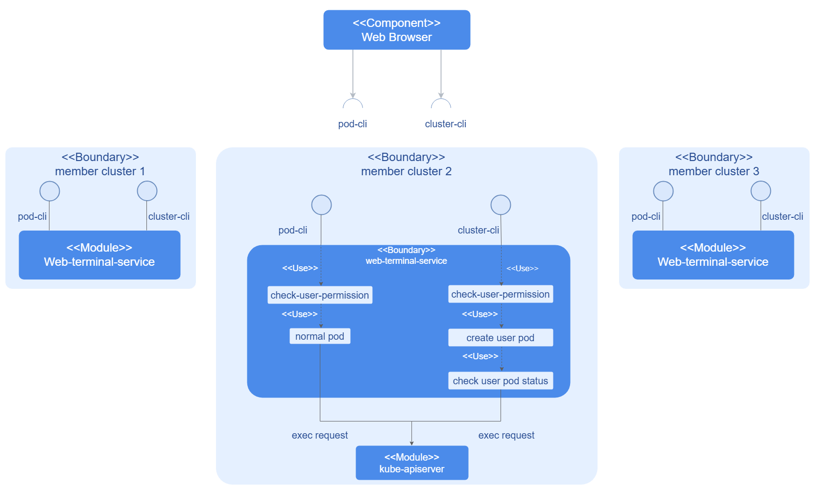
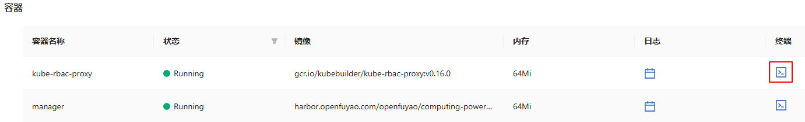
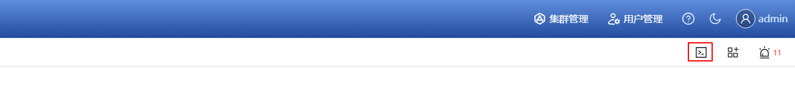

# Web Terminal

## 特性介绍

Web Terminal通常是广泛的云服务或者基于Web服务的一部分，用户能够通过Web浏览器访问命令行界面。这是一个虚拟终端，通常直接通过Web界面管理容器内部、服务、应用程序或者数据库，无需本地终端仿真软件或安全外壳(SSH)客户端。该特性通常用于管理集群中的资源对象，减少了对本地工具的依赖，简化了Kubernetes集群的操作和维护过程。

在openFuyao平台上，Web Terminal为平台提供了可交互的CLI界面。当前支持进入集群和容器的管理操作。

### 应用场景

- 故障排查：用户可以通过Web Terminal直接登录到容器和集群，快速诊断应用程序中的问题。例如，通过实时查看日志、执行相关命令或查看系统状态快速定位问题。
- 实时运维：当需要进行紧急运维时，Web Terminal为便捷的工具，允许用户在不离开浏览器的情况下执行管理任务，如清理临时文件、更新配置文件、调整系统设置等。
- 开发和测试：Web Terminal提供了与容器内部以及集群的交互接口，开发人员可以使用它进行容器内以及集群内开发和测试工作，而不必依赖本地开发环境。

### 能力范围

- 容器访问和管理：Web Terminal使用户能够直接访问和管理运行在Kubernetes集群中的容器，通过浏览器访问容器的命令行界面，无需借助Kubectl或SSH的外部工具。
- 集群管理和监控：Web Terminal提供与Kubernetes集群进行交互的接口，通过浏览器执行集群级的管理和监控操作，包括查看和管理集群资源，监控集群监控状态以及集群配置管理等。

### 实现原理

**图 1** web terminal服务实现原理

web-terminal-service的服务由API服务和controller逻辑组成，每个用户的请求会根据请求类型的不同，唤起不同的服务。其中请求集群的服务会创建webterminal-template，这个template会受到controller的协调控制，对所创建的user-pod或者node-pod进行生命周期的管理。

### 相关实例

代码链接：

- 前端：[openFuyao/console-website (gitcode.com)](https://gitcode.com/openfuyao/console-website)

- 后端：[openFuyao/web-terminal-service (gitcode.com)](https://gitcode.com/openfuyao/web-terminal-service)

## 安装

Web Terminal作为openFuyao平台核心组件随平台一起安装。

## 登录容器内部进行交互

### 前提条件

- 用户具有“platform-admin”或者“cluster-admin”的权限。
- 待登录的容器支持“kubectl exec”功能。

### 背景信息

- 用户能够通过更直观的方式访问和管理Pod，而不必安装和配置复杂的CLI工具。
- 使用Web Terminal工具登录容器使得操作更加便捷，尤其是在云端环境或受限环境下，避免对外部工具和网络访问的依赖。

### 使用限制

无。

### 操作步骤

1. 在openFuyao平台左侧导航栏选择“工作负载 > Pod”。

2. 单击Pod名称进入Pod详情界面。

3. 在Pod详情界面“容器”区域的“终端”列，单击图标进入终端交互命令行工具界面。

   **图 2** Pod详情页面

    

4. 进入容器内部输入相关命令进行交互。

## 登录集群进行交互

### 前提条件

- 用户具有“platform-admin”或者“cluster-admin”的权限。
- 待访问的集群已安装Web Terminal服务。

### 背景信息

- Web Terminal通过提供浏览器端的命令行界面，帮助开发人员、运维人员和管理员在集群中执行命令、管理资源和进行故障排查。
- Web Terminal是对传统kubectl命令行的一个补充，能够减少对本地环境配置的依赖，通过集群控制台实现远程管理。

### 使用限制

- 目前只对具有“platform-admin”或者“cluster-admin”的权限的用户开放该功能。
- Web Terminal在集群资源较紧张的情况下，可能会受到性能限制。例如，如果集群的节点负载过高，终端交互界面的响应时间会变慢，或者无法正常使用。
- Web Terminal服务依赖WebSocket协议与集群进行交互，可能会遇到网络中断、连接失败等问题。
- 目前Web Terminal的终端界面在25分钟内没有任何交互时，会提示并自动关闭终端交互界面，以节省集群资源。

### 操作步骤 

1. 单击openFuyao平台右上角的图标。

   **图 3** 打开集群终端
   
   

2. 在kubectl命令行工具界面，输入符合kubectl语法的命令行即可执行相关管理操作。

   > **说明：** 单击界面右侧的“了解更多”可查看kubectl通用语法说明。
  