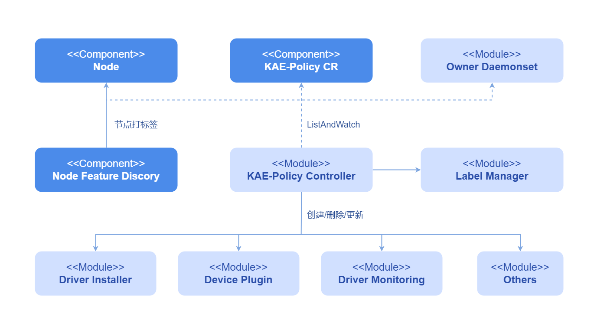

# KAE Operator

## 特性介绍

Kubernetes通过[设备插件](https://kubernetes.io/docs/concepts/extend-kubernetes/compute-storage-net/device-plugins/)提供对特殊硬件资源（如鲲鹏KAE、NIC、InfiniBand适配器和其他设备）的访问。
但是配置和管理具有这些硬件资源的节点需要配置多个软件组件（如驱动程序、容器运行时或其他库），这些组件安装复杂困难且容易出错。
KAE Operator使用Kubernetes中的[Operator Framework](https://operatorframework.io/)来自动管理配置KAE所需的所有软件组件。
这些组件包括KAE驱动程序、KAE的Kubernetes设备插件。

鲲鹏加速引擎KAE（Kunpeng Accelerator Engine）是鲲鹏920系列处理器中携带的能力，具体请参见
[KAE产品简介](https://www.hikunpeng.com/developer/techArticles/20230906-4?envFlag=1)。

### 应用场景

KAE硬件加速：集群中业务使用KAE硬件加速能力（如加解密），KAE Operator可以自动识别集群中KAE节点和安装部署必要组件。

### 能力范围

- 自动发现KAE设备节点。
- 自动部署和配置KAE所有必要组件，以便在Kubernetes集群中高效使用KAE。
- 节点上设备变更时，自动调整组件，如设备下线时回收部署的服务。

### 亮点特征

KAE Operator自动管理配置KAE所需的所有软件组件，极大降低KAE硬件使用门槛，提高使用效率。

### 实现原理

Operator观察三种资源变化：

- Operator自定义资源（CRD）发生变化。
- 集群中的节点发生变化（比如集群添加节点，集群节点的标签发生变化等）。
- 由Operator创建的Daemonsets发生变化。

Operator管理两类资源：

- 标签管理：根据NFD服务发现的系统、内核、硬件设备进行标签管理，给节点打上部署依赖的标签。
- 组件管理：根据CRD配置，组装资源文件安装服务。

Operator组件管理：

- 根据标签安装/卸载组件
- 升级/删除相关组件

### 与相关特性的关系

KAE Operator当前管理2个组件：

- KAE Driver Installer：KAE驱动安装组件
- KAE Device Plugin：KAE设备插件

**图 1** KAE Operator实现原理



## Operator的安全上下文

一些KAE Operator管理的Pod（例如驱动程序容器）需要提升的权限如下：

- `privileged: true`
- `hostPID: true`
- `hostIPC: true`
- `hostNetwork: true`

提升权限的原因如下：

- 访问主机文件系统和硬件设备，在宿主机上安装驱动。
- 修改设备权限，以适配非root用户使用。

只有Kubernetes集群管理员才需要访问或管理Operator命名空间。作为优秀实践，请用户建立适当的安全策略并阻止任何其他用户访问Operator命名空间。

## 安装

### 前提条件

- 计算机上有kubectl和Helm CLI或集群中有可配置的应用商店或仓库。

- Kubernetes集群中运行KAE工作负载的所有工作节点或节点组都必须运行相同的操作系统版本（当前为openEuler 22.03 LTS）才能使用KAE驱动程序容器。

  对于仅运行CPU工作负载的工作节点或节点组，节点可以运行任何操作系统，因为KAE Operator不会对非KAE工作负载的节点执行任何配置或管理。

- KAE节点已激活License，具体操作参考[获取License](https://www.hikunpeng.com/document/detail/zh/kunpengaccel/kae/usermanual/kunpengaccel_06_0008.html)。
  若为虚机场景，需要做好硬件切分和硬直通，具体操作参考[KAE在虚拟机场景下的使用](https://www.hikunpeng.com/document/detail/zh/kunpengaccel/kae/bestpractice/kunpengkaepractice_0012.html)。

- 因驱动安装需要依赖`kernel-devel`等一些内核包，因此节点上要配置正确版本的yum源（操作系统和版本要求一致）。

  离线环境时，可将系统镜像作为本地镜像源进行配置。**如下仅为参考设置，使用时请用户根据实际情况配置。**

     - 请前往[openEuler官网](https://www.openeuler.org/zh/)下载OS镜像，下载适用于服务器的标准版镜像（Offline Standard ISO）即可，
       要求下载镜像版本要与当前系统版本一致，完成下载后需将镜像文件上传至Linux环境，如上传至`/mnt/iso`目录下。

     - 创建需要挂载的目录。

       ```shell
       mkdir -p /mnt/openEuler
       ```

     - 将镜像挂载到`/mnt/openEuler`目录下。

       ```shell
       mount /mnt/iso/<OS镜像名字 eg: openEuler-22.03-LTS-x86_64-dvd.iso> /mnt/openEuler
       ```

     - 配置yum源。

       ```shell
       # 备份原有yum源
       mv /etc/yum.repos.d/openEuler.repo /etc/yum.repos.d/openEuler.repo.bak
       # 创建openEuler.repo文件
       cat << EOF > /etc/yum.repos.d/openEuler.repo
       [openEuler]
       name=openEuler
       baseurl=file:///mnt/openEuler
       enabled=1
       gpgcheck=1
       gpgkey=file:///mnt/openEuler/RPM-GPG-KEY-openEuler
       EOF
       ```
       
     - 更新yum源缓存。
  
       ```shell
       yum clean all
       yum makecache
       ```
  
- 节点特性感知服务 (NFD) 是每个节点上Operator的依赖项。默认情况下，NFD主节点和工作节点由Operator自动部署。如果NFD已在集群中运行，则必须在安装Operator时禁用部署NFD。

  values.yaml

  ```yaml
  nfd:
    enabled: false
  ```

  确定NFD是否已在集群中运行的一种方法是检查节点上的NFD标签：

  ```sh
  kubectl get nodes -o json | jq '.items[].metadata.labels | keys | any(startswith("feature.node.kubernetes.io"))'
  ```

  如果命令输出为`true`，则NFD已在集群中运行。此时设置`nodefeaturerules`，安装KAE自定义节点发现规则。
    
    ```yaml
    nfd:
      nodefeaturerules: true
    ```

### 开始安装

#### openFuyao平台

KAE Operator扩展组件，可在openFuyao应用市场下载安装。

1. 进入openFuyao平台，在左侧导航栏中选择“应用市场 > 应用列表”。
2. 在应用列表搜索“kae operator”，找到KAE Operator扩展组件。
3. 单击KAE Operator卡片进入应用的详情页。
4. 在详情页单击右上角的“部署”，在部署界面的“安装信息”模块中输入“应用名称”，“版本信息”和“命名空间”。
5. 单击“确认”，即可成功部署该组件。

#### 通用场景

##### 安装步骤

1. 添加openFuyao Helm存储库：

   ```shell
   helm repo add openfuyao https://helm.openfuyao.cn \
       && helm repo update
   ```

2. 安装KAE Operator。

   - 使用默认配置安装Operator：

     ```shell
     $ helm install --wait --generate-name \
         -n kae-operator --create-namespace \
         openfuyao/kae-operator
     ```

   - 安装Operator并指定配置选项：

     ```shell
     $ helm install --wait --generate-name \
         -n kae-operator --create-namespace \
         openfuyao/kae-operator \
         --set <option-name>=<option-value>
     ```

若基于Helm应用商店/市场方式安装，则通过添加`https://helm.openfuyao.cn`仓，在界面安装即可。
详情请参见[常见定制选项](#常见定制选项)和[常见部署场景](#常见部署场景)。

##### 常见定制选项

使用Helm Chart时，以下选项可用。这些选项可以`--set`在使用Helm安装时使用。

下表列出了最常用的选项。要查看所有选项，请运行`helm show values openfuyao/kae-operator`。
**表 1** 常用的选项

| 范围                                        | 描述                                                                                                                                                                                                   | 默认                                            |
|:------------------------------------------|:-----------------------------------------------------------------------------------------------------------------------------------------------------------------------------------------------------|:----------------------------------------------|
| `nfd.enabled`                             | 部署节点特性感知服务NFD，如果NFD已在集群中运行，则设置此变量为`false`。<br /><blockquote> **说明：** <br />若安装时为`true`使用时尽量不要修改此字段为`false`，否则会导致卸载时NFD残留标签。</blockquote>                                                      | `true`                                        |
| `nfd.nodefeaturerules`                    | 设置为`true`时，安装NFD发现KAE设备规则CR。                                                                                                                                                                         | `false`                                       |
| `node-feature-discovery.image.repository` | NFD服务镜像地址。                                                                                                                                                                                           | `registry.k8s.io/nfd/node-feature-discovery`  |
| `node-feature-discovery.image.pullPolicy` | NFD服务镜像拉取策略。                                                                                                                                                                                         | `IfNotPresent`                                |
| `node-feature-discovery.image.tag`        | NFD服务镜像版本。                                                                                                                                                                                           | `v0.16.4`                                     |
| `operator.enabledHPRE`                    | 使能KAE HPRE设备管理功能，开启时会管理HPRE设备，集群中不需要关注此设备时，设置为`false`。                                                                                                                                               | `true`                                        |
| `operator.enabledSEC`                     | 使能KAE SEC设备管理功能，开启时会管理SEC设备，集群中不需要关注此设备时，设置为`false`。当前版本Operator只处理HPRE设备插件，此字段为预留接口。                                                                                                                | `false`                                       |
| `operator.enabledZIP`                     | 使能KAE ZIP设备管理功能，开启时会管理ZIP设备，集群中不需要关注此设备时，设置为`false`。当前版本Operator只处理HPRE设备插件，此字段为预留接口。                                                                                                                | `false`                                       |
| `operator.upgradeCRD`                     | Operator使用`pre-upgrade`[Helm Hook](https://helm.sh/docs/topics/charts_hooks/#the-available-hooks)来执行升级CRD。                                                                                           | `false`                                       |
| `operator.cleanupCRD`                     | Operator使用`post-delete`[Helm Hook](https://helm.sh/docs/topics/charts_hooks/#the-available-hooks)来执行清理CRD。                                                                                           | `false`                                       |
| `operator.image`                          | KAE Operator镜像地址。                                                                                                                                                                                    | `cr.openfuyao.cn/openfuyao/kae-operator` |
| `operator.version`                        | KAE Operator镜像版本。                                                                                                                                                                                    | `latest`                                      |
| `operator.pullPolicy`                     | KAE Operator镜像拉取策略。                                                                                                                                                                                  | `IfNotPresent`                                |
| `daemonSets.labels`                       | 要添加到所有KAE Operator管理Pod的自定义标签。                                                                                                                                                                       | `{}`                                          |
| `daemonSets.tolerations`                  | 要添加到所有KAE Operator管理Pod的自定义容忍。                                                                                                                                                                       | `[]`                                          |
| `driver.enabled`                          | 默认情况下，Operator会将KAE驱动程序作为容器部署在系统上。在预装驱动程序的系统上使用Operator时，请将此值设置为`false`，Operator会卸载掉已安装的Driver DaemonSet（若存在）。<br /><blockquote> **说明：** <br />修改此字段为`false`时，其他同时设置的字段不生效。</blockquote>      | `true`                                        |
| `driver.enabledCleanup`                   | 默认情况下，Operator卸载时或Driver DaemonSet销毁时，宿主机上的驱动程序不会卸载。若要同时卸载宿主机上的驱动程序时，请将此值设置为`true`。                                                                                                                  | `false`                                       |
| `driver.repository`                       | 驱动程序镜像存储库。使用自定义驱动程序镜像时请指定另一个镜像存储库。                                                                                                                                                                   | `cr.openfuyao.cn/openfuyao`              |
| `driver.image`                            | 驱动程序镜像名称。若`driver.repository`和`driver.version`都为空，该字段请设置镜像全路径。                                                                                                                                       | `kae-driver-installer`                        |
| `driver.version`                          | 驱动程序版本。                                                                                                                                                                                              | `latest`                                      |
| `driver.env`                              | 驱动程序环境变量。当前支持安装策略KEY`INSTALL_POLICY`。值`IfNotPresent`：节点上已有驱动不覆盖；值`Always`：先卸载已有驱动再安装。                                                                                                                | `IfNotPresent`                                |
| `devicePlugin.enabled`                    | 默认情况下，Operator会将KAE设备插件程序部署在系统上。在预装设备插件的系统上使用Operator时，请将此值设置为`false`，Operator会卸载掉已安装的Device Plugin DaemonSet（若存在）。<br /><blockquote> **说明：** <br />修改此字段为`false`时，其他同时设置的字段不生效。</blockquote> | `true`                                        |
| `devicePlugin.repository`                 | 设备插件程序镜像存储库。使用自定义驱动程序镜像时请指定另一个镜像存储库。                                                                                                                                                                 | `cr.openfuyao.cn/openfuyao`              |
| `devicePlugin.image`                      | 设备插件程序镜像名称。若`driver.repository`和`driver.version`都为空，该字段请设置镜像全路径。                                                                                                                                     | `kae-device-plugin`                           |
| `devicePlugin.version`                    | 设备插件程序版本。                                                                                                                                                                                            | `latest`                                      |
| `psa.enabled`                             | 如果集群使用Pod Security Admission (PSA) 来限制Pod的行为，请设置为`true`。                                                                                                                                             | `false`                                       |

##### 常见部署场景

以下常见部署场景和示例命令适合具有KAE直通的主机或虚拟机。

###### 指定Operator命名空间

Operator命名空间是可配置的，在安装期间指定。例如，要在`openfuyao`命名空间中安装KAE Operator：

```shell
helm install --wait --generate-name \
     -n openfuyao --create-namespace \
     openfuyao/kae-operator
```

如果安装时不指定命名空间，则所有KAE Operator组件都会安装在该`default`命名空间中。

###### 阻止在某些节点上安装KAE驱动程序 

默认情况下，KAE Operator会在集群中的所有KAE工作节点上部署驱动程序。为了防止在KAE工作节点上安装驱动程序，请像以下示例命令一样标记该节点。

```shell
kubectl label nodes $NODE openfuyao.com/kae.deploy.driver=false
```

>  **说明：**
>
> - 建议在安装KAE Operator前完成标签设置。
> - 若节点重启或设备卸载后又添加请再次执行此命令。
> - 若后续需要在此节点安装驱动程序，请执行`kubectl label nodes $NODE openfuyao.com/kae.deploy.driver=true`。

###### 预安装KAE驱动程序 

在具有KAE的工作节点上已安装KAE驱动程序时，则不需要KAE Operator管理驱动程序，设置：

```shell
helm install --wait --generate-name \
     -n kae-operator --create-namespace \
     openfuyao/kae-operator \
     --set driver.enabled=false
```

###### 运行自定义镜像

通过覆盖`helm install`命令中的缺省值来指定新的镜像和存储库。例如：

```shell
helm install --wait --generate-name \
     -n kae-operator --create-namespace \
     openfuyao/kae-operator \
     --set driver.repository=docker.io/your repository \
     --set driver.version="0.1"
```

## 升级

KAE Operator支持对现有资源进行动态更新。此功能使KAE Operator能够确保集群中KAE Policy的设置始终保持最新。

由于Helm[不支持](https://helm.sh/docs/chart_best_practices/custom_resource_definitions/#some-caveats-and-explanations)现有CRD的自动升级，因此可以手动或通过启用Helm Hook来升级KAE Operator Chart。

### 手动升级CRD

1. 在环境变量中指定Operator发布标签：

   ```shell
   export RELEASE_TAG=v24.09
   ```

2. 更新KAE Policy CRD：

   ```shell
   kubectl apply -f <path>/device.openfuyao.com_kaepolicies_crd.yaml
   ```

   输出示例

   ```shell
   customresourcedefinition.apiextensions.k8s.io/kaepolicies.device.openfuyao.com configured
   ```

3. 更新节点特性感知服务NFD的自定义资源定义：

   ```shell
   kubectl apply -f <path>/nfd-api-crds.yaml
   ```

   输出示例

   ```shell
   customresourcedefinition.apiextensions.k8s.io/nodefeaturerules.nfd.k8s-sigs.io configured
   ```

4. 更新Operator Chart的相关信息：

   ```shell
   helm repo update openfuyao
   ```

   输出示例

   ```shell
   Hang tight while we grab the latest from your chart repositories...
   ...Successfully got an update from the "openfuyao" chart repository
   Update Complete. ⎈Happy Helming!⎈
   ```

5. 从Chart中获取values值：

   ```shell
   helm show values openfuyao/kae-operator --version=$RELEASE_TAG > values-$RELEASE_TAG.yaml
   ```

6. 根据需要更新文件。

7. 升级Operator。

   ```shell
   helm upgrade kae-operator openfuyao/kae-operator -n kae-operator -f values-$RELEASE_TAG.yaml
   ```

   输出示例

   ```shell
   Release "kae-operator" has been upgraded. Happy Helming!
   NAME: kae-operator
   LAST DEPLOYED: Thu sep 1 15:05:52 2024
   NAMESPACE: kae-operator
   STATUS: kae-operator
   REVISION: 2
   TEST SUITE: None
   ```

### 使用Helm Hook自动升级CRD

KAE Operator支持使用`pre-upgrade`[Helm Hook](https://helm.sh/docs/topics/charts_hooks/#the-available-hooks)自动升级CRD。参数`operator.upgradeCRD`用于在使用Helm升级KAE Operator期间触发此Hook。
此功能默认禁用。在升级命令期间使用`--set operator.upgradeCRD=true`选项设置

1. 在环境变量中指定Operator发布标签：

   ```shell
   export RELEASE_TAG=v24.09
   ```

2. 更新Operator Chart的相关信息：

   ```shell
   helm repo update openfuyao
   ```

   输出示例

   ```shell
   Hang tight while we grab the latest from your chart repositories...
   ...Successfully got an update from the "openfuyao" chart repository
   Update Complete. ⎈Happy Helming!⎈
   ```

3. 从Chart中获取values值：

   ```shell
   helm show values openfuyao/kae-operator --version=$RELEASE_TAG > values-$RELEASE_TAG.yaml
   ```

4. 根据需要更新文件。

5. 升级Operator：

   ```shell
   helm upgrade kae-operator openfuyao/kae-operator -n kae-operator \
       --set operator.upgradeCRD=true --disable-openapi-validation -f values-$RELEASE_TAG.yaml
   ```

   >  **说明：** <br />
   >
   > - 在这种情况下，需要设置选项 `--disable-openapi-validation`，以便Helm不会尝试验证新Chart的CR实例是否对旧CRD有效。由于Chart中的CR实例对升级后的CRD有效，因此这将是兼容的。
   > - Helm Hook使用的是Operator自身镜像。如果无法拉取镜像（可能是由于网络错误），Hook将失效。在这种情况下，需要使用`--no-hooks`选项删除Chart，以避免删除时Hook失败导致挂起。

## KAE Policy CR更新

KAE Operator支持使用`kubectl`对`KAEPolicy`CustomResource进行动态更新：

```shell
kubectl edit kaepolicy kae-policy
```

编辑完成后，Kubernetes自动将应用更新到集群。

## 卸载

执行以下步骤来卸载Operator。

1. Helm CLI删除Operator或通过应用管理界面删除：

   ```shell
   helm delete -n kae-operator $(helm list -n kae-operator | grep kae-operator | awk '{print $1}')
   ```

2. 可选：列出Operator命名空间中的Pod，以确认Pod已被删除或正在删除：

   ```shell
   kubectl get pods -n kae-operator
   ```

   输出示例

   ```shell
   No resources found.
   ```

默认情况下，Helm[不支持在删除Chart时删除现有的CRD](https://helm.sh/docs/chart_best_practices/custom_resource_definitions/#some-caveats-and-explanations)。

```shell
kubectl get crd kaepolicies.device.openfuyao.com
```

为了解决这个问题，Operator使用`post-delete`[Helm Hook](https://helm.sh/docs/topics/charts_hooks/#the-available-hooks)来执行CRD清理。`operator.cleanupCRD`参数用来控制启用此Hook。
默认情况下，此参数处于禁用状态。您可以在安装或升级期间指定`--set operator.cleanupCRD=true`启用此Hook，则在删除Chart时自动执行CRD清理。

或者，可以手动删除CRD：

```shell
kubectl delete crd kaepolicies.device.openfuyao.com
```

>  **说明：** <br />
>
> Operator卸载后驱动程序可能还存在于宿主机上。若要删除，请在卸载前，先更新values.yaml或kae-policy CR中的`enabledCleanup`字段为`true`。
  
  ```yaml
  driver:
    enabled: true
    enabledCleanup: true
  ```

## 集群中使用HPRE加速

### HPRE设备资源

KAE Device Plugin（HPRE），会将节点上的KAE HPRE设备作为`openfuyao.com/kae.hpre`资源上报给kubelet，可通过如下命令查看集群节点上设备数量信息：

```shell
kubectl describe nodes <nodeName>
```

输出示例

```shell
Allocatable:
  cpu:                8
  ephemeral-storage:  35858792389
  hugepages-1Gi:      0
  hugepages-2Mi:      0
  hugepages-32Mi:     0
  hugepages-64Ki:     0
  memory:             16005200Ki
  openfuyao.com/kae.hpre: 2   #check here
  pods:               110
```

上述输出说明此节点上有2个HPRE设备。

### 工作负载配置

当前KAE HPRE加解密支持OpenSSL 1.1.1x版本非对称加解密。针对集群中使用OpenSSL 1.1.1x版本加解密的服务可以做如下配置：

1. 编辑集群中需要使用KAE加速在工作负载如`nginx_deployment.yaml`：

   ```shell
   kubectl edit deployments nginx_deployment -n <namespace>
   ```

2. 添加`resources`字段，添加对KAE的资源请求：

   ```yaml
   resources:
     requests:
       openfuyao.com/kae.hpre: 1
   ```

3. 挂载openssl配置文件到容器镜像：

   ```yaml
     volumeMounts:
       - name: openssl-conf
         mountPath: /<container_path>/openssl.cnf
   volumes:
     - name: openssl-conf
       hostPath:
       path: /<host_path>/openssl.cnf
   ```

   `/<host_path>`为配置文件宿主机路径，`/<container_path>`为容器内路径。

   `openssl.cnf`文件内容为：

   ```text
   openssl_conf=openssl_def
   [openssl_def]
   engines=engine_section
   [engine_section]
   kae=kae_section
   [kae_section]
   engine_id=kae
   dynamic_path=/usr/local/lib/engines-1.1/kae.so
   KAE_CMD_ENABLE_ASYNC=1
   KAE_CMD_ENABLE_SM3=1
   KAE_CMD_ENABLE_SM4=1
   default_algorithms=ALL
   init=1
   ```

   也可通过configMap方式将上述文件挂载到容器中。

4. 设置环境变量：

   ```yaml
   env:
     - name: OPENSSL_CONF
       value: /<container_path>/openssl.cnf
   ```

5. 保存编辑内容，待Pod重新调度后生效。
