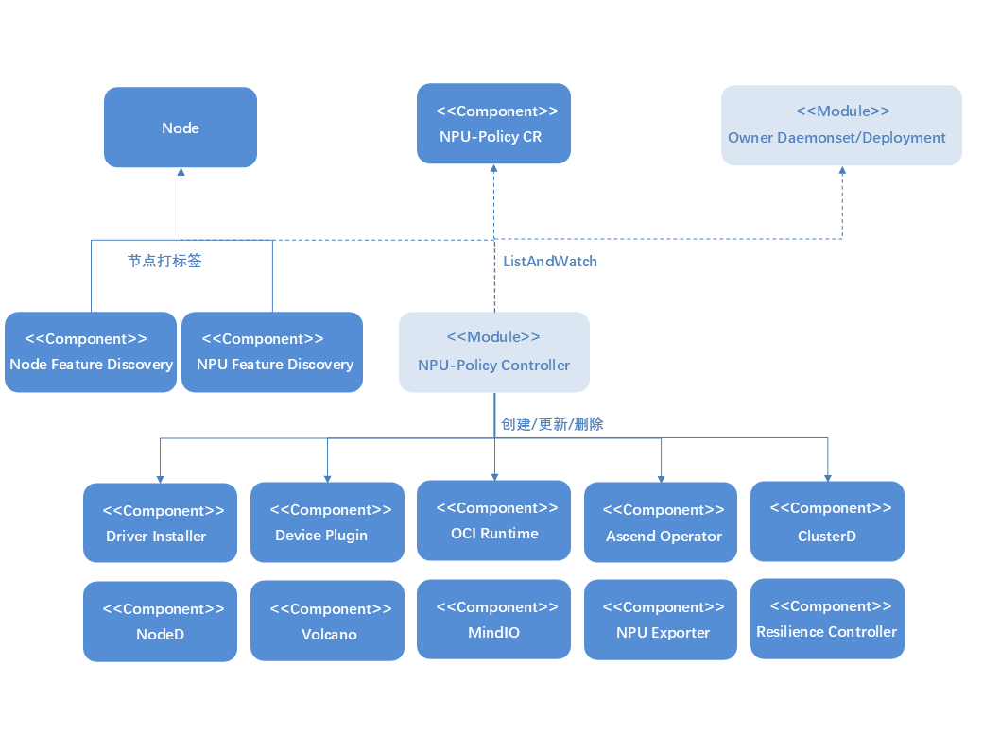

# NPU Operator

## 特性介绍

Kubernetes通过[设备插件](https://kubernetes.io/docs/concepts/extend-kubernetes/compute-storage-net/device-plugins/)提供对特殊硬件资源（如昇腾NPU）的访问。但是配置和管理具有这些硬件资源的节点需要配置多个软件组件（如驱动程序、容器运行时或其他库），这些组件安装复杂困难且容易出错。NPU Operator使用Kubernetes中的[Operator Framework](https://operatorframework.io/)来自动管理配置昇腾设备所需的所有软件组件。这些组件包括昇腾驱动程序和固件，使能构建集群全流程运行，支持集群作业调度、运维监控、故障恢复等功能的MindCluster设备插件。通过安装相应的组件，可以实现NPU资源管理、工作负载的优化调度、训推任务的容器化支持，使能AI作业以容器形式部署并运行在NPU设备上。

**表1** 当前支持安装的组件

| 组件名称              | 部署方式   | 组件功能                                                                                                                                                                                      |
| :-------------------- | :--------- | :-------------------------------------------------------------------------------------------------------------------------------------------------------------------------------------------- |
|昇腾驱动和固件|NPU Operator管理下的容器化部署|作为硬件设备和操作系统之间的桥梁，用来让操作系统识别并与硬件设备进行通信。|
| Ascend Device Plugin  | NPU Operator管理下的容器化部署 | 设备发现：基于Kubernetes设备插件机制，增加昇腾AI处理器的设备发现、设备分配、设备健康状态上报功能，使Kubernetes可以管理昇腾AI处理器资源。                                                      |
| Ascend Operator       | NPU Operator管理下的容器化部署 | 环境配置：Volcano协助组件，负责管理acjob类型的任务，将AI框架（MindSpore/PyTorch/TensorFlow）训练任务所需环境变量注入容器，Volcano再接手调度。                           |
| Ascend Docker Runtime | NPU Operator管理下的容器化部署  | 昇腾容器运行时：容器引擎插件，为所有AI作业提供NPU容器化支持，使用户进行AI作业时能够以Docker容器的方式平滑地在昇腾设备上运行。                                                       |
| NPU Exporter | NPU Operator管理下的容器化部署 | 昇腾AI处理器资源数据的实时监测：该功能支持实时采集昇腾AI处理器的各项资源数据，包括处理器利用率、温度、电压、内存使用情况。此外，还能够监测Atlas推理系列产品的虚拟NPU（vNPU），包括AI Core的利用率、vNPU的总内存以及已使用内存等关键指标。 |
| Resilience Controller | NPU Operator管理下的容器化部署 | 动态扩缩容：当任务训练过程中发生故障，并且没有充足的健康资源进行替换，该组件可使用动态缩容的方式，剔除故障资源并继续训练，等资源充足后通过动态扩容方式进行训练任务的恢复。 |
| ClusterD | NPU Operator管理下的容器化部署 | 收集集群任务信息、资源信息和故障信息，统一判定故障处理等级与策略，控制训练容器的进程重计算。 |
| Volcano | NPU Operator管理下的容器化部署 | 从底层组件获取集群资源信息，通过感知昇腾芯片之间的网络连接方式，选择最佳调度策略和最优资源分配，当任务资源故障时，可进行任务重调度。 |
| NodeD | NPU Operator管理下的容器化部署 | 检测节点资源监控状态和节点故障信息，将故障信息上报并防止新任务调度到故障节点上。 |
| MindIO | NPU Operator管理下的容器化部署 | 针对模型训练中断后的临终CheckPoint生成与保存，在线修复模型训练过程中片上内存的UCE故障，提供重启或替换节点完成故障修复和模型续训的能力，优化CheckPoint的保存和加载。 |
| vNPU Device Plugin | NPU Operator管理下的容器化部署 | 支持通过Volcano和vNPU设备插件对昇腾NPU进行虚拟化资源管理，向Kubernetes上报`huawei.com/vnpu-number`、`huawei.com/vnpu-cores`、`huawei.com/vnpu-memory.1Gi`等扩展资源，支持vNPU软切分和硬切分使用场景。 |
| vNPU Client Update | NPU Operator管理下的容器化部署 | 为vNPU场景准备运行时所需客户端依赖，使业务容器能够使用vNPU相关能力。 |
| XPU Exporter | NPU Operator管理下的容器化部署 | 采集vNPU场景下的设备与虚拟设备指标，支持通过自定义端口暴露监控指标。 |
| DRA Kubelet Plugin | NPU Operator管理下的容器化部署 | 基于Kubernetes Dynamic Resource Allocation机制发布ResourceSlice，处理ResourceClaim分配结果，并通过CDI向业务容器注入昇腾设备、环境变量和挂载信息。 |
| DRA DeviceClass | NPU Operator管理下的容器化部署 | 创建并维护DRA调度所需的DeviceClass，支持整卡、硬切分和软切分设备选择，也支持用户通过CEL表达式扩展自定义DeviceClass。 |
| DRA vCANN-RT Installer | NPU Operator管理下的容器化部署 | 为DRA软切分场景安装和准备vCANN-RT相关依赖，供DRA插件在容器准备阶段注入软切分运行时文件。 |

关于组件的详细信息请参考[MindCluster介绍](https://www.hiascend.com/software/mindcluster)。

### 组件版本配套关系

**表2** 当前支持安装的组件与默认版本

| 组件名称              | 版本型号                        |
| --------------------- | ------------------------------- |
| 昇腾驱动和固件        | 25.5.0                        |
| Ascend Device Plugin  | 7.3.0                         |
| Ascend Operator       | 7.3.0                         |
| Ascend Docker Runtime | 7.3.0                         |
| NPU Exporter          | 7.3.0                         |
| Resilience Controller | 7.1.RC1                         |
| ClusterD              | 7.3.0                         |
| Volcano               | 7.3.0（基于原始Volcano1.9.0） |
| NodeD                 | 7.3.0                         |
| MindIO                | 7.3.0                         |
| vNPU                  | 跟随NPU Operator版本或镜像tag配置 |
| DRA                   | 跟随NPU Operator版本或镜像tag配置 |

### 应用场景

构建基于昇腾设备的集群，支持集群作业调度、运维监控、故障恢复的功能场景，NPU Operator可以自动识别集群中的昇腾节点进行相应的安装部署工作。对于训练场景，支持NPU资源检测、整卡调度、静态vNPU调度、断点续训以及弹性训练等功能。而对于推理场景，支持资源检测、整卡调度、静态vNPU调度、动态vNPU调度、推理卡故障恢复和重调度功能。

### 能力范围

- 自动发现昇腾NPU设备节点，对节点进行标记。
- 自动部署昇腾NPU的驱动固件。
- 集群调度组件的MindCluster自动化部署安装和生命周期管理。
- 支持vNPU组件和vNPU配套Volcano资源的一键安装、配置更新和卸载。
- 支持DRA kubelet plugin、DeviceClass、ResourceSlice发布链路和DRA软切分依赖组件的安装、配置更新和卸载。
- 支持通过节点选择器将MindCluster、vNPU和DRA组件部署到不同节点，并检测关键节点组件的调度冲突。

### 亮点特征

NPU Operator能够自动识别集群中昇腾节点以及设备型号，安装对应版本的AI运行必要组件，极大简化了配置昇腾生态组件的使用门槛。对于所安装的组件进行全生命周期管理和自动化配置部署，NPU Operator可检测组件安装状态，并提供详细日志进行调试。

### 实现原理

- Operator通过监控CRD实例化的CR变化实现对管理组件状态的修改。
- Operator通过NFD在节点上标记的标签，利用npu-feature-discovery组件给节点标记上符合昇腾组件调度的节点标签。

**图 1** 原理图



### 与相关特性的关系

请确保application-management-service和marketplace-service正常运行，以保证该特性能够从应用市场正常安装。

## Operator的安全上下文

一些NPU Operator管理的Pod（例如驱动程序容器）需要提升的权限如下。

- `privileged: true`
- `hostPID: true`
- `hostIPC: true`
- `hostNetwork: true`

提升权限的原因如下：

- 访问主机文件系统和硬件设备，在宿主机上安装驱动固件和SDK服务。
- 修改设备权限，以适配非root用户使用。

## 安装

### openFuyao平台部署

#### 在线安装

##### 前提条件

- 当前计算机上有kubectl和Helm CLI，或集群中有可配置的应用商店或仓库。

- 请确认环境中含有bash工具，否则可能导致驱动固件安装脚本解析失败。

- Kubernetes集群中运行NPU工作负载的所有工作节点或节点组运行的操作系统版本都需满足openEuler 22.03 LTS或者Ubuntu 22.04（ARM架构）。

  对于仅运行CPU工作负载的工作节点或节点组，节点可以运行任何操作系统，因为NPU Operator不会对非NPU工作负载的节点执行任何配置或管理。

  当前NPU Operator所安装的组件需要运行环境满足的NPU芯片型号为910B和310P。具体OS和硬件配套关系请参考[MindCluster文档](https://www.hiascend.com/document/detail/zh/mindcluster/2600/clustersched/dlug/docs/zh/scheduling/introduction/03_supported_product_models_and_os.md)。

- 节点特性感知服务（Node-Feature-Discovery）和NPU特性感知服务（NPU-Feature-Discovery）是每个节点上Operator的依赖项。

  >  **说明：** <br />默认情况下，NFD主节点和工作节点由Operator自动部署。如果NFD已在集群中运行，则必须在安装Operator时禁用部署NFD。同样的，如果NPU-Feature-Discovery已经提前部署到集群中了，那么也需要在安装Operator时禁用部署NPU-Feature-Discovery。

  values.yaml

  ```yaml
  nfd:
    enabled: false
  npu-feature-discovery:
    enabled: false
  ```

  通过检查节点上的NFD标签确定NFD是否已在集群中运行。

  ```sh
  kubectl get nodes -o json | jq '.items[].metadata.labels | keys | any(startswith("feature.node.kubernetes.io"))'
  ```

  如果命令输出为`true`，则NFD已在集群中运行。此时设置`nodefeaturerules`，安装NPU自定义节点发现规则。
  
    ```yaml
    nfd:
      nodefeaturerules: true
    ```

  默认情况下，nfd为true状态，npu-feature-discovery为true状态，nodefeaturerules为false状态。

- 已在集群中安装openFuyao平台，安装方式参考[快速安装](https://docs.openfuyao.cn/zh/docs/v26.03/quick_start.html#%E5%BF%AB%E9%80%9F%E5%AE%89%E8%A3%85)文档。

##### 安装步骤

NPU Operator扩展组件，可在openFuyao应用市场下载安装。

1. 参考openFuyao[平台使用文档](https://docs.openfuyao.cn/zh/docs/v26.03/quick_start.html#%E5%BF%AB%E9%80%9F%E5%AE%89%E8%A3%85)，进入openFuyao平台，在左侧导航栏中选择“应用市场 > 应用列表”。

2. 在应用列表搜索“npu-operator”，找到NPU Operator扩展组件。

3. 单击NPU Operator卡片进入应用的详情页。

4. 在详情页单击右上角的“部署”，在部署界面的“安装信息”模块中输入“应用名称”，“版本信息”和“命名空间”。

5. 单击“确认”，即可成功部署该组件。

   >  **说明：** <br />目前在线安装功能，支持910B、310P系列型号的驱动固件安装，暂不支持910C型号的驱动固件在线安装，如若需要安装910C型号的驱动固件，请参考[离线安装](#离线安装)章节。通过应用市场进行npu-operator组件的安装部署时，可以修改对应的values.yaml的参数，详情请见[表4](#table12454324567857465342)。

#### 离线安装

<span id="openfuyao-platform-offline-prerequisites"></span>

##### 前提条件

- 当前计算机上有kubectl和Helm CLI，或集群中有可配置的应用商店或仓库。

- 请确认环境中含有bash工具，否则可能导致驱动固件安装脚本解析失败。

- Kubernetes集群中运行NPU工作负载的所有工作节点或节点组运行的操作系统版本都需满足openEuler 22.03 LTS或者Ubuntu 22.04（ARM架构）。

  对于仅运行CPU工作负载的工作节点或节点组，节点可以运行任何操作系统，因为NPU Operator不会对非NPU工作负载的节点执行任何配置或管理。

  当前NPU Operator所安装的组件需要运行环境满足的NPU芯片型号为910B和310P。具体OS和硬件配套关系请参考[MindCluster文档](https://www.hiascend.com/document/detail/zh/mindcluster/2600/clustersched/dlug/docs/zh/scheduling/introduction/03_supported_product_models_and_os.md)。

- 已在集群中安装openFuyao平台，安装方式参考[快速安装](https://docs.openfuyao.cn/zh/docs/v26.03/quick_start.html#%E5%BF%AB%E9%80%9F%E5%AE%89%E8%A3%85)文档。

- 下载离线镜像：将需要安装的组件所用到的全部镜像下载到本地，并导入到集群容器运行时中。详情见[表3](#table20260614)。

- 准备驱动固件zip包和MindIO组件的zip包：
  - **下载驱动固件zip包**：可前往`npu-driver-installer`仓库，查看`downloader/NPU/25.3.RC1/config.json`文件，按照对应节点的NPU型号、OS架构单击相应链接来下载对应的驱动固件压缩包；910C型号NPU支持离线驱动固件安装，需要从[昇腾社区-固件与驱动下载](https://www.hiascend.com/hardware/firmware-drivers/community?product=1&model=30&cann=8.5.0.alpha002&driver=Ascend+HDK+25.3.RC1)自行下载，其余型号的驱动固件zip包也可前往上述链接进行下载。
  - **下载MindIO组件zip包**：可前往`npu-node-provision`仓库，查看`downloader/software/6.0.0/config.json`文件，按照对应节点的NPU型号、OS架构，单击相应链接来下载对应的SDK压缩包。

- 将驱动固件包的zip文件放到需要进行离线安装的节点路径下：`/tmp/driver_pkg/`，该路径可自定义修改，具体修改方式请参考[表4](#table12454324567857465342)中的`driver.env`字段。

- 将MindIO组件的zip包放到需要进行离线安装的节点路径下：`/opt/openFuyao/mindio/`

- 检查待安装节点中是否含有以下工具：
  - 如果使用的包管理工具为yum，则需要安装的pkg为：**"jq wget unzip which initscripts coreutils findutils gawk e2fsprogs util-linux net-tools pciutils gcc make automake autoconf libtool git patch kernel-devel-$(uname -r) kernel-headers-$(uname -r) dkms"**<br/>
    可使用如下命令进行检测。
    ```bash
    pkgs=(jq wget unzip which initscripts coreutils findutils gawk e2fsprogs util-linux net-tools pciutils gcc make automake autoconf libtool git patch kernel-devel-$(uname -r) kernel-headers-$(uname -r) dkms); rpm -q "${pkgs[@]}" >/dev/null || rpm -q "${pkgs[@]}" | grep "is not installed"
    ```
  - 如果使用的包管理工具为apt-get，需要安装的pkg为：**"jq wget unzip debianutils coreutils findutils gawk e2fsprogs util-linux net-tools pciutils gcc make automake autoconf libtool git patch dkms linux-headers-$(uname -r)"**<br/>
    可使用如下命令进行检测。
    ```bash
    pkgs=(jq wget unzip debianutils coreutils findutils gawk e2fsprogs util-linux net-tools pciutils gcc make automake autoconf libtool git patch dkms linux-headers-$(uname -r)); dpkg-query -W -f='${Package}\t${Status}\n' "${pkgs[@]}" 2>&1 | grep -Ev "install ok installed"
    ```

  - 如果使用的包管理工具为dnf，则需要安装的pkg为：**"jq wget unzip which initscripts coreutils findutils gawk e2fsprogs util-linux net-tools pciutils gcc make automake autoconf libtool git patch kernel-devel-$(uname -r) kernel-headers-$(uname -r) dkms"**<br/>
    可使用如下命令进行检测。
    ```bash
    pkgs=(jq wget unzip which initscripts coreutils findutils gawk e2fsprogs util-linux net-tools pciutils gcc make automake autoconf libtool git patch kernel-devel-$(uname -r) kernel-headers-$(uname -r) dkms); rpm -q "${pkgs[@]}" >/dev/null || rpm -q "${pkgs[@]}" | grep "is not installed"
    ```

**表3** 组件涉及到的镜像列表<span id="table20260614"></span>

| 组件           | 镜像                  |
| -------------- | -------------------- |
| 昇腾驱动和固件        | cr.openfuyao.cn/openfuyao/npu-driver-installer:latest        |
| ascend-docker-runtime        | cr.openfuyao.cn/openfuyao/ascend-docker-runtime:v7.3.0<br/>cr.openfuyao.cn/openfuyao/npu-container-toolkit:latest      |
| clusterd        | hub.oepkgs.net/openfuyao/ascendhub/clusterd:v7.3.0        |
| device-plugin        | hub.oepkgs.net/openfuyao/ascendhub/ascend-k8sdeviceplugin:v7.3.0<br/>hub.oepkgs.net/openfuyao/busybox:1.36.1        |
| mindio        | cr.openfuyao.cn/openfuyao/npu-node-provision:latest        |
| noded        | hub.oepkgs.net/openfuyao/ascendhub/noded:v7.3.0        |
| npu-exporter        | hub.oepkgs.net/openfuyao/ascendhub/npu-exporter:v7.3.0        |
| resilience-controller        | hub.oepkgs.net/openfuyao/ascendhub/resilience-controller:v7.1.RC1        |
| ascend-operator        | hub.oepkgs.net/openfuyao/ascendhub/ascend-operator:v7.3.0<br/>hub.oepkgs.net/openfuyao/busybox:1.36.1        |
| volcano        | hub.oepkgs.net/openfuyao/ascendhub/vc-controller-manager:v1.9.0-v7.3.0<br/>hub.oepkgs.net/openfuyao/ascendhub/vc-scheduler:v1.9.0-v7.3.0<br/>hub.oepkgs.net/openfuyao/busybox:1.36.1        |
| vNPU Volcano        | cr.openfuyao.cn/openfuyao/vnpu/vc-controller-manager:latest<br/>cr.openfuyao.cn/openfuyao/vnpu/vc-scheduler:latest<br/>cr.openfuyao.cn/openfuyao/vnpu/vc-webhook-manager:latest<br/>hub.oepkgs.net/openfuyao/busybox:1.36.1        |
| vNPU        | cr.openfuyao.cn/openfuyao/vnpu/acl-client-update-910b:latest<br/>cr.openfuyao.cn/openfuyao/vnpu/npu-device-plugin:latest<br/>cr.openfuyao.cn/openfuyao/vnpu/xpu-exporter:latest        |
| DRA        | cr.openfuyao.cn/openfuyao/npu-dra-plugin:latest<br/>cr.openfuyao.cn/openfuyao/vnpu/acl-client-update-910b:latest        |
| npu-operator        | cr.openfuyao.cn/openfuyao/npu-operator:latest        |
| node-feature-discovery       | hub.oepkgs.net/openfuyao/nfd/node-feature-discovery:v0.16.4        |
| npu-feature-discovery       | cr.openfuyao.cn/openfuyao/npu-feature-discovery:latest        |

>  **注意：** <br />Helm chart中的acl-client-update相关镜像默认使用**910B**型号。如果使用其他型号的NPU卡，需通过`--set`指定对应镜像名或修改yaml中对应字段：
   > 
   > | NPU型号 | `images.draVCANNRTInstaller.repository` 取值 | `images.vnpuClientUpdate.repository` 取值 |
   > |---------|-----------------------------------|-----------------------------------|
   > | 910B    | `cr.openfuyao.cn/openfuyao/vnpu/acl-client-update-910b`（默认）   | `cr.openfuyao.cn/openfuyao/vnpu/acl-client-update-910b`  |
   > | 310P    | `cr.openfuyao.cn/openfuyao/vnpu/acl-client-update-310p`          | `cr.openfuyao.cn/openfuyao/vnpu/acl-client-update-310p`  |
   > | 910C    | `cr.openfuyao.cn/openfuyao/vnpu/acl-client-update-910c`          | `cr.openfuyao.cn/openfuyao/vnpu/acl-client-update-910c`  |
   > 
   > 例如，组件部署在310P型号NPU上时：
   > ```shell
   > helm install npu-operator oci://cr.openfuyao.cn/charts/npu-operator --version 0.0.0-latest --set images.draVCANNRTInstaller.repository=cr.openfuyao.cn/openfuyao/vnpu/acl-client-update-310p
   > ```

##### 安装步骤

请参见[安装步骤](#安装步骤)。

### 独立部署

#### 在线安装

##### 前提条件

- 当前计算机上有kubectl和Helm CLI，或集群中有可配置的应用商店或仓库。

- 请确认环境中含有bash工具，否则可能导致驱动固件安装脚本解析失败。

- Kubernetes集群中运行NPU工作负载的所有工作节点或节点组运行的操作系统版本都需满足openEuler 22.03 LTS或者Ubuntu 22.04（ARM架构）。

- 对于仅运行CPU工作负载的工作节点或节点组，节点可以运行任何操作系统，因为NPU Operator不会对非NPU工作负载的节点执行任何配置或管理。

- 当前NPU Operator所安装的组件需要运行环境满足的NPU芯片型号为910B和310P。具体OS和硬件配套关系请参考[MindCluster文档](https://www.hiascend.com/document/detail/zh/mindcluster/2600/clustersched/dlug/docs/zh/scheduling/introduction/03_supported_product_models_and_os.md)。

##### 二进制安装

1. 添加openFuyao Helm存储库。

   ```shell
   helm repo add openfuyao https://helm.openfuyao.cn && helm repo update
   ```

2. 拉取项目包。

   ```bash
   helm pull oci://cr.openfuyao.cn/charts/npu-operator --version xxx
   ```

   其中`xxx`需替换为具体项目安装包版本，如`0.0.0-latest`。拉取到的安装包为压缩包形式。

3. 安装NPU Operator。

   使用默认配置安装Operator：

   ```shell
   helm install --wait --generate-name \
   -n default --create-namespace \
   npu-operator-xxx.tgz
   ```

   若需修改安装参数，详情请参见[常见定制选项](#常见定制选项)。

   >  **说明：** <br />
   >
   > - 安装完NPU Operator后，会根据不同节点环境，为节点打上与NPU资源相关的标签，这些标签与集群调度组件相关。其中accelerate-type标签需要节点的硬件服务器与NPU卡完全匹配，具体匹配关系可参考MindCluster文档的[创建节点标签](https://www.hiascend.com/document/detail/zh/mindcluster/2600/clustersched/dlug/docs/zh/scheduling/installation_guide/03_installation/manual_installation/01_preparing_for_installation.md)。
   > - 对于A800I A2推理服务器，暂不支持自动添加server-usage=infer标签，需要用户执行如下命令手动添加。
   > ```bash
   > kubectl label nodes <节点名称> server-usage=infer
   > ```

##### 源码安装

1. 从npu-operator仓库拉取项目。

   ```bash
   git clone -b xxx https://gitcode.com/openfuyao/npu-operator.git
   ```

   其中`xxx`指的是代码的分支。

2. 安装部署。

   以命名空间`default`、release名称`npu-operator`为例，在`npu-operator`同级目录下执行如下命令。

   ```bash
   cd npu-operator/charts/npu-operator
   helm install -n default npu-operator .
   ```

   若需修改安装参数，详情请参见[常见定制选项](#常见定制选项)。

##### 常见定制选项

使用Helm Chart时，以下选项可进行修改，这些选项通过`--set`或者`--set-json`（修改组件环境变量、volumes等list结构时使用）在Helm安装时使用，由于配置项过多，推荐直接对chart包中的values.yaml进行对应字段的修改。

[表4](#table12454324567857465342)列出了最常用的字段，其余字段可查看 `npu-operator` 仓库中的 `charts/npu-operator/values.yaml` 文件。

**表4** 常用的选项<span id="table12454324567857465342"></span>

| 范围            |描述          | 默认                                            |
|:------------------------------------------|:-------------------------------------------------------------|:----------------------------------------------|
| `nfd.enabled`                             | 部署节点特性感知服务NFD，如果NFD已在集群中运行，则设置此变量为`false`。<br /> <blockquote> **说明：** <br />若安装时为`true`，使用时尽量不要修改此字段为`false`，否则会导致卸载时NFD残留标签。</blockquote>                                                      | `true`                                        |
| `nfd.nodefeaturerules`                    | 设置为`true`时，安装NFD发现NPU设备规则CR。                                                                                                                                                                         | `true`                                    |
| `node-feature-discovery.image.repository` | NFD服务镜像地址。                                                                                                                                                                                           | `registry.k8s.io/nfd/node-feature-discovery`  |
| `node-feature-discovery.image.pullPolicy` | NFD服务镜像拉取策略。                                                                                                                                                                                         | `Always`                           |
| `node-feature-discovery.image.tag`        | NFD服务镜像版本。                                                                                                                                                                                           | `v0.16.4`                                     |
| `npu-feature-discovery.images.core.repository` | NPU-Feature-Discovery镜像地址。 | `cr.openfuyao.cn/openfuyao/npu-feature-discovery` |
| `npu-feature-discovery.images.core.pullPolicy` | NPU-Feature-Discovery镜像拉取策略。 | `Always` |
| `npu-feature-discovery.images.core.tag` | NPU-Feature-Discovery镜像版本。 | `latest` |
| `npu-feature-discovery.enabled` | 部署NPU-Feature-Discovery的开关，如果NPU-Feature-Discovery已经在集群中运行了，则设置此变量为false。 | `true` |
| `images.operator.repository`     | NPU Operator镜像地址。                                                                                                                                                                                    | `cr.openfuyao.cn/openfuyao/npu-operator` |
| `images.operator.tag`     | NPU Operator镜像版本。                                                                                                                                                                                    | `latest`                                      |
| `images.operator.pullPolicy`    | NPU Operator镜像拉取策略。                                                                                                                                                                                  | `Always`                           |
| `daemonSets.labels`                       | 要添加到所有NPU Operator管理Pod的自定义标签。                                                                                                                                                                       | `{}`                                          |
| `daemonSets.tolerations`                  | 要添加到所有NPU Operator管理Pod的自定义容忍。                                                                                                                                                                       | `[]`                                   |
| `driver.enabled`                          | 默认情况下，Operator会将NPU驱动固件程序作为容器部署在系统上。    | `true`                                        |
| `images.driver.repository` | 驱动固件程序镜像存储地址。                                                                                                                                                  | `cr.openfuyao.cn/openfuyao/npu-driver-installer` |
| `images.driver.tag`      | 驱动固件安装服务的镜像版本。                                                                                                                   | `latest`                           |
| `driver.env` | 驱动固件安装服务相关的环境变量<br>1. name: HOST_DRIVER_SOURCE_PATH<br>    value: "/tmp/driver_pkg"<br>2. name: DRIVER_VERSION<br/>    value: "25.3.RC1" | 1.该环境变量指定驱动固件压缩包的放置路径<br>2.该环境变量指定驱动固件压缩包的在线下载安装版本。 |
| `devicePlugin.enabled`                    | 默认情况下，Operator会将NPU设备插件程序部署在系统上。在预装设备插件的系统上使用Operator时，请将此值设置为`false`。<br /> <blockquote> **说明：** <br />修改此字段为`false`时，其他同时设置的字段不生效。</blockquote> | `true`                                        |
| `images.devicePlugin.repository`          | 设备插件程序镜像地址。                                       | `hub.oepkgs.net/openfuyao/ascendhub/ascend-k8sdeviceplugin` |
| `images.devicePlugin.tag`    | 设备插件服务的镜像版本。                                     | `v7.3.0`                                         |
| `trainer.enabled`                    | 默认情况下，Operator会安装Ascend operator，若不需要安装请将该值设置为`false`。 | `true`                                        |
| `images.trainer.repository`     | Ascend operator镜像地址。                                                                                                              | `hub.oepkgs.net/openfuyao/ascendhub/ascend-operator` |
| `images.trainer.tag`      | Ascend operator镜像版本。                                                                                                                                                                           | `v7.3.0`                              |
| `ociRuntime.enabled`             | 默认情况下，Operator会安装Ascend Docker Runtime，若不需要安装请将该值设置为`false`。 | `true`                                        |
| `images.ociRuntime.repository`     | Ascend Docker Runtime镜像地址。                                                                                                               | `cr.openfuyao.cn/openfuyao/npu-container-toolkit` |
| `images.ociRuntime.tag`             | Ascend Docker Runtime镜像的版本。                                                                                                                                                                     | `latest`                                      |
| `nodeD.enabled` | 默认情况下，Operator会安装nodeD，若不需要安装请将该值设置为`false`。 | `true` |
| `images.nodeD.repository` | nodeD镜像地址。 | `hub.oepkgs.net/openfuyao/ascendhub/noded` |
| `images.nodeD.tag` | nodeD镜像的版本。 | `v7.3.0` |
| `clusterd.enabled`                        | 默认情况下，Operator会安装clusterD组件，若不需要安装请将该值设置为`false`。 | `true`                                                 |
| `images.clusterd.repository`              | clusterD镜像地址。                                           | `hub.oepkgs.net/openfuyao/ascendhub/clusterd` |
| `images.clusterd.tag`                     | clusterD镜像的版本。                                          | `v7.3.0`                                       |
| `rscontroller.enabled`                    | 默认情况下，Operator会安装resilience controller组件，若不需要安装请将该值设置为`false`。 | `true`                                                 |
| `images.rscontroller.repository`          | resilience controller镜像地址。                              | `hub.oepkgs.net/openfuyao/ascendhub/resilience-controller` |
| `images.rscontroller.tag`                 | resilience controller镜像的版本。                            | `v7.1.RC1`                                         |
| `exporter.enabled`                        | 默认情况下，Operator会安装NPU Exporter组件，若不需要安装请将该值设置为`false`。 | `true`                                                 |
| `images.exporter.repository` | NPU Exporter镜像地址。 | `cr.openfuyao.cn/openfuyao/npu-exporter` |
| `images.exporter.tag` | NPU Exporter镜像的版本。 | `v7.3.0` |
| `mindiotft.enabled` | 默认情况下，Operator会安装MindIO Training Fault Tolerance，若不需要安装请将该值设置为`false`。 | `true` |
| `images.mindiotft.repository` | MindIO Training Fault Tolerance镜像地址。 | `cr.openfuyao.cn/openfuyao/npu-node-provision` |
| `images.mindiotft.tag` | MindIO Training Fault Tolerance镜像的版本。 | `latest` |
| `mindioacp.enabled` | 默认情况下，Operator会安装MindIO Async Checkpoint Persistence，若不需要安装请将该值设置为`false`。 | `true` |
| `images.mindioacp.repository` | MindIO Async Checkpoint Persistence服务镜像地址。 | `cr.openfuyao.cn/openfuyao/npu-node-provision` |
| `images.mindioacp.tag` | MindIO Async Checkpoint Persistence服务镜像的版本。 | `latest` |
| `mindioacp.version` | MindIO Async Checkpoint Persistence的版本。 | `7.3.0` |
| `vccontroller.enabled` | 默认情况下，Operator会安装volcano-controller，若不需要安装请将该值设置为`false`。 | `true` |
| `images.vccontroller.repository` | volcano-controller服务镜像地址。 | `hub.oepkgs.net/openfuyao/ascendhub/vc-controller-manager` |
| `images.vccontroller.tag` | volcano-controller服务镜像的版本。 | `v1.9.0-v7.3.0` |
| `vcscheduler.enabled`                          | 默认情况下，Operator会安装volcano-scheduler，若不需要安装请将该值设置为`false`。 | `true`                                                       |
| `images.vcscheduler.repository`                | volcano-scheduler服务镜像地址。                              | `hub.oepkgs.net/openfuyao/ascendhub/vc-scheduler`            |
| `images.vcscheduler.tag`                       | volcano-scheduler服务镜像的版本。                            | `v1.9.0-v7.3.0` |
| `volcano.flavor` | Volcano组件类型，支持`mindcluster`、`vnpu`、`external`。设置为`mindcluster`时，Operator使用MindCluster配套Volcano资源；设置为`vnpu`时，Operator使用vNPU配套Volcano scheduler、controller、admission等资源；设置为`external`时，Operator不管理MindCluster或vNPU Volcano工作负载。 | `mindcluster` |
| `vnpu.enabled` | 是否启用vNPU组件管理。启用后，Operator管理vNPU命名空间、client-update、vNPU device plugin和可选XPU Exporter。 | `false` |
| `vnpu.nodeSelector` | vNPU组件共享节点选择器，组件级`nodeSelector`非空时会覆盖共享配置。默认配置为`huawei.com/vnpu: ready`，等价于选择带有`huawei.com/vnpu=ready`标签的NPU节点。 | `huawei.com/vnpu: ready` |
| `vnpu.clientUpdate.enabled` | 是否部署vNPU Client Update组件。 | `true` |
| `vnpu.devicePlugin.enabled` | 是否部署vNPU Device Plugin组件。 | `true` |
| `vnpu.devicePlugin.deviceSplitCount` | vNPU Device Plugin启动参数，表示单张物理卡允许切分出的虚拟设备数量。 | `20` |
| `vnpu.devicePlugin.loggingConsole` | 是否将vNPU Device Plugin日志输出到控制台。 | `true` |
| `vnpu.exporter.enabled` | 是否部署XPU Exporter。 | `false` |
| `vnpu.exporter.port` | XPU Exporter指标服务侦听端口，Operator会同步更新容器启动参数和Service的targetPort。 | `8082` |
| `dra.enabled` | 是否启用DRA组件管理。启用后，Operator可管理DRA kubelet plugin、DeviceClass、软切分配置和可选webhook。 | `false` |
| `dra.nodeSelector` | DRA组件共享节点选择器，组件级`nodeSelector`非空时会覆盖共享配置。 | `{}` |
| `dra.driverName` | DRA驱动名称，需要与DeviceClass中的`device.driver`表达式以及业务ResourceClaim使用的DeviceClass保持一致。 | `npu.huawei.com` |
| `dra.deviceProfile` | DRA插件设备配置类型，NPU场景使用`npu`。 | `npu` |
| `dra.cdiRoot` | CDI规范文件输出目录，需要与节点容器运行时读取CDI文件的目录一致。 | `/var/run/cdi` |
| `dra.kubeletPlugin.enabled` | 是否部署DRA kubelet plugin DaemonSet。 | `true` |
| `dra.deviceClasses.enabled` | 是否由Operator创建和维护DRA DeviceClass。关闭后，用户需要自行创建ResourceClaim引用的DeviceClass。 | `false` |
| `dra.deviceClasses.templates` | 自定义DeviceClass模板列表，每项包含`name`和`selectorCEL`。新增模板会创建同名DeviceClass；从列表中删除模板后，Operator会清理对应DeviceClass。 | `[]` |
| `dra.softVNPU.enabled` | 是否启用DRA软切分配置和相关组件。启用后，DRA kubelet plugin会加载软切分配置，并可部署vCANN-RT Installer。 | `false` |
| `dra.softVNPU.shareCount` | DRA软切分场景单张物理NPU允许共享的份数。 | `16` |
| `dra.softVNPU.npuProfileConfigPath` | DRA kubelet plugin容器内读取软切分配置文件的路径。 | `/etc/dra/dra.config` |
| `dra.softVNPU.chipCapabilitiesConfigMap` | DRA切分能力模板ConfigMap名称，用于描述不同芯片的AI Core、AI CPU、内存总量和可用切分模板。 | `vnpu-template-config` |
| `dra.softVNPU.chipCapabilitiesNamespace` | DRA切分能力模板ConfigMap所在命名空间。留空时使用DRA组件所在命名空间。 | `""` |
| `dra.softVNPU.profileConfig` | DRA插件读取的`dra.config`内容，可按节点和物理卡配置`vnpuMode`、`schedulingPolicy`以及软切分挂载信息。 | `""` |
| `dra.softVNPU.chipCapabilities` | DRA切分能力模板配置，描述不同芯片的AI Core、AI CPU、内存总量和可用切分模板。 | 参见values.yaml |
| `dra.softVNPU.vcannrtInstaller.enabled` | 是否部署DRA软切分依赖的vCANN-RT Installer组件。 | `true` |
| `dra.webhook.enabled` | 是否部署DRA validation webhook。当前默认关闭；如使用支持NPU profile的webhook镜像，可通过`commandSpec`覆盖启动参数后启用。 | `false` |

#### 离线安装

##### 前提条件

请参见[openFuyao平台部署-离线安装-前提条件](#openfuyao-platform-offline-prerequisites)，准备驱动固件zip包、离线镜像与相关工具。使用二进制安装或源码安装时，无需安装openFuyao平台。

##### 安装步骤

安装步骤参考[二进制安装](#二进制安装)和[源码安装](#源码安装)章节。常见定制选项见[表4](#table12454324567857465342)。

## vNPU和DRA场景配置

NPU Operator新增支持对vNPU和DRA相关组件进行统一管理。用户可以通过Helm values或直接修改`NPUClusterPolicy`CR完成组件安装、升级、卸载和参数调整。

>  **说明：** <br />vNPU、DRA和MindCluster Device Plugin均会管理NPU设备分配链路。若这些组件选择到同一节点，可能产生设备分配冲突。NPU Operator会在Reconcile时检测关键DaemonSet的`nodeSelector`是否存在节点重叠，发现冲突后会将NPUClusterPolicy置为未就绪并阻止冲突组件继续部署。需要在同一集群中同时启用多种能力时，请通过`nodeSelector`将不同能力调度到不同节点。

vNPU和DRA适用场景如表5所示。

**表5** vNPU和DRA适用场景

| 场景 | 资源申请方式 | 适用场景 | 共存说明 |
|------|--------------|----------|----------|
| vNPU | 基于Device Plugin上报`huawei.com/vnpu-*`扩展资源，由业务Pod在`resources.requests/limits`中申请。 | 已使用vNPU Device Plugin和vNPU配套Volcano资源的集群，或需要沿用传统Device Plugin资源申请方式的业务。 | 与MindCluster Device Plugin、DRA Kubelet Plugin不能选择到同一节点。 |
| DRA | 基于Kubernetes Dynamic Resource Allocation，通过DeviceClass、ResourceClaim或ResourceClaimTemplate声明式申请设备。 | 需要按设备属性、NUMA、整卡、硬切分或软切分容量进行精细化调度的业务。 | 与vNPU Device Plugin、MindCluster Device Plugin不能选择到同一节点。 |

>  **说明：** <br />vNPU和DRA可在同一集群内共存，但不能在同一节点上共同管理NPU设备。共存时需为不同节点配置互斥标签，并分别设置`vnpu.nodeSelector`、`dra.nodeSelector`或`devicePlugin.nodeSelector`进行隔离。

### vNPU场景

vNPU场景适用于通过vNPU Device Plugin和vNPU配套Volcano调度器管理虚拟NPU资源的场景。启用该场景时，需要将`volcano.flavor`设置为`vnpu`，并启用`vnpu.enabled`。如果不需要安装MindCluster设备插件，可同时关闭`devicePlugin.enabled`，避免同一节点上同时运行两套设备插件。

示例values.yaml如下。

```yaml
volcano:
  flavor: vnpu

devicePlugin:
  enabled: false

vnpu:
  enabled: true
  nodeSelector:
    huawei.com/vnpu: ready
  clientUpdate:
    enabled: true
  devicePlugin:
    enabled: true
    deviceSplitCount: 20
    loggingConsole: true
  exporter:
    enabled: true
    port: 8082
    https: false
```

使用Helm更新配置。

```bash
helm upgrade npu charts/npu-operator -f vnpu-values.yaml
```

>  **说明：** <br />以上命令中的`charts/npu-operator`为本地Chart路径示例。若使用OCI仓库安装，请替换为对应的Chart引用。

安装完成后，检查vNPU组件和节点扩展资源。

```bash
kubectl get pod -n xpu
kubectl get daemonset -n xpu
kubectl get node -o json | jq '.items[].status.allocatable | with_entries(select(.key | test("huawei.com/vnpu")))'
```

>  **说明：** <br />以上命令依赖`jq`工具。若运行环境未预装`jq`，请先通过操作系统包管理工具安装。

业务Pod可通过如下扩展资源申请vNPU。

```yaml
apiVersion: v1
kind: Pod
metadata:
  name: vnpu-demo
spec:
  schedulerName: volcano
  nodeSelector:
    huawei.com/vnpu: ready
  containers:
  - name: app
    image: docker.io/library/ubuntu:22.04
    command: ["/bin/bash", "-c"]
    args: ["sleep 3600"]
    resources:
      limits:
        huawei.com/vnpu-number: 1
        huawei.com/vnpu-cores: 5
        huawei.com/vnpu-memory.1Gi: 8
      requests:
        huawei.com/vnpu-number: 1
        huawei.com/vnpu-cores: 5
        huawei.com/vnpu-memory.1Gi: 8
```

vNPU资源类型如表6所示。

**表6** vNPU资源类型

| 资源名 | 含义 | 取值范围 | 示例 |
|--------|------|----------|------|
| `huawei.com/vnpu-number` | 申请的vNPU实例数量。 | 正整数，不能超过节点上报的可分配vNPU数量。 | `1` |
| `huawei.com/vnpu-cores` | 申请的vNPU AI Core数量。 | 正整数，实际可用值以节点上报资源和`vnpu.devicePlugin.deviceSplitCount`配置为准。 | `5` |
| `huawei.com/vnpu-memory.1Gi` | 申请的vNPU显存容量，单位为Gi。 | 正整数，实际可用值以物理NPU显存和切分规格为准。 | `8` |

>  **说明：** <br />`volcano.flavor`用于选择Operator管理的Volcano资源类型。MindCluster配套Volcano和vNPU配套Volcano的镜像版本及CRD范围可能不同，且两者均使用`volcano-system`命名空间下的`volcano-scheduler`、`volcano-controllers`等资源名，不能在同一集群内由NPU Operator同时部署两套。设置为`vnpu`时，Operator使用vNPU配套的Volcano scheduler、controller和admission资源；设置回`mindcluster`时，Operator会切换回MindCluster配套Volcano资源。切换`volcano.flavor`可能导致正在调度的任务中断，建议在无运行中业务Pod或可接受业务重调度时执行。

### DRA场景前提条件

使用DRA整卡、硬切分或软切分能力前，请确认集群满足以下条件。

- Kubernetes版本使用openFuyao社区推荐版本v1.34.3，或使用支持DRA能力的Kubernetes版本。
- kube-apiserver、kube-scheduler和kubelet已启用`DynamicResourceAllocation`特性门控。
- 使用软切分或硬切分容量申请时，kube-apiserver、kube-scheduler和kubelet已启用`DRAConsumableCapacity`特性门控，否则`memCapacity`、`coreCapacity`、`aiCore`、`aiCPU`等容量字段可能无法生效。
- containerd版本不低于1.7.0，`dra.cdiRoot`需与节点容器运行时读取CDI文件的目录一致。
- 使用硬切分前，节点需已安装并配置`ascend-docker-runtime`。
- 使用软切分前，需通过`dra.softVNPU.vcannrtInstaller.enabled: true`部署vCANN-RT Installer，或确保节点上已预装vCANN-RT劫持库，并同步修改`dra.softVNPU.profileConfig`中的软切分挂载路径。

更多DRA能力、约束和使用示例请参考`npu-dra-plugin`仓库。

DRA资源申请字段如表7所示。

**表7** DRA资源申请字段

| 字段或资源 | 含义 | 取值范围 | 示例 |
|------------|------|----------|------|
| `full.npu.huawei.com` | 整卡DeviceClass，申请完整NPU设备。 | 无需配置capacity，按`count`申请。 | `deviceClassName: full.npu.huawei.com` |
| `hard.npu.huawei.com` | 硬切分DeviceClass，按固定模板申请vNPU设备。 | `aiCore`、`aiCPU`取值需匹配`dra.softVNPU.chipCapabilities`中的模板。 | `aiCore: 4`、`aiCPU: 2` |
| `elastic.npu.huawei.com` | 软切分弹性调度DeviceClass。 | `memCapacity`为内存配额，`coreCapacity`为AI Core计算配额百分比，取值范围为1-100；多个Pod申请总量不能超过物理NPU可用容量。 | `memCapacity: 4Gi`、`coreCapacity: 50`（表示50%） |
| `fixed.npu.huawei.com` | 软切分固定份额调度DeviceClass。 | 使用`memCapacity`和`coreCapacity`申请软切分容量，适用于固定份额资源申请。 | `deviceClassName: fixed.npu.huawei.com` |
| `best-effort.npu.huawei.com` | 软切分尽力而为调度DeviceClass。 | 使用`memCapacity`和`coreCapacity`申请软切分容量，适用于可接受资源竞争的场景。 | `deviceClassName: best-effort.npu.huawei.com` |

### DRA整卡场景

DRA整卡场景适用于使用Kubernetes Dynamic Resource Allocation机制申请整张NPU卡的场景。启用该场景时，需要满足[DRA场景前提条件](#dra场景前提条件)，并打开DRA kubelet plugin和DeviceClass管理。

示例values.yaml如下。

```yaml
devicePlugin:
  enabled: false

dra:
  enabled: true
  driverName: npu.huawei.com
  deviceProfile: npu
  cdiRoot: /var/run/cdi
  kubeletPlugin:
    enabled: true
  deviceClasses:
    enabled: true
  softVNPU:
    enabled: false
  webhook:
    enabled: false
```

安装后检查DRA组件和DeviceClass。

```bash
kubectl get pod -A | grep npu-dra-kubeletplugin
kubectl get deviceclass
kubectl get resourceslice -o yaml
```

创建整卡ResourceClaim和Pod。

```yaml
apiVersion: resource.k8s.io/v1
kind: ResourceClaim
metadata:
  name: dra-full-claim
  namespace: default
spec:
  devices:
    requests:
    - name: npu
      exactly:
        deviceClassName: full.npu.huawei.com
        count: 1
---
apiVersion: v1
kind: Pod
metadata:
  name: dra-full-pod
  namespace: default
spec:
  resourceClaims:
  - name: npu
    resourceClaimName: dra-full-claim
  containers:
  - name: app
    image: docker.io/library/ubuntu:22.04
    command: ["/bin/bash", "-c"]
    args: ["env | grep -E 'DRA|NPU|ASCEND|VISIBLE' | sort; sleep 3600"]
    resources:
      claims:
      - name: npu
```

检查ResourceClaim分配和Pod运行状态。

```bash
kubectl get resourceclaim dra-full-claim -o yaml
kubectl get pod dra-full-pod -o wide
```

### DRA CEL Selector场景

DRA DeviceClass和ResourceClaim均支持通过CEL表达式筛选设备属性。以下示例使用`full.npu.huawei.com`，并在ResourceClaim中根据`numaNode`筛选设备。

先查看现有ResourceSlice中的NUMA属性。

```bash
kubectl get resourceslice -o yaml | grep -E 'numaNode|vnpuMode' -A3 -B3
```

创建命中已有NUMA节点的ResourceClaim和Pod。

```yaml
apiVersion: resource.k8s.io/v1
kind: ResourceClaim
metadata:
  name: dra-cel-hit-claim
  namespace: default
spec:
  devices:
    requests:
    - name: npu
      exactly:
        deviceClassName: full.npu.huawei.com
        count: 1
        selectors:
        - cel:
            expression: device.attributes["npu.huawei.com"].numaNode == 0
---
apiVersion: v1
kind: Pod
metadata:
  name: dra-cel-hit-pod
  namespace: default
spec:
  resourceClaims:
  - name: npu
    resourceClaimName: dra-cel-hit-claim
  containers:
  - name: app
    image: docker.io/library/ubuntu:22.04
    command: ["/bin/bash", "-c"]
    args: ["sleep 3600"]
    resources:
      claims:
      - name: npu
```

如果将表达式改为不存在的NUMA节点值，例如`numaNode == 999`，ResourceClaim将无法完成分配，引用该ResourceClaim的Pod会保持Pending。

### DRA软切分场景

DRA软切分场景适用于通过ResourceClaim申请软切分NPU能力。启用该场景时，需要打开`dra.softVNPU.enabled`，并根据集群实际节点名配置`profileConfig`，或通过节点标签配置运行模式。

执行如下命令查看集群节点名称，后续示例中的`worker-1`需替换为实际Kubernetes节点名。

```bash
kubectl get nodes
```

示例values.yaml如下。

```yaml
devicePlugin:
  enabled: false

dra:
  enabled: true
  driverName: npu.huawei.com
  deviceProfile: npu
  kubeletPlugin:
    enabled: true
  deviceClasses:
    enabled: true
  softVNPU:
    enabled: true
    shareCount: 16
    npuProfileConfigPath: /etc/dra/dra.config
    chipCapabilitiesConfigMap: vnpu-template-config
    profileConfig: |
      softShareMounts:
        - hostPath: /opt/xpu/bin/enpu-monitor
          containerPath: /opt/enpu/vcann-rt/tools/enpu-monitor
          options:
            - ro
            - rbind
        - hostPath: /opt/xpu/bin/systemd-detect-virt
          containerPath: /usr/bin/systemd-detect-virt
          options:
            - ro
            - rbind
      nodes:
        worker-1:
          - physicalId: 0
            vnpuMode: soft
            schedulingPolicy: elastic
    vcannrtInstaller:
      enabled: true
```

也可以通过节点标签将节点整体切换为软切分模式。

```bash
kubectl label node worker-1 vnpu-mode=soft schedulingPolicy=elastic --overwrite
kubectl rollout restart daemonset npu-dra-kubeletplugin
```

>  **说明：** <br />DRA插件识别的节点运行模式标签为`vnpu-mode`，可设置为`full`、`soft`或`hard`；软切分场景可配合`schedulingPolicy=elastic`、`fixed-share`或`best-effort`使用。`profileConfig`中的节点名必须与`kubectl get nodes`返回的实际Kubernetes节点名一致。若环境已通过其他方式预装vCANN-RT劫持库，请将`softShareMounts`中的`hostPath`修改为宿主机上的实际文件路径，并保持`containerPath`不变。

软切分挂载项如表8所示。

**表8** DRA软切分挂载项

| 宿主机路径 | 容器内路径 | 说明 |
|------------|------------|------|
| `/opt/xpu/bin/enpu-monitor` | `/opt/enpu/vcann-rt/tools/enpu-monitor` | 软切分监控工具，由vCANN-RT Installer安装到宿主机。 |
| `/opt/xpu/bin/systemd-detect-virt` | `/usr/bin/systemd-detect-virt` | 软切分运行时依赖的容器环境检测工具，由vCANN-RT Installer安装到宿主机。 |

创建软切分ResourceClaimTemplate和Pod。

```yaml
apiVersion: resource.k8s.io/v1
kind: ResourceClaimTemplate
metadata:
  name: npu-soft-vnpu
  namespace: default
spec:
  spec:
    devices:
      requests:
      - name: npu
        exactly:
          deviceClassName: elastic.npu.huawei.com
          capacity:
            requests:
              memCapacity: 4Gi
              # coreCapacity单位为百分比，50表示申请50%的AI Core计算配额。
              coreCapacity: 50
---
apiVersion: v1
kind: Pod
metadata:
  name: npu-soft-demo
  namespace: default
spec:
  resourceClaims:
  - name: npu
    resourceClaimTemplateName: npu-soft-vnpu
  containers:
  - name: app
    image: docker.io/library/ubuntu:22.04
    command: ["sleep", "3600"]
    resources:
      claims:
      - name: npu
```

检查ResourceClaim、ResourceSlice和Pod状态。

```bash
kubectl get resourceclaim -A
kubectl get resourceslice -o yaml | grep -E 'vnpuMode|schedulingPolicy|memCapacity|coreCapacity' -A3 -B3
kubectl get pod npu-soft-demo -o wide
```

>  **说明：** <br />`memCapacity`、`coreCapacity`、`aiCore`、`aiCPU`等可消耗容量字段依赖Kubernetes集群启用`DRAConsumableCapacity`特性开关。如果API Server、Scheduler或Kubelet未启用该特性，相关capacity字段可能被丢弃，软切分或硬切分容量申请将无法按预期生效。

### DRA硬切分场景

DRA硬切分场景通过`hard.npu.huawei.com` DeviceClass选择`vnpuMode=hard`的设备。需要为节点配置硬切分模式，并在ResourceClaim中申请硬切分容量。

```bash
kubectl label node worker-1 vnpu-mode=hard --overwrite
# 命令结尾的“-”表示删除节点上的schedulingPolicy标签。
kubectl label node worker-1 schedulingPolicy-
kubectl rollout restart daemonset npu-dra-kubeletplugin
```

ResourceClaim和Pod示例如下。

```yaml
apiVersion: resource.k8s.io/v1
kind: ResourceClaim
metadata:
  name: dra-hard-claim
  namespace: default
spec:
  devices:
    requests:
    - name: npu
      exactly:
        deviceClassName: hard.npu.huawei.com
        count: 1
        capacity:
          requests:
            aiCore: 4
            aiCPU: 2
---
apiVersion: v1
kind: Pod
metadata:
  name: dra-hard-pod
  namespace: default
spec:
  runtimeClassName: ascend
  resourceClaims:
  - name: npu
    resourceClaimName: dra-hard-claim
  containers:
  - name: app
    image: docker.io/library/ubuntu:22.04
    command: ["/bin/bash", "-c"]
    args: ["sleep 3600"]
    securityContext:
      capabilities:
        add: ["SYS_ADMIN"]
    resources:
      claims:
      - name: npu
```

### 自定义DRA DeviceClass

当默认DeviceClass不能满足筛选需求时，可通过`dra.deviceClasses.templates`新增自定义DeviceClass。以下示例新增名为`test-soft-share`的DeviceClass。

```yaml
dra:
  enabled: true
  deviceClasses:
    enabled: true
    templates:
      - name: test-soft-share
        selectorCEL: |
          device.driver == "npu.huawei.com" &&
          device.attributes["npu.huawei.com"].vnpuMode == "soft" &&
          device.attributes["npu.huawei.com"].schedulingPolicy == "fixed-share"
```

应用后检查DeviceClass。

```bash
kubectl get deviceclass test-soft-share -o yaml
```

如果从`dra.deviceClasses.templates`中删除该模板并重新应用配置，Operator会自动删除对应DeviceClass。重新应用配置是指再次执行`helm upgrade ... -f values.yaml`，或直接修改`NPUClusterPolicy` CR中的对应字段。需要注意，DeviceClass删除可能影响正在引用该DeviceClass的新建ResourceClaim。

### 组件冲突检测

NPU Operator会检测MindCluster Device Plugin、vNPU Device Plugin、DRA Kubelet Plugin、vNPU Client Update和DRA vCANN-RT Installer等关键节点组件的调度范围是否重叠。检测规则如下。

- 如果两个组件的`nodeSelector`静态上互斥，则认为不冲突。
- 如果两个组件均未配置`nodeSelector`，则认为都会选择所有节点，判定为冲突。
- 如果一个组件未配置`nodeSelector`，另一个组件配置了`nodeSelector`，则在集群中存在命中该`nodeSelector`的节点时判定为冲突。
- 如果两个组件均配置了`nodeSelector`且无法静态判断互斥，则Operator会查询节点并判断是否存在同时满足两个选择器的节点。

组件冲突检测示例如表9所示。

**表9** 组件冲突检测示例

| 组件A | 组件B | 节点标签示例 | 检测结果 |
|-------|-------|--------------|----------|
| MindCluster Device Plugin未配置`nodeSelector` | DRA Kubelet Plugin未配置`nodeSelector` | 任意NPU节点 | 冲突，两个组件都会选择所有节点。 |
| vNPU Device Plugin配置`stack=vnpu` | DRA Kubelet Plugin配置`stack=dra` | `worker-vnpu`带`stack=vnpu`，`worker-dra`带`stack=dra` | 不冲突，两个组件选择的节点集合互斥。 |
| vNPU Device Plugin配置`accelerator=npu` | DRA Kubelet Plugin配置`stack=dra` | 存在同时带`accelerator=npu`和`stack=dra`的节点 | 冲突，两个选择器存在节点重叠。 |

冲突发生时，可通过以下命令查看状态和日志。

```bash
kubectl get npuclusterpolicy cluster -o yaml
kubectl logs deployment/npu-operator --tail=200 | grep -Ei 'conflict|overlapping'
```

同一集群同时使用多种能力时，推荐为节点划分互斥标签。例如将部分节点用于vNPU，部分节点用于DRA。

```bash
kubectl label node worker-vnpu stack=vnpu --overwrite
kubectl label node worker-dra stack=dra --overwrite
```

对应配置如下。

```yaml
vnpu:
  enabled: true
  nodeSelector:
    stack: vnpu

dra:
  enabled: true
  nodeSelector:
    stack: dra
```

如果冲突来自MindCluster配套Volcano和vNPU配套Volcano版本不一致，需要先确定集群统一使用哪一套Volcano资源，不建议通过节点标签同时保留两套Volcano。可按以下方式处理。

- 需要使用vNPU调度能力时，将`volcano.flavor`设置为`vnpu`，并在维护窗口内通过`helm upgrade`切换到vNPU配套Volcano资源。
- 需要继续使用MindCluster训练调度能力时，将`volcano.flavor`保持为`mindcluster`，并关闭`vnpu.enabled`或迁移vNPU业务，避免安装vNPU配套Volcano资源。
- 集群中已有经过验证的外部Volcano时，将`volcano.flavor`设置为`external`，由集群管理员统一维护Volcano版本；此时需自行确认外部Volcano与MindCluster或vNPU业务所需CRD、调度插件和Webhook能力兼容。

切换前建议先停止或迁移正在使用`volcano`调度器的业务Pod，确认无新任务提交后再执行升级。切换后可通过如下命令确认实际生效的Volcano镜像。

```bash
kubectl get deployment -n volcano-system volcano-scheduler volcano-controllers -o jsonpath='{range .items[*]}{.metadata.name}{"\t"}{.spec.template.spec.containers[0].image}{"\n"}{end}'
```

### vNPU和DRA场景卸载

如需仅卸载vNPU或DRA相关组件而保留NPU Operator，可修改values.yaml或`NPUClusterPolicy` CR关闭对应管理开关后重新应用配置。示例values.yaml如下。

```yaml
volcano:
  flavor: mindcluster

vnpu:
  enabled: false

dra:
  enabled: false
  deviceClasses:
    enabled: false
  softVNPU:
    enabled: false
```

使用Helm更新配置。

```bash
helm upgrade npu charts/npu-operator -f disable-vnpu-dra-values.yaml
```

>  **说明：** <br />以上命令中的`charts/npu-operator`为本地Chart路径示例。若使用OCI仓库安装，请替换为对应的Chart引用。卸载DRA相关组件前，请确认没有业务Pod继续引用对应的DeviceClass、ResourceClaim或ResourceClaimTemplate。

## 升级

NPU Operator支持对现有资源进行动态更新。此功能使NPU Operator能够确保集群中NPU Policy的设置始终保持最新。

由于Helm不支持现有CRD的自动升级，因此可以手动或通过启用Helm Hook来升级NPU Operator Chart。

## NPU Policy CR更新

NPU Operator支持使用`kubectl`对`npuclusterpolicy`CustomResource进行动态更新。

```shell
kubectl get npuclusterpolicy -A
# 若未对默认npuclusterpolicy进行修改，npuclusterpolicy的默认名称为cluster。
kubectl edit npuclusterpolicy cluster
```

编辑完成后，Kubernetes自动将应用更新到集群。各项由NPU Operator管理的组件也会更新到预期状态。

## 安装状态验证

### 通过CustomResource查看组件状态

通过CustomResource`npuclusterpolicies.npu.openfuyao.com`查看组件状态，具体方式是通过查看`status`字段中的各个组件的`state`字段确认组件的当前状态，如下为driver安装程序正常运行的状态示例。

```yaml
status:
  componentStatuses:
    - name: /var/lib/npu-operator/components/driver
      prevState:
        reason: Reconciling
        type: deploying
      state:
        reason: Reconciled
        type: running
```

- 查看CustomResource

```bash
$ kubectl get npuclusterpolicies.npu.openfuyao.com cluster -o yaml
apiVersion: npu.openfuyao.com/v1
kind: NPUClusterPolicy
metadata:
  annotations:
    meta.helm.sh/release-name: npu
    meta.helm.sh/release-namespace: default
  creationTimestamp: "2025-03-11T13:22:39Z"
  generation: 2
  labels:
    app.kubernetes.io/managed-by: Helm
    app.kubernetes.io/name: npu-operator
  name: cluster
  resourceVersion: "2240086"
  uid: 0d1498c5-143a-4e05-a5dc-376d2e6c96ea
spec:
  clusterd:
    imageSpec:
      imagePullPolicy: Always
      imagePullSecrets: []
      registry: cr.openfuyao.cn
      repository: openfuyao/ascend-image/clusterd
      tag: v6.0.0
    logRotate:
      compress: false
      logFile: /var/log/mindx-dl/clusterd/clusterd.log
      logLevel: info
      maxAge: 7
      rotate: 30
    managed: true
  daemonsets:
    imageSpec:
      imagePullPolicy: IfNotPresent
      imagePullSecrets: []
    labels:
      app.kubernetes.io/managed-by: npu-operator
      helm.sh/chart: npu-operator-0.0.0-latest
    tolerations:
    - effect: NoSchedule
      key: node-role.kubernetes.io/master
      operator: Equal
      value: ""
    - effect: NoSchedule
      key: node-role.kubernetes.io/control-plane
      operator: Equal
      value: ""
  devicePlugin:
    imageSpec:
      imagePullPolicy: Always
      imagePullSecrets: []
      registry: cr.openfuyao.cn
      repository: openfuyao/ascend-image/ascend-k8sdeviceplugin
      tag: v6.0.0
    initImageSpec:
      imagePullPolicy: Always
      imagePullSecrets: []
      registry: ""
      repository: hub.oepkgs.net/busybox:latest
      tag: ""
    logRotate:
      compress: false
      logFile: /var/log/mindx-dl/devicePlugin/devicePlugin.log
      logLevel: info
      maxAge: 7
      rotate: 30
    managed: true
  driver:
    imageSpec:
      imagePullPolicy: Always
      imagePullSecrets: []
      registry: cr.openfuyao.cn
      repository: openfuyao/npu-driver-installer
      tag: latest
    initImageSpec:
      imagePullPolicy: Always
      imagePullSecrets: []
      registry: ""
      repository: cr.openfuyao.cn/openfuyao/npu-driver-installer:latest
      tag: ""
    logRotate:
      compress: false
      logFile: /var/log/mindx-dl/driver/driver.log
      logLevel: info
      maxAge: 7
      rotate: 30
    managed: true
    version: 24.1.RC3
  exporter:
    imageSpec:
      imagePullPolicy: Always
      imagePullSecrets: []
      registry: cr.openfuyao.cn
      repository: openfuyao/ascend-image/npu-exporter
      tag: v6.0.0
    logRotate:
      compress: false
      logFile: /var/log/mindx-dl/npu-exporter/npu-exporter.log
      logLevel: info
      maxAge: 7
      rotate: 30
    managed: true
  mindioacp:
    imageSpec:
      imagePullPolicy: Always
      imagePullSecrets: []
      registry: cr.openfuyao.cn
      repository: openfuyao/npu-node-provision
      tag: latest
    managed: false
    version: 6.0.0
  mindiotft:
    imageSpec:
      imagePullPolicy: Always
      imagePullSecrets: []
      registry: cr.openfuyao.cn
      repository: openfuyao/npu-node-provision
      tag: latest
    managed: false
  nodeD:
    heartbeatInterval: 5
    imageSpec:
      imagePullPolicy: Always
      imagePullSecrets: []
      registry: cr.openfuyao.cn
      repository: openfuyao/ascend-image/noded
      tag: v6.0.0
    logRotate:
      compress: false
      logFile: /var/log/mindx-dl/noded/noded.log
      logLevel: info
      maxAge: 7
      rotate: 30
    managed: true
    pollInterval: 60
  ociRuntime:
    imageSpec:
      imagePullPolicy: Always
      imagePullSecrets: []
      registry: cr.openfuyao.cn
      repository: openfuyao/npu-container-toolkit
      tag: latest
    initConfigImageSpec:
      imagePullPolicy: Always
      imagePullSecrets: []
      registry: ""
      repository: cr.openfuyao.cn/openfuyao/npu-container-toolkit:latest
      tag: ""
    initRuntimeImageSpec:
      imagePullPolicy: Always
      imagePullSecrets: []
      registry: ""
      repository: cr.openfuyao.cn/openfuyao/ascend-image/ascend-docker-runtime:latest
      tag: ""
    interval: 300
    managed: true
  operator:
    imageSpec:
      imagePullPolicy: IfNotPresent
      imagePullSecrets: []
    runtimeClass: ascend
  rscontroller:
    imageSpec:
      imagePullPolicy: Always
      imagePullSecrets: []
      registry: cr.openfuyao.cn
      repository: openfuyao/ascend-image/resilience-controller
      tag: v6.0.0
    logRotate:
      compress: false
      logFile: /var/log/mindx-dl/resilience-controller/run.log
      logLevel: info
      maxAge: 7
      rotate: 30
    managed: true
  trainer:
    imageSpec:
      imagePullPolicy: Always
      imagePullSecrets: []
      registry: cr.openfuyao.cn
      repository: openfuyao/ascend-image/ascend-operator
      tag: v6.0.0
    initImageSpec:
      imagePullPolicy: Always
      imagePullSecrets: []
      registry: ""
      repository: hub.oepkgs.net/library/busybox:latest
      tag: ""
    logRotate:
      compress: false
      logFile: /var/log/mindx-dl/ascend-operator/ascend-operator.log
      logLevel: info
      maxAge: 7
      rotate: 30
    managed: true
  vccontroller:
    controllerResources:
      limits:
        cpu: 1000m
        memory: 1Gi
      requests:
        cpu: 1000m
        memory: 1Gi
    imageSpec:
      imagePullPolicy: Always
      imagePullSecrets: []
      registry: cr.openfuyao.cn
      repository: openfuyao/ascend-image/vc-controller-manager
      tag: v1.9.0-v6.0.0
    managed: true
  vcscheduler:
    imageSpec:
      imagePullPolicy: Always
      imagePullSecrets: []
      registry: cr.openfuyao.cn
      repository: openfuyao/ascend-image/vc-scheduler
      tag: v1.9.0-v6.0.0
    managed: true
    schedulerResources:
      limits:
        cpu: 200m
        memory: 1Gi
      requests:
        cpu: 200m
        memory: 1Gi
status:
  componentStatuses:
  - name: /var/lib/npu-operator/components/driver
    prevState:
      reason: Reconciling
      type: deploying
    state:
      reason: Reconciled
      type: running
  - name: /var/lib/npu-operator/components/oci-runtime
    prevState:
      reason: Reconciling
      type: deploying
    state:
      reason: Reconciled
      type: running
  - name: /var/lib/npu-operator/components/device-plugin
    prevState:
      reason: Reconciling
      type: deploying
    state:
      reason: Reconciled
      type: running
  - name: /var/lib/npu-operator/components/trainer
    prevState:
      reason: Reconciling
      type: deploying
    state:
      reason: Reconciled
      type: running
  - name: /var/lib/npu-operator/components/noded
    prevState:
      reason: Reconciling
      type: deploying
    state:
      reason: Reconciled
      type: running
  - name: /var/lib/npu-operator/components/volcano/volcano-controller
    prevState:
      reason: Reconciling
      type: deploying
    state:
      reason: Reconciled
      type: running
  - name: /var/lib/npu-operator/components/volcano/volcano-scheduler
    prevState:
      reason: Reconciling
      type: deploying
    state:
      reason: Reconciled
      type: running
  - name: /var/lib/npu-operator/components/clusterd
    prevState:
      reason: Reconciling
      type: deploying
    state:
      reason: Reconciled
      type: running
  - name: /var/lib/npu-operator/components/resilience-controller
    prevState:
      reason: Reconciling
      type: deploying
    state:
      reason: Reconciled
      type: running
  - name: /var/lib/npu-operator/components/npu-exporter
    prevState:
      reason: Reconciling
      type: deploying
    state:
      reason: Reconciled
      type: running
  - name: /var/lib/npu-operator/components/mindio/mindiotft
    prevState:
      reason: Reconciling
      type: deploying
    state:
      reason: ComponentUnmanaged
      type: unmanaged
  - name: /var/lib/npu-operator/components/mindio/mindioacp
    prevState:
      reason: Reconciling
      type: deploying
    state:
      reason: ComponentUnmanaged
      type: unmanaged
  conditions:
  - lastTransitionTime: "2025-03-11T13:25:41Z"
    message: ""
    reason: Ready
    status: "False"
    type: Error
  - lastTransitionTime: "2025-03-11T13:25:41Z"
    message: all components have been successfully reconciled
    reason: Reconciled
    status: "True"
    type: Ready
  namespace: default
  phase: Ready

```

### 手动确认各组件安装的状态和运行结果

- 驱动安装状态确认

   检测驱动固件安装情况，请使用如`npu-smi info`命令，若回显类似如下说明已经安装驱动。

  ```shell

   +------------------------------------------------------------------------------------------------+
  | npu-smi 24.1.rc2                 Version: 24.1.rc2                                             |
  +---------------------------+---------------+----------------------------------------------------+
  | NPU   Name                | Health        | Power(W)    Temp(C)           Hugepages-Usage(page)|
  | Chip                      | Bus-Id        | AICore(%)   Memory-Usage(MB)  HBM-Usage(MB)        |
  +===========================+===============+====================================================+
  | 0     910B3               | OK            | 99.1        55                0    / 0             |
  | 0                         | 0000:C1:00.0  | 0           0    / 0          3162 / 65536         |
  +===========================+===============+====================================================+
  | 1     910B3               | OK            | 91.7        53                0    / 0             |
  | 0                         | 0000:C2:00.0  | 0           0    / 0          3162 / 65536         |
  +===========================+===============+====================================================+
  | 2     910B3               | OK            | 98.2        51                0    / 0             |
  | 0                         | 0000:81:00.0  | 0           0    / 0          3162 / 65536         |
  +===========================+===============+====================================================+
  | 3     910B3               | OK            | 93.2        49                0    / 0             |
  | 0                         | 0000:82:00.0  | 0           0    / 0          3162 / 65536         |
  +===========================+===============+====================================================+
  | 4     910B3               | OK            | 98.8        55                0    / 0             |
  | 0                         | 0000:01:00.0  | 0           0    / 0          3163 / 65536         |
  +===========================+===============+====================================================+
  | 5     910B3               | OK            | 96.2        56                0    / 0             |
  | 0                         | 0000:02:00.0  | 0           0    / 0          3163 / 65536         |
  +===========================+===============+====================================================+
  | 6     910B3               | OK            | 96.9        53                0    / 0             |
  | 0                         | 0000:41:00.0  | 0           0    / 0          3162 / 65536         |
  +===========================+===============+====================================================+
  | 7     910B3               | OK            | 97.6        55                0    / 0             |
  | 0                         | 0000:42:00.0  | 0           0    / 0          3163 / 65536         |
  +===========================+===============+====================================================+
  +---------------------------+---------------+----------------------------------------------------+
  | NPU     Chip              | Process id    | Process name             | Process memory(MB)      |
  +===========================+===============+====================================================+
  | No running processes found in NPU 0                                                            |
  +===========================+===============+====================================================+
  | No running processes found in NPU 1                                                            |
  +===========================+===============+====================================================+
  | No running processes found in NPU 2                                                            |
  +===========================+===============+====================================================+
  | No running processes found in NPU 3                                                            |
  +===========================+===============+====================================================+
  | No running processes found in NPU 4                                                            |
  +===========================+===============+====================================================+
  | No running processes found in NPU 5                                                            |
  +===========================+===============+====================================================+
  | No running processes found in NPU 6                                                            |
  +===========================+===============+====================================================+
  | No running processes found in NPU 7                                                            |
  +===========================+===============+====================================================+

  ```

- MindCluster组件安装状态确认

  使用`kubectl get pod -A`查看所有Pod，若均为运行状态，说明组件启动成功。更加详细的每个组件功能状态验证，请参考[MindCluster官方文档](https://www.hiascend.com/document)。

  ```bash

  NAMESPACE                NAME                                                      READY   STATUS    RESTARTS         AGE
  default                  ascend-runtime-containerd-7lg85                           1/1     Running   0                6m31s
  default                  npu-driver-c4744                                          1/1     Running   0                6m31s
  default                  npu-operator-77f56c9f6c-fhx8m                             1/1     Running   0                6m32s
  default                  npu-feature-discovery-zqgt9                               1/1     Running   0                7m12s
  default                  mindio-acp-43f64g63d2v                                    1/1     Running   0                7m21s
  default                  mindio-tft-2cc35gs3c2u                                    1/1     Running   0                6m32s
  kube-system              ascend-device-plugin-fm4h9                                1/1     Running   0                6m35s
  mindx-dl                 ascend-operator-manager-6ff7468bd9-47d7s                  1/1     Running   0                6m50s
  mindx-dl                 clusterd-5ffb8f6787-n5m82                                 1/1     Running   0                6m48s
  mindx-dl                 noded-kmv8d                                               1/1     Running   0                7m11s 
  mindx-dl                 resilience-controller-6727f36c28-wjn3s                    1/1     Running   0                7m20s  
  npu-exporter             npu-exporter-b6txl                                        1/1     Running   0                7m22s
  volcano-system           volcano-controllers-373749bg23c-mc9cq                     1/1     Running   0                7m31s 
  volcano-system           volcano-scheduler-d585db88f-nkxch                         1/1     Running   0                7m40s 
  ```

>  **说明：** <br />
>
> ascend-docker-runtime以插件的形式进行安装，并注册到containerd中，如果需要使用该功能，可在启动容器时指定运行时为ascend docker runtime，或是创建Kubernetes资源时，指定runtimeClassName为ascend。示例如下：
>
> `ctr run --runtime io.containerd.runc.v2 --runc-binary /var/lib/npu-container-toolkit/runtime/ascend-docker-runtime -t \`
>
> `--env ASCEND_VISIBLE_DEVICES=0 ubuntu:22.04 <container_id>`

## 卸载

执行以下步骤来卸载Operator。

- 执行如下命令，通过Helm CLI或应用管理界面删除Operator。

   ```shell
   helm delete <npu-operator release name>
   ```

默认情况下，Helm[不支持在删除Chart时删除现有的CRD](https://helm.sh/docs/chart_best_practices/custom_resource_definitions/#some-caveats-and-explanations)。

```shell
kubectl get crd npuclusterpolicies.npu.openfuyao.com
```

- 执行如下命令，也可以手动删除CRD。

```shell
kubectl delete crd npuclusterpolicies.npu.openfuyao.com
```

>  **说明：** <br />Operator卸载后驱动程序可能还存在于宿主机上。

## 组件安装卸载说明

### 各组件安装卸载字段

- 在第一次安装NPU Operator时，若values.yaml中的对应组件的enabled字段设置为`true`，则无论集群中是否曾有该组件资源，都将替换为由NPU Operator所管理的组件资源。

- 若本身集群环境中已有该组件（例如volcano-controller），且在第一次安装NPU Operator时，该组件的`enabled`字段在values.yaml中设置为`false`，不会删除集群中已有的组件资源。

- 当NPU Operator安装完成后，修改CR实例对应字段，可完成组件的镜像地址、资源配置、生命周期管理等操作。

### MindIO安装依赖

- 若用户需要安装MindIO相关组件时，需要在节点环境中提前安装好Python环境（需含pip3工具），支持的Python版本为3.7-3.11，否则无法正常安装。用户使用时，可将安装好的对应SDK挂载到训练容器中进行使用。

- MindIO TFT（Training Fault Tolerance）组件的安装路径为/opt/sdk/tft，并且我们在/opt/tft-whl-package中为用户提供了不同Python版本使用的whl包，以满足用户定制化的需求，具体使用请参考[MindCluster文档](https://www.hiascend.com/document)中的参考章节“故障恢复加速”。
- MindIO ACP（Async Checkpoint Persistence）组件的安装路径为/opt/mindio和/opt/sdk/acp，并且我们在/opt/acp-whl-package中为用户提供了不同Python版本使用的whl包供用户自行根据需要安装。具体使用说明请参考[MindCluster文档](https://www.hiascend.com/document)中的参考章节“checkpoint保存与加载优化”。
- 卸载MindIO组件时，有关MindIO组件的SDK文件夹等将被清除，可能导致使用服务的任务容器异常，请谨慎操作。

### Helm chart中values.yaml特殊字段说明

- `driver.env`字段，为npu-driver-installer添加容器环境变量，“HOST_DRIVER_SOURCE_PATH”对应的环境变量为离线驱动固件zip安装时，需要将zip包放置到的对应路径，目前默认路径为“/tmp/driver_pkg”；“DRIVER_VERSION”对应的环境变量为驱动固件的版本号，默认value为“25.3.RC1”。
- `trainer.commandSpec`字段，以ascend-operator组件为例，`commandSpec`字段提供了对组件容器的启动命令配置，可自行修改，如设置日志等级、日志路径、组件启动参数等；具体请参考[MindCluster文档](https://www.hiascend.com/document)中各个组件的参数说明。ascend-device-plugin、npu-exporter、volcano、clusterd、noded等组件均含有该字段，可配置不同的启动参数。
- `trainer.resources`字段，以ascend-operator组件为例，`resources`字段提供了对组件容器的资源申请配置，如无特别需要请按照默认配置申请，并可根据具体业务与集群资源情况进行动态调整。ascend-device-plugin、npu-exporter、volcano、clusterd、noded等组件均含有该字段。
