---
# 提案标题
title: openFuyao支持大版本升级
# 提案编号
ofep-number: 0020
# 提案作者
authors:
  - "@xuyouhong"
  - "@guanyu_zh"
# 提案主导SIG
owning-sig: sig-Installation
# 提案协作SIG
participating-sigs: []
# 提案状态(初步草案|准备开始实现|已在SIG中实现并合并|提案被暂缓|提案被否决|作者主动撤回提案|被另一个oFEP取代)
status: provisional
# 创建日期
creation-date: 2025-10-28
# 评审人
reviewers:
  - TBD
# 批准人
approvers:
  - TBD
# 相关联的其他oFEP
see-also:
  - "/ofeps/sig-Installation/ofep-0013-安装部署完全支持离线环境.md"
# 当前oFEP替代了哪些已有提案
replaces: []
# 当前oFEP被哪些提案替代，当status为replaced时需要填写此字段
replaced-by: []
# 此oFEP当前开发阶段
stage: alpha
# 最近一次推进的版本
latest-milestone: "v25.12"
# 各阶段目标版本
milestone:
  alpha: "v25.12"
  beta: "v26.03"
  stable: "v26.12"
# 功能开关及影响组件
feature-gates:
  - name: openFuyaoClusterUpgrade
    components:
      - cluster-api-provider-bke
      - bkeagent
      - bkeadm
      - installer-service
# 是否支持关闭该功能
disable-supported: false
# 该功能引入的监控指标
metrics: []
---

# oFEP-0020：openFuyao 支持大版本升级

<!-- toc -->
- [发布签核清单](#release-signoff-checklist)
- [摘要](#summary)
- [动机](#motivation)
  - [目标](#goals)
  - [非目标](#non-goals)
- [提案](#proposal)
  - [用户故事](#user-stories)
  - [注释/约束/警告](#notes-constraints-caveats)
  - [风险与缓解措施](#risks-and-mitigations)
- [设计细节](#design-details)
  - [架构与设计前提](#architecture-and-prerequisites)
  - [4+1 架构视图](#41-architecture-views)
  - [升级流程与详细方案](#upgrade-flow-and-detailed-design)
  - [关键设计决策](#key-design-decisions)
  - [模块接口与配置约定](#module-interfaces-and-configuration)
  - [DFX 质量属性设计](#dfx-quality-attributes)
  - [测试计划](#test-plan)
  - [毕业标准](#graduation-criteria)
  - [升级/降级策略](#upgrade-downgrade-strategy)
  - [版本倾斜策略](#version-skew-strategy)
- [生产准备情况评审问卷](#production-readiness-review-questionnaire)
- [实施历史](#implementation-history)
- [缺点](#drawbacks)
- [替代方案](#alternatives)
<!-- /toc -->

## 发布签核清单

标记有（R）的项目在达到里程碑/发布之前是必需的。

- [ ]（R）发布里程碑中的增强问题，链接到 [openfuyao/ofep](https://gitcode.com/openfuyao/ofep) 中的 oFEP 目录
- [ ] (R) oFEP 审批者已批准 oFEP 状态为「可实施」
- [ ] (R) 设计细节已适当记录
- [ ]（R）测试计划已到位，并考虑了 SIG 架构和 SIG 测试的输入
- [ ] (R) 毕业标准已设定
- [ ] (R) 生产准备情况审查完成并获批准
- [ ] 「实施历史」部分已更新里程碑
- [ ] 面向用户的文档已在 [openfuyao/docs](https://gitcode.com/openfuyao/docs) 创建

## 摘要

本提案为 openFuyao 已部署集群提供**自动化版本升级**能力，覆盖在线/离线、全量版本/补丁版本、管理集群/业务集群等场景。升级通过 cluster-api-provider-bke 的 Phase 编排与 bkeagent 节点代理协同，按「调谐器自升级 → bkeagent → containerd/kubelet → etcd/K8s 控制面 → 业务子系统」顺序滚动推进，确保升级过程可控、可观测。社区在 release-manager 维护 VersionConfig 与升级路径；用户可通过 installer 前端导入补丁包与版本数据，简化离线升级操作。

## 动机

当前环境版本碎片化与升级过程复杂是运维主要痛点。本提案将繁琐的手动升级收敛为标准化、可重复的自动化流程。

1. **终结繁琐手动操作**：传统升级涉及测试、审批、多环节执行，易出错、耗时长；自动化将核心路径收敛为「检查 → 上传制品 → 下发升级 CR → 滚动更新」。
2. **解决版本碎片化**：多版本并存形成「版本孤岛」，难以统一特性与安全基线；本能力提供受控升级路径，将集群收敛至目标社区版本。
3. **化解安全与合规风险**：长期滞留旧版本导致已知漏洞无法及时修复；补丁与全量升级能力使用户能持续跟进社区 LTS 与补丁发布。

### 目标

1. 提供 openFuyao 安装集群的自动化升级能力，覆盖在线/离线、补丁/全量、单集群/多集群部署场景。
2. 支持 openFuyao **v25.12 及后续版本**的升级（含 LTS 与补丁版本）。
3. 支持前端导入升级相关文件（补丁包、VersionConfig、index.yaml），简化离线升级操作。
4. 在 release-manager 中定义可安装/可升级版本及升级路径规则，升级前进行路径校验。

### 非目标

1. **不提供自动回退**（反向升级）；升级失败时由用户基于备份手动恢复。
2. **不跨 LTS 大版本跳跃升级**（如 v25.12 → v27.12）；Kubernetes API 跨三个 minor 不兼容，社区不支持此类路径。
3. **不升级用户业务容器**；仅处理 openFuyao 平台组件，业务 workload 由用户按需升级。
4. **`latest` 标签**仅表示可安装版本，不能作为升级起点或终点。

## 提案

本提案通过 registry 重定向、VersionConfig 版本矩阵、补丁包制备与 BKECluster 升级 Phase 编排，实现 openFuyao 集群从低版本到高版本的安全、平滑升级。

**成功衡量标准：**

- 给定运行中的低版本 openFuyao 管理/业务集群，下发合法目标版本的 BKECluster 升级任务后，provider-bke 按 Phase 顺序完成自升级、bkeagent、containerd、K8s 组件、etcd 及业务子系统滚动更新，集群最终版本与 VersionConfig 一致（P0）。
- 升级路径校验拒绝非法跳跃（跨 LTS、`latest` 作端点等）；合法路径下列出可升级版本列表（P0）。
- 离线场景：用户导入补丁包并完成镜像 sync 后，无需访问公网即可完成同等升级（P0）。
- 升级期间核心业务 Pod 不被非预期驱逐；etcd HA 集群升级过程中始终满足 quorum（P0）。
- 前端/installer-service 可完成补丁包上传、VersionConfig/index 同步及升级任务下发（P1）。

### 用户故事

#### 故事 1：全量/大版本升级

作为运维工程师，我希望将已部署的低版本 openFuyao 集群安全、平滑升级至高版本，以便修复漏洞、获取新特性，并支持在线与离线两种环境。

- **给定** 运行中的低版本 openFuyao 集群（在线可访问互联网，或离线已配置本地仓库），
- **当** 完成升级前检查并下发升级 BKECluster CR，
- **那么** 系统自动按 Phase 滚动更新各组件，最终将集群升级至目标高版本，业务 Pod 不被非预期驱逐。

#### 故事 2：补丁版本升级

作为离线环境客户，我希望在联网环境制备增量补丁包并导入引导/管理集群，仅更新变更组件，缩短升级窗口与传输成本。

- **给定** 已部署 v25.12 集群且社区发布 v25.12.1 补丁，
- **当** 通过 bkeadm 构建补丁包、上传并下发补丁升级任务，
- **那么** 仅补丁包内组件被更新，集群 openFuyao 版本变更为 v25.12.1。

#### 故事 3：多集群顺序升级

作为平台管理员，我希望先升级管理集群再升级业务集群，且业务集群升级由管理集群 provider-bke 跨集群下发指令。

- **给定** 管理集群纳管多个业务集群，
- **当** 依次下发管理集群与业务集群升级任务，
- **那么** 各集群独立滚动升级，版本 ConfigMap 与 index 在管理集群保持一致。

**用例图：**

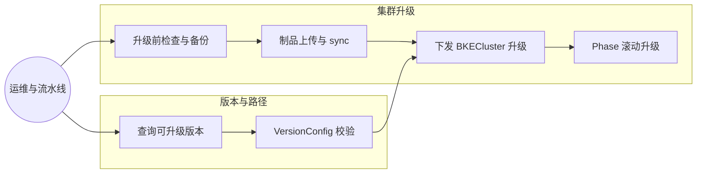

**设计意图**：全量升级与补丁升级共享同一 Phase 编排框架，差异在于制品范围（全量 VersionConfig vs 增量补丁包）；版本路径在升级前 gate，避免非法跳跃。

### 注释/约束/警告

1. 升级具有侵入性，**须预留升级时间窗**，窗口内避免 workload 管理类操作。
2. 升级时长取决于组件数量与集群规模；etcd、K8s 控制面滚动耗时占主要部分。
3. **升级前须用户自行备份 etcd**；社区不提供自动回滚。
4. 引导集群版本相关 ConfigMap 须**迁移至管理集群**，保证版本数据一致。
5. 组件间依赖冲突（如 addon 版本组合）由用户根据发布说明自行决策，社区提供 VersionConfig 与路径规则。

### 风险与缓解措施

| 风险 | 影响 | 缓解措施 |
|------|------|----------|
| 升级中途失败导致集群不可用 | 高 | 升级前检查 + 用户 etcd 备份；Phase 状态写入 BC 便于定位失败 Phase |
| provider-bke 自升级期间调谐中断 | 中 | Deployment 滚动更新 + 新 Pod Ready 后再终止旧 Pod |
| etcd 滚动升级 quorum 丢失 | 高 | bkeagent 控制逐成员升级，HA 集群保证至少两实例可用 |
| 离线补丁包与集群架构不匹配 | 中 | 补丁包按 amd64/arm64 分架构；sync 前校验 |
| 版本路径误配导致 API 不兼容 | 高 | 升级路径引擎拒绝跨 LTS；UI 仅展示合法目标版本 |
| 升级窗口内用户变更 workload | 中 | 文档约束 + 升级前检查告警 |

## 设计细节

### 架构与设计前提

#### 部署全流程

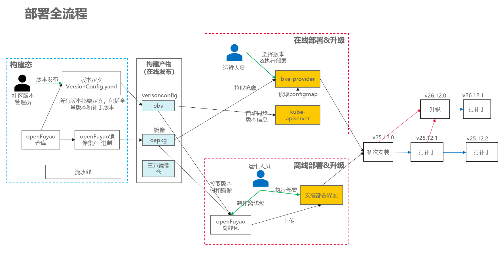

#### 概念与术语

| 术语 | 说明 |
|------|------|
| 组件版本 | 组件仓库 Semantic Version（MAJOR.MINOR.PATCH） |
| 社区版本 | RC、正式版、补丁版，如 v25.12-rc.2、v25.12、v25.12.1 |
| LTS 版本 | 每年 12/30 发布的正式社区版本 |
| 可安装版本 | 候选版本 + 正式版本 |
| 可升级版本 | 高于当前的可安装版本 + 补丁版本 |
| VersionConfig | openFuyao 版本与组件版本映射，由 release-manager 维护 |

#### VersionConfig 示例

```yaml
registry:
  imageAddress: cr.openfuyao.cn/openfuyao/registry:2.8.1
  architecture:
    - amd64
    - arm64
openFuyaoVersion: v25.12-rc.2
kubernetesVersion: v1.33.1.of.1
containerdVersion: v2.1.1
repos:
  - architecture: [amd64, arm64]
    isKubernetes: false
    needDownload: true
    subImages:
      - sourceRepo: cr.openfuyao.cn/openfuyao/coredns
        targetRepo: kubernetes/kubernetes
        images:
          - name: coredns
            tag: [v1.10.2]
addons:
  - name: cluster-api
    version: v1.4.3
openFuyaoCharts:
  - name: oauth-webhook
    chartVersion: 1.0.1
```

#### 离线制品类型

| 类型 | 内容 | 用途 |
|------|------|------|
| openFuyao 版本包（全量） | VersionConfig 定义的全部组件镜像与二进制 | 全量安装/大版本升级 |
| 增量补丁包 | 仅变更组件的 OCI 镜像包 + 二进制 | 补丁升级 |

社区在线归档 LTS 全量包及对应补丁包；其他离线包由用户按需通过 bkeadm 制备。

#### 升级方式分类

| 类型 | 典型组件 | 实现方式 |
|------|----------|----------|
| 自升级 | cluster-api-provider-bke、bkeagent-deployer | provider Phase + K8s Deployment/DaemonSet 滚动 |
| 主机服务 | containerd、kubelet、kubectl | bkeagent 监听 Commands CR 执行 |
| 容器类组件 | etcd、kube-apiserver、openFuyao 核心组件 | K8s 原生滚动 + bkeagent 辅助（etcd） |

#### 依赖组件

| 组件 | 描述 | 可获得性 |
|------|------|----------|
| cluster-api-provider-bke | BKECluster 调谐、升级 Phase 编排 | 必选 |
| bkeagent | 节点 containerd/kubelet 升级执行 | 必选 |
| bkeadm | 补丁包/版本包构建 | 离线必选 |
| installer-service / installer-website | 补丁上传、升级任务下发 | 在线/前端场景必选 |
| release-manager | VersionConfig、升级路径定义 | 必选 |

### 4+1 架构视图

#### 上下文与用例视图 (Context and Use Case View)

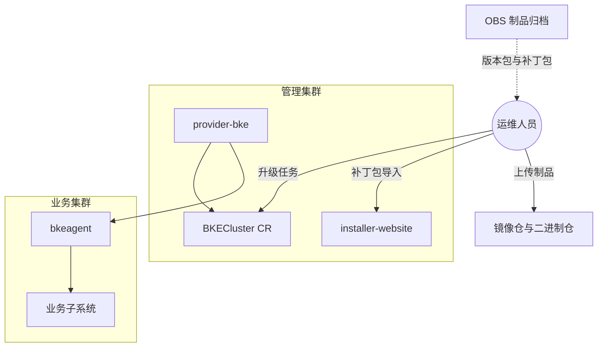

**设计意图**：运维通过 BKECluster 与 installer 触发升级；制品来自社区 OBS 或用户自建仓；管理集群 provider 统一编排管理/业务集群升级。

#### 逻辑视图 (Logical View)

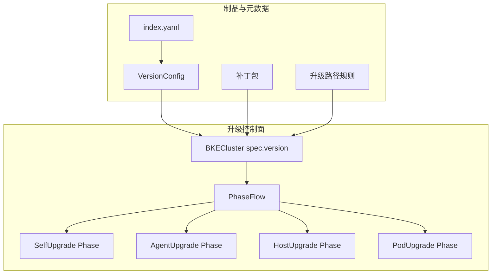

**设计意图**：VersionConfig 与补丁包定义「升什么」；升级路径规则定义「能否升」；PhaseFlow 定义「怎么升」。

#### 开发视图 (Development View)

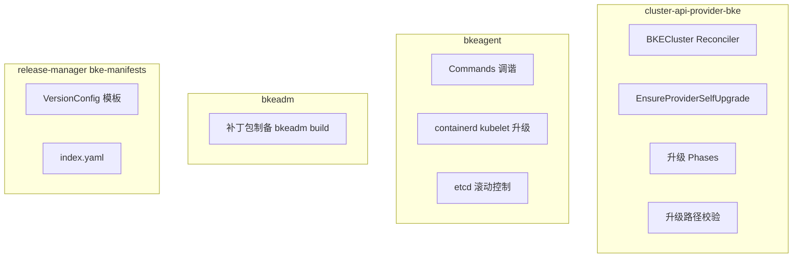

**设计意图**：CAP-BKE 负责编排与路径 gate；bkeagent 负责节点级执行；bkeadm 负责离线补丁制备；release-manager 负责版本矩阵。

#### 运行视图 (Runtime View)

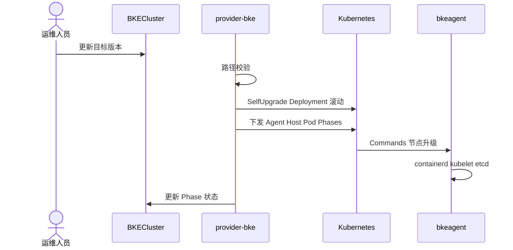

**设计意图**：单次 Reconcile 驱动 Phase 链；旧 provider Pod 在新 Pod Ready 前保持运行；节点升级通过 Commands 异步执行。

#### 部署视图 (Deployment View)

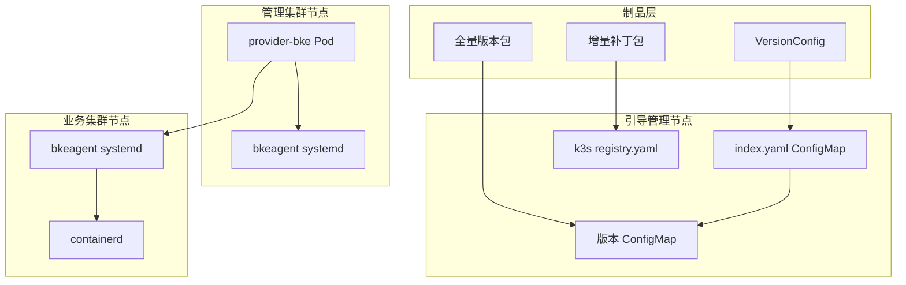

**设计意图**：版本元数据集中在管理集群 ConfigMap；补丁镜像经引导节点 sync 至本地 Registry；各节点 bkeagent 执行主机级升级。

### 升级流程与详细方案

#### 升级总览时序

升级前检查包括：节点信息、升级路径、应用版本状态、K8s 操作权限等；**etcd 备份由用户自行完成**。

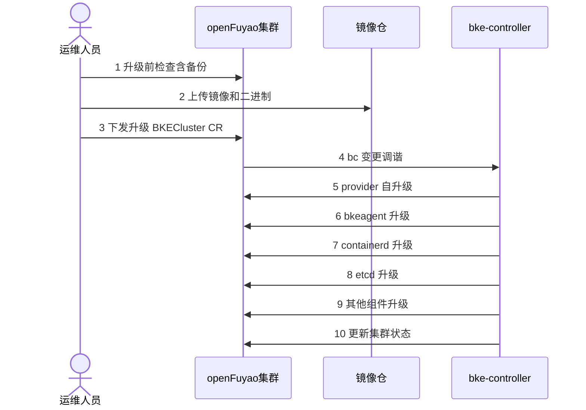

#### 管理集群升级时序

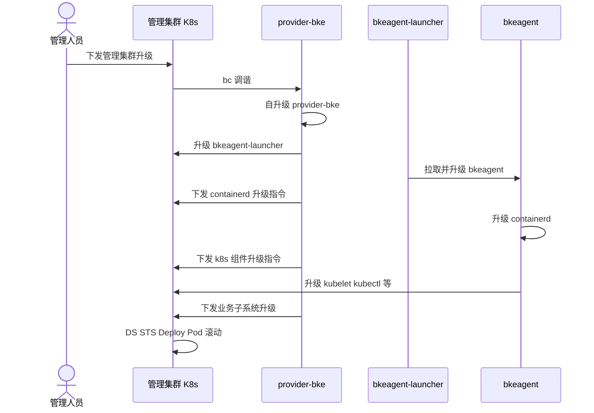

#### 业务集群升级时序

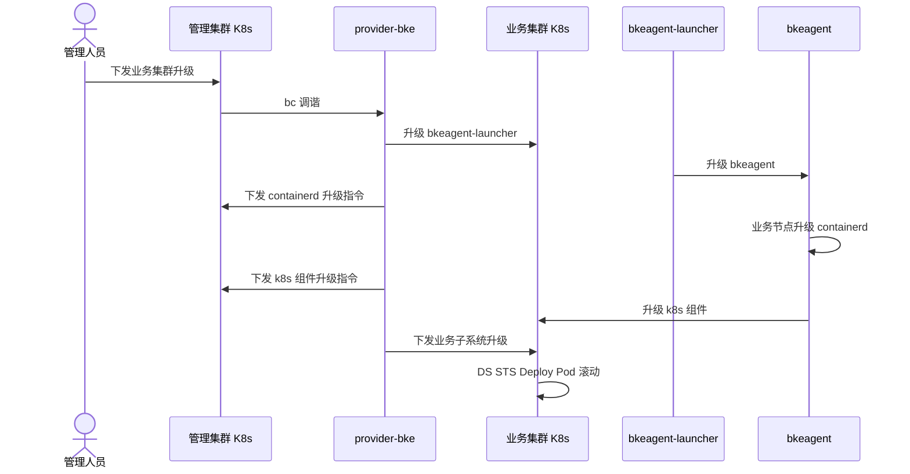

#### cluster-api-provider-bke 自升级

调谐器是升级第一入口，须作为升级第一步处理。

**交互视图：**

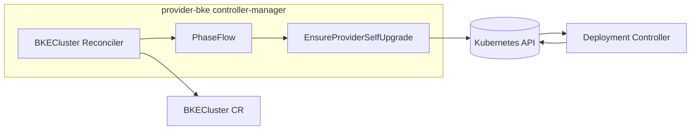

**自升级时序：**

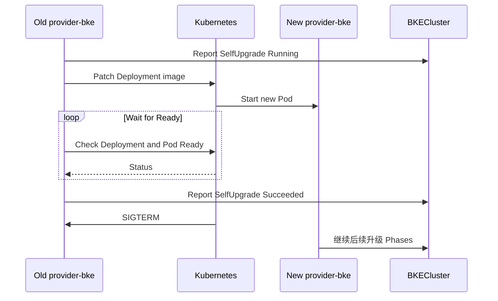

流程要点：旧调谐器 watch BC 变更并执行 SelfUpgrade Phase → K8s 滚动拉起新 Pod → 新 Pod Ready 后旧 Pod 终止 → 新调谐器继续后续 Phase。

#### bkeagent 升级

各节点运行 bkeagent systemd 服务，通过 `--kube-config` 连接管理集群 apiserver，监听 Commands CR。

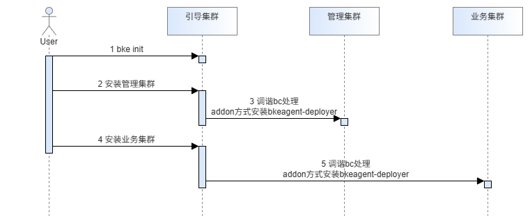

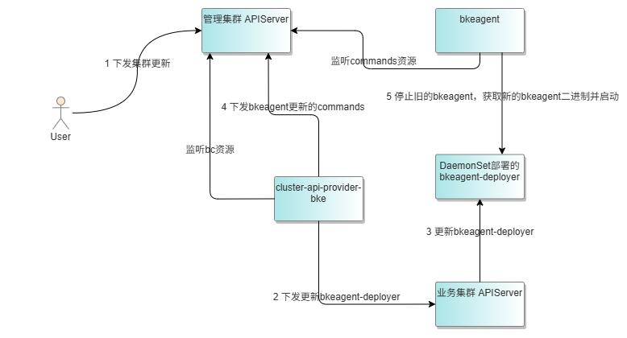

流程要点：

1. 集群部署 DaemonSet `bkeagent-deployer`；
2. provider 识别 deployer 升级并滚动节点 Pod；
3. provider 下发 bkeagent 升级 Commands，节点 bkeagent 从 deployer 获取新二进制、替换并重启服务。

#### etcd 升级

etcd 以静态 Pod 部署，无法直接使用 K8s Deployment 滚动；由 bkeagent 控制逐成员升级。HA 集群须保证升级过程中始终有两个实例可用。

#### 补丁升级

##### 补丁包制作与传输

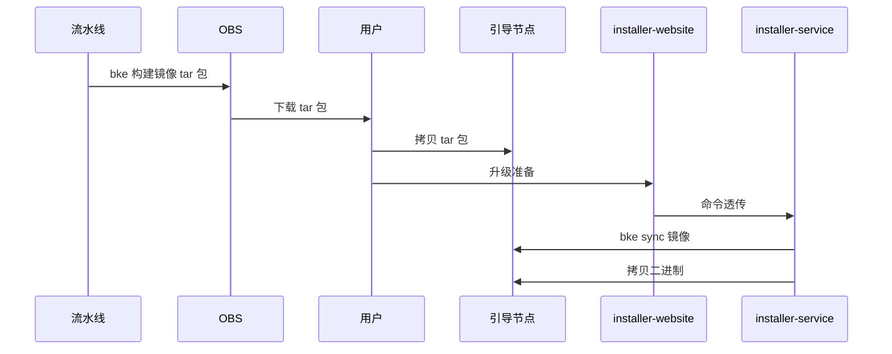

输入：补丁配置 yaml。工具：`bkeadm`。输出：含 OCI 镜像包与二进制的补丁包。

```
.
├── patchV1
│   ├── manifests.yaml
│   └── volumes
│       ├── containerd-v2.1.2-linux-amd64.tar.gz
│       ├── containerd-v2.1.2-linux-arm64.tar.gz
│       └── oci-layout
└── patchV1.tar.gz
```

##### 补丁数据上传

在线场景：

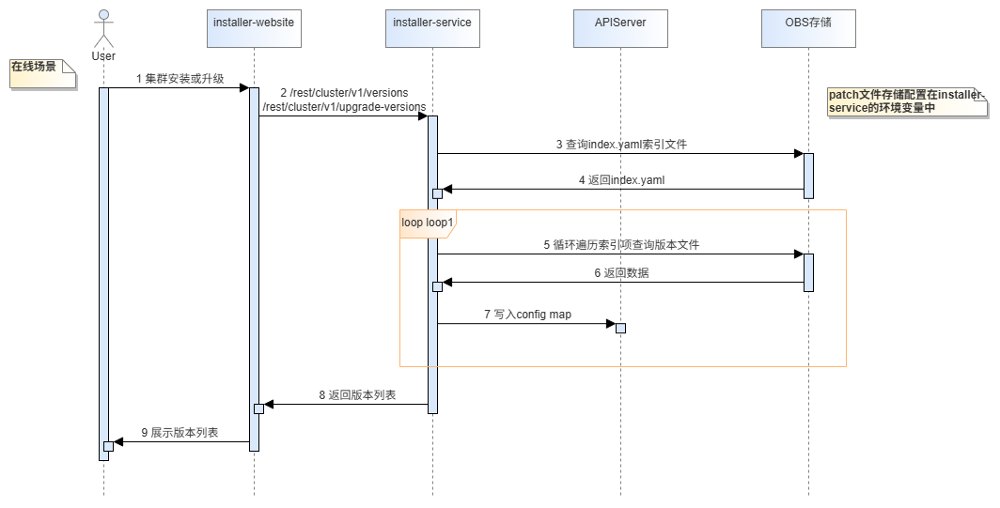

离线场景：

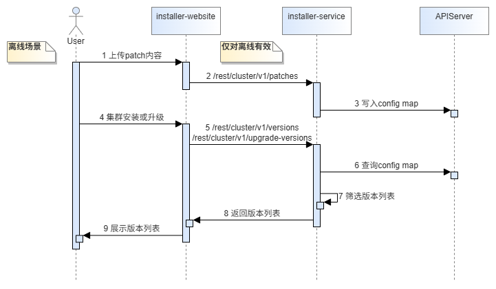

`index.yaml` 示例：

```yaml
- openFuyaoVersion: v25.12
  filePath: ./VersionConfig-v25.12.yaml
- openFuyaoVersion: v25.12-rc.2
  filePath: ./VersionConfig-v25.12-rc.2.yaml
- openFuyaoVersion: v25.12.1
  filePath: ./VersionConfig-v25.12.1.yaml
```

版本 ConfigMap 对应关系：


##### 补丁升级执行

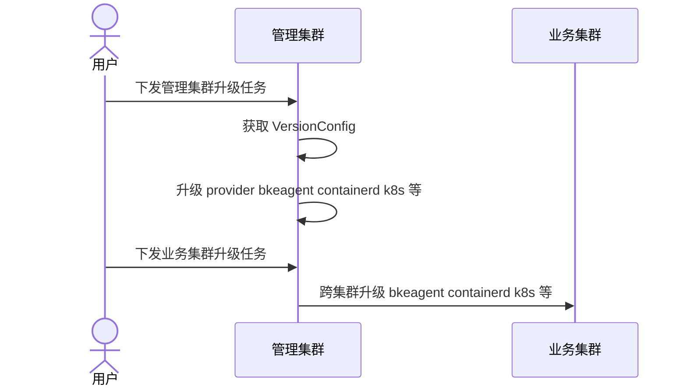

补丁升级本质是对集群组件的滚动更新，provider-bke 负责触发，K8s/bkeagent 负责执行。

#### openFuyao 版本及升级路径

| 版本类型 | 举例 |
|----------|------|
| 候选版本 | v25.12-rc.1、v25.12-rc.3 |
| 正式版本 | v25.12、v26.03 |
| 补丁版本 | v25.12.1、v25.03.1 |

规则：

1. 每年 12/30 发布的正式版本为 **LTS**。
2. **`latest`** 为可安装版本标识，**不能**作为升级起点或终点。

**升级路径示例**（当前版本列表：`latest, v25.09, v25.10-rc.2, v25.10, v25.10.2, v25.12, v25.12-rc.1, v25.12.2, v25.12.3`）：

| 当前版本 | 可升级版本列表 |
|----------|----------------|
| v25.09 | v25.10-rc.2, v25.10, v25.12, v25.12-rc.1 |
| v25.10 | v25.10.2, v25.12, v25.12-rc.1 |
| v25.10-rc.2 | v25.10, v25.12, v25.12-rc.1 |
| v25.12 | v25.12.2, v25.12.3 |
| v25.12-rc.1 | v25.12, v25.12.2, v25.12.3 |
| v25.12.2 | v25.12.3 |
| v25.12.3 | （无） |
| latest | （无） |

### 关键设计决策

| 决策点 | 选项 | 选定方案 | 理由 |
|--------|------|----------|------|
| 升级编排 | 脚本/Job vs PhaseFlow | **PhaseFlow** | 与安装路径一致，状态可写入 BC |
| provider 自升级 | 外部 Job vs In-place 滚动 | **Deployment 滚动** | 复用 K8s 原生能力，旧 Pod 等待新 Pod Ready |
| 节点组件升级 | SSH vs Commands CR | **Commands CR + bkeagent** | 与安装一致，可审计 |
| etcd 升级 | 一次性 vs 逐成员 | **bkeagent 逐成员** | 保证 HA quorum |
| 补丁制品 | 全量 tar vs 增量 OCI | **增量 OCI + 二进制** | 降低离线传输成本 |
| 版本路径 | 自由指定 vs 规则引擎 | **规则引擎 gate** | 避免 API 不兼容跳跃 |
| 回退 | 自动 vs 手动 | **手动（用户备份恢复）** | 降低自动化回退复杂度与风险 |

### 模块接口与配置约定

#### BKECluster 升级相关字段（概念）

| 字段/资源 | 说明 |
|-----------|------|
| `spec.clusterConfig.cluster.openFuyaoVersion` | 目标 openFuyao 版本 |
| BKECluster Phase 状态 | 各 Phase Running/Succeeded/Failed |
| Commands CR | bkeagent 节点升级指令载体 |
| 版本 ConfigMap | 由 index.yaml 索引的 VersionConfig 内容 |

#### 补丁包接口

| 输入 | 工具 | 输出 |
|------|------|------|
| 补丁 manifests.yaml | `bkeadm build patch` | patchV1.tar.gz（OCI + 二进制） |

#### installer 升级接口

| 操作 | 路径 | 说明 |
|------|------|------|
| 补丁上传 | installer-website → installer-service | 透传 bke sync |
| 升级下发 | BKECluster CR apply | 更新目标版本触发调谐 |

### DFX 质量属性设计

#### 性能

- 补丁升级仅传输/加载变更组件，相较全量包显著缩短 sync 与加载时间。
- Phase 顺序执行避免并行升级 etcd 与 apiserver 导致的不一致；可接受的整体升级时长随集群规模线性增长。

#### 可靠性

- provider SelfUpgrade 等待新 Pod Ready 再退出，避免调谐真空期。
- etcd HA 逐成员升级保证 quorum。
- Phase 失败状态写入 BC，支持定位失败步骤。

#### 安全性

- 升级前检查 K8s RBAC 与操作权限。
- 离线补丁包经用户可控通道传输；installer sync 在引导节点本地完成。
- 不支持自动回退，降低误操作反向升级风险。

#### 兼容性

- 升级路径引擎限制跨 LTS 跳跃，对齐 K8s API 兼容策略。
- 管理/业务集群可处于不同升级阶段，由 provider 分别调谐。
- 补丁包与全量包格式并存，index.yaml 索引多版本 Config。

#### 可服务性

- BC Phase 状态与 Events 暴露升级进度。
- 失败 Phase 可结合 bkeagent 日志与 Commands 状态排障。
- 文档明确升级时间窗与 etcd 备份要求。

#### 可测试性

- provider SelfUpgrade、路径校验、Commands 调谐均可单元/集成测试。
- e2e 覆盖在线全量升级、离线补丁升级、非法路径拒绝等场景。

#### 易用性

- 前端导入补丁包与 VersionConfig，减少 CLI 手工步骤。
- UI 展示当前版本与合法可升级版本列表。

### 测试计划

- [ ] 相关组件所有者可能要求补充测试以达到合入质量门槛。

#### 先决条件测试更新

- provider-bke Phase 框架与 SelfUpgrade 单测基线。
- bkeagent Commands 执行 containerd/kubelet 升级集成测试环境。

#### 单元测试

- 升级路径规则：合法/非法路径、LTS 边界、`latest` 拒绝。
- SelfUpgrade Phase：Deployment patch、Ready 等待、BC 状态上报。
- 补丁包解析：OCI layout 与 manifests 校验。

#### 集成测试

- 管理集群 mock 环境完成 provider → bkeagent → containerd Phase 链。
- 补丁 sync 至引导节点 Registry 后 Pod 镜像可拉取。

#### e2e 测试

| 编号 | 场景 | 预期 |
|------|------|------|
| UP-001 | 在线 v25.12 → v25.12.2 补丁升级 | 全 Phase Succeeded，版本一致 |
| UP-002 | 离线导入补丁包升级 | 无公网访问，升级成功 |
| UP-003 | 非法跨 LTS 路径 | 升级被拒绝并告警 |
| UP-004 | provider 自升级 | 新 Pod Ready，旧 Pod 终止，后续 Phase 继续 |
| UP-005 | 业务集群跨集群升级 | 管理 provider 驱动业务集群版本一致 |
| UP-006 | etcd HA 滚动升级 | 升级期间 quorum 保持 |

### 毕业标准

#### Alpha

- Phase 框架与 SelfUpgrade 合入；UP-001、UP-004  e2e 通过。
- 升级路径规则与 VersionConfig 索引可用。

#### Beta

- 在线/离线补丁升级（UP-002）稳定；管理+业务集群顺序升级（UP-005）通过。
- installer 前端补丁导入路径可用；文档与排障指南就绪。

#### GA

- 生产环境 N 套集群完成 v25.12 LTS 升级验证。
- 两周内 e2e 无非基础设施 flake；已知缺陷关闭。

### 升级/降级策略

- **升级**：通过更新 BKECluster 目标版本触发；provider 按 Phase 顺序滚动；不支持跳过 Phase。
- **降级**：不在范围内；用户须基于 etcd 备份与版本包手动恢复。
- 升级期间 BC spec 除目标版本外应避免并发变更。

### 版本倾斜策略

- 升级过程中允许短暂存在新旧 provider/bkeagent 共存（SelfUpgrade 滚动窗口）。
- 节点 kubelet/containerd 逐节点升级，控制面先于 worker 或按 Phase 定义顺序执行。
- 业务集群版本可滞后于管理集群，但不得高于管理集群所支持的路径规则。

## 生产准备情况评审问卷

### 功能启用和回滚

- **启用方式**：升级能力随 openFuyao 平台版本交付，无独立 Feature Gate 关闭路径（`disable-supported: false`）。
- **回滚**：不支持自动回滚；依赖用户 etcd 备份与手动恢复。

### 推出、升级和回滚规划

- 先在管理集群验证 SelfUpgrade，再推广业务集群升级。
- 回滚指标：BC Phase Failed、etcd quorum 丢失告警、核心 Pod 长时间 Not Ready。

### 监控要求

- BC Phase 状态、BKECluster Ready 条件作为升级进度 SLI。
- provider Reconcile 错误率、Commands 失败计数作为健康指标。

### 依赖项

- 管理集群 kube-apiserver、镜像仓可用性。
- 离线场景依赖引导节点 Registry sync 完成。

### 可扩展性

- 升级 Reconcile 频率随 BC 数量线性增长；大规模多集群建议分批升级。
- 补丁 OCI sync 耗时与补丁大小成正比。

### 故障排除

| 故障模式 | 检测 | 缓解 |
|----------|------|------|
| SelfUpgrade 卡住 | Deployment 无 Available | 检查镜像拉取与 Pod 事件 |
| bkeagent 升级失败 | Commands Failed | 检查 deployer Pod 与节点二进制权限 |
| etcd 升级 quorum 丢失 | etcd 健康检查失败 | 暂停升级，恢复备份 |
| 路径校验拒绝 | BC Event/Message | 核对 index 与目标版本合法性 |

## 实施历史

| 日期 | 里程碑 |
|------|--------|
| 2025-10-28 | oFEP 创建 |
| 2025-10-31 | 按 oFEP-0035/0040 格式优化：4+1 视图、DFX、成功标准、Mermaid 语法修正 |

## 缺点

1. 不支持自动回退，升级失败恢复成本高。
2. 升级窗口内需冻结 workload 变更，影响运维灵活性。
3. 跨 LTS 需分步升级，整体周期较长。
4. 组件依赖冲突需用户人工决策，无法全自动解析。

## 替代方案

| 方案 | 说明 | 未采纳原因 |
|------|------|------------|
| 卸载重装 | 销毁集群后按新版本安装 | 业务中断大，数据迁移成本高 |
| 纯脚本 SSH 升级 | 绕过 K8s 与 Phase 框架 | 难审计、难与 CAP 集成、状态不可声明式 |
| 蓝绿集群迁移 | 新建集群切流量 | 资源双倍，复杂度高，超出安装 SIG 范围 |
| 自动回滚 | 失败时自动恢复旧版本 | etcd/控制面状态难自动逆向，风险高 |
