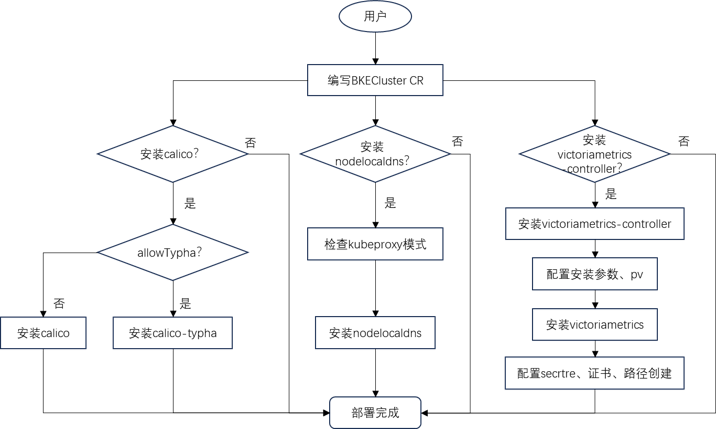
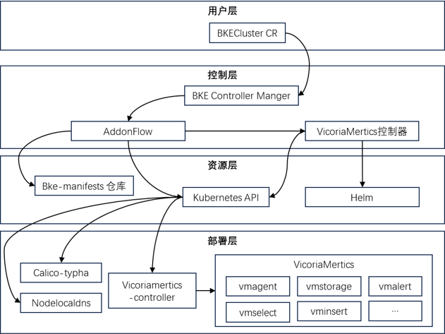
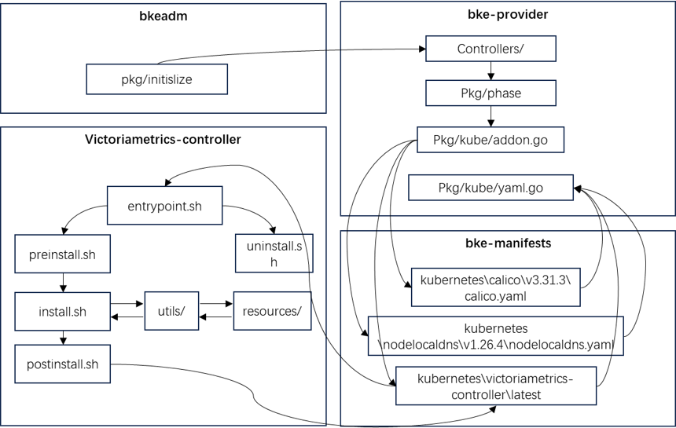
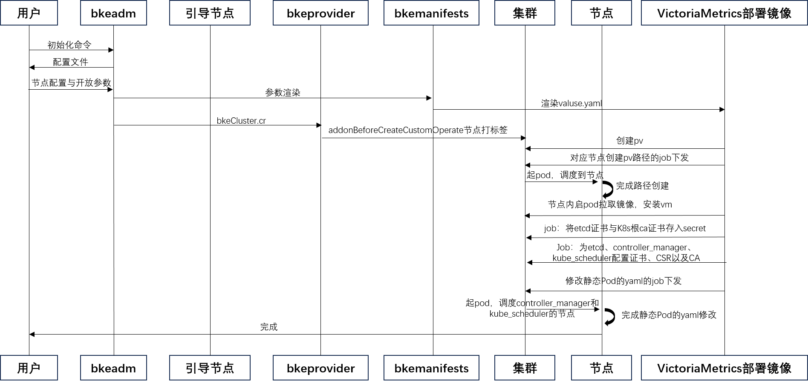
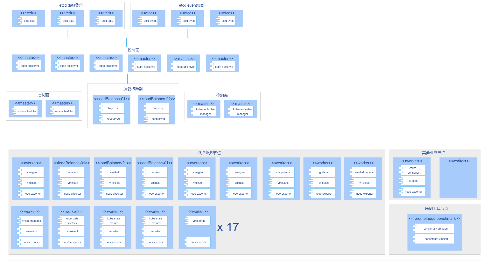

---
# 提案标题
title: 基于bke的监控与网络插件的自动化安装部署
# 提案编号
ofep-number: 0032
# 提案作者
authors:
  - "@chengyufei"
# 提案主导SIG
owning-sig: sig-large-scale-cluster
# 提案协作SIG
participating-sigs:
  - 
# 提案状态(初步草案|准备开始实现|已在SIG中实现并合并|提案被暂缓|提案被否决|作者主动撤回提案|被另一个oFEP取代)
status: provisional
# 创建日期
creation-date: 2026-01-15
# 评审人
reviewers:
  - TBD
  - "@alice.doe"
# 批准人
approvers:
  - TBD
  - "@oscar.doe"
# 相关联的其他oFEP
see-also:
  - "/ofeps/sig-aaa/1234-we-heard-you-like-ofeps"
  - "/ofeps/sig-bbb/2345-everyone-gets-a-ofep"
# 当前oFEP替代了哪些已有提案
replaces:
  - "/ofeps/sig-ccc/3456-replaced-ofep"
# 当前oFEP被哪些提案替代，当status为replaced时需要填写此字段
replaced-by:
  - "/ofeps/sig-ddd/4567-new-ofep"
# 此oFEP当前开发阶段
stage: alpha|beta|stable
# 最近一次推进的版本
latest-milestone: "v1.19"
# 各阶段目标版本
milestone:
  alpha: "v1.19"
  beta: "v1.20"
  stable: "v1.22"
# 功能开关及影响组件
feature-gates:
  - name: MyFeature
    components:
      - kube-apiserver
      - kube-controller-manager
# 是否支持关闭该功能
disable-supported: true
# 该功能引入的监控指标
metrics:
  - my_feature_metric
---
<!--
**注意：**当你的 oFEP 完成时，应删除所有这些注释块。

要开始使用此模板：
- [ ] **选择一个托管 SIG。**
  确保该问题领域是 SIG 感兴趣的。如果没有 SIG 的赞助，oFEP 不应提交。
-[]**在 openfuyao/ofep 中创建问题**
  提交增强功能跟踪问题时，请务必填写该模板中的所有字段。其中一个字段要求提供指向 oFEP 的链接。你可以留空该字段，直到提交此 oFEP 后再返回到增强功能并添加链接。
- [ ] **复制此模板目录。**
  将此模板复制到所属 SIG 的目录中，并将其命名为“ofep-NNNN-short-descriptive-title”，其中“NNNN”是分配给上述增强功能的问题编号（没有前导零填充）。
- [ ] **尽可能多地填写以上oFEP元数据。**
  至少，你应该填写“标题”、“作者”、“SIG所有者”、“状态”和与日期相关的字段。
- [ ] **请尽可能详细地填写此文件。**
  至少，你应该填写“摘要”和“动机”部分。如果你已经和相关的 SIG 进行过前期沟通和想法验证，那么这两部分应该会很容易完成。
- [ ] **为此 oFEP 创建 PR。**
  将其指派给正在支持该流程的 SIG（特别兴趣小组）成员。
- [ ] **尽早合并并迭代。**
  避免纠结于具体细节，而应致力于明确 oFEP 的目标并快速合并。最好的方法是从概要部分开始，然后在后续的 PR 中逐步完善细节。

oFEP 合并并不意味着它已完成或获得批准。任何标记为“临时”的 oFEP 都是工作文档，可能会发生变更。你可以按以下方式标记正在积极讨论的部分：

编辑 oFEPS 时，请尽量使用范围明确、主题单一的 PR，以保持讨论的集中性。如果你不同意文档中已有的内容，请提交新的 PR 并提出修改建议。

一个 oFEP 对应其整个生命周期内的一项“功能”或“增强”。例如，从 Beta 版升级到 GA 版无需新的 oFEP。如果出现属于 oFEP 的新细节，请编辑 oFEP。一旦某个功能被“实现”，重大变更应该获得新的 oFEP。

最新（以及该文件的可能来源）的规范位置是[0000-ofep-template.md]（/0000-ofep-template.md）。

**注意：**任何将 oFEP 推进为“implementable”状态的 PR，或在标记为“implementable”后的重大更改，都必须得到每个 oFEP 批准人的批准。如果这些批准人均不合适（例如离开社区、角色变更等），则该列表的更改应由其余批准人和/或所属 SIG 批准。
-->
# oFEP-0032：基于bke的监控与网络插件的自动化安装部署

<!--
这是你的 oFEP 的标题。请保持简短、简洁且描述性强。一个好的标题可以帮助传达什么是 oFEP，以及有助于审查与追踪。
-->

<!--
目录（TOC）有助于快速跳转到 oFEP 的各个部分，同时突出显示超出标准模板所提供的其他信息。

确保目录已用<code>&lt;!-- toc --&rt;&lt;!-- /toc --&rt;</code>标签，然后用`hack/update-toc.sh`生成。
-->

<!-- toc -->
- [发布签核清单](#release-signoff-checklist)
- [摘要](#summary)
- [动机](#motivation)
    - [目标](#goals)
    - [非目标](#non-goals)
- [提案](#proposal)
    - [风险与缓解措施](#risks-and-mitigations)
- [设计细节](#design-details)
    - [测试计划](#test-plan)
        - [先决条件测试更新](#prerequisite-testing-updates)
        - [单元测试](#unit-tests)
        - [集成测试](#integration-tests)
        - [e2e 测试](#e2e-tests)
    - [毕业标准](#graduation-criteria)
    - [升级/降级策略](#upgrade--downgrade-strategy)
    - [版本倾斜策略](#version-skew-strategy)
- [生产准备情况评审问卷](#production-readiness-review-questionnaire)
    - [功能启用和回滚](#feature-enablement-and-rollback)
    - [推出、升级和回滚规划](#rollout-upgrade-and-rollback-planning)
    - [监控要求](#monitoring-requirements)
    - [依赖项](#dependencies)
    - [可扩展性](#scalability)
    - [故障排除](#troubleshooting)
- [实施历史](#implementation-history)
- [缺点](#drawbacks)
- [替代方案](#alternatives)
- [所需基础设施（可选）](#infrastructure-needed-optional)
<!-- /toc -->

## 发布签核清单
<!--
**需要采取的行动：**为了将代码合并到一个版本中，在[openfuyao/ofep]引用此oFEP并在目标版本的[增强冻结]之前瞄准发布里程碑**中必须存在问题。

对于对核心代码或流程/程序进行更改的增强功能，例如：[openfuyao/openfuyao]，我们需要完成以下发布签署清单。

完成后勾选这些，以便发布团队跟踪。为了发布增强，必须更新这些检查表项。
-->

标记有（R）的项目*在达到里程碑/发布*之前是必需的。
- [ ]（R）发布里程碑中的增强问题，链接到 [openfuyao/ofep] 中的 oFEP 目录
- [ ] (R) oFEP 审批者已批准 oFEP 状态为“可实施”
- [ ] (R) 设计细节已适当记录
  - [ ]（R）测试计划已到位，并考虑了 SIG 架构和 SIG 测试的输入（包括测试重构）
    - [ ] 针对所有 Beta API 操作（端点）进行 e2e 测试
    - [ ] (R) 确保 GA e2e 测试满足一致性测试的要求
    - [ ] (R) GA e2e 测试至少需要两周时间才能证明测试结果无 flake（不稳定或偶发失败）
- [ ] (R) 毕业标准已设定
    - [ ] (R) 所有 GA 端点必须通过[一致性测试]
- [ ] (R) 生产准备情况审查完成
- [ ] (R) 生产准备情况审查已获批准
- [ ] “实施历史”部分已更新里程碑
- [ ] 面向用户的文档已在 [openfuyao/docs] 创建，以便发布到 [openfuyao.com]
- [ ] 支持文档 - 例如，额外的设计文档、邮件列表讨论/SIG 会议链接、相关 PR/问题、发行说明

<!--
**注意：**此清单是迭代的，每次考虑将此增强功能作为里程碑时都应进行审查和更新。
-->

- [openfuyao.com](https://openfuyao.com/)
- [openfuyao/ofep](https://gitcode.com/openfuyao/ofep)
- [openfuyao/docs](https://gitcode.com/openfuyao/docs)

## 概括
<!--
这部分对于生成高质量、以用户为中心的文档（如发行说明或开发路线图）非常重要。应该在实现开始之前收集这些信息，以避免要求实现者在编写发行说明和实现功能本身之间分散注意力。oFEP 编辑器和SIG文档应该有助于确保“摘要”部分的语气和内容对广泛的受众有用。

好的摘要可能至少有一段长度。

在本节和下一节中，请遵循[文档样式指南]的指导方针。特别是，将代码行包装到合理的长度，使审阅者更容易引用特定的部分，并尽量减少更新的差异。
-->

现有的bke工具作为openfuyao集群的核心部署工具，为用户提供了便捷高效的应用部署能力。然而，当前版本尚不支持对监控软件栈VictoriaMetrics以及网络插件typha和local-DNS的集成化安装部署能力。

为提升超大规模集群在可观测性、故障诊断与网络策略管理等方面的能力，本提案旨在扩展bke工具的功能，为其增加对VictoriaMetrics、typha及LocalDNS的一键部署支持。这将显著增强bke工具在超大规模集群场景下的可靠性、服务可用性与运维效率，为用户构建更加稳定、可观测、高性能的云原生基础设施提供有力支撑。

## 动机
<!--
本节用于明确列出该oFEP的动机、目标和非目标。描述变更的重要性以及对用户的好处。
-->

当前BKE工具作为OpenFuyao集群的核心部署组件，尚缺乏对监控与网络核心软件栈的原生支持。随着集群规模向超大规模演进，运维复杂度和稳定性风险显著增加，具体体现在：
- 监控能力缺失：无法快速部署高吞吐、可扩展的监控系统，影响故障排查与性能分析效率。
- 网络插件能力缺失： Calico安装能力不完整，Typha及LocalDNS需要手工部署，配置易出现不一致，增加网络策略管理复杂度。
- 平台能力不完整：作为集群部署核心工具，缺乏监控与网络能力影响平台整体竞性能。

为提升超大规模集群的可靠性、可观测性与运维效率，需要扩展BKE工具的部署能力，集成VictoriaMetrics监控栈及Calico网络插件（含Typha与LocalDNS），为用户提供一体化的部署体验。

当前组件（Calico、VictoriaMetrics）手动部署时缺乏自动化安全基线配置，如TLS认证、组件间访问控制等，存在配置不一致或默认弱安全的风险。手工部署易遗漏安全加固步骤，如kubelet的 `--cluster-dns` 修改、证书挂载、敏感信息暴露等，影响集群整体安全水位。

### 目标
<!--
列出oFEP的具体目标。它想要达到什么目标？我们怎么知道这已经成功了？
-->

- 监控能力集成：通过BKE一键部署VictoriaMetrics监控栈，支持超大规模集群的监控数据采集、存储与查询
- 扩展Calico安装能力：支持Typha的自动化部署与配置，支持LocalDNS的集成安装，提供高性能容器网络与DNS解析能力。
- 配置标准化：提供经过验证的默认配置模板，确保部署一致性和最佳实践
- 运维简化：减少部署步骤，降低用户学习成本，提升集群部署效率
- 安全基线内置：为各组件提供默认安全配置（如最小权限、TLS 加密、证书自动挂载），确保部署即符合安全实践。

### 非目标
<!--
什么超出了这个oFEP的范围？列出非目标有助于集中讨论并取得进展。
-->

- 不提供高级定制能力：基础版本提供标准部署方案，不包含高度定制化的高级配置选项
- 不取代专业监控告警：提供基础监控能力，但不替代专业的监控告警规则库

## 提案
<!--
**这是我们真正进入提案具体内容的部分。**  
这一部分应包含足够的细节，使评审人员能清晰理解你到底在提出什么建议，  
但不应涉及 API 设计或具体实现细节。  

请阐明：
- **预期目标是什么？**  
- **我们如何衡量成功？**

请将更详细的设计和实现细节放在下方的 “设计细节” 部分中。
-->

### 风险与缓解措施
<!--
这个提案存在哪些风险？我们将如何加以缓解？请从广泛的角度思考，例如包括安全性问题，以及它可能对更大范围的 openfuyao 生态系统产生的影响。 安全性将由谁进行评审，以及如何评审？用户体验（UX）将由谁进行评审，以及如何评审？建议考虑邀请 SIG 外部或子项目之外的相关人员参与评估。
-->

#### 风险一： 部署方式选择带来的配置灵活性与稳健性权衡
针对监控组件VictoriaMetrics现有通过chart包和yaml配置文件的两种安装方式。
chart包安装方式能够向用户开放全量参数但存在严重的参数解析困难，同时由于开放参数体量大，参数校验困难，难以避免因用户错误配置产生的问题；yaml配置文件的安装方式向用户开放部分参数，限制了用户的配置灵活性但提升了配置的稳健性。

**缓解措施：** 同时考虑到目前尚未产生对安装部署方式的特殊需求，为保障330交付，计划优先采用yaml配置方式实现集成部署，后续将结合伙伴需求有选择地开发监控组件的chart安装部署能力。

#### 风险二：部署配置可能引入安全风险
组件部署过程中，若配置不当（如接口暴露范围过宽、认证机制缺失等），可能引入安全风险，影响集群整体安全性。

**缓解措施：** 在部署脚本中采用安全基线配置（如限制服务暴露范围、启用基础认证），并提供默认的安全配置模板。同时，在安装流程中增加必要的配置合规性检查，确保各组件以安全最小化原则运行。

## 设计细节
<!--
本节应包含足够的信息，以便读者能够清楚理解你所提出的变更具体是什么。这可能包括 API 规格说明（虽然并非必须）或代码片段。如果对该提案将如何实施存在任何疑问，应在此处进行详细讨论。
-->

### 组件介绍
#### 网络插件扩展Typha与localDNS

- Typha用于在大规模Calico集群中降低数据存储（如Kubernetes API Server/etcd）的负载压力，其作用包括。
  - 代理多个Felix实例对数据存储的访问，减少连接数。
  - 过滤与节点无关的更新，降低Felix的CPU消耗。
  - 提供事件聚合和缓存，优化网络策略分发效率。
  - 支持水平扩展，通过部署多个Typha实例提高可用性。

- localDNS作为Kubernetes集群的内部DNS解析增强组件：
  - 在节点级别缓存DNS查询结果，减少CoreDNS负载。
  - 提升服务发现速度，降低网络延迟。
  - 支持自动重试和故障转移，增强DNS解析可靠性。

#### 监控组件VictoriaMetrics
VictoriaMetrics是一款高性能、可扩展的时序数据库与监控解决方案，适用于云原生环境，主要特点包括：
- 高性价比存储：采用无损压缩算法，显著降低存储成本。
- 查询高性能：优化查询引擎，支持PromQL和MetricsQL，响应速度快。
- 水平扩展：支持集群模式，可通过添加节点轻松扩展存储与查询能力。
- 易集成：完全兼容Prometheus配置，可作为长期存储或替代方案。
- 低资源消耗：相比其他监控方案，CPU和内存占用更低。
- 高可用性：内置数据复制与故障恢复机制，保障数据可靠性。
- 多租户支持：适用于共享集群环境，隔离不同团队或项目的数据。

### 场景视图


### 逻辑视图


### 开发视图


### 网络插件扩展Typha与localDNS部署方案

现有的bke部署工具集成了Calico的一键部署能力，但尚不能实现Typha与localDNS的部署。为在超大规模场景下优化网络插件性能能，将为用户额外提供Typha与localDNS的配置选项。延续bke原有calico部署方式，Typha与localDNS的部署都将采取yaml文件的方式完成。

#### Typha
- 版本：v3.31.3
- 安装方式：通过yaml的方式
- 配置文件：`calico-typha.yaml`，[点击获取](https://github.com/projectcalico/calico/blob/v3.31.3/manifests/calico-typha.yaml)。
- 传入参数抽取：
  1. replicas: {{.replicas}}用于设置Typha的副本数
  2. images：镜像地址，从bkeCluster.cr中能够直接获取，离线安装时会自动替换为离线地址
  > 说明：
  >
  > 配置文件中包含多个可以修改的参数，但大部分参数对于集群的配置都是不必要的，因此通过yaml的方式部署仅向用户开放部分参数，通过读取用户在bkeCluster.cr中param的配置，将开放参数作为传入参数完成对于模板yaml的渲染。
- bkecluster CR 配置
  ```
  apiVersion: bke.bocloud.com/v1beta1
  kind: BKECluster
  metadata:
    creationTimestamp: null
    name: bke-cluster
    namespace: bke-cluster
  spec:
    clusterConfig:
      addons:
      - name: kubeproxy
        block: true                        # 新增
        param:
          clusterNetworkMode: calico
        version: v1.33.1
      - block: true
        name: calico
        param:
          calicoMode: vxlan
          ipAutoDetectionMethod: skip-interface=nerdctl*
          allowTypha: true                 # 新增
          typhaReplicas:  2                # 新增
        version: v3.31.3                   # 版本更新
  ...
  ```
- yaml模板文件：完成参数抽取的部分配置文件如下：

  ```yaml
  ...
  # Source: calico/templates/calico-typha.yaml
  # This manifest creates a Deployment of Typha to back the above service.

  apiVersion: apps/v1
  kind: Deployment
  metadata:
    name: calico-typha
    namespace: kube-system
    labels:
      k8s-app: calico-typha
  spec:
    # Number of Typha replicas. To enable Typha, set this to a non-zero value *and* set the
    # typha_service_name variable in the calico-config ConfigMap above.
    #
    # We recommend using Typha if you have more than 50 nodes. Above 100 nodes it is essential
    # (when using the Kubernetes datastore). Use one replica for every 100-200 nodes. In
    # production, we recommend running at least 3 replicas to reduce the impact of rolling upgrade.
    replicas: {{ .replicas}}
    revisionHistoryLimit: 2
    selector:
      matchLabels:
        k8s-app: calico-typha
  ...
  ```
- bke-manifests新增目录结构：
  ```
  bke-manifests/kubernetes
  ├── ...
  ├── calico             
  │   ├── v3.25.0
  │   ├── v3.27.3
  │   │   └── calico.yaml         # 原calico配置文件
  │   └── v3.31.3
  │       └── calico.yaml         # 新增配置文件 
  ├── ...
  ```
  Typha与calico使用同一份配置文件，同时完成安装。bke工具中，组件的yaml配置文件被储存在`openFuyao/bke-manifests`库中，考虑到bke已有不包含扩展的calico配置文件`calico.yaml`，为满足用户不同需求，将导入一份新的包含Typha的calico配置文件`calico-typha.yaml`在`openFuyao/bke-manifests`中。

- 安全配置
  
  增加TLS配置，使用Kubernetes CA签发的证书，确保Typha与Felix之间的通信加密。

#### localDNS
- 版本：v1.26.4
- 安装方式：通过yaml的方式
- 配置文件：`nodelocaldns.yaml`，[点击获取](https://github.com/kubernetes/kubernetes/blob/v1.26.4/cluster/addons/dns/nodelocaldns/nodelocaldns.yaml)。
- 传入参数抽取
  1. domain：从bkeCluster.cr中能够直接获取
  2. localdns：用户配置
  3. DNSserver：本地侦听IP地址，从coreDNS的配置中获取
  4. images：镜像地址，从bkeCluster.cr中能够直接获取，离线安装时会自动替换为离线地址
  5. proxyMode：描述kube-proxy的运行模式，从kube-proxy的addons获取
- 模式判断
  
  kube-proxy的运行模式包含IPTABLES模式与IPVS模式两种，针对不同的运行模式，localDNS的配置也应做出同步修改。
  - 在IPTABLES 模式下，node-local-dns Pod会同时侦听kube-dns服务的IP地址和`<node-local-address>`的地址，以便Pod可以使用其中任何一个IP地址来查询DNS记录。
  - 在IPVS模式下，node-local-dns Pod只会侦听`<node-local-address>`的地址。node-local-dns接口不能绑定kube-dns的集群 IP地址，因为IPVS负载均衡使用的接口已经占用了该地址。
  - NFTABLES模式为k8sv1.33版本中kube-proxy新增模式，其与localDNS相关配置说明在官方文档暂未体现。
- bkecluster CR 配置
  ```
  apiVersion: bke.bocloud.com/v1beta1
  kind: BKECluster
  metadata:
    creationTimestamp: null
    name: bke-cluster
    namespace: bke-cluster
  spec:
    clusterConfig:
      addons:
      - name: kubeproxy
        block: true                   # 新增
        param:
          clusterNetworkMode: calico
        version: v1.33.1
      - name: nodelocaldns            # 新增
        param:
          localdns: 10.96.0.10
        version:v1.26.4               # 新增
  ...
  ```
  
- yaml模板文件：完成参数抽取与模式判断的部分配置文件如下：
  ```yaml
  ...
  apiVersion: v1
  kind: ConfigMap
  metadata:
    name: node-local-dns
    namespace: kube-system
    labels:
      addonmanager.kubernetes.io/mode: Reconcile
  data:
    Corefile: |
      {{ .domain }}:53 {
          errors
          cache {
                  success 9984 30
                  denial 9984 5
          }
          reload
          loop
          bind {{ .localdns }} {{ .DNSserver }}
          forward . {{ .clusterDNS" }} {
                  force_tcp
          }
          prometheus :9253
          health {{ .localdns }}:8080
          }
      in-addr.arpa:53 {
  ...
  ```
- bke-manifests新增目录结构：
  ```
  bke-manifests/kubernetes
  ├── ...
  ├── nodelocaldns                            # 新增配置文件
  │   └── v1.26.4
  │       └── nodelocaldns.yaml
  ├── ...
  ```
  对于localDNS，与calico的安装相对独立，使用一份额外的配置文件`nodelocaldns.yaml`，配置文件报保存在`openFuyao/bke-manifests`库中，安装时会自动调用。

- kubelet配置修改
  
  如果kube-proxy运行在IPVS模式，需要修改kubelet的--cluster-dns参数为NodeLocal DNSCache正在侦听的`<node-local-address>`地址。 否则，不需要修改--cluster-dns参数，因为NodeLocal DNSCache会同时侦听kube-dns服务的IP地址和`<node-local-address>`的地址。

  kubelet的部署依据用户在bkeCluster.cr中的配置，完成对模板文件的渲染，形成需要修改的变量列表。进一步基于列表对用户在bkeadm中提供的配置文件进行渲染，落盘形成完整kubelet的yaml配置文件。
  
  综合考虑首次安装，插件安装与插件卸载三类场景，对原有的配置流程进行优化：
  - **首次安装**：使用command方法，在`installKubeletCommand()`中对`clusterDNSIP`进行参数替换时增加对于kube-proxy运行和localDNS安装配置的检测，若kube-proxy运行在IPVS模式且addon中配置了对于localDNS的安装，则从coreDNS的配置中获取localdns，替换`clusterDNSIP`，否则维持原有配置。若用户选择CR方式部署kubelet，自行提供配置文件，则提醒用户自行筛查是否需要修改kubelet配置，单独安装卸载则不考虑CR方式。
  - **插件安装**：在完成localDNS的安装后，进行上述参数渲染步骤。完成新的kubelet的yaml配置文件落盘后，重启kubelet应用新的配置。
  - **插件卸载**：在完成localDNS的卸载后，进行上述参数渲染步骤，注意将`clusterDNSIP`还原为原有配置，以避免对kubelet的功能造成影响。完成新的kubelet的yaml配置文件落盘后，重启kubelet应用新的配置。

- 安全配置

  修改kubelet配置时，验证`--cluster-dns`是否为合法IP，避免指向恶意DNS。

### 监控组件VictoriaMetrics部署方案

- 版本：v1.26.4
- 安装涉及流程：
  1. **关键配置修改**，涉及集群模式、核心组件、采集组件、告警组件配置以及镜像地址配置等。
  2. **节点标签打标**，涉及"vmagent" "vminsert" "vmstorage" "vmselect" "vmalert" "vmalertmanager" "vm-grafana" "vm-operator" "kube-state-metrics"。
  3. **准备存储（PV）**，涉及vmstorage，vmselect，若vmagent采用StatefulSet模式则也需要配置pv
  4. **安装监控栈**，依据valuse.yaml使用helm安装，需要新建一个**VictoriaMetrics部署仓库**，提供自动化部署VM核心服务，安装时以pod形式在对应节点上拉取仓库镜像完成安装。
  5. **配置外部组件监控**，包含etcd、kube-controller-manager和 kube-scheduler的证书配置、CA签发、静态podyaml修改等
#### 具体部署流程方案
- **过程视图**
  
  使用VictoriaMetrics部署仓库，创建job完成配置，实现组件分离

  
- **关键配置修改**

  开放部分参数，用户可以通过bkeCluster.cr进行配置。参数内容主要涉及各组件部署模式、资源配置以及数据抓取与存储规则等内容，若用户手动配置，具体开放修改的参数包括：
  |参数|说明|默认值|
  |---|---|---|
  |imageRepo|镜像仓地址，离线安装时自动切换|hub.oepkgs.net/openfuyao|
  |version|victoriametrics helm chart版本|0.58.2|
  |useVMSingle|是否使用victoriametrics单节点模式，在超大规模集群场景建议使用集群模式，关闭该参数后默认开启集群模式|false|
  |vmSingleStorageSize|victoriametrics单节点模式存储大小，单位GiB|50Gi|
  |vmAgentAllowStatefulSet|是否允许VMAgent是否改为StatefulSet模式，改为StatefulSet模式后当存储节点宕机时，VMAgent会将数据保存到本地|true|
  |vmAgentCpuCount|VMAgent组件分配cpu数量|4|
  |vmAgentMemorySize|VMAgent组件分配内存大小，单位GiB|8Gi|
  |vmAgentReplicaCount|VMAgent组件副本数|2|
  |vmAgentShareCount|VMAgent水平分片数量|2|
  |vmAgentScrapeInterval|VMAgent组件指标抓取间隔|20s|
  |vmSelectCpuCount|VMSelect组件分配cpu数量|12|
  |vmSelectMemorySize|VMSelect组件分配内存大小，单位GiB|24Gi|
  |vmSelectStorageSize|VMSelect组件分配存储大小，单位GiB|35Gi|
  |vmSelectReplicaCount|VMSelect组件副本数|2|
  |vmStorageCPUCount|"VMStorage组件分配cpu数量|5|
  |vmStorageMemorySize|VMStorage组件分配内存大小，单位GiB|32Gi|
  |vmStorageStorageSize|VMStorage组件分配存储大小，单位GiB|720Gi|
  |vmStorageReplicaCount|VMStorage组件副本数|17|
  |vmInsertReplicaCount|VMInsert副本数|6|
  |vmInsertCpuCount|VMInsert组件分配cpu数量|4|
  |vmInsertMemorySize|VMInsert组件分配内存大小，单位GiB|8Gi|
  |vmAlertReplicaCount|VMAlert组件副本数|2|
  |vmAlertCpuCount|VMAlert组件分配cpu数量|4|
  |vmAlertMemorySize|VMAlert组件分配内存大小，单位GiB|16Gi|
  |vmAlertManagerReplicaCount|VMAlertManager组件副本数|2|
  |vmAlertManagerCpuCount|VMAlertManager组件分配cpu数量|4|
  |vmAlertManagerMemorySize|VMAlertManager组件分配内存大小，单位GiB|16Gi|
  |vmClusterRetentionPeriod|VMCluster数据保留时间，单位为h(ours), d(ays), w(eeks), y(ears)|15d|
  |vmClusterReplicationFactor|VMCluster数据复制因子|2|
  |grafanaNodePort|Grafana节点端口|30010|
  |kubeStateMetricsAutoSharding|是否开启KubeStateMetrics自动分片|true|
  |kubeStateMetricsReplicaCount|KubeStateMetrics组件副本数|3|
  |kubeStateMetricsCpuCount|KubeStateMetrics组件分配cpu数量|4|
  |kubeStateMetricsMemorySize|KubeStateMetrics组件分配内存大小，单位GiB|12Gi|

  若用户未自定义参数，系统将自动应用预设的默认参数组。该参数组针对集群数据摄取率在200w/s的场景进行优化，使用高可用配置方式，保证在部分节点故障时，监控业务不受影响。使用经过验证的推荐配置，可确保集群在此负载下获得稳定的监控保障，以下是默认配置的部署物理视图。
- **物理视图**
  

- **节点标签打标**
  
  依据用户在bkeCluster.cr中配置的节点信息，在对应节点dbkeCluster.Spec.ClusterConfig.Nodes.Labels字段写入标签信息，为d"vmagent" "vminsert" "vmstorage" "vmselect" "vmalert" "vmalertmanager" "vm-grafana" "vm-operator" "kube-state-metrics"选择对应节点。
  ```
  labels:
        - key: monitoring.victoria.com/vmstorage
          value: vmstorage
        - key: monitoring.victoria.com/metrics
          value: kube-state-metrics
        - key: monitoring.victoria.com/vminsert
          value: vminsert
        - key: monitoring.victoria.com/vmalert
          value: vmalert
        - key: monitoring.victoria.com/vmselect
          value: vmselect
        - key: monitoring.victoria.com/vmagent
          value: vmagent
        - key: monitoring.victoria.com/vmalertmanager
          value: vmalertmanager
  ```
- **参数校验**
  
  向用户开放的参数包括不限于副本、分片、存储以节点在内的内容，这提高了用户的配置灵活性，然而同时也造成了由于配置冲突（如分片数 > 可用节点数）可能引起的问题，于是定义以下规则，校验用户配置内容的一致性：

    1. 各组件可用节点数 = 打有对应标签的节点数
    2. 各组件副本*分片 <= 各组件可用节点数
    3. 各组件存储 <= 各组件对应节点实际存储
  
  这一部分的内容将添加在webhooks的内容中，尽可能早的识别用户配置中可能出现的问题。

- **准备存储（PV）**
  
  VictoriaMetrics部署仓库中使用job形式使得bash脚本启动，pv的创建以vmselect为例：
  ```
  function create_pv_for_vmslelct() {
    vmselect_node_names=$1

    IFS=',' read -r -a node_names <<< "$vmselect_node_names"
    replicas=0
    for node_name in "${node_names[@]}"; do
        yq -e ".metadata.name = \"pv-vmselect-${node_name}\"" -i ./resources/vmselect-pv.yaml
        yq -e ".spec.capacity.storage = \"10Gi\"" -i ./resources/vmselect-pv.yaml
        yq -e ".spec.nodeAffinity.required.nodeSelectorTerms[0].matchExpressions[0].values[0] = \"${node_name}\"" -i ./resources/vmselect-pv.yaml
        yq -e ".spec.claimRef.namespace = \"${VM_NAMESPACE}\"" -i ./resources/vmselect-pv.yaml
        yq -e ".spec.claimRef.name = \"vmselect-cachedir-vmselect-vm-victoria-metrics-k8s-stack-${replicas}\"" -i ./resources/vmselect-pv.yaml

        kubectl apply -f ./resources/vmselect-pv.yaml

        replicas=$((replicas+1))
    done

    info_log "Successfully create pv for vmselect"
  }
  ```
  pv的挂载路径配置逻辑如下，`${COMPONENTS}`来自对于节点标签的读取：
  ```
  for node_name in $nodes_name; do
    for componet in ${COMPONENTS}; do
      cat <<EOF > creat-pv-path-${node_name}.yaml
            apiVersion: batch/v1
            kind: Job
            metadata:
              name: creat-pv-path-${node_name}
              namespace: ${OPENFUYAO_SYSTEM_CONTROLLER_NAMESPACE}
            spec:
              template:
                spec:
                  nodeSelector:
                    openfuyao.io/${node_name}: ${node_name}
                  containers:
                  - name: creat-pv-path-${node_name}
                    image: ${REGISTRY}/openfuyao-system-controller:${OPENFUYAO_IMAGE_TAG}
                    imagePullPolicy: IfNotPresent
                    command:
                      - /bin/sh
                      - -c
                      - |
                        mkdir /mnt/data/$componet
                    volumeMounts:
                    - name: etc
                      mountPath: /etc
                    - name: usr
                      mountPath: /usr
                    - name: root
                      mountPath: /root
                  restartPolicy: OnFailure
                  volumes:
                  - name: etc
                    hostPath:
                      path: /etc
                  - name: usr
                    hostPath:
                      path: /usr
                  - name: root
                    hostPath:
                      path: /root
  EOF
      kubectl apply -f creat-pv-path-${node_name}.yaml
      kubectl wait --for=condition=complete --timeout=1800s job/creat-pv-path-${node_name} -n "${OPENFUYAO_SYSTEM_CONTROLLER_NAMESPACE}"
  ...
  ```


- **安装监控栈**
  
  依据用户在bkeCluster.cr中的配置，基于上述开放参数，完成对于valuse.yaml的渲染，生成完整可用的配置文件，使用helm二进制完成监控安装。

  目录结构：
  ```
  .VictoriaMetrics-controller
  ├── build/
  |     └──Dockerfile
  ├── resource/
  |     └── ...
  ├── .gitignore
  ├── Dockerfile
  ├── LICENSE
  ├── OAT.xml
  ├── README.md
  ├── consts.sh
  ├── deploy.yaml
  ├── entrypoint.sh
  ├── install.sh
  ├── log.sh
  ├── postinstall.sh
  ├── preinstall.sh
  ├── uninstall.sh
  └── utils.sh
  ```
  
  - 向用户开放的参数将在entrypoint.sh中，以入参的形式传入helm install的安装。
  - deploy.yaml中的env配置了向用户开放的参数以及默认值，这些参数将进一步渲染valuse.yaml形成完整安装文件。
    ```bash
    ...
    env:
        - name: imageRepo
          value: hub.oepkgs.net/openfuyao
        - name: version
          value: 0.58.2
        - name: useVMSingle
          value: false
        - name: vmSingleStorageSize
          value: 50Gi
        - name: vmAgentAllowStatefulSet
          value: true
    ...
    ```
  - install.sh中配置了完整安装配置，大部分流程都将在这一部分代码中体现。

- **配置外部组件监控**
  
  首先将etcd证书与K8s根ca证书存入secret，为etcd、controller_manager、kube_scheduler配置证书、CSR以及CA，这部分流程保证在集群内节点即可。

  接着需要修改controller_manager和kube_scheduler的静态POD的yaml，这一部分需要进入对应节点中进行。
  
  通过bash命令为etcd、controller_manager、kube_scheduler完成配置证书、CSR以及CA
  遍历节点q依据节点标签寻找预期节点，进行静态POD的yaml修改
  ```
  for node_name in $nodes_name; do
    cat <<EOF > modify-${node_name}.yaml
          apiVersion: batch/v1
          kind: Job
          ...
              command:
                - /bin/sh
                - -c
                - |
                yq -e '
                (.spec.containers[0].command[] | select(. == "--bind-address=127.0.0.1")) = "--bind-address=0.0.0.0" |
                .spec.containers[0].command += ["--tls-cert-file=/etc/kubernetes/pki/kube-controller-manager.crt"] |
                .spec.containers[0].command += ["--tls-private-key-file=/etc/kubernetes/pki/kube-controller-manager.key"]
              ' -i "$MANIFEST_FILE"
          ...
  ```
- **安全配置**
  - 认证与授权：VictoriaMetrics组件（vmselect、vminsert、vmstorage）通过证书认证。Grafana默认启用admin密码，并提示用户首次登录修改。

  - 网络隔离：使用`Kubernetes NetworkPolicy`限制监控组件仅能被特定服务访问，禁止外部直接访问。

  - 数据安全：确保PV使用加密存储，防止物理介质泄露。在部署脚本中检查etcd证书是否已挂载，若未挂载则自动创建并配置。

  - 最小权限：各组件的ServiceAccount仅授予访问自身资源的最小RBAC权限，避免使用 cluster-admin。

  - 配置校验增强：在参数校验中增加安全类校验，例如检查是否暴露了非必要的端口、是否使用了弱密码、是否禁用了TLS。


 

### 测试计划
<!--
**注意：**在该提案尚未被纳入某个正式版本前，此部分不是必需的。
其目标是确保我们不会接收缺乏充分测试的增强功能。
所有代码都应具备充分的测试（最终也应满足测试覆盖率要求）。在撰写测试计划时，请遵循 openFuyao 测试指南。
-->

[ ] 我/我们理解，相关组件的所有者可能会要求更新已有的测试，以便在提交实现该增强功能所需的更改之前，使代码达到足够稳固的质量标准。

##### 先决条件测试更新
<!--
根据评审者的反馈，描述在实施此项增强功能之前需要补充哪些额外的测试，以确保该增强特性也具备稳固的基础。
-->

##### 单元测试
<!--
原则上，所有新增的代码都应具有完整的单元测试覆盖率，因此列出确切的测试项并不会带来额外价值。
但如果无法实现完整的单元测试覆盖，请说明原因，并解释为何在这种情况下这是可以接受的。
-->

<!--
此外，对于 Alpha 阶段，请尽量列出为了实现该增强功能将涉及的核心包（core package），并提供这些包当前的单元测试覆盖率，格式如下：
- <软件包>: <日期> - <当前测试覆盖率>
这可以帮助我们在扩展生产代码、实施该增强功能之前，识别并推进某些测试覆盖率的改进工作。
-->

- `<软件包>`: `<日期>` - `<测试覆盖率>`

##### 集成测试
<!--
集成测试允许控制用于启动被测二进制文件的配置参数。
这与不允许配置参数的 e2e 测试不同。
这样做可以测试非默认选项以及多个不同的、可能冲突的命令行选项。

如果集成测试不是必要的或有用的，请解释原因。
-->

<!--
当准备将功能纳入某个正式版本时，需要填写此问题。
- 对于 Alpha 阶段，请描述将添加哪些测试，以确保该增强功能具备良好的质量保障。
- 对于 Beta 和 GA 阶段，需要记录测试已经编写、被定期执行，且结果稳定。

你可以通过以下方式提供相关证明：
- 指向 gitcode 源代码的永久链接
- 指向定期测试作业的链接，并按测试名称过滤
- 在 openfuyao 缺陷追踪工具中进行搜索。
-->

- 测试名称

##### e2e 测试
<!--
当该功能计划纳入某个正式版本时，应填写此问题。
- 对于 Alpha 阶段，请描述将添加哪些测试，以确保该增强功能具备良好的质量保障。
- 对于 Beta 和 GA 阶段，需要说明测试已经编写、被定期执行，且结果稳定。

可通过以下方式提供证明材料： 
- 指向 gitcode 源代码的永久链接
- 指向定期测试作业的链接，并按测试名称过滤
- 在 openfuyao 缺陷追踪工具中进行搜索。

作为进入 GA（正式可用）阶段的标准，我们期望过去一个月内不存在任何非基础设施相关的 flaky 测试（不稳定测试）。
如果你认为无需添加端到端测试（e2e），请解释其原因及合理性。
-->

- 测试名称

### 毕业标准
<!--
> **注意：** *在功能尚未计划纳入某个正式版本时，本节无需填写。*
> 请在此处定义该功能的毕业（Graduation）里程碑。
> 毕业条件可以基于 API 成熟度、[Feature Gate] 的推进阶段，或其他方式来定义。此处应保持高层次，重点说明评估是否可以毕业时将参考哪些信号（信心指标）。
> 在制定毕业标准时，请参考以下内容：
> - [成熟度等级（`alpha`、`beta`、`stable`）]
> - [Feature Gate 生命周期][feature gate]
> - [弃用政策][deprecation-policy]
> 请明确说明“毕业”的定义。
> 通常我们倾向于无论功能通过何种方式访问，均采用相同的阶段划分（alpha、beta、GA）。

#### 🔹 Alpha 阶段
- 功能已通过 Feature Gate 实现（默认关闭）  
- 初步的端到端（e2e）测试已完成并启用  
#### 🔸 Beta 阶段
- 收集开发者反馈及用户调研结果  
- 完成核心功能 A、B、C  
- 额外的测试已加入 Testgrid，并在 oFEP 中有链接说明  
- 实现更严格的测试形式，例如降级测试和可扩展性测试  
- 所有功能均已实现  
- 所有安全相关机制均已完备  
- 所有监控要求均已实现  
- 所有测试要求均已满足  
- 所有预发布阶段的问题与缺陷均已修复  

> **注意：** Beta 阶段的评估标准必须包含所有功能、安全性、监控与测试的要求，并解决所有已知问题或差距。

#### 🟢 GA 阶段
- 有 N 个真实生产环境中的使用示例  
- 有 N 次实际安装部署记录  
- 已留出反馈窗口期，收集充分用户反馈  
- 所有在 Beta 阶段反馈的问题与缺陷都已解决  

> **注意：** GA 阶段的毕业标准不得再包含功能、安全性、监控或测试方面的要求，这些应在 Beta 阶段全部完成。
> **注意：** 通常，我们在 Beta 和 GA 之间至少间隔两个版本周期，以便留出时间获取用户反馈和发现潜在问题，避免在连续发布中遗漏反馈环节。
> **对于非可选（默认启用）功能在进入 GA 阶段时，毕业标准必须包含 [一致性测试（Conformance tests）]。**

#### 🧯 弃用（Deprecation）
- 宣布弃用现有功能标志（flag）并说明支持策略  
- 自引入替代功能以来，已过去两个版本（以解决版本偏差问题）  
- 处理来自 gitcode Issues 等反馈渠道中的用法变更或行为差异问题  
- 正式弃用原有标志 （flag）
-->
### 升级/降级策略
<!--
> 指导提案人在功能设计时兼顾向前兼容性、配置迁移、Feature Gate 管理等问题。
-->
<!--
如果适用，该组件在升级和降级时将如何处理？请确保在测试计划中包含这部分内容。

在制定该增强功能的升级/降级策略时，请考虑以下问题：
- 为了保持现有行为不变，集群在升级时是否需要进行调用方式、配置或 API 使用上的任何更改？
- 为了使用该增强功能，集群在升级时是否需要对调用方式、配置或 API 使用做出调整？
-->

### 版本倾斜策略
<!--
确保你的提案在 openfuyao 集群中升级时能够兼容不同版本组件之间的运行差异。
-->
<!--
如果适用，该组件在面对与其他组件的版本不一致（version skew）时将如何处理？有哪些兼容性保证？请确保在测试计划中包括这一部分。

在为此增强功能制定版本偏差应对策略时，请考虑以下问题：
- 该功能是否涉及控制面（Control Plane）与节点（Node）之间的协同行为？
- 当使用该功能时，版本落后三个版本（n-3）的 kubelet 或 kube-proxy 会如何表现？
- 当使用该功能时，版本落后一个版本（n-1）的 kube-controller-manager 或 kube-scheduler 会有何行为？
- 节点上的其他组件是否会发生变更？ 例如，CSI（容器存储接口）、CRI（容器运行时接口）或 CNI（容器网络接口）是否需要在 kubelet 之前被更新？
-->

## 生产可用性审查
<!--
**生产可用性审查（Production Readiness Review，PRR）** 的目的是确保即将合并到 openfuyao 中的功能：
- 可观测（observable）、可扩展（scalable）、可支持（supportable）；
- 能在生产环境中安全运行；
- 在出现故障时能够被禁用或回滚。

**要使 oFEP 进入 `implementable` 状态并被纳入发布版本，必须完成并通过生产可用性审查问卷（PRR Questionnaire）。**

在某些情况下，元数据中也应包含这些问题的答案：
- 这样可以便于自动化工具验证是否进行了审查；
- 同时有助于减少评审负担并降低审查延迟。
-->

### 功能启用和回滚
<!--
当针对 alpha 版本发布时，必须完成此部分。
-->

###### 如何在实时集群中启用/禁用此功能？
<!--
选择其中一个并删除其余的。
-->

- [ ] **功能开关（Feature gate）**（请同时在元数据中填写相应字段）
    - 功能开关名称：
    - 依赖该功能开关的组件：
- [ ] **其他机制**
    - 描述机制实现方式：
    - 启用/禁用该功能是否会导致控制平面需要停机？
    - 启用/禁用该功能是否会导致节点需要停机或重新部署（reprovision）？

###### 启用该功能会改变任何默认行为吗？
<!--
任何默认行为的变更都可能让用户感到意外，或破坏现有的自动化流程，因此在这方面必须格外小心。
-->

###### 该功能一旦启用，是否可以禁用（即我们可以回滚启用）？
<!--
**请描述该功能对现有工作负载可能造成的影响**（例如，如果这是一个运行时特性，它是否可能破坏现有应用程序的行为？）。

通常，通过将功能开关（Feature Gate）设置为 `false` 并重启相应组件，即可禁用该功能。除这个操作之外，不应再需要其他变更来完成禁用。

**注意：**在元数据中，也请将 `disable-supported` 字段设置为 `true` 或 `false`。
-->

###### 如果该功能之前已回滚，现在我们重新启用它会发生什么情况？

###### 是否有任何针对功能启用/禁用的测试？
<!--
当前的端到端测试框架（e2e framework）**尚不支持启用或禁用 Feature Gate**。  
然而，对于处理数据的每个组件，必须编写包含**启用和未启用该功能场景的单元测试**。

如果该功能修改了 API 类型，**至少应该考虑添加转换测试（conversion tests）**。

此外，如果该功能引入了新的 API 字段，**还必须编写测试 Feature Gate 开关行为的单元测试**——也就是验证以下情形：  
- “当我先启用 Feature Gate 并写入了包含新字段的对象后，随后将其禁用，会发生什么？”
-->

### 推出、升级和回滚规划
<!--
当该功能计划从 Beta 阶段发布至正式版本时，必须填写本节内容。
-->

###### 部署或回滚为何会失败？这会影响正在运行的工作负载吗？
<!--
**尽可能保持警觉和审慎**——例如，假设在发布过程中某些组件会中途重启，会发生什么？

请务必考虑以下场景：
- **高可用（HA）集群**：在该场景下，功能开关（Feature Flag）可能仅在部分 API Server 上启用，而其他仍为禁用状态；
- **大型集群**：在这种情况下，功能的启用/禁用可能会分批分节点地推进，需考虑该过程中的一致性与兼容性问题。
-->

###### 哪些具体指标应该通知回滚？
<!--
当该功能还处于早期阶段时，用户应关注哪些信号，以便及早发现可能存在的严重问题？
-->

###### 升级和回滚测试了吗？升级->降级->升级的路径测试了吗？
<!--
请描述已完成的手动测试及其结果。
从长远来看，我们可能会要求实施自动化的升级/回滚测试，但目前我们仍缺少相关的机制和工具，因此暂时无法实现。
-->

###### 推出时是否伴随任何功能、API、API 类型的字段、标志等的弃用和/或删除？
<!--
即使应用弃用政策，仍可能会让一些用户感到惊讶。
-->

### 监控要求
<!--
当计划将功能从 Beta 阶段纳入某个正式版本（release）时，必须完成此部分内容。
对于 GA（正式可用）阶段，该部分也是必须填写的：审批人应能够基于实际生产环境中的经验，确认之前各项回答的准确性。
-->

###### 操作员如何确定该功能是否正在被工作负载使用？
<!--
理想情况下，应使用指标（metric）来实现。
通过对 Kubernetes API 的操作（例如检查是否存在设置了字段 X 的对象）应作为最后手段。
请避免将日志或事件用于此目的。
-->

###### 使用此功能的人如何知道它适用于他们的实例？
<!--
例如，如果这是一个与 Pod 相关的功能，则应能够针对每个 Pod 确定该功能是否正常工作。
请从以下选项中选择一项并删除其余内容。
请在下方详细描述所有对最终用户可见的内容，确保他们能够验证该功能是否已正确启用并正常运行。
> 请注意：最终用户通常无法查看组件日志或访问系统指标（metrics）。
-->

- [ ] 事件
    - 事件原因：
- [ ] API .状态
    - 条件名称：
    - 其他领域：
- [ ] 其他（作为最后手段）
    - 细节：

###### 增强的合理 SLO（服务级别目标）是什么？
<!--
这是你定义该功能“正常服务质量”（Quality of Service，QoS）表现的机会。
我们无法提供全面的指导，但从高层角度来看（还需要更精确定义），这些表现可能包括：
- 每天返回 5XX 错误的 API 调用比例 ≤ 1%  
- CronJob 的任务实际创建时间与预期创建时间之差的绝对值在一天内的 99 百分位 ≤ 10%  
- 每天 99.9% 的 `/health` 请求返回 HTTP 200 状态码  

这些目标将有助于你在下一个问题中确定需要衡量的服务指标（SLIs）。
-->

###### 运维人员可以使用哪些服务级别指标（SLIs）来判断服务的健康状况？
<!--
请选择以下选项中的一个，并删除其余内容。
-->

- [ ] 指标
    - 指标名称：
    - [可选] 聚合方法：
    - 暴露指标的组件：
- [ ] 其他（作为最后手段）
    - 细节：

###### 是否存在任何尚未覆盖的指标（metrics），可以用来进一步提升该功能的可观测性？
<!--
请描述这些指标本身，以及未添加它们的原因（例如：成本高、实现复杂等）。
-->

### 依赖项
<!--
当计划将该功能从 Beta 阶段纳入某个正式版本（release）时，必须完成本节内容。
-->

###### 此功能是否依赖于集群中运行的任何特定服务？
<!--
请同时考虑集群级别的服务（例如 metrics-server）以及节点级别的代理（例如某个特定版本的 CRI）。  
重点关注该功能所依赖的 **外部或可选服务**。  
例如，如果该功能依赖云服务商的 API、或外部的软件定义存储（SDS）或网络控制面板等服务，则应明确列出。

对于每一项依赖项，请填写以下内容：
- 当前用户工作负载的运行情况  
- 新建工作负载的创建情况  
- 集群级别的服务（例如 DNS）

填写格式如下：
```
- [依赖项名称]
  - 使用说明：
    - 若该服务发生中断，对该功能的影响：
    - 若该服务性能下降或错误率升高，对该功能的影响：
```
-->

### 可扩展性
<!--
对于 Alpha 阶段，鼓励填写本节内容：评审人员应考虑这些问题，并尝试给出回答。
对于 Beta 阶段，本节为必填项：评审人员必须回答这些问题。
对于 GA（正式发布）阶段，本节同样为必填项：审批人员应能根据实际生产经验，确认之前给出的所有回答。
-->

###### 启用/使用此功能会导致任何新的 API 调用吗？
<!--
**请描述相关 API 调用，包括以下信息：**
- **API 调用类型**（例如：`PATCH pods`）  
- **预估调用频率（吞吐量）**  
- **调用发起组件**（例如：`Kubelet`、`Feature-X-controller`）

重点关注以下场景：
- **组件开始列出（list）或监听（watch）以前未处理的资源**
- **某些 Kubernetes 资源发生变化后，触发新的 API 请求行为**  
  例如：更新对象 X 后又触发了对对象 Y 的修改或创建
- **用于状态对齐（state reconciliation）的定期 API 请求**  
  例如：周期性获取资源状态、心跳上报、领导者选举等
-->

###### 启用/使用此功能是否会导致引入新的 API 类型？
<!--
请描述它们（指代 API 对象或资源），并提供以下信息：
- **API 类型**（API type）  
- **每个集群支持的最大对象数量**
- **每个命名空间支持的最大对象数量**（仅适用于具备命名空间作用域的对象）
-->

###### 启用/使用此功能是否会导致对云提供商的任何新的 API 调用？
<!--
请进行如下描述：
- **涉及哪些 API：**  
- **预估调用增加量：**
-->

###### 启用/使用此功能是否会导致现有 API 对象的大小或数量增加？
<!--
**请描述新增或受影响的资源对象，提供以下信息：**
- **API 类型（API type(s)）：**  
- **预估对象体积增加量：**（例如：新增注解字段，大小为 32 字节）  
- **预估新增对象数量：**（例如：为每个现有 Pod 创建一个新的对象 X）
-->

###### 启用/使用此功能是否会导致现有 SLI/SLO 所涵盖操作的耗时增加？
<!--
请思考是否会新增额外操作或在现有流程中引入新的中间步骤（例如：为了启动一个容器，现在需要先执行步骤 X 等）。
请在下方详细描述这些新增内容。
-->

###### 启用/使用此功能是否会导致任何组件的资源使用率（CPU、RAM、磁盘、IO 等）不可忽略的增加？
<!--
需要注意的事项包括：
- 增加的内存状态（in-memory state）；
- 新引入的耗时计算操作；
- 频繁的磁盘访问（包括日志量增加）；
- 大量发送或接收的网络数据流量等。

请从小型和大型集群的不同规模角度，**全面评估这些资源消耗**，并结合 Kubernetes 的[支持上限（supported limits）](https://git.k8s.io/community/sig-scalability/configs-and-limits/thresholds.md)进行考量。
-->

###### 启用/使用此功能是否会导致某些节点资源（PID、套接字、inode 等）耗尽？
<!--
**请不要只关注理想情况，更重要的是评估异常或极端情况**，例如：
- 探针响应时间从毫秒级变成分钟级；
- 异常或失败的 Pod 持续占用资源等。

**如果该功能可能会导致某些资源被耗尽**，请说明：
- 如何通过 Kubernetes 已有的资源限制机制进行缓解（例如每节点最大 Pod 数）；
- 或该 oFEP 是否引入了新的限制来控制这些风险。

此外，还请说明：
- **是否已经进行了性能相关测试（或计划进行），用于更好地理解性能特征，并验证所声明的资源使用上限？**
-->

### 故障排除
<!--
**当该功能计划从 Beta 阶段发布至正式版本（release）时，本节必须填写。**

对于 **GA（正式发布）阶段**，本节同样为必填项：审批人员应能够根据实际生产环境中的经验，确认之前的各项回答。

当前的 **“排障（Troubleshooting）” 部分**，在功能发布流程中相当于临时承担了 **“运维手册（Playbook）”** 的角色。  
未来可能会将其拆分为一个专门的 `Playbook` 文档（可能还会包含一些监控信息）。但目前仍将其保留在此处。
-->

###### 如果 API 服务器和/或 etcd 不可用，此功能如何反应？

###### 其他已知故障模式有哪些？
<!--
**对于每种故障模式，请使用以下模板逐项填写信息：**
- **[故障模式简要描述]**  
  - **检测方式（Detection）：**  
    如何通过指标（metrics）检测该问题？换句话说：  
    操作人员**如何在不登录 master 或 worker 节点的情况下排障**？
  - **缓解手段（Mitigations）：**  
    尤其对于已在运行的用户工作负载，可采取哪些措施止血/减缓影响？
  - **诊断信息（Diagnostics）：**  
    有哪些有用的日志消息？其对应的**日志级别**（logging level）是多少？  
    ✅ *注：日志诊断信息在功能进入 Beta 阶段前可不填写。*
  - **测试情况（Testing）：**  
    针对该故障是否有测试用例？若无，请说明原因。
-->

###### 如果未满足 SLO，应采取哪些步骤来确定问题？

## 实施历史
<!--
**在本节中应记录一个 oFEP 生命周期中的主要里程碑。**

可能包括但不限于以下内容：
- `摘要` 和 `动机` 部分被合并，表示 SIG 已接受该提案  
- `提案` 部分被合并，表示对设计方案达成一致  
- 实现工作的启动日期  
- 首个包含该 oFEP 初始版本的 openfuyao 发布版本  
- 该 oFEP 成功毕业为正式可用（GA）的 openfuyao 版本  
- oFEP 被废弃或被其他提案取代的时间  
-->

## 缺点
<!--
为什么不实施这个 oFEP？从反面角度分析该提案可能带来的负面影响、权衡成本、潜在风险或争议点。
-->

## 替代方案
<!--
**你还考虑过哪些其他方案？为什么将它们排除？**  
这些备选方案不需要像最终提案那样详尽，但应提供足够的信息来阐述其基本思路，并说明为什么它们不可接受。
-->

## 所需基础设施（可选）
<!--
**如果你需要从项目或 SIG 获得资源支持，请在本节中列出。** 例如：
- 请求创建新的子项目（subproject）  
- 新建 gitcode 仓库（repos）  
- 配置 gitcode 相关权限或细节（如 team 成员或 CI 权限等）

提前在这里列出这些需求，有助于 SIG 尽早启动相关流程，加快资源配置效率。
-->