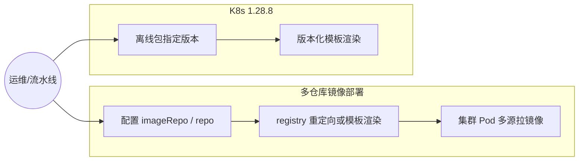
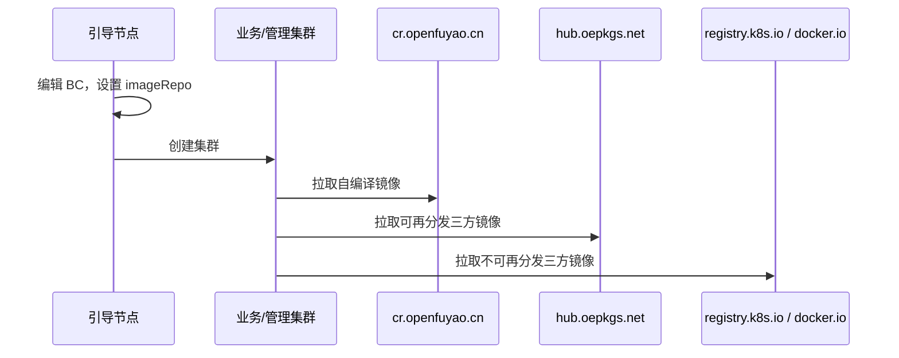
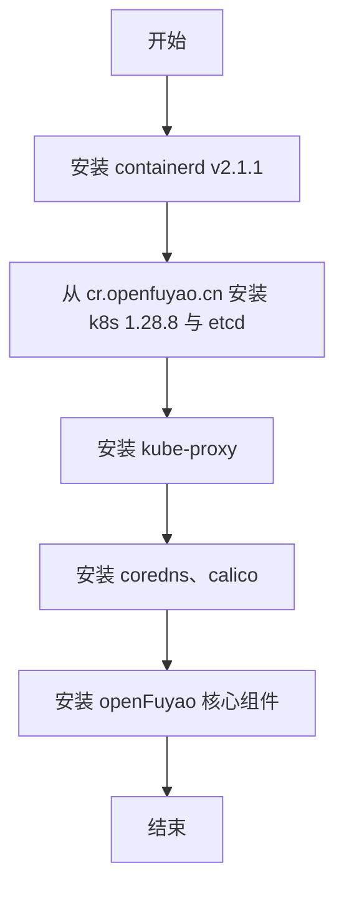
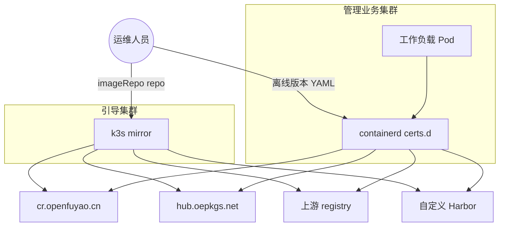
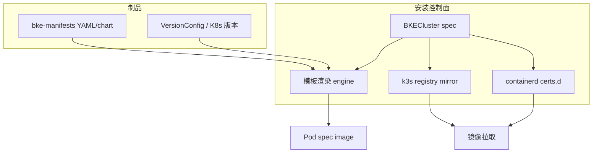
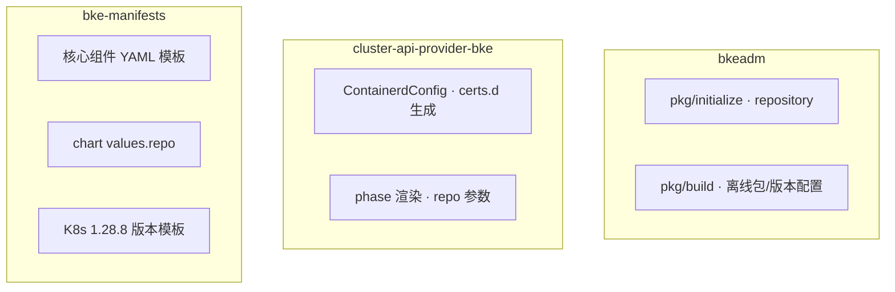
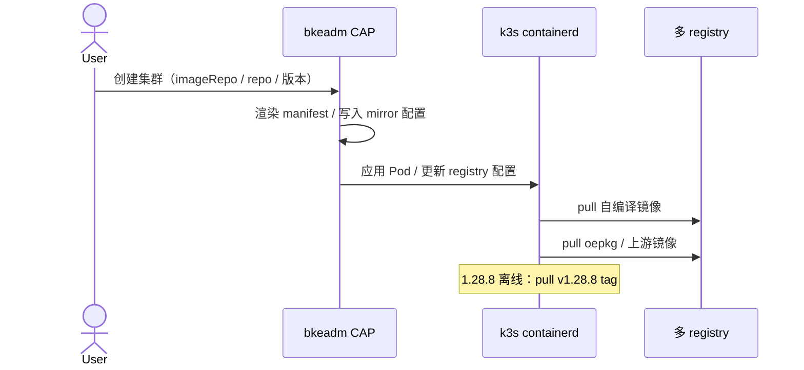
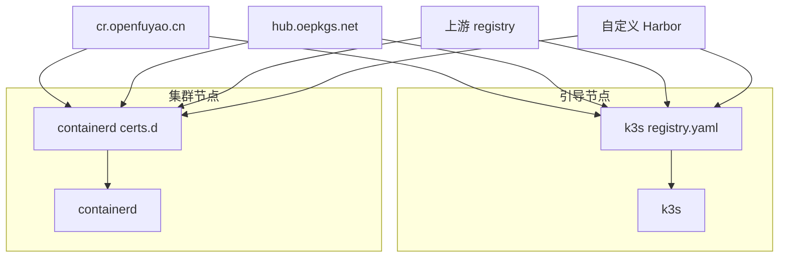

<!-- 格式合规检查：已通过 -->
---
# 提案标题
title: 支持多仓库镜像部署以及兼容 k8s 的 1.28.8 版本安装
# 提案编号
ofep-number: 0035
# 提案作者
authors:
  - "@xuyouhong"
# 提案主导SIG
owning-sig: sig-Installation
# 提案协作SIG
participating-sigs: []
# 提案状态(初步草案|准备开始实现|已在SIG中实现并合并|提案被暂缓|提案被否决|作者主动撤回提案|被另一个oFEP取代)
status: provisional
# 创建日期
creation-date: 2025-01-29
# 评审人
reviewers:
  - TBD
# 批准人
approvers:
  - TBD
# 相关联的其他oFEP
see-also:
  - "/ofeps/sig-Installation/ofep-0013-安装部署完全支持离线环境.md"
  - "/ofeps/sig-Installation/ofep-0040-引导节点安仓库自依赖安装和提供bkeagent健康端口.md"
# 当前oFEP替代了哪些已有提案
replaces: []
# 当前oFEP被哪些提案替代，当status为replaced时需要填写此字段
replaced-by: []
# 此oFEP当前开发阶段
stage: alpha
# 最近一次推进的版本
latest-milestone: "v26.03"
# 各阶段目标版本
milestone:
  alpha: ""
  beta: ""
  stable: ""
# 功能开关及影响组件
feature-gates:
  - name: MultiRegistryImageDeploy
    components:
      - bkeadm
      - cluster-api-provider-bke
      - bke-manifests
  - name: K8s1288OfflineInstall
    components:
      - bkeadm
      - bke-manifests
# 是否支持关闭该功能
disable-supported: true
# 该功能引入的监控指标
metrics: []
---

# oFEP-0035：支持多仓库镜像部署以及兼容 k8s 的 1.28.8 版本安装

<!-- toc -->
- [发布签核清单](#release-signoff-checklist)
- [摘要](#summary)
- [动机](#motivation)
  - [目标](#goals)
  - [非目标](#non-goals)
- [提案](#proposal)
  - [用户故事与用例视图](#user-stories)
  - [注释/约束/警告](#notesconstraintscaveats)
  - [风险与缓解措施](#risks-and-mitigations)
- [设计细节](#design-details)
  - [架构与设计前提](#architecture-and-design-premises)
  - [特性描述](#feature-description)
  - [4+1 架构视图](#41-architecture-views)
  - [模块接口与配置约定](#module-interfaces-and-configuration)
  - [关键设计决策表](#关键设计决策表)
  - [DFX 质量属性设计](#dfx-quality-attributes)
  - [测试计划](#test-plan)
  - [毕业标准](#graduation-criteria)
  - [升级/降级策略](#upgrade--downgrade-strategy)
  - [版本倾斜策略](#version-skew-strategy)
- [生产可用性审查](#production-readiness-review)
- [实施历史](#implementation-history)
- [缺点](#drawbacks)
- [替代方案](#alternatives)
- [所需基础设施](#infrastructure-needed)
<!-- /toc -->

## 发布签核清单

标记有（R）的项目*在达到里程碑/发布*之前是必需的。

- [ ]（R）发布里程碑中的增强问题，链接到 [openfuyao/ofep](https://gitcode.com/openfuyao/ofep) 中的 oFEP 目录
- [ ] (R) oFEP 审批者已批准 oFEP 状态为“可实施”
- [ ] (R) 设计细节已适当记录
- [ ]（R）测试计划已到位，并考虑了 SIG 架构和 SIG 测试的输入（包括测试重构）
  - [ ] 针对所有 Beta API 操作（端点）进行 e2e 测试
  - [ ] (R) 确保 GA e2e 测试满足一致性测试的要求
  - [ ] (R) GA e2e 测试至少需要两周时间才能证明测试结果无 flake（不稳定或偶发失败）
- [ ] (R) 毕业标准已设定
- [ ] (R) 生产准备情况审查完成
- [ ] (R) 生产准备情况审查已获批准
- [ ] “实施历史”部分已更新里程碑
- [ ] 面向用户的文档已在 [openfuyao/docs](https://gitcode.com/openfuyao/docs) 创建，以便发布到 [openfuyao.com](https://openfuyao.com/)
- [ ] 支持文档 - 例如，额外的设计文档、邮件列表讨论/SIG 会议链接、相关 PR/问题、发行说明

- [openfuyao.com](https://openfuyao.com/)
- [openfuyao/ofep](https://gitcode.com/openfuyao/ofep)
- [openfuyao/docs](https://gitcode.com/openfuyao/docs)

## 摘要

本提案涵盖 openFuyao 安装部署链路上的两项增强能力：

1. **多仓库镜像部署**：集群安装过程中，镜像不再强制来自单一 `cr.openfuyao.cn` 仓库，而是按社区制品规范分别从自编译镜像仓、可再分发三方仓（`hub.oepkgs.net`）及各自上游仓（如 `registry.k8s.io`、`docker.io`）拉取；同时支持用户将镜像导入**同一自定义内部仓库**（仓库名+项目名相同场景）后，通过模板渲染统一 `repo` 参数或 registry 重定向完成安装。
2. **兼容 Kubernetes v1.28.8 离线安装**：社区制备 v1.28.8 版本镜像与二进制，支持用户在离线制品包中指定 K8s 版本后完成 **≥ v1.28.8** 的低版本集群离线部署（containerd v2.1.1 已初步验证可拉起 Pod）；在线安装暂不支持指定该低版本。

与 [oFEP-0013](/ofeps/sig-Installation/ofep-0013-安装部署完全支持离线环境.md) 的关系：oFEP-0013 聚焦全离线制品包与 containerd 单点 mirror；本 oFEP 扩展为**多来源镜像**在线/自定义仓场景，并增加 K8s 1.28.8 离线版本支持。

## 动机

openFuyao 社区与政企伙伴在安装部署中存在以下痛点：

| 痛点 | 现状 | 影响 |
|------|------|------|
| 镜像来源单一 | 官方安装路径默认所有镜像来自 `cr.openfuyao.cn` | 与社区制品分仓规范（cr / oepkg / 上游）不一致；流水线无法按来源归类 |
| 自定义仓能力受限 | 模板渲染仅支持单一 `repo` 参数替换 | 伙伴将镜像导入同一内部 Harbor 后，无法灵活覆盖多来源 YAML |
| K8s 版本固定 | 仅支持社区当前主推 K8s 版本 | 部分客户需 v1.28.8 等较低版本离线部署，无法满足合规或存量环境 |

部分发行版伙伴会将安装所需镜像统一导入内部**同一 URL、同一 repo/项目**下，需要 openFuyao 安装工具链支持该交付形态。

### 目标

1. **流水线场景（多来源）**：在线/离线安装时，Pod 可按镜像来源分别从 `cr.openfuyao.cn`、`hub.oepkgs.net`、`registry.k8s.io`、`docker.io` 等拉取，满足社区制品分仓要求。
2. **自定义仓场景（单 repo）**：支持用户将镜像导入同一内部仓库（仓库名+项目名相同），通过 **统一 `repo` 模板渲染** 或 **registry 重定向** 完成引导集群与管理/业务集群安装。
3. **引导集群离线小包 2**：支持不含 openFuyao 前端/console 的最小引导集安装（与 oFEP-0040 自依赖方向对齐）。
4. **K8s v1.28.8 离线安装**：社区提供 v1.28.8 对应 kube-*、etcd 等镜像与二进制；用户修改版本配置 YAML 后可离线部署；组件安装支持按 K8s 版本进行模板渲染。
5. openFuyao 核心组件 YAML/chart 整改，暴露 `repo` 或可 `--set` 的 values 参数。

### 非目标

1. 不改造第三方上游 chart 内写死的镜像地址（保持原状，文档说明限制）。
2. K8s v1.28.8 **在线**安装自动同步 OBS 低版本文件（当前不支持，仅离线）。
3. 不在本 oFEP 解决扩展组件应用市场多 repo 强制统一（扩展组件仅梳理镜像来源，不要求同一 repo）。
4. 不覆盖 oFEP-0013 已定义的增量 patch 制品包全流程（可复用 containerd mirror 能力）。
5. 不支持低于 v1.28.8 的 K8s 版本。

## 提案

本提案通过 registry 重定向（k3s/containerd）、manifest 模板渲染、离线制品版本配置及 bke-manifests 整改，使安装部署同时满足社区多仓流水线与伙伴单仓导入两种交付诉求。

**成功衡量标准：**

**多仓库镜像部署：**

- 在线安装场景下，CAPI 等组件镜像可从 `registry.k8s.io` 拉取，openFuyao 组件从 `cr.openfuyao.cn` 拉取，三方镜像从各自上游或 `hub.oepkgs.net` 拉取（P0）。
- 自定义单 repo 场景：传入统一 `repo` 参数后，核心组件 Pod 镜像前缀正确渲染（P0）。
- 离线安装场景：引导集群 k3s mirror、业务集群 containerd `certs.d` 重定向生效（P0）。

**K8s v1.28.8 离线安装：**

- 离线包指定 `v1.28.8` 后，kube-apiserver/controller-manager/scheduler、etcd、kube-proxy 等以 1.28.8 版本镜像拉起且 Pod Running（P0）。
- containerd v2.1.1 + 1.28.8 控制面组合通过 SIG 回归（P0）。

### 用户故事与用例视图

#### 故事 1：社区多来源镜像在线安装

作为社区流水线维护者，我希望集群安装时自编译镜像、oepkg 三方镜像及不可再分发镜像各从其规范仓库拉取，而非全部指向 `cr.openfuyao.cn`。

#### 故事 2：伙伴单仓自定义镜像安装

作为政企运维人员，我将所有安装镜像导入内部 Harbor 同一项目下，希望通过配置 `imageRepo` 或统一 `repo` 参数完成集群安装，无需逐个改 YAML。

#### 故事 3：K8s 1.28.8 离线部署

作为离线环境客户，我希望在制备离线包时指定 Kubernetes v1.28.8，引导节点与业务集群均使用该版本控制面组件完成离线安装。

**用例图：**



**设计意图**：多仓与低版本 K8s 两条能力正交——前者解决镜像来源规范与自定义仓，后者解决控制面版本选型；均通过安装时配置与模板/重定向实现，不改动运行时业务逻辑。

### 注释/约束/警告

1. **镜像分仓规范**：自编译 → `cr.openfuyao.cn`；可再分发三方 → `hub.oepkgs.net`；不可再分发 → 各自上游。
2. **模板渲染限制**：统一 `repo` 参数仅支持**一个**仓库前缀，适用于「同仓同项目」自定义场景。
3. **k3s 重定向**：引导集群新增 mirror 项需**重启 k3s 容器**；containerd `certs.d` 新增 hosts 一般**无需重启** containerd。
4. **K8s 1.28.8**：仅验证离线路径；在线 OBS 版本同步暂不支持指定 1.28.8。
5. 扩展组件 chart 中写死的三方镜像不做统一 repo 改造。

### 风险与缓解措施

| 风险 | 影响 | 缓解措施 |
|------|------|----------|
| 多 mirror 配置错误 | ImagePullBackOff | 文档提供 k3s/containerd 配置样例；安装前校验脚本 |
| 模板 `repo` 与镜像路径不匹配 | 渲染后镜像不存在 | 默认值回退社区官方路径；安装日志打印最终 image |
| 1.28.8 与最新 addon 不兼容 | 扩展组件安装失败 | 明确兼容矩阵；离线包绑定 VersionConfig |
| 重定向 TLS 跳过验证 | 中间人风险 | 内网场景文档警示；生产建议配置 CA |
| chart 内镜像无法 `--set` | 部分扩展组件仍走上游 | 非目标明确；用户手册说明手动/import 策略 |

## 设计细节

### 架构与设计前提

**多仓库拉取目标态：**



**K8s 1.28.8 离线安装流程：**



**实现前提：**

- 引导集群使用 k3s，mirror 配置位于 `/etc/rancher/k3s/registry.yaml`。
- 管理/业务集群使用 containerd，多仓库重定向位于 `/etc/containerd/certs.d/<registry>/hosts.yaml`。
- 核心组件 manifest/chart 支持 `repo` 占位符或 `--set`；扩展组件按应用市场独立安装。
- K8s 低版本通过离线制品 VersionConfig 与版本化模板选择对应 tag。

### 特性描述

#### 背景与目标

见「动机」与「提案」。涉及仓库：`bkeadm`、`cluster-api-provider-bke`、`bke-manifests`、`openfuyao-system-controller`（核心组件安装）。

#### 依赖组件

| 组件 | 描述 | 可获得性 |
|------|------|----------|
| bkeadm | 引导 init、离线包构建、registry 配置 | 必选 |
| cluster-api-provider-bke | BKECluster 调谐、containerd 配置下发 | 必选 |
| bke-manifests | 安装 YAML/chart 模板与 `repo` 占位符 | 必选 |
| k3s | 引导集群 CRI，registry.yaml mirror | 引导集群必选 |
| containerd v2.1.1 | 节点 CRI，certs.d 多仓 pull | 集群节点必选 |
| hub.oepkgs.net / 上游 registry | 三方镜像来源 | 在线必选 |

#### License

Mulan PSL v2 License。

### 4+1 架构视图

#### 上下文与用例视图 (Context and Use Case View)



**设计意图**：安装配置在引导节点录入，运行时由 k3s/containerd 按 mirror 或渲染后 image 从多 registry 拉取。

#### 逻辑视图 (Logical View)



**设计意图**：`imageRepo`/`repo` 与版本配置驱动模板；mirror 与渲染两条路径互补，覆盖在线多仓与单仓自定义场景。

#### 开发视图 (Development View)



**设计意图**：模板与 mirror 配置分属 manifests 与 CAP-BKE/bkeadm；K8s 低版本模板与 VersionConfig 同仓维护。

#### 运行视图 (Runtime View)



**设计意图**：安装阶段一次性写入配置与渲染结果；运行期由 CRI 按配置拉取，无额外控制面轮询。

#### 部署视图 (Deployment View)



**设计意图**：引导节点与集群节点分别通过 k3s registry.yaml 与 containerd certs.d 对接多 registry。

### 模块接口与配置约定

#### 1. 多仓库镜像部署

##### 1.1 镜像来源规划

| 镜像来源 | 存储位置 |
|----------|----------|
| 自编译镜像 | `cr.openfuyao.cn` |
| license 允许分发的三方镜像 | `hub.oepkgs.net` |
| 不允许分发的三方镜像 | 各自上游仓库 |

**示例 Pod 镜像分布：**

```yaml
# CAPI
image: registry.k8s.io/cluster-api/cluster-api-controller:v1.4.3
# openFuyao
image: cr.openfuyao.cn/openfuyao/cluster-api-provider-bke:latest
# 三方
image: docker.io/library/openssl:latest
```

##### 1.2 安装场景与处理方式

**引导集群：**

| 场景 | 处理方式 |
|------|----------|
| 在线安装 | 无须额外处理 |
| 离线安装 | k3s registry 重定向 |
| 自定义仓：同仓同项目 | 模板渲染 或 离线小包 |
| 自定义仓：同仓不同项目 | 手动改 YAML 或 离线小包 |
| 自定义仓：多仓同映射 | k3s 重定向 或 离线小包 |

**管理/业务集群：**

| 场景 | 处理方式 |
|------|----------|
| 在线安装 | 无须额外处理 |
| 离线安装 | containerd 重定向（certs.d） |
| 自定义仓：同仓同项目 | 模板渲染 |
| 自定义仓：同仓不同项目 | 手动改 K8s YAML |
| 自定义仓：多仓同映射 | containerd 重定向 |

##### 1.3 Registry 重定向配置

**引导集群 k3s**（`/etc/rancher/k3s/registry.yaml`，变更需重启 k3s）：

```yaml
mirrors:
  cr.openfuyao.cn:
    endpoint:
      - "https://deploy.bocloud.k8s:443"
  registry.k8s.io:
    endpoint:
      - "https://deploy.bocloud.k8s:443"
  docker.io:
    endpoint:
      - "https://deploy.bocloud.k8s:443"
configs:
  "cr.openfuyao.cn":
    tls:
      insecure_skip_verify: true
```

**管理/业务集群 containerd**（`/etc/containerd/certs.d/docker.io/hosts.yaml`，新增文件无需重启）：

```yaml
server = "https://docker.io"
[host."https://deploy.bocloud.k8s:40443"]
  capabilities = ["pull", "resolve", "push"]
  skip_verify = true
```

##### 1.4 模板渲染（统一 repo）

BKECluster 字段：`spec.clusterConfig.cluster.imageRepo`；渲染参数：`repo`（单前缀，适用于同仓同项目）。

```yaml
image: {{ if .repo }}{{ .repo }}{{ else }}registry.k8s.io/cluster-api/{{ end }}cluster-api-controller:v1.4.3
image: {{ if .repo }}{{ .repo }}{{ else }}cr.openfuyao.cn/openfuyao/{{ end }}cluster-api-provider-bke:latest
image: {{ if .repo }}{{ .repo }}{{ else }}docker.io/{{ end }}openssl:latest
```

**核心组件**：openfuyao-system-controller 安装；yaml 用 `sed -i` 或 chart `--set repo=...`（prometheus、ingress、metrics-server 等）。

**扩展组件**：应用市场安装；梳理 cr/oepkg/三方来源，**不要求**统一 repo；chart values 暴露的可 `--set`，写死在 yaml 的暂不处理。

##### 1.5 终态交付诉求

- 流水线：满足场景 1（多来源在线）与场景 2（离线 redirect）。
- 伙伴客户：满足场景 3.1（同仓同项目自定义在线仓）。
- 支持引导集群**离线小包 2**（openFuyao 前端/console 相关镜像与 chart）。
- openFuyao 核心组件 YAML 整改 + 统一 `repo` 模板渲染。

#### 2. 兼容 Kubernetes v1.28.8 离线安装

##### 2.1 验证组件矩阵（初步）

| 组件 | 版本 |
|------|------|
| kube-apiserver / controller-manager / scheduler / kubectl / kubelet | v1.28.8 |
| kube-proxy | v1.28.8 |
| etcd | 3.5.12-0 |
| calico | 3.31.3 |
| coredns | 1.12.2-of.1 |
| containerd | v2.1.1 |

##### 2.2 使用方式

- **离线**：用户修改离线制品版本 YAML（K8s 版本为 v1.28.8）后上传/制备；社区提供 1.28.8 镜像与二进制。
- **在线**：OBS 版本文件自动同步，**暂不支持**指定 1.28.8。

##### 2.3 版本化模板

安装 K8s 组件时根据 VersionConfig 选择对应版本模板，拉起 v1.28.8 控制面及 etcd 镜像（非当前默认 latest/of-v1.33 线路）。

### 关键设计决策表

| 决策点 | 选项 | 选定方案 | 理由 |
|--------|------|----------|------|
| 多来源在线拉取 | 单仓聚合 / 分仓拉取 | **分仓按社区规范** | 符合流水线制品治理 |
| 自定义单仓 | 仅重定向 / 仅模板 / 两者 | **重定向 + 模板渲染** | 覆盖引导/集群不同 CRI 与伙伴导入习惯 |
| 统一 repo 粒度 | 多 repo 参数 / 单 repo | **单 `repo` 前缀** | 匹配「同 URL 同项目」伙伴诉求，实现简单 |
| 扩展组件 chart | 强制改 repo / 保持原状 | **保持三方 chart 原状** | 降低维护成本，文档说明 |
| K8s 1.28.8 范围 | 在线+离线 / 仅离线 | **仅离线** | 在线 OBS 同步链路未扩展低版本 |
| 引导集群小包 | 仅全量离线包 / 分包 | **支持离线小包 2** | 与最小引导集、oFEP-0040 方向一致 |
| containerd 重定向 | 主配置 mirror / certs.d | **certs.d hosts.yaml（v2）** | 增删 mirror 无需重启 containerd |

### DFX 质量属性设计

#### 性能

- 多 registry 并行 pull 不增加控制面 API 负载；节点首次 pull 延迟取决于各 registry RTT。
- 模板渲染为安装时一次性操作，不引入运行时开销。

#### 可靠性

- mirror 配置错误时 CRI 拉取失败应 fail-fast，Pod 处于 ImagePullBackOff，安装流程可重试。
- K8s 1.28.8 离线包与 VersionConfig 绑定，避免 tag 漂移。

#### 安全

- 生产环境 mirror 应配置 CA，避免长期使用 `insecure_skip_verify`。

#### 兼容性

- 未配置多仓/ repo 时保持现有单 `cr.openfuyao.cn` 行为（`disable-supported: true`）。
- K8s 1.28.8 与默认高版本安装路径并存，由离线包版本字段选择。
- 与 oFEP-0013 containerd 全局 mirror 配置可共存，文档说明优先级。

#### 可服务性

- 提供 k3s `registry.yaml` 与 containerd `certs.d` 样例及排障：`crictl pull` 验证。
- 明确 1.28.8 兼容矩阵与不支持在线低版本的说明。

#### 可测试性

- 单元测试：模板 `repo` 渲染默认值与自定义值。
- 集成测试：多 mirror 配置后 `crictl images` 来源正确。
- e2e：在线多源 pull；单 repo 渲染；1.28.8 离线全链路。

#### 易用性

- 伙伴场景优先文档化「同仓同项目 + 单一 repo 参数」最短路径。
- 扩展组件三方 chart 限制在 FAQ 中说明。

### 测试计划

[ ] 我/我们理解，相关组件的所有者可能会要求更新已有的测试，以便在提交实现该增强功能所需的更改之前，使代码达到足够稳固的质量标准。

#### 先决条件测试更新

- 补充 bke-manifests 模板渲染单测（`repo` 占位符）。
- 补充 containerd certs.d 生成逻辑单测。

#### 单元测试

| 包 | 覆盖重点 |
|----|----------|
| bke-manifests | `repo` 模板渲染、默认 registry 回退 |
| cluster-api-provider-bke | ContainerdConfig / certs.d 生成 |
| bkeadm/pkg/build | VersionConfig 1.28.8 制品解析 |

#### 集成测试

| 编号 | 场景 | 预期 |
|------|------|------|
| INT-MR-001 | 在线安装，多来源 YAML | Pod 分别从 cr/oepkg/上游 pull 成功 |
| INT-MR-002 | 单 repo 模板渲染 | 所有核心 Pod image 前缀一致 |
| INT-MR-003 | k3s registry.yaml 重定向 | 引导 Pod 从内部 Harbor pull |
| INT-MR-004 | containerd certs.d 重定向 | 节点 Pod 从内部 Harbor pull |
| INT-K128-001 | 离线包 v1.28.8 | 控制面 Pod 版本为 1.28.8 且 Running |

#### e2e 测试

| 编号 | 优先级 | 步骤 | 预期 |
|------|--------|------|------|
| MR-001-在线多仓 | P0 | 官方在线安装多组件集群 | 镜像来源符合分仓表 |
| MR-002-单repo自定义 | P0 | 导入 Harbor + repo 参数 | 集群安装成功 |
| MR-003-离线redirect | P0 | 离线包 + containerd mirror | 无公网 pull |
| K128-001-离线1.28.8 | P0 | 修改版本 YAML → 离线安装 | 控制面 1.28.8 Ready |
| K128-002-在线默认 | P1 | 在线安装不传低版本 | 仍为社区默认 K8s 版本 |

### 毕业标准

#### Alpha 阶段

- 多仓在线 pull 与单 repo 模板渲染代码合入。
- K8s 1.28.8 离线制品与模板合入。
- P0 集成/e2e 用例通过。

#### Beta 阶段

- P0 + P1 用例稳定 ≥ 2 周。
- 至少 1 个伙伴环境完成单 repo 自定义安装验证。
- 1.28.8 离线安装文档与 VersionConfig 发布。

#### GA 阶段

- ≥ 3 次生产/准生产多仓或 1.28.8 离线部署记录。
- Beta 反馈问题关闭。

### 升级/降级策略

- **升级**：新增 mirror/模板不影响已有集群；新集群安装默认启用多仓规范。K8s 版本仅在**新装**离线包时选择，已装集群不自动降级控制面。
- **降级**：关闭多仓行为可回退为单 `cr.openfuyao.cn`（不传 repo、不配置额外 mirror）。
- 1.28.8 集群升级到高版本 K8s 不在本 oFEP 范围，遵循社区升级文档。

### 版本倾斜策略

- bkeadm、bke-manifests、CAP-BKE 版本需对齐，否则模板 tag 与 VersionConfig 可能不一致。
- K8s 1.28.8 节点与 1.33.x 引导节点可共存于不同集群，同一集群内控制面组件版本须一致。
- containerd v2.1.1 为 1.28.8 路径验证版本，与其他 K8s 版本组合需在矩阵中声明。

## 生产可用性审查

### 功能启用和回滚

- **启用**：安装时配置 `imageRepo`/`repo`、mirror 文件或离线包 K8s 版本即可；无全局 Feature Gate 强制开启。
- **回滚**：移除额外 mirror 配置并重启 k3s/containerd（如适用）；或使用默认在线/离线包不带低版本字段。
- **disable-supported**：true。

### 监控要求

- 安装失败可通过 Pod ImagePullBackOff 事件与 `crictl pull` 诊断。
- 暂无新增 Prometheus 指标；后续可考虑记录 pull 失败 registry 维度。

### 依赖项

- 各镜像 registry 可用性直接影响安装；hub.oepkgs.net 与上游 registry 网络策略需提前放通。
- K8s 1.28.8 依赖社区制品库发布对应 tag 镜像。

### 故障排除

| 故障模式 | 检测 | 缓解 |
|----------|------|------|
| mirror 配置错误 | ImagePullBackOff | 核对 registry.yaml / hosts.yaml |
| repo 渲染错误 | Pod image 路径异常 | 检查 BC 与模板默认值 |
| 1.28.8 镜像缺失 | pull 404 | 确认离线包 VersionConfig 与制品同步 |

## 实施历史

| 日期         | 里程碑 |
|------------|--------|
| 2026-01-29 | oFEP-0035 草案创建 |
| 2026-02-01 | 按 oFEP-0040 格式优化：补全摘要/目标/4+1 视图/Mermaid/DFX/测试计划 |

## 缺点

1. 单 `repo` 参数无法覆盖「同仓不同项目」场景，仍需手动改 YAML。
2. 三方 chart 镜像无法统一改造，扩展组件体验不一致。
3. k3s mirror 变更需重启，引导集群有短暂影响。
4. K8s 1.28.8 仅离线支持，在线客户无法选用该版本。
5. 多 mirror + TLS skip 配置增加安全审计成本。

## 替代方案

| 方案 | 描述 | 未采纳原因 |
|------|------|------------|
| 全部镜像预聚合到单仓 | 安装前脚本 sync 所有镜像到 Harbor | 违背社区分仓规范；包体与同步成本高 |
| 仅手动改 YAML | 不提供模板与 mirror | 维护成本极高，易漏改 |
| 仅重定向不模板 | 所有场景用 mirror | 同仓同项目伙伴场景配置复杂 |
| 在线支持 1.28.8 | OBS 同步多版本 | 实现与测试范围大，首期仅离线 |

## 所需基础设施

- 社区制品流水线按 cr / oepkg / 上游分仓构建与校验。
- 发布 K8s v1.28.8 离线镜像与二进制制品及 VersionConfig。
- bke-manifests 仓库核心 YAML/chart 整改 PR 与评审流程。
- CI：多仓 pull 与 1.28.8 离线安装冒烟用例。
