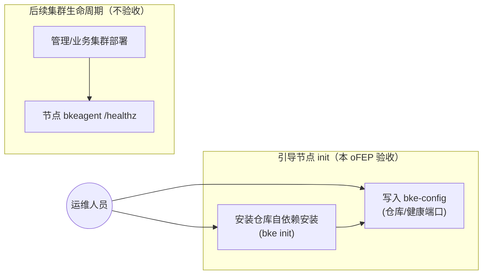
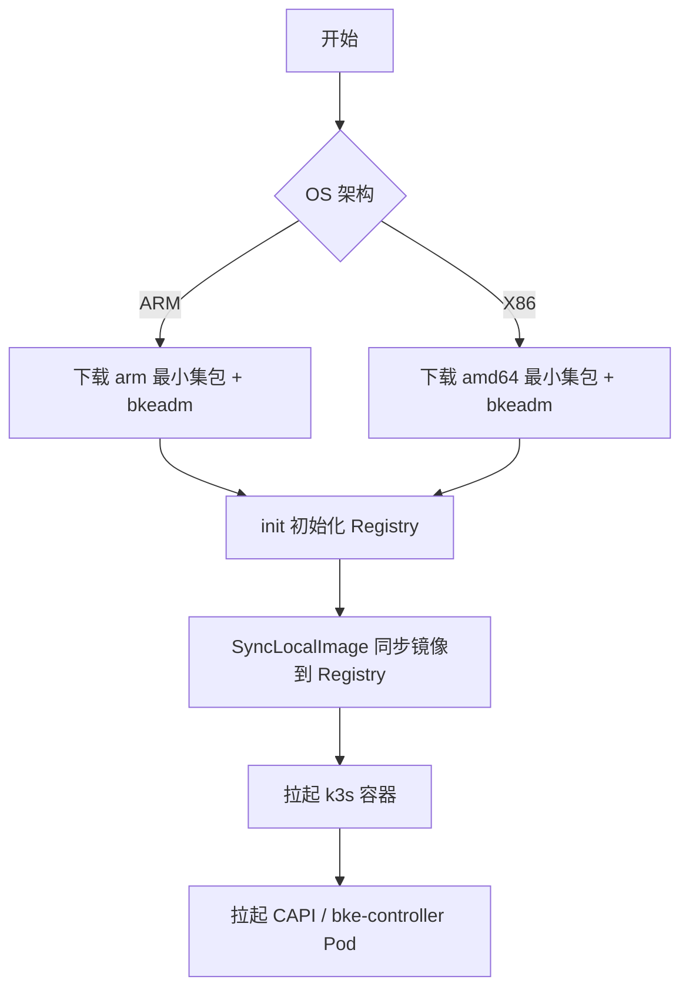
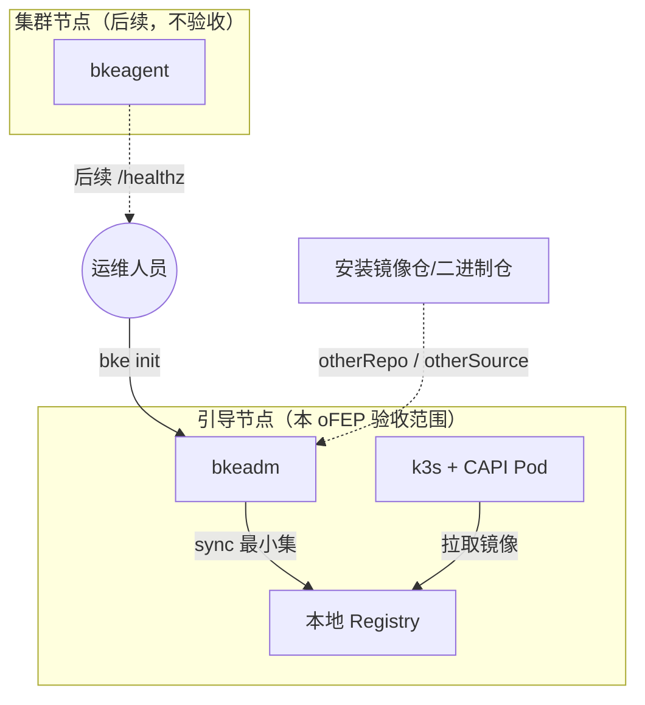
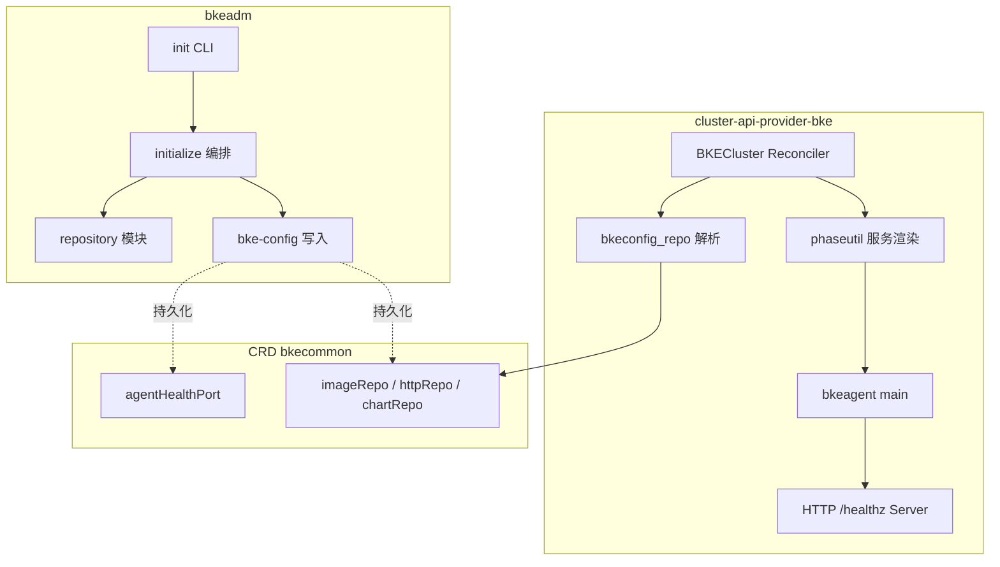
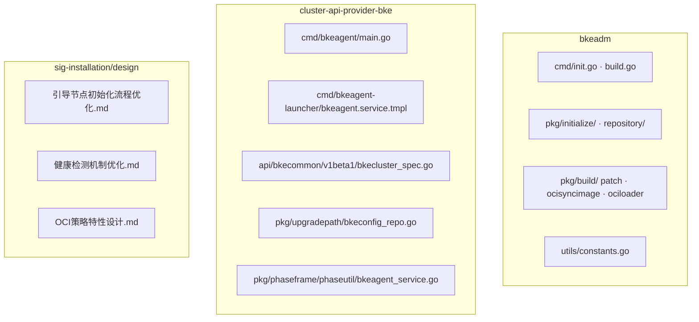
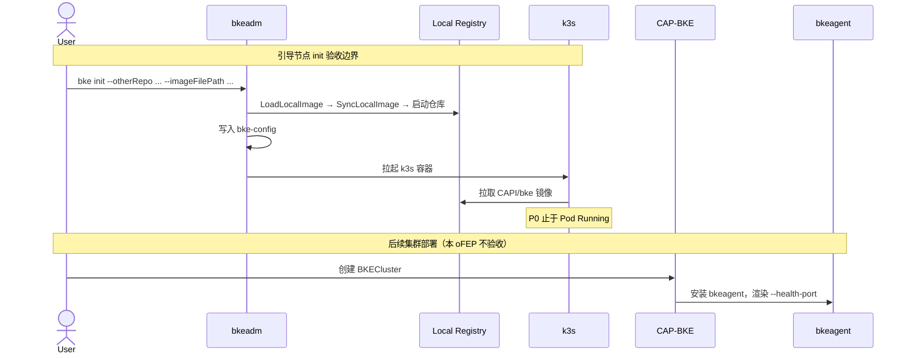
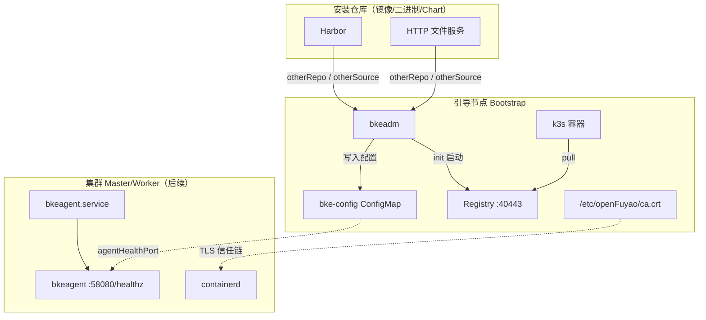

<!-- 格式合规检查：已通过 -->
---
# 提案标题
title: 引导节点安装仓库自依赖安装和提供 bkeagent 健康端口
# 提案编号
ofep-number: 0040
# 提案作者
authors:
  - TBD
# 提案主导SIG
owning-sig: sig-Installation
# 提案协作SIG
participating-sigs: []
# 提案状态(初步草案|准备开始实现|已在SIG中实现并合并|提案被暂缓|提案被否决|作者主动撤回提案|被另一个oFEP取代)
status: provisional
# 创建日期
creation-date: 2026-03-26
# 评审人
reviewers:
  - TBD
# 批准人
approvers:
  - TBD
# 相关联的其他oFEP
see-also:
  - "/ofeps/sig-Installation/ofep-0013-安装部署完全支持离线环境.md"
  - "sig-installation/design/引导节点安装优化和健康检测机制/引导节点初始化流程优化.md"
  - "sig-installation/design/引导节点安装优化和健康检测机制/健康检测机制优化.md"
  - "sig-installation/design/支持OCI策略制备离线包/特性设计.md"
# 当前oFEP替代了哪些已有提案
replaces: []
# 当前oFEP被哪些提案替代，当status为replaced时需要填写此字段
replaced-by: []
# 此oFEP当前开发阶段
stage: alpha
# 最近一次推进的版本
latest-milestone: ""
# 各阶段目标版本
milestone:
  alpha: ""
  beta: ""
  stable: ""
# 功能开关及影响组件
feature-gates:
  - name: BootstrapRepoSelfContainedInstall
    components:
      - bkeadm
      - cluster-api-provider-bke
  - name: BKEAgentHealthPort
    components:
      - bkeadm
      - cluster-api-provider-bke
# 是否支持关闭该功能
disable-supported: true
# 该功能引入的监控指标
metrics: []
---

# oFEP-0040：引导节点安装仓库自依赖安装和提供 bkeagent 健康端口

<!-- toc -->
- [发布签核清单](#release-signoff-checklist)
- [摘要](#summary)
- [动机](#motivation)
  - [目标](#goals)
  - [非目标](#non-goals)
- [提案](#proposal)
  - [用户故事与用例视图](#user-stories)
  - [注释/约束/警告](#notesconstraintscaveats)
  - [风险与缓解措施](#risks-and-mitigations)
- [设计细节](#design-details)
  - [架构与设计前提](#architecture-and-design-premises)
  - [特性描述](#feature-description)
  - [4+1 架构视图](#41-architecture-views)
  - [模块接口与配置约定](#module-interfaces-and-configuration)
  - [关键设计决策表](#关键设计决策表)
  - [DFX 质量属性设计](#dfx-quality-attributes)
  - [测试计划](#test-plan)
  - [毕业标准](#graduation-criteria)
  - [升级/降级策略](#upgrade--downgrade-strategy)
  - [版本倾斜策略](#version-skew-strategy)
- [生产可用性审查](#production-readiness-review)
- [实施历史](#implementation-history)
- [缺点](#drawbacks)
- [替代方案](#alternatives)
- [所需基础设施](#infrastructure-needed)
<!-- /toc -->

## 发布签核清单

标记有（R）的项目*在达到里程碑/发布*之前是必需的。

- [ ]（R）发布里程碑中的增强问题，链接到 [openfuyao/ofep](https://gitcode.com/openfuyao/ofep) 中的 oFEP 目录
- [ ] (R) oFEP 审批者已批准 oFEP 状态为“可实施”
- [ ] (R) 设计细节已适当记录
- [ ]（R）测试计划已到位，并考虑了 SIG 架构和 SIG 测试的输入（包括测试重构）
  - [ ] 针对所有 Beta API 操作（端点）进行 e2e 测试
  - [ ] (R) 确保 GA e2e 测试满足一致性测试的要求
  - [ ] (R) GA e2e 测试至少需要两周时间才能证明测试结果无 flake（不稳定或偶发失败）
- [ ] (R) 毕业标准已设定
- [ ] (R) 生产准备情况审查完成
- [ ] (R) 生产准备情况审查已获批准
- [ ] “实施历史”部分已更新里程碑
- [ ] 面向用户的文档已在 [openfuyao/docs](https://gitcode.com/openfuyao/docs) 创建，以便发布到 [openfuyao.com](https://openfuyao.com/)
- [ ] 支持文档 - 例如，额外的设计文档、邮件列表讨论/SIG 会议链接、相关 PR/问题、发行说明

- [openfuyao.com](https://openfuyao.com/)
- [openfuyao/ofep](https://gitcode.com/openfuyao/ofep)
- [openfuyao/docs](https://gitcode.com/openfuyao/docs)

## 摘要

本提案涵盖 openFuyao 安装部署链路上的两项增强能力，设计依据见 sig-Installation 仓 `design/引导节点安装优化和健康检测机制/` 与 `design/支持OCI策略制备离线包/`：

1. **引导节点安装仓库自依赖安装**（对应《引导节点初始化流程优化》）：面向**在线安装**场景，验收范围**限于引导节点 `bke init`**。用户仅需 bkeadm + 最小集镜像包，通过 `--imageFilePath` 等参数使 k3s/CAPI Pod 在引导节点上从本地 Registry 自供给；**不涉及**管理/业务集群部署。
2. **bkeagent 健康端口**（对应《健康检测机制优化》3.3.1 节，本 oFEP 范围）：为节点 systemd 服务 bkeagent 提供可配置 HTTP `/healthz` 探针（默认 `127.0.0.1:58080`），供用户监控系统对接；bkeagent-deployer（8443）、bke-controller-manager（9444）及 K8s 原生组件探针改造不在本 oFEP 范围内。

上述能力已在 `bkeadm`、`cluster-api-provider-bke`（含 bkeagent）及 sig-Installation 设计文档中完成初步实现与设计，本 oFEP 将其标准化为社区可评审、可演进的增强提案。

## 动机

openFuyao 引导节点安装与集群生命周期管理当前存在以下痛点：

| 痛点 | 现状 | 影响 |
|------|------|------|
| 在线引导节点依赖远端制品 | 在线安装需从公共镜像仓拉取 k3s、CAPI 等基础镜像及在线二进制 | 远端仓库故障或证书校验复杂时阻塞 init；与离线包体验差距大 |
| 安装仓库与本地最小集未协同 | 指定 `--otherRepo` 后，引导最小集仍可能走远端拉取 | 无法做到「仅 bkeadm + 最小集 tar.gz」的轻量在线安装 |
| 节点代理不可观测 | bkeagent 无标准健康检查端点 | 用户监控系统无法探测节点代理可用性 |

与 [oFEP-0013](/ofeps/sig-Installation/ofep-0013-安装部署完全支持离线环境.md) 的关系：oFEP-0013 聚焦全离线制品包制备与 containerd mirror；本 oFEP 聚焦**在线**引导节点自依赖（OCI 最小集 + 安装仓库）及 bkeagent 健康端口，二者互补。

### 目标

1. 在线场景支持 `--otherRepo` / `--otherSource` / `--otherChart` 及 TLS 参数，写入 `cluster-system/bke-config`，供 BKECluster 部署与 CAP-BKE 解析消费。
2. 支持 `--imageFilePath` 加载 OCI 最小集（`bke build patch --strategy=oci`），经 `LoadLocalImage`（nerdctl 导入 registry 镜像）→ `SyncLocalImage` 同步至本地 Registry；须 `--installConsole=false` 且 `--otherRepo` 非空（与纯离线 init 互斥）。
3. bkeagent 在 `127.0.0.1:<port>/healthz` 暴露 HTTP 健康检查；端口经 `--agentHealthPort` → `bke-config` → installer-service（前端）或 BKECluster `agentHealthPort`（后端）→ systemd `--health-port` 全链路传递，默认 `58080`。
4. 健康判定：`manager ready` 且对目标集群 APIServer 执行 `Discovery().ServerVersion()` 成功返回 200，否则 503。

### 非目标

1. 不覆盖 oFEP-0013 全离线制品包、containerd 全局 mirror 及增量 patch 安装。
2. 不覆盖纯离线 `bke init` 路径；`--imageFilePath` 仅用于在线安装优化。
3. 不在本 oFEP 实现 bkeagent-deployer（8443 HTTPS）、bke-controller-manager（9444 HTTPS）及 K8s/CNI 等组件探针（见《健康检测机制优化》，单独演进）。
4. bkeagent 健康端口不暴露到非 `127.0.0.1` 地址。
5. `--imageFilePath` 与 `--installConsole=true` 互斥（最小集模式仅安装 CAPI/bke-controller，不装 openFuyao 控制台及 coredns）。
6. **本 oFEP 安装自依赖能力的验收范围限于引导节点 `bke init`**（含 k3s/CAPI Pod 在引导节点上就绪）；**不包含**管理集群/业务集群的创建与部署。

## 提案

本提案通过扩展 `bkeadm init` CLI、BKECluster CRD（`bkecommon/v1beta1`）及 bkeagent 进程，在不改变现有离线安装主路径的前提下，为引导节点安装仓库自依赖及节点代理可观测场景提供统一安装体验。

**成功衡量标准：**

**引导节点安装仓库自依赖（验收止于 init）：**

- 使用安装仓库 + `--imageFilePath` 完成引导节点 `bke init`，引导节点上 k3s 容器及 CAPI/bke-controller Pod 均 Running，且镜像均来自引导节点本地 Registry，init 过程无公共镜像源访问（P0）。
- init 完成后 `cluster-system/bke-config` 中安装仓库相关键值正确写入（P0）。

**bkeagent 健康端口（init 阶段配置 + 模块验证）：**

- init 可通过 `--agentHealthPort` 写入 `bke-config`，默认 `58080`（P0）。
- bkeagent 健康服务单元测试：`/healthz` 在 APIServer 可达时返回 200、不可达时返回 503；端口冲突 fail-fast（P0/P1）。

> 说明：bkeagent 运行于后续管理/业务集群节点，节点侧 `curl /healthz` 的端到端验证依赖集群部署，**不在本 oFEP 安装自依赖验收范围内**；设计文档 HC 用例可作为健康端口能力的参考测试，非本提案 P0 门禁。

### 用户故事与用例视图

#### 故事 1：引导节点安装仓库自依赖安装

作为平台运维人员或社区用户，我希望仅下载 bkeadm 与 amd64/arm64 最小集镜像包，执行 `bke init --otherRepo ... --installConsole=false --imageFilePath=...`，使引导节点 init 完成且本地 Registry 自供给 k3s/CAPI Pod，无需完整离线包或实时访问公共镜像源。

#### 故事 2：对接外部监控系统探测 bkeagent

作为 SRE，我希望 init 阶段即可配置 bkeagent 健康端口并写入 bke-config，供后续集群节点安装 bkeagent 时使用；健康服务行为通过模块测试验证。

**用例图**：



**设计意图**：本 oFEP 验收聚焦引导节点 init 与 bke-config 写入；管理/业务集群部署及节点侧 healthz 探测为后续能力，不在安装自依赖 P0 门禁内。

### 注释/约束/警告

1. **适用场景**：`--imageFilePath` 仅用于在线安装优化；纯离线 `bke init` 保持不变，无需该参数。
2. **参数互斥**：`--imageFilePath` 与 `--installConsole=true` 互斥；与 `--otherRepo` 为空（离线模式）互斥；文件须为存在的 `.tar.gz` / `.tgz`。
3. **coredns 时机**：最小集模式（`installConsole=false`）不安装 coredns，仅拉起 CAPI/bke-controller；安装 openFuyao 控制台组件时才需要 coredns。
4. **OCI 制品**：最小集推荐使用 `bke build patch --strategy=oci` 构建，避免 CI 环境 DinD 依赖；init 时 `DetectPatchFormat` 自动识别 OCI/Registry 格式。
5. **二进制仓目录**：`--otherSource` 指向的 HTTP 服务根目录下须有 `files/` 子目录存放 containerd、kubectl、kubelet 等二进制（见设计文档可测试性章节）。
6. bkeagent `/healthz` 仅监听 `127.0.0.1`；外部监控需节点侧 Agent 或 SSH 隧道。

### 风险与缓解措施

| 风险 | 影响 | 缓解措施 |
|------|------|----------|
| 安装仓库证书/域名配置不一致 | 引导节点 init 失败或 k3s/CAPI Pod 拉镜像失败 | init 阶段校验 `--domain` 与 `--otherRepo`；文档明确 CA 路径 |
| 最小集镜像包版本与 bkeadm 不匹配 | 引导节点 Pod ImagePullBackOff | 镜像包绑定 VersionConfig；init 前校验 patches |
| 健康端口配置错误 | 后续集群节点 bkeagent 端口不符合预期 | init 写入 bke-config；文档说明前端/后端覆盖方式 |
| 本地 healthz 无 TLS | 本机进程可伪造探针响应 | 仅绑定 127.0.0.1；响应体不含敏感信息 |

## 设计细节

### 架构与设计前提

**引导节点 init 流程**（设计文档 3.1 节）：



**实现前提：**

- 引导节点运行 k3s；bkeadm 负责 init 阶段 Registry/YUM/Chart 服务及 `bke-config` 写入。
- `--imageFilePath` 指定时：`LoadLocalImage`（nerdctl 导入 `registry.image-*`）→ `ContainerServer` → `SyncLocalImage`（OCI Layout 或 Registry 格式自动检测）→ 再启动 k3s。
- 镜像来源优先级（`ContainerServer`）：`localImage（imageFilePath）> otherRepo > 离线默认 > 第三方公共源`。
- CAP-BKE 通过 `pkg/upgradepath/bkeconfig_repo.go` 解析 `bke-config` 映射至 BKECluster `imageRepo` / `httpRepo` / `chartRepo`。
- 节点 bkeagent 以 systemd 运行；健康端口由 `bkeagent.service.tmpl` 渲染 `--health-port`。

### 特性描述

#### 背景与目标

见「动机」与「提案」章节。实现分布在：

| 仓库 | 职责 |
|------|------|
| bkeadm | init CLI、仓库服务启动、本地镜像包加载/sync、bke-config 写入 |
| cluster-api-provider-bke | BKECluster CRD、 bkeagent 健康服务、systemd 模板渲染 |
| sig-installation | 用户指南、设计文档、API 参考 |

#### 依赖组件

| 组件 | 描述 | 可获得性 |
|------|------|----------|
| bkeadm | 引导 init、OCI 最小集构建（`bke build patch --strategy=oci`）、Registry sync | 必选 |
| cluster-api-provider-bke | bkeagent 健康服务、BKECluster 调谐、systemd 模板 | 必选 |
| bkecommon (v1beta1) | `AgentHealthPort`、`Repo` CRD 字段 | 必选 |
| bke-manifests | 集群安装 YAML 集合 | 必选 |
| installer-service / installer-website | 前端部署读取 `bke-config.agentHealthPort` | 前端路径必选 |
| containers/image + OCI Layout | OCI 策略镜像 sync（`reg.CopyRegistry`） | 最小集构建必选 |
| containerd / k3s | 节点 CRI、引导控制面 | 必选 |

#### License

Mulan PSL v2 License。

### 4+1 架构视图

#### 上下文与用例视图 (Context and Use Case View)



**设计意图**：验收边界为引导节点 init 完成且 k3s/CAPI Pod 自本地 Registry 就绪；集群节点 bkeagent 为后续生命周期能力。

#### 逻辑视图 (Logical View)



**设计意图**：init 阶段完成仓库启动与 ConfigMap 持久化；CAP-BKE 在集群调谐时读取仓库配置并渲染 bkeagent systemd 单元；健康检查逻辑内嵌于 bkeagent 进程。

#### 开发视图 (Development View)



**设计意图**：CLI 与仓库逻辑集中在 bkeadm；CRD 与运行时行为在 CAP-BKE；bkeagent 健康服务与 systemd 模板同仓维护；sig-installation 承载对外文档。

#### 运行视图 (Runtime View)



**设计意图**：P0 验收覆盖 init 至引导节点 k3s/CAPI Pod 就绪；后续 BKECluster 部署与 bkeagent 节点探针为扩展能力，不在本 oFEP 门禁内。

#### 部署视图 (Deployment View)



**设计意图**：引导节点集中提供 Registry/YUM/Chart 服务；安装仓库与本地最小集在 init 阶段完成配置与 sync；集群节点仅部署 bkeagent 与 containerd。

### 模块接口与配置约定

#### 1. 引导节点安装仓库自依赖安装

##### 1.1 最小集制品内容

**容器镜像**（sync 至本地 Registry 后供 k3s/CAPI 拉取）：

| 镜像 | 标签 | 用途 |
|------|------|------|
| registry | 2.8.1 | 本地镜像仓库（nerdctl 导入启动） |
| nginx_yum_repo | 1.23.0-alpine | YUM 代理 |
| chartmuseum | v0.16.2 | Chart 仓库 |
| k3s | v1.25.16-k3s4 | 引导控制面 |
| mirrored-pause | 3.6 | 暂停镜像 |
| cluster-api-controller 等 | v1.4.3 | CAPI 组件 |
| cluster-api-provider-bke / bke-manifests | latest | BKE 调谐与清单 |

**二进制文件**（随最小集 volumes 或 `--otherSource` 提供）：

- `registry.image-{amd64|arm64}`（nerdctl 导入）
- `containerd-v2.1.1-linux-{arch}.tar.gz`
- `cni-plugins-linux-{arch}-v1.4.1.tgz`
- `patches/VersionConfig-latest.yaml`

##### 1.2 OCI 最小集构建（《支持 OCI 策略制备离线包》）

   ```bash
bke build patch -f bootstrap_amd64.yaml -t image_amd64.tar.gz --strategy=oci
   ```

构建采用 `syncRepoOCI`：创建 `volumes/oci-layout/`（含 `oci-layout`、`index.json`、`blobs/sha256/`），无需 DinD；部署/init 时 `DetectPatchFormat()` 识别 OCI 或 Registry 格式，OCI 路径经 `reg.CopyRegistry()` 直接推送至目标 Registry（内置 9 次重试）。

**manifests 示例（节选）**：

```yaml
repos:
  - architecture: [amd64]
    needDownload: true
    subImages:
      - sourceRepo: cr.openfuyao.cn/openfuyao
        targetRepo: kubernetes
        images:
          - name: k3s
            tag: [v1.25.16-k3s4]
          - name: chartmuseum
            tag: [v0.16.2]
files:
  - address: https://openfuyao.obs.cn-north-4.myhuaweicloud.com/registry/
    files:
      - fileName: registry.image-amd64
patches:
  - address: https://openfuyao.obs.cn-north-4.myhuaweicloud.com/openFuyao/version-config/
    files:
      - fileName: VersionConfig-latest.yaml
```

**解压目录结构（OCI 策略）**：

```
image_amd64/
       ├── manifests.yaml
└── volumes/
    ├── oci-layout/
    │   ├── blobs/sha256/...
    │   ├── index.json
    │   └── oci-layout
    ├── registry.image-amd64
    ├── containerd-v2.1.1-linux-amd64.tar.gz
    ├── cni-plugins-linux-amd64-v1.4.1.tgz
    └── patches/VersionConfig-latest.yaml
```

##### 1.3 安装仓库 CLI 与 CR

| 参数 | 说明 |
|------|------|
| `--otherRepo` | 私有镜像仓地址（含端口与路径，如 `192.168.1.1:443/openfuyao`） |
| `--otherSource` | 私有二进制 HTTP 仓（须以 `http://` 开头） |
| `--otherChart` | 私有 Chart 仓地址 |
| `--domain` | 镜像仓域名（与证书 SAN 一致） |
| `--imageRepoPort` | 本地/镜像仓端口 |
| `--imageRepoCAFile` | 镜像仓 CA 证书路径 |
| `--imageRepoTLSVerify` | 是否校验 TLS（默认 true） |
| `--imageRepoUsername/Password` | 镜像仓认证 |

**bke-config ConfigMap 键：** `otherRepo`、`otherRepoIp`、`otherSource`、`otherChart`、`otherChartIp`、`domain`、`imageRepoPort`

**BKECluster CR 字段：**

```yaml
spec:
  clusterConfig:
    cluster:
      imageRepo:
        domain: deploy.example.com
        ip: 192.168.200.173
        port: "40443"
        prefix: openfuyao
        tlsSecretRef: ...
        insecureSkipTLSVerify: false
      httpRepo:
        domain: http.example.com
        ip: 192.168.200.173
        port: "40080"
      chartRepo:
        domain: chart.example.com
        ip: 192.168.200.173
        port: "8080"
```

**containerd TLS（ContainerdConfig CR）：**

```yaml
registry:
  configs:
    "my.harbor.com":
      tls:
        caFile: /etc/openFuyao/ca.crt
      plainHTTP: false
```

##### 1.4 init 命令示例

```bash
# 安装仓库 + 最小集 + 二进制仓
bke init \
  --otherRepo cr.openfuyao.cn/openfuyao \
  --otherSource http://192.168.100.48:8080 \
  --installConsole=false \
  --imageFilePath=/tmp/local_amd/image_amd64.tar.gz

# 社区在线常用（无二进制仓）
bke init \
  --otherRepo cr.openfuyao.cn/openfuyao \
  --installConsole=false \
  --imageFilePath=/tmp/local_amd/image_amd64.tar.gz

# 离线安装（不变，不使用 imageFilePath）
bke init
```

**PreRunE 校验逻辑**（设计文档 3.3.2 节）：

| 条件 | 结果 |
|------|------|
| `imageFilePath` + `installConsole=true` | 拒绝 |
| `imageFilePath` + `otherRepo=""` | 拒绝（与离线互斥） |
| 文件非 `.tar.gz`/`.tgz` 或不存在 | 拒绝 |

#### 2. bkeagent 健康端口

##### 2.1 本 oFEP 与健康检测体系边界

《健康检测机制优化》覆盖多组件探针；**本 oFEP 仅交付 bkeagent 系统服务 HTTP 探针**：

| 组件 | 协议/端口 | 本 oFEP 范围 |
|------|-----------|--------------|
| bkeagent（systemd） | HTTP，`127.0.0.1:<port>/healthz`，默认 58080 | **是** |
| bkeagent-deployer | HTTPS 8443 | 否 |
| bke-controller-manager | HTTPS 9444（管理集群） | 否 |
| 引导集群 CAPI/bke-controller Pod | HTTP，网络隔离 | 不对接外部监控 |

##### 2.2 模块接口（cluster-api-provider-bke/cmd/bkeagent）

```go
func startHealthServer(port int, hc *healthChecker) error  // 127.0.0.1 监听
func (hc *healthChecker) checkHealth() (bool, string)       // APIServer Discovery
func parseFlags() config                                     // --health-port，默认 58080
```

BKECluster CR 新增字段：

```go
// AgentHealthPort defines the agent health port
AgentHealthPort string `json:"agentHealthPort,omitempty"`
```

systemd 模板（`bkeagent.service.tmpl`）：

```
ExecStart=/usr/local/bin/bkeagent --kubeconfig=... --health-port={{.healthPort}} ...
```

##### 2.3 配置传递路径

| 层级 | 字段/参数 | 默认值 | 说明 |
|------|-----------|--------|------|
| bke init | `--agentHealthPort` | `58080` | init 写入 bke-config |
| bke-config CM | `agentHealthPort` | init 写入 | **前端**：installer-service 读取 |
| BKECluster CR | `spec.clusterConfig.cluster.agentHealthPort` | 可选 | **后端** YAML 部署 |
| bkeagent | `--health-port` | systemd 渲染 | 进程实际监听端口 |

init 完成后 `/bke/cluster/` 目录生成 BKECluster 样例，含默认健康端口。

**探针用法：**

```bash
curl -v http://127.0.0.1:58080/healthz
# 200: ok（manager ready 且 APIServer 可达）
# 503: unavailable（含原因摘要）
```

**健康判定逻辑：** manager ready + `Discovery().ServerVersion()` 成功 → 200；否则 503。

### 关键设计决策表

| 决策点 | 选项 | 选定方案 | 理由 |
|--------|------|----------|------|
| 最小集制品格式 | Registry tar / OCI Layout | **OCI（`--strategy=oci`）** | 免 DinD、CI 友好、与 skopeo/crane 工具链兼容 |
| 自依赖适用场景 | 在线 / 离线 | **仅在线**（须 `--otherRepo` 非空） | 离线包已含全量镜像，无需 imageFilePath |
| 控制台与最小集 | 可同时 / 互斥 | **互斥**（`installConsole=false`） | 最小集仅 CAPI/bke-controller，不装 coredns 与控制台 |
| registry 镜像加载 | 远端拉取 / nerdctl 本地导入 | **nerdctl 导入 `registry.image-*`** | 设计文档：registry 从本地包启动，不依赖远端 |
| bkeagent 探针协议 | HTTP / HTTPS | **HTTP @ 127.0.0.1** | 本机 systemd 服务；HTTPS 留给 bkeagent-deployer |
| 健康端口配置源 | 仅 CR / 仅 CM / 多级 | **init→bke-config→前端/CR 后端** | 兼顾 installer-service 与 YAML 部署路径 |
| OCI 部署检测 | 固定格式 / 自动检测 | **`DetectPatchFormat()`** | 向后兼容 Registry 格式补丁包 |

### DFX 质量属性设计

#### 性能

| 规格项 | 指标/说明 |
|--------|-----------|
| 最小集镜像 sync 耗时 | 与镜像包大小线性相关；OCI 策略下典型 amd64 最小集（约 500MB 级）目标 < 10 min（千兆内网） |
| `/healthz` 响应时间 | P99 < 500ms（含 APIServer Discovery 调用） |
| 健康检查开销 | 单节点额外内存 < 10MB；无周期性主动轮询（仅按需 HTTP 请求触发） |

#### 可靠性

- **init 顺序**：`LoadLocalImage` → `ContainerServer` → `SyncLocalImage` → Yum/Chart；任一步失败中止 init。
- **OCI sync**：`reg.CopyRegistry` 内置最多 9 次重试；网络中断支持断点续传（containers/image 特性）。
- **端口冲突**：bkeagent 启动前 `isPortInUse`，占用则 fail-fast。
- **健康降级**：APIServer 不可达返回 503，不退出进程。

#### 安全

- bkeagent `/healthz` 仅 `127.0.0.1`；响应体不含凭证。
- OCI 构建/同步：TLS 验证、SHA256 Digest 保留、目录权限 0755/0644（《OCI 策略》2.1 节）。

#### 兼容性

- OCI 与 Registry 两种 patch 格式共存，`DetectPatchFormat` 自动分支。
- 未传 `--imageFilePath` / `--agentHealthPort` 时保持 legacy 行为。
- `AgentHealthPort`、`Repo` 为 optional CRD 字段，旧集群无需迁移。

#### 可服务性（运维）

- init 后 `/bke/cluster/` 提供 BKECluster 样例；`kubectl edit cm bke-config -n cluster-system` 调整前端默认端口。
- 二进制仓 HTTP 根目录结构：`files/files/{containerd-*.tar.gz, kubectl-*, kubelet-*, ...}`。
- 排障：`journalctl -u bkeagent`；`ss -tlnp | grep <port>`；OCI sync 失败查磁盘空间与 `manifests.yaml` 版本。

#### 可测试性

- 引导节点自依赖：设计文档用例 BS-001~003（**仅 init 阶段**）。
- bkeagent 健康：init 阶段 bke-config 写入（HC-init-001）+ 模块单测（HC-unit-001）；设计文档 HC-001~008 为参考，需集群部署，非 P0 门禁。
- OCI：`DetectPatchFormat`、`syncRepoOCI`、`CopyRegistry` 单元测试。

#### 易用性

- 错误信息明确指出互斥参数组合（如 `local image file and install console is mutually exclusive`）。
- 默认健康端口 58080 与社区文档一致，减少额外配置。
- 最小集安装仅需 bkeadm + 一个 tar.gz，低于完整离线包门槛；文档提供 `bke build patch` 一键构建示例。

### 测试计划

[ ] 我/我们理解，相关组件的所有者可能会要求更新已有的测试，以便在提交实现该增强功能所需的更改之前，使代码达到足够稳固的质量标准。

#### 先决条件测试更新

- 补充 `bkeadm/pkg/initialize/repository` 对 `otherRepo` 优先级链路的单元测试。
- 补充 `cluster-api-provider-bke/cmd/bkeagent` 健康服务与端口校验测试。

#### 单元测试

| 包 | 覆盖重点 |
|----|----------|
| `bkeadm/cmd` | init PreRunE 参数互斥、文件后缀校验 |
| `bkeadm/pkg/initialize/repository` | ContainerServer 优先级、ParseOnlineConfig |
| `cluster-api-provider-bke/cmd/bkeagent` | startHealthServer、checkHealth、validatePort |
| `cluster-api-provider-bke/pkg/upgradepath` | RepoFromBKEConfigData |

#### 集成测试

| 编号 | 场景 | 预期 |
|------|------|------|
| INT-001 | `--otherRepo` + TLS CA init | Registry/YUM 启动，bke-config 键正确 |
| INT-002 | `--imageFilePath` 最小集 init | 引导节点 k3s/CAPI Pod Running，镜像来自本地 40443 |
| INT-003 | `--agentHealthPort 58081` init | bke-config 中 `agentHealthPort=58081` |
| INT-004 | bkeagent 健康服务单测 | 端口占用 fail-fast；200/503 分支正确 |

#### e2e 测试

**验收范围说明**：P0 e2e **仅覆盖引导节点 `bke init`**，不创建管理/业务集群。设计文档中涉及集群部署的 HC 用例列为**参考测试**（P1 或后续版本）。

**引导节点自依赖（P0，对齐《引导节点初始化流程优化》3.5 节）**

| 编号 | 优先级 | 步骤 | 预期 |
|------|--------|------|------|
| BS-001-参数校验 | P0 | installConsole+imageFilePath；otherRepo 空+imageFilePath；非法后缀/路径 | 均拒绝并提示明确 |
| BS-002-在线自依赖 init | P0 | OCI 构建最小集 → `bke init` | init 成功；引导节点 k3s/CAPI Pod Running；镜像来自本地 Registry |
| BS-003-legacy 在线 init | P1 | 无 imageFilePath 的 `bke init` | init 成功，镜像来自远端仓库 |

**bkeagent 健康端口**

| 编号 | 优先级 | 步骤摘要 | 预期 |
|------|--------|----------|------|
| HC-init-001-默认端口写入 | P0 | `bke init --agentHealthPort` 默认/自定义 | bke-config 中 `agentHealthPort` 正确 |
| HC-unit-001-健康服务 | P0 | bkeagent 单元/集成测试 | `/healthz` 200/503；端口冲突 fail-fast |
| HC-ref-001~008 | P1（参考） | 设计文档集群部署场景 | 见《健康检测机制优化》3.5 节，非本 oFEP init 门禁 |

### 毕业标准

#### Alpha 阶段

- 两项能力代码合入 bkeadm 与 cluster-api-provider-bke 主分支。
- P0 e2e 用例通过（**引导节点 init + bke-config 校验**，不含业务/管理集群部署）。
- sig-installation 用户指南与设计文档与实现一致。

#### Beta 阶段

- P0 + P1 用例稳定运行 ≥ 2 周无 flake。
- 至少 2 个内外部环境完成**引导节点 init** 自依赖安装验证。
- PRR 问卷完成，监控与排障文档就绪。

#### GA 阶段

- ≥ 5 次生产/准生产**引导节点 init** 记录。
- 反馈窗口内无 P0/P1  open 问题。
- 与 oFEP-0013 离线能力联调文档发布。

### 升级/降级策略

- **升级**：新版本 bkeadm 兼容已有 bke-config；新增字段（`agentHealthPort`）optional，未设置时使用默认 58080。已运行集群升级 bkeagent 时需滚动重启节点代理以应用新 health-port（若变更）。
- **降级**：回退 bkeadm 不影响已写入的 bke-config 字段；旧版 bkeagent 忽略未知 CRD 字段。若已使用 `--imageFilePath` 流程，降级后仍可用 `--otherRepo` 在线路径替代。
- **Feature Gate**：当前为 CLI/CR 可选能力，默认启用；可通过不传递相关参数保持 legacy 行为，无需显式 Gate。

### 版本倾斜策略

- bkeadm 与 cluster-api-provider-bke 建议同版本或相邻版本使用；`agentHealthPort` 字段 n-1 版本 CAP 可忽略，健康端口保持默认。
- 引导节点 bkeadm 新 + 旧版 CAP 镜像：health-port 若未渲染到 systemd，bkeagent 使用二进制默认 58080。
- `--imageFilePath` 依赖 bkeadm 与镜像包 VersionConfig 对齐，跨大版本 skew 可能导致镜像 tag 不匹配，需在发布说明中声明支持矩阵。

## 生产可用性审查

### 功能启用和回滚

- **启用**：`bke init` 传递对应 CLI 参数即可；无全局 Feature Gate。
- **回滚**：重新 init 时不传 `--imageFilePath` / 安装仓库相关参数即恢复 legacy 行为；已部署集群的健康端口变更需重新渲染 bkeagent systemd 并重启服务。
- **disable-supported**：true（不传参即禁用增强行为）。

### 监控要求

- **SLI**：节点侧 `bkeagent_healthz_up`（建议后续版本通过 node exporter textfile 或 agent 自暴露；当前阶段由外部脚本 curl `/healthz`）。
- **SLO**：集群节点 bkeagent 探针成功率 ≥ 99.9%（排除计划内维护）。
- **告警**：连续 3 次 `/healthz` 503 触发节点代理不可用告警。

### 依赖项

- 安装镜像仓 / HTTP 仓可用性直接影响 init 与节点拉取；仓库中断时 init 或 Pod 拉镜像失败，需监控仓库 SLA。
- kube-apiserver 可用性影响 healthz 结果；APIServer 故障时 healthz 503 为预期行为，应与 bkeagent 进程崩溃区分。

### 故障排除

| 故障模式 | 检测 | 缓解 |
|----------|------|------|
| 镜像拉取失败 | Pod ImagePullBackOff | 检查 otherRepo、CA、ContainerdConfig |
| bkeagent 启动失败 | systemd failed | 检查端口占用、journalctl 日志 |
| healthz 503 | curl 返回 unavailable | 检查 kubeconfig、APIServer 连通性 |
| 最小集 sync 失败 | init 日志 Error | 检查 tar.gz 完整性、磁盘空间 |

## 实施历史

| 日期         | 里程碑 |
|------------|--------|
| 2026-03-26 | oFEP-0040 草案创建 |
| 2026-03-28 | 基于 sig-installation/design 功能设计文档对齐改进（引导节点初始化流程优化、健康检测机制优化、OCI 策略制备） |

## 缺点

1. `--imageFilePath` 与 `--installConsole=false` 绑定，无法在同一引导节点同时体验最小集安装与控制台。
2. 健康检查仅 HTTP + localhost，企业跨节点集中采集需额外 Agent，不如 HTTPS 节点 IP 探针统一。
3. 仓库配置存在于 CLI、bke-config、BKECluster、ContainerdConfig 多处，学习曲线偏高。
4. 最小集镜像包需与版本配置同步维护，增加发布流水线负担。

## 替代方案

| 方案 | 描述 | 未采纳原因 |
|------|------|------------|
| 全量离线包替代最小集 | 一律使用 oFEP-0013 离线包 | 包体大，在线场景体验差 |
| bkeagent HTTPS 健康端口 | 使用集群 CA 签发 TLS | 本机探针场景过度设计；HTTPS 留给 bkeagent-deployer |
| 统一远程仓库不做本地 sync | 在线安装始终拉公共源 | 无法满足隔离与确定性要求 |
| 固定 58080 不可配置 | 硬编码端口 | 政企环境端口规划冲突 |

## 所需基础设施

- sig-installation `design/引导节点安装优化和健康检测机制/` 与 `design/支持OCI策略制备离线包/` 作为实现与评审的设计基线。
- 社区 CI 提供 `bke build patch --strategy=oci` 最小集制品构建流水线。
- CI 冒烟：**引导节点 init**（imageFilePath）+ 校验 k3s/CAPI Pod 与 bke-config（不含业务集群创建）。
