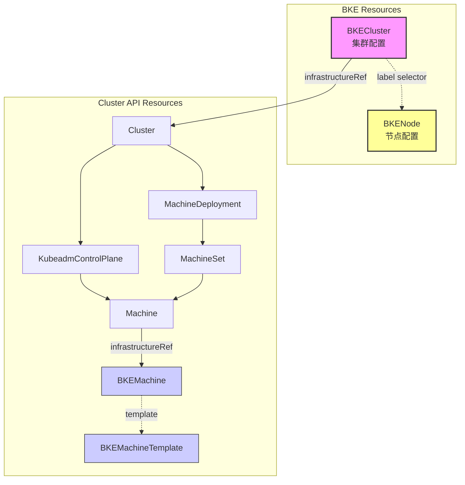
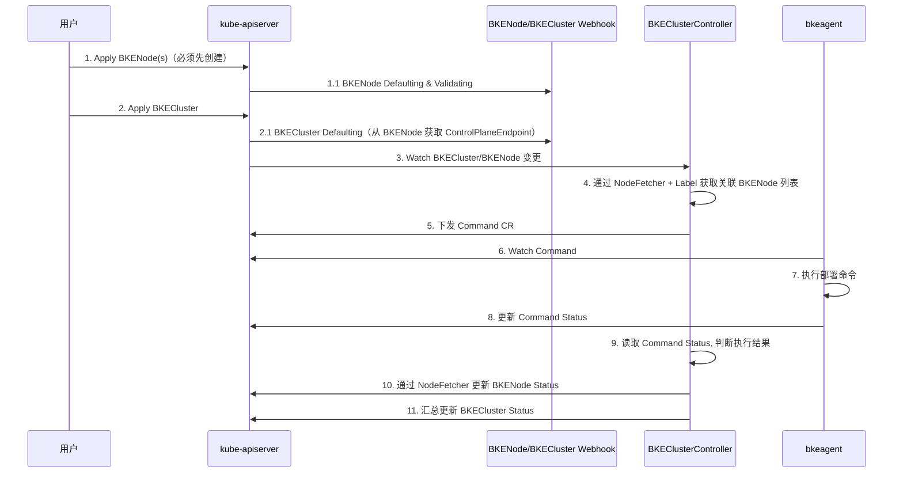
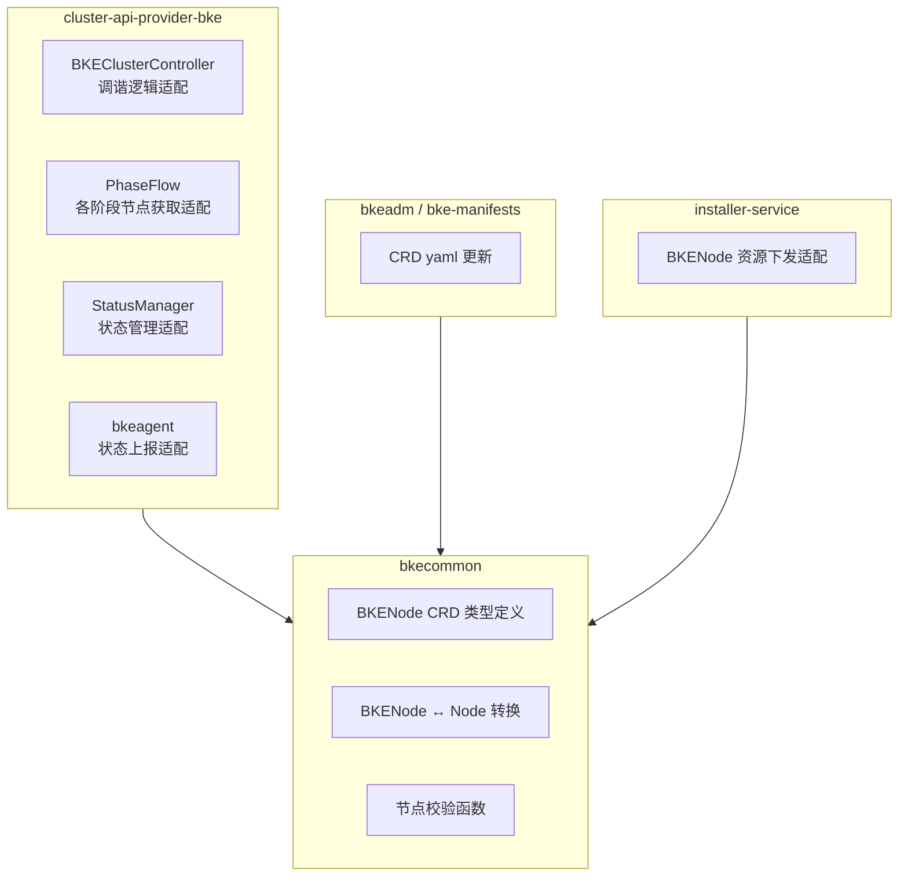
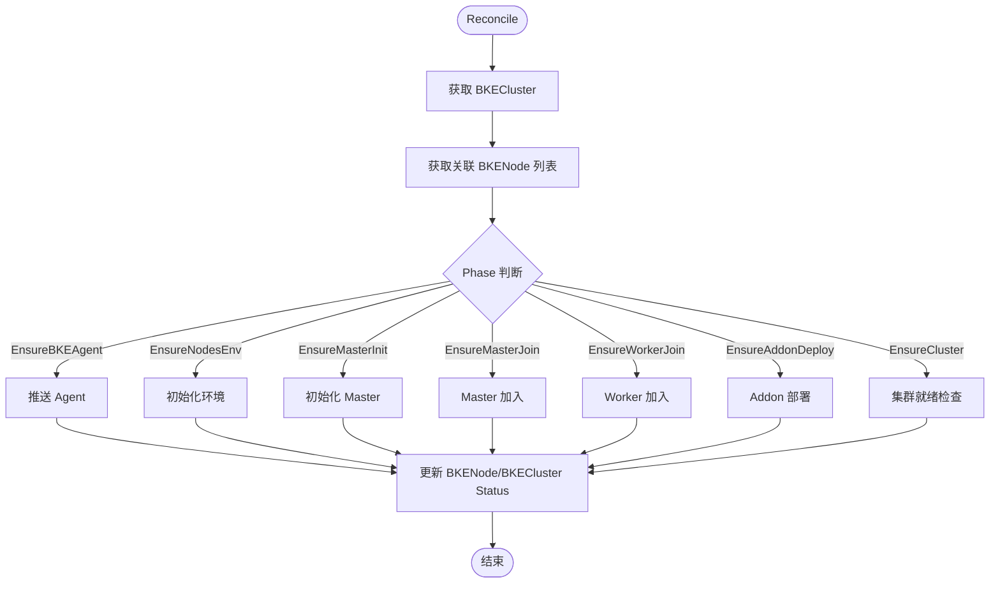

# BKENode 拆分 开发详细设计

# 1、特性描述

将 BKECluster 资源中的 Node 节点信息拆分为独立的 BKENode CRD 资源，实现节点与集群的解耦。

**核心目标：**
- 解耦节点配置与集群配置，降低单个资源体积
- 提升大规模集群场景下的调谐性能，支持节点级别并行处理
- 为后续节点配置热更新能力提供基础

**改动范围：**
- **bkecommon**：CRD 类型定义拆分，公共函数适配
- **cluster-api-provider-bke**：控制器调谐逻辑适配，状态管理适配，bkeagent 状态上报适配
- **bkeadm**：CRD yaml 文件更新及解析webhook等适配
- **bke-manifests**：CRD yaml 文件更新
- **installer-service**：资源下发适配，支持 BKENode 资源创建

**CRD yaml 修改位置：**
- `bkeadm/pkg/initialize/cluster-api/cluster-api-bke.yaml`
- `bke-manifests/kubernetes/cluster-api/v1.4.3/003-cluster-api-bke.yaml`
- `cluster-api-provider-bke/config/crd/bases/bke.bocloud.com_bkeclusters.yaml`（新增 bke.bocloud.com_bkenodes.yaml）

**设计原则：**
- 最小化变更，保持原有调谐逻辑不变
- 仅将 Node 信息从 BKECluster 中独立出来
- 复用现有的节点处理函数和校验逻辑

## 1.1、依赖组件

| 组件 | 组件描述 | 可获得性 |
|:---|:-------|:-------|
| bkecommon | BKE 公共库，定义 CRD 类型和公共函数 | 内部仓库 |
| cluster-api-provider-bke | BKE 控制器（含 bkeagent），实现集群生命周期管理 | 内部仓库 |
| bkeadm | BKE 二进制工具，负责引导集群初始化 | 内部仓库 |
| bke-manifests | BKE 部署 yaml 资源集合 | 内部仓库 |
| installer-service | 集群安装管理后端服务，下发集群配置资源 | 内部仓库 |

## 1.2、License

Mulan PSL v2 License

# 2、需求场景威胁建模

本次拆分不涉及新增安全敏感字段，BKENode 资源复用原有 Node 结构体的密码加密机制。

**安全考虑：**
- BKENode 资源中的 `password` 字段继续使用 AES 加密存储
- 通过 Kubernetes RBAC 控制 BKENode 资源的访问权限
- BKENode 与 BKECluster 通过 Label 关联，需确保 namespace 隔离

# 3、特性设计

## 3.1、上下文/USE-CASE视图

### 3.1.1 资源关系视图

拆分后的 BKE 资源对象关系如下：



### 3.1.2 关联关系说明

| 关联方式 | 说明 |
|---------|------|
| BKENode → BKECluster | 通过 Label `cluster.x-k8s.io/cluster-name: <cluster-name>` 关联 |
| BKECluster → BKENode | 控制器通过 Label Selector 获取关联的 BKENode 列表 |
| 同 Namespace | BKENode 与 BKECluster 必须在同一 Namespace |

### 3.1.3 集群安装交互流程



## 3.2、模块设计

### 3.2.1 CRD 结构变更

#### BKECluster 变更（删除字段）

**Spec 变更：**
- 删除 `spec.clusterConfig.nodes` 字段

**Status 变更：**
- 删除 `status.nodesStatus` 字段
- 删除 `NodeState`、`NodesStates` 类型定义

#### 新增 BKENode CRD

```yaml
apiVersion: bke.bocloud.com/v1beta1
kind: BKENode
metadata:
  name: <cluster-name>-<node-ip>
  namespace: <cluster-namespace>
  labels:
    cluster.x-k8s.io/cluster-name: <cluster-name>
spec:
  ip: "10.44.244.99"
  port: "22"
  hostname: "master1"
  username: "root"
  password: "<encrypted>"
  role:
    - master/node
    - etcd
  controlPlane: {}   # 可选，节点级别覆盖
  kubelet: {}        # 可选，节点级别覆盖
  labels: []
status:
  state: NotReady    # NotReady|Ready|Pending|Failed|Deleting|Upgrading|Provisioned
  stateCode: 15      # 位掩码状态码，与原有逻辑一致
  message: ""
  needSkip: false
```

**PrinterColumns 定义：**

| 列名 | 类型 | JSONPath | 说明 |
|------|------|----------|------|
| IP | string | `.spec.ip` | 节点 IP |
| Hostname | string | `.spec.hostname` | 主机名 |
| Role | string | `.spec.role` | 节点角色 |
| State | string | `.status.state` | 节点状态 |
| Age | date | `.metadata.creationTimestamp` | 创建时间 |

### 3.2.2 模块职责划分



### 3.2.3 控制器适配要点

**原有流程（从 BKECluster 获取节点）：**
```
bkeCluster.Spec.ClusterConfig.Nodes → 节点列表
bkeCluster.Status.NodesStatus → 节点状态
```

**适配后流程（从 BKENode 获取）：**
```
List BKENode by Label(cluster-name) → BKENode 列表 → 转换为节点列表
BKENode.Status → 节点状态
```

**主要适配点：**

| 模块 | 适配内容 |
|-----|---------|
| BKEClusterController | 添加 BKENode Informer，Watch BKENode 变更触发调谐（通过 BKENodeChange Predicate 仅响应 Create/Delete 及 Spec 变更） |
| NodeFetcher | 新增节点查询抽象层，封装通过 Label 查询 BKENode、状态更新、批量操作等 40+ 方法 |
| PhaseFlow 各阶段 | 节点获取方式改为通过 NodeFetcher 查询 BKENode |
| StatusManager | 状态更新目标从 BKECluster.Status.NodesStatus 改为 BKENode.Status |
| bkeagent | 通过 dynamic client + Label Selector 获取 BKENode 数据（bkeagent 只更新 Command Status，BKENode 状态由控制器通过 NodeFetcher 更新） |

**NodeFetcher 核心设计：**

`NodeFetcher` 是新增的节点查询抽象层（位于 `utils/capbke/nodeutil/fetcher.go`），统一封装节点的查询、转换和状态更新操作：

```go
type NodeFetcher struct {
    client client.Client
}

type FetchResult struct {
    BKENodes []confv1beta1.BKENode  // 原始 CRD 对象
    Nodes    bkenode.Nodes           // 转换后的业务模型
}

type NodeStateInfo struct {
    Node      confv1beta1.Node       // 兼容旧版节点类型
    BKENode   *confv1beta1.BKENode   // CRD 对象引用
    State     confv1beta1.NodeState
    StateCode int
    Message   string
    NeedSkip  bool
}
```

主要方法分类：
- **查询**：`FetchNodesForCluster`、`GetBKENodesWrapperForCluster`、`GetNodeByIP`、`GetNodeStates` 等
- **状态更新**：`UpdateNodeStatus`、`UpdateBKENodeState`、`UpdateModifiedNodes` 等
- **过滤**：`GetNodesExcludingSkipped`、`GetReadyNodes`、`GetDeletingNodes` 等
- **操作**：`DeleteBKENode`、`CompareNodes`、`SetNodeNeedSkip` 等

### 3.2.4 BKENode Webhook

新增 BKENode 的 Defaulting 和 Validating Webhook（位于 `webhooks/capbke/bkenode.go`）：

**Defaulting：**
- 设置默认端口 `port = "22"`
- 对未加密的 `password` 字段进行 AES 加密

**ValidateCreate：**
- 调用 `ValidateSingleNode` 校验节点基本配置
- 校验同集群内节点 IP 唯一性
- 要求 BKENode 必须包含 `cluster.x-k8s.io/cluster-name` Label

**ValidateUpdate：**
- 节点 IP 不可变更
- 节点处于 `Pending` 或 `Upgrading` 状态时不允许修改 Role

**ValidateDelete：**
- 节点处于 `Pending` 或 `Upgrading` 状态时不允许删除

**BKECluster Webhook 适配：**
- BKEClusterWebhook 注入 `NodeFetcher`，Defaulting 时从关联 BKENode 获取 Master 节点 IP 设置 `ControlPlaneEndpoint`
- Validation 时通过 NodeFetcher 获取节点列表进行校验

### 3.2.5 调谐流程（保持不变）



## 3.3、Story 分解

### 3.3.1 Story 1: bkecommon - BKENode CRD 定义

**功能描述：** 在 bkecommon 中定义 BKENode CRD 类型，从 BKECluster 中移除 Nodes 相关字段

**主要工作：**
- 新增 `bkenode_types.go`，定义 BKENode/BKENodeSpec/BKENodeStatus
- 新增 NodeState 常量（复用原有状态值）
- 修改 `bkecluster_spec.go`，从 BKEConfig 移除 Nodes 字段
- 修改 `bkecluster_status.go`，移除 NodesStatus 相关类型
- 新增 BKENode ↔ Node 转换函数
- 新增 ValidateBKENodes 校验入口

**验收标准：**
- [ ] `go build ./...` 编译通过
- [ ] `go test ./...` 测试通过
- [ ] controller-gen 生成 DeepCopy 代码正确

### 3.3.2 Story 2: cluster-api-provider-bke - 控制器适配

**功能描述：** 在 provider 中注册 BKENode 类型，适配控制器调谐逻辑和 bkeagent 状态上报

**主要工作：**
- 注册 BKENode 到 Scheme，配置 Informer 和 cluster-name Label 索引
- BKENode 变更时触发关联 BKECluster 调谐
- BKEClusterController 节点获取改为通过 Label 查询 BKENode
- PhaseFlow 各阶段适配新的节点获取方式
- StatusManager 状态更新改为写入 BKENode.Status
- bkeagent 命令执行结果更新到对应 BKENode.Status

**涉及模块：**
- `controllers/capbke/` - 控制器主逻辑、Informer 配置
- `utils/capbke/nodeutil/` - NodeFetcher 节点查询抽象层
- `api/capbke/v1beta1/` - BKENodes 包装类型、Scheme 注册
- `webhooks/capbke/` - BKENode Webhook、BKECluster Webhook 适配
- `pkg/phaseframe/phases/` - 各阶段节点处理适配
- `pkg/statusmanage/` - 状态管理适配
- `utils/bkeagent/cluster/` - bkeagent 节点获取适配（dynamic client）

**验收标准：**
- [ ] BKENode 资源可正常 CRUD
- [ ] BKENode 变更能触发 BKECluster Reconcile
- [ ] 各阶段正确获取和处理 BKENode
- [ ] 节点状态正确更新到 BKENode.Status
- [ ] 集群状态正确汇总

### 3.3.3 Story 3: CRD yaml 文件更新

**功能描述：** 更新各仓库中的 CRD yaml 文件，新增 BKENode CRD 定义

**主要工作：**
- 更新 `bkeadm/pkg/initialize/cluster-api/cluster-api-bke.yaml`
- 更新 `bke-manifests/kubernetes/cluster-api/v1.4.3/003-cluster-api-bke.yaml`
- 新增 `cluster-api-provider-bke/config/crd/bases/bke.bocloud.com_bkenodes.yaml`
- 更新对应的 RBAC 权限配置

**验收标准：**
- [ ] CRD yaml 格式正确，可正常 apply
- [ ] RBAC 权限配置完整

### 3.3.4 Story 4: installer-service 适配

**功能描述：** 适配 installer-service 支持 BKENode 资源下发

**主要工作：**
- 资源下发逻辑适配，将原有节点信息拆分为独立 BKENode 资源下发
- 资源模板渲染适配，生成 BKECluster + BKENode 资源

**验收标准：**
- [ ] installer-service 可正常下发 BKECluster 和 BKENode 资源
- [ ] 节点增删改操作正确生成对应 BKENode 资源变更

### 3.3.5 Story 5: 集成测试与文档

**功能描述：** 端到端验证和文档更新

**主要工作：**
- 编写示例 YAML（BKECluster + BKENode）
- 端到端部署验证
- 更新用户文档

**验收标准：**
- [ ] 完整集群部署流程验证通过
- [ ] 节点扩缩容流程验证通过

## 3.4、质量属性设计

### 3.4.1、性能规格

本次拆分主要提升大规模集群场景性能，无新增性能指标要求。

### 3.4.2、可靠性设计

- 调谐操作保持幂等性
- BKENode 状态与实际节点状态保持最终一致
- 节点操作失败时记录详细 Message，支持重试

### 3.4.3、安全/韧性/隐私设计

- 新增 BKENode RBAC 权限定义
- password 字段继续使用 AES 加密

### 3.4.4、兼容性设计

- 本次为破坏性变更，不考虑升级兼容
- API 版本继续使用 `bke.bocloud.com/v1beta1`

### 3.4.5、可服务性设计

- BKENode Status 包含 state/stateCode/message 便于排障
- `kubectl get bkenodes` 支持 printer columns 显示关键状态

### 3.4.6、可测试性设计

- 单元测试：核心函数测试覆盖
- 集成测试：端到端验证部署流程


# 4、用户使用变更

本章说明 BKENode 拆分后，后端 API 层面集群生命周期操作的变化。

## 4.1、操作方式对比

| 操作 | 拆分前 | 拆分后 |
|-----|--------|--------|
| **创建集群** | Apply BKECluster（含 nodes 字段） | 先 Apply BKENode，再 Apply BKECluster |
| **扩容** | 设置 pause=true → 修改 nodes 数组 → 设置 pause=false | 直接 Apply 新的 BKENode 资源 |
| **缩容** | 设置 pause=true → 修改 nodes 数组 → 添加 annotation → 设置 pause=false | 直接 Delete BKENode 资源 |
| **删除集群** | 设置 spec.reset=true | 设置 spec.reset=true（逻辑不变） |

## 4.2、创建集群

**资源创建顺序：先 BKENode，后 BKECluster**

BKECluster Webhook 会从关联的 BKENode 获取 Master 节点 IP 自动设置 `controlPlaneEndpoint`，因此必须先创建 BKENode。

```bash
# 1. 创建 Namespace（如果bkenodes中有命名空间创建则无需执行）
kubectl create namespace bke-cluster

# 2. 创建 BKENode 资源（必须先创建）
kubectl apply -f bkenodes.yaml

# 3. 创建 BKECluster 资源
kubectl apply -f bkecluster.yaml
```
或者使用bke命令来创建集群
`bke cluster create -f bkecluster.yaml -n bkeNode.yaml`

**BKENode 示例：**
```yaml
apiVersion: bke.bocloud.com/v1beta1
kind: BKENode
metadata:
  name: bke-cluster-master1
  namespace: bke-cluster
  labels:
    cluster.x-k8s.io/cluster-name: bke-cluster  # 必须：关联到 BKECluster
spec:
  hostname: m1
  ip: 192.168.100.209
  password: '<encrypted>'
  port: "22"      # 可选，Webhook 默认设置为 "22"
  role:
  - master/node
  - etcd
  username: root
```

**BKECluster 示例（无需指定 controlPlaneEndpoint）：**
```yaml
apiVersion: bke.bocloud.com/v1beta1
kind: BKECluster
metadata:
  name: bke-cluster
  namespace: bke-cluster
spec:
  clusterConfig:
    cluster:
      kubernetesVersion: "v1.28.0"
      # 无需指定 nodes 字段，从 BKENode 获取
```

## 4.3、扩容节点

**拆分后操作：直接创建新的 BKENode 资源**

无需暂停集群，控制器 Watch BKENode 创建事件，自动触发 BKECluster 调谐。

```bash
# 创建新的 worker 节点
kubectl apply -f new-worker-node.yaml
```

```yaml
apiVersion: bke.bocloud.com/v1beta1
kind: BKENode
metadata:
  name: bke-cluster-worker2
  namespace: bke-cluster
  labels:
    cluster.x-k8s.io/cluster-name: bke-cluster
spec:
  hostname: n1
  ip: 192.168.100.92
  password: '<encrypted>'
  port: "22"
  role:
  - node
  username: root
```

## 4.4、缩容节点

**拆分后操作：直接删除 BKENode 资源**

无需设置 annotation，控制器 Watch BKENode 删除事件，通过比对目标集群实际节点与 BKENode 资源列表检测需要删除的节点。

```bash
# 删除 worker 节点
kubectl delete bkenode bke-cluster-worker2 -n bke-cluster
```

**注意事项：**
- 缩容仅在集群已部署完成后生效（首次部署期间不会触发缩容逻辑）
- 节点会先被驱逐（drain），再从集群中移除

## 4.5、删除集群

**操作方式不变**

先修改注释：["bke.bocloud.com/ignore-target-cluster-delete"] = "false"
再设置bkecluster的 `spec.reset=true` 销毁集群，适用于集群处于 Ready 或 Failed 状态。

## 4.6、兼容模式（Appointment Annotation）

为保持向后兼容，仍支持通过 annotation 指定扩缩容节点：

| Annotation | 用途 |
|------------|------|
| `bke.bocloud.com/appointment-add-nodes` | 指定要添加的节点 IP 列表（JSON 格式） |
| `bke.bocloud.com/appointment-deleted-nodes` | 指定要删除的节点 IP 列表（JSON 格式） |

**推荐使用 BKENode 资源的创建/删除方式。**

# 5、修改日志

| 版本 | 发布说明 |
|:---|:-------|
| v1.0 | 初版设计 - 2026.01.08 |
| v1.1 | 补充 CRD yaml 修改位置、installer-service 适配说明，合并 bkeagent 适配到控制器 Story - 2026.01.16 |
| v1.2 | 新增用户使用变更章节，说明拆分后的操作方式变化 - 2026.02.03 |
| v1.3 | 优化设计文档：修正资源创建顺序（先 BKENode 后 BKECluster）、补充 NodeFetcher 设计、补充 BKENode Webhook 设计、修正模块路径和 BKENode 命名规则示例、明确 bkeagent 状态上报机制 - 2026.02.10 |

# 6、参考目录


