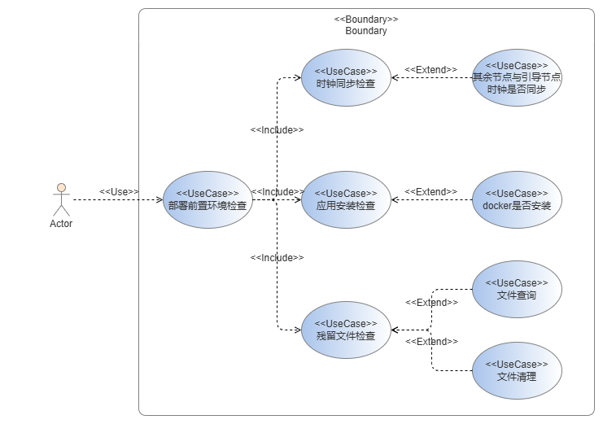
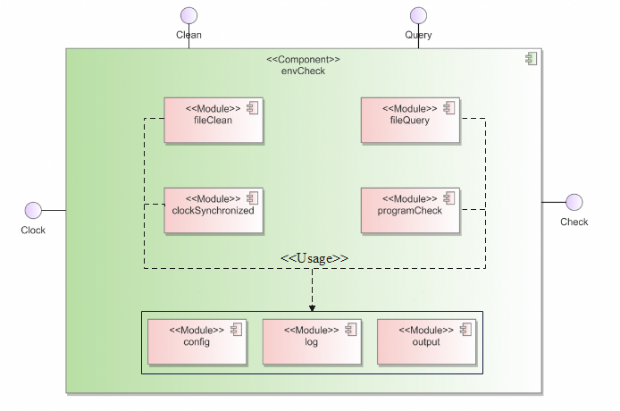

# 安装部署前置环境校验工具


# 1、特性描述

伙伴在使用安装部署程序的过程中发现，由于伙伴环境中可能存在其他软件残留的配置文件，以及部分和规格中冲突的应用程序，导致安装部署过程异常或失败。为了保障安装部署的成功运行，需要构建一个前置环境检查工具，目前工具需要完成以下目标：

目标：

1. 给定文件路径列表，查询当前环境中是否残留文件，并输出检查报告
2. 给定文件路径列表，支持安全和强制清理文件，并输出检查报告
3. 检查环境中是否安装指定程序，并输出检查报告
4. 增加时间校验功能，默认时间误差在10s内即为时间同步（可在配置文件中配置），需要检测其余节点和引导节点之间时钟是否同步

## 1.1、依赖组件

|组件|组件描述|可获得性|
|:---|:-------|:-------|
|    |        |        |
|    |        |        |

## 1.2、License

Mulan PSL v2 License

# 2、需求场景威胁建模

_在需求场景分析阶段进行威胁建模可以有效提升系统的安全/韧性/隐私设计质量_

_该过程可选，建议下列特性进行需求场景威胁建模：_

- _安全功能特性，如认证、鉴权、审计等_
- _受攻击可能性大的特性，如跨信任域交互频繁的业务_
- _个人隐私相关特性，如涉及到个人隐私数据的收集、分析、处理、存储等_

# 3、特性设计

## 3.1、上下文/USE-CASE视图

_可应用架构设计，补充模块功能分析_



## 3.2、模块设计

_通过时序图，数据流图等工具，分析特性的主要功能，实现功能的进一步划分_



### 3.2.1、模块接口定义

_通过模块接口依赖图，识别模块接口，完善模块间的调用关系_

本特性主要提供一个环境检查工具，工具名定义为`envCheck`，该工具提供四个子命令，其中`envCheck query`提供文件查询功能给用户，`envCheck clean`提供文件清理功能给用户，`envCheck check`可以检测环境中是否安装有指定程序，`envCheck clock`检测其余节点和引导节点之前的时钟是否同步。最终的报告支持`text终端输出`、输出为`json文件`，生成`html`文件。包含以下模块

| 模块名            | 功能                                                         |
| ----------------- | ------------------------------------------------------------ |
| fileClean         | 实现fileClean接口，执行文件清理工作，对外提供`envCheck clean`命令 |
| fileQuery         | 实现fileQuery接口，执行文件查询工作，对外提供`envCheck query`命令 |
| programCheck      | 实现programCheck接口，执行检测应用程序存在性工作，对外提供`envCheck check`命令 |
| clockSynchronized | 实现clockSynchroniezed接口，执行时钟同步检测工作，，对外提供`envCheck clock`命令 |
| config            | 负责前置配置的读取和解析，包括配置文件和命令行读取解析       |
| log               | 记录工具执行过程中的操作结果                                 |
| output            | 负责整理输出工具执行的结果，生成报告文件                     |

该工具的命令使用`Cobra`定义，用户可以使用 `envCheck -h` 获取工具使用帮助文档

#### 查询功能实现

查询功能默认运行命令（配置文件在当前文件夹下）

```bash
envCheck query
```

配置文件在其余位置（假设在上一层文件夹下）

```bash
envCheck query -c ../config.json
envCheck query --config ../config.json
```

在查询时显示信息，包括判断该文件路径所指是文件夹还是文件，所属用户、所属用户组以及可操作权限，因此定义文件信息的结构体如下：

```go
// FileInfo 文件/文件夹信息
type FileInfo struct {
    Path        string      `json:"path"`
    Exists      bool        `json:"exists"`
    IsDir       bool        `json:"is_dir"`
    Owner  string  `json:"owner,omitempty"`
    Group  string  `json:"group,omitempty"`
    Permissions string      `json:"permissions"`
    Error       string      `json:"error,omitempty"`
}
```

查询汇总结果包含

```go
// QuerySummary 查询汇总信息
type QuerySummary struct {
    TotalChecked int `json:"total_checked"`
    TotalExists  int `json:"total_exists"`
    TotalMissing int `json:"total_missing"`
    TotalDirs    int `json:"total_dirs"`
    TotalFiles   int `json:"total_files"`
}
```

#### 清理功能实现

清理功能默认安全清理，在删除文件时，会遍历每一项询问用户是否确认删除，用户可以自行决定是否跳过部分文件；另外支持强制清理，直接清理所给路径文件

相关配置设置为

```json
"clean_force": false
```

清理功能默认运行命令（配置文件在当前文件夹下）

```bash
envCheck clean
```

配置文件在其余位置（假设在上一层文件夹下）

```bash
envCheck clean -c ../config.json
envCheck clean --config ../config.json
```

强制删除文件

```bash
envCheck clean --force
```

清理汇总结果包含

```go
// CleanSummary 清理汇总信息
type CleanSummary struct {
    TotalChecked int `json:"total_checked"`
    TotalDeleted int `json:"total_deleted"`
    TotalFailed  int `json:"total_failed"`
    TotalSkipped int `json:"total_skipped"`
}
```

#### 程序存在性检查功能实现

程序存在性检查功能默认运行命令（配置文件在当前文件夹下）

```bash
envCheck check
```

配置文件在其余位置（假设在上一层文件夹下）

```bash
envCheck check -c ../config.json
envCheck check --config ../config.json
```

检测环境中是否安装有指定程序，如果存在，会显示安装的版本和位置。

```go
// ProgramInfo 程序信息
type ProgramInfo struct {
 Name      string `json:"name"`
 Installed bool   `json:"installed"`
 Version   string `json:"version,omitempty"`
 Path      string `json:"path,omitempty"`
 Error     string `json:"error,omitempty"`
}
```

程序存在性检查汇总结果包含

```go
// ProgramCheckSummary 程序检查汇总
type ProgramCheckSummary struct {
 TotalChecked   int `json:"total_checked"`
 TotalInstalled int `json:"total_installed"`
 TotalMissing   int `json:"total_missing"`
}
```

#### 时钟同步检测功能实现

查询功能默认运行命令（配置文件在当前文件夹下）

```bash
envCheck clock
```

配置文件在其余位置（假设在上一层文件夹下）

```bash
envCheck clock -c ../config.json
envCheck clock --config ../config.json
```

时钟同步检测涉及到多台机器，因此需要在配置文件中添加各机器信息，单台机器的信息定义为

```go
type Host struct {
 IP       string   `json:"ip" yaml:"ip"`
 UserName string   `json:"username" yaml:"username"`
 Password string   `json:"password" yaml:"password"`
 Port     string   `json:"port" yaml:"port"`
 Role     []string `json:"role" yaml:"role"`
}
```

对于单台机器的时钟同步检测结果定义如下

```go
type ClockCheckInfo struct {
 Host          string   `json:"host"`
    Role          []string `json:"role" yaml:"role"`
 IsSynced      bool     `json:"is_synced"`
 TimeDiff      int64    `json:"time_diff"`
 RemoteTime    int64    `json:"remote_time"`
 ReferenceTime int64    `json:"reference_time"`
 Error         string   `json:"error,omitempty"`
 IsLocal       bool     `json:"is_local,omitempty"`
}
```

#### 配置读取

配置支持根据配置文件获取

配置文件定义为：

```go
// AppConfig application configuration
type AppConfig struct {
 Mode         OperationMode `json:"mode" yaml:"mode"`                   // Operation mode
 LogFile      string        `json:"log_file" yaml:"log_file"`           // Log file path
 OutputFormat string        `json:"output_format" yaml:"output_format"` // Output format
 Paths        []string      `json:"paths" yaml:"paths"`                 // List of paths to operate on

 // Clean related configuration
 CleanForce bool `json:"clean_force" yaml:"clean_force"` // Force clean (no prompt)

 ProgramList []string `json:"program_list" yaml:"program_list"` // List of programs to check
    
    Hosts          []Host `json:"hosts" yaml:"hosts"` // host list
 ClockThreshold int64  `json:"clock_threshold" yaml:"clock_threshold"`
}
```

全量配置文件示例：

```json
{
  "log_file": "./envCheck.log",
  "output_format": "text",
  "paths": [
    "$HOME/.kube",
    "/etc/kubernetes",
    "/usr/bin/kube*",
    "/usr/local/bin/kube*",
    "/usr/local/bin/crictl",
    "/etc/sysctl.d/k8s.conf",
    "/etc/systemd/system/kubelet.service",
    "/etc/systemd/system/kubelet.service.d",
    "/var/lib/openFuyao/etcd",
    "/var/lib/kubelet",
    "/run/containerd/containerd.sock",
    "/usr/lib/systemd/system/kubelet.service.d",
    "/var/run/containerd/containerd.sock",
    "/var/run/docker.sock"
  ],
  "clean_force": false,
  "program_list": [
    "docker",
    "kubectl",
    "containerd"
  ],
  "hosts": [
    {
      "ip": "192.168.1.1",
      "username": "root",
      "password": "******",
      "port": "22",
      "role": ["bootstrap"]
    },
    {
      "ip": "192.168.1.2",
      "username": "root",
      "password": "******",
      "port": "22",
      "role": ["master"]
    }
  ],
  "clock_threshold": 10
}
```

配置文件校验：

- query和clean：paths不能为空
- check：program_list不能为空
- clock：hosts不能为空

## 3.3、 Story分解

_结合3.1~3.2的分析，分解支持该特性所需要的Stroy，可以按照USE-CASE场景划分，也可以按照USE-CASE操作步骤划分_

### 3.3.1 Story设计

_功能描述_

_验收标准_

_接口清单_

_以类图的方式描述Story的需求，以时序图的方式描述Story的实现过程_

#### 故事 1

- 功能描述：用户需要执行安装部署操作时，为了确保安装部署过程成功完成，需要确保当前环境中没有相关的文件残留。因此，用户在进行安装部署之前会执行文件查询操作，根据查询报告确定后续步骤。用户可以通过 `envCheck query` 执行文件查询功能
- 验收标准：输出文件查询报告

#### 故事 2

- 功能描述：用户已经知道需要进行安装部署的环境中存在一定的文件残留，现在需要对这些文件进行清理，清理方案可能是强制清理或者逐项确认清理。用户可以通过 `envCheck clean` 执行文件清理功能
- 验收标准：成功删除文件并输出执行结果报告

#### 故事 3

- 功能描述：执行安装部署之前，系统中如果安装有部分程序，可能会导致安装部署不成功。因此，用户需要检查系统环境中是否安装有会和安装部署冲突的应用。用户可以通过 `envCheck check` 执行应用检测功能
- 验收标准：输出应用存在性报告

#### 故事 4

- 功能描述：在创建集群之前，不同机器时间不同步可能会导致问题。因此，用户需要检查所需集群的时钟是否同步。用户可以通过`envCheck clock`执行时钟同步检测功能
- 验收标准：成功输出

## 3.4、质量属性设计

### 3.4.1、性能规格

|规格名称|规格指标|
|:-------|:-------|
|内存占用|        |
|启动时间|        |
|响应时间|        |
|xxx     |        |

### 3.4.2、可靠性设计

### 3.4.3、安全/韧性/隐私设计

### 3.4.4、兼容性设计

### 3.4.5、可服务性设计

### 3.4.6、可测试性设计

# 4、需求分解分配表

|序号 |模块名称|Story名称|Story描述|
|:----|:-------|:--------|:--------|
|     |        |         |         |
|     |        |         |         |

# 5、修改日志

|版本|发布说明|
|:---|:-------|
|    |        |
|    |        |

# 6、参考目录
