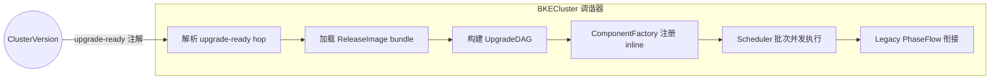
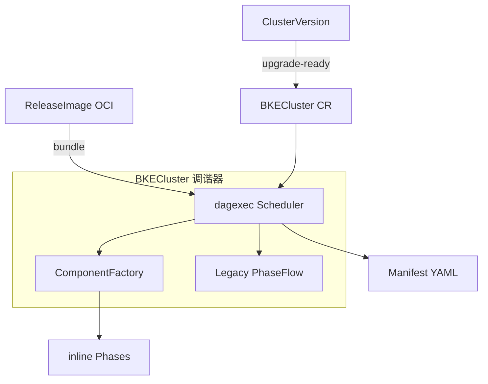
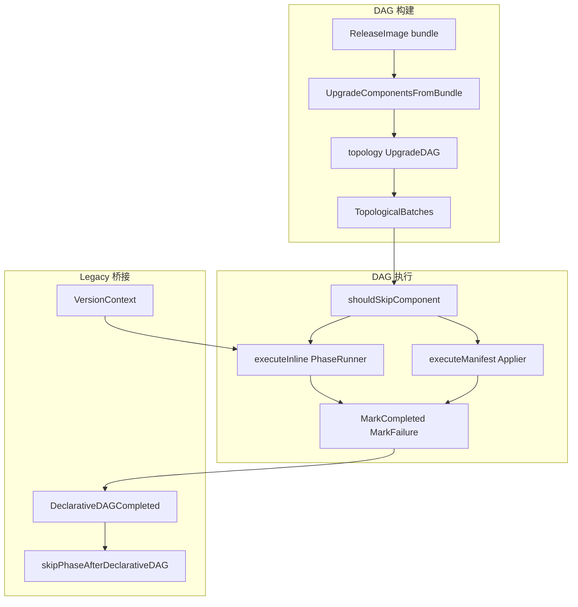
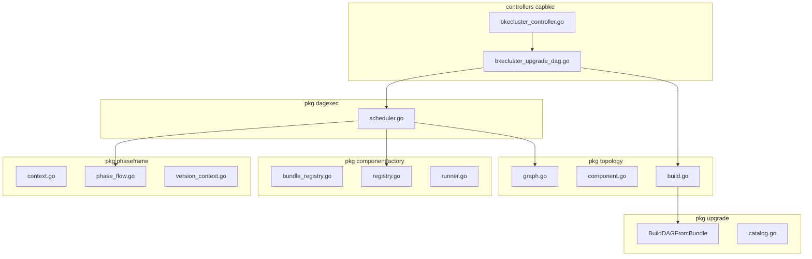
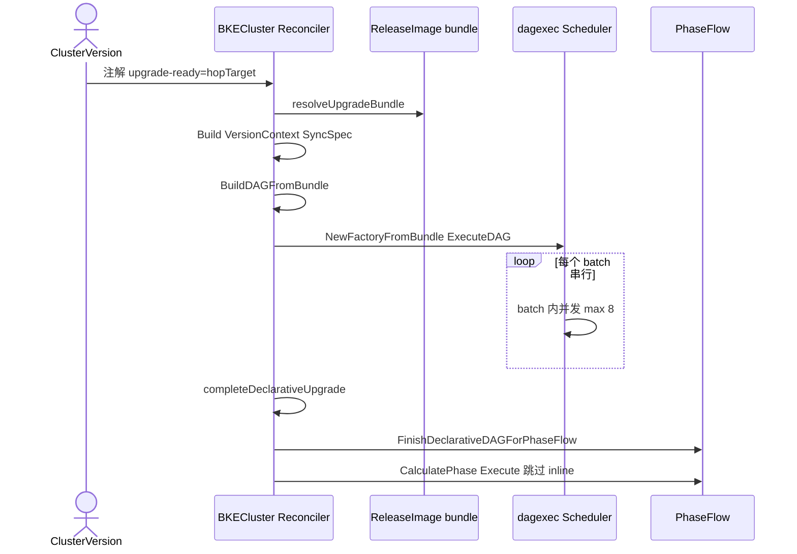
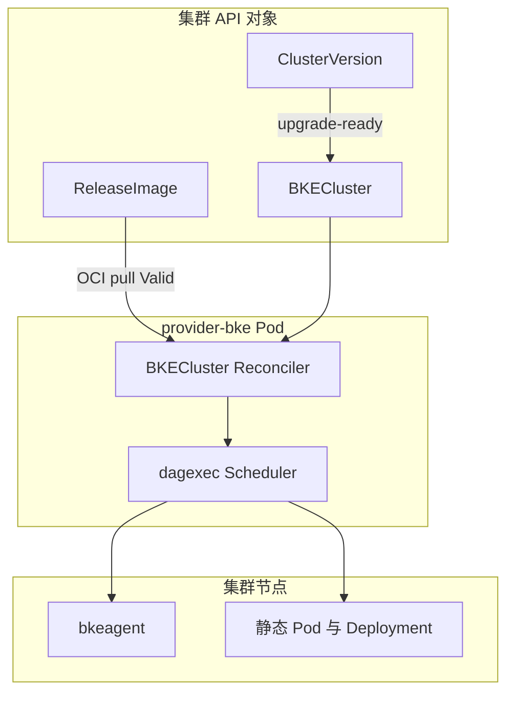

---
# 提案标题
title: 声明式架构适配 BKECluster 调谐器
# 提案编号
ofep-number: 0057
# 提案作者
authors:
  - TBD
# 提案主导SIG
owning-sig: sig-Installation
# 提案协作SIG
participating-sigs: []
# 提案状态(初步草案|准备开始实现|已在SIG中实现并合并|提案被暂缓|提案被否决|作者主动撤回提案|被另一个oFEP取代)
status: provisional
# 创建日期
creation-date: 2026-06-21
# 评审人
reviewers:
  - TBD
# 批准人
approvers:
  - TBD
# 相关联的其他oFEP
see-also:
  - "/ofeps/sig-installation/ofep-0020-openFuyao大版本升级.md"
# 当前oFEP替代了哪些已有提案
replaces: []
# 当前oFEP被哪些提案替代，当status为replaced时需要填写此字段
replaced-by: []
# 此oFEP当前开发阶段
stage: alpha
# 最近一次推进的版本
latest-milestone: ""
# 各阶段目标版本
milestone:
  alpha: ""
  beta: ""
  stable: ""
# 功能开关及影响组件
feature-gates:
  - name: DeclarativeUpgradeDAG
    components:
      - cluster-api-provider-bke
# 是否支持关闭该功能
disable-supported: true
# 该功能引入的监控指标
metrics: []
---

# oFEP-0057：声明式架构适配 BKECluster 调谐器

<!-- toc -->
- [发布签核清单](#release-signoff-checklist)
- [摘要](#summary)
- [动机](#motivation)
  - [目标](#goals)
  - [非目标](#non-goals)
- [提案](#proposal)
  - [用户故事](#user-stories)
  - [注释/约束/警告](#notes-constraints-caveats)
  - [风险与缓解措施](#risks-and-mitigations)
- [设计细节](#design-details)
  - [架构与设计前提](#architecture-and-prerequisites)
  - [4+1 架构视图](#41-architecture-views)
  - [BKECluster 调谐器增强设计](#bkecluster-reconciler-enhancement)
  - [关键设计决策](#key-design-decisions)
  - [模块接口与配置约定](#module-interfaces-and-configuration)
  - [DFX 质量属性设计](#dfx-quality-attributes)
  - [测试计划](#test-plan)
  - [毕业标准](#graduation-criteria)
  - [升级/降级策略](#upgrade-downgrade-strategy)
  - [版本倾斜策略](#version-skew-strategy)
- [生产准备情况评审问卷](#production-readiness-review-questionnaire)
- [实施历史](#implementation-history)
- [缺点](#drawbacks)
- [替代方案](#alternatives)
<!-- /toc -->

## 发布签核清单

标记有（R）的项目在达到里程碑/发布之前是必需的。

- [ ]（R）发布里程碑中的增强问题，链接到 [openfuyao/ofep](https://gitcode.com/openfuyao/ofep) 中的 oFEP 目录
- [ ] (R) oFEP 审批者已批准 oFEP 状态为「可实施」
- [ ] (R) 设计细节已适当记录
- [ ]（R）测试计划已到位，并考虑了 SIG 架构和 SIG 测试的输入
- [ ] (R) 毕业标准已设定
- [ ] (R) 生产准备情况审查完成并获批准
- [ ] 「实施历史」部分已更新里程碑
- [ ] 面向用户的文档已在 [openfuyao/docs](https://gitcode.com/openfuyao/docs) 创建

## 摘要

本提案描述 **cluster-api-provider-bke** 中 `BKEClusterReconciler` 对声明式版本升级架构的适配：在 ClusterVersion 控制器写入 `upgrade-ready` 注解后，调谐器从 `ReleaseImage` OCI 制品解析升级组件清单，构建 **UpgradeDAG**，由 `dagexec.Scheduler` 按拓扑批次执行——批次内**并发**、批次间**串行**；`inline` 组件通过 **ComponentFactory** 动态注册并桥接既有 Phase（`NeedExecute` + `Execute`），非 inline 组件走 **ManifestApplier** 应用 YAML。执行进度持久化于 `status.declarativeUpgrade`；DAG 成功后设置 `DeclarativeDAGCompleted`，Legacy **PhaseFlow** 跳过已执行的 6 个 inline 升级 Phase，保留安装与非升级 Phase，实现平滑迁移。

初始设计来源：`cluster-api-provider-bke/bin/声明式集群版本升级方案.md` 第 4.6.5 节及 Phase 桥接章节；本 oFEP 聚焦 **BKECluster 调谐器侧**实现边界。

## 动机

Legacy `BKEClusterReconciler` 通过固定 **PhaseFlow** 链（Common → Deploy → PostDeploy）顺序执行升级 Phase，存在以下局限：

1. **升级顺序硬编码**：组件依赖关系写死在 Phase 列表，无法随 ReleaseImage 制品独立演进。
2. **无法并发**：无依赖的组件（如部分 manifest 组件）仍串行等待，升级窗口长。
3. **版本决策分散**：升级是否执行依赖各 Phase 自行比较 `BKECluster.Spec` 字段，与声明式 `ComponentVersion` 目标版本难以对齐。
4. **制品驱动不足**：升级组件集合应来自 ReleaseImage `spec.upgrade.components`，而非代码内固定列表。

声明式架构在 **不改变 Phase 接口** 的前提下，引入 DAG 调度层与 VersionContext 注入，使调谐器成为「制品驱动 + 拓扑有序 + 可并发」的升级执行引擎。

### 目标

1. `BKEClusterReconciler` 在检测到 `cvo.openfuyao.cn/upgrade-ready` 注解时，执行声明式升级 DAG。
2. 从 ReleaseImage bundle 构建 UpgradeDAG，支持 `ComponentVersion.spec.dependencies` 与隐式 `pre-upgrade-resources` 依赖。
3. 批次内组件并发执行（默认最多 8 并行），批次间严格拓扑顺序。
4. inline 组件通过 `ComponentFactory` 按 bundle 注册 handler→Phase 映射，复用 `NeedExecuteWithVersionContext`。
5. 进度跨 Reconcile 持久化（`status.declarativeUpgrade.completed`），控制器重启可续跑。
6. DAG 成功后 Legacy PhaseFlow 跳过 6 个 declarative inline 升级 Phase，与非升级 Phase 共存。

### 非目标

1. **ClusterVersion、ReleaseImage、UpgradePath 控制器**的 CRD 设计与 OCI 拉取逻辑（见初始设计文档全文；本 oFEP 仅描述 BKECluster 侧消费方式）。
2. **安装 DAG** 的完整实现（与升级 DAG 对称，可后续独立 oFEP）。
3. **替换 Legacy PhaseFlow** 用于全新安装路径；当前仍保留双路径共存。
4. **业务 workload 升级**；仅 openFuyao 平台组件。

## 提案

**成功衡量标准：**

- ClusterVersion 写入 `upgrade-ready=<hopTarget>` 后，BKECluster 调谐器构建 DAG 并按拓扑完成当前 hop 全部组件升级，`status.declarativeUpgrade.completed` 覆盖全部节点（P0）。
- 同一 hop 重入 Reconcile 时，已完成组件被跳过，从未完成组件续跑（P0）。
- 无依赖关系的组件在同一 batch 内并发执行，batch 顺序与 DAG 拓扑一致（P0）。
- inline 组件（etcd、bkeagent、containerd、master、worker、pre-upgrade-resources）经 ComponentFactory 注册并成功执行；manifest 组件经 ManifestApplier 应用（P0）。
- DAG 成功后 Legacy PhaseFlow 不再重复执行 6 个 declarative inline 升级 Phase（P0）。
- ReleaseImage 未 Ready 时 30s 重排队；FailFast 组件失败时标记 `LastFailure` 并按 StatusManager 预算重试（P1）。

### 用户故事

#### 故事 1：多跳升级单 hop 执行

作为平台升级控制器，当 ClusterVersion 将 `upgrade-ready` 设为 v25.12.1（中间 hop），BKECluster 调谐器仅执行该 hop 对应 ReleaseImage 中的升级 DAG，完成后由 ClusterVersion 推进下一 hop。

#### 故事 2：并发缩短升级窗口

作为运维人员，当 ReleaseImage 声明 provider-bke 与 kube-proxy 无相互依赖时，期望二者在同一拓扑 batch 内并行升级，缩短总耗时。

#### 故事 3：控制器重启续跑

作为 SRE，当 provider-bke Pod 在升级中途重启，期望已写入 `status.declarativeUpgrade.completed` 的组件不再重复执行，从未完成节点继续。

**用例图：**



**设计意图**：ClusterVersion 负责「何时升、升哪一跳」；BKECluster 调谐器负责「这一跳怎么升」——DAG 编排、并发、inline 桥接与 Legacy 共存。

### 注释/约束/警告

1. **触发门控**：当前代码仅以 `cvo.openfuyao.cn/upgrade-ready` 注解触发 DAG；`cvo.openfuyao.cn/declarative-upgrade=true` 与 `--declarative-upgrade` 标志**不是** DAG 门控（遗留 FeatureGate，供其他路径使用）。
2. **hopTarget 与 desiredVersion**：注解值为当前 hop 目标版本，可能与 ClusterVersion `spec.desiredVersion`（最终目标）不同。
3. **双路径**：DAG 执行后仍运行 Legacy PhaseFlow；须正确设置 `DeclarativeDAGCompleted` 避免 inline 升级 Phase 重复。
4. **inline handler 白名单**：未知 handler 在 `ComponentFactory` 注册时失败；扩展新 inline 组件须同时更新 `registry.go` 与 ReleaseImage 清单。
5. **Phase 内 Requeue**：inline Phase 返回 `Requeue` 会被 DAG 视为错误，不单独支持 Phase 级异步重入（与 Legacy 行为差异）。

### 风险与缓解措施

| 风险 | 影响 | 缓解措施 |
|------|------|----------|
| 双路径重复执行升级 | 高 | `skipPhaseAfterDeclarativeDAG` + `DeclarativeClusterUpgradePhaseNames` 白名单 |
| 并发升级资源争用 | 中 | `MaxParallelPerBatch` 默认 8，可配置 |
| DAG 与 Legacy 版本决策不一致 | 中 | 统一 `VersionContext`；inline Phase 使用 `NeedExecuteWithVersionContext` |
| 中途失败状态不一致 | 高 | `DeclarativeUpgradeStatus` 持久化 + `MarkCompleted`/`MarkFailure` |
| ReleaseImage 未就绪阻塞 | 中 | 30s Requeue；BC 保持 Upgrading 状态 |
| FailFast 单点失败终止整跳 | 中 | 默认 FailFast；`FailurePolicyContinue` 可收集错误继续（manifest skip 场景） |

## 设计细节

### 架构与设计前提

#### 双路径 Reconcile 总览

```
BKECluster.Reconcile
  ├─ ensureClusterVersionOnInstall
  ├─ handleClusterStatus
  ├─ executePhaseFlow
  │    ├─ [upgrade-ready 注解存在] executeUpgradeDAG   ← 声明式路径
  │    │    └─ 成功 → FinishDeclarativeDAGForPhaseFlow()
  │    └─ PhaseFlow.CalculatePhase + Execute          ← Legacy 路径（顺序）
  ├─ completeClusterVersionInstall
  └─ getFinalResult → StatusManager 重试
```

| 维度 | 声明式 DAG | Legacy PhaseFlow |
|------|------------|------------------|
| 触发 | `upgrade-ready` 注解 | 各 Phase `NeedExecute` |
| 顺序 | ReleaseImage 依赖拓扑 | 固定 Phase 列表 |
| 并发 | batch 内并行（≤8） | 严格串行 |
| 组件来源 | `ReleaseImage.spec.upgrade.components` | `list.go` 硬编码 |
| inline | ComponentFactory + PhaseRunner | 直接 Phase.Execute |
| 进度 | `status.declarativeUpgrade` | `status.phaseStatus` |

#### 依赖组件

| 组件 | 角色 |
|------|------|
| ClusterVersion 控制器 | 校验路径、写入 `upgrade-ready` |
| ReleaseImage CR + OCI bundle | 升级组件清单与 ComponentVersion 元数据 |
| bke-manifests | `component.yaml` 依赖与 inline 定义 |
| Legacy Phase 实现 | inline handler 实际执行体 |

### 4+1 架构视图

#### 上下文与用例视图 (Context and Use Case View)



**设计意图**：BKECluster 是升级执行主调度器；制品与版本声明由上游 CR 提供；Legacy PhaseFlow 作为安装与非 DAG 升级的后备路径。

#### 逻辑视图 (Logical View)



**设计意图**：构建与执行分离；VersionContext 驱动 inline NeedExecute；完成后通过标志位避免 Legacy 重复。

#### 开发视图 (Development View)



**设计意图**：控制器薄编排；DAG、工厂、Phase 框架分包，便于单测与扩展 handler。

#### 运行视图 (Runtime View)



**设计意图**：单 hop 在一次或多次 Reconcile 中完成；batch 内 errgroup 并发；完成后才进入 Legacy 链。

#### 部署视图 (Deployment View)



**设计意图**：控制面集中在 provider-bke；节点级 inline 组件经 bkeagent；manifest 组件经 apiserver 应用。

### BKECluster 调谐器增强设计

#### 1. 触发与 hop 目标解析

**门控**（`shouldUseDeclarativeUpgrade`）：

```go
func (r *BKEClusterReconciler) shouldUseDeclarativeUpgrade(bkeCluster *bkev1beta1.BKECluster) bool {
    _, ok := featuregate.UpgradeReady(bkeCluster)
    return ok
}
```

**注解**：`cvo.openfuyao.cn/upgrade-ready` = 当前 hop 的 openFuyao 版本（非最终 desiredVersion）。

#### 2. executeUpgradeDAG 主流程

| 步骤 | 动作 | 代码位置 |
|------|------|----------|
| 1 | 解析 hopTarget | `declarativeUpgradeTargetVersion` |
| 2 | 加载目标 ReleaseImage bundle | `resolveUpgradeBundle`（未 Ready → 30s Requeue） |
| 3 | 加载当前版本 bundle 构建 VersionContext | `resolveCurrentReleaseBundle` |
| 4 | 同步升级目标到 Spec | `SyncUpgradeTargetsToClusterSpec` |
| 5 | 构建 UpgradeDAG | `upgrade.BuildDAGFromBundle` |
| 6 | 初始化进度 | `ensureDeclarativeUpgradeProgress` |
| 7 | 注册 inline 工厂 | `componentfactory.NewFactoryFromBundle` |
| 8 | 执行 DAG | `dagexec.NewScheduler(...).ExecuteDAG` |
| 9 | 同步状态 | `syncDeclarativeUpgradeStatusFromAPI` |
| 10 | 完成 hop | `completeDeclarativeUpgrade`（清注解、ClusterVersion CompleteUpgradeHop） |

#### 3. UpgradeDAG 构建

**节点来源**：`ReleaseImage.spec.upgrade.components[]`，经 `UpgradeComponentsFromBundle` 合并 `component.yaml` 中的 `dependencies` 与 `inline`。

**依赖规则**：

- 显式：`ComponentVersion.spec.dependencies[]`
- 隐式：除 `pre-upgrade-resources` 外，所有组件依赖 `pre-upgrade-resources`（若存在）

**拓扑语义**（`topology.Graph`）：边 `A → B` 表示 **A 完成后才能执行 B**；`TopologicalBatches()` 返回可并行 batch。

**ComponentNode 结构**：

```go
type ComponentNode struct {
    Name          string
    Version       string
    Inline        *InlineRef      // handler + version
    FailurePolicy FailurePolicy   // FailFast | Continue
    Dependencies  []string
}
```

#### 4. 并发调度（dagexec.Scheduler）

- **批次间**：串行，`batchIdx` 递增。
- **批次内**：`errgroup` + semaphore，默认 `defaultMaxParallelPerBatch = 8`。
- **FailFast**：单组件失败且策略为 FailFast → 终止当前 batch 与整 DAG。
- **Continue**：错误收集，batch 内其他组件继续。
- **Skip**：`manifest.IsSkipNotInstalled` 视为成功；`shouldSkipComponent` 检查 `status.declarativeUpgrade.completed`。

#### 5. inline 组件注册（ComponentFactory）

**每 Reconcile 从 bundle 构建工厂**（非全局单例）：

```
NewFactoryFromBundle(bundle)
  → RegisterInlinePhasesFromBundle
       → 读取 upgrade.components[].inline.handler
       → registerInlineHandler / registerInlineComponent
       → 注册键：handler@version → Phase 构造函数
```

**已支持 handler 映射**：

| Handler | 组件名 | Phase |
|---------|--------|-------|
| `EnsurePreUpgradeResources` | pre-upgrade-resources | 预创建资源 |
| `EnsureAgentUpgrade` | bkeagent | Agent 升级 |
| `EnsureEtcdUpgrade` | etcd | etcd 滚动 |
| `EnsureContainerdUpgrade` | containerd | containerd |
| `EnsureMasterUpgrade` | kubernetes-master | 控制面 |
| `EnsureWorkerUpgrade` | kubernetes-worker | 节点 |

**执行路径**（`PhaseRunner.Execute`）：

1. `Factory.Resolve(handler, version)`
2. `NeedExecuteWithVersionContext` / `NeedExecute`
3. `ExecutePreHook` → `Execute` → `ExecutePostHook`
4. Phase 返回 Requeue → 转为 error（DAG 不支持 Phase 级 requeue）

#### 6. 非 inline 组件（Manifest 路径）

无 `Inline` 字段的 DAG 节点：

1. `ManifestStore.GetComponentManifests(name, version, tmplCtx)`
2. `ManifestApplier.ApplyManifests`

适用于 provider-bke、kube-proxy、coredns 等声明式 YAML 组件。

#### 7. Legacy PhaseFlow 衔接

**Declarative inline Phase 白名单**（DAG 成功后跳过）：

```go
DeclarativeClusterUpgradePhaseNames = {
    EnsurePreUpgradeResources,
    EnsureAgentUpgrade,
    EnsureEtcdUpgrade,
    EnsureContainerdUpgrade,
    EnsureMasterUpgrade,
    EnsureWorkerUpgrade,
}
```

**跳过逻辑**：

```go
func (p *PhaseFlow) skipPhaseAfterDeclarativeDAG(phase phaseframe.Phase) bool {
    if !p.ctx.DeclarativeDAGCompleted { return false }
    return phase.Name().In(DeclarativeClusterUpgradePhaseNames)
}
```

**Legacy 升级 Phase 跳过**（ClusterVersion Failed 时）：`shouldSkipLegacyUpgrade` 避免失败 hop 后 Legacy 链误执行。

**VersionContext 注入**（inline Phase）：

```go
func (b *BasePhase) NeedExecuteWithVersionContext(
    component string, old, new *bkev1beta1.BKECluster,
    legacy func(old, new *bkev1beta1.BKECluster) bool,
) bool {
    if decided, need := b.ComponentVersionDecision(component); decided {
        return need
    }
    return legacy(old, new)
}
```

#### 8. 状态持久化与恢复

**DeclarativeUpgradeStatus**（`BKECluster.status.declarativeUpgrade`）：

| 字段 | 用途 |
|------|------|
| `targetVersion` | 当前 hop 目标；变更时 Reset |
| `startedAt` / `finishedAt` |  hop 生命周期 |
| `completed[]` | 已完成组件 name+version |
| `lastFailure` | 最近失败组件（排障，不用于 skip） |
| `lastError` | 最近错误摘要 |

**跨 Reconcile 续跑**：Scheduler 跳过 `IsCompleted(name, versionKey)` 的节点。

**失败处理**：

- `handleDeclarativeUpgradeDAGFailure`：写 `ClusterUpgradeFailed` + `LastError`
- StatusManager `ALLOWED_FAILED_COUNT`（默认 10）内允许重试
- 超出预算 → `abortDeclarativeUpgrade` 清注解并 `FailUpgradeHop`

### 关键设计决策

| 决策点 | 选项 | 选定方案 | 理由 |
|--------|------|----------|------|
| 调度模型 | 纯 PhaseFlow vs DAG+PhaseFlow | **DAG 优先 + Legacy 共存** | 平滑迁移；安装路径不受影响 |
| DAG 触发 | FeatureGate vs 注解 | **`upgrade-ready` 注解** | 与 ClusterVersion hop 语义对齐 |
| 并发粒度 | Phase 并行 vs 组件并行 | **batch 内组件并行** | Phase 内有状态依赖；组件级更细 |
| 并行上限 | 无限制 vs 固定 8 | **默认 8，可配置** | 控制 apiserver 与节点压力 |
| inline 注册 | 全局 Registry vs 每 bundle 工厂 | **每 bundle ComponentFactory** | 版本隔离；handler@version 精确匹配 |
| NeedExecute | 新 ShouldUpgrade vs 复用 | **复用 NeedExecute + VersionContext** | 减少 Phase 改造面 |
| 进度存储 | 内存 vs BC Status | **BC Status subresource** | 控制器重启可续跑 |
| Phase Requeue | 支持 vs 拒绝 | **inline Requeue 转 error** | DAG 批次原子性；简化调度 |
| 失败策略 | 全部 Continue vs 默认 FailFast | **默认 FailFast** | 与生产升级安全一致 |

### 模块接口与配置约定

#### BKECluster 注解

| 键 | 写入方 | 含义 |
|----|--------|------|
| `cvo.openfuyao.cn/upgrade-ready` | ClusterVersion | 触发 DAG；值 = hopTarget |
| `cvo.openfuyao.cn/cluster-version` | ClusterVersion | 关联 ClusterVersion |
| `cvo.openfuyao.cn/upgrade-path` | ClusterVersion | 路径元数据 |

#### ReleaseImage 升级组件声明

```yaml
spec:
  upgrade:
    components:
      - name: pre-upgrade-resources
        version: v1.0.0
        inline:
          handler: EnsurePreUpgradeResources
          version: v1.0.0
      - name: etcd
        version: v3.5.12
        inline:
          handler: EnsureEtcdUpgrade
          version: v1.0.0
      - name: cluster-api-provider-bke
        version: v1.0.2
        # 无 inline → manifest 路径
```

#### ComponentVersion 补充字段

```yaml
spec:
  dependencies:
    - pre-upgrade-resources
  inline:
    handler: EnsureEtcdUpgrade
    version: v1.0.0
```

#### dagexec 配置

```go
dagexec.NewScheduler(dagexec.Config{
    InlineRunner:        &componentfactory.PhaseRunner{Factory: factory},
    ManifestStore:       manifest.NewBundleStore(bundle),
    ManifestApplier:     applier,
    MaxParallelPerBatch: 0, // 0 → 8
})
```

#### 扩展新 inline 组件步骤

1. 实现 Phase（`NeedExecute` + `Execute`）
2. 在 `componentfactory/registry.go` 注册 handler
3. 在 `upgrade/catalog.go` 添加组件名映射
4. ReleaseImage `upgrade.components` 声明 inline
5. 补充 DAG 依赖边

### DFX 质量属性设计

#### 性能

- 无依赖组件 batch 内并行，理论加速比 ≤ `min(batchSize, 8)`。
- DAG 构建为内存操作，随组件数线性增长，典型 hop < 20 组件时毫秒级。
- 跨 Reconcile 续跑避免重复执行已完成组件，降低重试成本。

| 指标 | 目标（Alpha） |
|------|---------------|
| 单 batch 并行度 | ≤ 8（可配置） |
| DAG 构建耗时 | P99 < 100ms（20 组件以内） |
| 已完成组件 skip | 100% 不重复执行 |

#### 可靠性

- `DeclarativeUpgradeStatus.completed` 持久化，provider 重启可续跑。
- FailFast 默认终止不安全部分升级；StatusManager 失败预算内自动重试。
- `completeDeclarativeUpgrade` 仅在整 DAG 成功后清注解，避免 hop 半完成被误标记。

#### 安全性

- 升级仅由 ClusterVersion 写入 `upgrade-ready` 触发，hop 经 UpgradePath 校验。
- inline Phase 仍走 RBAC 与 Commands 既有权限模型。
- 未知 handler 注册失败，不会静默跳过。

#### 兼容性

- Legacy PhaseFlow 完整保留；无 `upgrade-ready` 时行为与旧版一致。
- `NeedExecuteWithVersionContext` 在无 VersionContext 时回退 legacy 逻辑。
- manifest 组件与 inline 组件可在同一 DAG 共存。

#### 可服务性

- `status.declarativeUpgrade` 暴露 target、completed、lastFailure、lastError。
- `clusterStatus=Upgrading` 与 Phase 日志 `ComponentUpgradingReason` 可关联排障。
- hop 完成后注解清除，ClusterVersion status 推进，便于 UI 展示。

#### 可测试性

- `topology.Graph` 拓扑排序、`upgrade.BuildDAGFromBundle` 可纯单元测试。
- `dagexec.Scheduler` 可注入 mock InlineRunner/ManifestApplier。
- `PhaseFlow.skipPhaseAfterDeclarativeDAG` 可 table-driven 测试。

#### 易用性

- 组件依赖声明在 ReleaseImage/ComponentVersion YAML，无需改 Go 代码即可调整顺序（inline handler 除外）。
- 多跳升级对用户透明：ClusterVersion 循环写 `upgrade-ready`，BKECluster 逐 hop 执行。

### 测试计划

- [ ] 相关组件所有者可能要求补充测试以达到合入质量门槛。

#### 单元测试

| 包 | 用例 |
|----|------|
| `pkg/topology` | 环检测、TopologicalBatches、隐式 pre-upgrade 依赖 |
| `pkg/upgrade` | BuildDAGFromBundle、UpgradeComponentsFromBundle |
| `pkg/dagexec` | 并行上限、FailFast/Continue、shouldSkipComponent |
| `pkg/componentfactory` | handler 注册、未知 handler 错误、Resolve |
| `pkg/phaseframe/phases` | skipPhaseAfterDeclarativeDAG、shouldSkipLegacyUpgrade |

#### 集成测试

- mock ReleaseImage bundle 驱动 executeUpgradeDAG 全链路。
- 模拟 completed 记录续跑：第二次 ExecuteDAG 跳过已完成节点。
- inline + manifest 混合 DAG 顺序与并发验证。

#### e2e 测试

| 编号 | 场景 | 预期 |
|------|------|------|
| DA-001 | 单 hop 全 inline 升级 | declarativeUpgrade.completed 全覆盖，Legacy inline Phase 未重复 |
| DA-002 | batch 内两 manifest 组件并行 | 日志 batch 同 index，耗时 < 串行 1.8x |
| DA-003 | provider 重启 mid-DAG | 续跑从未完成组件，已完成不重复 |
| DA-004 | FailFast 组件失败 | DAG 终止，lastFailure 写入，StatusManager 重试 |
| DA-005 | ReleaseImage Not Ready | 30s Requeue，不 abort |
| DA-006 | 多 hop vA→vB→vC | 每 hop 独立 declarativeUpgrade targetVersion |

### 毕业标准

#### Alpha

- executeUpgradeDAG + Scheduler + ComponentFactory 合入。
- DA-001、DA-004、DA-005 通过；topology/dagexec 单测覆盖 > 70%。

#### Beta

- DA-002、DA-003、DA-006 稳定；文档说明双路径与排障。
- 生产试点 1 套集群完成声明式 hop 升级。

#### GA

- 两周 e2e 无 flake；Legacy 升级路径标记 deprecated 计划（可选）。
- DFX 性能指标在 20 组件 hop 上实测达标。

### 升级/降级策略

- **provider-bke 自升级**：可作为 DAG 中 manifest 或 inline 组件；SelfUpgrade Phase 仍在 Legacy 链，与 DAG 顺序由 ReleaseImage 依赖定义。
- **声明式 → Legacy 回退**：清除 `upgrade-ready` 且 `DeclarativeDAGCompleted=false` 时走 Legacy PhaseFlow（仅适用于未启用声明式 hop 的集群）。
- **CRD 字段**：`DeclarativeUpgradeStatus` 为新增 status 字段，向后兼容（omitempty）。

### 版本倾斜策略

- DAG 执行期间允许新旧 provider Pod 短暂共存（Deployment 滚动）。
- batch 内并发组件须无共享可变状态；etcd、apiserver 等通过依赖边强制顺序。
- 节点 bkeagent 版本可能滞后于 manifest 组件；Commands 调谐保证最终一致。

## 生产准备情况评审问卷

### 功能启用和回滚

- **启用**：ClusterVersion 声明式升级流程写入 `upgrade-ready` 即触发；无独立集群级开关。
- **回滚**：abortDeclarativeUpgrade 清注解并 FailUpgradeHop；Legacy 路径仍可用（需 ClusterVersion 配合）。
- **disable-supported**：可通过不在 ReleaseImage 中声明 upgrade 组件、不写入 upgrade-ready 保持 Legacy 行为。

### 监控要求

- **SLI**：`declarativeUpgrade.completed` 数量 / DAG 节点总数；`clusterStatus==Upgrading` 持续时间。
- **SLI**：`lastFailure.name`、`lastError` 非空计数。
- **待增强**：DAG batch 耗时、并行度 Prometheus 指标（当前主要依赖日志）。

### 依赖项

- ReleaseImage Phase=Valid 且 OCI 可拉取。
- 管理集群 kube-apiserver 可用（Status 写入、Manifest Apply）。
- bkeagent 对 inline 节点组件可用。

### 可扩展性

- 单集群 DAG 节点数预期 < 30；并行度 8 限制 apiserver QPS。
- 多集群场景每 BC 独立 Reconcile，无全局锁。

### 故障排除

| 故障模式 | 检测 | 缓解 |
|----------|------|------|
| DAG 卡住无 completed 增长 | declarativeUpgrade 长时间无新 completed | 查 lastFailure；查 ReleaseImage Valid |
| inline handler 未注册 | Reconcile error build component factory | 检查 handler 名与 registry.go |
| 重复升级 etcd | Legacy Phase 仍执行 EnsureEtcdUpgrade | 确认 DeclarativeDAGCompleted 已设置 |
| batch 内 OOM | provider Pod 内存飙升 | 降低 MaxParallelPerBatch |
| hop 完成但 CV 未推进 | upgrade-ready 仍存在 | 查 completeDeclarativeUpgrade 错误 |

## 实施历史

| 日期 | 里程碑 |
|------|--------|
| 2026-05-21 | oFEP-0057 创建；基于 `声明式集群版本升级方案.md` BKECluster 章节与 cluster-api-provider-bke 代码对齐 |

## 缺点

1. **双路径复杂度**：DAG + Legacy 并存，排障需区分执行路径。
2. **inline 扩展需改代码**：新 handler 须注册，非纯 YAML 扩展。
3. **Phase Requeue 不支持**：长耗时 inline 步骤须内部 poll，不能返回 ctrl.Result Requeue。
4. **DAG 专用指标不足**：生产可观测性依赖 status 与日志，Prometheus 指标待补。

## 替代方案

| 方案 | 说明 | 未采纳原因 |
|------|------|------------|
| 完全替换 PhaseFlow | 安装与升级均走 DAG | 迁移风险大；安装 DAG 尚未完备 |
| 纯 Legacy 顺序 Phase | 不引入 DAG | 无法制品驱动与并发 |
| 全局 ComponentRegistry | 启动时注册全部 handler | 版本耦合；bundle 隔离差 |
| 新建 ShouldUpgrade 接口 | 替代 NeedExecute | 改造面大；与初始设计「复用 Phase」原则冲突 |
| batch 间也并行 | 全 DAG 一次 errgroup | 破坏依赖语义，不安全 |
