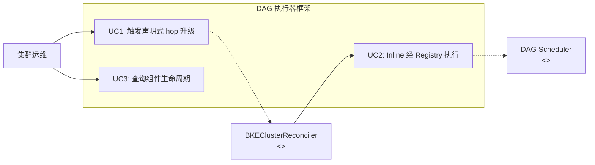
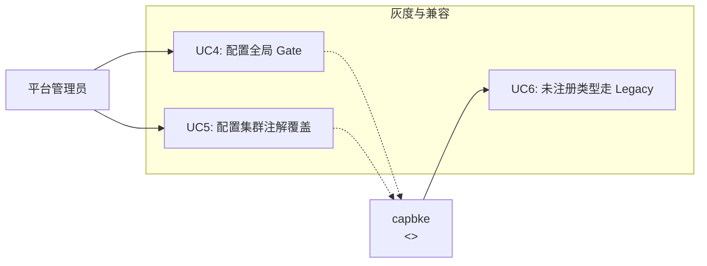
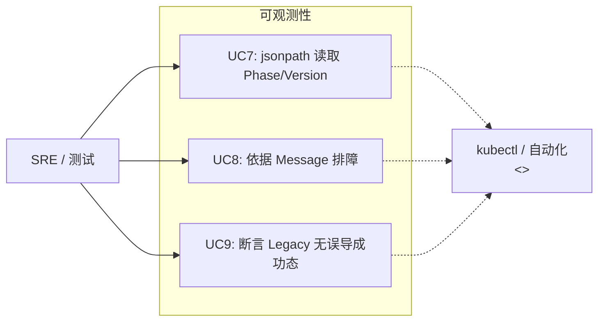
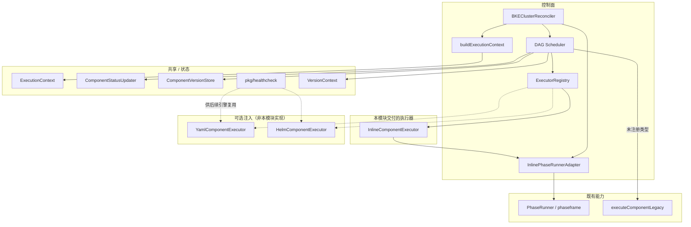
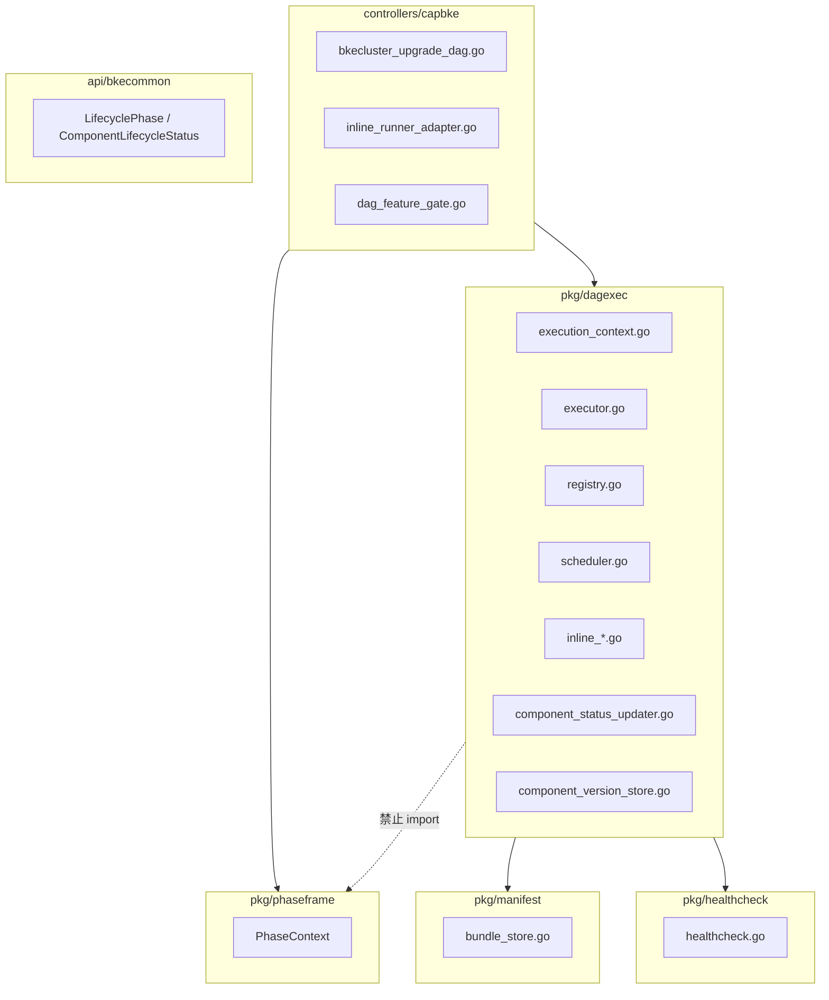
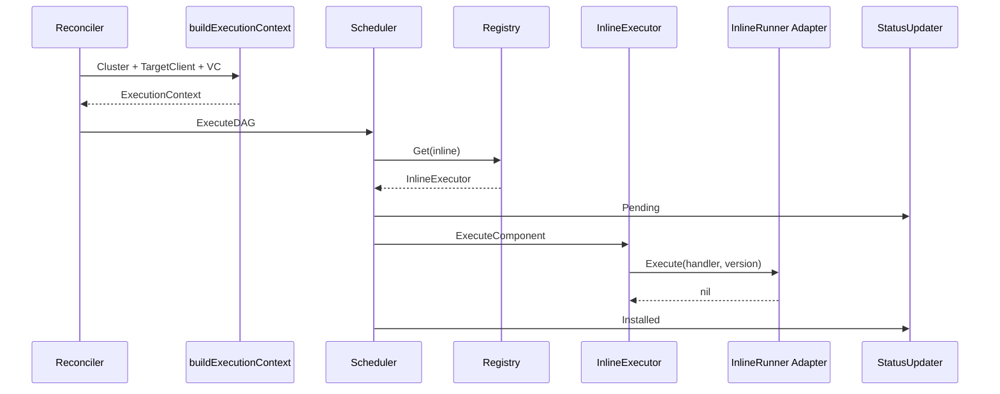
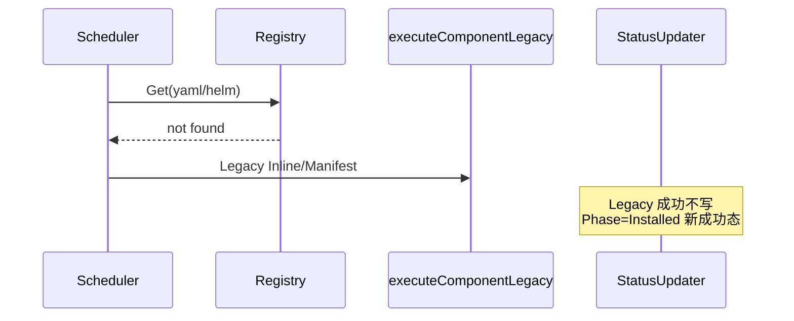
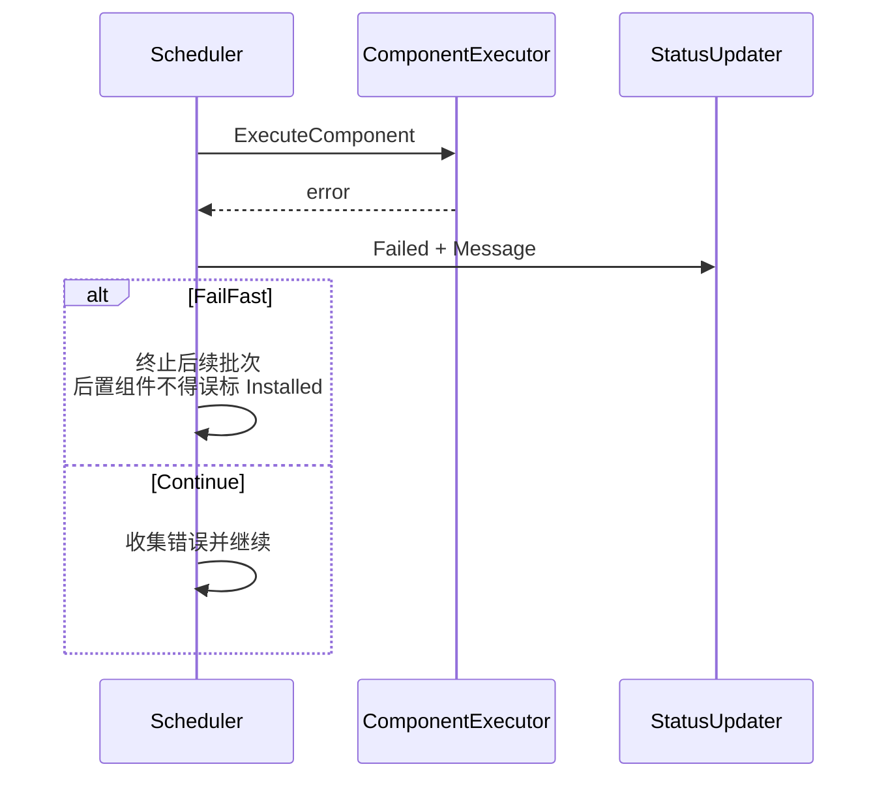
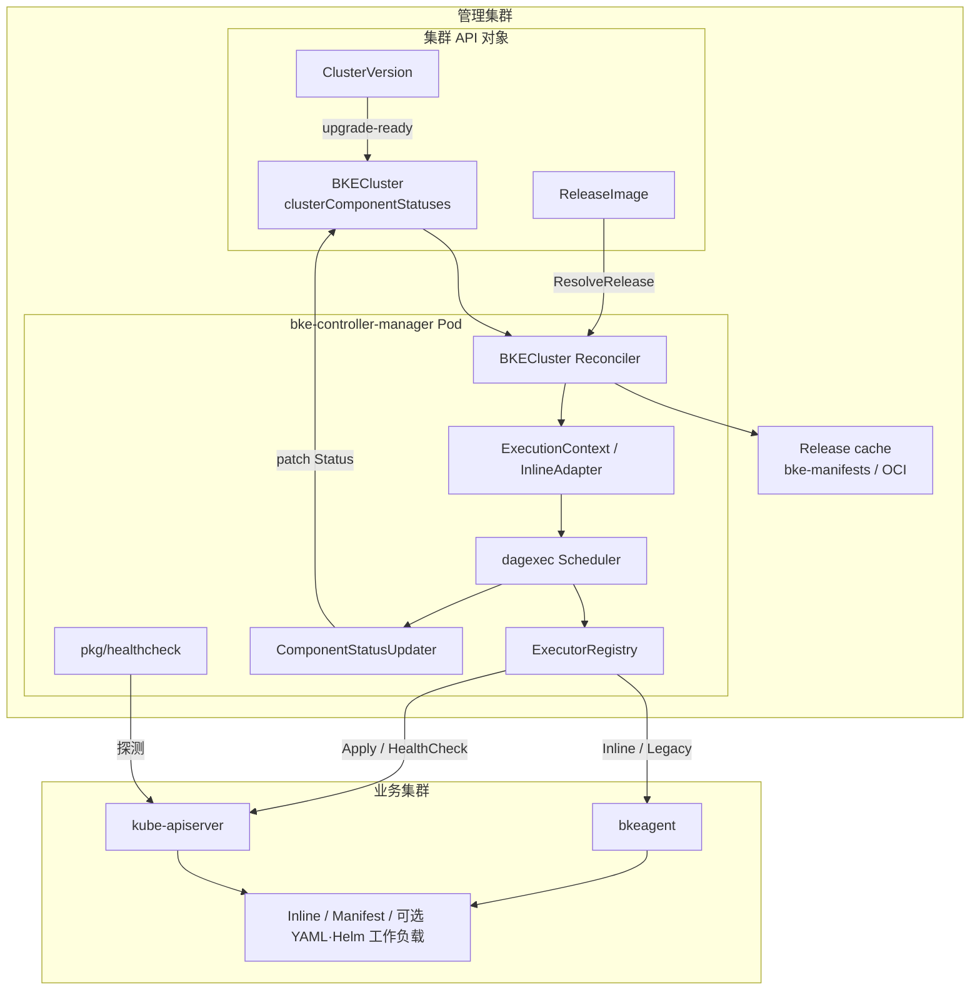

<!-- 格式合规检查：已通过 -->
---
title: 声明式升级 DAG 解耦重构（执行器框架与状态模型）
ofep-number: "0066"
authors:
  - TBD
owning-sig: sig-Installation
participating-sigs: []
status: provisional
creation-date: 2026-08-11
reviewers:
  - TBD
approvers:
  - TBD
see-also:
  - "/ofeps/sig-Installation/ofep-0057-声明式架构适配BKECluster调谐器"
  - "/ofeps/sig-Installation/ofep-0020-openFuyao大版本升级"
replaces: []
replaced-by: []
stage: alpha
latest-milestone: ""
milestone:
  alpha: "TODO"
  beta: "TODO"
  stable: "TODO"
feature-gates:
  - name: HelmComponentEnabled
    components:
      - cluster-api-provider-bke
      - bke-controller-manager
disable-supported: true
metrics: []
feedback-period: 2 weeks
cc-list:
  - TBD
---

# oFEP-0066：声明式升级 DAG 解耦重构（执行器框架与状态模型）

<!-- toc -->
- [发布签核清单](#发布签核清单)
- [概括（摘要）](#概括摘要)
- [动机](#动机)
  - [目标](#目标)
  - [非目标](#非目标)
- [提案](#提案)
  - [用户故事](#用户故事)
    - [故事 1：Inline 经注册表路径执行](#故事-1inline-经注册表路径执行)
    - [故事 2：Feature Gate 控制新执行器注入与 Legacy 回退](#故事-2feature-gate-控制新执行器注入与-legacy-回退)
    - [故事 3：组件生命周期可观测与失败可诊断](#故事-3组件生命周期可观测与失败可诊断)
  - [注释/约束/警告](#注释约束警告)
- [需求点详细说明](#需求点详细说明)
  - [FR 总览](#fr-总览)
  - [FR-DAG-01 ExecutionContext](#fr-dag-01-executioncontext)
  - [FR-DAG-02 Scheduler 入口重构](#fr-dag-02-scheduler-入口重构)
  - [FR-DAG-03 InlineRunner 与适配器](#fr-dag-03-inlinerunner-与适配器)
  - [FR-DAG-04 ComponentExecutor 与注册表](#fr-dag-04-componentexecutor-与注册表)
  - [FR-DAG-05 InlineComponentExecutor](#fr-dag-05-inlinecomponentexecutor)
  - [FR-DAG-06 ComponentVersionStore](#fr-dag-06-componentversionstore)
  - [FR-DAG-07 VersionContext 决策事实](#fr-dag-07-versioncontext-决策事实)
  - [FR-DAG-08 状态模型与 ComponentStatusUpdater](#fr-dag-08-状态模型与-componentstatusupdater)
  - [FR-DAG-09 调度策略保持](#fr-dag-09-调度策略保持)
  - [FR-DAG-10 Feature Gate 与 Legacy 接线](#fr-dag-10-feature-gate-与-legacy-接线)
  - [FR-DAG-11 共享 HealthCheck 包](#fr-dag-11-共享-healthcheck-包)
  - [已确认约束](#已确认约束)
  - [模块级验收标准](#模块级验收标准)
- [设计细节](#设计细节)
  - [逻辑视图](#逻辑视图)
  - [开发视图](#开发视图)
  - [运行视图](#运行视图)
  - [部署视图](#部署视图)
  - [开发详解](#开发详解)
  - [CRD/API 设计](#crdapi-设计)
  - [组件外部交互与安全](#组件外部交互与安全)
  - [DFX 质量属性设计](#dfx-质量属性设计)
- [风险与缓解措施](#风险与缓解措施)
  - [安全风险](#安全风险)
  - [待讨论问题](#待讨论问题)
- [兼容性与迁移](#兼容性与迁移)
- [测试与验证计划](#测试与验证计划)
  - [功能测试](#功能测试)
  - [DFX 非功能测试](#dfx-非功能测试)
- [替代方案](#替代方案)
- [实施计划](#实施计划)
- [成功标准](#成功标准)
- [毕业标准](#毕业标准)
- [升级/降级策略](#升级降级策略)
- [版本倾斜策略](#版本倾斜策略)
- [推出/弃用计划](#推出弃用计划)
- [文档计划](#文档计划)
- [生产可用性审查（PRR）](#生产可用性审查prr)
- [实施历史](#实施历史)
- [缺点](#缺点)
- [所需基础设施（可选）](#所需基础设施可选)
- [附录](#附录)
<!-- /toc -->

## 发布签核清单

标记有（R）的项目*在达到里程碑/发布*之前是必需的。

- [ ]（R）发布里程碑中的增强问题，链接到 [openfuyao/ofep] 中的 oFEP 目录
- [ ]（R）oFEP 审批者已批准 oFEP 状态为「可实施」
- [ ]（R）设计细节已适当记录
- [ ]（R）测试计划已到位，并考虑了 SIG 架构和 SIG 测试的输入（包括测试重构）
  - [ ] 针对所有 Beta API 操作（端点）进行 e2e 测试
  - [ ]（R）确保 GA e2e 测试满足一致性测试的要求
  - [ ]（R）GA e2e 测试至少需要两周时间才能证明测试结果无 flake
- [ ]（R）毕业标准已设定
  - [ ]（R）所有 GA 端点必须通过一致性测试
- [ ]（R）生产准备情况审查完成
- [ ]（R）生产准备情况审查已获批准
- [ ]「实施历史」部分已更新里程碑
- [ ] 面向用户的文档已在 [openfuyao/docs] 创建，以便发布到 [openfuyao.cn]
- [ ] 支持文档 - 例如，额外的设计文档、邮件列表讨论/SIG 会议链接、相关 PR/问题、发行说明

- [openfuyao 官网](https://www.openfuyao.cn/)
- [ofep 仓库](https://gitcode.com/openFuyao/ofep)
- [docs 仓库](https://gitcode.com/openFuyao/docs)

## 概括（摘要）

当前问题：声明式升级的 `pkg/dagexec` 直接依赖 `pkg/phaseframe`，`ExecuteDAG` 入参绑定 `PhaseContext`；组件分发在 Scheduler 内硬编码为 Inline / Manifest 二路，无法按类型注册扩展执行器；组件级生命周期状态缺失或不统一，失败难诊断，也无法在不改核心调度代码的前提下接入后续 YAML/Helm 执行器。

建议方案：完成 **DAG 解耦重构**——引入 phaseframe-free 的 `ExecutionContext`、`ComponentExecutor` + `ExecutorRegistry`、Inline 适配器桥接、`ComponentStatusUpdater` / `ClusterComponentStatuses` 生命周期模型，以及共享 `pkg/healthcheck` 库；通过 Feature Gate 决定是否注入已就绪的 YAML/Helm 执行器，未注入或 Gate OFF 时回退 `executeComponentLegacy`。

受影响对象：`cluster-api-provider-bke` 中 `pkg/dagexec`、`controllers/capbke` 桥接层、BKECluster Status 生命周期字段；后续 Yaml/Helm SR 仅作为本框架的注册消费者。

本提案最希望评审者反馈：Legacy 与新路径状态面差异（Legacy 不写 Installed 成功态）是否可接受，以及 YAML/Helm 共用 Gate 命名的灰度语义。

## 动机

### 当前痛点

在 oFEP-0057 已落地的声明式升级 hop / DAG 入口之上，调度内核仍存在结构性耦合：

1. **`pkg/dagexec` 绑定 `phaseframe`**：无法独立编译与单测，变更与 Reconcile 框架连锁。
2. **分发硬编码**：`if node.Inline != nil` → Inline，否则 Manifest，扩展类型必须改 Scheduler。
3. **缺少统一执行器接口与注册表**：开闭原则被破坏。
4. **组件生命周期不完整**：难以在 Executor 层统一 Pending / Installed / Failed，自动化验收与排障成本高。

这些问题不是小 PR 可修：需要先交付执行器框架与状态模型（模块代号 M-DAG-EXEC-FRAMEWORK），为后续引擎 SR 奠基。

### 相关基线

- oFEP-0057：声明式架构适配 BKECluster 调谐器。
- oFEP-0020：openFuyao 大版本升级。
- 模块设计：《DAG 解耦重构-执行器框架与状态模型-开发侧需求模块设计》（FR-DAG-01～11）。
- 总体设计中第 8 章「DAG 集成」仅作为本模块的上下文来源；**本提案不展开 HelmInstaller / YamlInstaller 引擎内部设计**。

### 目标

| 编号 | 目标 | 可验证标准 |
| --- | --- | --- |
| G1 | `pkg/dagexec` 不再 import `pkg/phaseframe` | 包依赖检查 / 独立 `go test` |
| G2 | 引入 `ExecutionContext` 替代 PhaseContext 入参 | `ExecuteDAG(ctx, execCtx, dag)` |
| G3 | 引入 `ComponentExecutor` + `ExecutorRegistry` | 按类型 Register/Get 分发 |
| G4 | Inline 经 `InlineRunner` + controllers 适配器桥接 | Inline 始终注册 |
| G5 | 落地生命周期与 `ComponentStatusUpdater` | 新路径写 `ClusterComponentStatuses` |
| G6 | 扩展 `ComponentVersionStore` | 支撑类型解析与 Executor 读 Spec |
| G7 | Feature Gate + Legacy 回退 | Gate OFF / 未注入时走 Legacy |
| G8 | 交付共享 `pkg/healthcheck` | PodReady / EndpointReady / Custom 可单测 |

### 非目标

- **不交付** `YamlInstaller` / `HelmInstaller` 引擎内部实现（分属 Yaml SR / Helm SR）。
- **不交付** `YamlComponentExecutor` / `HelmComponentExecutor` 实现；本模块 `NewScheduler` **只 Register** 已注入实例。
- 不展开 Helm/YAML CRD 字段完整业务语义、Hooks、高级错误分类重试。
- 不把「目标版本去掉组件」做成自动卸载（已确认：有 A→无 A 不自动卸载）。
- 不以 `BKECluster.ClusterStatus=UpgradeFailed` 作为本模块验收映射（失败以组件级 `Phase=Failed`+`Message` 为准）。

## 提案

### 建议做什么

1. **解耦**：controllers 组装 `ExecutionContext` / `InlinePhaseRunnerAdapter`；`dagexec` phaseframe-free。
2. **注册表分发**：Inline 始终注册；YAML/Helm 仅在 Gate 开启且依赖已注入时注册；未命中走 Legacy。
3. **状态模型**：新执行器路径由 Scheduler 写 Pending → Installed / Failed；Legacy **不写** `ClusterComponentStatuses` 的 Installed 成功态。
4. **调度语义保持**：批次间串行、批内并行（默认 `MaxParallelPerBatch=8`）、FailFast/Continue。
5. **共享 HealthCheck 库**：供后续 Installer Apply 后复用；本模块交付库与单测，升级链路完整验收属引擎 SR（框架侧保证可注入 `TargetClient`）。

### 用户可见变化

- Inline 升级走注册表路径，并写回组件生命周期（可观测）。
- Gate OFF：YAML 等非 Inline 组件保持 Legacy，行为兼容，不出现新路径误导成功态。
- Gate ON 且注入 YAML/Helm 执行器后：新路径执行并写回状态（执行器实现由后续 SR 提供）。
- 默认 Gate 关闭时，现网行为不变。

### 用户故事

#### 故事 1：Inline 经注册表路径执行

作为集群运维，我希望声明式升级中的 Inline 组件经统一注册表执行并写回 Installed，从而确认解耦后控制面升级路径可用且可观测。



#### 故事 2：Feature Gate 控制新执行器注入与 Legacy 回退

作为平台管理员，我希望默认关闭新 YAML/Helm 执行器注入，仅对指定集群用注解打开，从而在框架就绪后安全灰度。



#### 故事 3：组件生命周期可观测与失败可诊断

作为测试与 SRE，我希望新路径失败时 `Phase=Failed` 且 `Message` 非空，且 Legacy 成功不写入误导性 Installed，从而区分双路径状态面。



### 注释/约束/警告

- Gate 历史命名为 `HelmComponentEnabled` / `--helm-component-support` / 注解 `cvo.openfuyao.cn/helm-component`，语义为「是否注入 YAML/Helm 类新执行器」；**Inline 不受 Gate 关闭影响，始终注册**。
- 注解优先于全局 flag。
- 本提案验收以框架与 Inline / Legacy / 状态写回为主；依赖 Yaml SR 的完整 YAML 升级场景在测试计划中标注「依赖引擎 SR」。

## 需求点详细说明

> 本章对应模块设计 FR-DAG-01～11，是**可开发、可测试**的需求规格。每条按「说明 → 接口要点 → 验收」组织；架构视图与部署落位见下一章「设计细节」。

### FR 总览

| 编号 | 名称 | 交付要点 |
| --- | --- | --- |
| FR-DAG-01 | ExecutionContext | phaseframe-free 上下文；含 TargetClient |
| FR-DAG-02 | Scheduler 入口重构 | `ExecuteDAG(ctx, execCtx, dag)` |
| FR-DAG-03 | InlineRunner 与适配器 | dagexec 只依赖接口；controller 桥接 |
| FR-DAG-04 | ComponentExecutor 与注册表 | 可插拔分发；未注册 → Legacy |
| FR-DAG-05 | InlineComponentExecutor | 本模块交付的 Inline 执行器 |
| FR-DAG-06 | ComponentVersionStore | CV 加载窄接口；BundleStore 实现 |
| FR-DAG-07 | VersionContext 决策事实 | Install/Upgrade/Skip 由版本事实驱动 |
| FR-DAG-08 | 状态模型与 Updater | `ClusterComponentStatuses` + Mark* |
| FR-DAG-09 | 调度策略保持 | 批次串行、批内并行、FailFast/Continue |
| FR-DAG-10 | Feature Gate 与 Legacy | 共用 Gate；注解优先；Legacy 不写新成功态 |
| FR-DAG-11 | 共享 HealthCheck 包 | `pkg/healthcheck.Run` |

### FR-DAG-01 ExecutionContext

**说明**

- 新增 phaseframe-free 执行上下文，供 `ExecuteDAG` / Executor 使用，由 controllers `buildExecutionContext` 组装。
- `NewExecutionContext` 从 Cluster 填充 `TemplateContext`；注入 `TargetClient`（目标集群 typed clientset），供后续 Installer HealthCheck；`ClusterConfig == nil` 时不 panic。

**字段职责**

| 字段 | 语义 | 主要消费者 | 约束 |
| --- | --- | --- | --- |
| `OldCluster` | 执行前快照 | Inline 差异对比 | 只读 |
| `Cluster` | 目标态集群 | 模板、状态写回 | desired/target |
| `TargetClient` | 目标集群 clientset | HealthCheck | 必须由桥接层注入 |
| `VersionContext` | 版本事实 | Executor 决策 | Install/Upgrade/Skip 依据 |
| `TemplateContext` | 模板渲染 | YAML/Helm Installer | 从 Cluster 填充 |
| `ComponentStatusUpdater` | 状态写回端口 | Scheduler/Executor | 只调接口 |
| `Log` / `Client` | 日志与管理集群客户端 | 各路径 | — |

**接口要点**

```go
type ExecutionContext struct {
    OldCluster             *bkev1beta1.BKECluster
    Cluster                *bkev1beta1.BKECluster
    ComponentStatusUpdater ComponentStatusUpdater
    Log                    *bkev1beta1.BKELogger
    VersionContext         *upgrade.VersionContext
    TemplateContext        manifest.TemplateContext
    TargetClient           kubernetes.Interface
    Client                 client.Client
}
```

**验收**

- 单元测试覆盖正常填充与 nil ClusterConfig。
- `dagexec` 包无 phaseframe import。

### FR-DAG-02 Scheduler 入口重构

**说明**

- `ExecuteDAG` 改为接收 `ExecutionContext`，不再接收 `*phaseframe.PhaseContext`。
- 保持「批次间串行、批次内并行」；controllers 负责从 PhaseContext 构建 ExecutionContext。

**接口要点**

```go
func (s *Scheduler) ExecuteDAG(ctx context.Context, execCtx *ExecutionContext, dag *topology.UpgradeDAG) error
```

**流程摘要**

1. `TopologicalBatches` 得到批次。
2. 逐批 `executeBatchParallel`（errgroup + 并发上限）。
3. 单组件失败按 FailFast / Continue 决定是否中断。

**验收**

- Skip / Status / Version 相关既有测试迁移到新签名后全部通过。

### FR-DAG-03 InlineRunner 与适配器

**说明**

- `dagexec` 只依赖 phaseframe-free 的 `InlineRunner`。
- controllers 实现 `InlinePhaseRunnerAdapter`（持有 `*phaseframe.PhaseContext` + `PhaseRunner`），是 **唯一** 允许持有 PhaseContext 的桥。
- 未注入 `InlineRunner` 时不得静默跳过 inline 注册。

**接口要点**

```go
type InlineRunner interface {
    Execute(ctx context.Context, oldCluster, newCluster *bkev1beta1.BKECluster, handler, version string) error
}
```

**流程摘要**

1. `NewFactoryFromBundle` → `PhaseRunner`。
2. `NewInlinePhaseRunnerAdapter` → 注入 `Config.InlineRunner`。
3. `NewScheduler` 内部始终 `Register(inline, InlineComponentExecutor)`。
4. 运行时：InlineExecutor → InlineRunner → Adapter → PhaseRunner。

**验收**

- kubernetes-master/worker 等 Inline 经注册表路径可执行。
- phaseframe 类型不出现在 `dagexec` 包。

### FR-DAG-04 ComponentExecutor 与注册表

**说明**

- 按组件类型可插拔分发。
- Inline **始终**注册；YAML/Helm 仅在对应 Executor 非 nil 时注册（本模块不实现二者，只 Register）。
- 未注册类型回退 `executeComponentLegacy`。
- 类型解析：优先 `node.ComponentType`；不可用时 `CVStore.GetComponentVersion` → `cv.Spec.Type`。

**接口要点**

```go
type ComponentExecutor interface {
    GetComponentType() ComponentType
    ExecuteComponent(ctx context.Context, node *topology.ComponentNode, execCtx *ExecutionContext) error
}
```

**NewScheduler 注册规则**

| 条件 | 行为 |
| --- | --- |
| 始终 | Register `inline` |
| `cfg.YamlExecutor != nil` | Register `yaml` |
| `cfg.HelmExecutor != nil` | Register `helm` |
| 依赖为 nil | 不注册对应类型 |

**验收**

- 未注册类型触发 Legacy。
- 依赖为 nil 时不注册。
- Gate OFF 不注入时行为等同 Legacy。
- 单测可 mock Executor 验证分发。

### FR-DAG-05 InlineComponentExecutor

**说明**

- 最小执行器：无 Installer；校验 `node.Inline`；委托 `InlineRunner.Execute`。

**接口要点**

```go
type InlineComponentExecutor struct{ Runner InlineRunner }
```

**流程摘要**

1. 校验 `node.Inline` / handler 非空。
2. version 为空则使用与现网一致的默认版本常量。
3. `Runner.Execute(ctx, OldCluster, Cluster, handler, version)`。

**验收**

- 缺 handler 返回明确错误。
- version 空时使用默认版本常量。

### FR-DAG-06 ComponentVersionStore

**说明**

- dagexec 层 CV 加载窄接口，用于取得完整 `ComponentVersion`（`Spec.Type` / YAML / Helm Spec）。
- **不是新数据源**：数据仍来自同一 `releasemanifest.Bundle`；由 `manifest.BundleStore` 扩展实现。
- 与 `manifest.Store.GetComponentManifests` 共用 `ComponentKey`，但只返回 CV 对象，**不**做清单收集与模板渲染。
- controllers 可将同一 `BundleStore` 同时作为 `ManifestStore` 与 `CVStore` 注入。

**接口要点**

```go
type ComponentVersionStore interface {
    GetComponentVersion(ctx context.Context, name, version string) (*cvv1alpha1.ComponentVersion, error)
}
```

**验收**

- 同一 `*BundleStore` 可同时实现两个接口。
- 同一 `(name, version)` 与 Manifest 查找 key 一致；缺失返回明确错误。
- `node.ComponentType` 为空时能经 CVStore 解析类型并命中 Executor。
- `GetComponentVersion` 不触发 `CollectComponentManifests`。
- nil store/bundle 不 panic。

### FR-DAG-07 VersionContext 决策事实

**说明**

- Executor 基于 VersionContext 自主决策 Install / Upgrade / Skip。
- `ExecutionContext` **不**携带 OperationType 枚举。

**接口要点**

保证（或复用）：`HasCurrent`、`CurrentVersion`、`TargetVersion`、`NeedsUpgrade`。

**决策摘要**

| 条件 | 行为 |
| --- | --- |
| 不 NeedsUpgrade | Skip（返回 nil） |
| NeedsUpgrade 且无 Current | Install 语义 |
| NeedsUpgrade 且有 Current | Upgrade 语义 |

**验收**

- 单元测试覆盖 HasCurrent / 版本读写；若有锁则覆盖并发安全。

### FR-DAG-08 状态模型与 ComponentStatusUpdater

**说明**

- 扩展 `BKECluster.Status.clusterComponentStatuses`，由 `ComponentStatusUpdater` 经 Status Patch 幂等写回。
- `MarkInstalled` 前提：安装动作及后续 HealthCheck 均成功；HealthCheck 失败必须 `MarkFailed`，不得提前 Installed。
- 状态侧 `componentType` 取值为 `node` / `cluster`（与执行器类型 inline/yaml/helm **不同维**）。

**字段表**

| 字段 | 说明 |
| --- | --- |
| `phase` | Pending / Installing / Installed / Upgrading / RollingBack / Uninstalling / Removed / Failed |
| `currentVersion` / `targetVersion` | 已对齐 / 本轮目标版本 |
| `lastTransitionTime` | Phase 变化时更新（批次时序观测） |
| `message` | 失败可定位信息；`MarkFailed` 必写 |

**接口要点**

```go
type ComponentStatusUpdater interface {
    MarkPending(ctx context.Context, cluster *bkev1beta1.BKECluster, componentName string, componentType ComponentType, nodeIP string) error
    MarkInstalled(ctx context.Context, cluster *bkev1beta1.BKECluster, componentName string, componentType ComponentType, nodeIP string, version string) error
    MarkFailed(ctx context.Context, cluster *bkev1beta1.BKECluster, componentName string, componentType ComponentType, nodeIP string, err error) error
    MarkRollingBack(...) error
    MarkUninstalling(...) error
    MarkRemoved(...) error
}
```

**验收**

- 字段可序列化；重复 `MarkInstalled` 不产生错误状态。
- `MarkFailed` 写入非空 Message，并更新 LastTransitionTime。
- 可用 fake client 单测。
- Legacy **不写**本字段（见已确认约束）。

### FR-DAG-09 调度策略保持

**说明**

- 解耦不得改变既有调度语义：拓扑批次、批次内并行、失败策略入口与现实现兼容。
- Helm 级 Rollback 细节由 Helm 模块实现；本模块只保留调度侧入口语义。

**配置要点**

- `TopologicalBatches`
- `MaxParallelPerBatch`（默认与现网一致，如 8）
- FailFast / Continue / Rollback 入口

**验收**

- scheduler_skip / status / version 既有场景行为不回退。

### FR-DAG-10 Feature Gate 与 Legacy 接线

**说明**

- YAML 与 Helm **共用**开关，控制是否注入新路径依赖。
- 控制模型：
  1. Gate OFF → 不注入 → Registry 仅 inline → yaml/helm 走 Legacy
  2. Gate ON 且依赖已注入 → 新路径
  3. Gate ON 但某 Executor 仍 nil → 该类型不注册 → 仍 Legacy（允许分期合入）

**控制面**

| 控制面 | 形式 | 说明 |
| --- | --- | --- |
| 全局 flag | `--helm-component-support`（默认 false） | 进程级 |
| 对象注解 | `cvo.openfuyao.cn/helm-component: "true"` | 单集群灰度 |
| 判定 | `HelmComponentEnabled(obj)` | **注解优先于**全局 flag |

**验收**

- Gate OFF：不注册 helm/yaml，Legacy 与现网一致。
- Gate ON + 注入 YAML：yaml 走新 Executor（依赖 Yaml SR 实现）。
- 注解可覆盖全局 flag。
- Legacy 不写回 `ClusterComponentStatuses`。

### FR-DAG-11 共享 HealthCheck 包

**说明**

- 交付 `pkg/healthcheck`，作为后续 YAML/Helm Installer Apply 后健康检查的**唯一实现**。
- 支持：PodReady（含 minReady）、EndpointReady、Custom（退出码 0 通过）。
- Installer 只调用 `healthcheck.Run`；本模块交付库与单测。

**接口要点**

```go
func Run(ctx context.Context, client kubernetes.Interface, hc HealthCheckSpec) error
```

**流程摘要**

遍历 Checks → 按类型探测 → 超时内重试 → 全通过返回 nil，否则 error。

**验收**

- 超时重试正确；PodReady 支持 minReady。
- EndpointReady / Custom 行为符合约定。
- 单测覆盖通过/失败/超时。

### 已确认约束

#### 有组件 A → 目标无 A：不自动卸载

| 项 | 内容 |
| --- | --- |
| 结论 | 本轮升级**不**自动卸载。目标 Bundle 无 A → A 不进调度 → 不调用 Uninstall |
| 实现约束 | 不得把「旧新差集 → 逆序卸载」作为本 SR 升级主路径 |
| 关联 | `YAML_ENGINE_FIT_8`（引擎侧验证残留） |

#### Legacy 不写 `ClusterComponentStatuses`

| 项 | 内容 |
| --- | --- |
| 结论 | Gate OFF / 未注册走 Legacy 时**不**调用新 Updater |
| 实现约束 | `executeComponentLegacy` 不得 `MarkPending/Installed/Failed` 写该 map |
| 测试 | 可用「有无 Installed 新成功态」区分新/旧路径（FIT_3 / FIT_7） |

### 模块级验收标准

1. `pkg/dagexec` 不再 import `pkg/phaseframe`，可独立 `go test`。
2. 未注册类型触发 `executeComponentLegacy`。
3. Inline 经 Adapter 正确调用原有 Phase。
4. `ComponentStatusUpdater` Patch 幂等，正确更新 `ClusterComponentStatuses`。
5. `BundleStore.GetComponentVersion` 命中/未命中行为正确。
6. Helm/YAML 依赖为 nil 时不注册对应执行器。
7. `NewExecutionContext` 填充 TemplateContext 与 TargetClient；nil ClusterConfig 不 panic。
8. Inline 集成路径（master/worker）通过。
9. Gate OFF 走 Legacy；注解可覆盖全局 flag。
10. `pkg/healthcheck.Run` 三类检查与超时可单测。
11. 本模块不实现 Yaml/Helm Executor，仅 Register 外部注入实例。
12. 新增/重构代码单测覆盖率目标 ≥85%。
13. 既有 Scheduler 行为回归（skip / 失败标记 / 版本跳过）通过。

## 设计细节

### 逻辑视图



| 单元 | 职责 |
| --- | --- |
| Reconciler 桥接 | 组装 ExecutionContext、适配 InlineRunner、按 Gate 注入可选执行器 |
| Scheduler | 拓扑批次、并发、失败策略、调用执行器、写生命周期 |
| Registry | 类型 → Executor；未命中 Legacy |
| InlineComponentExecutor | 本模块交付的 Inline 路径 |
| StatusUpdater | Patch `clusterComponentStatuses` |
| healthcheck | 共享库；本模块交付，引擎 SR 调用 |

### 开发视图



**约束**：`pkg/dagexec` 禁止依赖 `pkg/phaseframe`；持有 `PhaseContext` 的唯一桥在 controllers。

### 运行视图

#### 场景 A：Inline 新路径成功



#### 场景 B：类型未注册 / Gate OFF → Legacy



#### 场景 C：新路径失败（FailFast）



**并发**：批内并行 + 信号量；批次间串行；共享状态经 Status Patch / VersionContext 保护。

### 部署视图



本提案不新增独立进程；能力仍在既有 `bke-controller-manager` 内。控制面集中在管理集群；Inline 经 bkeagent，清单/健康检查经业务集群 apiserver。

### 开发详解

#### 核心接口

```go
type ComponentExecutor interface {
    GetComponentType() ComponentType
    ExecuteComponent(ctx context.Context, node *topology.ComponentNode, execCtx *ExecutionContext) error
}

type InlineRunner interface {
    Execute(ctx context.Context, oldCluster, newCluster *bkev1beta1.BKECluster, handler, version string) error
}

type ComponentStatusUpdater interface {
    UpdateComponentStatus(ctx context.Context, cluster *bkev1beta1.BKECluster, name string, st ComponentLifecycleStatus) error
}
```

#### 注册与分发

1. controllers 构造 `Config{InlineRunner, YamlExecutor?, HelmExecutor?, ...}`。
2. `NewScheduler`：始终 `Register(inline, …)`；若注入 YAML/Helm 则 Register。
3. `executeComponent`：`registry.Get(type)`，未命中 → Legacy。

#### Feature Gate

| 控制面 | 键 |
| --- | --- |
| 全局 flag | `--helm-component-support`（默认 false） |
| 对象注解 | `cvo.openfuyao.cn/helm-component=true` |

判定：`HelmComponentEnabled`；仅影响是否注入 YAML/Helm 执行器。

#### 关键设计决策

1. 框架与引擎分离：本 oFEP 只交付框架 + Inline + healthcheck 库。
2. Legacy 不写新成功态：避免双路径误判。
3. FailFast 默认：跨批次失败隔离。
4. ExecutionContext 携带 `TargetClient`：供后续 HealthCheck 使用，避免空 client。

### CRD/API 设计

本模块 API 变更聚焦 **BKECluster Status 生命周期**（及必要的公共类型），不新增 Helm/YAML Spec 业务字段（属引擎 SR）。

| 字段 | 说明 |
| --- | --- |
| `status.clusterComponentStatuses` | map[componentName]ComponentLifecycleStatus |
| `.phase` | Pending / Installed / Failed |
| `.currentVersion` / `.targetVersion` | 版本对齐 |
| `.message` / `.lastTransitionTime` | 诊断与时序 |

兼容性：增量字段；旧控制器可忽略。

### 组件外部交互与安全

| 组件 | 外部对象 | 权限（示例） |
| --- | --- | --- |
| Reconciler / Updater | 管理集群 API | BKECluster get/patch status |
| Inline / Legacy | 业务集群 API | 既有 Phase/Manifest 权限 |
| healthcheck（被调用时） | 业务集群 API | pods/endpoints get/list |

本提案不新增独立鉴权模型。

### DFX 质量属性设计

| DFX | 设计承诺 | 依据 |
| --- | --- | --- |
| DFT | Status 字段可 jsonpath 机器解析 | FR-DAG-08 |
| DFD | Failed+Message；Legacy 无误导 Installed | FR-DAG-08/10 |
| DFR | 批次时序可观测；FailFast 隔离 | FR-DAG-02/09 |
| DFC | 注解覆盖全局 Gate | FR-DAG-10 |
| DFS | Gate 可关并回退 Legacy | Feature Gate |
| DFP | 本阶段不适用（无性能基线材料） | — |
| DFNS | 本阶段不适用（无新增鉴权设计） | — |

## 风险与缓解措施

1. **风险**：Gate 命名含 helm，易误解为仅 Helm。  
   **缓解**：文档明确「控制 YAML/Helm 执行器注入」；Inline 始终注册。

2. **风险**：双路径状态面不一致导致自动化误判。  
   **缓解**：FIT/DFD 明确 Legacy 不得写 Installed 成功态。

3. **风险**：解耦回归 Inline 控制面升级。  
   **缓解**：FIT_1 与回归用例覆盖 etcd/master 等 Inline 链。

4. **风险**：后续引擎未注入时误以为框架可完成 YAML/Helm 升级。  
   **缓解**：非目标与测试计划标注依赖引擎 SR；未注册走 Legacy。

### 安全风险

本提案不涉及新增安全边界设计；复用既有控制器 RBAC 与集群凭证。不在文档写入真实密钥。

### 待讨论问题

1. 是否为 YAML 单独增加注解键，降低 `helm-component` 命名歧义？
2. `ClusterComponentStatuses` 是否演进为 Conditions 列表？
3. Legacy 退役时间表是否另开 oFEP？

## 兼容性与迁移

- **Breaking change**：否（默认 Gate OFF）。
- **迁移**：升级到含本框架的 capbke 后，Inline 即走注册表；YAML/Helm 新路径待引擎注入且 Gate ON。
- **文档**：说明 Status 新字段与 Gate 语义。

## 测试与验证计划

### 功能测试

- **单元测试**：Registry、ExecutionContext、Updater、Gate、Legacy 回退、healthcheck 库、InlineExecutor。
- **集成 / FIT**（对齐《DAG解耦重构 SR 特性级集成与 DFX 测试用例》）：

| 编号 | 场景 | 里程碑 |
| --- | --- | --- |
| DAG_EXEC_FIT_1 | Inline 注册路径 + Installed | 仅 DAG |
| DAG_EXEC_FIT_3 | Gate OFF Legacy 兼容 | 仅 DAG |
| DAG_EXEC_FIT_6 | 批次串行时序（Inline） | 仅 DAG |
| DAG_EXEC_FIT_2/4/5/7 | YAML 新路径/失败/HC/注解 | **依赖 Yaml SR** |

- **回归**：oFEP-0057 hop 与 Inline 控制面升级。

### DFX 非功能测试

| 编号 | 类型 | 要点 | 关联 |
| --- | --- | --- | --- |
| DAG_EXEC_DFT_1 | DFT | phase/version/time 可解析 | FIT_1 |
| DAG_EXEC_DFD_1 | DFD | Failed Message 可定位 | FIT_4（依赖 Yaml SR） |
| DAG_EXEC_DFD_2 | DFD | Legacy 无误导成功态 | FIT_3 |
| DAG_EXEC_DFR_1 | DFR | FailFast 后置不误标成功 | 独立，仅 DAG |
| DAG_EXEC_DFR_2 | DFR | LastTransitionTime 有序 | FIT_6 |
| DAG_EXEC_DFC_1 | DFC | 注解覆盖 Gate | FIT_7（依赖 Yaml SR） |

未覆盖：DFP、DFNS（见 DFX 设计说明）。

## 替代方案

1. **继续在 Scheduler 内加 if/else**：否决（不可扩展）。
2. **dagexec 继续依赖 phaseframe**：否决（不可测、耦合）。
3. **YAML/Helm 分两个 Gate**：可作为后续增强；本提案保持单一 Gate 控制注入。

## 实施计划

| 里程碑 | 内容 |
| --- | --- |
| M1 | ExecutionContext、Registry、InlineExecutor、Adapter、Updater、Gate、Legacy、healthcheck 库 |
| M2 | 仅 DAG 可执行的 FIT/DFX（FIT_1/3/6、DFR_1） |
| M3 | 与 Yaml/Helm SR 联调（Register 接线，不属本提案实现范围） |

## 成功标准

- `pkg/dagexec` 无 phaseframe 依赖且单测通过。
- Inline 升级经注册表写回 Installed。
- Gate OFF 下 Legacy 无回归，且无误导 Installed。
- FailFast 隔离用例通过。

## 毕业标准

### Alpha

- [ ] M1 合入；FIT_1/3 通过
- [ ] 包依赖约束满足

### Beta

- [ ] 仅 DAG DFX 用例通过
- [ ] 至少一次灰度环境验证 Gate

### GA

- [ ] 与引擎 SR 联调稳定；文档发布；PRR 完成

## 升级/降级策略

- 升级控制器：默认 Gate OFF，现网兼容。
- 回滚：关闭 Gate / 回退控制器版本；新 Status 字段可保留忽略。

## 版本倾斜策略

管理集群 capbke 应先升级到含本框架的版本，再在目标集群开启 Gate 并使用依赖新执行器的制品。

## 推出/弃用计划

- 推出：随 capbke 发布，Gate 默认关闭。
- Legacy 退役：待 Yaml/Helm 覆盖后另议。

## 文档计划

- [ ] 声明式升级：执行器框架、Status 字段、Gate 语义
- [ ] 开发者：如何实现并注入 ComponentExecutor

## 生产可用性审查（PRR）

### 功能启用和回滚

启用 Gate 仅影响是否注入可选执行器；关闭即回退 Legacy。Inline 始终新路径。

### 监控要求

初期以 Status/日志为准；metrics TODO。

### 依赖项

管理集群 API；Inline Phase 既有依赖；可选执行器由后续 SR 提供。

### 可扩展性

注册表扩展新类型无需改 Scheduler 核心。

### 故障排除

- 查 `clusterComponentStatuses.*.phase/message`
- 区分 Legacy（无新成功态）与新路径
- Gate/注解是否生效

## 实施历史

- 2026-08-11：创建 oFEP-0066；范围收敛为 DAG 解耦重构（执行器框架与状态模型）。

## 缺点

- Gate 命名历史包袱。
- 双路径增加测试矩阵。
- 完整 YAML/Helm 升级体验依赖后续引擎 SR。

## 所需基础设施（可选）

本提案不涉及。FIT 可用独立验证版本，不占用现网版本号。

## 附录

### A. 需求追溯

完整需求规格见正文「[需求点详细说明](#需求点详细说明)」（FR-DAG-01～11、已确认约束、模块级验收标准）。

| FR | 摘要 |
| --- | --- |
| FR-DAG-01 | ExecutionContext |
| FR-DAG-02 | Scheduler 入口重构 |
| FR-DAG-03 | InlineRunner 与适配器 |
| FR-DAG-04 | ComponentExecutor + Registry |
| FR-DAG-05 | InlineComponentExecutor |
| FR-DAG-06 | ComponentVersionStore |
| FR-DAG-07 | VersionContext 决策事实 |
| FR-DAG-08 | 生命周期 Updater |
| FR-DAG-09 | 调度策略保持 |
| FR-DAG-10 | Feature Gate + Legacy |
| FR-DAG-11 | 共享 healthcheck 库 |

### B. 参考

- 《DAG 解耦重构-执行器框架与状态模型-开发侧需求模块设计》
- 《DAG解耦重构 SR 特性级集成与 DFX 测试用例》
- 《声明式集群版本升级方案-支持 Helm 组件》第 8 章（仅 DAG 集成上下文）
- oFEP-0057、oFEP-0020
