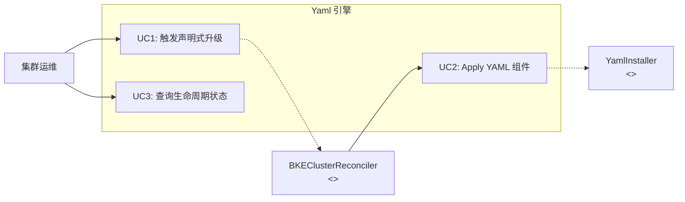
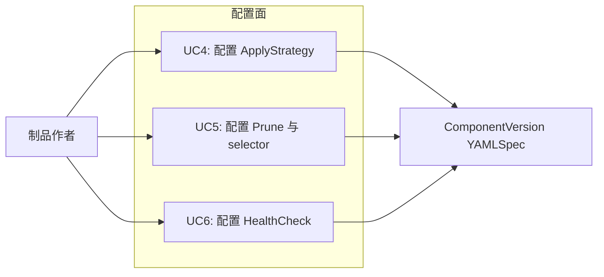
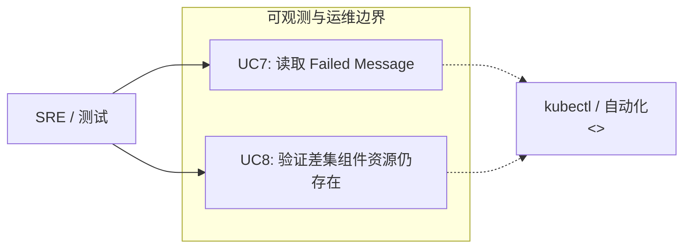
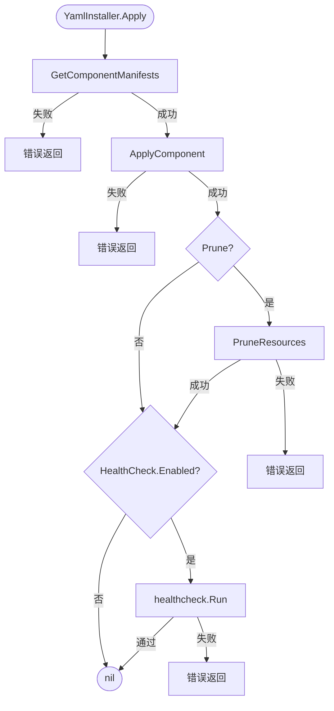
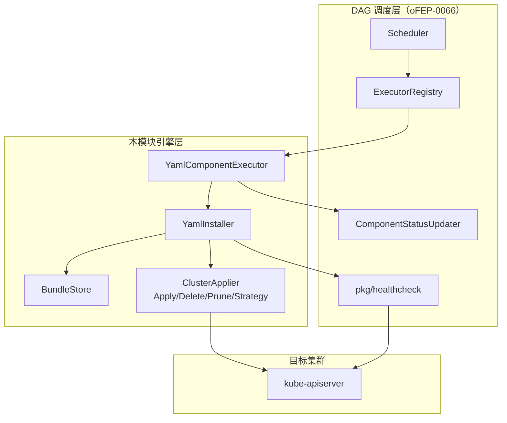
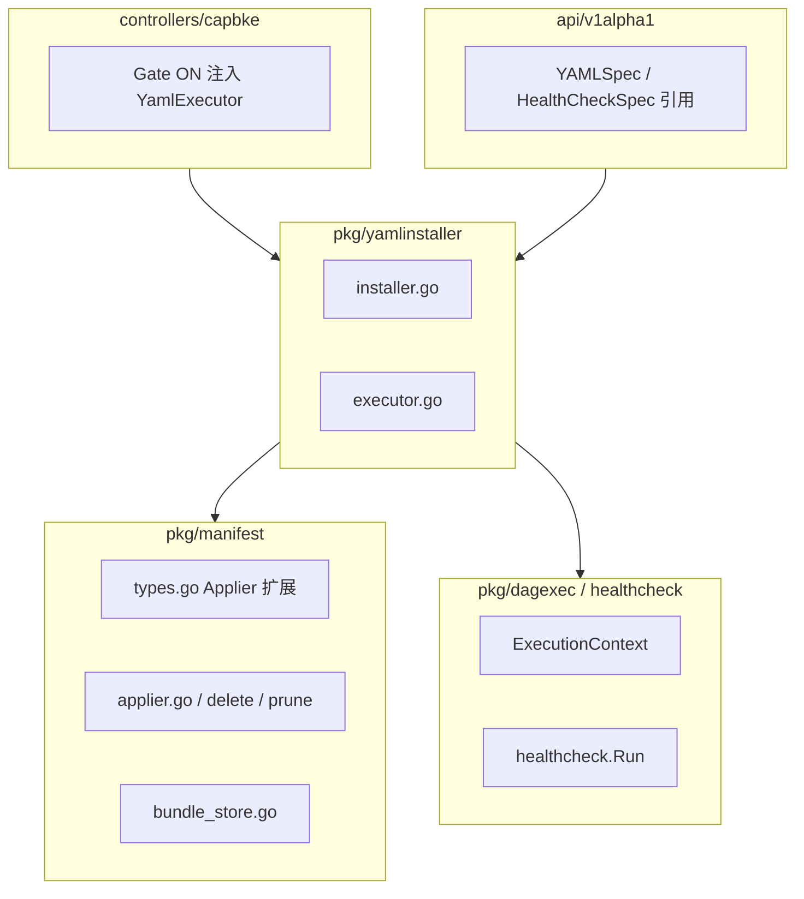
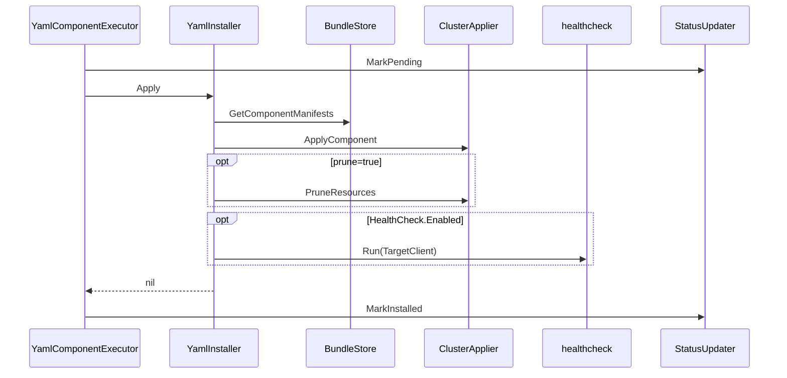
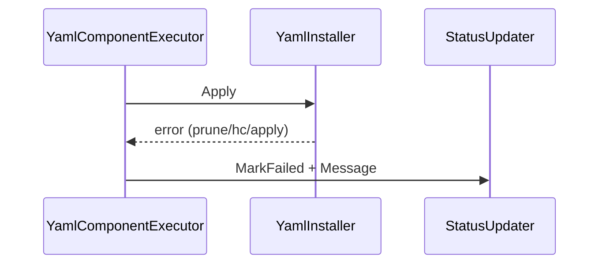
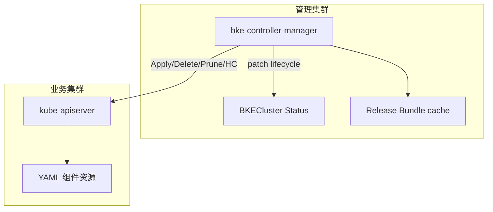

<!-- 格式合规检查：已通过 -->
---
title: 声明式升级 YamlInstaller 核心引擎适配
ofep-number: "0067"
authors:
  - TBD
owning-sig: sig-Installation
participating-sigs: []
status: provisional
creation-date: 2026-08-11
reviewers:
  - TBD
approvers:
  - TBD
see-also:
  - "/ofeps/sig-Installation/ofep-0066-声明式升级DAG解耦重构-执行器框架与状态模型"
  - "/ofeps/sig-Installation/ofep-0057-声明式架构适配BKECluster调谐器"
  - "/ofeps/sig-Installation/ofep-0020-openFuyao大版本升级"
replaces: []
replaced-by: []
stage: alpha
latest-milestone: ""
milestone:
    alpha: "TODO"
    beta: "TODO"
    stable: "TODO"
feature-gates:
  - name: HelmComponentEnabled
    components:
      - cluster-api-provider-bke
      - bke-controller-manager
    disable-supported: true
    metrics: []
    feedback-period: 2 weeks
    cc-list:
  - TBD
---

# oFEP-0067：声明式升级 YamlInstaller 核心引擎适配

<!-- toc -->
- [发布签核清单](#发布签核清单)
- [概括（摘要）](#概括摘要)
- [动机](#动机)
  - [目标](#目标)
  - [非目标](#非目标)
- [提案](#提案)
  - [用户故事](#用户故事)
    - [故事 1：YAML 组件声明式安装与升级](#故事-1yaml-组件声明式安装与升级)
    - [故事 2：ApplyStrategy / Prune / HealthCheck 可控](#故事-2applystrategy--prune--healthcheck-可控)
    - [故事 3：失败可诊断与差集不自动卸载](#故事-3失败可诊断与差集不自动卸载)
  - [注释/约束/警告](#注释约束警告)
- [需求点详细说明](#需求点详细说明)
  - [FR 总览](#fr-总览)
  - [FR-YAML-01 CRD / 类型](#fr-yaml-01-crd--类型)
  - [FR-YAML-02 YamlInstaller 结构与构造](#fr-yaml-02-yamlinstaller-结构与构造)
  - [FR-YAML-03 Apply 流程](#fr-yaml-03-apply-流程)
  - [FR-YAML-04 ApplyStrategy 引擎](#fr-yaml-04-applystrategy-引擎)
  - [FR-YAML-05 Uninstall 流程](#fr-yaml-05-uninstall-流程)
  - [FR-YAML-06 Applier 接口扩展](#fr-yaml-06-applier-接口扩展)
  - [FR-YAML-07 健康检查集成](#fr-yaml-07-健康检查集成)
  - [FR-YAML-08 YamlComponentExecutor](#fr-yaml-08-yamlcomponentexecutor)
  - [已确认约束](#已确认约束)
  - [模块级验收标准](#模块级验收标准)
- [设计细节](#设计细节)
  - [逻辑视图](#逻辑视图)
  - [开发视图](#开发视图)
  - [运行视图](#运行视图)
  - [部署视图](#部署视图)
  - [开发详解](#开发详解)
  - [CRD/API 设计](#crdapi-设计)
  - [组件外部交互与安全](#组件外部交互与安全)
  - [DFX 质量属性设计](#dfx-质量属性设计)
- [风险与缓解措施](#风险与缓解措施)
  - [安全风险](#安全风险)
  - [待讨论问题](#待讨论问题)
- [兼容性与迁移](#兼容性与迁移)
- [测试与验证计划](#测试与验证计划)
  - [功能测试](#功能测试)
  - [DFX 非功能测试](#dfx-非功能测试)
- [替代方案](#替代方案)
- [实施计划](#实施计划)
- [成功标准](#成功标准)
- [毕业标准](#毕业标准)
- [升级/降级策略](#升级降级策略)
- [版本倾斜策略](#版本倾斜策略)
- [推出/弃用计划](#推出弃用计划)
- [文档计划](#文档计划)
- [生产可用性审查（PRR）](#生产可用性审查prr)
- [实施历史](#实施历史)
- [缺点](#缺点)
- [所需基础设施（可选）](#所需基础设施可选)
- [附录](#附录)
<!-- /toc -->

## 发布签核清单

标记有（R）的项目*在达到里程碑/发布*之前是必需的。

- [ ]（R）发布里程碑中的增强问题，链接到 [openfuyao/ofep] 中的 oFEP 目录
- [ ]（R）oFEP 审批者已批准 oFEP 状态为「可实施」
- [ ]（R）设计细节已适当记录
- [ ]（R）测试计划已到位，并考虑了 SIG 架构和 SIG 测试的输入（包括测试重构）
  - [ ] 针对所有 Beta API 操作（端点）进行 e2e 测试
  - [ ]（R）确保 GA e2e 测试满足一致性测试的要求
  - [ ]（R）GA e2e 测试至少需要两周时间才能证明测试结果无 flake
- [ ]（R）毕业标准已设定
  - [ ]（R）所有 GA 端点必须通过一致性测试
- [ ]（R）生产准备情况审查完成
- [ ]（R）生产准备情况审查已获批准
- [ ]「实施历史」部分已更新里程碑
- [ ] 面向用户的文档已在 [openfuyao/docs] 创建，以便发布到 [openfuyao.cn]
- [ ] 支持文档 - 例如，额外的设计文档、邮件列表讨论/SIG 会议链接、相关 PR/问题、发行说明

- [openfuyao 官网](https://www.openfuyao.cn/)
- [ofep 仓库](https://gitcode.com/openFuyao/ofep)
- [docs 仓库](https://gitcode.com/openFuyao/docs)

## 概括（摘要）

当前问题：声明式升级中 YAML/Manifest 组件由 Scheduler 直接调用 `manifest.Store` + `ApplyComponent`，缺少独立引擎层，无法统一表达 ApplyStrategy（SSA/Replace/CreateOnly）、Prune、Apply 后 HealthCheck，以及与调度层执行器的清晰边界。

建议方案：交付 **`pkg/yamlinstaller.YamlInstaller` 引擎**与 **`YamlComponentExecutor`**（供 oFEP-0066 DAG `Register("yaml", …)`），扩展 `manifest.Applier` 的 Delete/Prune，支撑 `ComponentVersion.spec.yaml`（YAMLSpec）；HealthCheck 调用 DAG 模块交付的 `pkg/healthcheck`，不重复实现。

受影响对象：`cluster-api-provider-bke` 的 yamlinstaller/manifest/api；声明式升级制品中 `type=yaml` 组件；依赖 Feature Gate 注入新路径。

本提案最希望评审者反馈：默认 ApplyStrategy=SSA、Prune 白名单与「目标去掉组件不自动卸载」是否可接受。

## 动机

### 当前痛点

1. **无引擎边界**：Scheduler 直连 Applier，难以扩展策略、裁剪与健康检查。
2. **策略不可配置**：无法按组件选择 SSA / Replace / CreateOnly。
3. **缺少 Prune**：升级后废弃资源可能残留，或缺乏安全裁剪约束。
4. **缺少 Apply 后探测**：无法在写 Installed 前验证工作负载就绪。

依赖前提：oFEP-0066（DAG 执行器框架、Updater、healthcheck 库、Gate）。本提案不重做调度框架。

### 相关基线

- oFEP-0066：DAG 解耦重构
- oFEP-0057 / oFEP-0020：声明式升级入口与大版本升级

### 目标

| 编号 | 目标 | 可验证标准 |
| --- | --- | --- |
| G1 | 落地独立 `YamlInstaller` | Apply/Uninstall 可单测 |
| G2 | Bundle + 内联 Resources 加载 | 不支持外部 URL |
| G3 | Applier 扩展 Delete + Prune | prune=true 时裁剪；核心 GVK 禁删 |
| G4 | Apply 后调用共享 healthcheck | 失败则 Apply 失败 |
| G5 | 支撑 YAMLSpec CRD 字段 | 旧对象 YAML=nil 兼容 |
| G6 | 交付 YamlComponentExecutor | 可 Register("yaml")；写 Pending/Installed/Failed |

### 非目标

- DAG Registry / ExecutionContext / Gate / Legacy / phaseframe 解耦（oFEP-0066）
- `pkg/healthcheck` 实现（oFEP-0066 FR-DAG-11；本模块只调用）
- HelmInstaller / HelmComponentExecutor（独立 Helm SR）
- Hooks、高级错误分类重试（增强集）
- 版本差集自动卸载（已确认不做）

## 提案

### 建议做什么

1. 新增 `pkg/yamlinstaller`：`Apply` / `Uninstall` 编排 Store、Applier、可选 Prune/HealthCheck。
2. 扩展 `manifest.Applier`：`DeleteComponent`（GVK 逆序）、`PruneResources`（wantSet + PruneableGVKs）。
3. CRD 增加 `spec.yaml`（YAMLSpec）。
4. 交付 `YamlComponentExecutor`：NeedsUpgrade → MarkPending → Apply → MarkInstalled/Failed。
5. controllers 在 Gate ON 时注入并 Register yaml 执行器。

### 用户可见变化

- 制品可声明 `type=yaml` 及 ApplyStrategy/Prune/HealthCheck。
- Gate ON 后新路径执行并写 `ClusterComponentStatuses`。
- 目标版本去掉某 YAML 组件时**不自动卸载**资源。

### 用户故事

#### 故事 1：YAML 组件声明式安装与升级

作为集群运维，我希望 ReleaseImage 中的 yaml 组件经统一引擎安装/升级并写回 Installed，从而用声明式清单收敛目标集群。



#### 故事 2：ApplyStrategy / Prune / HealthCheck 可控

作为组件制品作者，我希望为组件配置 SSA/Replace/CreateOnly、Prune 与 HealthCheck，从而按资源特性选择收敛策略并防止误删。



#### 故事 3：失败可诊断与差集不自动卸载

作为 SRE，我希望 Prune/HealthCheck 失败时 Failed+Message 可定位，且目标版本去掉的组件不会被自动卸载，从而避免静默失败与误删。



### 注释/约束/警告

- 清单仅来自 Bundle 目录与内联 Resources，**不支持外部 URL**。
- `prune=true` 时 `pruneLabelSelector` **必填**，不得静默跳过。
- Prune **禁止**删除 CRD、Namespace 等非 PruneableGVKs。
- HealthCheck 依赖 `ExecutionContext.TargetClient`（由 DAG 桥接注入）。
- 状态 API 以 oFEP-0066 为准；本模块只调用 Updater。

## 需求点详细说明

> 对应模块设计 FR-YAML-01～08。每条按「说明 → 接口/行为要点 → 验收」组织。

### FR 总览

| 编号 | 名称 | 交付要点 |
| --- | --- | --- |
| FR-YAML-01 | CRD / 类型 | `YAMLSpec` 字段与兼容 |
| FR-YAML-02 | YamlInstaller 构造 | Store + Applier；无内嵌 clientset |
| FR-YAML-03 | Apply 流程 | Load → Apply → Prune? → HealthCheck? |
| FR-YAML-04 | ApplyStrategy | SSA 默认 / Replace / CreateOnly |
| FR-YAML-05 | Uninstall 流程 | 逆序删除 + 可选 Prune |
| FR-YAML-06 | Applier 扩展 | DeleteComponent / PruneResources |
| FR-YAML-07 | HealthCheck 集成 | 调用共享 `healthcheck.Run` |
| FR-YAML-08 | YamlComponentExecutor | Skip/Apply + 状态写回 |

### FR-YAML-01 CRD / 类型

**说明**：`ComponentVersionSpec` 新增可选 `YAML *YAMLSpec`；`type=yaml` 时使用。

| 字段 | 类型 | 说明 |
| --- | --- | --- |
| `namespace` | string | 部署目标命名空间（可选） |
| `applyStrategy` | string | `ServerSideApply`（默认）/ `Replace` / `CreateOnly` |
| `prune` | bool | true 时 Apply/Uninstall 触发 Prune |
| `pruneLabelSelector` | map[string]string | prune=true 时必填 |
| `healthCheck` | `*HealthCheckSpec` | 共享健康检查类型 |

**验收**：CRD schema + deepcopy；旧对象 `YAML=nil` 反序列化不变。

### FR-YAML-02 YamlInstaller 结构与构造

**说明**：新增引擎结构；Config 不注入 clientset，HealthCheck 使用 `execCtx.TargetClient`。

```go
type YamlInstaller struct {
    store   manifest.Store
    applier manifest.Applier
    logger  *bkev1beta1.BKELogger
}
func NewYamlInstaller(cfg YamlInstallerConfig) *YamlInstaller
```

**验收**：可独立单测；nil Store/Applier 时 Apply 返回明确错误。

### FR-YAML-03 Apply 流程

**说明**：`Apply(ctx, cv, execCtx) error` 固定步骤：

1. `GetComponentManifests`（Bundle 文件 + 内联 Resources，经 TemplateContext 渲染）
2. `ApplyComponent`（按策略）
3. `prune=true` → 校验 selector → `PruneResources`
4. `HealthCheck.Enabled` → `healthcheck.Run`
5. 任一步失败包装组件名返回



**验收**：双通道清单可 Apply；prune 缺 selector 报错；HC 未启用不调用；HC 失败不吞错。

### FR-YAML-04 ApplyStrategy 引擎

**说明**：策略实现归属 `ClusterApplier`；Installer 只传入策略。

| 策略 | 行为 | 典型用途 |
| --- | --- | --- |
| ServerSideApply（默认） | 幂等字段管理 | 常规升级收敛 |
| Replace | 删除 + 重建 | 无法增量更新 |
| CreateOnly | 已存在则不更新 | 一次性初始化 |

**验收**：三种策略单测覆盖；默认 SSA。

### FR-YAML-05 Uninstall 流程

**说明**：

1. 加载清单 → `DeleteComponent`（GVK 逆序，`IsNotFound` 成功）
2. `prune=true` → `PruneResources`
3. 传播策略 `DeletePropagationBackground`
4. 复用 `addonutil.SortUninstallUnstructuredByKind`

**验收**：重复 Uninstall 不报错；CRD 最后删；GVR 无法解析 Warn 跳过。

### FR-YAML-06 Applier 接口扩展

```go
type Applier interface {
    ApplyComponent(ctx context.Context, pkg *ComponentPackage) error
    DeleteComponent(ctx context.Context, pkg *ComponentPackage) error
    PruneResources(ctx context.Context, selector map[string]string, namespace string, currentManifests [][]byte) error
}
```

**Prune 行为**：currentManifests → wantSet；按 PruneableGVKs + label selector List；删除不在 wantSet 者。

**安全约束**：PruneableGVKs **不得**含 CRD、Namespace。

建议白名单：ConfigMap / Secret / Service / ServiceAccount / Deployment / DaemonSet / StatefulSet / Job / CronJob / Role / RoleBinding / ClusterRole / ClusterRoleBinding / Ingress / PDB。

**验收**：wantSet 比对单测；非 Pruneable GVK 不删。

### FR-YAML-07 健康检查集成

**说明**：实现属 oFEP-0066；本模块仅在 Enabled 时调用 `healthcheck.Run(ctx, TargetClient, spec)`。

**验收**：失败 → Apply 失败；本包无重复探针实现。

### FR-YAML-08 YamlComponentExecutor

**说明**：供 DAG `Register("yaml", …)`；基于 VersionContext 决策；调用 Installer；经 Updater 写状态。

| 调用 | 期望 |
| --- | --- |
| Skip | 不强制改 Failed |
| MarkPending → Apply 成功 | MarkInstalled + CurrentVersion |
| Apply/Prune/HC 失败 | MarkFailed + Message |

```go
type YamlComponentExecutor struct {
    Installer *YamlInstaller
    CVStore   ComponentVersionStore
}
```

**验收**：Skip/成功/失败路径单测；可注入 Register；不依赖 phaseframe。

### 已确认约束

#### 有 A → 目标无 A：不自动卸载

升级 DAG 仅含目标 Bundle；目标无 A → 不调度、不调用 Uninstall。`Uninstall` 能力保留给其他触发面。测试：`YAML_ENGINE_FIT_8`。

#### Legacy 不写新状态字段

仅新 Executor 路径写 `ClusterComponentStatuses`（见 oFEP-0066）。

### 模块级验收标准

1. Bundle + 内联 Resources 可 Apply  
2. SSA 幂等；Replace 重建；CreateOnly 不覆盖  
3. Delete 逆序且 NotFound 幂等  
4. Prune 不误删 CRD/Namespace  
5. prune=true 缺 selector 报错；成功后触发裁剪  
6. HealthCheck 失败导致 Apply 失败  
7. 旧 CV 无 YAML 字段可反序列化  
8. 单测覆盖率目标 ≥85%  
9. Executor 可 Register("yaml")  
10. 集成：全新安装 / 增量更新 / Apply·Uninstall Prune 通过  

## 设计细节

### 逻辑视图



### 开发视图



### 运行视图

#### Apply 成功路径



#### HealthCheck / Prune 失败



### 部署视图



本提案不新增独立进程。

### 开发详解

**关键设计决策**：

1. 引擎与调度分离：Executor 决策 + Installer 编排 + Applier 执行。
2. 默认 SSA，符合声明式收敛与幂等。
3. Prune 与 Apply/Delete 解耦：Apply/Delete 按 GVK+ns+name；Prune 靠 label + wantSet。
4. HealthCheck 失败不得 MarkInstalled。

### CRD/API 设计

见 FR-YAML-01。样例：

```yaml
apiVersion: config.openfuyao.com/v1alpha1
kind: ComponentVersion
metadata:
  name: demo-yaml-v1-0-0
spec:
  name: demo-yaml
  version: v1.0.0
  type: yaml
  yaml:
    namespace: demo
    applyStrategy: ServerSideApply
    prune: true
    pruneLabelSelector:
      app.kubernetes.io/name: demo-yaml
    healthCheck:
      enabled: true
      checks:
        - type: PodReady
          podReady:
            namespace: demo
            labelSelector: app=demo-yaml
            minReady: 1
```

兼容性：增量字段；旧 CV 无 YAML 时行为不变。

### 组件外部交互与安全

| 组件 | 外部对象 | 权限示例 |
| --- | --- | --- |
| ClusterApplier | 业务集群 API | 目标 ns 资源 create/update/patch/delete |
| PruneResources | 业务集群 API | 按白名单 GVK list/delete |
| healthcheck | 业务集群 API | pods/endpoints get/list |

### DFX 质量属性设计

| DFX | 设计承诺 | 关联用例 |
| --- | --- | --- |
| DFT | Status 可 jsonpath 解析 | FIT_1 |
| DFC | SSA 二次触发幂等；CreateOnly 不覆盖存量 | FIT_2 / FIT_4 |
| DFD | prune 缺 selector / HC 失败 Message 可定位 | FIT_6 / FIT_7 |
| DFS | 差集不自动卸载运维边界 | FIT_8 |
| DFR | Prune 不误删核心资源；Skip 与成功隔离 | FIT_9 / FIT_10 |
| DFP / DFNS | 本阶段不适用 | 材料无依据 |

## 风险与缓解措施

1. **风险**：Prune selector 过宽误删。  
   **缓解**：PruneableGVKs 白名单；selector 必填；manifest 标签对齐。

2. **风险**：TargetClient 未注入导致 HC 失败。  
   **缓解**：依赖 oFEP-0066 桥接注入；单测覆盖。

3. **风险**：与 DAG/HealthCheck 并行交付。  
   **缓解**：接口 mock；联调里程碑。

4. **风险**：Replace 重建中断。  
   **缓解**：默认 SSA；Replace 需评审确认。

### 安全风险

禁止 Prune 核心资源；不在文档写入真实密钥；复用既有 RBAC。

### 待讨论问题

1. CreateOnly 组件升级时 CurrentVersion 语义是否一律写目标版本？
2. PruneableGVKs 是否允许制品侧扩展？
3. Uninstall 对外触发面（集群删除 / 显式 API）时间表？

## 兼容性与迁移

- Breaking change：否（Gate OFF 走 Legacy）。
- 迁移：制品增加 `type=yaml` + YAMLSpec；开启 Gate 注入 Executor。
- 旧 CV 无 YAML 字段保持兼容。

## 测试与验证计划

### 功能测试

| 编号 | 场景 | 优先级 |
| --- | --- | --- |
| YAML_ENGINE_FIT_1 | 低无高有首次安装 + DFT | P0 |
| YAML_ENGINE_FIT_2 | SSA 二次触发幂等 | P0 |
| YAML_ENGINE_FIT_3 | Replace 重建 | P1 |
| YAML_ENGINE_FIT_4 | CreateOnly 不覆盖 | P1 |
| YAML_ENGINE_FIT_5 | Prune 正向清理 | P0 |
| YAML_ENGINE_FIT_6 | 缺 pruneLabelSelector Failed | P0 |
| YAML_ENGINE_FIT_7 | HealthCheck 失败阻断 | P0 |
| YAML_ENGINE_FIT_8 | 差集不自动卸载 | P1 |
| YAML_ENGINE_FIT_9 | Prune 不误删核心资源 | P1 |
| YAML_ENGINE_FIT_10 | Skip 与成功互不干扰 | P1 |

单元测试：Installer、三策略、Delete/Prune、Executor Skip/失败写回。

### DFX 非功能测试

已并入上表 FIT（DFT/DFC/DFD/DFS/DFR）。未覆盖：DFP、DFNS。

## 替代方案

1. 继续在 Scheduler 内扩展 Apply 逻辑：否决（边界混乱）。  
2. 仅用 Manifest Apply 无 Prune/HC：否决（无法满足声明式收敛与可观测）。  
3. 自研 HealthCheck：否决（与 oFEP-0066 共享库重复）。

## 实施计划

| 里程碑 | 内容 | 依赖 |
| --- | --- | --- |
| M1 | YAMLSpec + YamlInstaller Apply/Uninstall + Applier 扩展 | oFEP-0066 类型/healthcheck |
| M2 | YamlComponentExecutor + Gate 注入 | M1 + oFEP-0066 Registry |
| M3 | FIT/DFX（FIT_1～10） | M2 |

## 成功标准

- Gate ON 下 yaml 组件可 Installed，Status 可观测。
- SSA/Replace/CreateOnly、Prune、HC 负向用例通过。
- 差集不自动卸载用例通过。

## 毕业标准

### Alpha

- [ ] M1/M2 合入；关键单测通过

### Beta

- [ ] FIT P0 全通过；灰度验证

### GA

- [ ] FIT/DFX 稳定；文档发布；PRR 完成

## 升级/降级策略

- 默认 Gate OFF 无行为变化。
- 开启后失败可关 Gate 回退 Legacy。
- 降级控制器忽略新 YAML 字段。

## 版本倾斜策略

管理集群 capbke 需同时具备 oFEP-0066 框架与本引擎后再启用 yaml 新路径。

## 推出/弃用计划

随 capbke 发布；Legacy Manifest 路径退役另议。

## 文档计划

- [ ] YAMLSpec 字段与策略说明
- [ ] Prune 标签与白名单实践
- [ ] 排障：Failed Message 常见原因

## 生产可用性审查（PRR）

### 功能启用和回滚

Gate / 注解启用；关闭回退 Legacy；不自动卸载已 Apply 资源。

### 监控要求

初期 Status/日志；metrics TODO。

### 依赖项

oFEP-0066；目标集群 API；Release Bundle。

### 可扩展性

新策略可在 Applier 扩展；Executor 已注册即可调度。

### 故障排除

查 `clusterComponentStatuses.*.message`；核对 prune selector、TargetClient、HealthCheck 选择器。

## 实施历史

- 2026-08-11：创建 oFEP-0067（基于 YamlInstaller 模块设计）。

## 缺点

- 依赖 Gate 与 DAG 框架分期合入。
- Prune 依赖制品打标，漏标会残留。
- CreateOnly 不利于版本收敛，易误用。

## 所需基础设施（可选）

本提案不涉及。可用独立 `vfit-*` 制品做 FIT，不占用现网版本。

## 附录

### A. 需求追溯

| FR | 摘要 |
| --- | --- |
| FR-YAML-01 | YAMLSpec CRD |
| FR-YAML-02 | YamlInstaller 构造 |
| FR-YAML-03 | Apply 流程 |
| FR-YAML-04 | ApplyStrategy |
| FR-YAML-05 | Uninstall |
| FR-YAML-06 | Delete/Prune |
| FR-YAML-07 | HealthCheck 调用 |
| FR-YAML-08 | YamlComponentExecutor |

### B. 参考

- 《YamlInstaller 核心引擎适配-开发侧需求模块设计》
- 《YamlInstaller核心引擎_SR_FIT与DFX测试用例合集》
- oFEP-0066 / oFEP-0057 / oFEP-0020
