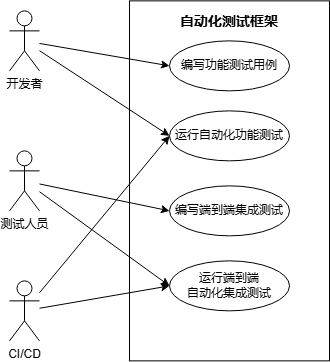
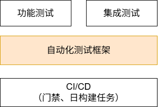
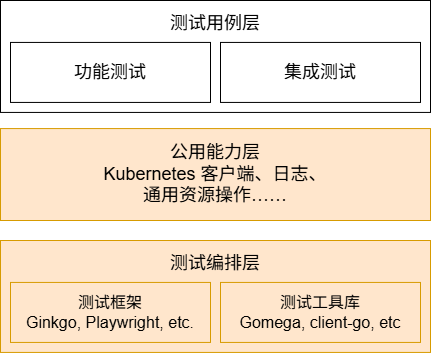
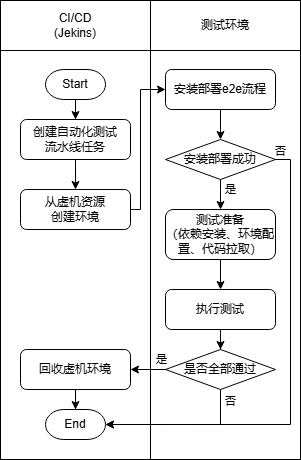

---
# 提案标题
title: 构建 openFuyao 社区自动化测试体系
# 提案编号
ofep-number: 0019
# 提案作者
authors:
  - "@guanyu_zhu"
  - "@yangxt65535"
# 提案主导SIG
owning-sig: sig-QA
# 提案协作SIG
participating-sigs:
# 提案状态(初步草案|准备开始实现|已在SIG中实现并合并|提案被暂缓|提案被否决|作者主动撤回提案|被另一个oFEP取代)
status: provisional
# 创建日期
creation-date: 2025-10-10
# 评审人
reviewers:
  - TBD
# 批准人
approvers:
  - TBD
# 相关联的其他oFEP
see-also:
# 当前oFEP替代了哪些已有提案
replaces:
# 当前oFEP被哪些提案替代，当status为replaced时需要填写此字段
replaced-by:
# 此oFEP当前开发阶段
stage: 
# 最近一次推进的版本
latest-milestone:
# 各阶段目标版本
milestone:
# 功能开关及影响组件
feature-gates:
# 是否支持关闭该功能
disable-supported: true
# 该功能引入的监控指标
metrics:
---
<!--
**注意：**当你的 oFEP 完成时，应删除所有这些注释块。

要开始使用此模板：
- [ ] **选择一个托管 SIG。**
  确保该问题领域是 SIG 感兴趣的。如果没有 SIG 的赞助，oFEP 不应提交。
  - [ ] **在 openfuyao/ofep 中创建问题**
    提交增强功能跟踪问题时，请务必填写该模板中的所有字段。其中一个字段要求提供指向 oFEP 的链接。你可以留空该字段，直到提交此 oFEP 后再返回到增强功能并添加链接。
- [ ] **复制此模板目录。**
  将此模板复制到所属 SIG 的目录中，并将其命名为“ofep-NNNN-short-descriptive-title”，其中“NNNN”是分配给上述增强功能的问题编号（没有前导零填充）。
- [ ] **尽可能多地填写以上oFEP元数据。**
  至少，你应该填写“标题”、“作者”、“SIG所有者”、“状态”和与日期相关的字段。
- [ ] **请尽可能详细地填写此文件。**
  至少，你应该填写“摘要”和“动机”部分。如果你已经和相关的 SIG 进行过前期沟通和想法验证，那么这两部分应该会很容易完成。
- [ ] **为此 oFEP 创建 PR。**
  将其指派给正在支持该流程的 SIG（特别兴趣小组）成员。
- [ ] **尽早合并并迭代。**
  避免纠结于具体细节，而应致力于明确 oFEP 的目标并快速合并。最好的方法是从概要部分开始，然后在后续的 PR 中逐步完善细节。

oFEP 合并并不意味着它已完成或获得批准。任何标记为“临时”的 oFEP 都是工作文档，可能会发生变更。你可以按以下方式标记正在积极讨论的部分：

编辑 oFEPS 时，请尽量使用范围明确、主题单一的 PR，以保持讨论的集中性。如果你不同意文档中已有的内容，请提交新的 PR 并提出修改建议。

一个 oFEP 对应其整个生命周期内的一项“功能”或“增强”。例如，从 Beta 版升级到 GA 版无需新的 oFEP。如果出现属于 oFEP 的新细节，请编辑 oFEP。一旦某个功能被“实现”，重大变更应该获得新的 oFEP。

最新（以及该文件的可能来源）的规范位置是[0000-ofep-template.md]（/0000-ofep-template.md）。

**注意：**任何将 oFEP 推进为“implementable”状态的 PR，或在标记为“implementable”后的重大更改，都必须得到每个 oFEP 批准人的批准。如果这些批准人均不合适（例如离开社区、角色变更等），则该列表的更改应由其余批准人和/或所属 SIG 批准。
-->

# oFEP-0019：社区自动化测试体系

<!-- toc -->
- [oFEP-0019：社区自动化测试体系](#ofep-0019社区自动化测试体系)
  - [发布签核清单](#发布签核清单)
  - [摘要](#摘要)
  - [动机](#动机)
    - [目标](#目标)
    - [非目标](#非目标)
  - [提案](#提案)
    - [用户故事](#用户故事)
      - [故事 1](#故事-1)
    - [注释/限制/注意事项](#注释限制注意事项)
    - [风险与缓解措施](#风险与缓解措施)
      - [自动化测试用例编写路标规划](#自动化测试用例编写路标规划)
      - [自动化测试代码归档与管理](#自动化测试代码归档与管理)
  - [设计细节](#设计细节)
    - [整体架构设计](#整体架构设计)
    - [功能测试框架选型](#功能测试框架选型)
      - [Golang 项目](#golang-项目)
      - [非 Golang 项目](#非-golang-项目)
    - [集成测试框架选型](#集成测试框架选型)
      - [集群纯后端集成测试](#集群纯后端集成测试)
      - [前端端到端测试](#前端端到端测试)
      - [其他特性的集成测试](#其他特性的集成测试)
    - [CI/CD集成](#cicd集成)
      - [门禁与自动化测试集成](#门禁与自动化测试集成)
      - [日构建流水线任务与自动化测试集成](#日构建流水线任务与自动化测试集成)

## 发布签核清单
<!--
**需要采取的行动：**为了将代码合并到一个版本中，在[openfuyao/ofep]引用此oFEP并在目标版本的[增强冻结]之前瞄准发布里程碑**中必须存在问题。

对于对核心代码或流程/程序进行更改的增强功能，例如：[openfuyao/openfuyao]，我们需要完成以下发布签署清单。

完成后勾选这些，以便发布团队跟踪。为了发布增强，必须更新这些检查表项。
-->

标记有（R）的项目*在达到里程碑/发布*之前是必需的。

- [ ] (R) 发布里程碑中的增强问题，链接到 [openfuyao/ofep] 中的 oFEP 目录
- [ ] (R) oFEP 审批者已批准 oFEP 状态为“可实施”
- [ ] (R) 设计细节已适当记录
- [ ] (R) 测试计划已到位，并考虑了 SIG 架构和 SIG 测试的输入（包括测试重构）
  - [ ] 针对所有 Beta API 操作（端点）进行 e2e 测试
  - [ ] (R) 确保 GA e2e 测试满足一致性测试的要求
  - [ ] (R) GA e2e 测试至少需要两周时间才能证明测试结果无 flake（不稳定或偶发失败）
- [ ] (R) 毕业标准已设定
  - [ ] (R) 所有 GA 端点必须通过[一致性测试]
- [ ] (R) 生产准备情况审查完成
- [ ] (R) 生产准备情况审查已获批准
- [ ] “实施历史”部分已更新里程碑
- [ ] 面向用户的文档已在 [openfuyao/docs] 创建，以便发布到 [openfuyao.com]
- [ ] 支持文档 - 例如，额外的设计文档、邮件列表讨论/SIG 会议链接、相关 PR/问题、发行说明

<!--
**注意：**此清单是迭代的，每次考虑将此增强功能作为里程碑时都应进行审查和更新。
-->

- [openfuyao.com](https://openfuyao.com/)
- [openfuyao/ofep](https://gitcode.com/openfuyao/ofep)
- [openfuyao/docs](https://gitcode.com/openfuyao/docs)

## 摘要
<!--
这部分对于生成高质量、以用户为中心的文档（如发行说明或开发路线图）非常重要。应该在实现开始之前收集这些信息，以避免要求实现者在编写发行说明和实现功能本身之间分散注意力。oFEP 编辑器和SIG文档应该有助于确保“摘要”部分的语气和内容对广泛的受众有用。

好的摘要可能至少有一段长度。

在本节和下一节中，请遵循[文档样式指南]的指导方针。特别是，将代码行包装到合理的长度，使审阅者更容易引用特定的部分，并尽量减少更新的差异。
-->

本提案旨在为 openFuyao 社区构建自动化测试体系，在实现自动化测试框架的基础上，推动开发者功能测试与测试团队集成测试自动化改造，并将测试任务与社区基础设施流水线集成。该体系能够提升测试效率、降低测试人力需求，从而为 openFuyao 各版本各特性提供可靠的质量保证。

## 动机
<!--
本节用于明确列出该oFEP的动机、目标和非目标。描述变更的重要性以及对用户的好处。
-->

在 openFuyao 历史版本的测试工作中，包含功能测试、性能测试、性能基线测试等多个环节，其人工执行率超过80%，存在显著的自动化改造空间。此外，openFuyao 功能特性不断扩展，仅依靠规模有限的 sig-QA 人员将难以支撑日益增长的测试用例数量，且会进一步挤占其他质量保障工作的投入，进而影响各功能模块以及版本整体的质量。测试工作与版本验收和版本构建等有一定关联性，这为自动化测试与基础设施的结合创造了条件，进一步促进自动化测试体系的构建，提升社区整体的运作与交付效率。

### 目标
<!--
列出oFEP的具体目标。它想要达到什么目标？我们怎么知道这已经成功了？
-->

为社区发行版以及其它特性

- 构建功能自动化测试框架，满足社区贡献者的开发者自测需求；
- 构建端到端自动化测试框架，满足 sig-QA 端到端测试需求；
- 将自动化测试任务与每日构建集成；
- 提供功能自动化测试框架的最佳实践：提供NPU Operator与安装部署功能典型场景测试自动化用例，作为社区最佳实践。

### 非目标
<!--
什么超出了这个oFEP的范围？列出非目标有助于集中讨论并取得进展。
-->

- **具体测试用例的编写**: 除最佳实践外，本提案在v25.12版本不负责具体测试用例的构建，仅提供支撑测试用例运行的框架、工具、环境配置等，同时，具体特性的自动化指标不直接作为本特性的交付目标，但会对测试用例的自动化改造进行规划。

## 提案
<!--
**这是我们真正进入提案具体内容的部分。**  
这一部分应包含足够的细节，使评审人员能清晰理解你到底在提出什么建议，  
但不应涉及 API 设计或具体实现细节。  

请阐明：
- **预期目标是什么？**  
- **我们如何衡量成功？**

请将更详细的设计和实现细节放在下方的 “设计细节” 部分中。
-->

### 用户故事
<!--
详细说明如果该 oFEP 被实施，用户将能够做哪些事情。请尽可能提供细节，以便人们理解系统将“如何”运作。此部分的目标是：让用户对提案有真实的感受，而不是陷入技术细节的泥淖中。
-->

#### 故事 1

开发、测试人员在某一特性转测后，应当基于自动化测试框架，实现功能测试与端到端集成测试的自动化代码。允许在转测前后，通过执行命令或调用测试工具，快速运行测试用例，高效完成功能验证与问题定位，从而显著降低人力投入并提升测试代码可复用性。

同时，基于该自动化测试框架的测试任务也可以接入CI/CD日构建任务，能够及时发现代码缺陷，确保产品在每次变更后始终处于可转测交付状态，提高开发效率和代码质量。

### 注释/限制/注意事项
<!--
该提案有哪些注意事项或潜在限制？
有没有上文未能充分表达的重要细节？
请在此处根据需要尽可能详细地展开说明。
这部分也非常适合用于讲解一些核心概念及它们之间的关联关系。
-->

功能测试或集成测试用例可能存在需要针对服务器、网络规格等调整参数的，开发者与测试人员应当通过特性级的 Readme 文档明确运行指南、配置规则等。对于部分用例可能无法进行自动化的，同样应在相关文档中进行说明，保证溯源。

### 风险与缓解措施
<!--
这个提案存在哪些风险？我们将如何加以缓解？请从广泛的角度思考，例如包括安全性问题，以及它可能对更大范围的 openfuyao 生态系统产生的影响。 安全性将由谁进行评审，以及如何评审？用户体验（UX）将由谁进行评审，以及如何评审？建议考虑邀请 SIG 外部或子项目之外的相关人员参与评估。
-->

#### 自动化测试用例编写路标规划

尽管该提案聚焦自动化测试框架的构建而非用例的编写，但由于存量特性与新特性较多，全量测试用例的自动化改造需预留人力，并进行路标规划。

缓解措施：

- AI赋能的测试代码开发：公共领域中的自动化测试实例代码多、且文案资料完备，相比定制化的业务代码，AI更擅长生成测试代码；同时，测试代码容易存在大量局部相似逻辑与格式，更适合AI生成。
- 按优先级分批改造：对于大量自动化测试改造任务，根据特性优先级、活跃度等指标分批实现，将整体改造所需人力在时间维度上进行平铺。

测试用例自动化改造计划建议：

- v25.12: NPU Operator和Cluster API安装部署完成功能测试自动化改造，特性功能测试自动化率达到80%；
- v26.03：新增特性需包含功能测试自动化用例；openFuyao社区发行版最小集完成测试自动化改造，特性功能测试自动化率达到80%；
- v26.06：全部特性完成功能测试自动化用例覆盖，功能测试自动化率达到80%。

#### 自动化测试代码归档与管理

当前 openFuyao 存在“一仓库多制品”和“一特性多仓库”的现象，涉及多模块协作的特性可能会在自动化测试代码的构筑过程中存在归档路径和维护责任人不明确的问题。

缓解措施：

- **功能测试用**例由**特性 sig 组**进行管理，以模块或特性为单位，直接在该模块代码仓建立测试路径以托管，保证一一对应关系。若特性涉及多个仓库，建议选取其中一个仓库用于存放集成测试代码（可以与 chart 包等特性级的内容存放仓库保持一致）。
- 系统级的**集成测试**用例由 **sig-QA** 进行管理，统一归档在e2e-auto-test仓库

> 若推动openFuyao特性仓库合并，则更适合测试用例代码的存放。对于某一特性，可以单独提供路径（如 tests/）用于存放测试代码，功能测试按照仓库子模块划分，保证测试模块与业务模块的模块级对应关系；同时提供单独的特性级集成测试路径，存放集成测试代码，也实现了集成测试与特性级的对应关系。

## 设计细节
<!--
本节应包含足够的信息，以便读者能够清楚理解你所提出的变更具体是什么。这可能包括 API 规格说明（虽然并非必须）或代码片段。如果对该提案将如何实施存在任何疑问，应在此处进行详细讨论。
-->

### 整体架构设计

openFuyao 社区自动化测试体系构建为功能与集成测试提供自动化测试框架，使测试用例可以基于测试框架开发和运行。

此外，本提案将上述自动化测试框架与用例与CI/CD集成，以门禁过日构建方式触发基于上述框架实现的自动化测试任务，以保证测试效率与结果的针对性。

参考Kubernetes、Rancher、OpenShift等现有开源社区自动化测试框架，本提案提出如下架构：

- 测试编排层：使用目标语言生态中的成熟测试框架作为底层，配合特定测试工具库，提供功能与集成测试的测试编排、可观测等能力，允许开发与测试人员快速搭建与运行测试项目。
- 公用能力层：根据 openFuyao 特性能力，将测试过程中的常见操作、常用资源对象等进行抽取，作为公用能力各特性的测试用例提供。该层应具备可扩展性，在自动化测试框架构建过程中初步构建后，允许根据 openFuyao 社区的特性演进对模块进行新增、修改与删除。
- 测试用例层：测试用例的代码实现，不属于框架核心内容，因此不在本提案的实现范围内。开发与测试人员应当参考所用测试框架的最佳实践，进行测试用例的编写与编排，确保用例能够通过测试框架的编排能力高效与灵活地执行。

### 功能测试框架选型

#### Golang 项目

对于使用 **Golang** 开发的 openFuyao 纯后端模块的功能测试，参考 Kubernetes 与 OpenShift 社区，可使用 **Ginkgo** 这一 Golang 生态的主流测试框架，其优势在于：

- 可以通过 `import` 方式直接导入项目内部包，使用 mock client、结构体等内容，实现代码复用；
- 使测试运行环境与开发、构建环境保持一致，避免开发者与流水线维护额外测试环境的成本；
- Golang 原生对大规模并发支持更佳，允许更高效的执行大规模测试任务，在流水线场景下并发性能收益更高。

功能测试中如果存在环境或组件依赖，则尽可能使用 Mock 工具完成。自动化测试体系中应进一步提供客户端（client-go）、文件系统（Afero）、测试环境（envtest）等配套 Mock 工具。

#### 非 Golang 项目

对于非 Golang 开发的项目（如C++、Python等），推荐使用 **Python Pytest** 作为测试框架。不考虑项目内部接口、模块的调用时，Python 作为脚本语言更适合测试脚本的开发。

- 编码逻辑（控制流、函数调用、面向对象）与主流语言一致（相比JavaScript），便于测试脚本编写。
- 丰富的测试工具和库：测试框架 & 各类请求、数据库操作等库，便于模拟。
- 功能测试相对简单，对性能要求低。

对于各类 Mock 场景，可从 Python 丰富的生态中选择对应 Mock 工具。

### 集成测试框架选型

#### 集群纯后端集成测试

此类集成测试不涉及前端，仅针对运行于集群中的后端组件，将深度依赖各类与 Kubernetes 集群的交互。可以参考或部分复用 Kubernetes 社区的 `e2e/framework` 测试框架，同时根据 openFuyao 测试用例的需求自研部分公用能力。

Kubernetes framework 测试框架作为对基础测试框架的封装，已经提供一系列公有能力，包括：

- 测试上下文与集群配置，封装了和测试环境、集群配置有关的全局信息。
- 命名空间与资源生命周期管理，包括测试前后的创建与清理。
基于 Gomega 的断言与错误处理封装，提供标准化错误信息输出。
- 常用对象操作 Helper，如 e2e pod 提供 Pod 管理、自动等待等，e2e node 提供节点调度、污点管理功能。
- 日志与诊断收集

在 openFuyao 社区特性测试用例的开发过程中，预计存在特性特有的常用操作或对象，也应当抽取为测试公用包，作为公共能力层的自有扩展部分，其地位接近 Kubernetes 框架中“常用对象操作”的模块。需要注意的是，在该公用能力层的构建过程中，应当建立一定机制（单元测试、人工审核等），严格管控公用能力的新增、删除与修改，保证不影响现有的、使用公用能力的测试用例的正常运行。

#### 前端端到端测试

对于涉及前端操作的测试，需要引入前端自动化工具，以达成打开网页、点击按钮、输入文本、截屏等交互流程的自动化。

Cypress、Playwright 均为 JavaScript 生态下的主流测试框架，本提案建议使用 Playwright 作为 openFuyao 社区前端场景下的测试框架。尽管目前云原生开源社区对 Cypress 的使用更为成熟，但是 Playwright 作为背靠 Microsoft 的新项目，功能更强、设计更现代、更具技术前景，且生态也在快速成熟，能够为 openFuyao 社区质量保障体更更强支撑。相比 Cypress, Playwright 主要优势如下：

- 语义化定位增强测试代码的稳定性，降低维护成本；
- 广泛的浏览器支持保障项目在不同平台上的一致性；
- 并发+多上下文隔离能力，允许在CI/CD上的高性能执行。

此外，考虑的 Playwright 的多语言支持，应当使用 Node.js 版本进行前端端到端用例的编写，与前端开发语言保持一致。考虑到测试代码的可维护与可演进，建议确保使用 ESM 规范编写代码，且尽可能以 TypeScript 实现。

#### 其他特性的集成测试

对于部分业务属性较强的特性，涉及 Kubernetes 与 openFuyao 操作较少，可以直接使用 Python Pytest 框架完成其集成测试用例的编写与执行。

### CI/CD集成

自动化测试体系在社区的落地，除了任务的独立运行，还需要与社区协作流程紧密结合。将自动化测试嵌入门禁、流水线等环节，可以在代码变更被合入之前就及时发现问题，避免代码的修改以外引入错误，保证主干分支的稳定性，同时提升反馈速度与团队协作效率。

#### 门禁与自动化测试集成

开发者功能测试，具有环境依赖低、执行速度快的特点，且涉及代码均存放在同一仓库，因此适合添加到 PR 门禁，作为代码合入质量保障的一部分。，且以下是一个功能测试门禁任务的流程：

- 分配测试环境
- 拉取仓库源代码、安装依赖
- 运行测试命令以启动功能测试任务
- 收集日志与测试结果，输出到门禁结果界面

#### 日构建流水线任务与自动化测试集成

日构建测试任务在流水线中运行的必要准备：

- 基础设施提供的虚机资源，作为测试环境。基础设施应当提供模板能力，允许为特定测试任务提供特定配置的环境；
- 基于自动化测试框架编写的流水线任务。

对于一次完整的版本级集成测试，在接收到来自日构建或手动触发的任务时，将执行以下步骤：

- 环境资源分配：基础设施能力为本次测试分配虚拟环境；
- 组件安装部署：启动在环境上执行端到端安装部署流程，测试安装部署能力；若需要，安装所需的扩展组件；
- 测试环境配置：安装语言与框架依赖，更新环境变量；
- 测试任务执行：从目标仓库拉取特性相关的测试代码，并运行测试任务；
- 测试结果收集：收集日志与测试任务结果；
- 问题定位与资源释放：若测试结果存在错误，测应当保留环境并通知测试与开发人员进行定位；否则释放测试环境虚机资源。

