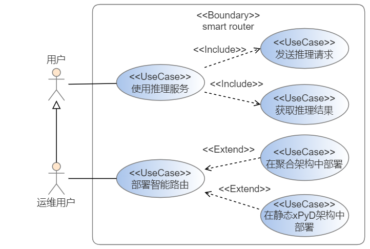
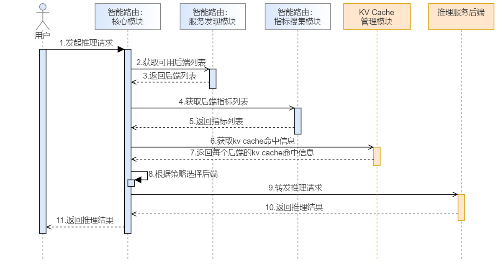
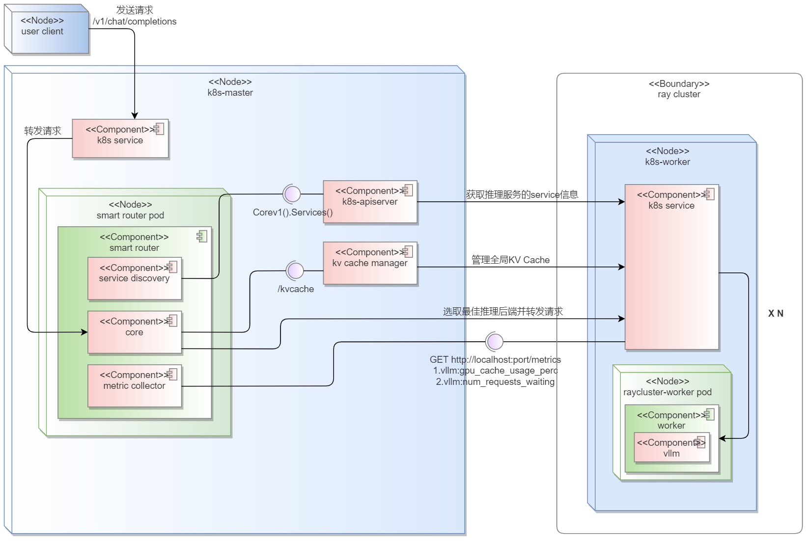
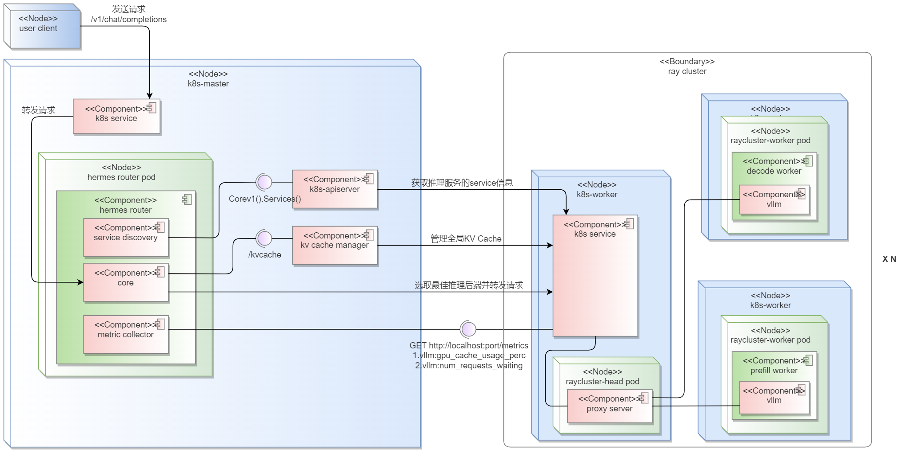
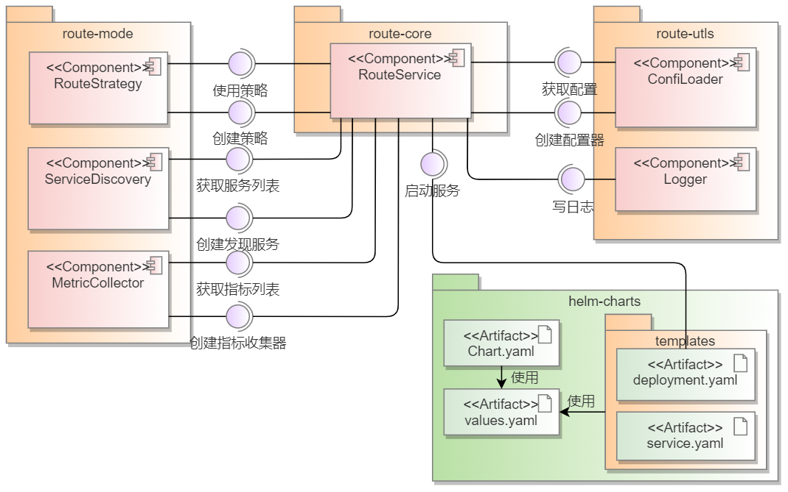
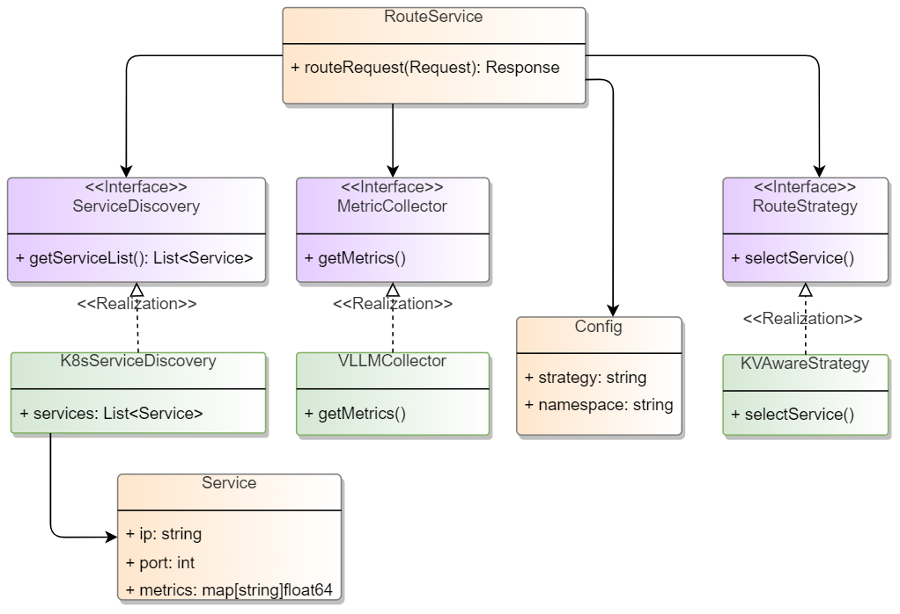

---
# 提案标题
title: oFEP AI推理智能路由hermes-router
# 提案编号
ofep-number: 0011
# 提案作者
authors:
  - "@qinwenzh"
# 提案主导SIG
owning-sig: sig-ai-inference
# 提案协作SIG
participating-sigs:
# 提案状态(初步草案|准备开始实现|已在SIG中实现并合并|提案被暂缓|提案被否决|作者主动撤回提案|被另一个oFEP取代)
status: provisional
# 创建日期
creation-date: 2025-07-24
# 评审人
reviewers:
  - TODO
# 批准人
approvers:
  - TODO
# 相关联的其他oFEP
see-also:
  - TODO
# 当前oFEP替代了哪些已有提案
replaces:
  - TODO
# 当前oFEP被哪些提案替代，当status为replaced时需要填写此字段
replaced-by:
  - TODO
# 此oFEP当前开发阶段
stage: alpha|beta|stable
# 最近一次推进的版本
latest-milestone: TODO
# 各阶段目标版本
milestone:
  alpha: TODO
  beta: TODO
  stable: TODO
# 功能开关及影响组件
feature-gates:
  - name: TODO
    components:
      - TODO
      - TODO
# 是否支持关闭该功能
disable-supported: true
# 该功能引入的监控指标
metrics:
  - TODO
---

# oFEP-hermes router：AI推理智能路由

<!-- vscode-markdown-toc -->
* 1. [发布签核清单](#)
* 2. [概括](#-1)
* 3. [动机](#-1)
	* 3.1. [目标](#-1)
	* 3.2. [非目标](#-1)
* 4. [用户故事](#-1)
	* 4.1. [故事 1：使用推理服务](#1)
	* 4.2. [故事 2：在聚合推理架构中部署智能路由](#2)
	* 4.3. [故事 3：在静态xPyD架构中部署智能路由](#3xPyD)
	* 4.4. [注释/限制/注意事项](#-1)
	* 4.5. [风险与缓解措施](#-1)
* 5. [设计细节](#-1)
	* 5.1. [规格细节](#-1)
		* 5.1.1. [开发规格](#-1)
		* 5.1.2. [软件依赖](#-1)
		* 5.1.3. [硬件规格](#-1)
	* 5.2. [5.2 路由策略](#-1)
		* 5.2.1. [路由策略：KV Cache Aware](#KVCacheAware)
		* 5.2.2. [路由策略：Round robin](#Roundrobin)
	* 5.3. [5.3. 开发视图](#-1)
	* 5.4. [5.4. 逻辑视图](#-1)
	* 5.5. [测试计划](#-1)
		* 5.5.1. [先决条件测试更新](#-1)
		* 5.5.2. [单元测试](#-1)
		* 5.5.3. [集成测试](#-1)
		* 5.5.4. [e2e 测试](#e2e)
	* 5.6. [毕业标准](#-1)
		* 5.6.1. [Alpha 阶段](#Alpha)
		* 5.6.2. [Beta 阶段](#Beta)
		* 5.6.3. [GA 阶段](#GA)
	* 5.7. [升级/降级策略](#-1)
	* 5.8. [版本倾斜策略](#-1)
* 6. [生产可用性审查](#-1)
	* 6.1. [功能启用和回滚](#-1)
	* 6.2. [推出、升级和回滚规划](#-1)
	* 6.3. [监控要求](#-1)
	* 6.4. [依赖项](#-1)
	* 6.5. [可扩展性](#-1)
	* 6.6. [故障排除](#-1)
* 7. [实施历史](#-1)
* 8. [缺点](#-1)
* 9. [替代方案](#-1)
* 10. [所需基础设施（可选）](#-1)

<!-- vscode-markdown-toc-config
	numbering=true
	autoSave=true
	/vscode-markdown-toc-config -->
<!-- /vscode-markdown-toc -->


##  1. <a name=''></a>发布签核清单
标记有（R）的项目*在达到里程碑/发布*之前是必需的。
- [ ]（R）发布里程碑中的增强问题，链接到 [openfuyao/ofep] 中的 oFEP 目录
- [ ] (R) oFEP 审批者已批准 oFEP 状态为“可实施”
- [ ] (R) 设计细节已适当记录
- [ ]（R）测试计划已到位，并考虑了 SIG 架构和 SIG 测试的输入（包括测试重构）
  - [ ] 针对所有 Beta API 操作（端点）进行 e2e 测试
  - [ ] (R) 确保 GA e2e 测试满足一致性测试的要求
  - [ ] (R) GA e2e 测试至少需要两周时间才能证明测试结果无 flake（不稳定或偶发失败）
- [ ] (R) 毕业标准已设定
  - [ ] (R) 所有 GA 端点必须通过[一致性测试]
- [ ] (R) 生产准备情况审查完成
- [ ] (R) 生产准备情况审查已获批准
- [ ] “实施历史”部分已更新里程碑
- [ ] 面向用户的文档已在 [openfuyao/docs] 创建，以便发布到 [openfuyao.com]
- [ ] 支持文档 - 例如，额外的设计文档、邮件列表讨论/SIG 会议链接、相关 PR/问题、发行说明

- [openfuyao.com](https://openfuyao.com/)
- [openfuyao/ofep](https://gitcode.com/openfuyao/ofep)
- [openfuyao/docs](https://gitcode.com/openfuyao/docs)

##  2. <a name='-1'></a>概括
本提案提出一个kubernetes原生的AI推理智能路由方案，该智能路由的核心能力是接收用户推理请求并转发至合适的推理服务后端，通过感知全局KV Cahce与支持PD分离架构达到优化推理效率的目的。

智能路由在设计上解耦配置加载、服务发现、指标收集与路由策略等模块，使得系统功能可组合、易维护；通过工厂模式与策略模式使得模块扩展符合开闭原则，支持后续推理路由策略迭代更新。

##  3. <a name='-1'></a>动机

AI推理是AI领域中将模型转化为业务价值的核心技术，体现AI技术的应用效果与商业价值。路由在AI推理中承担着智能调度的角色，直接影响推理效率、资源利用率与服务稳定性。

本提案的智能路由设计旨在推动openFuyao社区在云原生场景的AI推理优化。

###  3.1. <a name='-1'></a>目标

本提案关注AI推理场景下的路由策略，不包含网关能力，后续计划以插件形式与成熟开源网关（Envoy Gateway、Istio等）集成，以具备生产环境中的完整网关能力。

- 实现面向k8s环境的智能路由架构，实现路由基本能力，能够端到端处理用户请求；
- 支持用户自由配置路由的后端架构与路由策略；
- 实现K8s+ray环境下的服务发现功能，支持系统获取集群可用后端列表；
- 实现K8s+ray环境下的指标采集功能，支持系统获取推理后端负载指标；
- 实现日志功能，支持查看智能路由运行状况；
- 支持智能路由以helm形式在k8s环境部署；
- 支持传统聚合推理架构；
- 支持静态xPyD推理的架构；
- 实现KV Cache Aware的、具备负载均衡能力的路由策略；

###  3.2. <a name='-1'></a>非目标

- AI训练场景的智能路由：本提案针对AI推理场景进行路由相关优化，不考虑AI训练场景。
- 数据持久化存储能力：本提案的智能路由关注请求转发与后端服务选取，所需数据来自配置文件或外部接口，无持久化存储数据的需求。

##  4. <a name='-1'></a>用户故事

智能路由用户视图如下所示：



###  4.1. <a name='1'></a>故事 1：使用推理服务
**故事内容**

作为使用AI推理服务的用户，我能够向指定URL地址发送推理请求并获取推理结果，以便我使用AI模型解决问题。

**运行视图**

该故事为智能路由的业务逻辑，系统运行视图如下：



时序图的起点为用户发起推理请求，在此之前智能路由已完成初始化，下面首先对初始化阶段进行介绍：

1. 智能路由读取用户的后端配置和路由策略；
2. 启动服务发现模块，周期性发现并更新后端列表；
3. 启动指标收集模块，周期性发现并更新后端负载指标；

下面是每次收到用户推理请求的处理流程：

1. 接收推理请求：用户发送推理请求（1）；
2. 获取后端列表：调用服务发现模块，获取当前最新的可用后端列表（2、3）；
3. 获取后端指标：调用指标收集模块，获取当前最新的后端指标信息（4、5）；
4. 获取KV Cache匹配信息：调用KV Cache管理模块，获取每个后端对推理请求匹配程度（6、7）；
5. 选择后端：根据用户配置的路由策略选择后端（8）；
6. 转发推理请求：将推理请求转发至选定的后端（9）；
7. 响应返回：获取后端服务推理结果，并以标准openAI响应格式返回用户（10、11）。

**故事流程**

下面介绍用户视角的故事流程：

1. 获取路由入口url，入口url由智能路由地址和推理uri，以常见的OpenAI推理uri为例：
```
https://\<smart-rouyer\>/v1/chat/completions
```
2. 构造推理请求，以json格式为例：
```json
{
  "model": "model name", 
  "messages": [               
    {
      "role": "user",         
      "content": "请介绍openFuyao开源社区"
    },
  ],
  "stream": true
}
```
3. 发送推理请求，以cURL为例：
```bash
curl https://\<smart-rouyer\>/v1/chat/completions \
  -H "Content-Type: application/json" \
  -H "Authorization: Bearer YOUR_API_KEY" \
  -d '{
    "model": "model name",
    "messages": [{"role": "user", "content": "请介绍openFuyao开源社区"}]
    "stream": true
  }'
```
4. 获取推理结果响应：当推理请求中`stream`设为`false`时一次性返回完整结果，为`true`时会逐块返回结果，每块都是以`data:`开头的json对象。

###  4.2. <a name='2'></a>故事 2：在聚合推理架构中部署智能路由

**故事内容**

作为AI推理服务的运维用户，我能够在k8s+ray部署的聚合架构中部署智能路由，以支持后端对外提供推理服务。

**部署视图**

本提案的部署有如下特点：

- k8s service为最小推理服务单位，而非具体pod。这是因为单个pod最多提供8张卡，当大模型来到70B以上时会出现需要多个pod承载的情况，而无论是单pod还是多pod，对外都是通过一个k8s service服务暴露。




**故事流程**

在本故事中，用户需要对智能路由、ray cluster以及推理服务的service进行配置，其中ray cluster中的推理服务各自通过k8s的service对象对外暴露，以支持智能路由进行服务发现。

1. 智能路由相关配置

    智能路由应用配置包含路由策略、kv cache全局管理器、服务发现以及指标收集四个部分。

    其他配置项包括镜像、service资源、serviceAccount权限资源、deployment资源以及configMap资源，这些资源属于k8s环境资源，用户只需关心values.yaml中暴露出的配置参数。

```yaml
# values.yaml
# 镜像配置
image:
  repository: harbor.openfuyao.com/openfuyao/hermes-router
  tag: "latest"
  pullPolicy: IfNotPresent

# service配置
service:
  type: NodePort
  port: 8099
  targetPort: 8099
  nodePort: 31099

# 资源配置
resources:
  limits:
    cpu: 1000m
    memory: 1Gi
  requests:
    cpu: 500m
    memory: 512Mi

# hermes-router应用配置
app:
  namespace: "ai-inference" # 命名空间
  strategy: "kv-aware" # 路由策略
  timeout: 120 # 非流式响应超时时间

  # 服务发现配置
  discovery:
    type: "k8s-service"
    interval: 5  # 服务发现刷新间隔，单位为秒
    labelSelector:
      app: vllm-inference  # 仅发现携带此标签的服务
    inferenceEngine: "vllm"  # 推理引擎类型
    inferencePort: 8000 # 推理端口
    timeout: 10 # 服务发现超时时间，单位为秒
  
  # 指标收集配置
  collector:
    type: "vllm"
    interval: 5  # 指标发现刷新间隔，单位为秒
    timeout: 10 # 指标发现超时时间，单位为秒
    metrics: # 捕获的指标列表
      - vllm:gpu_cache_usage_perc
      - vllm:num_requests_waiting
  
  # KV Cache管理器配置
  kvmanager:
    url: "http://10.96.xxx.xxx" # 
    port: 8080
    matchPath: "/match_sort"
    timeout: 10 # 请求超时时间，单位为秒

# 服务账户配置
serviceAccount:
  create: true
  name: "hermes-router"
  
# 副本数
replicaCount: 1

# 配置文件挂载
configMap:
  enabled: true
  name: "hermes-router-config"
  mountPath: "/app/config"
  configFileName: "config.yaml"
```

2. ray cluster集群配置
```yaml
# ray cluster crd
apiVersion: ray.io/v1alpha1
kind: RayCluster
metadata:
  name: my-ray-cluster
  namespace: ai-inference  # 与路由配置中的namespace一致
...
spec:
  workerGroupSpecs:
    - replicas: 3
     groupName: workers
      template:
        spec:
          containers:
            - name: ray-worker
              ...
              # vLLM推理服务配置
              labels:
                app: vllm-inference
                model: model-name
                ray.io/cluster: my-ray-cluster
                ray.io/node-type: worker 
```
3. raycluster集群中推理服务对应的k8s service配置

    raycluster默认仅为head pod配置k8s service，统一对外暴露服务。本提案在部署设计中为worker pod同样配置了k8s service，将其作为独立推理服务暴露；

```yaml
# ray cluster/k8s service
apiVersion: v1
kind: Service
metadata:
  name: vllm-service 
  namespace: ai-inference
  # Service标签
  labels:
    service-type: vllm-model
    model: model-name
spec:
  selector:
    app: vllm-inference
    model: model-name
    ray.io/cluster: my-ray-cluster
    ray.io/node-type: head
  ports:
    - protocol: TCP
      targetPort: 8000  # 推理服务暴露的端口 
      ... 
```
4. 配置完成后在k8s环境中通过ray部署推理引擎后端与kv cache全局管理器，并通过helm部署智能路由，待二者就绪后即可使用推理服务。本提案主要呈现设计，不对部署流程进行详细描述。

###  4.3. <a name='3xPyD'></a>故事 3：在静态xPyD架构中部署智能路由

作为AI推理服务的运维用户，我能够在k8s+ray部署的、静态xPyD架构的推理后端中部署智能路由，以支持后端对外提供推理服务。

**部署视图**

本提案支持的静态xPyD部署参考Mooncake方案，需要满足以下要求：

- 路由仅感知Proxy server，不感知Prefill/Decode worker，PD分离的决策由Proxy server执行。



**故事流程**

静态xPyD场景下的智能路由部署与聚合场景下无明显区别，用户仅需为ray cluster中的Proxy server配置k8s service，将整个PD分离推理后端作为单个推理服务暴露。

###  4.4. <a name='-1'></a>注释/限制/注意事项

- 当前仅支持纯文本的推理内容：多模态推理涉及到额外的内容编解码，暂不适合kv aware路由策略。
- 不提供针对推理请求的认证、容错等网关能力；网关相关能力在后续规划中，计划由开源网关项目提供。
- 暂不支持OpenAI API之外的接口风格：本提案关注路由过程，推理接口优先采用业界标准。
- 暂不支持vLLM之外的推理引擎：考虑到社区生态与异构算力支持，推理引擎优先采用vLLM。

###  4.5. <a name='-1'></a>风险与缓解措施

- 风险1：在安全准入方面，未提供针对推理请求的认证能力，任何用户均可发送推理请求，导致集群计算资源被恶意占用。同时未提供针对推理请求的内容审核，用户可能发送不当内容或恶意注入请求，导致敏感信息泄露或系统数据被窃取/篡改。
  
  缓解措施：避免将推理服务入口暴露给无关用户。

##  5. <a name='-1'></a>设计细节
考虑到AI推理场景技术的多样性与快速迭代性，本提案采用工厂模式和策略模式以支持路由模块在未来灵活扩展。

###  5.1. <a name='-1'></a>规格细节
规格细节为本提案中智能路由正确运行与部署的软硬件规格。

####  5.1.1. <a name='-1'></a>开发规格
| 开发工具 | 描述          | License      | 版本   |
|----------|-------------|--------------|--------|
| go       | 编程语言      | BSD-3-Clause | 1.24.5 |
| Gin      | 高性能web框架 | MIT          | 1.10.1 |

####  5.1.2. <a name='-1'></a>软件依赖

| 软件        | 描述                                   | License      | 版本         |
|-------------|--------------------------------------|--------------|--------------|
| Mooncake    | 提供多级KV Cahce与LLM KV Cache管理能力 | Apache-2.0   | 0.3.5        |
| vLLM        | LLM推理引擎                            | Apache-2.0   | 0.10.0       |
| cache-index | 全局KV Cache管理组件                   | MulanPSL-2.0 | 0.0.0-latest |

其中：
- Mooncake代表KV Cache管理组件，可以提供相同功能接口的开源工具替代；
- 由于当前Mooncake开源版本暂未提供全局KV Cache查询能力，本提案使用openFuyao社区的cache-index组件提供该能力，以支持KV cache aware路由策略。
- vLLM通过`/metrics`接口提供prometheus风格的指标查询服务，智能路由查询后从返回体过滤出目标指标，进行负载均衡的路由决策。

在昇腾k8s环境使用ray部署后端时有如下依赖：

| 软件             | 描述                                 | License      | 版本         |
|------------------|------------------------------------|--------------|--------------|
| ray              | 分布式计算框架                       | Apache-2.0   | 2.48.0       |
| kuberay-operator | k8s ray应用部署与管理工具            | Apache-2.0   | 1.4.0        |
| npu operator     | openFuyao组件，k8s Ascend NPU管理工具 | MulanPSL-2.0 | 0.0.0-latest |
| vllm-ascend      | vllm 昇腾NPU适配插件                 | Apache-2.0   | 0.10.0RC1    |

####  5.1.3. <a name='-1'></a>硬件规格

智能路由本身无硬件规格要求。
###  5.2. <a name='-1'></a>5.2 路由策略
####  5.2.1. <a name='KVCacheAware'></a>路由策略：KV Cache Aware

**原理**：对于一个推理请求，综合考虑推理服务的KV Cache匹配度以及负载情况进行选择，在提高请求间KV Cache利用率的同时避免出现路由集中到少数几个推理服务的极端情况。

**功能边界1：服务发现模块与指标收集模块**

kv aware路由策略由类图中的KVAwareStrategy类实现，核心为selectService方法，该方法的go函数与关键类的定义如下：
```go
type Service struct {
	Name           string             // 推理服务名称
	NameSpace      string             // 命名空间
	IP             string             
	Port           int                
	Metrics        map[string]float64 // 指标字典，存储{指标名: 指标值}
	KVCacheHitRate float64            // kv cache 命中率
	Score          float64            // 得分
}

func (k *KVAwareStrategy) SelectService(
  request Request,
  serviceList []Service) *service.Service
```
其中：
- `Request`为AI推理请求结构体，主要使用请求中的AI推理内容；
- `Service`为后端推理服务结构体，其中`IP:Port`为推理服务所属k8s service的URL；本提案通过vLLM服务提供的`\metrics`接口获取`xpuCacheUsage`和`waitingRequests`两种指标。
  ```
  GET http://<vLLM k8s service地址>:<端口号>/metrics
  ```

**功能边界2：KV Cache匹配情况查询**

kv aware路由策略需要对每个请求从全局KV Cache管理服务（简称Cache服务）获取每个可用后端的KV Cache匹配度，因此需要Cache服务提供如下接口：

```
POST http://<Cache服务地址>:<端口号>/match_sort
```
该接口的入参为：
- `serverList`:后端服务实例列表；
- `request`：原始推理请求，这里将tokenizer放到Cache服务中进行。

该接口的响应至少需包括：
- `kvcahceBlockList`：与`serverList`对应，为每个后端服务实例命中的KV Cache块数。

**算法流程：**

1. 从参数中获取可用推理服务列表`serviceList`；
2. 从Cache服务的`/match_sort`接口获取每个推理实例命中的KV Cahce Block数量`kvcahceBlockList`
3. 每个后端推理服务的`xPUCashUsage`指标（xPU缓存使用率）和`waitingRequsts`指标（等待请求数量）
4. 根据得分函数计算出`serviceList`中每个推理实例`Service`的得分`Score`
5. 选择得分最佳的推理实例，返回给路由主流程

**得分函数设计**：

本提案的KV Aware得分函数设计如下：
$$
L_{i}=\frac{num^{i}_{reqBlock}-num^{i}_{matchBlock}}{num^{i}_{reqBlock}}+xpuCacheUsage+\frac{w^{i}}{max(w)}
$$
$$
num^{i}_{reqBlock}=ceil(请求token总数/vllm单块缓存token数量)
$$
其中：
- $num^{i}_{reqBlock}$：当前请求对应的KV Cache总块数
- $num^{i}_{matchBlock}$：当前请求在第i个推理服务上匹配的KV Cache块数
- $xpuCacheUsage$：xPU缓存使用率
- $w^{i}$：第i个推理服务中处于等待状态的请求数量
- $max(w)$为当前`serviceList`中处于等待状态的请求数量最大值

在该公式中，总得分越低，该后端的优先级越高。当多个后端获得相同得分时，通过随机算法选取其中一个后端返回。

####  5.2.2. <a name='Roundrobin'></a>路由策略：Round robin

该路由策略的用途是作为性能测试的对比基线。

**原理：** 按照固定顺序依次从推理服务列表中选择，确保请求在推理服务间均匀分配。

**设计：**

包含内部状态变量current_index（当前选中的推理服务索引），用于记录轮询位置。

**算法流程：**

1. 初始化时，current_index设为-1

2. 获取可用服务列表`serviceList`

3. 更新current_index：(current_index + 1) % 后端列表长度。这里考虑到后端可能新增或减少，需要避免访问越界。

4. 选择current_index对应的服务返回

###  5.3. <a name='-1'></a>5.3. 开发视图



###  5.4. <a name='-1'></a>5.4. 逻辑视图



###  5.5. <a name='-1'></a>测试计划

####  5.5.1. <a name='-1'></a>先决条件测试更新
<!--
根据评审者的反馈，描述在实施此项增强功能之前需要补充哪些额外的测试，以确保该增强特性也具备稳固的基础。
-->
- 需补充路由配置读取解析测试，覆盖无效配置（如不存在的路由模式、策略冲突）的错误处理场景，确保配置加载失败时输出明确日志。

- 完善推理请求的异常处理测试，包括后端服务超时、连接失败等场景，验证只能路由是否能正确捕获异常并返回友好错误

####  5.5.2. <a name='-1'></a>单元测试
<!--
原则上，所有新增的代码都应具有完整的单元测试覆盖率，因此列出确切的测试项并不会带来额外价值。
但如果无法实现完整的单元测试覆盖，请说明原因，并解释为何在这种情况下这是可以接受的。
-->
所有新增代码将实现50%以上的单元测试覆盖率，重点覆盖路由模式与路由策略的核心逻辑。
<!--
此外，对于 Alpha 阶段，请尽量列出为了实现该增强功能将涉及的核心包（core package），并提供这些包当前的单元测试覆盖率，格式如下：
- <软件包>: <日期> - <当前测试覆盖率>
这可以帮助我们在扩展生产代码、实施该增强功能之前，识别并推进某些测试覆盖率的改进工作。
-->


####  5.5.3. <a name='-1'></a>集成测试
<!--
集成测试允许控制用于启动被测二进制文件的配置参数。
这与不允许配置参数的 e2e 测试不同。
这样做可以测试非默认选项以及多个不同的、可能冲突的命令行选项。

如果集成测试不是必要的或有用的，请解释原因。
-->

<!--
当准备将功能纳入某个正式版本时，需要填写此问题。
- 对于 Alpha 阶段，请描述将添加哪些测试，以确保该增强功能具备良好的质量保障。
- 对于 Beta 和 GA 阶段，需要记录测试已经编写、被定期执行，且结果稳定。

你可以通过以下方式提供相关证明：
- 指向 gitcode 源代码的永久链接
- 指向定期测试作业的链接，并按测试名称过滤
- 在 openfuyao 缺陷追踪工具中进行搜索。
-->

- 推理服务后端动态变更测试：模拟后端服务上下线，验证路由是否能实时感知并更新路由目标。

####  5.5.4. <a name='e2e'></a>e2e 测试
<!--
当该功能计划纳入某个正式版本时，应填写此问题。
- 对于 Alpha 阶段，请描述将添加哪些测试，以确保该增强功能具备良好的质量保障。
- 对于 Beta 和 GA 阶段，需要说明测试已经编写、被定期执行，且结果稳定。

可通过以下方式提供证明材料： 
- 指向 gitcode 源代码的永久链接
- 指向定期测试作业的链接，并按测试名称过滤
- 在 openfuyao 缺陷追踪工具中进行搜索。

作为进入 GA（正式可用）阶段的标准，我们期望过去一个月内不存在任何非基础设施相关的 flaky 测试（不稳定测试）。
如果你认为无需添加端到端测试（e2e），请解释其原因及合理性。
-->

- 并发转发测试：单节点网关模拟每秒100+请求，验证路由准确性与响应延迟。

###  5.6. <a name='-1'></a>毕业标准
<!--
> **注意：** *在功能尚未计划纳入某个正式版本时，本节无需填写。*
> 请在此处定义该功能的毕业（Graduation）里程碑。
> 毕业条件可以基于 API 成熟度、[Feature Gate] 的推进阶段，或其他方式来定义。此处应保持高层次，重点说明评估是否可以毕业时将参考哪些信号（信心指标）。
> 在制定毕业标准时，请参考以下内容：
> - [成熟度等级（`alpha`、`beta`、`stable`）]
> - [Feature Gate 生命周期][feature gate]
> - [弃用政策][deprecation-policy]
> 请明确说明“毕业”的定义。
> 通常我们倾向于无论功能通过何种方式访问，均采用相同的阶段划分（alpha、beta、GA）。
-->
####  5.6.1. <a name='Alpha'></a>Alpha 阶段
- 核心路由功能可用：支持聚合模式与 PD 分离模式的基本路由逻辑，实现kv cache aware、round robin两种路由策略
- 完成初步的端到端测试，覆盖基本路由流程（请求接收→服务选择→转发→响应返回）
- 支持通过K8s YAML配置文件加载路由模式与策略，配置解析逻辑稳定
- 提供详细的路由日志（包含模式、策略、选中的服务信息），便于问题排查
- 明确文档化已知限制（如不支持认证、限流等高级功能）

####  5.6.2. <a name='Beta'></a>Beta 阶段
- 收集开发者/用户的使用反馈并处理
- 核心功能完善：
  - 聚合模式与PD分离模式无重大功能缺陷；
  - 路由策略稳定运行，能够在较长时间（如1天）内正确选取合适后端；
  - 满足用户故事中描述的开发者与运维工程师需求
- 补充测试覆盖：
  - 压力测试：单节点路由支撑100+QPS并发
  - 故障注入测试：模拟后端服务下线/超时，后续请求不再转发到故障后端；
- 文档齐全：包含用户手册、配置指南、故障排查手册等；

####  5.6.3. <a name='GA'></a>GA 阶段
- 至少1个生产环境成功部署案例
- 用户反馈积极，核心功能（模式切换、策略选择）满足业务需求，无阻塞性问题
- 性能达标：在生产环境中稳定支撑设计目标
- 文档完善：包含最佳实践（如模式选择建议、策略调优指南）、升级指南、常见问题解答
- 长期运行稳定性：连续30天运行中，服务可用性≥99.9%，路由逻辑无内存泄漏或资源泄露
- 升级路径平滑：从Beta版本升级至GA版本无需修改配置文件，数据兼容

###  5.7. <a name='-1'></a>升级/降级策略
<!--
> 指导提案人在功能设计时兼顾向前兼容性、配置迁移、Feature Gate 管理等问题。
-->
<!--
如果适用，该组件在升级和降级时将如何处理？请确保在测试计划中包含这部分内容。

在制定该增强功能的升级/降级策略时，请考虑以下问题：
- 为了保持现有行为不变，集群在升级时是否需要进行调用方式、配置或 API 使用上的任何更改？
- 为了使用该增强功能，集群在升级时是否需要对调用方式、配置或 API 使用做出调整？
-->
暂不涉及。
###  5.8. <a name='-1'></a>版本倾斜策略
<!--
确保你的提案在 openfuyao 集群中升级时能够兼容不同版本组件之间的运行差异。
-->
<!--
如果适用，该组件在面对与其他组件的版本不一致（version skew）时将如何处理？有哪些兼容性保证？请确保在测试计划中包括这一部分。

在为此增强功能制定版本偏差应对策略时，请考虑以下问题：
- 该功能是否涉及控制面（Control Plane）与节点（Node）之间的协同行为？
- 当使用该功能时，版本落后三个版本（n-3）的 kubelet 或 kube-proxy 会如何表现？
- 当使用该功能时，版本落后一个版本（n-1）的 kube-controller-manager 或 kube-scheduler 会有何行为？
- 节点上的其他组件是否会发生变更？ 例如，CSI（容器存储接口）、CRI（容器运行时接口）或 CNI（容器网络接口）是否需要在 kubelet 之前被更新？
-->
暂不涉及
##  6. <a name='-1'></a>生产可用性审查
<!--
**生产可用性审查（Production Readiness Review，PRR）** 的目的是确保即将合并到 openfuyao 中的功能：
- 可观测（observable）、可扩展（scalable）、可支持（supportable）；
- 能在生产环境中安全运行；
- 在出现故障时能够被禁用或回滚。

**要使 oFEP 进入 `implementable` 状态并被纳入发布版本，必须完成并通过生产可用性审查问卷（PRR Questionnaire）。**

在某些情况下，元数据中也应包含这些问题的答案：
- 这样可以便于自动化工具验证是否进行了审查；
- 同时有助于减少评审负担并降低审查延迟。
-->

###  6.1. <a name='-1'></a>功能启用和回滚
<!--
当针对 alpha 版本发布时，必须完成此部分。
-->
###### 如何在实时集群中启用/禁用此功能？
<!--
选择其中一个并删除其余的。
-->
本提案的智能路由为集群应用，通过部署/卸载来启动/禁用相关功能。

###### 启用该功能会改变任何默认行为吗？
<!--
任何默认行为的变更都可能让用户感到意外，或破坏现有的自动化流程，因此在这方面必须格外小心。
-->
不会改变任何默认行为。

###### 该功能一旦启用，是否可以禁用（即我们可以回滚启用）？
<!--
**请描述该功能对现有工作负载可能造成的影响**（例如，如果这是一个运行时特性，它是否可能破坏现有应用程序的行为？）。

通常，通过将功能开关（Feature Gate）设置为 `false` 并重启相应组件，即可禁用该功能。除这个操作之外，不应再需要其他变更来完成禁用。

**注意：**在元数据中，也请将 `disable-supported` 字段设置为 `true` 或 `false`。
-->
可以禁用。
###### 如果该功能之前已回滚，现在我们重新启用它会发生什么情况？
不会产生影响。

###### 是否有任何针对功能启用/禁用的测试？
<!--
当前的端到端测试框架（e2e framework）**尚不支持启用或禁用 Feature Gate**。  
然而，对于处理数据的每个组件，必须编写包含**启用和未启用该功能场景的单元测试**。

如果该功能修改了 API 类型，**至少应该考虑添加转换测试（conversion tests）**。

此外，如果该功能引入了新的 API 字段，**还必须编写测试 Feature Gate 开关行为的单元测试**——也就是验证以下情形：  
- “当我先启用 Feature Gate 并写入了包含新字段的对象后，随后将其禁用，会发生什么？”
-->
有针对智能路由配置文件正确性的测试。
###  6.2. <a name='-1'></a>推出、升级和回滚规划
<!--
当该功能计划从 Beta 阶段发布至正式版本时，必须填写本节内容。
-->

###### 部署或回滚为何会失败？这会影响正在运行的工作负载吗？
<!--
**尽可能保持警觉和审慎**——例如，假设在发布过程中某些组件会中途重启，会发生什么？

请务必考虑以下场景：
- **高可用（HA）集群**：在该场景下，功能开关（Feature Flag）可能仅在部分 API Server 上启用，而其他仍为禁用状态；
- **大型集群**：在这种情况下，功能的启用/禁用可能会分批分节点地推进，需考虑该过程中的一致性与兼容性问题。
-->
暂不涉及。
###### 哪些具体指标应该通知回滚？
<!--
当该功能还处于早期阶段时，用户应关注哪些信号，以便及早发现可能存在的严重问题？
-->
暂不涉及。
###### 升级和回滚测试了吗？升级->降级->升级的路径测试了吗？
<!--
请描述已完成的手动测试及其结果。
从长远来看，我们可能会要求实施自动化的升级/回滚测试，但目前我们仍缺少相关的机制和工具，因此暂时无法实现。
-->
暂不涉及。
###### 推出时是否伴随任何功能、API、API 类型的字段、标志等的弃用和/或删除？
<!--
即使应用弃用政策，仍可能会让一些用户感到惊讶。
-->
暂不涉及。
###  6.3. <a name='-1'></a>监控要求
<!--
当计划将功能从 Beta 阶段纳入某个正式版本（release）时，必须完成此部分内容。
对于 GA（正式可用）阶段，该部分也是必须填写的：审批人应能够基于实际生产环境中的经验，确认之前各项回答的准确性。
-->
暂不涉及。
###### 操作员如何确定该功能是否正在被工作负载使用？
<!--
理想情况下，应使用指标（metric）来实现。
通过对 Kubernetes API 的操作（例如检查是否存在设置了字段 X 的对象）应作为最后手段。
请避免将日志或事件用于此目的。
-->
暂不涉及。
###### 使用此功能的人如何知道它适用于他们的实例？
<!--
例如，如果这是一个与 Pod 相关的功能，则应能够针对每个 Pod 确定该功能是否正常工作。
请从以下选项中选择一项并删除其余内容。
请在下方详细描述所有对最终用户可见的内容，确保他们能够验证该功能是否已正确启用并正常运行。
> 请注意：最终用户通常无法查看组件日志或访问系统指标（metrics）。
-->
暂不涉及。

###### 增强的合理 SLO（服务级别目标）是什么？
<!--
这是你定义该功能“正常服务质量”（Quality of Service，QoS）表现的机会。
我们无法提供全面的指导，但从高层角度来看（还需要更精确定义），这些表现可能包括：
- 每天返回 5XX 错误的 API 调用比例 ≤ 1%  
- CronJob 的任务实际创建时间与预期创建时间之差的绝对值在一天内的 99 百分位 ≤ 10%  
- 每天 99.9% 的 `/health` 请求返回 HTTP 200 状态码  

这些目标将有助于你在下一个问题中确定需要衡量的服务指标（SLIs）。
-->
暂不涉及。
###### 运维人员可以使用哪些服务级别指标（SLIs）来判断服务的健康状况？
<!--
请选择以下选项中的一个，并删除其余内容。
-->
暂不涉及。
###### 是否存在任何尚未覆盖的指标（metrics），可以用来进一步提升该功能的可观测性？
<!--
请描述这些指标本身，以及未添加它们的原因（例如：成本高、实现复杂等）。
-->
暂不涉及。
###  6.4. <a name='-1'></a>依赖项
<!--
当计划将该功能从 Beta 阶段纳入某个正式版本（release）时，必须完成本节内容。
-->
###### 此功能是否依赖于集群中运行的任何特定服务？
<!--
请同时考虑集群级别的服务（例如 metrics-server）以及节点级别的代理（例如某个特定版本的 CRI）。  
重点关注该功能所依赖的 **外部或可选服务**。  
例如，如果该功能依赖云服务商的 API、或外部的软件定义存储（SDS）或网络控制面板等服务，则应明确列出。

对于每一项依赖项，请填写以下内容：
- 当前用户工作负载的运行情况  
- 新建工作负载的创建情况  
- 集群级别的服务（例如 DNS）

填写格式如下：
```
- [依赖项名称]
  - 使用说明：
    - 若该服务发生中断，对该功能的影响：
    - 若该服务性能下降或错误率升高，对该功能的影响：
```
-->
暂不涉及。
###  6.5. <a name='-1'></a>可扩展性
<!--
对于 Alpha 阶段，鼓励填写本节内容：评审人员应考虑这些问题，并尝试给出回答。
对于 Beta 阶段，本节为必填项：评审人员必须回答这些问题。
对于 GA（正式发布）阶段，本节同样为必填项：审批人员应能根据实际生产经验，确认之前给出的所有回答。
-->
暂不涉及。
###### 启用/使用此功能会导致任何新的 API 调用吗？
<!--
**请描述相关 API 调用，包括以下信息：**
- **API 调用类型**（例如：`PATCH pods`）  
- **预估调用频率（吞吐量）**  
- **调用发起组件**（例如：`Kubelet`、`Feature-X-controller`）

重点关注以下场景：
- **组件开始列出（list）或监听（watch）以前未处理的资源**
- **某些 Kubernetes 资源发生变化后，触发新的 API 请求行为**  
  例如：更新对象 X 后又触发了对对象 Y 的修改或创建
- **用于状态对齐（state reconciliation）的定期 API 请求**  
  例如：周期性获取资源状态、心跳上报、领导者选举等
  -->
暂不涉及。
###### 启用/使用此功能是否会导致引入新的 API 类型？
<!--
请描述它们（指代 API 对象或资源），并提供以下信息：
- **API 类型**（API type）  
- **每个集群支持的最大对象数量**
- **每个命名空间支持的最大对象数量**（仅适用于具备命名空间作用域的对象）
-->
暂不涉及。
###### 启用/使用此功能是否会导致对云提供商的任何新的 API 调用？
<!--
请进行如下描述：
- **涉及哪些 API：**  
- **预估调用增加量：**
-->
暂不涉及。
###### 启用/使用此功能是否会导致现有 API 对象的大小或数量增加？
<!--
**请描述新增或受影响的资源对象，提供以下信息：**
- **API 类型（API type(s)）：**  
- **预估对象体积增加量：**（例如：新增注解字段，大小为 32 字节）  
- **预估新增对象数量：**（例如：为每个现有 Pod 创建一个新的对象 X）
-->
暂不涉及。
###### 启用/使用此功能是否会导致现有 SLI/SLO 所涵盖操作的耗时增加？
<!--
请思考是否会新增额外操作或在现有流程中引入新的中间步骤（例如：为了启动一个容器，现在需要先执行步骤 X 等）。
请在下方详细描述这些新增内容。
-->
暂不涉及。
###### 启用/使用此功能是否会导致任何组件的资源使用率（CPU、RAM、磁盘、IO 等）不可忽略的增加？
<!--
需要注意的事项包括：
- 增加的内存状态（in-memory state）；
- 新引入的耗时计算操作；
- 频繁的磁盘访问（包括日志量增加）；
- 大量发送或接收的网络数据流量等。

请从小型和大型集群的不同规模角度，**全面评估这些资源消耗**，并结合 Kubernetes 的[支持上限（supported limits）](https://git.k8s.io/community/sig-scalability/configs-and-limits/thresholds.md)进行考量。
-->
暂不涉及。
###### 启用/使用此功能是否会导致某些节点资源（PID、套接字、inode 等）耗尽？
<!--
**请不要只关注理想情况，更重要的是评估异常或极端情况**，例如：
- 探针响应时间从毫秒级变成分钟级；
- 异常或失败的 Pod 持续占用资源等。

**如果该功能可能会导致某些资源被耗尽**，请说明：
- 如何通过 Kubernetes 已有的资源限制机制进行缓解（例如每节点最大 Pod 数）；
- 或该 oFEP 是否引入了新的限制来控制这些风险。

此外，还请说明：
- **是否已经进行了性能相关测试（或计划进行），用于更好地理解性能特征，并验证所声明的资源使用上限？**
-->
暂不涉及。
###  6.6. <a name='-1'></a>故障排除
<!--
**当该功能计划从 Beta 阶段发布至正式版本（release）时，本节必须填写。**

对于 **GA（正式发布）阶段**，本节同样为必填项：审批人员应能够根据实际生产环境中的经验，确认之前的各项回答。

当前的 **“排障（Troubleshooting）” 部分**，在功能发布流程中相当于临时承担了 **“运维手册（Playbook）”** 的角色。  
未来可能会将其拆分为一个专门的 `Playbook` 文档（可能还会包含一些监控信息）。但目前仍将其保留在此处。
-->
暂不涉及。
###### 如果 API 服务器和/或 etcd 不可用，此功能如何反应？
暂不涉及。

###### 其他已知故障模式有哪些？
<!--
**对于每种故障模式，请使用以下模板逐项填写信息：**
- **[故障模式简要描述]**  
  - **检测方式（Detection）：**  
    如何通过指标（metrics）检测该问题？换句话说：  
    操作人员**如何在不登录 master 或 worker 节点的情况下排障**？
  - **缓解手段（Mitigations）：**  
    尤其对于已在运行的用户工作负载，可采取哪些措施止血/减缓影响？
  - **诊断信息（Diagnostics）：**  
    有哪些有用的日志消息？其对应的**日志级别**（logging level）是多少？  
    ✅ *注：日志诊断信息在功能进入 Beta 阶段前可不填写。*
  - **测试情况（Testing）：**  
    针对该故障是否有测试用例？若无，请说明原因。
    -->
暂不涉及。
###### 如果未满足 SLO，应采取哪些步骤来确定问题？
暂不涉及。

##  7. <a name='-1'></a>实施历史
<!--
**在本节中应记录一个 oFEP 生命周期中的主要里程碑。**

可能包括但不限于以下内容：
- `摘要` 和 `动机` 部分被合并，表示 SIG 已接受该提案  
- `提案` 部分被合并，表示对设计方案达成一致  
- 实现工作的启动日期  
- 首个包含该 oFEP 初始版本的 openfuyao 发布版本  
- 该 oFEP 成功毕业为正式可用（GA）的 openfuyao 版本  
- oFEP 被废弃或被其他提案取代的时间  
-->
暂无实施历史。
##  8. <a name='-1'></a>缺点
<!--
为什么不实施这个 oFEP？从反面角度分析该提案可能带来的负面影响、权衡成本、潜在风险或争议点。
-->
暂不涉及。
##  9. <a name='-1'></a>替代方案
<!--
**你还考虑过哪些其他方案？为什么将它们排除？**  
这些备选方案不需要像最终提案那样详尽，但应提供足够的信息来阐述其基本思路，并说明为什么它们不可接受。
-->
暂不涉及。
##  10. <a name='-1'></a>所需基础设施（可选）
<!--
**如果你需要从项目或 SIG 获得资源支持，请在本节中列出。** 例如：
- 请求创建新的子项目（subproject）  
- 新建 gitcode 仓库（repos）  
- 配置 gitcode 相关权限或细节（如 team 成员或 CI 权限等）

提前在这里列出这些需求，有助于 SIG 尽早启动相关流程，加快资源配置效率。
-->
- 需要在AI inference SIG中新建gitcode仓库