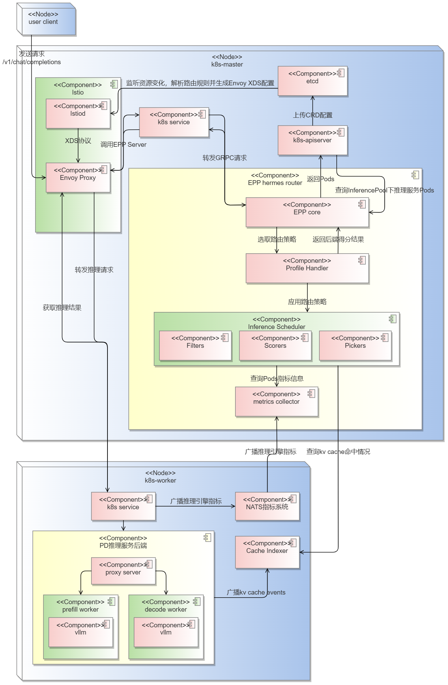

---
# 提案标题
title: oFEP AI推理智能路由增强
# 提案编号
ofep-number: 25
# 提案作者
authors:
  - "@qinwenzh"
  - "@lileqi"
# 提案主导SIG
owning-sig: sig-ai-inference
# 提案协作SIG
participating-sigs:
# 提案状态(初步草案|准备开始实现|已在SIG中实现并合并|提案被暂缓|提案被否决|作者主动撤回提案|被另一个oFEP取代)
status: provisional
# 创建日期
creation-date: 2025-11-4
# 评审人
reviewers:
  - "@foxbit"
# 批准人
approvers:
# 相关联的其他oFEP
see-also:
  - "/ofeps/sig-ai-inference/ofep-0011-AI推理智能路由"
# 当前oFEP替代了哪些已有提案
replaces:
# 当前oFEP被哪些提案替代，当status为replaced时需要填写此字段
replaced-by:
# 此oFEP当前开发阶段
stage: alpha|beta|stable
# 最近一次推进的版本
latest-milestone: 
# 各阶段目标版本
milestone:
  alpha: "v1.19"
  beta: "v1.20"
  stable: "v1.22"
# 功能开关及影响组件
feature-gates:
  - name: MyFeature
    components:
# 是否支持关闭该功能
disable-supported: true
# 该功能引入的监控指标
metrics:
---

# oFEP-0025：AI推理智能路由增强

## 发布签核清单

标记有（R）的项目*在达到里程碑/发布*之前是必需的。
- [ ] (R) 发布里程碑中的增强问题，链接到 [openfuyao/ofep] 中的 oFEP 目录
- [ ] (R) oFEP 审批者已批准 oFEP 状态为“可实施”
- [ ] (R) 设计细节已适当记录
- [ ] (R) 测试计划已到位，并考虑了 SIG 架构和 SIG 测试的输入（包括测试重构）
  - [ ] 针对所有 Beta API 操作（端点）进行 e2e 测试
  - [ ] (R) 确保 GA e2e 测试满足一致性测试的要求
  - [ ] (R) GA e2e 测试至少需要两周时间才能证明测试结果无 flake（不稳定或偶发失败）
- [ ] (R) 毕业标准已设定
  - [ ] (R) 所有 GA 端点必须通过[一致性测试]
- [ ] (R) 生产准备情况审查完成
- [ ] (R) 生产准备情况审查已获批准
- [ ] “实施历史”部分已更新里程碑
- [ ] 面向用户的文档已在 [openfuyao/docs] 创建，以便发布到 [openfuyao.com]
- [ ] 支持文档 - 例如，额外的设计文档、邮件列表讨论/SIG 会议链接、相关 PR/问题、发行说明

- [openfuyao.com](https://openfuyao.com/)
- [openfuyao/ofep](https://gitcode.com/openfuyao/ofep)
- [openfuyao/docs](https://gitcode.com/openfuyao/docs)

## 概括

本提案是“ofep-0011-smart-router”提案的增强方案，基于K8s原生推理扩展API Gateway API Inference extension(GIE)对AI推理智能路由（以下简称智能路由）进行重构，通过集成开源网关使其具备完整网关能力；并且新增分桶调度路由策略，以提高智能路由在中高并发、长短请求场景的性能表现。

###  动机

- 已有智能路由不包含网关能力，无法满足用户在实际生产环境中的使用需求，考虑到网关本身的复杂性与开发成本，本提案采取集成开源网关的方式获取网关能力；
- 已有智能路由难以兼容提案“ofep-0016-AI推理PD分离”中的分桶优化设计，本提案以路由策略的形式集成分桶优化设计，提高智能路由在中高并发、长短请求场景下的性能表现；
- 已有智能路由为服务级路由，以`service`资源为推理服务后端（以下简称推理后端），不感知实际运行推理引擎的`pod`；PD分离架构下的`service`代表xPyD推理服务整体，此时需要进行二次路由以将请求分发到具体的P/D推理实例`pod`。原有策略系统复杂度高、管理粒度大、路由策略效果不明显，本提案的智能路由将感知所有`pod`实例并进行路由，实现服务级与实例请求级路由协同。

### 目标

- 基于GIE框架将智能路由重构为端点选择器Endpoint Picker(EPP)；
- 提供与Istio、kgateway等开源网关的集成示例，支持用户获取完整网关能力；
- 对KVCache Aware路由策略进行插件化重构，性能无劣化；
- 新增面向PD分离架构的分桶调度路由策略，提高中高并发、长短请求场景的性能表现；
- 提高智能路由配置自由度，路由策略由Filter、Scorer以及Picker等EPP插件组成，允许用户自定义，同时开放路由策略各类参数。

### 非目标

本提案基于“ofep-0011-smart-router”提案补充以下非目标：
- LLM跨机部署场景。当前GIE仅支持单个`pod`作为推理后端，本提案优先支持k8s主流推理场景。

### 注释/限制/注意事项

- 【注释】本提案中智能路由重构后的形态为EPP，不包含开源网关，但提供开源网关的集成示例；
- 【注释】vLLM/SGLang等推理引擎的部署不在本提案交付范围内，但提供推理后端的部署示例；
- 【限制】本提案中的路由策略需独立使用，暂不支持叠加使用（如KVCache Aware + 分桶调度）。若有复杂场景（如请求内容有重复且请求长短分布的场景）需要组合使用策略，需用户在EPP插件粒度上重新组合，不在本提案设计范围内。

## 用户故事

@startuml
left to right direction
skinparam packageStyle rectangle

actor "AI推理用户" as User
actor "网关管理员" as Admin
actor "开发者" as Dev

rectangle "<<Boundary>>\n智能路由 hermes-router" as SYS {

  (使用推理服务) as UC_UseSvc
  (发送推理请求) as UC_SendReq
  (获取推理结果) as UC_GetRes

  (部署智能路由) as UC_DeployRouter
  (在PD聚合架构部署) as UC_DeployAgg
  (在PD分离架构部署) as UC_DeployPD

  (配置EPP路由策略) as UC_ConfigEPP
  (配置KVCache aware路由策略) as UC_ConfigKvAware
  (配置分桶调度路由策略) as UC_ConfigBucket

  (扩展EPP路由策略) as UC_ExtendEPP
  (开发路由插件) as UC_DevPlugin
  (定义路由策略) as UC_DefinePolicy
}

' Actor -> Use cases
User -- UC_UseSvc
Admin -- UC_DeployRouter
Admin -- UC_ConfigEPP
Dev -- UC_ExtendEPP

' Includes
UC_UseSvc ..> UC_SendReq : <<include>>
UC_UseSvc ..> UC_GetRes  : <<include>>

UC_DeployRouter <|-- UC_DeployAgg
UC_DeployRouter <|-- UC_DeployPD

UC_ConfigEPP <|--  UC_ConfigKvAware
UC_ConfigEPP <|--  UC_ConfigBucket 

UC_ExtendEPP ..> UC_DevPlugin    : <<include>>
UC_ExtendEPP ..> UC_DefinePolicy : <<include>>

@enduml

### 故事1：AI推理用户使用推理服务
#### 故事描述

作为AI推理用户，我能够向网关URL地址发送AI推理请求并获取推理结果，满足我使用大模型解决问题的目的。

#### 故事流程
（1）发送推理请求

1. 构造推理请求的URL。URL由网关地址与openAI API支持的路径组成。下面以典型的生成对话式文本响应路径为例展示URL：
   ```
   https://<gateway-ip>:<gatway-port>/v1/chat/completions
   ```
2. 构造推理请求请求体。本提案支持用户在`model`参数中指定多种LLM模型（需有对应模型推理引擎），在`stream`中指定是否流式返回推理结果，在`messages`中指定请求角色`role`与内容`content`，其余参数的支持情况由实际部署的推理引擎决定。下面以`/v1/chat/completions`为例展示请求体：
   ```json
   {
      "model": "gpt-3.5-turbo", // 可指定多种推理模型
      "messages": [
        {"role": "system", "content": "你是openFuyao社区的技术助手"},
        {"role": "user", "content": "什么是openFuyao？"},
      ],
      "stream": false,
      ... // 其他参数
    }
   ```
3. 向网关发送推理请求。以cURL为例展示：
   ```bash
   curl -X POST \
     https://<gateway-ip>:<gatway-port>/v1/chat/completions \
     -H "Content-Type: application/json" \
     -d '{
        "model": "gpt-3.5-turbo",
        "messages": [
          {"role": "system", "content": "你是openFuyao社区的技术助手"},
          {"role": "user", "content": "什么是openFuyao？"},
        ],
        "stream": false,
        ...
      }'
   ```
（2）获取推理结果

网关与智能路由会返回推理引擎原始推理结果，当请求体中`stream`参数设为`false`时一次性返回完整结果，为true时会逐块返回结果，每块都是以data:开头的json对象。

### 故事2：管理员在PD聚合架构部署智能路由
#### 故事描述
作为管理员，我能够部署智能路由与开源网关，以支持外部访问推理后端。
#### 故事流程
智能路由以独立的EPP服务形式与开源网关集成，能够让网关实时感知多个推理服务的运行状态，并对请求进行智能调度和负载均衡。

1. 安装必须的CRD资源：`Gateway API`与`GIE`
    ```bash
    export GATEWAY_API_CRD_REVISION="v1.x.x"
    export GATEWAY_API_INFERENCE_EXTENSION_CRD_REVISION="v0.x.x"
    ```

1. 部署开源网关`Gateway`

    完成CRD安装后需要部署网关控制平面和数据平面，下面以开源网关Istio为例：

    ```yaml
    apiVersion: gateway.networking.k8s.io/v1
    kind: Gateway
    metadata:
      name: inference-gateway
    spec:
      gatewayClassName: istio
      listeners:
        - name: default
          protocol: HTTP
          port: 80
          allowedRoutes:
            namespaces:
              from: All
      infrastructure:
        parametersRef:
          name: inference-gateway
          group: ""
          kind: ConfigMap
    ---
    apiVersion: v1
    kind: ConfigMap
    metadata:
      name: inference-gateway
    data:
      deployment: |
        spec:
          template:
            spec:
              containers:
              - name: istio-proxy
                args:
                  - proxy
                  - router
      service: |
        spec:
          type: "ClusterIP"
    ```

2. 部署智能路由EPP服务

在成功部署网关控制平面与数据平面后，需按照顺序完成`HTTPRoute`、`InferencePool`和`EPP`的配置：

- 将`HTTPRoute`资源关联到已部署的`Gateway`实例
  ```yaml
  apiVersion: gateway.networking.k8s.io/v1
  kind: HTTPRoute
  ...
  spec:
    parentRefs:
    - group: gateway.networking.k8s.io
      kind: Gateway
      name: inference-gateway
    rules:
      - backendRefs:
        - group: inference.networking.x-k8s.io
          kind: InferencePool
          name: inference-pool
          port: 8000
          ...
        matches:
        - path:
            type: PathPrefix
            value: /
  ```
- 根据路径匹配规则将HTTP请求路由至对应的`InferencePool`。每个`InferencePool`需配置指向指定端口的`EPP`，确保两者端口设置一致。
  ```yaml
  apiVersion: inference.networking.x-k8s.io/v1alpha2
  kind: InferencePool
  metadata:
    name: inference-pool
  spec:
    targetPortNumber: 8000
    extensionRef:
      name: epp
      portNumber: 9002
  ```
- 在`EndpointPickerConfig`中，明确配置`EPP`所需启用的插件及其组合方式，用于实现智能路由决策。
  ```yaml
  apiVersion: v1
  kind: ConfigMap
  metadata:
    name: epp
    ...
  data:
    default-plugins.yaml: |
      apiVersion: inference.networking.x-k8s.io/v1alpha1
      kind: EndpointPickerConfig
      plugins:
      - type: filter-by-pd-label
      - type: scorer-kv-pd-kv-cache-aware
      - type: picker-minimum-score
      schedulingProfiles:
      - name: kv-cache-aware-aggregate
        plugins:
        - pluginRef: filter-by-pd-label
        - pluginRef: scorer-kv-pd-kv-cache-aware
        - pluginRef: picker-minimum-score
  ```
- 在K8s集群中部署EPP服务
  ```yaml
  apiVersion: apps/v1
  kind: Deployment
  metadata:
    name: epp
  spec:
    selector:
      matchLabels:
        inferencepool: epp
    template:
      metadata:
        labels:
          inferencepool: epp
      spec:
        containers:
        - name: epp
          image: <epp image>
          imagePullPolicy: Always
          ports:
          - name: grpc
            containerPort: 9002
          ...
          volumeMounts:
          - name: plugins-config-volume
            mountPath: "/config"
        volumes:
        - name: plugins-config-volume
          configMap:
            name: epp
  ```

3. 部署推理后端
  
    部署推理后端本身不在本提案范围内，但智能路由要求推理后端正确配置标签信息用于服务发现，下面分别介绍两种推理后端架构的部署注意事项：

  - PD聚合架构

    按照常规流程部署模型推理后端。在`Deployment`资源中定义标签组：
      ```yaml
    app: inference-service
    role: aggregated
    ```
    确保每个推理后端能够被`InferencePool`正确识别和接入。
    
  - P/D分离架构

    在P/D分离架构中，模型推理服务分为三个角色：Leader、Prefill和Decode。
    
    需要为Prefill和Decode实例配置对应的`role=prefill/decode`标签，实现P/D角色区分；
    
    Leader Pod是智能路由的直接转发目标，需要设置`role=leader`标签，主要负责解析请求头，获取智能路由指定的Prefill/Decode Pod，并指挥P/D Pod完成推理任务。
    
    此外分桶调度策略需要为P/D实例添加`tp=n（n为张量并行数）`标签。

### 故事3：网关管理员配置EPP路由策略
#### 故事描述
作为管理员，我能够配置EPP的路由策略，使部署后的智能路由满足业务场景需要。
#### 故事流程

网关管理员可以通过创建或修改`EndpintPickerConfig`配置文件来指定EPP的路由策略。在EPP规范中，路由策略被定义为`schedulingProfile`类型，由以下3种插件组成：

- Filter：根据请求特征过滤出满足条件的推理后端`pod`；
- Scorer：计算每个`pod`的得分；
- Picker：基于得分和选择算法选择最合适处理推理请求的`pod`；

此外还有`ProfileHandler`插件用于调度一个EPP中的多个`schedulingProfile`，用于应对复杂调度需求。

本提案建议网关管理员为每种路由策略创建专属的`EndpointPickerConfig`配置文件，并在其中指定相应的`schedulingProfile`配置信息。

（1）配置KVCache Aware路由策略

场景1：PD聚合后端架构。EPP配置文件如下：

```yaml
apiVersion: inference.networking.x-k8s.io/v1alpha1
kind: EndpointPickerConfig
plugins:
- type: scorer-aggregate-kv-cache-aware
- type: picker-minimum-score
schedulingProfiles:
- name: default
  plugins:
  - pluginRef: scorer-kv-cache-aware-aggregate
  - pluginRef: picker-minimum-score
```

场景2：PD分离后端架构。EPP配置文件如下：

```yaml
apiVersion: inference.networking.x-k8s.io/v1alpha1
kind: EndpointPickerConfig
plugins:
- type: filter-by-pd-label
- type: scorer-kv-pd-kv-cache-aware
- type: picker-minimum-score
schedulingProfiles:
- name: default
  plugins:
  - pluginRef: filter-by-pd-label
  - pluginRef: scorer-kv-pd-kv-cache-aware
  - pluginRef: picker-minimum-score
```

（2）配置分桶调度路由策略

场景3：TP异构的PD分离后端架构。EPP配置文件如下：

```yaml
apiVersion: inference.networking.x-k8s.io/v1alpha1
kind: EndpointPickerConfig
plugins:
- type: filter-by-request-length
- type: scorer-pd-bucket
- type: picker-minimum-score
schedulingProfiles:
- name: default
  plugins:
  - pluginRef: filter-by-request-length
  - pluginRef: scorer-pd-bucket
  - pluginRef: picker-minimum-score
```

### 故事4：开发者扩展EPP路由策略
#### 故事描述
作为开发者，我能够根据业务需求自主开发插件以扩展EPP的路由策略。
#### 故事流程

（1）开发路由插件

开发者在完成路由策略的设计后，需要将策略流程拆分为若干EPP插件，主要插件类型为Filter、Scorer和Picker。

下面以用于过滤`pod`的Filter插件为例，展示路由插件开发流程：

1. 创建Filter代码文件
   本提案已将EPP插件分类，建议在`pkg/plugins/filter`下创建新的Filter插件。
2. 定义Filter插件结构体
   ```go
   type MyFilter struct {  
      typedName plugins.TypedName  
      // ... 其他成员变量 
    }  
   ```
3. 实现结构体构造函数
   ```go
   func NewMyFilter(...){
      // ... 初始化成员变量
      return &MyFilter{...}
   }
   ```
4. 实现工厂函数
   ```go
   func ByMyFilterFactory(...){
      // ... 根据GIE传入参数初始化Filter成员变量
      return NewMyFilter(...)
    }
   ```
5. 实现`Filter`接口中的`Filter()`方法
   ```go
    func (m *MyFilter) Filter(_ context.Context, _ *types.CycleState, _ *types.LLMRequest, pods []types.Pod) []types.Pod {}
   ```
6. 在`pkg/plugins/register.go`中注册新增Filter
   ```go
   func RegisterAllPlugins() {  
      plugins.Register(filter.MyFilter, filter.ByMyFilterFactory)  
      // ... 其他插件  
    }
   ```
至此新的Filter插件开发完成，开发者可以按照相同流程开发其他类型的EPP插件。

（2）定义路由策略

在完成路由策略的插件开发后，开发者需要创建EPP配置文件，并以`schedulingProfile`资源形式组合插件以实现路由策略。

下面给出EPP配置文件示例：

```yaml
apiVersion: inference.networking.x-k8s.io/v1alpha1
kind: EndpointPickerConfig
plugins:
- type: myfilter
# ... 其他插件声明
schedulingProfiles:
- name: kv-cache-aware-aggregate
  plugins:
  - pluginRef: myfilter
  # ... 其他组成路由的插件
```

至此开发者已完成路由策略的开发，后续将EPP配置文件部署到集群中即可生效。

## 设计细节
### 系统规格
#### 软件依赖

本提案的设计范围为智能路由 EPP。由于 EPP 依赖开源网关实现网关能力，下表列出了与 EPP 兼容的网关及其所需的 Gateway API Version、GIE Version 和 K8s Version。对于每种网关：
- 第一行表示 EPP 使用该网关时，各组件所需的最小版本。
- 第二行表示各组件当前的最新版本。

| Gateway               | Version | Gateway API Version            | GIE version | K8s version        |
|-----------------------|-----------------------|--------------|----------------------|--------------------|
| Istio                 | 1.27                  | 1.4.0+       | 1.0+      | 1.29+              |
|                       | 1.28 | 1.4.0+     | 1.0+              | 1.30+              |
| Nginx Gateway Fabric  | 2.2                  | 1.3.0+      | 1.0+               | 1.25+              |
|                       | 2.3         | 1.4.0+      | 1.0+              | 1.25+             |
| Envoy AI Gateway      | 0.4                  | 1.4.0+      | 1.0+               | 1.32+              |
|                       | 0.5         | 1.4.0+       |1.0+               | 1.32+              |
| Kgateway              | 2.1                  | 1.3.0+       | 1.0+                | 1.29+             |

#### 硬件依赖

无硬件依赖。

### 逻辑视图
实际在本提案设计范围的组件为EPP hermes router，其余组件均用于示意周边组件关系，以PD分离架构为例，整个端到端推理架构的逻辑视图如下图所示：




### 部署视图

本提案的部署范围仅包含EPP，以及相关CRD资源，部署视图如下图所示：

@startuml
!theme plain
skinparam nodeStyle rectangle

node "Master" as Master {
  artifact "InferencePool CRD" as InferencePool
  artifact "HTTPRoute" as HTTPRoute
  artifact "EPPServerPod" as EPPServerPod
}

file "chart/Values.yaml" as GAIEValues

GAIEValues ..> InferencePool: <<deployed to>>
GAIEValues ..> HTTPRoute: <<deployed to>>
GAIEValues ..> EPPServerPod: <<deployed to>>
@enduml

### 路由策略设计
本提案基于EPP规范改造KVCache Aware路由策略，并新增分桶调度策略，支持两种路由策略单独应用，不涉及`ProfileHandler`插件。

本提案设计以下通用插件，可被多种路由策略复用：
- `picker-minimum-score`：选取分数最低的`pod`；
  
#### KVCache Aware路由策略


本提案中KVCache Aware路由策略包含`aggregate-kv-cache-aware`、`pd-kv-cache-aware`两种`schedulingProfile`，分别适用于聚合与PD架构，包含以下专用插件：
- `scorer-aggregate-kv-cache-aware`：适用于聚合架构的kv缓存感知得分计算；
- `scorer-kv-pd-kv-cache-aware`：适用于PD架构的kv缓存感知得分计算；

##### PD聚合架构

PD聚合架构下KVCache Aware路由策略由以下插件组成：
- `scorer-aggregate-kv-cache-aware`：以下简称`scorer`
- `picker-minimum-score`：以下简称`picker`

核心算法流程如下：
1. `scorer`接收`Pods`列表，调用`/match_sort`接口获取`Pods`列表中每个`Pod`的KVCache命中率`kvCacheHitRate`；
2. `scorer`计算每个`Pod`的得分，`Pod`中已包含最新指标数据，以第`i`个`Pod`为例得分计算公式如下，其中$\alpha、\beta、\gamma$均为可配置的超参数：
$$
L_{i}=\alpha\cdot(1-kvCacheHitRate)+\beta\cdot xpuCacheUsage+\gamma\cdot{\frac{w^{i}}{max(w)}} \\
\alpha,\beta,\gamma \ge 0
$$
3. `picker`选取得分`L`最低的`Pod`作为路由目标，若存在多个得分相同的`Pod`则随机选取。

端到端整体流程如下：

@startuml
!theme plain

participant "Client" as Client
participant "EPP:GIE" as GIE
participant "EPP:Router" as Router
participant "EPP:MetricSys" as MetricSys
participant "k8s API Server" as K8sAPI
participant "Cache Indexer" as CacheIndexer
participant "VLLM" as VLLM

Client -> GIE: POST /v1/completions
activate GIE
GIE -> GIE: InferencePool=matchByPath()
GIE -> K8sAPI: getBackends(InferencePool)
activate  K8sAPI
GIE <-- K8sAPI: PodList
deactivate  K8sAPI


GIE -> Router: RunScorer()
activate Router
Router -> MetricSys: getMetric(PodList)
activate MetricSys
Router <-- MetricSys: PodList
deactivate MetricSys

Router -> MetricSys: getMetric(PodList)
activate MetricSys
Router <-- MetricSys: PodList
deactivate MetricSys
Router -> MetricSys: getKVCacheHit(PodList, prompt)
activate MetricSys
MetricSys -> CacheIndexer: getKVCacheHit(PodList, prompt)
activate CacheIndexer
CacheIndexer -> MetricSys: response:kvcacheHitRateList
deactivate CacheIndexer
Router <-- MetricSys: PodList
deactivate MetricSys

loop for pod
    Router -> Router: Pod.score = L(Pod)
end

Router --> GIE: PodList
deactivate Router

GIE -> Router: RunPicker()
activate Router
Router -> Router: picker()
note right: 只取PodList[0]作为转发目标
Router --> GIE: PodList
deactivate Router

GIE -> VLLM: HTTP POST PodList[0].address:Port/v1/completions
activate VLLM
VLLM --> GIE: result
deactivate VLLM
GIE --> Client: result
deactivate GIE

@enduml


##### PD分离架构

PD分离架构下KVCache Aware路由策略由以下插件组成：
- `filter-by-pd-label`：以下简称`filter`
- `scorer-pd-kv-cache-aware`：以下简称`scorer`
- `picker-minimum-score`：以下简称`picker`

在PD分离架构下，推理后端包含Prefill/Decode/Leader 三类Pod，通过如下标签标识：
- Prefill Pod：`openfuyao.com/pdRole=prefill`;
- Decode Pod：`openfuyao.com/pdRole=decode`;
- Leader Pod：`openfuyao.com/pdRole=decode`;

并且每个Pod均通过`openfuyao.com/pdGroupID={id}`来标识所属组。

核心算法流程如下：
1. `filter`接收Pod列表`Pods`，对每个Pod根据标签信息分类，形成`PDGroup`列表`PDGroups`；
2. `scorer`读取`PDGroups`，提取所有`Prefill Pod`并形成列表`PrefillPods`,而后调用`/match_sort`接口获取`PrefillPods`中每个`PrefillPod`的KVCache命中率`kvCacheHitRate`；
3. `scorer`遍历`PDGroups`，计算每个`PDGroup`得分：

    对每个`PDGroup`，首先根据公式计算组内Prefill Pods得分，并选出最佳Prefill Pod `bestPrefill`：

    $$
    L_{prefill} = \alpha\cdot(1-kvCacheHitRate)+\beta\cdot xpuCacheUsage+\gamma\cdot{\frac{w^{i}}{max(w)}}
    $$

    遍历Decode Pods，根据公式计算每个Decode Pod得分，选出最佳Decode Pod `bestDecode`，Decode Pod 得分$L_{decode}$为自身等待请求数$w_{i}$与所有`LeaderPod`中`Decode`的等待请求数最大值$max(w)$的比值；

    $$
    L_{decode} = \delta\cdot{\frac{w^{i}}{max(w)}}
    $$

    最后综合`bestPrefill`与`bestDecode`计算对应`PDGroup`的得分$L_{i}$，记录在`LeaderPod`中：

    $$
    L_{i}=\theta_{1}\cdot{L_{prefill}}+\theta_{2}\cdot{L_{decode}}
    $$

4. `picker`选取得分`L`最低的`LeaderPod`作为路由目标，并将组成该得分的`bestPrefill`与`bestDecode`信息写入请求头；后续Leader Pod将指定该组Prefill Pod与Decode Pod处理推理请求。


端到端整体流程如下：

@startuml
!theme plain

participant "Client" as Client
participant "EPP:GIE" as GIE
participant "EPP:Router" as Router
participant "EPP:MetricSys" as MetricSys
participant "k8s API Server" as K8sAPI
participant "Cache Indexer" as CacheIndexer
participant "vLLM" as VLLM

Client -> GIE: POST /v1/completions
activate GIE
GIE -> GIE: InferencePool=matchByPath()
GIE -> K8sAPI: getBackends(InferencePool)
activate K8sAPI
K8sAPI --> GIE: PodList
deactivate K8sAPI

GIE -> Router: RunFilter()
activate Router
Router -> Router: FilterByPrefill()
note right: 按Leader/Prefill/Decode角色分类
Router --> GIE: PDGroupList
deactivate Router

GIE -> Router: RunScorer()
activate Router
Router -> MetricSys: getMetric(PrefillPodList)
activate MetricSys
MetricSys --> Router: PrefillPodList
deactivate MetricSys

Router -> MetricSys: getKVCacheHit(PrefillPodList, prompt)
activate MetricSys
MetricSys -> CacheIndexer: HTTP POST /kvcache
activate CacheIndexer
CacheIndexer --> MetricSys: response:kvcacheHitRateList
deactivate CacheIndexer
MetricSys --> Router: PrefillPodList
deactivate MetricSys

loop for pod
    Router -> Router: getUsableDecodePodList()
    note right: 获取每个Prefill同组的Decode
    Router -> Router: PrefillPod.score = L(PrefillPod, DecodePodList)
    note right: 综合Decode负载计算Prefill得分
    Router -> Router: LeaderPod = {PrefillPod, DecodePod}
    note right: LeaderPod为PDPod所在组的
end

Router --> GIE: LeaderPodList
deactivate Router

GIE -> Router: RunPicker()
activate Router
Router -> Router: picker()
note right: 只取LeaderPodList[0]作为转发目标
Router --> GIE: PodList
deactivate Router

GIE -> VLLM: HTTP POST LeaderPodList[0].address:Port /v1/completions
activate VLLM
VLLM --> GIE: result
deactivate VLLM
GIE --> Client: result
deactivate GIE

@enduml


#### 分桶调度路由策略

本提案中分桶调度路由策略是名称为`pd-bucket`的`schedulingProfile`，该策略仅用于PD分离架构，包含以下专用插件：
- `filter-by-request-length`：根据请求长度过滤出`tp`配置满足条件的`pod`；
- `scorer-pd-bucket`：根据`prefill pod`和`decode pod`负载信息计算得分； 

pd-bucket路由策略由以下插件组成：
- `filter-by-pd-label`
- `filter-by-request-length`
- `scorer-pd-bucket`
- `picker-minimum-score`

核心算法流程如下：

1. 计算每个Pod的累计活跃 tokens：
    - 对于每一个Prefiller Pod，其处理的每个请求会增加的active tokens数量为：
      $$
      T_{prefill} = 0.0345 \times \frac{L}{4} + 120.0745
      $$
      此处的打分函数来自Omni_infer的calculate_input_scores，其中 $L$ 代表当前请求的长度。
    - 对于每一个Decoder Pod，其处理的每个请求会增加的active tokens数量为：
      $$
      T_{decode} = L
      $$
    - 当请求处理结束后，Prefiller和Decoder各自负责从其对应的active tokens累计值中扣除相应的token数。
    
2. 计算每个PD组的活跃tokens分数：
    - 每个PD组的活跃tokens分数为组内所有Prefiller和Decoder的active tokens总和除以组内Decoder数量：
      $$
      S_{active}^{(g)} = \frac{\sum_{p \in \text{Prefillers}^{(g)}} T_{prefill}^{(p)} + \sum_{d \in \text{Decoders}^{(g)}} T_{decode}^{(d)}}{N_{dec}^{(g)}}
      $$
      其中$N_{dec}^{(g)}$表示第$g$个组中的Decoder数量。

3. 选组逻辑：
   - 求所有组的活跃tokens分数的最大值$S_{max}$和最小值$S_{min}$。
   - 若$S_{max} > S_{min} + \text{threshold}$，则直接选择分数最小的组作为调度目标。
   - 否则需要为每个组计算算力占比因子，定义如下：
     - 每个组的Prefiller算力分数为：
       $$
       S_{capacity}^{(g)} = \frac{\sum_{p \in \text{Prefillers}^{(g)}} tp\_size^{(p)}}{\sum_{g'}\sum_{p' \in \text{Prefillers}^{(g')}} tp\_size^{(p')}} - \frac{1}{G}
       $$
       其中 $tp\_size^{(p)}$为Prefiller $P$的tp配置，$G$为PD组总数。
     - 组得分综合计算公式为：
       $$
       S_{total}^{(g)} = \alpha \cdot S_{active}^{(g)} + \beta \cdot S_{capacity}^{(g)}
       $$
       其中 $\alpha$ 和 $\beta$ 为可调权重参数。
   - 选择$S_{total}^{(g)}$最小的组。

4. 在选中组内，从Prefiller和Decoder分别选出active tokens累计值最小的 Pod：
   - 记$p^*$为Prefiller中$T_{prefill}^{(p)}$最小的Pod，$d^*$为Decoder中$T_{decode}^{(d)}$最小的Pod。
   - 将 $p^*$、$d^*$ 及该组的$LeaderPod$一同作为调度目标，返回结果为（LeaderPod, PrefillPod, DecoderPod）。

pd-bucket路由流程如下：

@startuml
!theme plain

participant "Client" as Client
participant "EPP:GIE" as GIE
participant "EPP:Router" as Router
participant "EPP:MetricSys" as MetricSys
participant "k8s API Server" as K8sAPI
participant "Cache Indexer" as CacheIndexer
participant "vLLM" as VLLM

Client -> GIE: POST /v1/completions
activate GIE
GIE -> GIE: InferencePool=matchByPath()
GIE -> K8sAPI: getBackends(InferencePool)
activate K8sAPI
K8sAPI --> GIE: PodList
deactivate K8sAPI

GIE -> Router: RunFilter()
activate Router
Router -> Router: FilterByPDGroup()
note right: 根据PDGroup标签\n筛选出PDGroupList
Router --> GIE: PDGroupList
deactivate Router

GIE -> Router: RunScorer()
activate Router
Router -> MetricSys: getMetric(PDGroupList)
activate MetricSys
MetricSys --> Router: (PrefillPods, DecodePods)
deactivate MetricSys

loop for PDGroup
    Router -> Router: PDGroup.score = Score(PrefillPods, DecodePods)
    note right: 根据Prefill/DecodePod负载计算\nLeaderPod得分
end

Router --> GIE: PDGroupList
deactivate Router

GIE -> Router: RunPicker()
activate Router
Router -> Router: PickPDGroup()
note right: 选取分数最低的PDGroup
Router -> Router: PickPrefill()
note right: 选取该PD组分数最低的PrefillPod
Router -> Router: PickDecode()
note right: 选取该PD组分数最低的DecodePod
Router --> GIE: (LeaderPod, PrefillPod, DecodePod)
deactivate Router

GIE -> Router: RunPreRequest()
activate Router
Router -> Router: PreRequest()
note right: 将PrefillPod和DecodePod写入请求头
Router --> GIE: Request
deactivate Router

GIE -> VLLM: HTTP POST LeaderPod.address:Port /v1/completions
activate VLLM
VLLM --> GIE: result
deactivate VLLM
GIE --> Client: result
deactivate GIE

@enduml


## 基于开源网关+AI推理智能路由的容灾设计
### 概括
#### 动机

在AI推理服务场景中，推理后端可能由于各种原因陷入无法使用的状态，网关层面需要提供容灾能力来保障用户不受后端服务故障的影响。

#### 目标

基于本提案设计的开源网关+AI推理智能路由体系，在K8s场景下构建具备容灾能力的AI推理网关，目标如下：

1. **自动切流**：在推理后端故障或重启时，保证流量的无损或低损切换；
2. **请求重试**：当推理请求因各种异常情况失败时，AI推理网关按照预定规则自动重试请求。

### 用户故事

@startuml
left to right direction
skinparam packageStyle rectangle

actor "推理用户" as User
actor "系统管理员" as Admin

rectangle "AI推理服务系统" {
  (自动重试失败请求) as UC_Retry
  
  (配置开源网关) as UC_ConfigGateway
  (配置HTTP Route) as UC_ConfigHTTPRoute
  
  (配置智能路由) as UC_ConfigRouter
  (配置路由策略) as UC_ConfigStrategy
  
  (配置推理后端) as UC_ConfigBackend
  (配置推理服务Label) as UC_ConfigLabel
  (配置健康探针) as UC_ConfigProbe
}

User --> UC_Retry

Admin --> UC_ConfigGateway
Admin --> UC_ConfigRouter
Admin --> UC_ConfigBackend

UC_ConfigGateway ..> UC_ConfigHTTPRoute : <<include>>

UC_ConfigRouter ..> UC_ConfigStrategy : <<include>>
UC_ConfigRouter ..> UC_ConfigLabel : <<include>>

UC_ConfigBackend ..> UC_ConfigLabel : <<include>>
UC_ConfigBackend ..> UC_ConfigProbe : <<include>>

@enduml


#### 故事1：系统管理员配置开源网关
系统管理员在开源网关中配置请求重试规则以启动请求重试能力。

#### 故事2：系统管理员配置智能路由
系统管理员在智能路由中配置推理后端标签以启动服务发现能力，配置路由策略以启动负载均衡能力。

#### 故事3：系统管理员配置推理后端
系统管理员为推理后端配置标签用于服务发现，配置健康探针用于智能路由查询推理后端状态。

#### 故事4：推理用户请求失败时系统自动重试
推理用户发送的请求因某些原因失败时，开源网关能够发现请求异常，并按照系统管理员预先设定的规则进行重试，尽可能保障用户体验。

### 详细设计
#### 逻辑视图
本小节给出PD聚合与PD分离两种AI推理系统架构下的容灾设计架构图。
##### PD聚合架构的容灾架构

@startuml
!theme plain
skinparam componentStyle rectangle

package "用户层" {
  [用户] as User
}

package "开源网关+智能路由" {
  [Gateway] as Gateway
  [Hermes-router\n(GIE+EPP)] as Router
  Gateway -> Router : 获取最佳推理后端
}

package "K8s配置" {
  [HTTPRoute] as CRDS
  [InferencePool] as POOL
  [···] as More_CRDS
   Gateway ..> CRDS: 获取重试配置
   Router ..> POOL: 获取服务发现配置
}

package "AI推理服务集群" {
  [PD聚合实例1] as PD1
  [PD聚合实例2] as PD2
  [···] as More_PD
}

User --> Gateway : 发送推理请求
Gateway --> PD1 : 转发推理请求
Gateway --> PD2 : 转发推理请求
Gateway --> More_PD : 转发推理请求

@enduml

##### PD分离系统的容灾架构

@startuml
!theme plain
skinparam componentStyle rectangle

package "用户层" {
  [用户] as User
}

package "开源网关+智能路由" {
  [Gateway] as Gateway
  [Hermes-router\n(GIE+EPP)] as Router
  Gateway -> Router : 获取最佳推理后端
}

package "K8s配置" {
  [HTTPRoute] as CRDS
  [InferencePool] as POOL
  [···] as More_CRDS
   Gateway ..> CRDS: 获取重试配置
   Router ..> POOL: 获取服务发现配置
}

package "AI推理服务集群" {
  package "PD分离集群1" {
    [Proxy1] as Proxy1
    [P实例] as P1
    [···] as P_Dots1
    [D实例] as D1
    [···] as D_Dots1
    Proxy1 --> P1
    Proxy1 --> P_Dots1
    Proxy1 --> D1
    Proxy1 --> D_Dots1
  }
  
  package "PD分离集群2" {
    [Proxy2] as Proxy2
    [P实例] as P2
    [···] as P_Dots2
    [D实例] as D2
    [···] as D_Dots2
    Proxy2 --> P2
    Proxy2 --> P_Dots2
    Proxy2 --> D2
    Proxy2 --> D_Dots2
  }
  
}

User --> Gateway : 发送推理请求
Gateway --> Proxy1 : 转发推理请求
Gateway --> Proxy2 : 转发推理请求

@enduml

#### 功能1：服务发现与健康监测
##### 服务发现功能
**功能描述**：

服务发现功能的作用是动态发现和管理可用的后端服务。

**功能设计**：

服务发现功能设计包含自动发现、动态更新：
1. 自动发现：
   - InferencePool Controller定期轮询集群，发现匹配`selector.matchLabels`的Pod
   - 当新的后端服务Pod启动并打上匹配的Label后，Controller自动将其加入可用后端列表
   - EPP Server通过InferencePool获取最新的后端列表，用于路由决策

2. 动态更新：
   - Pod上线：当新的后端服务Pod启动并打上匹配标签后，InferencePool会自动将其加入可用列表，流量开始进入
   - Pod下线：当Pod被删除或标签不匹配时，InferencePool会自动将其从列表中移除，新流量不再路由到该Pod
   - Pod状态变化：根据K8s健康检查结果（readinessProbe/livenessProbe），自动更新Pod的可用性状态

智能路由已支持服务发现机制，系统管理员需要进行如下配置：

1. 确定标识推理后端Pod的标签组
2. 在后端推理服务Pod中配置标签组
3. 在InferencePool资源的`selector.matchLabels`字段中配置标签组

完成配置后，智能路由运行时即可自动根据InferencePool的标签组发现后端推理服务并维护列表。

**详细配置示例**：

1. 确定标识推理后端Pod的标签组

    示例如下：
    ```yaml
    app: inference-service
    role: serving
    ```
2. 在后端推理服务的Deployment中配置标签组

    ```yaml
    apiVersion: apps/v1
    kind: Deployment
    metadata:
      name: inference-service
    spec:
      template:
        metadata:
          labels:
            app: inference-service 
            role: serving   
          # ...
    ```

3. 在InferencePool资源的`selector.matchLabels`字段中配置标签组

    ```yaml
    apiVersion: inference.networking.x-k8s.io/v1alpha2
    kind: InferencePool
    metadata:
      name: inference-pool
    spec:
      # Pod选择器，配置后端服务Pod的标签组
      selector:
        matchLabels:
          app: inference-service
          role: serving
      # ...
    ```

##### 健康检测功能
**功能描述**：

健康检测功能用于实时监控后端服务Pod的健康状态，并向外部提供状态查询接口，支持智能路由识别后端服务Pod状态，确保只有健康的Pod才会被加入可用列表。

**功能设计**：

本方案通过K8s的三种原生探针实现基础设施层面的健康检测：

- startupProbe（启动探测）：确保服务完全初始化后再进行后续探测，适用于启动时间较长的服务。在容器启动后开始探测，只有startupProbe成功后，才会启用readinessProbe和livenessProbe。这样可以避免在服务启动过程中因为未就绪而被误判为不健康。配置时需要设置足够大的`failureThreshold`，以应对服务启动时间较长的情况。

- readinessProbe（就绪探测）：判断Pod是否准备好接收流量，这是健康检测机制的关键环节。通过调用后端服务的`/health`接口进行探测，如果连续失败（如3次），Pod会被标记为NotReady，K8s会自动切断流向该Pod的新流量。InferencePool会根据readinessProbe的结果决定是否将Pod加入可用后端列表，从而实现自动的服务发现和流量切换。探测间隔建议10-30s，超时时间5-10s，失败阈值通常设置为3次。

- livenessProbe（存活探测）：判断Pod是否还在正常运行，用于检测服务是否"假死"。如果连续失败，K8s会重启Pod。配合RAS业务监控，实现多层次的故障检测和恢复机制。探测间隔建议10-30s，超时时间5-10s，失败阈值通常设置为3次。

**详细配置示例**：

以下是一个完整的后端服务Pod的Deployment，包含三种探针的配置：

```yaml
apiVersion: apps/v1
kind: Deployment
metadata:
  name: inference-service
spec:
  template:
    metadata:
      labels:
        app: inference-service
        role: serving
    spec:
      containers:
      - name: inference-service
        image: <inference-service-image>
        ports:
        - containerPort: 8000
        # 启动探测：确保服务完全初始化
        startupProbe:
          httpGet:
            path: /health
            port: 8000
          initialDelaySeconds: 15
          periodSeconds: 10
          timeoutSeconds: 5
          failureThreshold: 60
        # 就绪探测：判断Pod是否准备好接收流量
        readinessProbe:
          httpGet:
            path: /health
            port: 8000
          initialDelaySeconds: 15
          periodSeconds: 10
          timeoutSeconds: 5
          failureThreshold: 3
        # 存活探测：判断Pod是否还在运行
        livenessProbe:
          httpGet:
            path: /health
            port: 8000
          initialDelaySeconds: 15
          periodSeconds: 10
          timeoutSeconds: 5
          failureThreshold: 3
```
> ⚠️注意：为了启用健康检测机制，后端服务必须提供健康探测接口，配置中：
> - 通过`httpGet.path`指定健康检查接口路径（如`/health`）
> - 通过`httpGet.port`指定接口端口（需与容器暴露的端口一致）。
> 
> 其他参数如`initialDelaySeconds`、`periodSeconds`、`timeoutSeconds`、`failureThreshold`可根据实际服务启动时间和业务需求进行调整。

#### 功能2：自动切流与故障恢复
##### 自动切流设计

1.  故障判定：监控系统检测到后端服务业务异常（如服务长时间无响应）。
2.  触发退出：触发故障处理服务的优雅退出流程。
3.  主动下线：删除故障后端服务的Pod（或触发Pod自动终止）。
4.  流量切换：
    *   新流量：Pod删除后，K8s Endpoint Controller会将该IP从Service/InferencePool列表中移除，新流量自动路由到其他节点。
    *   在途流量：对于正在发送给故障Pod的请求，由于Pod终止或网络不可达，请求会失败。此时网关代理捕获5xx错误或连接失败，触发自动重试，将请求转发给其他健康的后端服务。

##### 故障恢复设计

1.  重启服务：拉起新的后端服务Pod。
2.  自身预热：等待Pod就绪，并通过发送推理请求自我验证服务可用性。
3.  上线接流：验证通过后，给Pod打上InferencePool匹配的标签组（如`app=inference-service, role=serving`）。
4.  自动发现：智能路由感知到新Pod，将其加入可用服务后端列表。


#### 功能3：请求重试

请求重试机制用于处理超时或异常的推理请求，确保系统的可靠性和容错能力。通过在网关控制面配置HTTPRoute资源，可以定义超时和重试策略，网关会根据这些配置自动执行请求重试流程。

以下是一个包含超时和重试配置的 HTTPRoute 示例：

```yaml
apiVersion: gateway.networking.k8s.io/v1
kind: HTTPRoute
metadata:
  name: inference-route-with-retry
  namespace: default
spec:
  parentRefs:
  - group: gateway.networking.k8s.io
    kind: Gateway
    name: inference-gateway
  rules:
  - matches:
    - path:
        type: PathPrefix
        value: /v1/chat/completions
    backendRefs:
    - group: inference.networking.x-k8s.io
      kind: InferencePool
      name: inference-pool
      port: 8000
    timeouts:
      # 请求超时时间：整个请求（包括所有重试）的最大持续时间
      request: 60s
      # 后端请求超时时间：单次尝试的超时时间
      backendRequest: 30s
    # 重试配置
    filters:
    - type: ExtensionRef
      extensionRef:
        group: gateway.networking.k8s.io
        kind: RetryPolicy
        name: inference-retry-policy
```
> ⚠️ **注意**：不同网关实现（如 Istio、Envoy等）对重试配置的支持可能略有差异。上述配置基于 Gateway API 标准规范，实际使用时请参考具体网关实现的文档。

配置完成后，网关控制面会将配置同步到网关数据面，网关数据面会根据HTTPRoute中的配置自动执行超时检测和异常请求重试处理，无需额外操作。

#### 功能4：请求负载均衡

请求负载均衡基于智能路由的路由策略实现，用于在多个可用的后端服务Pod之间合理分发推理请求，避免单个Pod过载，提高整体系统的吞吐量和稳定性。

系统管理员通过配置EPP的`EndpointPickerConfig`指定使用路由策略，以下是一个随机路由策略的配置示例，通过Helm values文件配置：

```yaml
inferencepool:
  inferenceExtension:
    pluginsConfigFile: "epp-random-routing.yaml"
    pluginsCustomConfig:
      epp-random-routing.yaml: |
        apiVersion: inference.networking.x-k8s.io/v1alpha1
        kind: EndpointPickerConfig
        plugins:
        - type: picker-min-random
        schedulingProfiles:
        - name: default
          plugins:
          - pluginRef: picker-min-random
```

