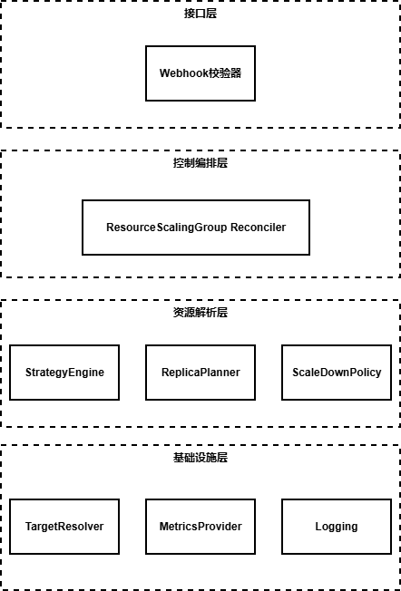
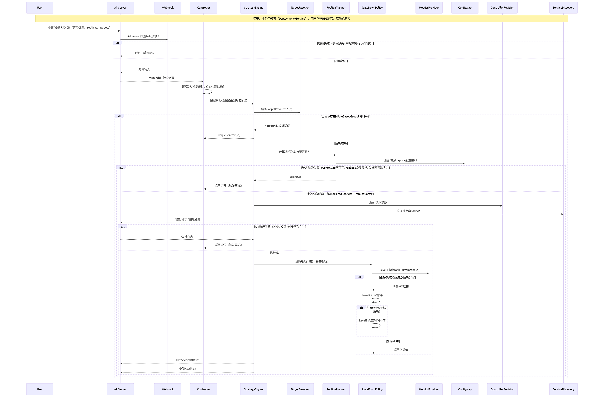
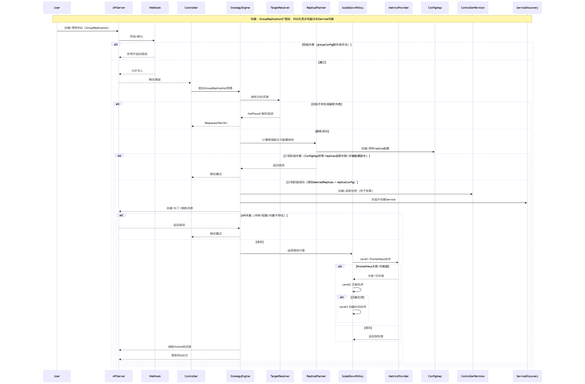
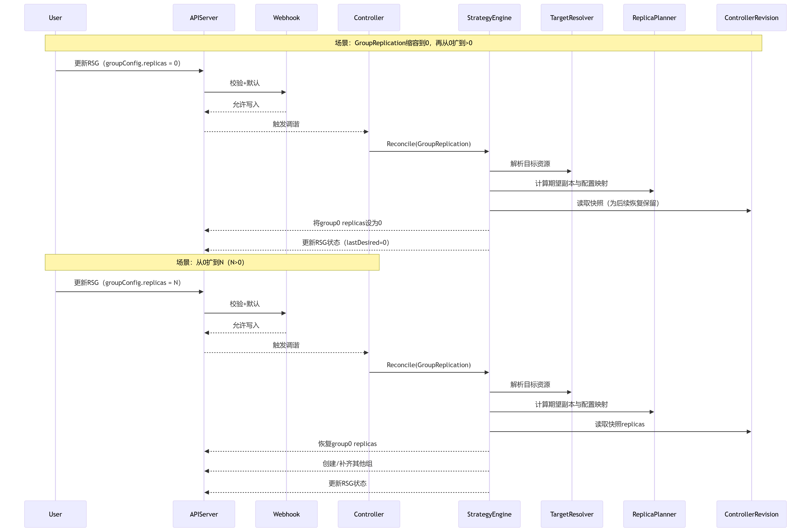
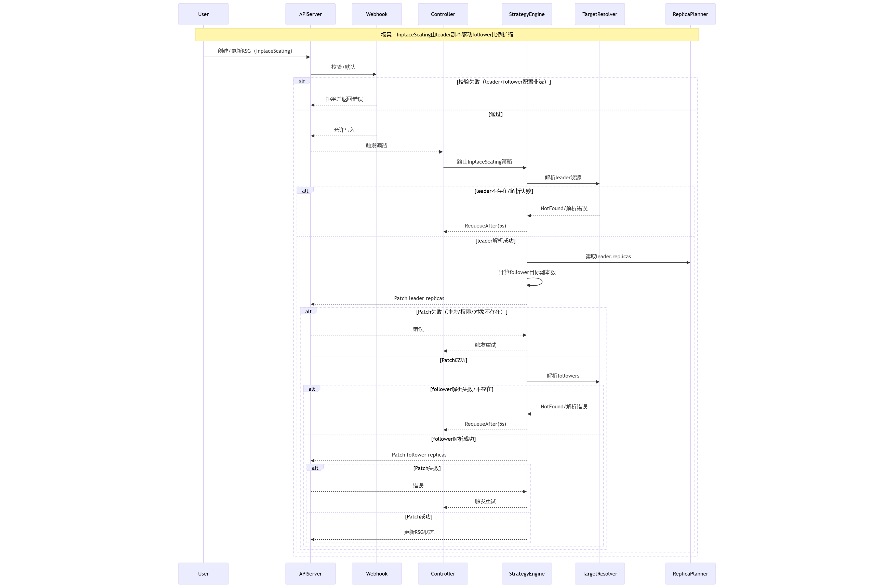

# oFEP-0029: 面向PD分离场景的动态扩缩容方案

## 动机

当前 AI 推理工作负载已呈现多样化形态，既包括“单个 Pod 对应一个完整模型实例”的单节点部署，也包括将单个服务实例拆分为多个组件、跨多个 Pod 和节点协同运行的部署方式。随着模型规模、并发规模和服务复杂度持续提升，资源利用率、服务性能以及组件级独立扩缩容已成为生产环境中的核心诉求。

RoleBasedGroup（以下简称 RBG）是一个 Kubernetes 原生的 AI 工作负载编排方案，在调度和运维方面具备较好的基础能力。但在扩缩容场景下，尤其是在动态 PD 分离场景下，现有能力仍存在不足。本提案旨在补充这部分能力，使单节点、多节点以及 PD 分离等不同类型的推理工作负载能够以统一方式完成扩缩容。

虽然 RBG  在工作负载管理方面表现出色，但在自动伸缩方面存在明显的局限性：

1. **现有 ScalingAdapter 的局限性：** RBG 中现有的 `ScalingAdapter` 主要设计用于单维度的伸缩。然而，在某些典型的PD分离架构中，Router、Prefill 节点和 Decode 节点等组件必须根据特定比例（例如 1:4）进行联动伸缩。在目前的机制下，要在不引入复杂外部逻辑的情况下实现这种耦合的多角色伸缩是非常困难的。
2. **存量工作负载的接入门槛高：** 许多生产集群都有通过标准 Deployment 或 StatefulSet 部署的现有推理工作负载。强迫用户为了获得高级伸缩能力而将这些工作负载迁移并重构为 RBG 资源，会带来高昂的迁移成本和潜在的服务停机时间。因此，迫切需要一种“非侵入式”的机制来纳管和编排现有的工作负载，而无需重新部署。
3. **缺乏确定性的缩容控制：** 在长运行的推理场景中，原生的 Kubernetes 缩容策略（随机或基于时间戳）经常会中断正在处理的请求。目前的 RBG 实现缺乏一种机制，允许外部系统指定特定的“空闲组”进行优雅终止。

### 目标

本提案的目标如下：

1. 在不修改原生 RoleBasedGroup 项目代码、也不对其形成运行时依赖的前提下，提供两种扩缩容模式，增强工作负载的精细化扩缩能力。
2. 支持用户对推理服务进行扩缩容：
    - 单节点聚合推理场景，即单个pod为完整模型实例，可实现推理服务的扩缩；
    - 多节点聚合推理场景，即多个pod为完整模型实例，可实现推理服务的扩缩；
    - 动态PD分离单节点场景，可实现完整推理服务所有组件、或者PD组的统一扩缩；
    - 动态PD分离多节点场景，可实现完整推理服务所有组件、或者PD组的统一扩缩；
3. 通过定义“主（Leader）”资源和“从（Follower）”资源之间的关系，支持按比例联动伸缩。例如，调整 Prefill 的副本数后，Decode 可按 1:4 的比例自动跟随变化。
4. 允许通过引用方式直接纳管现有的 Deployment、StatefulSet、LeaderWorkerSet 或 RBG 对象，在不改动原始资源定义的前提下，为这些工作负载提供更强的扩缩容能力。
5. 提供声明式 API，用于按指标对资源组排序，并按照排序结果选择缩容目标，从而与外部决策模块配合，实现更平滑的缩容过程。

### 非目标

1. 不涉及训练场景的部署与扩缩。
2. 本提案关注工作负载编排与动态扩缩容，不涉及扩缩容过程中的任务数据持久化、迁移等问题。
3. 本提案不负责计算扩缩指标，也不负责生成扩缩决策。
4. 本提案聚焦扩缩容能力设计，不讨论 RBG 项目本身的部署方式、代码修改过程及其对应视图。

## 提案

### 用户故事

#### 故事 1

作为集群管理员，我希望将已有的 Deployment、StatefulSet、LeaderWorkerSet 或 RoleBasedGroup 角色纳管为 ResourceScalingGroup，而不修改原有业务工作负载定义。

#### 故事 2

作为平台运维人员，我希望为 ResourceScalingGroup 选择 `GroupReplication` 或 `InplaceScaling` 两种模式，并通过状态字段观察调谐结果。

**开发部署态用例图**

<!-- ```plantuml -->
@startuml
left to right direction
skinparam packageStyle rectangle

actor "集群管理员" as Admin
actor "平台运维人员" as Ops

rectangle "ResourceScalingGroup Operator" {
  usecase "创建 ResourceScalingGroup" as UC1
  usecase "纳管现有工作负载" as UC2
  usecase "配置 GroupReplication 策略" as UC3
  usecase "配置 InplaceScaling 策略" as UC4
  usecase "查看扩缩容状态" as UC5
  usecase "删除 ResourceScalingGroup" as UC6
}

Admin --> UC1
Admin --> UC2
Admin --> UC3
Admin --> UC4
Ops --> UC5
Ops --> UC6
UC1 .> UC2 : <<include>>
@enduml
<!-- ``` -->

#### 故事 3

作为外部扩缩决策系统，我希望通过修改 ResourceScalingGroup 中的期望副本字段驱动扩缩容，而不是直接修改每个业务工作负载的 `replicas`。

#### 故事 4

作为业务运维人员，我希望在缩容时按照指标、注解回退和兜底规则选择目标组，尽量降低对在线推理服务的影响。

**运行态用例图（PlantUML）**

<!-- ```plantuml -->
@startuml
left to right direction
skinparam packageStyle rectangle

actor "外部扩缩决策系统" as Auto
actor "业务运维人员" as BizOps

rectangle "ResourceScalingGroup Operator" {
  usecase "调整 GroupReplication 期望副本" as UC7
  usecase "调整 InplaceScaling\nleader 副本" as UC8
  usecase "执行组扩容" as UC9
  usecase "执行组缩容" as UC10
  usecase "查看扩缩容结果" as UC11
}

Auto --> UC7
Auto --> UC8
BizOps --> UC10
BizOps --> UC11
UC7 .> UC9 : <<include>>
UC7 .> UC10 : <<include>>
UC8 .> UC9 : <<include>>
@enduml
<!-- ``` -->

### 风险与缓解措施

1. **风险**：自动扩缩容生效期间，如果再手动修改目标资源的副本数，可能与控制器调谐结果冲突，导致扩缩容失败或状态反复震荡。

**缓解措施**：一旦某个工作负载被纳入 RSG 管理，就应通过 RSG 字段驱动扩缩，而不是继续直接修改原始 workload 的 `replicas` 字段。

2.**风险**：在 `InplaceScaling` 模式下，如果资源 A 跟随 B，而 B 又跟随 A，将会发生无限伸缩循环。

**缓解措施**：实施严格的验证 Webhook，确保 `leaderFollowerConfig` 中仅存在一个 `leader`，且每个 `follower` 都必须引用 `targetResources` 中的唯一目标资源，禁止 follower 反向指向 leader 或重复引用。

3. **风险**：如果 RSG（ResourceScalingGroup）被删除，已经扩出来的业务资源是否会被一并删除，或者被恢复到初始状态，容易引发使用上的误解。

**缓解措施**：无论是 `InplaceScaling` 还是 `GroupReplication` 模式，删除 RSG 本身都不会直接删除已经存在的业务资源。控制器只清理自己创建的控制面产物，避免把业务资源误删掉。

4. **风险**：策略配置错误可能导致扩缩容行为不符合预期，严重时会影响服务可用性。

**缓解措施**：通过 Webhook 在准入阶段做强校验，尽量把非法配置拦在入口处。在 GroupReplication 缩容场景下，如果拿不到指标数据，控制器会按既定回退路径继续选择目标组，避免整个调谐过程卡住。

## 设计细节

#### 逻辑视图



从逻辑视图看，RSG 的实现可划分为接口层、控制编排层、资源规划层和基础设施层。该划分用于明确声明入口、调谐流程、副本规划和外部依赖接入等职责边界，避免核心逻辑集中耦合在 Reconciler 中。

**接口层**：负责与 Kubernetes API Server 对接，定义 CRD、准入校验规则以及 API 边界。

- **Webhook校验器**
  - 校验 RSG 的创建 / 更新请求（字段缺失、策略冲突、配置不合法）。
  - 检查 RoleBasedGroup 子资源合法性、leader/follower 配置合法性。
  - 在入口阶段拦截非法配置，降低 controller 内部复杂性和运行风险。

**控制编排层**：负责执行调谐主流程，包括策略触发、资源更新、异常重试和状态回写。

- **ResourceScalingGroupReconciler 模块**
  - 负责 RSG CR 生命周期管理和完整的调谐闭环。
  - 统一驱动策略、解析目标资源、创建快照、克隆副本、缩容回收。
  - 错误处理、状态更新、Finalizer 清理等关键流程。

**资源规划层**：负责根据策略输出明确的副本规划和缩容选择结果，供控制器执行。

- **StrategyEngine 模块**
  - 根据策略类型分派到 GroupReplication 或 InplaceScaling 的具体实现。
  - 将策略实现细节与主调谐流程解耦。
  - 为后续扩展新策略预留统一入口。
- **ReplicaPlanner模块**
  - 在 GroupReplication 模式下，输出目标 group 数量以及各 target 的副本基线。
  - 在 InplaceScaling 模式下，输出 leader 的目标副本数，作为 follower 副本计算依据。
- **ScaleDownPolicy模块**
  - 负责缩容目标组选择以及 Prometheus、annotation、group-id 兜底路径处理。

**基础设施层**：负责与外部资源或系统交互，并为上层提供基础能力。

- **TargetResolver模块**
  - 将 `TargetResource` 解析为控制器实际操作的 workload 引用。
  - 支持把 `RoleBasedGroup` 进一步解析成 StatefulSet、Deployment、LeaderWorkerSet 等实际资源。
  - 屏蔽资源类型差异，统一上层调用方式。
- **MetricsProvider模块**
  - 从 Prometheus 拉取按 `group_id` 维度组织的指标数据。
  - 为缩容目标选择提供统一的数据输入。
- **Logging模块**
  - 提供统一日志输出，便于追踪调谐过程和定位异常。

#### 组件图

<!-- ```plantuml -->
@startuml
skinparam componentStyle rectangle

component "Kubernetes API Server" as APIServer
component "ResourceScalingGroup\nWebhook" as Webhook
component "ResourceScalingGroup\nReconciler" as Reconciler
component "StrategyEngine\n(GroupReplication / InplaceScaling)" as Strategy
component "TargetResolver" as Resolver
component "ReplicaPlanner" as Planner
component "ScaleDownPolicy" as Policy
component "MetricsProvider" as Metrics
database "Prometheus" as Prom
component "Managed Workloads\nDeployment/StatefulSet/\nLeaderWorkerSet/RBG role" as Workloads

APIServer --> Webhook : 创建或更新 RSG 时执行准入校验
Webhook --> APIServer : 返回通过或拒绝结果
APIServer --> Reconciler : 分发 RSG 变化事件
Reconciler --> Strategy : 按策略类型选择实现
Reconciler --> Resolver : 解析目标资源引用
Reconciler --> Planner : 计算目标副本与副本基线
Reconciler --> Policy : 选择缩容目标组
Policy --> Metrics : 查询组级指标
Metrics --> Prom : 发起 Prometheus 查询
Reconciler --> APIServer : 读取或更新控制面对象
APIServer --> Workloads : 持久化 workload 变更
@enduml
<!-- ``` -->

该组件图描述了核心模块之间的边界和调用关系：Webhook 负责准入校验，Reconciler 负责调谐闭环，TargetResolver 负责 workload 解析，ReplicaPlanner 负责目标副本规划，MetricsProvider 负责 Prometheus 查询, StrategyEngine负责按不同策略类型实现。

#### 部署视图

**单节点**：

<!-- ```plantuml -->
@startuml
node "Kubernetes Cluster" {
  node "Master Node" {
    component "RSG Operator Pod\n(Controller + Webhook)" as Operator
    component "Webhook Service" as WebhookService
    component "Metrics Service" as MetricsService
    database "ControllerRevision" as Revision
    database "ConfigMap" as ConfigMap
  }
  database "API Server / etcd" as APIServer
  node "Worker Node" {
    component "Deployment-prefill" as Prefill
    component "Deployment-decode" as Decode
    component "Service / Headless Service" as BizService
  }
  cloud "Prometheus" as Prom
}

APIServer --> WebhookService : 创建或更新 RSG 时调用准入校验
WebhookService --> Operator : 转发到 Webhook Server
APIServer --> Operator : 分发 RSG 事件
Operator --> APIServer : 读取并更新资源
Operator --> Revision : 读写快照对象
Operator --> ConfigMap : 读写副本基线
Operator --> Prom : 查询缩容指标
Prom --> MetricsService : 抓取控制器指标
MetricsService --> Operator : 暴露 metrics 端点
BizService --> Prefill : 通过 selector 关联业务实例
BizService --> Decode : 通过 selector 关联业务实例
@enduml
<!-- ``` -->

在单节点部署场景下，一个 Pod 对应一个完整的推理实例。以图中的 `Deployment-prefill` 为例，其每个 Pod 均可视为一个独立的 Prefill 实例。

RSG Operator 以 Deployment 方式部署在集群中。外部扩缩决策系统不直接操作业务 workload，而是通过修改 RSG 中的目标副本字段驱动扩缩容。

**多节点**：

<!-- ```plantuml -->
@startuml
node "Kubernetes Cluster" {
  node "Master Node" {
    component "RSG Operator Pod\n(Controller + Webhook)" as Operator
    component "Webhook Service" as WebhookService
    component "Metrics Service" as MetricsService
    database "ControllerRevision" as Revision
    database "ConfigMap" as ConfigMap
  }
  database "API Server / etcd" as APIServer

  node "Worker Node A" {
    component "LWS-Prefill-Leader" as PLeader
    component "LWS-Prefill-Worker" as PWorker
  }

  node "Worker Node B" {
    component "LWS-Decode-Leader" as DLeader
    component "LWS-Decode-Worker" as DWorker
  }

  component "Service / Headless Service" as BizService
  cloud "Prometheus" as Prom
}

APIServer --> WebhookService : 创建或更新 RSG 时调用准入校验
WebhookService --> Operator : 转发到 Webhook Server
APIServer --> Operator : 分发 RSG 事件
Operator --> APIServer : 读取并更新资源
Operator --> Revision : 读写快照对象
Operator --> ConfigMap : 读写副本基线
Operator --> Prom : 查询缩容指标
Prom --> MetricsService : 抓取控制器指标
MetricsService --> Operator : 暴露 metrics 端点
PLeader --> PWorker : 共同组成 Prefill 实例
DLeader --> DWorker : 共同组成 Decode 实例
BizService --> PLeader : 通过 selector 关联业务实例
BizService --> DLeader : 通过 selector 关联业务实例
@enduml
<!-- ``` -->

在多节点部署场景下，一个完整的推理实例通常由多个 Pod 共同组成。例如图中的 `LWS-Prefill-Leader` 和 `LWS-Prefill-Worker` 共同表示一个完整的 Prefill 实例。此时，RSG 的扩缩粒度不是单个 Pod，而是由一组相关资源组成的 group。

例如，某个 RSG 同时纳管 `LWS-1` 和 `LWS-2` 两个目标资源，当期望副本数从 1 调整为 2 时，控制器会基于原始模板创建一组新的对应资源。新建副本默认沿用原始资源模板，仅在名称、标签和关联关系上做必要调整，以与原始 group 区分。


#### 开发详解

#### CRD设计

ResourceScalingGroup有两种扩缩容模式：GroupReplication 和  InplaceScaling。

| 字段 | 类型 | 说明 |
| --- | --- | --- |
| spec.targetResources | []TargetResource | 被 RSG 管理的目标资源列表 |
| spec.scalingStrategy | ScalingStrategy | 扩缩容策略配置 |
| spec.scalingStrategy.type | ScalingStrategyType | 策略类型：`GroupReplication` / `InplaceScaling` |
| spec.scalingStrategy.groupConfig | *GroupReplicationConfig | GroupReplication 配置 |
| spec.scalingStrategy.groupConfig.groupName | string | 组名前缀，用于克隆资源命名与标签 |
| spec.scalingStrategy.groupConfig.replicas | int32 | 期望 group 数量，支持 0 |
| spec.scalingStrategy.groupConfig.scaleDown | *ScaleDownConfig | 缩容目标选择配置 |
| spec.scalingStrategy.groupConfig.scaleDown.metric | *MetricSpec | Prometheus 查询配置，包含 `expr/type/window/aggregator` |
| spec.scalingStrategy.groupConfig.scaleDown.order | ScaleDownOrder | 排序顺序：`ascending` / `descending` |
| spec.scalingStrategy.leaderFollowerConfig | *LeaderFollowerConfig | InplaceScaling 配置 |
| spec.scalingStrategy.leaderFollowerConfig.leader.resourceName | string | leader 对应的 target 名称 |
| spec.scalingStrategy.leaderFollowerConfig.leader.replicas | int32 | leader 期望副本数 |
| spec.scalingStrategy.leaderFollowerConfig.follower[].resourceName | string | follower 对应的 target 名称 |
| spec.scalingStrategy.leaderFollowerConfig.follower[].followRatio | int32 | `follower = leader * followRatio` |
| status.observedGeneration | int64 | 已处理的 generation |
| status.currentReplicas | *int32 | 当前观测到的 group 数量 |
| status.lastDesiredReplicas | *int32 | 最近一次期望 group 数量 |
| status.selector | string | scale 子资源使用的标签选择器 |
| status.conditions | []metav1.Condition | Ready 等状态条件 |

##### GroupReplication模式

**示例yaml**：

```yaml
apiVersion: autoscaling.openfuyao.com/v1alpha1
kind: ResourceScalingGroup
metadata:
  name: pd-cluster
spec:
  targetResources:
    - name: prefill
      resourceRef:
        apiVersion: apps/v1
        kind: Deployment
        name: vllm-prefill
        namespace: ai
    - name: decode
      resourceRef:
        apiVersion: apps/v1
        kind: Deployment
        name: vllm-decode
        namespace: ai
  scalingStrategy:
    type: GroupReplication
    groupConfig:
      groupName: inference-unit
      replicas: 2
      scaleDown:
        metric:
          expr: vllm:num_requests_running
          type: Gauge
          aggregator: avg
        order: ascending
```

**扩容示意图：**

<!-- ```plantuml -->
@startuml
left to right direction

rectangle "RSG" as RSG
rectangle "group 0\n原始 targetResources" as G0
rectangle "group 1\n克隆资源" as G1
rectangle "group 2\n克隆资源" as G2
database "ControllerRevision\n快照" as CR
database "ConfigMap\nreplica-config" as CM
rectangle "Service / HeadlessService\n克隆副本" as SVC

RSG --> G0 : 管理原始资源
RSG --> CR : 保存模板快照
RSG --> CM : 保存各 target 副本基线
RSG --> G1 : create clone
RSG --> G2 : create clone
RSG --> SVC : clone selector-bound service
@enduml
<!-- ``` -->

在 GroupReplication 模式下，`targetResources` 中声明的原始资源被视为 `group 0`，即整组扩缩容的基线。控制器在首次调谐时会为这些原始资源保存 `ControllerRevision` 快照，并写入 `ConfigMap` 副本基线；后续扩容和恢复均基于这两类数据执行。

扩容时，控制器根据快照克隆新的 group 资源，命名方式与当前实现保持一致，即 `groupName-effectiveRef.Name-groupID`。当期望副本缩减为 0 时，控制器将 `group 0` 的原始目标资源直接缩减为 0；后续若从 0 恢复，则依据快照和副本基线恢复原始资源。

除 workload 本身外，控制器还会根据被纳管资源上的标签反向发现关联的 `Service` 或 `Headless Service`。如需随 group 一并复制，控制器会为新 group 创建 selector 对齐的 Service 副本，以保持流量路由关系一致。

**缩容示意图：**

<!-- ```plantuml -->
@startuml
start
:计算候选 group;
if (Prometheus 指标可用?) then (yes)
  :按 metric + order 排序;
elseif (注解 autoscaling.rsg.metric.values 可用?) then (yes)
  :按注解值排序;
else (no)
  :选择最大 group-id 作为兜底;
endif
:删除目标 group\n或将 group 0 副本置 0;
stop
@enduml
<!-- ``` -->

该模式支持通过 `scaleDown.metric` 和 `scaleDown.order` 指定缩容顺序。为避免指标缺失导致缩容流程中断，控制器在缩容时设计了明确的三级回退路径：

- 先从 Prometheus 查询各 group 的指标值，并生成缩容顺序。
- 如果查询失败、结果为空，或者候选组的指标信息不完整，则回退到 annotation 方案。
  - 读取每个 group 对应 workload 上的注解 `autoscaling.rsg.metric.values`。
  - 按注解中的值继续排序并选择缩容目标。
- 若仍无法选择，则使用最大 `group-id` 作为兜底目标组。

**ConfigMap示例**

```yaml
apiVersion: v1
kind: ConfigMap
metadata:
  name: pd-cluster-replica-config
  namespace: default
  labels:
    rsg.io/name: pd-cluster
data:
  prefill: "2"
  decode: "2"
```

**ControllerRevision示例：**

```yaml
apiVersion: apps/v1
kind: ControllerRevision
metadata:
  name: pd-cluster-prefill-snapshot
  namespace: ai
  labels:
    rsg.io/name: pd-cluster
    rsg.io/target-name: prefill
  ownerReferences:
    - apiVersion: autoscaling.openfuyao.com/v1alpha1
      kind: ResourceScalingGroup
      name: pd-cluster
data:
  raw: <序列化后的 workload 模板快照>
```


##### InplaceScaling模式

示例yaml：

```yaml
apiVersion: autoscaling.openfuyao.com/v1alpha1
kind: ResourceScalingGroup
metadata:
  name: pd-pool
spec:
  targetResources:
    - name: prefill
      resourceRef:
        apiVersion: scheduling.k8s.io/v1alpha1
        kind: LeaderWorkerSet
        name: qwen3-72b-prefill
        namespace: ai
    - name: decode
      resourceRef:
        apiVersion: scheduling.k8s.io/v1alpha1
        kind: LeaderWorkerSet
        name: qwen3-72b-decode
        namespace: ai
  scalingStrategy:
    type: InplaceScaling
    leaderFollowerConfig:
      leader:
        resourceName: prefill
        replicas: 10
      follower:
        - resourceName: decode
          followRatio: 2
```

**示意图：**

<!-- ```plantuml -->
@startuml
left to right direction

rectangle "leader target\nprefill" as Leader
rectangle "follower target\ndecode" as Follower
rectangle "RSG Reconciler" as RSG

RSG --> Leader : patch replicas = 10
RSG --> Follower : patch replicas = 20
Leader --> Follower : followRatio = 2
@enduml
<!-- ``` -->

在 InplaceScaling 模式下，控制器直接以 `leaderFollowerConfig.leader.replicas` 作为 leader 的目标副本数，并在同一轮调谐中同步计算各 follower 的目标值。以上述示例为例，控制器会先将 `prefill` 调整为 10，再按 `followRatio=2` 将 `decode` 调整为 20。

该模式与 GroupReplication 的主要区别在于，不会额外创建新的 group，也不会生成克隆 workload，而是直接修改现有 workload 的副本数。因此更适用于资源形态稳定、仅需按比例联动扩缩的场景。


#### 时序图

**整体流程时序图**



**GroupReplication模式扩缩时序**





**InplaceScaling模式扩缩时序**




**rbac权限**

```yaml
- apiGroups: ["autoscaling.openfuyao.com"]
  resources: ["resourcescalinggroups"]
  verbs: ["get","list","watch","create","update","patch","delete"]

- apiGroups: ["autoscaling.openfuyao.com"]
  resources: ["resourcescalinggroups/status"]
  verbs: ["get","update","patch"]

- apiGroups: ["autoscaling.openfuyao.com"]
  resources: ["resourcescalinggroups/finalizers"]
  verbs: ["update"]

- apiGroups: ["apps"]
  resources: ["deployments","statefulsets","replicasets","controllerrevisions"]
  verbs: ["get","list","watch","create","update","patch","delete"]

- apiGroups: [""]
  resources: ["services","configmaps"]
  verbs: ["get","list","watch","create","update","patch","delete"]

- apiGroups: ["scheduling.k8s.io"]
  resources: ["leaderworkersets"]
  verbs: ["get","list","watch","create","update","patch","delete"]

- apiGroups: ["workloads.x-k8s.io"]
  resources: ["rolebasedgroups"]
  verbs: ["get","list","watch"]

```


#### 开发核心代码

**CRD定义**

```go
type ResourceScalingGroupSpec struct {
	TargetResources []TargetResource `json:"targetResources"`
	ScalingStrategy ScalingStrategy  `json:"scalingStrategy"`
}

type ResourceScalingGroupStatus struct {
	ObservedGeneration int64              `json:"observedGeneration,omitempty"`
	CurrentReplicas    *int32             `json:"currentReplicas,omitempty"`
	LastDesiredReplicas *int32            `json:"lastDesiredReplicas,omitempty"`
	Selector           string             `json:"selector,omitempty"`
	Conditions         []metav1.Condition `json:"conditions,omitempty"`
}

type TargetResource struct {
	Name        string            `json:"name"`
	ResourceRef ResourceReference `json:"resourceRef"`
}

type ScalingStrategy struct {
	Type                 ScalingStrategyType     `json:"type"`
	GroupConfig          *GroupReplicationConfig `json:"groupConfig,omitempty"`
	LeaderFollowerConfig *LeaderFollowerConfig   `json:"leaderFollowerConfig,omitempty"`
}
...
```

**Webhook**

```go
type ResourceScalingGroupCustomDefaulter struct{}
type ResourceScalingGroupCustomValidator struct {
	client client.Client
}

func (d *ResourceScalingGroupCustomDefaulter) Default(ctx context.Context, obj runtime.Object) error {}
func (v *ResourceScalingGroupCustomValidator) ValidateCreate(ctx context.Context, obj runtime.Object) (admission.Warnings, error) {}
func (v *ResourceScalingGroupCustomValidator) ValidateUpdate(ctx context.Context, oldObj, newObj runtime.Object) (admission.Warnings, error) {}
func (v *ResourceScalingGroupCustomValidator) ValidateDelete(ctx context.Context, obj runtime.Object) (admission.Warnings, error) {}

```

当前实现中，与业务规则相关的约束主要由 `Validator` 完成，包括目标资源名称唯一性、`RoleBasedGroup` 子资源合法性、`leader/follower` 引用关系合法性，以及目标资源是否被多个 ResourceScalingGroup 重复纳管等。

**接口定义**

```go
type StrategyEngine interface {
	Type() autoscalingv1alpha1.ScalingStrategyType
	Reconcile(ctx context.Context, rsg *autoscalingv1alpha1.ResourceScalingGroup) (ctrl.Result, error)
}

type TargetResolver interface {
	Resolve(ctx context.Context, rsg *autoscalingv1alpha1.ResourceScalingGroup, target autoscalingv1alpha1.TargetResource) (autoscalingv1alpha1.ResourceReference, error)
}

type ReplicaPlanner interface {
	GroupReplicationPlan(ctx context.Context, rsg *autoscalingv1alpha1.ResourceScalingGroup, targets []autoscalingv1alpha1.TargetResource) (int32, map[string]int32, ctrl.Result, error)
	InplaceLeaderReplicas(rsg *autoscalingv1alpha1.ResourceScalingGroup) int32
}

type ScaleDownPolicy interface {
	Select(ctx context.Context, rsg *autoscalingv1alpha1.ResourceScalingGroup, targets []autoscalingv1alpha1.TargetResource, candidates []int, cfg *autoscalingv1alpha1.ScaleDownConfig) (int, bool, error)
}

type MetricsProvider interface {
	QueryGroupMetric(ctx context.Context, metric autoscalingv1alpha1.MetricSpec) (map[int]float64, error)
}

type defaultTargetResolver struct {
	client client.Client
}

func (r *defaultTargetResolver) Resolve(ctx context.Context, rsg *autoscalingv1alpha1.ResourceScalingGroup, target autoscalingv1alpha1.TargetResource) (autoscalingv1alpha1.ResourceReference, error) {
	// workload 解析
	// ...
}
type defaultReplicaPlanner struct {
	reconciler ReplicaPlannerReconciler
}

func (p *defaultReplicaPlanner) GroupReplicationPlan(ctx context.Context, rsg *autoscalingv1alpha1.ResourceScalingGroup, targets []autoscalingv1alpha1.TargetResource) (int32, map[string]int32, ctrl.Result, error) {
	replicaConfig, result, err := p.reconciler.EnsureReplicaConfigMap(ctx, rsg, targets)
	return rsg.Spec.ScalingStrategy.GroupConfig.Replicas, replicaConfig, result, err
}

func (p *defaultReplicaPlanner) InplaceLeaderReplicas(rsg *autoscalingv1alpha1.ResourceScalingGroup) int32 {
	return rsg.Spec.ScalingStrategy.LeaderFollowerConfig.Leader.Replicas
}
type defaultScaleDownPolicy struct {
	reconciler      *ResourceScalingGroupReconciler
	metricsProvider MetricsProvider
}

func (p *defaultScaleDownPolicy) Select(
	ctx context.Context,
	rsg *autoscalingv1alpha1.ResourceScalingGroup,
	targets []autoscalingv1alpha1.TargetResource,
	candidates []int,
	cfg *autoscalingv1alpha1.ScaleDownConfig,
) (int, bool, error) {
	// Prometheus -> annotation -> max group-id
	// ...
}
```

#### 安全韧性设计

- 准入阶段采用 `failurePolicy=fail` 的 validating webhook。配置不合法时，请求会被直接拒绝，不进入后续调谐流程。
- 控制器只对 RSG、目标 workload、快照 `ControllerRevision`、`ConfigMap` 以及关联 `Service` 执行最小必要的增删改查，尽量缩小影响面。
- 指标查询统一通过 `MetricsProvider` 访问 Prometheus。当 Prometheus 不可达、返回为空或结果不完整时，控制器会自动回退到 annotation 或最大 `group-id` 方案，不阻塞调谐流程。
- manager 默认启用受保护的 metrics 端点，并通过 authn/authz 过滤访问；同时默认关闭 HTTP/2，以降低已知协议层风险。
- 删除 RSG 时，GroupReplication 模式会先移除业务资源上的 owner reference，再清理控制面产物，避免误删已经扩出来的业务资源。

#### 设计模式

- **策略模式（Strategy Pattern）**：`StrategyEngine` 定义统一接口，`groupReplicationEngine` 和 `inplaceScalingEngine` 分别实现两种策略；`DefaultStrategyEngines` 将两者注册到 `map[ScalingStrategyType]StrategyEngine` 中，`ResourceScalingGroupReconciler.Reconcile()` 再通过 `strategyFor()` 按 `spec.scalingStrategy.type` 选择具体实现。
- **适配/解析器模式（Resolver Pattern）**：`TargetResolver.Resolve()` 将不同类型目标资源的解析逻辑集中在统一边界内。对于 `Deployment`、`StatefulSet` 等普通 workload，直接返回目标引用；对于 `RoleBasedGroup`，则先读取 RBG，再将 role 解析为真实 workload 的 `name`、`kind` 和 `apiVersion`。因此，上层控制器始终面向统一的 `ResourceReference` 工作，无需在多处重复处理资源类型分支。

### 测试计划

<!--
**注意：**在该提案尚未被纳入某个正式版本前，此部分不是必需的。
其目标是确保我们不会接收缺乏充分测试的增强功能。
所有代码都应具备充分的测试（最终也应满足测试覆盖率要求）。在撰写测试计划时，请遵循 openFuyao 测试指南。
-->

[x] 我/我们理解，相关组件的所有者可能会要求更新已有的测试，以便在提交实现该增强功能所需的更改之前，使代码达到足够稳固的质量标准。

##### 先决条件测试更新

当前实现已经具备围绕 ResourceScalingGroup 的分层测试基础，覆盖 CRD、Webhook、Controller、Planner、Resolver 和 MetricsProvider 等关键模块。因此，本提案不要求额外引入新的前置测试框架，重点在于补齐并持续维护现有测试体系。

##### 单元测试

本提案要求以下核心包保持单元测试覆盖，并在实现变更时同步补齐新增分支：

- `api/resourcescalinggroup/v1alpha1`：覆盖 CRD schema、deepcopy、状态字段和 scale 子资源相关定义。
- `internal/webhook/resourcescalinggroup/v1alpha1`：覆盖目标资源唯一性、RoleBasedGroup 子资源校验、leader/follower 合法性、跨 ResourceScalingGroup 冲突检测。
- `pkg/resourcescalinggroup`：覆盖 `StrategyEngine`、`ReplicaPlanner`、`TargetResolver`、`MetricsProvider`、`ScaleDownPolicy` 的默认实现和回退路径。
- `internal/controller/resourcescalinggroup`：覆盖快照创建、ConfigMap 副本基线维护、group 0 缩扩、service 克隆、删除 RSG 保留业务资源、状态更新与错误重试。

原则上，新增代码应与现有单元测试一并进入 CI。覆盖率以提交时的 CI 报告为准，无需在设计文档中手工维护固定百分比。

##### 集成测试

基于 `envtest` 的集成测试应覆盖以下场景：

- `GroupReplication_CreateReplicaAndStatus`：创建 group 副本，并校验 `status.currentReplicas`、`status.lastDesiredReplicas` 与 `status.selector`。
- `GroupReplication_DeleteRSG_KeepBusinessResources`：删除 RSG 时清理 `ConfigMap` 和 `ControllerRevision`，同时保留业务工作负载。
- `GroupReplication_InstanceIsolation_NoTakeover`：验证同名控制面产物不会被其他 RSG 实例接管。
- `InplaceScaling_LeaderFollower`：验证 leader 和 follower 会在同一轮调谐中按比例更新。
- `Webhook_CrossGroupConflict`：验证跨 ResourceScalingGroup 的目标资源冲突会被 webhook 拒绝。
- `ScaleDownFallbackPaths`：验证 Prometheus、annotation 与最大 `group-id` 兜底路径。

##### e2e 测试

目前已经存在独立的 E2E 自动化测试仓库 `openfuyao/e2e-auto-test`，本提案不需要额外建立新的端到端测试工程。

其中，ResourceScalingGroup 相关的自动化用例主要集中在以下文件：

- `e2e/elastic-scaler/resource_scaling_group_test.go`
- `e2e/elastic-scaler/utils/resource_scaling_group_functions.go`
- `e2e/elastic-scaler/utils/resource_scaling_group_config.go`

现有 E2E 自动化已经覆盖本提案对应的大部分关键路径，主要包括：

- webhook 准入校验：空目标、缺失 `groupConfig`、缺失 `leaderFollowerConfig`、跨 RSG 目标资源冲突等；
- GroupReplication 基本能力：快照创建、`ConfigMap` 基线创建、状态字段更新、group 副本扩容；
- 删除语义：删除 RSG 后保留业务资源，同时清理 `ControllerRevision` 和 `ConfigMap`；
- 实例隔离：同名 RSG 重建后不会接管旧实例的克隆资源；
- InplaceScaling：leader/follower 按比例联动更新；
- 0 副本路径：GroupReplication 从非零缩到 0，以及从 0 恢复；
- 缩容回退：annotation 回退与最大 `group-id` 兜底路径。

## 可用性审查

<!--
**生产可用性审查（Production Readiness Review，PRR）** 的目的是确保即将合并到 openfuyao 中的功能：

- 可观测（observable）、可扩展（scalable）、可支持（supportable）；
- 能在生产环境中安全运行；
- 在出现故障时能够被禁用或回滚。

**要使 oFEP 进入 `implementable` 状态并被纳入发布版本，必须完成并通过生产可用性审查问卷（PRR Questionnaire）。**

在某些情况下，元数据中也应包含这些问题的答案：

- 这样可以便于自动化工具验证是否进行了审查；
- 同时有助于减少评审负担并降低审查延迟。
  -->

### 功能启用和回滚

<!--
当针对 alpha 版本发布时，必须完成此部分。
-->

###### 如何在实时集群中启用/禁用此功能？

<!--
选择其中一个并删除其余的。
-->

- [ ] **功能开关（Feature gate）**（请同时在元数据中填写相应字段）
    - 功能开关名称：
    - 依赖该功能开关的组件：
- [ ] **其他机制**
    - 描述机制实现方式：
    - 启用/禁用该功能是否会导致控制平面需要停机？
    - 启用/禁用该功能是否会导致节点需要停机或重新部署（reprovision）？

###### 启用该功能会改变任何默认行为吗？

<!--
任何默认行为的变更都可能让用户感到意外，或破坏现有的自动化流程，因此在这方面必须格外小心。
-->

###### 该功能一旦启用，是否可以禁用（即我们可以回滚启用）？

<!--
**请描述该功能对现有工作负载可能造成的影响**（例如，如果这是一个运行时特性，它是否可能破坏现有应用程序的行为？）。

通常，通过将功能开关（Feature Gate）设置为 `false` 并重启相应组件，即可禁用该功能。除这个操作之外，不应再需要其他变更来完成禁用。

**注意：**在元数据中，也请将 `disable-supported` 字段设置为 `true` 或 `false`。
-->

###### 如果该功能之前已回滚，现在我们重新启用它会发生什么情况？

###### 是否有任何针对功能启用/禁用的测试？

<!--
当前的端到端测试框架（e2e framework）**尚不支持启用或禁用 Feature Gate**。  
然而，对于处理数据的每个组件，必须编写包含**启用和未启用该功能场景的单元测试**。

如果该功能修改了 API 类型，**至少应该考虑添加转换测试（conversion tests）**。

此外，如果该功能引入了新的 API 字段，**还必须编写测试 Feature Gate 开关行为的单元测试**——也就是验证以下情形：  

- “当我先启用 Feature Gate 并写入了包含新字段的对象后，随后将其禁用，会发生什么？”
  -->

### 推出、升级和回滚规划

<!--
当该功能计划从 Beta 阶段发布至正式版本时，必须填写本节内容。
-->

###### 部署或回滚为何会失败？这会影响正在运行的工作负载吗？

<!--
**尽可能保持警觉和审慎**——例如，假设在发布过程中某些组件会中途重启，会发生什么？

请务必考虑以下场景：

- **高可用（HA）集群**：在该场景下，功能开关（Feature Flag）可能仅在部分 API Server 上启用，而其他仍为禁用状态；
- **大型集群**：在这种情况下，功能的启用/禁用可能会分批分节点地推进，需考虑该过程中的一致性与兼容性问题。
  -->

###### 哪些具体指标应该通知回滚？

<!--
当该功能还处于早期阶段时，用户应关注哪些信号，以便及早发现可能存在的严重问题？
-->

###### 升级和回滚测试了吗？升级->降级->升级的路径测试了吗？

<!--
请描述已完成的手动测试及其结果。
从长远来看，我们可能会要求实施自动化的升级/回滚测试，但目前我们仍缺少相关的机制和工具，因此暂时无法实现。
-->

###### 推出时是否伴随任何功能、API、API 类型的字段、标志等的弃用和/或删除？

<!--
即使应用弃用政策，仍可能会让一些用户感到惊讶。
-->

### 监控要求

###### 操作员如何确定该功能是否正在被工作负载使用？

###### 使用此功能的人如何知道它适用于他们的实例？

<!--
例如，如果这是一个与 Pod 相关的功能，则应能够针对每个 Pod 确定该功能是否正常工作。
请从以下选项中选择一项并删除其余内容。
请在下方详细描述所有对最终用户可见的内容，确保他们能够验证该功能是否已正确启用并正常运行。

> 请注意：最终用户通常无法查看组件日志或访问系统指标（metrics）。
> -->

- [ ] 事件
    - 事件原因：
- [ ] API .状态
    - 条件名称：
    - 其他领域：
- [ ] 其他（作为最后手段）
    - 细节：

###### 增强的合理 SLO（服务级别目标）是什么？

<!--
这是你定义该功能“正常服务质量”（Quality of Service，QoS）表现的机会。
我们无法提供全面的指导，但从高层角度来看（还需要更精确定义），这些表现可能包括：

- 每天返回 5XX 错误的 API 调用比例 ≤ 1%  
- CronJob 的任务实际创建时间与预期创建时间之差的绝对值在一天内的 99 百分位 ≤ 10%  
- 每天 99.9% 的 `/health` 请求返回 HTTP 200 状态码  

这些目标将有助于你在下一个问题中确定需要衡量的服务指标（SLIs）。
-->

###### 运维人员可以使用哪些服务级别指标（SLIs）来判断服务的健康状况？

<!--
请选择以下选项中的一个，并删除其余内容。
-->

- [ ] 指标
    - 指标名称：
    - [可选] 聚合方法：
    - 暴露指标的组件：
- [ ] 其他（作为最后手段）
    - 细节：

###### 是否存在任何尚未覆盖的指标（metrics），可以用来进一步提升该功能的可观测性？

<!--
请描述这些指标本身，以及未添加它们的原因（例如：成本高、实现复杂等）。
-->

### 可扩展性

<!--
对于 Alpha 阶段，鼓励填写本节内容：评审人员应考虑这些问题，并尝试给出回答。
对于 Beta 阶段，本节为必填项：评审人员必须回答这些问题。
对于 GA（正式发布）阶段，本节同样为必填项：审批人员应能根据实际生产经验，确认之前给出的所有回答。
-->

###### 启用/使用此功能会导致任何新的 API 调用吗？

<!--
**请描述相关 API 调用，包括以下信息：**

- **API 调用类型**（例如：`PATCH pods`）  
- **预估调用频率（吞吐量）**  
- **调用发起组件**（例如：`Kubelet`、`Feature-X-controller`）

重点关注以下场景：

- **组件开始列出（list）或监听（watch）以前未处理的资源**
- **某些 Kubernetes 资源发生变化后，触发新的 API 请求行为**  
  例如：更新对象 X 后又触发了对对象 Y 的修改或创建
- **用于状态对齐（state reconciliation）的定期 API 请求**  
  例如：周期性获取资源状态、心跳上报、领导者选举等
  -->

###### 启用/使用此功能是否会导致引入新的 API 类型？

<!--
请描述它们（指代 API 对象或资源），并提供以下信息：

- **API 类型**（API type）  
- **每个集群支持的最大对象数量**
- **每个命名空间支持的最大对象数量**（仅适用于具备命名空间作用域的对象）
  -->

###### 启用/使用此功能是否会导致对云提供商的任何新的 API 调用？

<!--
请进行如下描述：

- **涉及哪些 API：**  
- **预估调用增加量：**
  -->

###### 启用/使用此功能是否会导致现有 API 对象的大小或数量增加？

<!--
**请描述新增或受影响的资源对象，提供以下信息：**

- **API 类型（API type(s)）：**  
- **预估对象体积增加量：**（例如：新增注解字段，大小为 32 字节）  
- **预估新增对象数量：**（例如：为每个现有 Pod 创建一个新的对象 X）
  -->

###### 启用/使用此功能是否会导致现有 SLI/SLO 所涵盖操作的耗时增加？

<!--
请思考是否会新增额外操作或在现有流程中引入新的中间步骤（例如：为了启动一个容器，现在需要先执行步骤 X 等）。
请在下方详细描述这些新增内容。
-->

###### 启用/使用此功能是否会导致任何组件的资源使用率（CPU、RAM、磁盘、IO 等）不可忽略的增加？

<!--
需要注意的事项包括：

- 增加的内存状态（in-memory state）；
- 新引入的耗时计算操作；
- 频繁的磁盘访问（包括日志量增加）；
- 大量发送或接收的网络数据流量等。

请从小型和大型集群的不同规模角度，**全面评估这些资源消耗**，并结合 Kubernetes 的[支持上限（supported limits）](https://git.k8s.io/community/sig-scalability/configs-and-limits/thresholds.md)进行考量。
-->

###### 启用/使用此功能是否会导致某些节点资源（PID、套接字、inode 等）耗尽？

<!--
**请不要只关注理想情况，更重要的是评估异常或极端情况**，例如：

- 探针响应时间从毫秒级变成分钟级；
- 异常或失败的 Pod 持续占用资源等。

**如果该功能可能会导致某些资源被耗尽**，请说明：

- 如何通过 Kubernetes 已有的资源限制机制进行缓解（例如每节点最大 Pod 数）；
- 或该 oFEP 是否引入了新的限制来控制这些风险。

此外，还请说明：

- **是否已经进行了性能相关测试（或计划进行），用于更好地理解性能特征，并验证所声明的资源使用上限？**
  -->

### 故障排除

<!--
**当该功能计划从 Beta 阶段发布至正式版本（release）时，本节必须填写。**

对于 **GA（正式发布）阶段**，本节同样为必填项：审批人员应能够根据实际生产环境中的经验，确认之前的各项回答。

当前的 **“排障（Troubleshooting）” 部分**，在功能发布流程中相当于临时承担了 **“运维手册（Playbook）”** 的角色。  
未来可能会将其拆分为一个专门的 `Playbook` 文档（可能还会包含一些监控信息）。但目前仍将其保留在此处。
-->

###### 如果 API 服务器和/或 etcd 不可用，此功能如何反应？

###### 其他已知故障模式有哪些？

<!--
**对于每种故障模式，请使用以下模板逐项填写信息：**

- **[故障模式简要描述]**  
  - **检测方式（Detection）：**  
    如何通过指标（metrics）检测该问题？换句话说：  
    操作人员**如何在不登录 master 或 worker 节点的情况下排障**？
  - **缓解手段（Mitigations）：**  
    尤其对于已在运行的用户工作负载，可采取哪些措施止血/减缓影响？
  - **诊断信息（Diagnostics）：**  
    有哪些有用的日志消息？其对应的**日志级别**（logging level）是多少？  
    ✅ *注：日志诊断信息在功能进入 Beta 阶段前可不填写。*
  - **测试情况（Testing）：**  
    针对该故障是否有测试用例？若无，请说明原因。
    -->

###### 如果未满足 SLO，应采取哪些步骤来确定问题？
