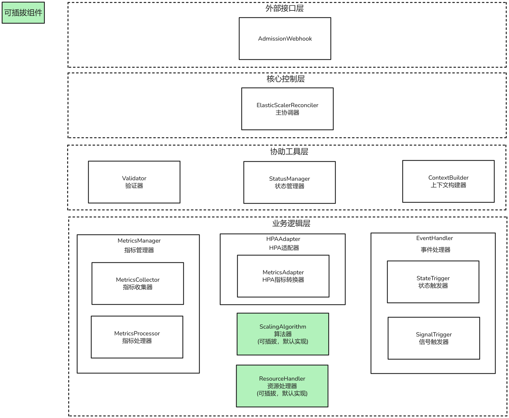
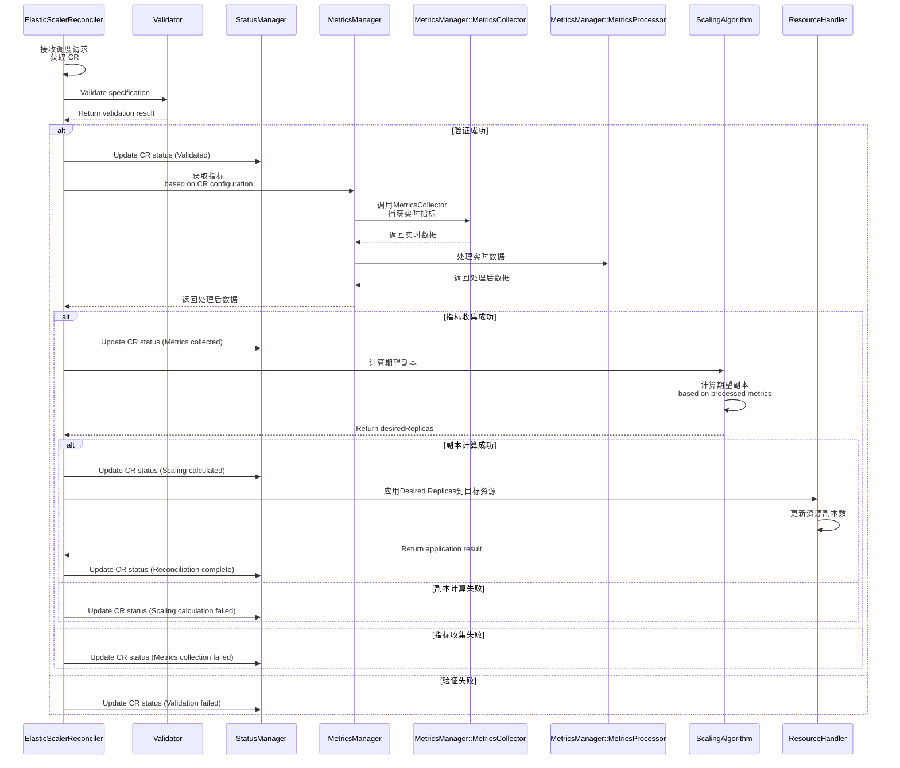
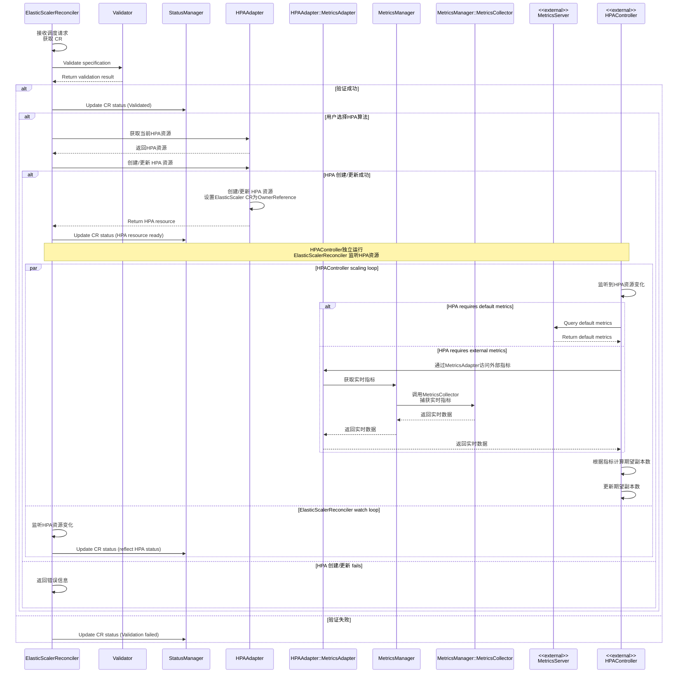
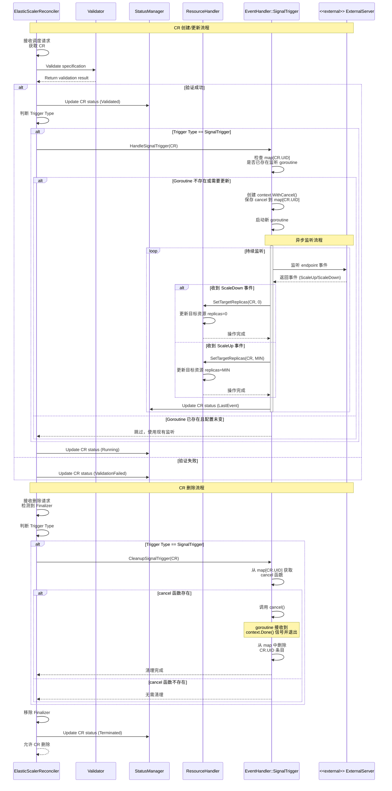
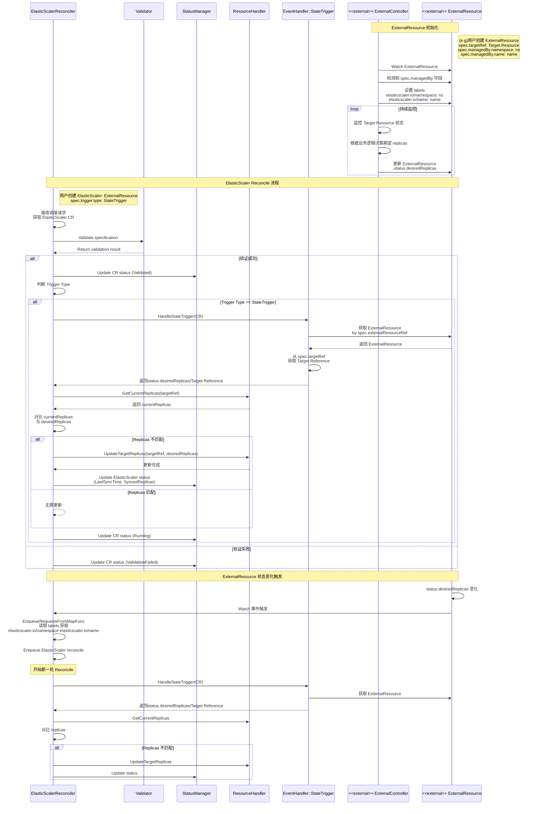
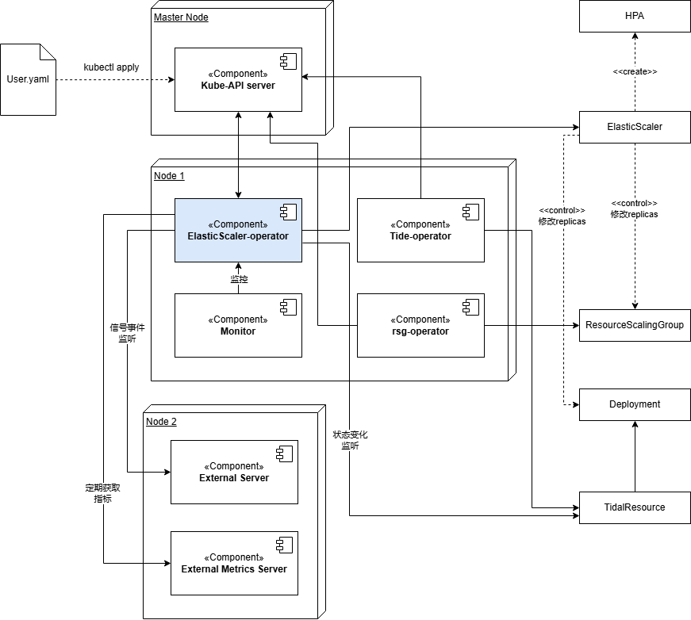

---
# 提案标题
title: 通用扩缩容决策框架设计提案
# 提案编号
ofep-number: 0030
# 提案作者
authors:
  - "@wang-bubo"
# 提案主导SIG
owning-sig: sig-ai-inference
# 提案协作SIG
participating-sigs:
# 提案状态(初步草案|准备开始实现|已在SIG中实现并合并|提案被暂缓|提案被否决|作者主动撤回提案|被另一个oFEP取代)
status: provisional
# 创建日期
creation-date: 2026-01-07
# 评审人
reviewers:
  - TBD
# 批准人
approvers:
  - TBD
# 相关联的其他oFEP
see-also:
  - "/ofeps/sig-ai-inference/0029-面向PD分离场景的基于RoleBasedGroup的动态扩缩方案"
# 当前oFEP替代了哪些已有提案
replaces:
# 当前oFEP被哪些提案替代，当status为replaced时需要填写此字段
replaced-by:
# 此oFEP当前开发阶段
stage: alpha
# 最近一次推进的版本
latest-milestone: TODO
# 各阶段目标版本
milestone: TODO
# 功能开关及影响组件
feature-gates:
  - name: TODO
    components:
      - TODO
# 是否支持关闭该功能
disable-supported: true
# 该功能引入的监控指标
metrics:
  - TODO
---

# oFEP-0030：通用扩缩容决策框架设计提案

<!-- toc -->
- [发布签核清单](#release-signoff-checklist)
- [概括](#summary)
- [动机](#motivation)
  - [目标](#goals)
  - [非目标](#non-goals)
- [提案](#proposal)
  - [用户故事](#user-stories-optional)
    - [故事 1](#story-1)
    - [故事 2](#story-2)
  - [风险与缓解措施](#risks-and-mitigations)
- [设计细节](#design-details)
  - [逻辑视图](#test-plan)
  - [部署视图](#prerequisite-testing-updates)
  - [时序图](#unit-tests)
  - [开发详解](#integration-tests)
<!-- /toc -->

## 1. 发布签核清单
<!--
**需要采取的行动：**为了将代码合并到一个版本中，在[openfuyao/ofep]引用此oFEP并在目标版本的[增强冻结]之前瞄准发布里程碑**中必须存在问题。

对于对核心代码或流程/程序进行更改的增强功能，例如：[openfuyao/openfuyao]，我们需要完成以下发布签署清单。

完成后勾选这些，以便发布团队跟踪。为了发布增强，必须更新这些检查表项。
-->

标记有（R）的项目*在达到里程碑/发布*之前是必需的。
- [ ]（R）发布里程碑中的增强问题，链接到 [openfuyao/ofep] 中的 oFEP 目录
- [ ] (R) oFEP 审批者已批准 oFEP 状态为“可实施”
- [ ] (R) 设计细节已适当记录
- [ ]（R）测试计划已到位，并考虑了 SIG 架构和 SIG 测试的输入（包括测试重构）
  - [ ] 针对所有 Beta API 操作（端点）进行 e2e 测试
  - [ ] (R) 确保 GA e2e 测试满足一致性测试的要求
  - [ ] (R) GA e2e 测试至少需要两周时间才能证明测试结果无 flake（不稳定或偶发失败）
- [ ] (R) 毕业标准已设定
  - [ ] (R) 所有 GA 端点必须通过[一致性测试]
- [ ] (R) 生产准备情况审查完成
- [ ] (R) 生产准备情况审查已获批准
- [ ] “实施历史”部分已更新里程碑
- [ ] 面向用户的文档已在 [openfuyao/docs] 创建，以便发布到 [openfuyao.com]
- [ ] 支持文档 - 例如，额外的设计文档、邮件列表讨论/SIG 会议链接、相关 PR/问题、发行说明

<!--
**注意：**此清单是迭代的，每次考虑将此增强功能作为里程碑时都应进行审查和更新。
-->

- [openfuyao.com](https://openfuyao.com/)
- [openfuyao/ofep](https://gitcode.com/openfuyao/ofep)
- [openfuyao/docs](https://gitcode.com/openfuyao/docs)

## 2. 概括
本提案设计并引入一个通用的扩缩容决策框架，用于满足不同业务场景下的扩缩容决策需求。

在扩缩模式上，本框架同时支持**指标驱动**与**事件驱动**两类扩缩语义, 其中事件驱动主要服务于资源需求有显著波动或突发变化的业务场景。

在算法接入与资源管理层面，本框架采用插件化机制，支持不同业务场景下扩缩容决策算法及自定义资源管理逻辑的灵活扩展。

## 3. 动机
随着业务对决策框架能力要求的不断提升, 决策系统已不再仅关注负载跟随, 而需要同时支持多算法选择，事件与指标协同决策，以及可控的零值扩缩管理机制。进一步地, 部分业务场景还要求基于事件直接表达明确的容量目标, 例如潮汐流量或定时负载切换等。这对扩缩容决策模型提出了更高要求。

然而, 主流方案在上述能力之间难以同时兼顾: 
部分方案在算法与指标支持上较为丰富, 但是对事件驱动的建模能力有限。另一些方案在基于信号事件驱动的场景中表现成熟, 却高度依赖特定扩缩算法,难以支撑更复杂,可演进的决策逻辑。

整体而言，现有决策体系普遍缺乏可插拔的决策引擎抽象。当需要引入新算法或扩展到不同资源类型时，往往只能通过侵入式修改来实现, 显著增加系统演进和落地成本。

基于上述问题，有必要引入新的决策框架，以系统性的方式满足以下核心诉求：
1. **解耦决策与执行**: 通过插件化机制支持用户自定义扩缩容决策算法
2. **融合事件与指标**：同时支持基于资源或业务运行状态的指标决策, 以及基于事件触发的扩缩语义, 包括零值扩缩与目标副本数扩缩两类模式
3. **泛资源管理能力**: 不再局限于特性资源类型，通过插件机制支持任意自定义资源接入扩缩体系

### 3.1 目标
1. 插件化架构
	* 支持对扩缩容决策算法的插件化接入，使用户能够根据业务特性灵活定义和演进扩缩算法
	* 支持资源管理能力的插件化扩展, 通过自定义CRD管理插件，使不同类型资源能够无缝接入统一的扩缩体系
2. 支持指标驱动扩缩
    * 基于指标变化自动调节副本数，适用于持续运行、负载平滑变化的业务场景
    * 兼容HPA能力
3. 支持事件驱动扩缩容语义
	* **按事件触发:** 支持基于事件信号触发的scale-to/from-zero扩缩，用于按需启停资源
	* **状态驱动/明确目标副本数:** 支持直接指定目标副本数扩缩, 用于潮汐流量，定时容量切换等需要明确容量目标场景
4. 多指标体系
	* 支持多种来源的指标(系统指标，业务指标，外部指标)作为扩缩决策输入
	* 提供对HPA的扩展能力, 使其能够通过框架访问和使用非原生指标
5. 兼容现有k8s原生资源

### 3.2 非目标
1. 本框架不负责资源的创建，销毁和执行; 具体的操作由对应资源controller来完成
## 4. 提案
### 4.1 用户故事

#### 故事 1 
作为用户，我希望能够基于指标自动调整工作负载副本数
<!-- ```plantuml -->
@startuml
left to right direction
skinparam componentStyle ractangle

actor "用户" as User

rectangle "自动化扩缩管理" {
    (Target Resource) as UC1
    (ElasticScaler) as UC2
    (Metrics Server) as UC3
}

User --> UC1 :部署工作负载
User --> UC2 :配置 ElasticScaler CR

note top of UC1
    Target Resource 由用户提前创建
    ElasticScaler 仅负责副本协调
end note

UC3 ..> UC2: 提供指标
UC2 ..> UC1: 根据指标更新replicas

@enduml

<!-- ``` -->

#### 故事 2
作为用户我希望在特定时间段直接指定目标副本数，从而在可预测的流量高峰或低谷下提前完成容量调整
<!-- ```plantuml -->
@startuml
left to right direction
skinparam componentStyle ractangle

actor "用户" as User

rectangle "自动化扩缩管理" {
    (Target Resource) as UC1
    (ElasticScaler) as UC2
    (Tidal Resource) as UC5
}

User --> UC1 :部署工作负载
User --> UC2 :配置 ElasticScaler CR
User --> UC5 :部署 Tidal Resource

note top of UC5
    Tidal Resource 由用户提前创建
    并通过label绑定ElasticScaler
end note

UC2 ..> UC5: 监听
UC5 ..> UC2: status.replicas
UC2 ..> UC1: replicas = status.replicas
@enduml

<!-- ``` -->
#### 故事 3
作为平台管理员，我希望能够通过信号控制工作负载scale-to/from-zero
<!-- ```plantuml -->
@startuml
left to right direction
skinparam componentStyle ractangle

actor "用户" as User

rectangle "自动化扩缩管理" {
    (Target Resource) as UC1
    (ElasticScaler) as UC2
    (Signal Endpoint) as UC4
}

User --> UC1 :部署工作负载
User --> UC2 :配置 ElasticScaler CR

UC4 ..> UC2: scale signal
UC2 ..> UC1: replicas = 0 / MinReplicas
@enduml
<!-- ``` -->

#### 故事 4
作为高级用户，我希望能够引入自定义扩缩容算法和自定义资源来满足特定业务场景下扩缩容需求
<!-- ```plantuml -->
@startuml
left to right direction
skinparam componentStyle ractangle

actor "用户" as User

rectangle "自动化扩缩管理" {
    (ElasticScaler) as UC2
    (Custom Algorithm) as UC4
    (Custom Resource Process) as UC5
}

User --> UC4 : <<implement>>
User --> UC5 : <<implement>>

UC5 ..> UC2: <<extends>>
UC4 ..> UC2: <<extends>>
@enduml
<!-- ``` -->

### 4.2 风险和缓解措施
1. **风险:** 用户自定义算法与现有算法名称重复

    **缓解措施:** 算法注册阶段使用工厂模式进行唯一性校验; 若检测到重复名称，拒绝注册并打印明确warning信息，保证算法不会冲突
2. **风险:** 如果不同ElasticScaler对同一个targetRef进行管理，可能产生扩缩容操作相互覆盖，导致冲突

    **缓解措施:** 在控制器逻辑中保证ElasticScaler与TargetTRef一一对应关系; 创建时若发现重复管理，拒绝创建并给出提示
3. **风险:** 用户可能配置多个Trigger类型，引发决策冲突

    **缓解措施:** 控制器进行Trigger校验，保证ElasticScaler只能使用一种trigger策略；未来演进考虑多Trigger协作模式
4. **风险:** MetricsTrigger指标来源不可用，导致扩缩容失败

    **缓解措施:** 对异常情况记录事件并触发告警，不进行扩缩操作，保留现有副本数
5. **风险:** 事件驱动-明确副本数模式下，controller重启引起事件丢失

    **缓解措施:** 使用基于资源状态的reconcile机制，扩缩可通过轮询重新触发

6. **风险:** 指标扩缩容中，指标短时波动可能导致副本数变化过大，引发资源抖动

    **缓解措施:** 控制器在校验副本数合法性的基础上，引入防抖动机制以限制扩缩容频率和幅度


## 5. 设计细节

### 5.1 ElasticScaler CRD 设计
本提案设计了ElasticScaler CRD，用于统一管理资源的弹性扩缩容。为支持多种扩缩容决策模式(指标驱动，事件驱动-信号，事件驱动-状态)，CRD层引入统一的Trigger抽象, 用于明确不同触发源的语义

**(1) 字段详解**
|字段名	|类型	|说明	|
|-----|-----|-----|
|targetRef	|ObjectReference	|要扩缩容的目标资源引用 |
|trigger	|TriggerSpec	|扩缩容触发源抽象, 统一承载不同触发语义|
|trigger.type	|TriggerType |扩缩容触发类型，用于区分扩缩容决策路径|
|trigger.metricsTrigger	|MetricsTriggerSpec | 指标驱动扩缩容配置 |
| trigger.stateTrigger | StateTriggerSpec | 事件驱动-状态 扩缩容配置 |
| trigger.signalTrigger	| SignalTriggerSpec | 事件驱动-信号 扩缩容配置| 
|minReplicas	|int32 |最小副本数限制|
| maxReplicas | int32 |最大副本数限制|
			

**(2) 使用样例**

指标驱动扩缩容
```yaml
apiVersion: autoscaling.openfuyao.io/v1alpha1
kind: ElasticScaler
metadata:
  name: metrics-scaler-example
spec:
  targetRef:
    apiVersion: apps/v1
    kind: Deployment
    name: my-app
  minReplicas: 2
  maxReplicas: 10
  trigger:
    type: MetricsTrigger
    metricsTrigger:
      scalingAlgorithm: HPA
      metrics:
        - type: Resource
          resource:
            metricsName: cpu
            target:
              type: Utilization
              averageUtilization: 70
```
事件驱动扩缩容-信号触发
```yaml
apiVersion: autoscaling.openfuyao.io/v1alpha1
kind: ElasticScaler
metadata:
  name: signal-scaler-example
spec:
  targetRef:
    apiVersion: apps/v1
    kind: Deployment
    name: my-app
  minReplicas: 0
  maxReplicas: 10
  trigger:
    type: SignalTrigger
    signalTrigger:
      endpoint: "https://webhook.example.com/scale-signal"
```
事件驱动扩缩容-明确副本数 , 使用状态驱动的资源需要在指标上添加指定label
```yaml
apiVersion: autoscaling.openfuyao.io/v1alpha1
kind: ElasticScaler
metadata:
  name: state-scaler-example
spec:
  targetRef:
    apiVersion: apps/v1
    kind: Tide
    name: my-app
  trigger:
    type: StateTrigger
    stateTrigger: {}
```

**(3) 复杂字段 MetricSpec 详解**
* 对应`trigger.metricsTrigger.metrics`字段，类型为`[]MetricSpec`，用于扩缩容决策的指标列表。
* MetricSpec 通过 type 字段区分三种指标类型，每种类型有独立配置：
  * **Resource**：`metricsName` + K8s 原生 `target`（MetricTarget：Utilization / Value / AverageValue）
  * **External**：`metricsName` + 通用 `target` + `selector`（可选）
  * **ExternalServer**：`metricsName` + 通用 `target` + `endpoint` + `protocol`
```
MetricSpec
├── type: MetricType (枚举值: Resource | External | ExternalServer)  [必填]
│
├── 当 type = Resource 时（Kubernetes 原生资源指标）：
│   └── resource: ResourceMetricSpec  [必填] — metricsName, target
│
├── 当 type = External 时（Kubernetes External Metrics）：
│   └── external: ExternalMetricSpec  [必填] — metricsName, target, selector
│
└── 当 type = ExternalServer 时（外部服务器指标）：
    └── externalServer: ExternalServerMetricSpec  [必填] — metricsName, target, endpoint, protocol
```

### 5.2 逻辑视图

从逻辑视角来看，框架整体划分为四个层次：外部接口层、核心控制层、协调工具层和业务逻辑层。

**外部接口层**
外部接口层负责框架与API Server之间的交互与约束控制。
* AdmissionWebhook 模块
    * 对 ElasticScaler 相关 CR 的创建与更新请求进行准入校验
    * 提前拦截不合法或语义冲突的配置，降低控制器运行时复杂度

**核心控制层**
核心控制层是框架的调度与协调中心。
* ElasticScalerReconciler 模块
    * 作为主协调器，负责 ElasticScaler CR 的生命周期管理
    * 组织并驱动各业务组件完成一次完整的扩缩决策与执行流程
    * 串联指标采集、事件处理、算法决策与资源更新等核心路径

**协调工具层**
协调工具层为核心控制层提供通用支撑能力，避免业务逻辑与通用流程耦合。
* Validator 模块
    * 负责控制器侧的 CR 语义校验
    * 对跨字段约束、策略组合合法性等复杂规则进行校验
* StatusManager 模块
    * 负责 ElasticScaler CR 状态的计算与更新
* ContextBuilder 模块
    * 负责在不同组件交互过程中构建与传递上下文信息

**业务逻辑层**
业务逻辑层承载具体的扩缩容决策与执行能力，面向指标驱动与事件驱动两类扩缩模式。

* MetricsManager 模块（指标扩缩）
负责指标驱动模式的整体指标管理，包含以下子模块：
    * MetricsCollector 模块：与外部指标系统交互，采集实时指标数据
    * MetricsProcessor 模块：对采集到的指标进行处理，如防抖、平滑、聚合等
* ScalingAlgorithm 模块
    * 根据 MetricsManager 提供的指标数据计算目标副本数
    * 采用插件化机制，允许用户自定义和扩展扩缩算法
* HPAAdapter 模块
    * 负责对接 Kubernetes 原生 HPA 算法
    * MetricsAdapter 模块: 通过暴露 External Metrics 接口，使 HPA 能够使用框架内的指标体系

* EventHandler 模块（事件扩缩）
    * 负责事件驱动扩缩模式的处理，包含以下子模块：
    * SignalTrigger 模块：服务于 scale-to/from-zero 场景的事件触发
    * StateTrigger 模块：服务于基于状态的目标副本数触发模式
* ResourceHandler 模块
    * 负责与被扩缩目标资源交互，包括获取与更新副本数
    * 采用插件化模式，支持不同类型资源（不仅限于原生工作负载）接入扩缩体系

### 5.3 时序图
以下时序图用于说明ElasticScaler在不同扩缩模式下控制流程与组件交互关系。四种模式 (`指标-自定义算法`，`指标-HPA算法`, `事件-信号驱动`, `事件-状态驱动`) 在执行路径上有显著差异，因此分别给出对应时序说明。

**基于指标的自定义算法扩缩**
* 扩缩容与执行均有ElasticScaler控制器负责
* 指标采集，处理与副本数计算在统一控制回路中完成

**基于指标的HPA算法扩缩**
* ElasticScaler仅负责HPA资源生命周期管理和状态映射
* 实际扩缩决策由k8s原生HPA Controller执行


**基于事件信号扩缩**
* 在信号模式下, ElasticScaler不计算副本数, 仅响应外部事件，根据预定义配置(minReplicas)执行扩缩


**基于明确副本数扩缩**
* 在状态驱动模式下，副本数由外部系统计算并写入ExternalResource.status, ElasticScaler仅负责执行
* 这里以潮汐资源为例，展示基于明确副本数的扩缩时序


### 5.4 组件外部交互与安全
本节说明框架各组件与外部系统的交互边界及对应的安全策略，确保在功能完整的前提下最小化权限风险。
| 组件                    | 职责                           | 外部交互对象                               | 协议                   | 权限要求                                                                                          |
| ----------------------- | ---------------------------------------- | ------------------------------------------ | ---------------------- | ------------------------------------------------------------------------------------------------ |
| AdmissionWebhook        | 校验 ElasticScaler CR 创建/更新 | API Server                                 | HTTPS                  | - `elasticscalers`：`get` |
| ElasticScalerReconciler | 协调扩缩流程，读 CR/目标资源，更新 status/finalizers | API Server                                 | HTTPS                  | - `elasticscalers`：`get`, `list`, `watch`<br>- `elasticscalers/status`、`elasticscalers/finalizers`：`get`, `update`, `patch`<br>- 目标资源(k8s原生+用户crd)：基于label获取，`get`, `list`, `watch`<br>- hpa:  `get`, `list`, `watch`|
| ResourceHandler         | 修改目标工作负载副本数及 scale 子资源      | API Server                                 | HTTPS                  | - 目标工作负载（k8s 原生 + 用户自定义 CRD）：`get`, `patch`, `update`<br>- 对应资源的 `*/scale` 子资源：`get`, `patch`, `update` |
| MetricsManager::MetricsCollector        | 采集系统、业务及外部指标                  | API Server / 外部指标系统                  | HTTPS / HTTP / gRPC    | - `pods`（核心组 `""`）：`get`, `list`<br>- `pods.metrics.k8s.io`、`nodes.metrics.k8s.io`：`get`, `list`<br>- Custom / External Metrics：`get` |
| HPAAdapter::MetricsAdapter          | 暴露 External Metrics 给 HPA 使用         | API Server（对 HPA 提供 Metrics）          | HTTPS                  | - |
| HPAAdapter              | 对接 HPA，实现 HPA 生命周期管理与扩缩适配 | API Server                                 | HTTPS                  | - `hpa`：`get`, `create`, `update`, `patch` |
| StateTrigger           | 获取targetRef CR 细节         | API Server                                   | HTTPS  | - 目标工作负载（k8s 原生 + 用户自定义 CRD）：`get` |
| SignalTrigger           | 事件驱动扩缩触发，仅与外部系统通信         | 外部系统                                   | HTTP / HTTPS / gRPC    | - |

### 5.5 部署视图
下图展示了 ElasticScaler 在集群中的部署视图。ElasticScaler 以 Operator 形式运行，与 API Server、External Metrics Server 和 External Signal Server 进行交互。
弹性扩缩操作通过 ElasticScaler CR 更新绑定资源的副本数实现。对于状态驱动场景（以潮汐流量 tidal 为例），ElasticScaler 会监控外部资源的变化，并根据变化调整 CR 状态，从而最终触发资源的扩缩操作。


## 6. 开发详解
本节从开发实现视角展开，给出扩缩容框架核心模块的接口定义与职责说明。
### 6.1 AdmissionWebhook 模块
```go
type ElasticScalerCustomDefaulter struct {
	// TODO(user): Add more fields as needed for defaulting
}
var _ webhook.CustomDefaulter = &ElasticScalerCustomDefaulter{}

// Default implements webhook.CustomDefaulter so a webhook will be registered for the Kind ElasticScaler.
func (d *ElasticScalerCustomDefaulter) Default(_ context.Context, obj runtime.Object) error {
	// TODO(user): fill in your defaulting logic.
	return nil
}
type ElasticScalerCustomValidator struct {
	// TODO(user): Add more fields as needed for validation
}

var _ webhook.CustomValidator = &ElasticScalerCustomValidator{}

// ValidateCreate implements webhook.CustomValidator so a webhook will be registered for the type ElasticScaler.
func (v *ElasticScalerCustomValidator) ValidateCreate(_ context.Context, obj runtime.Object) (admission.Warnings, error) {
	// TODO(user): fill in your validation logic upon object creation.
	return nil, nil
}

// ValidateUpdate implements webhook.CustomValidator so a webhook will be registered for the type ElasticScaler.
func (v *ElasticScalerCustomValidator) ValidateUpdate(_ context.Context, oldObj, newObj runtime.Object) (admission.Warnings, error) {
	// TODO(user): fill in your validation logic upon object update.
	return nil, nil
}

// ValidateDelete implements webhook.CustomValidator so a webhook will be registered for the type ElasticScaler.
func (v *ElasticScalerCustomValidator) ValidateDelete(ctx context.Context, obj runtime.Object) (admission.Warnings, error) {
	// TODO(user): fill in your validation logic upon object deletion.
	return nil, nil
}

```
### 6.2 ElasticScalerReconciler 模块
```go
type ElasticScalerReconciler struct {
	client.Client
	Scheme *runtime.Scheme

	// Component interfaces
	validator       validator.Validator
	statusManager   status.StatusManager
	metricsManager  metrics.MetricsManager
	scalingAlgo     scaling.ScalingAlgorithm
	resourceHandler resource.ResourceHandler
	eventHandler    event.EventHandler
}

func (r *ElasticScalerReconciler) Reconcile(ctx context.Context, req ctrl.Request) (ctrl.Result, error) {
    //TODO
}
func (r *ElasticScalerReconciler) handleMetricsTrigger(ctx context.Context, es *autoscalingv1alpha1.ElasticScaler) (ctrl.Result, error) {
    //TODO
}
func (r *ElasticScalerReconciler) handleStateTrigger(ctx context.Context, es *autoscalingv1alpha1.ElasticScaler) (ctrl.Result, error) {
    //TODO
}
func (r *ElasticScalerReconciler) handleSignalTrigger(ctx context.Context, es *autoscalingv1alpha1.ElasticScaler) (ctrl.Result, error) {
    //TODO
}
func (r *ElasticScalerReconciler) handleDeletion(ctx context.Context, es *autoscalingv1alpha1.ElasticScaler) (ctrl.Result, error) {
    //TODO
}
func (r *ElasticScalerReconciler) SetupWithManager(mgr ctrl.Manager) error {
    //TODO
}
```

### 6.3 Validator 模块
```go
// Validator validates ElasticScaler specifications.
type Validator interface {
	// Validate validates the ElasticScaler specification.
	// Returns an error if validation fails, nil otherwise.
	Validate(ctx context.Context, es *autoscalingv1alpha1.ElasticScaler) error
}
```
### 6.4 StatusManager 模块
```go
// StatusManager manages the status of ElasticScaler resources.
type StatusManager interface {
	// UpdateCondition updates a specific condition in the ElasticScaler status.
	UpdateCondition(ctx context.Context, es *elasticscaleriov1alpha1.ElasticScaler, conditionType string, status bool, reason, message string) error

	// UpdateCurrentReplicas updates the current replicas in the status.
	UpdateCurrentReplicas(ctx context.Context, es *elasticscaleriov1alpha1.ElasticScaler, replicas int32) error

	// UpdateDesiredReplicas updates the desired replicas in the status.
	UpdateDesiredReplicas(ctx context.Context, es *elasticscaleriov1alpha1.ElasticScaler, replicas int32) error

	// UpdateLastSyncTime updates the last sync time in the status.
	UpdateLastSyncTime(ctx context.Context, es *elasticscaleriov1alpha1.ElasticScaler) error

	// UpdateLastScaleTime updates the last scale time in the status.
	UpdateLastScaleTime(ctx context.Context, es *elasticscaleriov1alpha1.ElasticScaler) error

	// UpdateStatus updates the full status in a single call.
	// Use this to batch multiple status field changes and avoid frequent Status().Update calls.
	UpdateStatus(ctx context.Context, es *elasticscaleriov1alpha1.ElasticScaler) error
}
```
### 6.5 ContextBuilder 模块
```go
type ContextBuilder interface {
	BuildMetricsContext(ctx context.Context, es *elasticscaleriov1alpha1.ElasticScaler) (MetricsContext, error)
	BuildScalingAlgorithmContext(ctx context.Context, es *elasticscaleriov1alpha1.ElasticScaler) (ScalingAlgorithmContext, error)
}
```
### 6.6 MetricsManager 模块
```go
type MetricsManager interface {
	// GetMetrics gets metrics from the given metrics context.
	GetMetrics(ctx context.Context, metricsContext escontext.MetricsContext) ([]elasticscaleriov1alpha1.MetricSpec, error)
}
```
#### 6.6.1 MetricCollector 模块
```go
type MetricsCollector interface {
	// CollectMetrics collects metrics from the given metrics context.
	CollectMetrics(ctx context.Context, metricsContext escontext.MetricsContext) ([]elasticscaleriov1alpha1.MetricSpec, error)
}
```
#### 6.6.2 MetricsProcessor 模块
```go
type MetricsProcessor interface {
	// ProcessMetrics processes the given metrics.
	ProcessMetrics(ctx context.Context, metrics []elasticscaleriov1alpha1.MetricSpec, metricscontext escontext.MetricsContext) ([]elasticscaleriov1alpha1.MetricSpec, error)
}
```

### 6.7 ScalingAlgorithm 模块
**算法接口 ScalingAlgorithm**
* 根据 context 和 processingCtx（含算法参数、指标等）计算期望副本数。所有具体算法都要实现该接口。
```go
// ScalingAlgorithm calculates desired replicas based on metrics.
type ScalingAlgorithm interface {
	// CalculateDesiredReplicas calculates the desired number of replicas
	// based on the processing context which contains ElasticScaler configuration,
	// current metrics, and other context information.
	CalculateDesiredReplicas(
		ctx context.Context,
		processingCtx *escontext.ScalingAlgorithmContext,
	) (int32, error)
}
```
**注册表类型 AlgorithmRegistry**
* 注册表负责按名称存储、查找算法，不实现 ScalingAlgorithm。内置 `map[string]ScalingAlgorithm`，提供 `Register`、`Get`，以及`CalculateDesiredReplicas` 转发入口。
```go
// pkg/scaling/algorithm.go

// AlgorithmRegistry stores and retrieves scaling algorithm implementations by name.
// It does not implement ScalingAlgorithm; actual algorithms (e.g. xpa) do.
type AlgorithmRegistry struct {
	mu         sync.RWMutex
	algorithms map[string]ScalingAlgorithm
}

// DefaultRegistry is the shared algorithm registry used by the controller.
// Custom algorithms (e.g. xpa) register via init.
var DefaultRegistry = NewAlgorithmRegistry()

// NewAlgorithmRegistry creates a new AlgorithmRegistry.
func NewAlgorithmRegistry() *AlgorithmRegistry {
	return &AlgorithmRegistry{
		algorithms: make(map[string]ScalingAlgorithm),
	}
}
```
Register 将算法以 name 注册到表中，同名重复注册会返回错误。Get 按名称查找，未找到则返回 (nil, false)。未来考虑将算法注册机制扩展为按需初始化。
```go
// Register registers a scaling algorithm under the given name.
func (r *AlgorithmRegistry) Register(name string, algorithm ScalingAlgorithm) error {
	r.mu.Lock()
	defer r.mu.Unlock()
	if _, exists := r.algorithms[name]; exists {
		return fmt.Errorf("algorithm %s already registered", name)
	}
	r.algorithms[name] = algorithm
	return nil
}


// Get returns the algorithm registered under name, or (nil, false) if not found.
func (r *AlgorithmRegistry) Get(name string) (ScalingAlgorithm, bool) {
	r.mu.RLock()
	defer r.mu.RUnlock()
	alg, ok := r.algorithms[name]
	return alg, ok
}
```
`CalculateDesiredReplicas`作为统一入口，封装了从ElasticScaler解析算法名并完成算法调度的通用逻辑;
根据配置读取算法名，查表后转发给对应实现的scalingAlgorithm
```go
// pkg/scaling/algorithm.go

// CalculateDesiredReplicas looks up the algorithm from the ElasticScaler spec,
// then delegates to its CalculateDesiredReplicas. Use this when processing
// a single ElasticScaler reconciliation.
func (r *AlgorithmRegistry) CalculateDesiredReplicas(
	ctx context.Context,
	processingCtx *procctx.ProcessingContext,
) (int32, error) {
	if processingCtx == nil || processingCtx.ElasticScaler == nil {
		return 0, fmt.Errorf("processing context or ElasticScaler is nil")
	}

	es := processingCtx.ElasticScaler
	algorithmName := es.Spec.Trigger.MetricsTrigger.ScalingAlgorithm
	if algorithmName == "" {
		return 0, fmt.Errorf("scalingAlgorithm not specified")
	}

	r.mu.RLock()
	algorithm, exists := r.algorithms[algorithmName]
	r.mu.RUnlock()
	if !exists {
		return 0, fmt.Errorf("algorithm %q not registered", algorithmName)
	}

	return algorithm.CalculateDesiredReplicas(ctx, processingCtx)
}
```

**算法实现示例**
* 定义 xpaAlgorithm, 实现 ScalingAlgorithm 接口，在 初始化阶段完成在DefaultRegistry中的注册
```go
// pkg/scaling/xpa.go

func init() {
	if err := DefaultRegistry.Register("xpa", NewXpaAlgorithm()); err != nil {
		// panic(err)
		fmt.Println("register xpa algorithm failed", err)
	}
}

var _ ScalingAlgorithm = &xpaAlgorithm{}

type xpaAlgorithm struct{}

// NewXpaAlgorithm returns the XPA scaling algorithm implementation.
func NewXpaAlgorithm() ScalingAlgorithm {
	return &xpaAlgorithm{}
}

func (a *xpaAlgorithm) CalculateDesiredReplicas(ctx context.Context, processingCtx *procctx.ProcessingContext) (int32, error) {
	// TODO: implement XPA logic using processingCtx
	return 0, nil
}
```

### 6.8 ResourceHandler 模块
**资源接口 ResourceHandler**
* 抽象处理目标资源的能力，对接资源都需实现这个接口。
```go
type ResourceHandler interface {
	// GetCurrentReplicas gets the current number of replicas of the target resource.
	GetCurrentReplicas(ctx context.Context, targetRef corev1.ObjectReference) (int32, error)

	// UpdateReplicas updates the number of replicas of the target resource.
	UpdateReplicas(ctx context.Context, targetRef corev1.ObjectReference, desiredReplicas int32) error

	// GetPodList gets the list of pods managed by the target resource.
	GetPodList(ctx context.Context, targetRef corev1.ObjectReference) (*corev1.PodList, error)

	// Supports checks if the handler supports the given resource type.
	Supports(targetRef corev1.ObjectReference) bool
}
```
**HandlerFactory 与注册表 FactoryRegistry**
* 支持CustomResourceHandler按照GVK注册
```go
// HandlerFactory creates a ResourceHandler for a given controller-runtime client.
// Custom handlers should be registered via RegisterResourceHandler in an init() function.
type HandlerFactory func(c client.Client) ResourceHandler

var (
	registryMu       sync.RWMutex
	handlerFactories = map[string]HandlerFactory{} // key: apiVersion/kind
	defaultFactory   HandlerFactory
)

func gvkKey(apiVersion, kind string) string {
	return apiVersion + "/" + kind
}

func RegisterResourceHandler(apiVersion, kind string, factory HandlerFactory) {
	if apiVersion == "" || kind == "" {
		panic("RegisterResourceHandler: apiVersion/kind must be non-empty")
	}
	if factory == nil {
		panic("RegisterResourceHandler: factory must be non-nil")
	}

	key := gvkKey(apiVersion, kind)
	registryMu.Lock()
	defer registryMu.Unlock()

	if _, exists := handlerFactories[key]; exists {
		panic(fmt.Sprintf("RegisterResourceHandler: duplicate handler factory for %s", key))
	}
	handlerFactories[key] = factory
}
```
**控制器统一入口Handler**
* ResourceManager作为统一入口，内置handler，负责根据资源类型路由到实际处理对象
```go
/type ResourceManager struct {
	Client client.Client

	mu       sync.RWMutex
	handlers map[string]ResourceHandler // key: apiVersion/kind (or "__default__" for fallback)
}

func NewResourceManager(client client.Client) *ResourceManager {
	return &ResourceManager{
		Client:   client,
		handlers: make(map[string]ResourceHandler),
	}
}

func (r *ResourceManager) getHandler(targetRef corev1.ObjectReference) (ResourceHandler, error) {
    //TODO
}
```

**自定义CRD处理实现示例**
* 实现ResourceHandler接口，并注册到factoryRegistry中
```go
func init() {
	RegisterResourceHandler(func(c client.Client) ResourceHandler {
		return &DefaultCustomResourceHandler{Client: c}
	})
}

type ExternalResourceHandler struct {
}

func (h *ExternalResourceHandler) Supports(ref corev1.ObjectReference) bool {
	//TODO
}

func (h *ExternalResourceHandler) GetCurrentReplicas(
	ctx context.Context,
	ref corev1.ObjectReference,
) (int32, error) {
	// TODO: 根据你的 CRD 结构读取当前 replicas（spec 或 status）
	return 0, fmt.Errorf("not implemented")
}

func (h *ExternalResourceHandler) UpdateReplicas(
	ctx context.Context,
	ref corev1.ObjectReference,
	desired int32,
) error {
	// TODO: 更新你的 CRD 的 spec.replicas 或类似字段
	return fmt.Errorf("not implemented")
}

func (h *ExternalResourceHandler) GetPodList(
	ctx context.Context,
	ref corev1.ObjectReference,
) (*corev1.PodList, error) {
	// TODO: 根据 CRD 中定义的 selector 列 Pod
	selector := labels.Everything()
	podList := &corev1.PodList{}
	if err := h.client.List(ctx, podList, &client.ListOptions{
		Namespace:     ref.Namespace,
		LabelSelector: selector,
	}); err != nil {
		return nil, err
	}
	return podList, nil
}
```

### 6.9 EventHandler 模块
#### 6.9.1 StateTrigger 子模块
```go
// StateTrigger handles state-based scaling with explicit replica targets.
type StateTrigger interface {
	// HandleStateTrigger handles state trigger logic for the given ElasticScaler.
	// It reads the desired replicas from the target resource's status and updates accordingly.
	HandleStateTrigger(ctx context.Context, es *autoscalingv1alpha1.ElasticScaler) error
}
```
#### 6.9.2 SignalTrigger 子模块
```go
// SignalTrigger handles signal-based scale-to/from-zero events.
type SignalTrigger interface {
	// HandleSignalTrigger starts or updates the signal trigger handler for the given ElasticScaler.
	// It should manage goroutines for listening to signals and updating replicas accordingly.
	HandleSignalTrigger(ctx context.Context, es *autoscalingv1alpha1.ElasticScaler) error

	// CleanupSignalTrigger cleans up resources associated with the signal trigger for the given ElasticScaler.
	CleanupSignalTrigger(ctx context.Context, es *autoscalingv1alpha1.ElasticScaler) error
}
```
### 6.10 HPAAdapter 模块
```go
type HPAAdapter interface {
	GetHPA(ctx context.Context, es *elasticscaleriov1alpha1.ElasticScaler) (*autoscalingv2.HorizontalPodAutoscaler, error)
	// Create or update HPA
	// current can be nil when not found.
	CreateOrUpdateHPA(ctx context.Context, es *elasticscaleriov1alpha1.ElasticScaler, current *autoscalingv2.HorizontalPodAutoscaler) error
}
```
#### 6.10.1 MetricsAdapter 模块
```go
// ExternalMetricsQuery is the minimal, stable interface a MetricsAdapter implementation
// should depend on to serve Kubernetes HPA "External" metrics.
//
// Note:
// - HPA queries external metrics by (namespace, metricName, labelSelector).
// - The REST/aggregation details live outside this package; this interface is intentionally transport-agnostic.
type MetricsAdapter interface {
	// ListMetricNames returns metric names that can be queried.
	// Implementations may return an empty list when discovery is not supported.
	ListMetricNames(ctx context.Context) ([]string, error)

	// Get returns one or more time series for a metric.
	//
	// For HPA, returning multiple items is valid (different label sets). The labelSelector
	// is applied server-side to filter series.
	Get(ctx context.Context, req ExternalMetricRequest) (ExternalMetricResponse, error)
}
```


