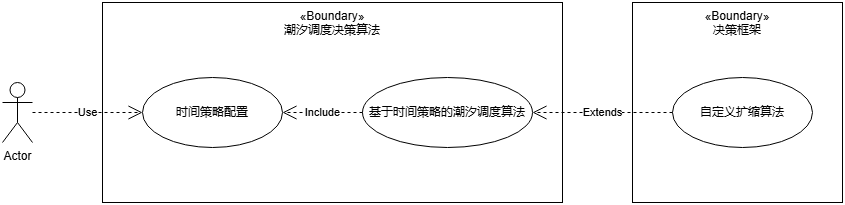
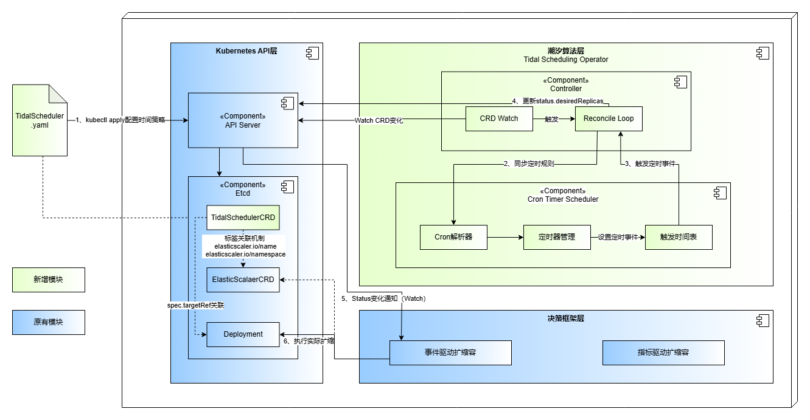
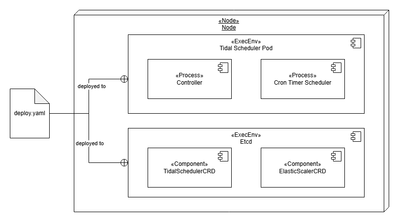
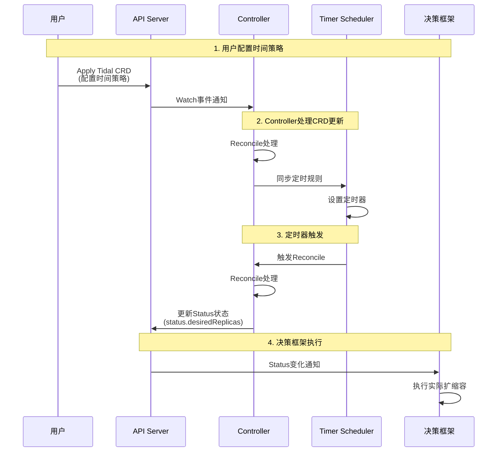

---
# 提案标题
title: 基于时间因素的潮汐调度决策算法
# 提案编号
ofep-number: 0033
# 提案作者
authors:
  - "@xinhongchen"
# 提案主导SIG
owning-sig: sig-ai-inference
# 提案协作SIG
participating-sigs:
# 提案状态(初步草案|准备开始实现|已在SIG中实现并合并|提案被暂缓|提案被否决|作者主动撤回提案|被另一个oFEP取代)
status: provisional
# 创建日期
creation-date: 2026-01-23
# 评审人
reviewers:
  - foxbit
# 批准人
approvers:
# 相关联的其他oFEP
see-also:
  - "/ofeps/sig-ai-inference/面向PD分离场景的基于RoleBasedGRoup的动态扩缩调度方案"
  - "/ofeps/sig-ai-inference/通用扩缩容决策框架设计提案"
# 当前oFEP替代了哪些已有提案
replaces:
# 当前oFEP被哪些提案替代，当status为replaced时需要填写此字段
replaced-by:
# 此oFEP当前开发阶段
stage: alpha
# 最近一次推进的版本
latest-milestone: "v0.1.0"
# 各阶段目标版本
milestone:
  alpha: "v0.1.0"
feature-gates:
  - name: TODE
    components:
      - TODE
# 是否支持关闭该功能
disable-supported: false
# 该功能引入的监控指标
metrics:
  - times
---
<!--
**注意：**当你的 oFEP 完成时，应删除所有这些注释块。

要开始使用此模板：
- [ ] **选择一个托管 SIG。**
  确保该问题领域是 SIG 感兴趣的。如果没有 SIG 的赞助，oFEP 不应提交。
-[]**在 openfuyao/ofep 中创建问题**
  提交增强功能跟踪问题时，请务必填写该模板中的所有字段。其中一个字段要求提供指向 oFEP 的链接。你可以留空该字段，直到提交此 oFEP 后再返回到增强功能并添加链接。
- [ ] **复制此模板目录。**
  将此模板复制到所属 SIG 的目录中，并将其命名为“ofep-NNNN-short-descriptive-title”，其中“NNNN”是分配给上述增强功能的问题编号（没有前导零填充）。
- [ ] **尽可能多地填写以上oFEP元数据。**
  至少，你应该填写“标题”、“作者”、“SIG所有者”、“状态”和与日期相关的字段。
- [ ] **请尽可能详细地填写此文件。**
  至少，你应该填写“摘要”和“动机”部分。如果你已经和相关的 SIG 进行过前期沟通和想法验证，那么这两部分应该会很容易完成。
- [ ] **为此 oFEP 创建 PR。**
  将其指派给正在支持该流程的 SIG（特别兴趣小组）成员。
- [ ] **尽早合并并迭代。**
  避免纠结于具体细节，而应致力于明确 oFEP 的目标并快速合并。最好的方法是从概要部分开始，然后在后续的 PR 中逐步完善细节。

oFEP 合并并不意味着它已完成或获得批准。任何标记为“临时”的 oFEP 都是工作文档，可能会发生变更。你可以按以下方式标记正在积极讨论的部分：

编辑 oFEPS 时，请尽量使用范围明确、主题单一的 PR，以保持讨论的集中性。如果你不同意文档中已有的内容，请提交新的 PR 并提出修改建议。

一个 oFEP 对应其整个生命周期内的一项“功能”或“增强”。例如，从 Beta 版升级到 GA 版无需新的 oFEP。如果出现属于 oFEP 的新细节，请编辑 oFEP。一旦某个功能被“实现”，重大变更应该获得新的 oFEP。

最新（以及该文件的可能来源）的规范位置是[0000-ofep-template.md]（/0000-ofep-template.md）。

**注意：**任何将 oFEP 推进为“implementable”状态的 PR，或在标记为“implementable”后的重大更改，都必须得到每个 oFEP 批准人的批准。如果这些批准人均不合适（例如离开社区、角色变更等），则该列表的更改应由其余批准人和/或所属 SIG 批准。
-->
# oFEP-0033：基于时间因素的潮汐调度决策算法

<!--
这是你的 oFEP 的标题。请保持简短、简洁且描述性强。一个好的标题可以帮助传达什么是 oFEP，以及有助于审查与追踪。
-->

<!--
目录（TOC）有助于快速跳转到 oFEP 的各个部分，同时突出显示超出标准模板所提供的其他信息。

确保目录已用<code>&lt;!-- toc --&rt;&lt;!-- /toc --&rt;</code>标签，然后用`hack/update-toc.sh`生成。
-->

<!-- toc -->
- [发布签核清单](#发布签核清单)
- [概括](#概括)
- [动机](#动机)
  - [目标](#目标)
  - [规格说明](#规格说明)
- [提案](#提案)
  - [用户故事](#用户故事)
  - [注释/限制/注意事项（可选）](#注释限制注意事项可选)
  - [风险与缓解措施](#风险与缓解措施)
- [设计细节](#设计细节)
  - [逻辑视图](#逻辑视图)
  - [部署视图](#部署视图)
  - [运行视图](#运行视图)
  - [开发详解](#开发详解)
    - [1. TidalScheduler CRD 设计](#1-tidalscheduler-crd-设计)
      - [API 定义](#api-定义)
      - [字段说明](#字段说明)
      - [使用示例](#使用示例)
      - [状态字段](#状态字段)
    - [2. Controller实现细节](#2-controller实现细节)
    - [3. Timer Scheduler实现细节](#3-timer-scheduler实现细节)
    - [4. 与通用决策框架（oFEP-0030）的集成机制](#4-与通用决策框架ofep-0030的集成机制)
    - [5. 规则冲突处理机制](#5-规则冲突处理机制)
    - [6. 配置验证机制](#6-配置验证机制)
    - [7. 恢复机制](#7-恢复机制)
    - [8. 安全考虑](#8-安全考虑)
    - [9. 约束](#9-约束)
  - [测试计划](#测试计划)
    - [先决条件测试更新](#先决条件测试更新)
    - [单元测试](#单元测试)
    - [集成测试](#集成测试)
    - [e2e 测试](#e2e-测试)


<!-- /toc -->

## 发布签核清单
<!--
**需要采取的行动：**为了将代码合并到一个版本中，在[openfuyao/ofep]引用此oFEP并在目标版本的[增强冻结]之前瞄准发布里程碑**中必须存在问题。

对于对核心代码或流程/程序进行更改的增强功能，例如：[openfuyao/openfuyao]，我们需要完成以下发布签署清单。

完成后勾选这些，以便发布团队跟踪。为了发布增强，必须更新这些检查表项。
-->

标记有（R）的项目*在达到里程碑/发布*之前是必需的。
- [ ]（R）发布里程碑中的增强问题，链接到 [openfuyao/ofep] 中的 oFEP 目录
- [ ] (R) oFEP 审批者已批准 oFEP 状态为“可实施”
- [ ] (R) 设计细节已适当记录
- [ ]（R）测试计划已到位，并考虑了 SIG 架构和 SIG 测试的输入（包括测试重构）
  - [ ] 针对所有 Beta API 操作（端点）进行 e2e 测试
  - [ ] (R) 确保 GA e2e 测试满足一致性测试的要求
  - [ ] (R) GA e2e 测试至少需要两周时间才能证明测试结果无 flake（不稳定或偶发失败）
- [ ] (R) 毕业标准已设定
  - [ ] (R) 所有 GA 端点必须通过[一致性测试]
- [ ] (R) 生产准备情况审查完成
- [ ] (R) 生产准备情况审查已获批准
- [ ] “实施历史”部分已更新里程碑
- [ ] 面向用户的文档已在 [openfuyao/docs] 创建，以便发布到 [openfuyao.cn]
- [ ] 支持文档 - 例如，额外的设计文档、邮件列表讨论/SIG 会议链接、相关 PR/问题、发行说明

<!--
**注意：**此清单是迭代的，每次考虑将此增强功能作为里程碑时都应进行审查和更新。
-->

- [openfuyao.cn](https://openfuyao.cn/)
- [openfuyao/ofep](https://gitcode.com/openfuyao/ofep)
- [openfuyao/docs](https://gitcode.com/openfuyao/docs)

## 概括
<!--
这部分对于生成高质量、以用户为中心的文档（如发行说明或开发路线图）非常重要。应该在实现开始之前收集这些信息，以避免要求实现者在编写发行说明和实现功能本身之间分散注意力。oFEP 编辑器和SIG文档应该有助于确保“摘要”部分的语气和内容对广泛的受众有用。

好的摘要可能至少有一段长度。

在本节和下一节中，请遵循[文档样式指南]的指导方针。特别是，将代码行包装到合理的长度，使审阅者更容易引用特定的部分，并尽量减少更新的差异。
-->
针对电商、在线推理等具有明显潮汐特征的业务场景（如早晚高峰、节假日波峰、定期活动等），本提案设计一个专门面向潮汐业务的时间调度算法，作为通用决策框架（oFEP-0030）的算法扩展。该算法基于预配置的时间策略，在可预测的业务流量变化前主动调整副本数，为周期性业务负载提供更加及时的资源保障。

**术语说明**：本文档中提到的"通用决策框架"指的是oFEP-0030提案（通用扩缩容决策框架设计提案）中定义的决策框架。为便于阅读和理解，本文档后续统一使用"通用决策框架"这一术语，避免与其他决策框架混淆。
## 动机
<!--
本节用于明确列出该oFEP的动机、目标和非目标。描述变更的重要性以及对用户的好处。
-->
随着业务场景的不断演进，服务的扩缩需求日益多样化。通用决策框架（oFEP-0030）作为统一的扩缩容决策框架，主要基于实时监控指标进行扩缩决策，但在时间维度调度能力方面存在不足。针对具有明显潮汐特征的业务场景（如电商、在线推理等），需要补充以下能力：

1. **时间维度策略支持**：通用决策框架主要基于实时监控指标（如CPU、内存、QPS等）进行扩缩决策，缺乏对可预测周期性业务负载的时间维度专门支持。对于具有明显潮汐特征的业务场景（如早晚高峰、节假日波峰、定期营销活动），无法充分利用业务的时间规律性进行主动资源调整。

2. **业务日历感知能力**：现有算法无法识别工作日/周末差异、节假日特殊安排、定期营销活动等业务特征，导致资源调度与实际的业务节奏存在脱节，无法实现基于业务日历的精细化资源管理。

基于上述需求，本提案作为通用决策框架的扩展算法，引入专门针对潮汐业务场景的时间调度算法，通过标准化的时间策略配置和算法接口，补充通用决策框架在时间维度调度方面的能力，提升框架对潮汐业务负载的资源调度能力。
### 目标
<!--
列出oFEP的具体目标。它想要达到什么目标？我们怎么知道这已经成功了？
-->
1. **支持基本时间策略配置**
   - 支持使用CRON表达式定义时间调度规则
   - 支持在指定时间点设置固定的副本数

2. **支持与通用决策框架（oFEP-0030）对接**
   - 根据用户配置的时间策略，以事件形式触发通用决策框架（oFEP-0030）设置服务的扩缩容副本数

### 规格说明

本提案当前版本的规格说明如下：

1. **时间策略配置方式**：基于用户显式配置的时间策略进行调度，不进行历史数据分析预测。用户通过CRON表达式配置固定时间点的副本数设置。
2. **调度策略类型**：当前版本支持固定时间点的副本数设置，不支持连续时间段内的动态副本数调整策略。

**说明**：以上规格为当前版本的设计范围，后续版本可能会根据需求演进，支持更多功能特性。

## 提案
<!--
**这是我们真正进入提案具体内容的部分。**  
这一部分应包含足够的细节，使评审人员能清晰理解你到底在提出什么建议，  
但不应涉及 API 设计或具体实现细节。  

请阐明：
- **预期目标是什么？**  
- **我们如何衡量成功？**

请将更详细的设计和实现细节放在下方的 “设计细节” 部分中。
-->

### 用户故事
<!--
详细说明如果该 oFEP 被实施，用户将能够做哪些事情。请尽可能提供细节，以便人们理解系统将“如何”运作。此部分的目标是：让用户对提案有真实的感受，而不是陷入技术细节的泥淖中。
-->



**用例1**：作为在线教育平台的运维人员，我希望为工作日和周末配置不同的资源调度策略，在工作日上课时间（如8:00-18:00）自动扩容到较高副本数，在非上课时间和周末自动缩容到基础副本数，以优化资源利用率。

**用例2**：作为AI推理服务的运维人员，我希望为定期的大模型推理任务（如每周一、三、五的晚上20:00-22:00进行批量推理）预先配置时间策略，在任务开始前自动扩容，任务结束后自动缩容，避免手动操作带来的延迟和错误。

**用例3**：作为电商平台的运维人员，我希望在大型促销活动（如双11、618）期间，通过配置多个时间规则覆盖活动预热期、高峰期和收尾期，实现分阶段的资源调度，确保活动期间的服务稳定性。

**用例4**：作为管理离线混部场景的运维人员，我希望为在线业务和离线任务配置时间策略，在业务低峰期（如夜间0:00-6:00）自动缩容在线服务并释放资源给离线批处理任务，在业务高峰期前（如早晨7:00）自动扩容在线服务并回收离线任务资源，实现资源的动态调度和最大化利用率。

### 注释/限制/注意事项（可选）
<!--
该提案有哪些注意事项或潜在限制？
有没有上文未能充分表达的重要细节？
请在此处根据需要尽可能详细地展开说明。
这部分也非常适合用于讲解一些核心概念及它们之间的关联关系。
-->

### 风险与缓解措施
<!--
这个提案存在哪些风险？我们将如何加以缓解？请从广泛的角度思考，例如包括安全性问题，以及它可能对更大范围的 openfuyao 生态系统产生的影响。 安全性将由谁进行评审，以及如何评审？用户体验（UX）将由谁进行评审，以及如何评审？建议考虑邀请 SIG 外部或子项目之外的相关人员参与评估。
-->
1. **风险**：用户在配置时间策略时存在多个规则冲突，即在同一个时间点的扩缩容副本数不相同。

    **缓解措施**：对多个副本数取最大值，保障业务的安全性。

2. **风险**：CRON表达式配置错误或时区设置不当，导致调度时间与预期不符，可能错过业务高峰或提前/延后触发扩缩容。

    **缓解措施**：在CRD验证阶段对CRON表达式进行格式校验，要求必须包含时区信息；Controller在解析CRON表达式时进行错误捕获和日志记录，并在Status中反馈配置错误信息；提供CRON表达式验证工具和最佳实践文档。

3. **风险**：Controller重启或Pod异常导致定时器丢失，可能错过关键时间点的扩缩容触发。

    **缓解措施**：Controller启动时重新计算所有规则的下一触发时间并重建定时器；在Status中记录最后触发时间和下一触发时间，便于监控和诊断。


## 设计细节
<!--
本节应包含足够的信息，以便读者能够清楚理解你所提出的变更具体是什么。这可能包括 API 规格说明（虽然并非必须）或代码片段。如果对该提案将如何实施存在任何疑问，应在此处进行详细讨论。
-->
### 逻辑视图

逻辑视图展示了基于时间策略的潮汐业务场景调度决策算法的核心组件及其交互关系。系统采用分层架构设计，包含用户层、Kubernetes API层、潮汐算法层（TidalScheduler Controller和Timer Scheduler）以及决策框架集成层。各层之间通过标准Kubernetes API机制（Watch、Reconcile）进行交互，Controller负责监听CRD变化并协调定时规则，Timer Scheduler负责CRON表达式的解析和定时触发，最终通过标签机制与决策框架集成，实现对目标Deployment的自动扩缩容。



### 部署视图

部署视图描述了系统在Kubernetes集群中的物理部署结构。TidalScheduler Controller以独立Pod形式部署在集群中，Pod内运行控制器主程序和Timer Scheduler协程。控制器通过Kubernetes API Server监听TidalScheduler CRD资源变化，Timer Scheduler在内存中维护定时器状态，两者协同工作实现时间策略的调度执行。



### 运行视图

运行视图通过时序图展示了系统从用户配置到最终执行扩缩容的完整运行时流程。流程包括四个主要阶段：用户通过YAML配置TidalScheduler CRD并提交到API Server；Controller通过Watch机制感知CRD变化，触发Reconcile处理并同步定时规则到Timer Scheduler；Timer Scheduler根据CRON表达式设置定时器，到达触发时间后通知Controller；Controller更新CRD状态和期望副本数，决策框架监听到状态变化后执行实际的Pod扩缩容操作。


### 开发详解

本章节详细介绍时间调度算法的核心实现细节，主要包括以下内容：

- **CRD设计**：定义TidalScheduler自定义资源的API结构、字段说明和使用示例
- **Controller实现**：Reconcile逻辑、event.GenericEvent机制以及CRD变更和定时器触发的处理流程
- **Timer Scheduler实现**：基于robfig/cron的定时器调度机制、pendingTriggerMap设计以及并发控制
- **与通用决策框架（oFEP-0030）的集成**：通过Status字段传递副本数信息，实现与通用决策框架（oFEP-0030）的对接
- **规则冲突处理**：多个时间规则同时触发时的冲突解决策略
- **配置验证机制**：基于CEL的CRD Schema验证和Controller补充验证
- **恢复机制**：Controller重启时的定时器恢复和状态一致性保障
- **安全考虑**：Controller的RBAC权限配置，确保最小权限原则
- **约束**：rules数量限制和扩缩容范围说明

#### 1. TidalScheduler CRD 设计

##### API 定义

```yaml
apiVersion: scheduling.tidal.io/v1alpha1
kind: TidalScheduler
metadata:
  name: <实例名称>
  namespace: <命名空间>
  labels:
    elasticscaler.io/name: "<决策框架Elasticscaler资源名称>"
    elasticscaler.io/namespace: "<决策框架Elasticscaler资源命名空间>"
spec:
  # 需要扩缩容的目标资源引用
  targetRef:
    apiVersion: <目标资源的API版本，如apps/v1>
    kind: <目标资源类型，如Deployment>
    name: <目标资源名称>
    namespace: <目标资源命名空间>
  
  # 时间调度规则
  triggers:
    times:
      rules:
        - name: "<规则名称>"
          cron: "<CRON表达式>"
          replicas: <期望副本数>
          description: "<规则描述>"
```

#### 字段说明

##### metadata.labels（必填）
用于与决策框架建立关联的标准标签：
- `elasticscaler.io/name`：决策框架Elasticscaler资源名称
- `elasticscaler.io/namespace`：决策框架Elasticscaler资源命名空间

##### spec.targetRef（必填）
指定调度策略作用的目标工作负载：
- `apiVersion`：目标资源的API版本，例如`apps/v1`（用于Deployment、StatefulSet等）、`v1`（用于ReplicationController）或其他自定义资源的API版本
- `kind`：目标资源类型，支持Deployment、StatefulSet、DaemonSet等所有支持副本数（replicas）字段的工作负载类型（详见[约束](#9-约束)部分）
- `name`：目标资源名称
- `namespace`：目标资源命名空间

##### spec.triggers.times.rules（必填）
时间调度规则数组，支持配置多个调度规则。规则定义在 `triggers.times.rules` 字段下：

| 字段 | 必填 | 说明 |
|------|------|------|
| name | 是 | 规则唯一标识符，用于状态跟踪 |
| cron | 是 | CRON表达式，格式为6位（秒 分 时 日 月 周），支持通过`CRON_TZ=`前缀指定时区，如`CRON_TZ=Asia/Shanghai 0 0 9 * * 1-5`（其中`CRON_TZ=Asia/Shanghai`是时区前缀，`0 0 9 * * 1-5`是6位CRON表达式） |
| replicas | 是 | 规则触发时设置的期望副本数 |
| description | 否 | 规则的描述信息，便于理解 |

#### 使用示例

```yaml
apiVersion: scheduling.tidal.io/v1alpha1
kind: TidalScheduler
metadata:
  name: tidal-scheduler
  namespace: production
  labels:
    elasticscaler.io/name: "ecommerce-frontend"
    elasticscaler.io/namespace: "production"
spec:
  targetRef:
    apiVersion: apps/v1
    kind: Deployment
    name: ecommerce-frontend
    namespace: production
  
  triggers:
    times:
      rules:
        - name: "morning-base"
          cron: "CRON_TZ=Asia/Shanghai 0 0 8 * * *"
          replicas: 20
          description: "每日早晨基础容量"
      
        - name: "afternoon-peak"
          cron: "CRON_TZ=Asia/Shanghai 0 0 14-17 * * *"
          replicas: 40
          description: "下午高峰期"
      
        - name: "evening-rush"
          cron: "CRON_TZ=Asia/Shanghai 0 0 19-21 * * *"
          replicas: 60
          description: "晚间流量高峰"
```


#### 状态字段

TidalScheduler Controller会自动更新以下状态字段：

```yaml
status:
  # 当前调度状态
  desiredReplicas: <当前生效副本数>
  activeRule: <当前生效规则名称>
  
  # 时间信息
  lastTriggerTime: <最后触发时间>
  lastTriggeredRule: <最后触发的规则名称>
  nextTriggerTime: <下一次触发时间>
  nextTriggerRule: <下一次触发的规则名称>
  
  # 运行状态
  conditions:
    - type: "Ready"
      status: "True"
      lastTransitionTime: "2024-01-15T10:30:00Z"
      reason: "TriggerActive"
      message: "Time-based trigger is active"
```

#### 2. Controller实现细节

Controller采用标准的Kubernetes Controller模式实现，主要包含以下核心组件：

**Reconcile循环**

Reconcile是Controller的核心处理函数，无论是CRD修改还是定时器触发，都会通过event.GenericEvent机制统一调用Reconcile函数。

**event.GenericEvent机制说明：**
event.GenericEvent是Kubernetes Controller模式中的事件机制，用于触发Reconcile请求。定时器触发时，会构造`event.GenericEvent`并发送到`timerEventChan`通道，Controller通过`WatchesRawSource`配置Watch该通道来接收事件并触发Reconcile。CRD变化通过Kubernetes的Watch机制（`For`方法）自动触发Reconcile，定时器触发则通过`timerEventChan`通道发送事件来触发Reconcile。

**Reconciler结构体：**

```go
type TidalSchedulerReconciler struct {
    client.Client                    // Kubernetes API客户端
    Scheme         *runtime.Scheme   // Kubernetes资源Scheme
    TimerScheduler *TimerScheduler   // 定时调度器
    timerEventChan chan event.GenericEvent // 定时器事件通道，用于触发Reconcile
    specCache      map[string]tidaliov1alpha1.TidalSchedulerSpec // Spec缓存，用于检测Spec变化
}
```

**Reconcile函数：**

```go
func (r *TidalSchedulerReconciler) Reconcile(ctx context.Context, req ctrl.Request) (ctrl.Result, error) {
    key := req.Namespace + "/" + req.Name
    
    // 1. 获取TidalScheduler CRD实例
    tidalScheduler := &v1alpha1.TidalScheduler{}
    if err := r.Client.Get(ctx, req.NamespacedName, tidalScheduler); err != nil {
        if errors.IsNotFound(err) {
            r.TimerScheduler.RemoveScheduler(key)
            return ctrl.Result{}, nil
        }
        return ctrl.Result{}, err
    }
    
    // 2. CRD修改场景：同步规则到Timer Scheduler的map
    if r.hasSpecChanged(key, tidalScheduler.Spec) {
        rules := tidalScheduler.Spec.Triggers.Times.Rules
        r.TimerScheduler.SyncRules(key, rules)
    }
    
    // 3. 定时器触发场景：从pendingTriggerMap获取触发的规则并更新副本数
    triggeredRuleNames := r.TimerScheduler.GetAndClearPendingTriggers(key)
    if len(triggeredRuleNames) > 0 {
        // 根据ruleName从schedulers map中查找规则信息（包括replicas）
        triggeredRules := r.TimerScheduler.GetRulesByNames(key, triggeredRuleNames)
        
        // 处理规则冲突：取最大副本数
        maxReplicas := int32(0)
        activeRule := ""
        for _, rule := range triggeredRules {
            if rule.Replicas > maxReplicas {
                maxReplicas = rule.Replicas
                activeRule = rule.Name
            }
        }
        r.updateReplicasStatus(ctx, tidalScheduler, maxReplicas, activeRule)
    }
    
    return ctrl.Result{}, nil
}
```

**SetupWithManager配置：**

Controller需要在SetupWithManager中配置Watch timerEventChan通道，以便接收定时器触发的事件：

```go
func (r *TidalSchedulerReconciler) SetupWithManager(mgr ctrl.Manager) error {
    // 初始化specCache
    if r.specCache == nil {
        r.specCache = make(map[string]tidaliov1alpha1.TidalSchedulerSpec)
    }
    
    // 初始化timerEventChan
    if r.timerEventChan == nil {
        r.timerEventChan = make(chan event.GenericEvent)
    }
    
    // 初始化Timer Scheduler，设置triggerCallback并启动
    if r.TimerScheduler == nil {
        r.TimerScheduler = tidaltime.NewTimerScheduler(r.enqueueTimerEvent)
        r.TimerScheduler.Start()
    }
    
    return ctrl.NewControllerManagedBy(mgr).
        For(&tidaliov1alpha1.TidalScheduler{}).
        WatchesRawSource(source.Channel(r.timerEventChan, &handler.EnqueueRequestForObject{})).
        Named("tidal.io-tidalscheduler").
        Complete(r)
}
```

#### 3. Timer Scheduler实现细节

Timer Scheduler是Controller内部的定时调度组件，负责CRON表达式的解析和定时触发。

**CRON表达式解析**
- 使用标准CRON解析库（`robfig/cron`）解析CRON表达式
- 支持带秒的CRON格式：`秒 分 时 日 月 周`（6位格式）
- CRON解析器配置：使用`cron.NewParser(cron.Second | cron.Minute | cron.Hour | cron.Dom | cron.Month | cron.Dow | cron.Descriptor)`初始化解析器，支持秒级精度
- 支持时区配置：通过`CRON_TZ=`前缀指定时区，例如`CRON_TZ=Asia/Shanghai 0 0 9 * * 1-5`（其中`CRON_TZ=Asia/Shanghai`是时区前缀，`0 0 9 * * 1-5`是6位CRON表达式，注意：第一位是秒，第二位是分）
- 解析失败时记录错误日志并在Status中反馈

```go
// CRON解析器初始化示例
parser := cron.NewParser(cron.Second | cron.Minute | cron.Hour | cron.Dom | cron.Month | cron.Dow | cron.Descriptor)
cronParser := cron.New(cron.WithParser(parser))
```

**定时器管理**
- 每个TidalScheduler实例对应一组定时器（每个规则一个定时器）
- 定时器存储在内存中，使用map结构管理：`map[ruleName]*Timer`
- TimerScheduler通过`Start()`方法启动，开始执行定时任务
- 定时器触发时，生成事件并发送到Controller的timerEventChan通道
- 支持定时器的动态添加、更新、删除

**定时器触发机制**

robfig/cron维护定时器：通过`cronParser.Schedule()`将定时任务添加到cron调度器，cron调度器在后台运行，根据CRON表达式自动计算下一触发时间并执行job函数。

定时器触发流程：
1. **robfig/cron触发**：cron调度器根据CRON表达式计算的时间到达时，自动执行job函数
2. **写入pendingTriggerMap**：job函数中将触发的规则名称添加到pendingTriggerMap
3. **通过event.GenericEvent触发Reconcile**：调用`enqueueTimerEvent`回调函数，验证schedulerKey格式，构造`event.GenericEvent`并发送到timerEventChan通道触发Reconcile。如果channel满，则记录日志并丢弃事件，避免阻塞定时器

```go
// Timer触发：robfig/cron维护定时器，触发时写入pendingTriggerMap并通过event.GenericEvent触发Reconcile
func (ts *TimerScheduler) addTimer(schedulerKey string, ruleName string, schedule cron.Schedule) cron.EntryID {
    job := func() {
        // 1. 写入pendingTriggerMap
        ts.mu.Lock()
        ts.pendingTriggers[schedulerKey] = append(ts.pendingTriggers[schedulerKey], ruleName)
        ts.mu.Unlock()
        
        // 2. 通过event.GenericEvent触发Reconcile
        ts.triggerCallback(schedulerKey, ruleName) // 调用enqueueTimerEvent发送event.GenericEvent到timerEventChan
    }
    // robfig/cron维护定时器：Schedule方法将job添加到cron调度器，返回EntryID用于管理
    return ts.cronParser.Schedule(schedule, cron.FuncJob(job))
}

// enqueueTimerEvent实现：构造event.GenericEvent并发送到timerEventChan触发Reconcile
// 用于定时器回调，包含schedulerKey格式验证和channel满时的处理
func (r *TidalSchedulerReconciler) enqueueTimerEvent(schedulerKey string, ruleName string) {
    // 验证schedulerKey格式（必须是namespace/name格式）
    parts := strings.Split(schedulerKey, "/")
    if len(parts) != 2 {
        return
    }
    
    // 构造event.GenericEvent
    obj := &tidaliov1alpha1.TidalScheduler{
        ObjectMeta: metav1.ObjectMeta{
            Namespace: parts[0],
            Name:      parts[1],
        },
    }
    
    // 非阻塞方式发送事件，如果channel满则记录日志并丢弃事件
    select {
    case r.timerEventChan <- event.GenericEvent{Object: obj}:
        // 成功发送事件
    default:
        // channel满时记录日志并丢弃事件，避免阻塞定时器
        logf.Log.WithName("tidal-scheduler-timer").V(1).Info(
            "timer event channel full, dropping event",
            "schedulerKey", schedulerKey,
            "ruleName", ruleName,
        )
    }
}

// Reconcile查询：获取并清除待处理的触发规则
func (ts *TimerScheduler) GetAndClearPendingTriggers(schedulerKey string) []string {
    ts.mu.Lock()
    defer ts.mu.Unlock()
    rules := ts.pendingTriggers[schedulerKey]
    delete(ts.pendingTriggers, schedulerKey) // 清除已处理的规则
    return rules
}
```

**设计说明：**
- **key选择**：使用`schedulerKey`（`namespace/name`）作为key，用于唯一标识一个TidalScheduler CRD实例。这样设计是因为Reconcile收到的`ctrl.Request`只包含namespace和name，需要通过这个key来查找对应的触发规则
- **value结构**：value存储规则名称数组（`[]string`），因为一个CRD实例可能同时有多个规则触发（例如多个规则的时间点接近，或在Reconcile处理期间有多个规则触发），需要在一个Reconcile周期内处理所有触发的规则
- **cron EntryID**：robfig/cron返回的EntryID用于管理定时器（删除、更新），但不作为pendingTriggerMap的key
- **查询时机**：Reconcile收到Request后，立即查询pendingTriggerMap获取触发的规则列表
- **清除时机**：`GetAndClearPendingTriggers`方法获取规则后立即清除，避免重复处理
- **并发安全**：使用mutex保护pendingTriggerMap的读写操作


#### 4. 与通用决策框架（oFEP-0030）的集成机制

TidalScheduler通过标准化的标签和Status字段与通用决策框架（oFEP-0030）集成。

**标签关联机制**
- TidalScheduler CRD的`metadata.labels`中包含：
  - `elasticscaler.io/name`：决策框架Elasticscaler资源名称
  - `elasticscaler.io/namespace`：决策框架Elasticscaler资源命名空间
- 决策框架通过标签选择器（Label Selector）关联对应的TidalScheduler实例
- 一个Elasticscaler可以关联多个TidalScheduler实例

**副本数传递机制**
- Controller在定时器触发时，更新TidalScheduler CRD的Status字段：
  - `status.desiredReplicas`：当前期望的副本数
  - `status.activeRule`：当前生效的规则名称
- 决策框架通过Watch机制监听TidalScheduler CRD的Status变化
- 当`status.desiredReplicas`发生变化时，决策框架：
  1. 读取`spec.targetRef`字段，确定目标资源的namespace和name
  2. 读取`status.desiredReplicas`字段，获取期望的副本数
  3. 将副本数应用到`spec.targetRef`指向的目标资源


#### 5. 规则冲突处理机制

当多个规则在同一时间点触发时，需要处理副本数冲突。

**冲突检测**
- Controller在计算下一触发时间时，检查是否有多个规则在同一时间点触发
- 如果检测到冲突，记录警告日志并在Status中记录冲突信息

**冲突解决策略**
- 默认策略：对多个规则的副本数取最大值，确保业务安全性
- 实现逻辑：
  1. 收集所有在同一时间点触发的规则
  2. 提取每个规则的`replicas`值
  3. 选择最大值作为最终副本数
  4. 记录生效的规则名称到`status.activeRule`


#### 6. 配置验证机制

为确保配置的正确性，系统在多个层面进行配置验证。

**基于CEL的CRD Schema验证**

TidalScheduler CRD使用CEL（Common Expression Language）在Schema层面进行验证，确保用户在`kubectl apply`时就能获得即时反馈。CEL验证规则定义在CRD的`x-kubernetes-validations`字段中，Kubernetes 1.25+版本支持。

CEL验证规则包括：
- `spec.targetRef`：必填字段验证，确保apiVersion、kind、name、namespace字段非空
- `spec.triggers.times.rules`：数组非空验证，确保至少包含一个规则
- `spec.triggers.times.rules[].name`：规则名称非空验证
- `spec.triggers.times.rules[].cron`：CRON表达式格式验证，确保包含时区信息（`CRON_TZ=`前缀）
- `spec.triggers.times.rules[].replicas`：副本数范围验证，确保为正整数


**Controller补充验证**

对于CEL无法覆盖的验证场景，Controller在Reconcile时进行补充验证：

1. **规则名称唯一性验证**：检查同一TidalScheduler实例中所有规则的名称是否唯一（CEL无法进行跨元素唯一性验证）
2. **CRON表达式格式验证**：
   - 检查是否包含时区信息（`CRON_TZ=`前缀）
   - 验证CRON表达式格式是否正确
   - 尝试使用robfig/cron解析CRON表达式，检查是否有效
3. **目标资源存在性验证**：验证`spec.targetRef`指向的Deployment资源是否存在


#### 7. 恢复机制

系统需要处理Controller重启的异常情况，确保稳定运行。

**Controller重启恢复**

Controller重启时执行以下恢复流程：
1. 重新连接Kubernetes API Server
2. 重新建立Informer，监听所有TidalScheduler CRD
3. 遍历所有CRD实例，重新解析所有规则，计算每个规则的下一触发时间
4. 重建所有定时器到Timer Scheduler，确保不遗漏任何触发时间点
5. 检查是否有遗漏的触发时间（当前时间已超过触发时间），如果发现遗漏，立即触发Reconcile确保状态一致性

#### 8. 安全考虑

Controller需要访问Kubernetes API Server来监听和更新TidalScheduler CRD资源，需要配置适当的RBAC权限。

**RBAC权限配置**

Controller需要以下权限：

1. **TidalScheduler CRD权限**：
   - `get`、`list`、`watch`、`create`、`update`、`patch`、`delete`：对TidalScheduler CRD的完整操作权限
   - `tidalschedulers/status`：`get`、`update`、`patch` - 更新TidalScheduler CRD的Status字段
   - `tidalschedulers/finalizers`：`update` - 管理TidalScheduler CRD的finalizers

2. **apps组资源权限**（用于常见工作负载）：
   - `deployments`、`statefulsets`、`daemonsets`：`get`、`list`、`watch` - 监听和验证这些资源的存在

3. **所有资源权限**（用于验证targetRef）：
   - `groups=*,resources=*,verbs=get`：对所有资源类型的`get`权限，用于验证`spec.targetRef`指向的资源是否存在。由于targetRef可以指向任意类型的资源（包括自定义资源），需要通用权限来验证资源存在性

**最小权限原则**

Controller遵循最小权限原则，只申请必要的权限：
- 对TidalScheduler CRD进行完整的CRUD操作
- 对apps组的常见工作负载（Deployment、StatefulSet、DaemonSet）进行只读操作（用于监听和验证）
- 对所有资源类型仅申请`get`权限，用于验证targetRef指向的资源是否存在
- 不直接修改目标资源的副本数，而是通过更新TidalScheduler的Status字段，由通用决策框架（oFEP-0030）负责实际的扩缩容操作


#### 9. 约束

本节说明TidalScheduler在使用过程中的约束和限制。

**Rules数量约束**

- **理论支持**：理论上支持任意数量的rules，没有硬性限制
- **实际建议**：建议单个TidalScheduler实例配置的rules数量不超过100个，以保证：
  - Controller Reconcile性能
  - Timer Scheduler的内存占用
  - 配置的可维护性

**扩缩容资源范围约束**

- **理论支持**：理论上支持任意类型的Kubernetes资源进行扩缩容，没有硬性限制
- **实际支持**：
  - 支持Deployment、StatefulSet、DaemonSet等所有支持副本数（replicas）字段的工作负载类型
  - 通过`spec.targetRef.kind`字段指定目标资源类型
- **资源类型约束**：
  - 目标资源必须支持副本数（replicas）字段
  - 目标资源必须与通用决策框架（oFEP-0030）兼容，能够接收扩缩容决策

**其他约束**

- **时区支持**：CRON表达式必须包含时区信息（`CRON_TZ=`前缀），支持标准IANA时区名称
- **CRON表达式格式**：必须符合带秒的CRON格式（`秒 分 时 日 月 周`，6位格式），使用robfig/cron库解析，解析器配置为`cron.NewParser(cron.Second | cron.Minute | cron.Hour | cron.Dom | cron.Month | cron.Dow | cron.Descriptor)`。时区信息通过`CRON_TZ=`前缀指定，不属于CRON表达式本身
- **副本数约束**：副本数必须为正整数（通过CEL验证和Controller验证保证）

### 测试计划
<!--
**注意：**在该提案尚未被纳入某个正式版本前，此部分不是必需的。
其目标是确保我们不会接收缺乏充分测试的增强功能。
所有代码都应具备充分的测试（最终也应满足测试覆盖率要求）。在撰写测试计划时，请遵循 openFuyao 测试指南。
-->

[ ] 我/我们理解，相关组件的所有者可能会要求更新已有的测试，以便在提交实现该增强功能所需的更改之前，使代码达到足够稳固的质量标准。

##### 先决条件测试更新
<!--
根据评审者的反馈，描述在实施此项增强功能之前需要补充哪些额外的测试，以确保该增强特性也具备稳固的基础。
-->

##### 单元测试
<!--
原则上，所有新增的代码都应具有完整的单元测试覆盖率，因此列出确切的测试项并不会带来额外价值。
但如果无法实现完整的单元测试覆盖，请说明原因，并解释为何在这种情况下这是可以接受的。
-->

<!--
此外，对于 Alpha 阶段，请尽量列出为了实现该增强功能将涉及的核心包（core package），并提供这些包当前的单元测试覆盖率，格式如下：
- <软件包>: <日期> - <当前测试覆盖率>
这可以帮助我们在扩展生产代码、实施该增强功能之前，识别并推进某些测试覆盖率的改进工作。
-->

- `<软件包>`: `<日期>` - `<测试覆盖率>`

##### 集成测试
<!--
集成测试允许控制用于启动被测二进制文件的配置参数。
这与不允许配置参数的 e2e 测试不同。
这样做可以测试非默认选项以及多个不同的、可能冲突的命令行选项。

如果集成测试不是必要的或有用的，请解释原因。
-->

<!--
当准备将功能纳入某个正式版本时，需要填写此问题。
- 对于 Alpha 阶段，请描述将添加哪些测试，以确保该增强功能具备良好的质量保障。
- 对于 Beta 和 GA 阶段，需要记录测试已经编写、被定期执行，且结果稳定。

你可以通过以下方式提供相关证明：
- 指向 gitcode 源代码的永久链接
- 指向定期测试作业的链接，并按测试名称过滤
- 在 openfuyao 缺陷追踪工具中进行搜索。
-->

- 测试名称

##### e2e 测试
<!--
当该功能计划纳入某个正式版本时，应填写此问题。
- 对于 Alpha 阶段，请描述将添加哪些测试，以确保该增强功能具备良好的质量保障。
- 对于 Beta 和 GA 阶段，需要说明测试已经编写、被定期执行，且结果稳定。

可通过以下方式提供证明材料： 
- 指向 gitcode 源代码的永久链接
- 指向定期测试作业的链接，并按测试名称过滤
- 在 openfuyao 缺陷追踪工具中进行搜索。

作为进入 GA（正式可用）阶段的标准，我们期望过去一个月内不存在任何非基础设施相关的 flaky 测试（不稳定测试）。
如果你认为无需添加端到端测试（e2e），请解释其原因及合理性。
-->

- 测试名称

### 毕业标准
<!--
> **注意：** *在功能尚未计划纳入某个正式版本时，本节无需填写。*
> 请在此处定义该功能的毕业（Graduation）里程碑。
> 毕业条件可以基于 API 成熟度、[Feature Gate] 的推进阶段，或其他方式来定义。此处应保持高层次，重点说明评估是否可以毕业时将参考哪些信号（信心指标）。
> 在制定毕业标准时，请参考以下内容：
> - [成熟度等级（`alpha`、`beta`、`stable`）]
> - [Feature Gate 生命周期][feature gate]
> - [弃用政策][deprecation-policy]
> 请明确说明“毕业”的定义。
> 通常我们倾向于无论功能通过何种方式访问，均采用相同的阶段划分（alpha、beta、GA）。

#### 🔹 Alpha 阶段
- 功能已通过 Feature Gate 实现（默认关闭）  
- 初步的端到端（e2e）测试已完成并启用  
#### 🔸 Beta 阶段
- 收集开发者反馈及用户调研结果  
- 完成核心功能 A、B、C  
- 额外的测试已加入 Testgrid，并在 oFEP 中有链接说明  
- 实现更严格的测试形式，例如降级测试和可扩展性测试  
- 所有功能均已实现  
- 所有安全相关机制均已完备  
- 所有监控要求均已实现  
- 所有测试要求均已满足  
- 所有预发布阶段的问题与缺陷均已修复  

> **注意：** Beta 阶段的评估标准必须包含所有功能、安全性、监控与测试的要求，并解决所有已知问题或差距。

#### 🟢 GA 阶段
- 有 N 个真实生产环境中的使用示例  
- 有 N 次实际安装部署记录  
- 已留出反馈窗口期，收集充分用户反馈  
- 所有在 Beta 阶段反馈的问题与缺陷都已解决  

> **注意：** GA 阶段的毕业标准不得再包含功能、安全性、监控或测试方面的要求，这些应在 Beta 阶段全部完成。
> **注意：** 通常，我们在 Beta 和 GA 之间至少间隔两个版本周期，以便留出时间获取用户反馈和发现潜在问题，避免在连续发布中遗漏反馈环节。
> **对于非可选（默认启用）功能在进入 GA 阶段时，毕业标准必须包含 [一致性测试（Conformance tests）]。**

#### 🧯 弃用（Deprecation）
- 宣布弃用现有功能标志（flag）并说明支持策略  
- 自引入替代功能以来，已过去两个版本（以解决版本偏差问题）  
- 处理来自 gitcode Issues 等反馈渠道中的用法变更或行为差异问题  
- 正式弃用原有标志 （flag）
-->
### 升级/降级策略
<!--
> 指导提案人在功能设计时兼顾向前兼容性、配置迁移、Feature Gate 管理等问题。
-->
<!--
如果适用，该组件在升级和降级时将如何处理？请确保在测试计划中包含这部分内容。

在制定该增强功能的升级/降级策略时，请考虑以下问题：
- 为了保持现有行为不变，集群在升级时是否需要进行调用方式、配置或 API 使用上的任何更改？
- 为了使用该增强功能，集群在升级时是否需要对调用方式、配置或 API 使用做出调整？
-->

### 版本倾斜策略
<!--
确保你的提案在 openfuyao 集群中升级时能够兼容不同版本组件之间的运行差异。
-->
<!--
如果适用，该组件在面对与其他组件的版本不一致（version skew）时将如何处理？有哪些兼容性保证？请确保在测试计划中包括这一部分。

在为此增强功能制定版本偏差应对策略时，请考虑以下问题：
- 该功能是否涉及控制面（Control Plane）与节点（Node）之间的协同行为？
- 当使用该功能时，版本落后三个版本（n-3）的 kubelet 或 kube-proxy 会如何表现？
- 当使用该功能时，版本落后一个版本（n-1）的 kube-controller-manager 或 kube-scheduler 会有何行为？
- 节点上的其他组件是否会发生变更？ 例如，CSI（容器存储接口）、CRI（容器运行时接口）或 CNI（容器网络接口）是否需要在 kubelet 之前被更新？
-->

## 生产可用性审查
<!--
**生产可用性审查（Production Readiness Review，PRR）** 的目的是确保即将合并到 openfuyao 中的功能：
- 可观测（observable）、可扩展（scalable）、可支持（supportable）；
- 能在生产环境中安全运行；
- 在出现故障时能够被禁用或回滚。

**要使 oFEP 进入 `implementable` 状态并被纳入发布版本，必须完成并通过生产可用性审查问卷（PRR Questionnaire）。**

在某些情况下，元数据中也应包含这些问题的答案：
- 这样可以便于自动化工具验证是否进行了审查；
- 同时有助于减少评审负担并降低审查延迟。
-->

### 功能启用和回滚
<!--
当针对 alpha 版本发布时，必须完成此部分。
-->

###### 如何在实时集群中启用/禁用此功能？
<!--
选择其中一个并删除其余的。
-->

- [ ] **功能开关（Feature gate）**（请同时在元数据中填写相应字段）  
  - 功能开关名称：  
  - 依赖该功能开关的组件：
- [ ] **其他机制**  
  - 描述机制实现方式：  
  - 启用/禁用该功能是否会导致控制平面需要停机？  
  - 启用/禁用该功能是否会导致节点需要停机或重新部署（reprovision）？

###### 启用该功能会改变任何默认行为吗？
<!--
任何默认行为的变更都可能让用户感到意外，或破坏现有的自动化流程，因此在这方面必须格外小心。
-->

###### 该功能一旦启用，是否可以禁用（即我们可以回滚启用）？
<!--
**请描述该功能对现有工作负载可能造成的影响**（例如，如果这是一个运行时特性，它是否可能破坏现有应用程序的行为？）。

通常，通过将功能开关（Feature Gate）设置为 `false` 并重启相应组件，即可禁用该功能。除这个操作之外，不应再需要其他变更来完成禁用。

**注意：**在元数据中，也请将 `disable-supported` 字段设置为 `true` 或 `false`。
-->

###### 如果该功能之前已回滚，现在我们重新启用它会发生什么情况？

###### 是否有任何针对功能启用/禁用的测试？
<!--
当前的端到端测试框架（e2e framework）**尚不支持启用或禁用 Feature Gate**。  
然而，对于处理数据的每个组件，必须编写包含**启用和未启用该功能场景的单元测试**。

如果该功能修改了 API 类型，**至少应该考虑添加转换测试（conversion tests）**。

此外，如果该功能引入了新的 API 字段，**还必须编写测试 Feature Gate 开关行为的单元测试**——也就是验证以下情形：  
- “当我先启用 Feature Gate 并写入了包含新字段的对象后，随后将其禁用，会发生什么？”
-->

### 推出、升级和回滚规划
<!--
当该功能计划从 Beta 阶段发布至正式版本时，必须填写本节内容。
-->

###### 部署或回滚为何会失败？这会影响正在运行的工作负载吗？
<!--
**尽可能保持警觉和审慎**——例如，假设在发布过程中某些组件会中途重启，会发生什么？

请务必考虑以下场景：
- **高可用（HA）集群**：在该场景下，功能开关（Feature Flag）可能仅在部分 API Server 上启用，而其他仍为禁用状态；
- **大型集群**：在这种情况下，功能的启用/禁用可能会分批分节点地推进，需考虑该过程中的一致性与兼容性问题。
-->

###### 哪些具体指标应该通知回滚？
<!--
当该功能还处于早期阶段时，用户应关注哪些信号，以便及早发现可能存在的严重问题？
-->

###### 升级和回滚测试了吗？升级->降级->升级的路径测试了吗？
<!--
请描述已完成的手动测试及其结果。
从长远来看，我们可能会要求实施自动化的升级/回滚测试，但目前我们仍缺少相关的机制和工具，因此暂时无法实现。
-->

###### 推出时是否伴随任何功能、API、API 类型的字段、标志等的弃用和/或删除？
<!--
即使应用弃用政策，仍可能会让一些用户感到惊讶。
-->

### 监控要求
<!--
当计划将功能从 Beta 阶段纳入某个正式版本（release）时，必须完成此部分内容。
对于 GA（正式可用）阶段，该部分也是必须填写的：审批人应能够基于实际生产环境中的经验，确认之前各项回答的准确性。
-->

###### 操作员如何确定该功能是否正在被工作负载使用？
<!--
理想情况下，应使用指标（metric）来实现。
通过对 Kubernetes API 的操作（例如检查是否存在设置了字段 X 的对象）应作为最后手段。
请避免将日志或事件用于此目的。
-->

###### 使用此功能的人如何知道它适用于他们的实例？
<!--
例如，如果这是一个与 Pod 相关的功能，则应能够针对每个 Pod 确定该功能是否正常工作。
请从以下选项中选择一项并删除其余内容。
请在下方详细描述所有对最终用户可见的内容，确保他们能够验证该功能是否已正确启用并正常运行。
> 请注意：最终用户通常无法查看组件日志或访问系统指标（metrics）。
-->

- [ ] 事件
  - 事件原因：
- [ ] API .状态
  - 条件名称：
  - 其他领域：
- [ ] 其他（作为最后手段）
  - 细节：

###### 增强的合理 SLO（服务级别目标）是什么？
<!--
这是你定义该功能“正常服务质量”（Quality of Service，QoS）表现的机会。
我们无法提供全面的指导，但从高层角度来看（还需要更精确定义），这些表现可能包括：
- 每天返回 5XX 错误的 API 调用比例 ≤ 1%  
- CronJob 的任务实际创建时间与预期创建时间之差的绝对值在一天内的 99 百分位 ≤ 10%  
- 每天 99.9% 的 `/health` 请求返回 HTTP 200 状态码  

这些目标将有助于你在下一个问题中确定需要衡量的服务指标（SLIs）。
-->

###### 运维人员可以使用哪些服务级别指标（SLIs）来判断服务的健康状况？
<!--
请选择以下选项中的一个，并删除其余内容。
-->

- [ ] 指标
  - 指标名称：
  - [可选] 聚合方法：
  - 暴露指标的组件：
- [ ] 其他（作为最后手段）
  - 细节：

###### 是否存在任何尚未覆盖的指标（metrics），可以用来进一步提升该功能的可观测性？
<!--
请描述这些指标本身，以及未添加它们的原因（例如：成本高、实现复杂等）。
-->

### 依赖项
<!--
当计划将该功能从 Beta 阶段纳入某个正式版本（release）时，必须完成本节内容。
-->

###### 此功能是否依赖于集群中运行的任何特定服务？
<!--
请同时考虑集群级别的服务（例如 metrics-server）以及节点级别的代理（例如某个特定版本的 CRI）。  
重点关注该功能所依赖的 **外部或可选服务**。  
例如，如果该功能依赖云服务商的 API、或外部的软件定义存储（SDS）或网络控制面板等服务，则应明确列出。

对于每一项依赖项，请填写以下内容：
- 当前用户工作负载的运行情况  
- 新建工作负载的创建情况  
- 集群级别的服务（例如 DNS）

填写格式如下：
```
- [依赖项名称]
  - 使用说明：
    - 若该服务发生中断，对该功能的影响：
    - 若该服务性能下降或错误率升高，对该功能的影响：
```
-->

### 可扩展性
<!--
对于 Alpha 阶段，鼓励填写本节内容：评审人员应考虑这些问题，并尝试给出回答。
对于 Beta 阶段，本节为必填项：评审人员必须回答这些问题。
对于 GA（正式发布）阶段，本节同样为必填项：审批人员应能根据实际生产经验，确认之前给出的所有回答。
-->

###### 启用/使用此功能会导致任何新的 API 调用吗？
<!--
**请描述相关 API 调用，包括以下信息：**
- **API 调用类型**（例如：`PATCH pods`）  
- **预估调用频率（吞吐量）**  
- **调用发起组件**（例如：`Kubelet`、`Feature-X-controller`）

重点关注以下场景：
- **组件开始列出（list）或监听（watch）以前未处理的资源**
- **某些 Kubernetes 资源发生变化后，触发新的 API 请求行为**  
  例如：更新对象 X 后又触发了对对象 Y 的修改或创建
- **用于状态对齐（state reconciliation）的定期 API 请求**  
  例如：周期性获取资源状态、心跳上报、领导者选举等
-->

###### 启用/使用此功能是否会导致引入新的 API 类型？
<!--
请描述它们（指代 API 对象或资源），并提供以下信息：
- **API 类型**（API type）  
- **每个集群支持的最大对象数量**
- **每个命名空间支持的最大对象数量**（仅适用于具备命名空间作用域的对象）
-->

###### 启用/使用此功能是否会导致对云提供商的任何新的 API 调用？
<!--
请进行如下描述：
- **涉及哪些 API：**  
- **预估调用增加量：**
-->

###### 启用/使用此功能是否会导致现有 API 对象的大小或数量增加？
<!--
**请描述新增或受影响的资源对象，提供以下信息：**
- **API 类型（API type(s)）：**  
- **预估对象体积增加量：**（例如：新增注解字段，大小为 32 字节）  
- **预估新增对象数量：**（例如：为每个现有 Pod 创建一个新的对象 X）
-->

###### 启用/使用此功能是否会导致现有 SLI/SLO 所涵盖操作的耗时增加？
<!--
请思考是否会新增额外操作或在现有流程中引入新的中间步骤（例如：为了启动一个容器，现在需要先执行步骤 X 等）。
请在下方详细描述这些新增内容。
-->

###### 启用/使用此功能是否会导致任何组件的资源使用率（CPU、RAM、磁盘、IO 等）不可忽略的增加？
<!--
需要注意的事项包括：
- 增加的内存状态（in-memory state）；
- 新引入的耗时计算操作；
- 频繁的磁盘访问（包括日志量增加）；
- 大量发送或接收的网络数据流量等。

请从小型和大型集群的不同规模角度，**全面评估这些资源消耗**，并结合 Kubernetes 的[支持上限（supported limits）](https://git.k8s.io/community/sig-scalability/configs-and-limits/thresholds.md)进行考量。
-->

###### 启用/使用此功能是否会导致某些节点资源（PID、套接字、inode 等）耗尽？
<!--
**请不要只关注理想情况，更重要的是评估异常或极端情况**，例如：
- 探针响应时间从毫秒级变成分钟级；
- 异常或失败的 Pod 持续占用资源等。

**如果该功能可能会导致某些资源被耗尽**，请说明：
- 如何通过 Kubernetes 已有的资源限制机制进行缓解（例如每节点最大 Pod 数）；
- 或该 oFEP 是否引入了新的限制来控制这些风险。

此外，还请说明：
- **是否已经进行了性能相关测试（或计划进行），用于更好地理解性能特征，并验证所声明的资源使用上限？**
-->

### 故障排除
<!--
**当该功能计划从 Beta 阶段发布至正式版本（release）时，本节必须填写。**

对于 **GA（正式发布）阶段**，本节同样为必填项：审批人员应能够根据实际生产环境中的经验，确认之前的各项回答。

当前的 **“排障（Troubleshooting）” 部分**，在功能发布流程中相当于临时承担了 **“运维手册（Playbook）”** 的角色。  
未来可能会将其拆分为一个专门的 `Playbook` 文档（可能还会包含一些监控信息）。但目前仍将其保留在此处。
-->

###### 如果 API 服务器和/或 etcd 不可用，此功能如何反应？

###### 其他已知故障模式有哪些？
<!--
**对于每种故障模式，请使用以下模板逐项填写信息：**
- **[故障模式简要描述]**  
  - **检测方式（Detection）：**  
    如何通过指标（metrics）检测该问题？换句话说：  
    操作人员**如何在不登录 master 或 worker 节点的情况下排障**？
  - **缓解手段（Mitigations）：**  
    尤其对于已在运行的用户工作负载，可采取哪些措施止血/减缓影响？
  - **诊断信息（Diagnostics）：**  
    有哪些有用的日志消息？其对应的**日志级别**（logging level）是多少？  
    ✅ *注：日志诊断信息在功能进入 Beta 阶段前可不填写。*
  - **测试情况（Testing）：**  
    针对该故障是否有测试用例？若无，请说明原因。
-->

###### 如果未满足 SLO，应采取哪些步骤来确定问题？

## 实施历史
<!--
**在本节中应记录一个 oFEP 生命周期中的主要里程碑。**

可能包括但不限于以下内容：
- `摘要` 和 `动机` 部分被合并，表示 SIG 已接受该提案  
- `提案` 部分被合并，表示对设计方案达成一致  
- 实现工作的启动日期  
- 首个包含该 oFEP 初始版本的 openfuyao 发布版本  
- 该 oFEP 成功毕业为正式可用（GA）的 openfuyao 版本  
- oFEP 被废弃或被其他提案取代的时间  
-->

## 缺点
<!--
为什么不实施这个 oFEP？从反面角度分析该提案可能带来的负面影响、权衡成本、潜在风险或争议点。
-->

## 替代方案
<!--
**你还考虑过哪些其他方案？为什么将它们排除？**  
这些备选方案不需要像最终提案那样详尽，但应提供足够的信息来阐述其基本思路，并说明为什么它们不可接受。
-->

## 所需基础设施（可选）
<!--
**如果你需要从项目或 SIG 获得资源支持，请在本节中列出。** 例如：
- 请求创建新的子项目（subproject）  
- 新建 gitcode 仓库（repos）  
- 配置 gitcode 相关权限或细节（如 team 成员或 CI 权限等）

提前在这里列出这些需求，有助于 SIG 尽早启动相关流程，加快资源配置效率。
-->