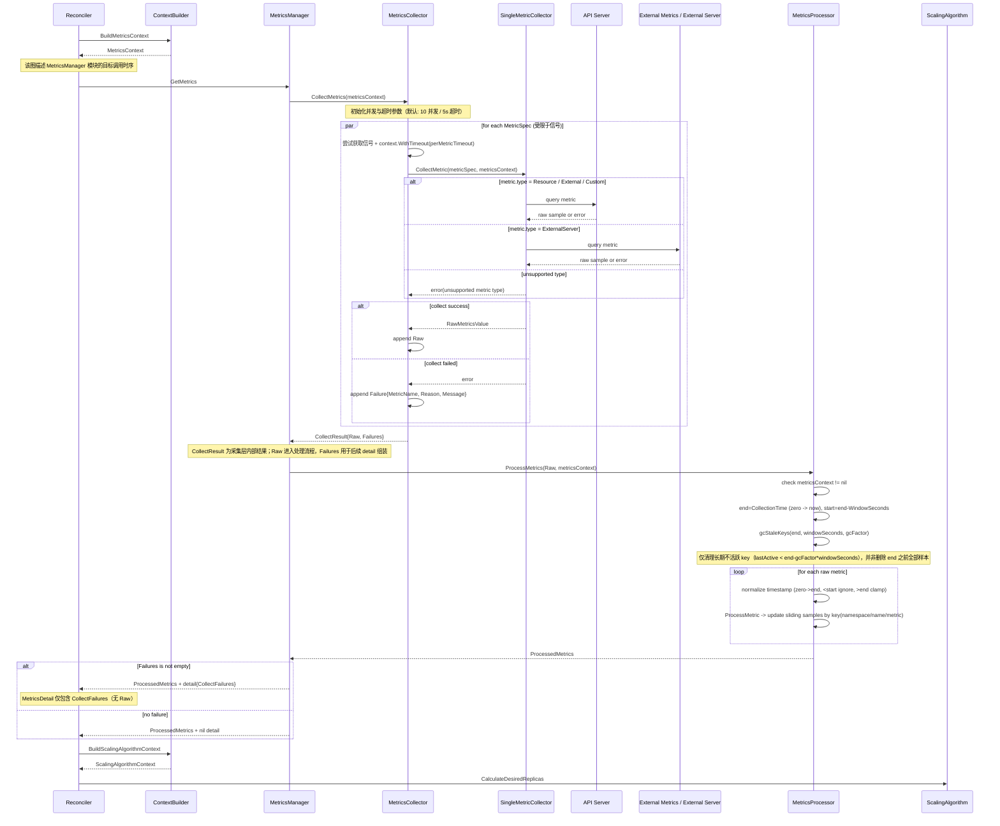
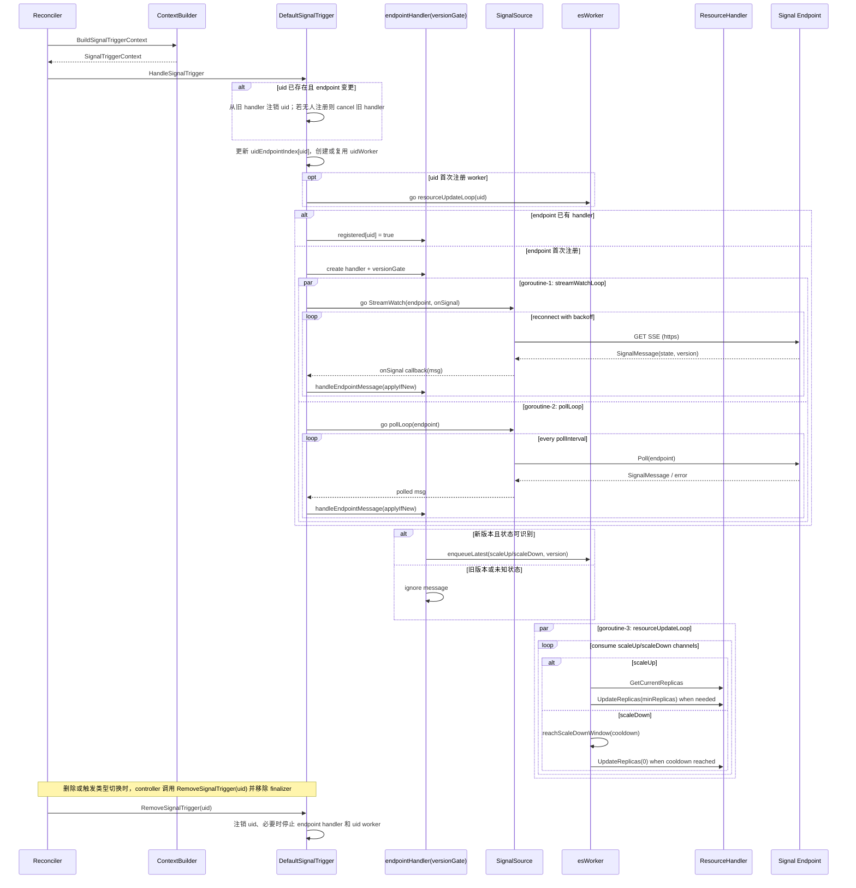

---
# 提案标题
title: 通用扩缩容决策框架增强提案
# 提案编号
ofep-number: 0044
# 提案作者
authors:
  - "@wang-bubo"
# 提案主导SIG
owning-sig: sig-ai-inference
# 提案协作SIG
participating-sigs:
# 提案状态(初步草案|准备开始实现|已在SIG中实现并合并|提案被暂缓|提案被否决|作者主动撤回提案|被另一个oFEP取代)
status: provisional
# 创建日期
creation-date: 2026-03-25
# 评审人
reviewers:
  - TBD
# 批准人
approvers:
  - TBD
# 相关联的其他oFEP
see-also:
  - "/ofeps/sig-ai-inference/0030-ofep-通用扩缩容决策框架设计提案"
# 当前oFEP替代了哪些已有提案
replaces:
# 当前oFEP被哪些提案替代，当status为replaced时需要填写此字段
replaced-by:
# 此oFEP当前开发阶段
stage: alpha
# 最近一次推进的版本
latest-milestone: TODO
# 各阶段目标版本
milestone: TODO
# 功能开关及影响组件
feature-gates:
  - name: TODO
    components:
      - TODO
# 是否支持关闭该功能
disable-supported: true
# 该功能引入的监控指标
metrics:
  - TODO
---

# oFEP-0044：通用扩缩容决策框架增强提案

<!-- toc -->
- [发布签核清单](#1-发布签核清单)
- [概括](#2-概括)
- [动机](#3-动机)
  - [当前问题与原因分析](#31-当前问题与原因分析)
  - [目标](#32-目标)
  - [非目标](#33-非目标)
- [提案](#4-提案)
  - [用户故事](#41-用户故事)
    - [故事 1](#故事-1)
    - [故事 2](#故事-2)
  - [风险与缓解措施](#42-风险与缓解措施)
- [设计细节](#5-设计细节)
  - [CRD设计变更](#51-crd设计变更)
    - [字段更新](#511-字段更新)
    - [默认值策略](#512-默认值策略)
    - [兼容性](#513-兼容性)
  - [MetricsAdapter 移除](#52-metricsadapter-移除)
    - [移除原因](#521-移除原因)
    - [架构对比](#522-架构对比)
  - [ContextBuilder组件设计](#53-contextbuilder组件设计)
    - [职责](#531-职责)
    - [组件逻辑视图](#532-组件逻辑视图)
    - [接口设计](#533-接口设计)
    - [关键设计点](#534-关键设计点)
  - [MetricsManager组件设计](#54-metricsmanager组件设计)
    - [职责](#541-职责)
    - [组件逻辑视图](#542-组件逻辑视图)
    - [时序图](#543-时序图)
    - [接口设计](#544-接口设计)
    - [关键设计点](#545-关键设计点)
- [附录](#6-附录)
  - [SignalTrigger 风险与缓解措施（预研）](#signaltrigger-风险与缓解措施预研)
  - [SignalTrigger（预研）组件设计](#61-signaltrigger预研组件设计)
    - [职责](#611-职责)
    - [组件逻辑视图](#612-组件逻辑视图)
    - [时序图](#613-时序图)
    - [接口设计](#614-接口设计)
    - [关键设计点](#615-关键设计点)
<!-- /toc -->

## 1. 发布签核清单
<!--
**需要采取的行动：**为了将代码合并到一个版本中，在[openfuyao/ofep]引用此oFEP并在目标版本的[增强冻结]之前瞄准发布里程碑**中必须存在问题。

对于对核心代码或流程/程序进行更改的增强功能，例如：[openfuyao/openfuyao]，我们需要完成以下发布签署清单。

完成后勾选这些，以便发布团队跟踪。为了发布增强，必须更新这些检查表项。
-->

标记有（R）的项目*在达到里程碑/发布*之前是必需的。
- [ ]（R）发布里程碑中的增强问题，链接到 [openfuyao/ofep] 中的 oFEP 目录
- [ ] (R) oFEP 审批者已批准 oFEP 状态为“可实施”
- [ ] (R) 设计细节已适当记录
- [ ]（R）测试计划已到位，并考虑了 SIG 架构和 SIG 测试的输入（包括测试重构）
  - [ ] 针对所有 Beta API 操作（端点）进行 e2e 测试
  - [ ] (R) 确保 GA e2e 测试满足一致性测试的要求
  - [ ] (R) GA e2e 测试至少需要两周时间才能证明测试结果无 flake（不稳定或偶发失败）
- [ ] (R) 毕业标准已设定
  - [ ] (R) 所有 GA 端点必须通过[一致性测试]
- [ ] (R) 生产准备情况审查完成
- [ ] (R) 生产准备情况审查已获批准
- [ ] “实施历史”部分已更新里程碑
- [ ] 面向用户的文档已在 [openfuyao/docs] 创建，以便发布到 [openfuyao.com]
- [ ] 支持文档 - 例如，额外的设计文档、邮件列表讨论/SIG 会议链接、相关 PR/问题、发行说明

<!--
**注意：**此清单是迭代的，每次考虑将此增强功能作为里程碑时都应进行审查和更新。
-->

- [openfuyao.com](https://openfuyao.com/)
- [openfuyao/ofep](https://gitcode.com/openfuyao/ofep)
- [openfuyao/docs](https://gitcode.com/openfuyao/docs)

## 2. 概括
本提案在 oFEP-0030 ElasticScaler 总体架构设计的基础上进行增强，主要涉及 CRD 语义完善，以及 `ContextBuilder`、`MetricsManager` 两个关键组件的详细设计；`SignalTrigger` 方案在当前阶段场景尚不明确，移至附录作为预研设计。

## 3. 动机
`0030` 提案已经定义了通用扩缩容决策框架的总体架构，但从用户真正使用该框架配置指标、接入算法并获得稳定扩缩体验的角度看，仍有几类关键问题没有被完整覆盖。

1. **用户已能配置决策算法，但还缺少稳定、可消费的指标输入**。对于基于多类指标和自定义算法完成扩缩容的场景，框架还需要明确指标采集、统一处理和稳定化后的输入语义；否则算法将难以获得一致、可用的决策输入，进而影响扩缩容结果的稳定性和可解释性。

2. **现有指标表达能力不足，限制了用户场景覆盖**。当前设计缺少 `Custom` 指标类型，难以覆盖与 Kubernetes 对象相关的自定义指标场景；`ExternalServer` 缺少 `query` 字段，也使 Prometheus 等外部查询场景的配置表达不够直观，不利于复用和维护。

### 3.1 目标
1. **补齐用户可用的指标表达能力**：新增 `Custom` 指标类型与 `ExternalServer.query` 可选字段，降低用户配置与理解成本，并提升对 `custom.metrics.k8s.io` 和 Prometheus 查询场景的适配能力。
2. **为算法提供稳定一致的输入**：细化 `ContextBuilder`、`MetricsManager` 的接口契约、组件边界与内部协作关系，明确指标采集、处理和上下文构建的责任分工。
3. **控制 Alpha 阶段范围**：当前阶段不引入独立 `MetricsAdapter`，`SignalTrigger` 仅在附录给出预研设计，不纳入本阶段实现承诺。

### 3.2 非目标
1. 不重新定义 ElasticScaler 的总体架构与分层模型。
2. 不建设独立 `MetricsAdapter` 体系。

## 4. 提案
### 4.1 用户故事
#### 故事 1
作为框架使用者，我希望在 `ElasticScaler` 中直接配置 `Resource`、`External`、`ExternalServer`、`Custom` 指标，并结合自定义算法完成扩缩决策。

<!-- ```plantuml -->
@startuml
left to right direction
skinparam componentStyle ractangle

actor "用户" as User

rectangle "自动化扩缩管理" {
    (ElasticScaler) as UC1
    (API Server\nResource/External/Custom) as UC2
    (ExternalServer) as UC4
    (Custom Algorithm) as UC3
}

User --> UC1 : 配置 metricsTrigger\n(多指标类型 + 算法)
UC2 ..> UC1 : 提供指标数据
UC4 ..> UC1 : 提供指标数据
UC1 ..> UC3 : 调用算法计算副本数
UC3 ..> UC1 : 返回 desiredReplicas
@enduml
<!-- ``` -->

#### 故事 2
作为框架使用者，我希望通过 `ElasticScaler` 注解配置 `GCFactor`、`MissingDataPolicy` 等指标处理策略，实现指标处理行为可控。

<!-- ```plantuml -->
@startuml
left to right direction
skinparam componentStyle ractangle

actor "用户" as User

rectangle "自动化扩缩管理" {
    (ElasticScaler) as UC1
    (MetricsProcessor) as UC2
    (MetricsManager) as UC3
}

User --> UC1 : 配置 annotation\n(GCFactor/MissingDataPolicy 等)
UC1 ..> UC3 : 下发指标处理策略
UC3 ..> UC2 : 执行窗口聚合/缺失值处理
UC2 ..> UC1 : 返回处理后指标
@enduml
<!-- ``` -->

### 4.2 风险与缓解措施
1. **风险**：指标配置不合法，导致本轮采集或决策不可用  

    **缓解措施**：使用Webhook, CRD 以及Controller校验模块进行校验拦截。

2. **风险**：指标采集部分失败，导致决策输入不完整  

    **缓解措施**：采用“部分成功”策略：成功样本继续进入 `Processor`，失败明细写入状态并触发告警。

3. **风险**：指标处理策略（窗口、缺失值策略）配置不当，导致处理后指标失真  

    **缓解措施**：提供默认策略以降低误配影响；提供参数范围校验、策略有效性校验。

4. **说明**：`SignalTrigger` 相关风险与缓解措施仅适用于附录中的预研方案，不纳入本阶段 Alpha 默认交付范围；详见[附录：SignalTrigger 风险与缓解措施（预研）](#signaltrigger-风险与缓解措施预研)。

## 5. 设计细节
### 5.1 CRD设计变更
#### 5.1.1 字段更新
字段更新主要集中在 `MetricSpec` 相关结构，主要用于增强 `custom.metrics.k8s.io` 指标兼容能力，并提升对 Prometheus 查询接口的适配性。下表展示相关差异：

| 字段 | 原设计 | 增强实现 |
|---|---|---|
| `MetricSpec.type` | `Resource/External/ExternalServer` | 扩展为 `Resource/External/ExternalServer/Custom` |
| `MetricSpec.custom` | 无 | 新增 `custom: *CustomMetricSpec` 字段（`type=Custom` 时生效） |
| `CustomMetricSpec` | 无 | 新增 `metricsName`、`target`、`selector` 字段定义 |
| `ExternalServerMetricSpec.query` | 无 | 新增 `query` 可选字段（optional） |

#### 5.1.2 默认值策略
下表汇总当前 `ElasticScaler` CRD 字段类型与默认值情况。

**顶层与 Spec 字段**
| 字段 | 类型 | 是否必填 | 默认值 | 说明 |
|---|---|---|---|---|
| `spec` | `ElasticScalerSpec` | 是 | 无 | 期望状态 |
| `spec.targetRef` | `corev1.ObjectReference` | 是 | 无 | 目标资源引用 |
| `spec.trigger` | `TriggerSpec` | 是 | 无 | 触发策略 |
| `spec.minReplicas` | `*int32` | 否 | `1` | 最小值约束 `>=0` |
| `spec.maxReplicas` | `int32` | 否 | `10` | 最小值约束 `>=1` |
| `status` | `ElasticScalerStatus` | 否 | 无 | 观测状态，由控制器维护 |

**Trigger 与 Metrics 相关字段**
| 字段 | 类型 | 是否必填 | 默认值 | 说明 |
|---|---|---|---|---|
| `spec.trigger.type` | `TriggerType` | 是 | 无 | 枚举：`MetricsTrigger/StateTrigger/SignalTrigger`（`SignalTrigger` 为保留能力，见附录预研） |
| `spec.trigger.metricsTrigger` | `*MetricsTriggerSpec` | 条件必填 | 无 | `type=MetricsTrigger` 时必填 |
| `spec.trigger.stateTrigger` | `*StateTriggerSpec` | 条件必填 | 无 | `type=StateTrigger` 时必填 |
| `spec.trigger.signalTrigger` | `*SignalTriggerSpec` | 条件必填 | 无 | `type=SignalTrigger` 时必填（预研能力） |
| `spec.trigger.metricsTrigger.metrics` | `[]MetricSpec` | 条件必填 | 无 | `type=MetricsTrigger` 时必填 |
| `spec.trigger.metricsTrigger.scalingAlgorithm` | `string` | 条件必填 | 无 | `type=MetricsTrigger` 时必填 |
| `spec.trigger.metricsTrigger.algorithmConfig` | `map[string]string` | 否 | 无 | 算法参数 |
| `spec.trigger.metricsTrigger.metrics[].type` | `MetricType` | 是 | 无 | 枚举：`Resource/External/ExternalServer/Custom` |
| `spec.trigger.metricsTrigger.metrics[].resource` | `*ResourceMetricSpec` | 条件必填 | 无 | `type=Resource` 时必填 |
| `spec.trigger.metricsTrigger.metrics[].external` | `*ExternalMetricSpec` | 条件必填 | 无 | `type=External` 时必填 |
| `spec.trigger.metricsTrigger.metrics[].externalServer` | `*ExternalServerMetricSpec` | 条件必填 | 无 | `type=ExternalServer` 时必填 |
| `spec.trigger.metricsTrigger.metrics[].custom` | `*CustomMetricSpec` | 条件必填 | 无 | `type=Custom` 时必填 |
| `spec.trigger.metricsTrigger.metrics[].externalServer.protocol` | `string` | 否 | `https` | 枚举：`http/https` |
| `spec.trigger.metricsTrigger.metrics[].externalServer.query` | `string` | 否 | 无 | 外部查询语句（可选） |
| `spec.trigger.signalTrigger.endpoint` | `string` | 条件必填 | 无 | `type=SignalTrigger` 时必填（预研能力） |
| `spec.trigger.signalTrigger.protocol` | `string` | 否 | `https` | 枚举：`http/https` |

#### 5.1.3 兼容性
- 本次字段调整以增量扩展为主，对已有对象保持向后兼容，不影响现有配置的解析与运行。
- `MetricType` 新增 `Custom` 枚举值属于能力补充，原有 `Resource/External/ExternalServer` 语义与行为保持不变。

### 5.2 MetricsAdapter 移除
#### 5.2.1 移除原因
在 Alpha 阶段，`MetricsAdapter` 的设计初衷是将 `MetricsCollector` 的指标能力以服务形式对外暴露，供 HPA 通过 `external.metrics.k8s.io` 访问，相当于在集群内提供统一的 External Metrics APIService。  
但在实现评估中发现，该路径会要求 `MetricsCollector` 额外承担 API 暴露、语义转换与平台治理等复杂能力，明显超出其在扩缩容框架中的采集定位。对当前阶段而言，这类平台化投入收益有限，且会显著增加实现和维护复杂度。

因此本提案在 Alpha 阶段的决策是：移除 `HPAAdapter` 内部 `MetricsAdapter` 设计，不再以 `external.metrics.k8s.io` 形式对外暴露 `MetricsCollector` 能力，优先收敛框架内的核心扩缩链路。

#### 5.2.2 架构对比
该对比图重点说明本次架构收敛方向：在原方案中，`MetricsCollector` 的能力会经由 `MetricsAdapter Service` 以 `external.metrics.k8s.io` 形式对外暴露；在当前采纳方案中，该外露链路被移除，`MetricsCollector` 仅作为框架内部采集组件由 `MetricsManager` 调用，不再承担对外 APIService 职责。
<!-- ```plantuml -->
@startuml
!define HIGHLIGHT #c2e0c6
skinparam component<<external>> {
  BackgroundColor #FFF3E0
  BorderColor #FB8C00
}
skinparam NodePadding 30
title MetricsAdapter 方案收敛（Before/After）
left to right direction

rectangle "Before（原设想）" {
  [HPAController] as B1
  [HPAAdapter] as B2 HIGHLIGHT
  [MetricsAdapter Service\n(APIService: external.metrics.k8s.io)] as B3 HIGHLIGHT
  [MetricsCollector] as B4
  [External Metrics System] <<external>> as B5

  B1 --> B2 : query external metrics
  B2 --> B3 : route/request
  B3 --> B4 : collect/convert
  B4 --> B5 : fetch metrics
}

rectangle "After（本次采纳）" {
  package "ElasticScaler 控制层" {
    [ElasticScalerReconciler] as A1
  }

  package "Metrics 管理层" {
    [MetricsManager\n(统一入口)] as A2 HIGHLIGHT
    [MetricsCollector\n(采集指标)] as A3 HIGHLIGHT
    [MetricsProcessor\n(处理指标)] as A4 HIGHLIGHT
  }

  package "算法层" {
    [ScalingAlgorithm\n(自定义)] as A5
  }

  package "外部系统层" {
    [External Metrics System] <<external>> as A6
  }

  A1 --> A2 : internal scaling flow
  A2 --> A3 : collect metrics
  A3 --> A6 : fetch metrics
  A2 --> A4 : process metrics
  A4 --> A5 : calculate replicas
}
@enduml
<!-- ``` -->

### 5.3 ContextBuilder组件设计
#### 5.3.1 职责
`ContextBuilder` 本质上是跨组件交互的上下文管理服务，负责将 CRD 配置、运行态数据与策略参数组装为统一上下文对象，降低组件间耦合。
- **指标链路** 构建 `MetricsContext`，包括指标配置、Pod 视图、处理策略与采集时间锚点，供 `MetricsManager`/`Collector`/`Processor` 共享使用。
- **算法决策** 构建 `ScalingAlgorithmContext`，包括处理后指标、算法参数、副本边界与运行态信息，供算法组件使用。
- **信号链路（附录预研）** 构建 `SignalTriggerContext`，统一承载 UID、endpoint、protocol、targetRef 与副本边界，供 `SignalTrigger` 在注册、分发与清理流程中使用。

#### 5.3.2 组件逻辑视图
该视图描述 `ContextBuilder` 在扩缩容主流程中的桥接作用：控制器统一向 `ContextBuilder` 构建上下文，再把 `MetricsContext`、`ScalingAlgorithmContext` 传递给主线执行组件；`SignalTriggerContext` 对应附录预研能力。
<!-- ```plantuml -->
@startuml
!define HIGHLIGHT #c2e0c6
skinparam component<<external>> {
  BackgroundColor #FFF3E0
  BorderColor #FB8C00
}
skinparam NodePadding 30
title ContextBuilder 逻辑视图

package "ElasticScaler 控制层" {
  [ElasticScalerReconciler] as R
}

package "协调工具层" {
  [ContextBuilder] as CB HIGHLIGHT
}

package "执行组件层" {
  [MetricsManager] as MM
  [ScalingAlgorithm] as SA
  [SignalTrigger] as ST
}

package "上下文对象层" {
  [MetricsContext] as MC
  [ScalingAlgorithmContext] as SAC
  [SignalTriggerContext] as STC
}

R -down-> CB : build contexts

CB -down-> MC : BuildMetricsContext
CB -down-> SAC : BuildScalingAlgorithmContext
CB -down-> STC : BuildSignalTriggerContext

R -down-> MM : invoke metrics flow
R -down-> SA : invoke algorithm
R -down-> ST : invoke signal flow

MC ..> MM : provide context
SAC ..> SA : provide context
STC ..> ST : provide context
@enduml
<!-- ``` -->

#### 5.3.3 接口设计
**ContextBuilder组件类图**

本图描述 `ContextBuilder`、默认实现 `DefaultContextBuilder` 以及三类上下文对象之间的静态关系
<!-- ```plantuml -->
@startuml
title ContextBuilder 组件类图
skinparam classAttributeIconSize 0

interface ContextBuilder {
  +BuildMetricsContext(ctx, es, podList) MetricsContext
  +BuildScalingAlgorithmContext(ctx, es, processedMetrics) ScalingAlgorithmContext
  +BuildSignalTriggerContext(ctx, es) SignalTriggerContext
}

class DefaultContextBuilder {
  +BuildMetricsContext(ctx, es, podList) MetricsContext
  +BuildScalingAlgorithmContext(ctx, es, processedMetrics) ScalingAlgorithmContext
  +BuildSignalTriggerContext(ctx, es) SignalTriggerContext
  +ParseMetricsPolicyConfig(ctx, es) MetricsPolicyConfig
  +ParseScalingAlgorithmConfig(ctx, es) map[string]string
}

interface MetricsContext {
  +Pods() []Pod
  +ElasticScalerID() ElasticScalerIdentity
  +MetricSpecs() []MetricSpec
  +PolicyConfig() MetricsPolicyConfig
  +CollectionTime() Time
}

class ElasticScalerMetricsContext {
  -podList []Pod
  -elasticScalerID ElasticScalerIdentity
  -metricSpecs []MetricSpec
  -policyConfig MetricsPolicyConfig
  -collectionTime Time
}

class ScalingAlgorithmContext {
  +ElasticScalerID ElasticScalerIdentity
  +ProcessedMetrics []ProcessedMetricsValue
  +AlgorithmConfig map[string]string
  +AlgorithmName string
  +MinReplicas int32
  +MaxReplicas int32
  +CurrentReplicas int32
  +LastScaleTime Time
}

class SignalTriggerContext {
  +UID string
  +Endpoint string
  +Protocol string
  +TargetRef ObjectReference
  +MinReplicas int32
  +MaxReplicas int32
}

class MetricsPolicyConfig {
  +WindowSeconds int64
  +GCFactor int64
  +AggregationType string
  +MissingDataPolicy string
  +EnableOutlierFilter bool
  +OutlierThreshold float64
}

class ElasticScalerIdentity {
  +Namespace string
  +Name string
}

class ProcessedMetricsValue {
  +MetricsName string
  +StableValue float64
}

DefaultContextBuilder ..|> ContextBuilder
ElasticScalerMetricsContext ..|> MetricsContext

DefaultContextBuilder --> MetricsContext : build
DefaultContextBuilder --> ScalingAlgorithmContext : build
DefaultContextBuilder --> SignalTriggerContext : build
DefaultContextBuilder --> MetricsPolicyConfig : parse

MetricsContext --> ElasticScalerIdentity
MetricsContext --> MetricsPolicyConfig
ScalingAlgorithmContext --> ElasticScalerIdentity
ScalingAlgorithmContext --> ProcessedMetricsValue
@enduml
<!-- ``` -->

**ContextBuilder接口设计**

该接口定义了 Reconciler 侧构建上下文的统一入口，分别面向指标采集链路、算法决策链路和信号触发链路（预研）。
```go
type ContextBuilder interface {
	BuildMetricsContext(ctx context.Context, es *elasticscaleriov1alpha1.ElasticScaler, podList []corev1.Pod) (MetricsContext, error)
	BuildScalingAlgorithmContext(ctx context.Context, es *elasticscaleriov1alpha1.ElasticScaler, processedMetrics []ProcessedMetricsValue) (ScalingAlgorithmContext, error)
	BuildSignalTriggerContext(ctx context.Context, es *elasticscaleriov1alpha1.ElasticScaler) (SignalTriggerContext, error)
}
```
**MetricsContext 设计（接口 + 默认实现）**

`MetricsContext` 用于指标链路输入，包含 5 类信息：Pod 列表、ElasticScaler 标识（namespace/name）、指标规格列表（metricSpecs）、指标处理策略（policyConfig）和本轮采集时间锚点（collectionTime）。
```go
type MetricsContext interface {
	Pods() []corev1.Pod
	ElasticScalerID() ElasticScalerIdentity
	MetricSpecs() []elasticscaleriov1alpha1.MetricSpec
	PolicyConfig() MetricsPolicyConfig
	CollectionTime() metav1.Time
}

type ElasticScalerMetricsContext struct {
	podList         []corev1.Pod
	elasticScalerID ElasticScalerIdentity
	metricSpecs     []elasticscaleriov1alpha1.MetricSpec
	policyConfig    MetricsPolicyConfig
	collectionTime  metav1.Time
}
```

**ScalingAlgorithmContext 设计**

`ScalingAlgorithmContext` 用于算法决策输入，包含 4 类信息：对象标识（ElasticScalerID）、稳定化指标结果（processedMetrics）、算法定义与参数（algorithmName + algorithmConfig）、副本信息（min/max/current replicas 与 lastScaleTime）。
```go
type ScalingAlgorithmContext struct {
	ElasticScalerID  ElasticScalerIdentity
	ProcessedMetrics []ProcessedMetricsValue
	AlgorithmConfig  map[string]string
	AlgorithmName    string

	MinReplicas int32
	MaxReplicas int32

	CurrentReplicas int32
	LastScaleTime   metav1.Time
}
```

**SignalTriggerContext 设计**

`SignalTriggerContext` 用于信号触发输入，包含 4 类信息：实例标识（UID）、信号源配置（endpoint + protocol）、扩缩目标对象（targetRef）、副本边界（minReplicas + maxReplicas）。
```go
type SignalTriggerContext struct {
	UID         string
	Endpoint    string
	Protocol    string
	TargetRef   corev1.ObjectReference
	MinReplicas int32
	MaxReplicas int32
}
```

#### 5.3.4 关键设计点
`PolicyConfig` 服务于 `MetricsProcessor`，用于承载指标稳定化参数（窗口、聚合、缺失值处理、异常值过滤等）。
```go
type MetricsPolicyConfig struct {
	WindowSeconds int64
	GCFactor int64
	AggregationType string
	MissingDataPolicy string
	EnableOutlierFilter bool
	OutlierThreshold float64
}
```
1. 在 `BuildMetricsContext` 阶段统一解析并注入，确保同一轮处理策略一致。
2. 支持用户通过 annotation 配置策略参数。
3. 未配置或配置非法时回退 `DefaultMetricsPolicyConfig` 默认值，保证行为稳定。

### 5.4 MetricsManager组件设计
#### 5.4.1 职责
`MetricsManager` 是指标链路的统一协调组件，负责指标采集、稳定化处理。
- **入口链路** 对外统一暴露 `GetMetrics`，屏蔽 Resource/External/ExternalServer/Custom 指标类型差异。
- **处理链路** 提供`MetricsCollector -> MetricsProcessor` 固定主路径，将原始样本转换为算法可消费的稳定指标。
- **反馈链路** 提供部分成功语义：成功样本继续处理，失败项通过 `MetricsDetail.CollectFailures` 回传用于状态上报。

#### 5.4.2 组件逻辑视图
该视图展示了 MetricsManager 在扩缩链路中的分层定位与交互关系：控制层通过统一入口触发指标获取，MetricsManager完成采集与处理，并将结果回传给控制器继续进入算法决策阶段。
<!-- ```plantuml -->
@startuml
!define HIGHLIGHT #c2e0c6
skinparam component<<external>> {
  BackgroundColor #FFF3E0
  BorderColor #FB8C00
}
skinparam NodePadding 30
title MetricsManager 逻辑视图

package "ElasticScaler 控制层" {
  [ElasticScalerReconciler] as R1
}

package "协调工具层" {
  [ContextBuilder] as T1
}

package "Metrics 管理层" {
  [MetricsManager\n(统一入口)] as M1 HIGHLIGHT
  [MetricsCollector\n(采集指标)] as M2 HIGHLIGHT
  [MetricsProcessor\n(处理指标)] as M3 HIGHLIGHT
}

package "算法层" {
  [ScalingAlgorithm\n(自定义)] as A1
}

package "外部系统层" {
  [API Server] <<external>> as S1
  [Prometheus / External\nMetrics Server] <<external>> as S2
}

R1 -down-> M1 : GetMetrics

M1 -down-> M2 : CollectMetrics
M2 -down-> S1 : Resource/External/Custom
M2 -down-> S2 : ExternalServer
S1 ..> M2
S2 ..> M2

M2 ..> M1 : rawMetrics[] (success only)
M2 ..> M1 : collectFailures[] (optional)

M1 -down-> M3 : rawMetrics[]
M3 ..> M1 : processedMetrics[]
M1 ..> R1 : processedMetrics[] + detail(collectFailures)

R1 -down-> T1 : BuildScalingAlgorithmContext
T1 ..> R1 : ScalingAlgorithmContext
R1 -down-> A1 : CalculateDesiredReplicas
A1 ..> R1 : desiredReplicas
@enduml
<!-- ``` -->

#### 5.4.3 时序图


#### 5.4.4 接口设计
**MetricsManager组件类图**

接口按职责可分为三类：  
- **编排入口接口**：`MetricsManager`，对控制器提供统一调用入口，负责串联采集与处理并回传结果。  
- **执行能力接口**：`MetricsCollector`、`SingleMetricCollector`、`MetricsProcessor`，分别负责批量采集、单指标采集和稳定化处理。  
- **结果与配置接口**：`CollectResult`、`MetricsDetail`、`MetricsCollectorOptions`，用于表达部分成功结果与运行参数。  
<!-- ```plantuml -->
@startuml
title MetricsManager 组件类图
skinparam classAttributeIconSize 0

interface MetricsManager {
  +GetMetrics(ctx, metricsContext) ([]ProcessedMetricsValue, *MetricsDetail, error)
}

interface MetricsCollector {
  +CollectMetrics(ctx, metricsContext) (*CollectResult, error)
}

interface SingleMetricCollector {
  +CollectMetric(ctx, metric, metricsContext) (RawMetricsValue, error)
}

interface MetricsProcessor {
  +ProcessMetrics(ctx, metrics, metricsContext) ([]ProcessedMetricsValue, error)
}

class DefaultMetricsManager {
  +MetricsCollector MetricsCollector
  +MetricsProcessor MetricsProcessor
  +GetMetrics(ctx, metricsContext) ([]ProcessedMetricsValue, *MetricsDetail, error)
}

class DefaultMetricsCollector {
  -resourceCollector ResourceCollector
  -externalCollector ExternalCollector
  -customCollector CustomCollector
  -externalServerCollector ExternalServerCollector
  -maxConcurrentCollect int
  -perMetricTimeout Duration
  +CollectMetrics(ctx, metricsContext) (*CollectResult, error)
}

class DefaultMetricsProcessor {
  -samples map[string][]RawMetricsValue
  -lastActive map[string]Time
  +ProcessMetrics(ctx, metrics, metricsContext) ([]ProcessedMetricsValue, error)
}

class RawMetricsValue {
  +MetricsName string
  +Timestamp Time
  +Value float64
}

class ProcessedMetricsValue {
  +MetricsName string
  +StableValue float64
}

class CollectResult {
  +Raw []RawMetricsValue
  +Failures []MetricCollectFailure
}

class MetricsDetail {
  +CollectFailures []MetricCollectFailure
}

class MetricCollectFailure {
  +MetricName string
  +Reason string
  +Message string
}

class MetricsCollectorOptions {
  +MaxConcurrentCollect int
  +PerMetricTimeout Duration
}

class ResourceCollector
class ExternalCollector
class CustomCollector
class ExternalServerCollector

MetricsManager <|.. DefaultMetricsManager
MetricsCollector <|.. DefaultMetricsCollector
MetricsProcessor <|.. DefaultMetricsProcessor
SingleMetricCollector <|.. ResourceCollector
SingleMetricCollector <|.. ExternalCollector
SingleMetricCollector <|.. CustomCollector
SingleMetricCollector <|.. ExternalServerCollector

DefaultMetricsManager o--> MetricsCollector
DefaultMetricsManager o--> MetricsProcessor
DefaultMetricsCollector --> CollectResult
DefaultMetricsCollector --> MetricCollectFailure
DefaultMetricsCollector --> ResourceCollector
DefaultMetricsCollector --> ExternalCollector
DefaultMetricsCollector --> CustomCollector
DefaultMetricsCollector --> ExternalServerCollector
DefaultMetricsProcessor --> RawMetricsValue
DefaultMetricsProcessor --> ProcessedMetricsValue
MetricsManager --> MetricsDetail
@enduml
<!-- ``` -->

```go
type MetricsManager interface {
	GetMetrics(ctx context.Context, metricsContext escontext.MetricsContext) ([]escontext.ProcessedMetricsValue, *MetricsDetail, error)
}

type MetricsCollector interface {
	CollectMetrics(ctx context.Context, metricsContext escontext.MetricsContext) (*CollectResult, error)
}

type SingleMetricCollector interface {
	CollectMetric(ctx context.Context, metric elasticscaleriov1alpha1.MetricSpec, metricsContext escontext.MetricsContext) (escontext.RawMetricsValue, error)
}

type MetricsProcessor interface {
	ProcessMetrics(ctx context.Context, metrics []escontext.RawMetricsValue, metricsContext escontext.MetricsContext) ([]escontext.ProcessedMetricsValue, error)
}

// RawMetricsValue / ProcessedMetricsValue 归属于 ContextBuilder 组件（共享 context 类型）；
// 这里仅展示其数据形态，便于理解 MetricsManager 的输入输出。
type RawMetricsValue struct {
	MetricsName string
	Timestamp   metav1.Time
	Value       float64
}

type ProcessedMetricsValue struct {
	MetricsName string
	StableValue float64
}

type CollectResult struct {
	Raw      []escontext.RawMetricsValue
	Failures []MetricCollectFailure
}

type MetricsDetail struct {
	CollectFailures []MetricCollectFailure
}

type MetricsCollectorOptions struct {
	MaxConcurrentCollect int
	PerMetricTimeout     time.Duration
}
```

#### 5.4.5 关键设计点
1. **采集侧性能与安全设计（MetricsCollector）**  
   从性能和稳定性出发，Collector 采用“有界并发 + 单指标超时 + 部分成功”组合策略。  
   - **并发控制**：通过 `MaxConcurrentCollect` 限制同一轮采集的并发数量，避免在指标较多时瞬时打满 API Server/外部服务。未显式配置时使用默认并发 `10`。  
   - **超时隔离**：每个指标采集都会单独设置超时，默认 `5s`，避免单个慢指标拖垮整轮采集（实现上使用 `context.WithTimeout(perMetricTimeout)`）。    
   - **部分成功策略**：采集结果拆分为 `CollectResult{Raw, Failures}`。成功样本进入 `Raw` 继续处理，失败项记录 `MetricName/Reason/Message` 并通过 `MetricsDetail.CollectFailures` 回传给控制器用于状态上报。  

2. **旧数据管理与稳定化设计（MetricsProcessor）**  
   Processor 的核心要求是“算法获取的是当前窗口内、时间语义一致的样本”，并持续清理历史数据防止内存膨胀。  
   - **窗口控制**：以本轮采集时间作为窗口结束点，按 `WindowSeconds` 计算起点 `start`，只处理 `[start,end]` 内样本。
   - **时间归一化**：没有时间戳的样本按“本轮样本”处理；早于窗口的样本直接忽略；晚于窗口结束点的样本截断到窗口末端（判定关系：`timestamp==0`、`timestamp < start`、`timestamp > end`）。  
   - **样本窗口维护**：按“对象 + 指标名”维护独立滑动窗口，保证每个对象、每个指标互不干扰（键形态：`namespace/name/metricName`）。  
   - **窗口 GC 策略**：对长时间未活跃的指标 key 做回收，避免缓存持续增长（回收阈值：`end - (GCFactor * WindowSeconds)`）。  

## 6. 附录

本节内容用于沉淀当前阶段尚未明确业务场景的预研设计，不纳入 Alpha 阶段默认实现范围。`SignalTrigger` 相关内容仅作为后续评估与演进参考。

### SignalTrigger 风险与缓解措施（预研）

以下风险与缓解措施仅针对 `SignalTrigger` 信号驱动链路；因该能力当前为预研，正文「4.2 风险与缓解措施」不将其列为 Alpha 默认范围。

1. **风险**：多个 ElasticScaler 复用同一 endpoint 时，可能出现事件分发到错误对象或删除后监听残留。  

    **缓解措施**：按 UID 进行事件分发与索引管理；对象删除或更新时进行反注册和清理。

2. **风险**：endpoint 抖动、重复事件或乱序事件，导致重复扩缩或延迟扩缩  

    **缓解措施**：采用“实时接收 + 周期兜底”双路径接收机制，并对重复/过期信号进行去重与丢弃，保证仅处理最新有效信号。

3. **风险**：endpoint 安全能力不足，存在未鉴权访问与伪造信号风险  

    **缓解措施**：当前阶段临时采用强制HTTPS协议；后续版本需补齐完整鉴权体系（认证、签名校验、权限控制与密钥轮转）。

#### 故事 3
作为平台管理员，我希望通过统一的 Signal endpoint 触发工作负载 `scale-to/from-zero`，并支持多个 ElasticScaler 分别管理多个 Target Resource 且复用同一 endpoint。

<!-- ```plantuml -->
@startuml
left to right direction
skinparam componentStyle ractangle

actor "平台管理员" as Admin

rectangle "自动化扩缩管理" {
    (Target Resource A) as UC1
    (Target Resource B) as UC5
    (ElasticScaler A) as UC2
    (ElasticScaler B) as UC6
    (Signal Endpoint) as UC3
    (SignalTrigger Handler) as UC4
}

Admin --> UC2 : 配置 SignalTrigger\n(endpoint/protocol)
Admin --> UC6 : 配置 SignalTrigger\n(endpoint/protocol)
UC3 ..> UC4 : 推送 signal(state/version)
UC4 ..> UC2 : 按 UID 分发事件
UC4 ..> UC6 : 按 UID 分发事件
UC2 ..> UC1 : replicas = 0 / minReplicas
UC6 ..> UC5 : replicas = 0 / minReplicas
UC2 ..> UC4 : 删除时反注册并清理
UC6 ..> UC4 : 删除时反注册并清理
@enduml
<!-- ``` -->

### 6.1 SignalTrigger（预研）组件设计
#### 6.1.1 职责
`SignalTrigger` 为附录中的预研组件，用于描述信号驱动链路的潜在实现方式；当前阶段暂不承诺落地。其设计上负责 endpoint 信号监听、工作负载更新与生命周期管理。
- **注册链路** 通过 `HandleSignalTrigger` 作为统一入口，负责 endpoint 归一化监听、UID 映射注册与 worker 初始化，支持多UID复用同一endpoint监听循环。
- **监听链路** 为每个 endpoint 并行运行 `StreamWatch + Poll`，并基于版本门控只接受最新版本事件，避免重复/回放事件干扰。
- **分发执行链路** endpoint 事件经版本门控后，按 UID 分发到 `esWorker`；`esWorker` 基于事件方向调用 `ResourceHandler` 完成副本查询与更新。

#### 6.1.2 组件逻辑视图
该视图聚焦 `SignalTrigger` 的静态组件关系：控制层通过 `ContextBuilder` 构建上下文并调用 `SignalTrigger`；`SignalTrigger` 管理 handler/worker 索引，通过 `SignalSource` 监听 endpoint 事件，根据`SignalHandler`进行事件分发, 并由 `esWorker` 调用 `ResourceHandler` 完成副本更新。
<!-- ```plantuml -->
@startuml
!define HIGHLIGHT #c2e0c6
skinparam component<<external>> {
  BackgroundColor #FFF3E0
  BorderColor #FB8C00
}
skinparam NodePadding 30
title SignalTrigger 逻辑视图

package "ElasticScaler 控制层" {
  [ElasticScalerReconciler] as R1
}

package "协调工具层" {
  [ContextBuilder] as B1
}

package "Signal 管理层" {
  [SignalTrigger\n(DefaultSignalTrigger)] as T1 HIGHLIGHT
  [SignalSource] as S1
  [signalHandler] as H1 HIGHLIGHT
  [endpointHandlers\n(endpoint -> handler)] as I1
  [uidWorkers\n(uid -> worker)] as I3
  [esWorker\n(resourceUpdateLoop)] as W1 HIGHLIGHT
}

package "资源管理层" {
  [ResourceHandler] as RH1
}

package "外部系统层" {
  [Signal Endpoint] <<external>> as E1
}

R1 -down-> B1 : build SignalTriggerContext
R1 -down-> T1 : HandleSignalTrigger / RemoveSignalTrigger

T1 --> I1 : manage
T1 --> I3 : manage
I1 --> H1 : holds
I3 --> W1 : holds

T1 --> S1 : use (StreamWatch/Poll)
S1 --> E1 : listen
S1 ..> H1 : onSignal(event)
H1 --> W1 : fan-out event
W1 --> RH1 : update replicas
@enduml
<!-- ``` -->

#### 6.1.3 时序图
该时序图描述 `HandleSignalTrigger` 后的动态执行过程，重点体现代码中的并发模型：endpoint 级 `streamWatchLoop` 与 `pollLoop` 并行运行，UID 级 `resourceUpdateLoop` 独立消费事件并执行扩缩容。


#### 6.1.4 接口设计
本节给出 `SignalTrigger` 的接口与核心结构体设计, 控制器只依赖 `SignalTrigger` 统一入口，内部通过 `SignalSource`、`signalHandler` 与 `esWorker` 协作完成端到端处理。

组件按职责可分为四类：  
- **入口编排组件**：`SignalTrigger`。对控制器提供 `HandleSignalTrigger/RemoveSignalTrigger`接口，负责索引维护、handler/worker 生命周期管理与主流程编排。  
- **事件接入组件**：`SignalSource`、`SignalMessage`。负责从 endpoint 执行 `StreamWatch/Poll` 并产出标准化信号消息。  
- **状态与路由组件**：`signalHandler`、`versionGate`。负责 endpoint 级注册关系维护与版本门控，仅放行新版本消息并触发 fan-out。  
- **执行更新组件**：`esWorker`、`ResourceHandler`。负责 UID 级事件消费与扩缩容执行（查询当前副本并更新目标副本）。  

**SignalTrigger组件类图**
<!-- ```plantuml -->
@startuml
title SignalTrigger 组件类图
skinparam classAttributeIconSize 0

interface SignalTrigger {
  +HandleSignalTrigger(ctx, signalCtx) error
  +RemoveSignalTrigger(ctx, uid) error
}

interface SignalSource {
  +StreamWatch(ctx, signalCtx, onSignal) error
  +Poll(ctx, signalCtx) (SignalMessage, error)
}

class DefaultSignalTrigger {
  +ResourceHandler ResourceHandler
  +SignalSource SignalSource
  -endpointHandlers map[string]*signalHandler
  -uidEndpointIndex map[string]string
  -uidWorkers map[string]*esWorker
  -pollInterval Duration
  -retryBackoff Duration
  -scaleDownCooldown Duration
  +HandleSignalTrigger(ctx, signalCtx) error
  +RemoveSignalTrigger(ctx, uid) error
}

class DefaultSignalSource {
  +Client HttpClient
  +StreamWatch(ctx, signalCtx, onSignal) error
  +Poll(ctx, signalCtx) (SignalMessage, error)
}

class SignalMessage {
  +State string
  +Version int64
}

class signalHandler {
  +handlerKey string
  +version versionGate
  +registered map[string]struct{}
}

class esWorker {
  +uid string
  +scaleUp chan int64
  +scaleDown chan int64
  +workloadCtx workloadSignalContext
}

class versionGate {
  +lastApplied int64
  +applyIfNew(version, apply) (bool, error)
}

SignalTrigger <|.. DefaultSignalTrigger
SignalSource <|.. DefaultSignalSource
DefaultSignalTrigger o--> SignalSource
DefaultSignalTrigger o--> signalHandler
DefaultSignalTrigger o--> esWorker
signalHandler --> versionGate
SignalSource --> SignalMessage
SignalTrigger --> SignalMessage
@enduml
<!-- ``` -->

```go
type SignalTrigger interface {
	HandleSignalTrigger(ctx context.Context, signalCtx escontext.SignalTriggerContext) error
	RemoveSignalTrigger(ctx context.Context, uid string) error
}

type SignalSource interface {
	StreamWatch(ctx context.Context, signalCtx escontext.SignalTriggerContext, onSignal func(SignalMessage) error) error
	Poll(ctx context.Context, signalCtx escontext.SignalTriggerContext) (SignalMessage, error)
}

type SignalMessage struct {
	State   string
	Version int64
}
```

#### 6.1.5 关键设计点
SignalTrigger 按生命周期分为**注册阶段、执行阶段、清理阶段**。

1. **注册阶段（入口注册、映射维护、协程启动）**
   - `HandleSignalTrigger` 统一处理注册；先做 endpoint 归一化与 UID 合法性校验，再更新 `uidEndpointIndex`。  
   - endpoint 级复用：同一 endpoint 仅保留一个 `signalHandler`，避免重复监听；UID endpoint 变更时先从旧 handler 注销，必要时停止旧 handler。  
   - worker 级建模：`uidWorkers` 以 UID 维度维护 `esWorker`；首次出现 UID 时创建并启动 `resourceUpdateLoop` goroutine。  
   - 监听协程启动：endpoint 首次注册时启动两类 endpoint 级 goroutine：`streamWatchLoop` 与 `pollLoop`。  


2. **执行阶段（双类 goroutine 协作执行）**

  **两类 goroutine 协作关系（UML 概览）**
  <!-- ```plantuml -->
  @startuml
  title SignalTrigger 双类 goroutine 协作概览
  skinparam componentStyle rectangle

  package "endpoint 级 goroutine" {
    [streamWatchLoop] as G1
    [pollLoop] as G2
  }

  [SignalSource] as S
  [Signal Endpoint] as E
  [signalHandler + versionGate] as H
  [uidWorkers(index)] as I

  package "UID 级 goroutine" {
    [resourceUpdateLoop(esWorker)] as W
  }

  [ResourceHandler] as R

  G1 --> S : StreamWatch()
  G2 --> S : Poll()
  S --> E : HTTPS/SSE or Poll
  S --> H : SignalMessage
  H --> I : fan-out by uid
  I --> W : enqueueLatest(scaleUp/scaleDown)
  W --> R : GetCurrentReplicas/UpdateReplicas
  @enduml
  <!-- ``` -->
   - **两类 goroutine 分工**：  
     - endpoint 级：`streamWatchLoop` + `pollLoop` 负责从 endpoint 拉取事件；  
     - UID 级：`resourceUpdateLoop` 负责消费队列并调用 `ResourceHandler` 完成扩缩容。  
   - **通信与门控**：事件先进入 `signalHandler`，经 `versionGate.applyIfNew` 做版本门控；通过后按 UID fan-out 并写入 `esWorker.scaleUp/scaleDown` 队列。  
   - **队列管理**：`enqueueLatest` 对每方向通道只保留最新版本；当消费者处理缓慢时，同故宫丢弃旧数据避免队列积压。  
   - **扩缩容处理**：  
     - scale-up：读取当前副本，不足 `minReplicas` 才执行更新；  
     - scale-down：满足冷却窗口后才收敛到 0，且任一 scale-up 会重置 scale-down 窗口。  
   - **稳定性与安全性**：`streamWatchLoop` 失败采用退避重试（含抖动）；endpoint/protocol 临时强制 HTTPS，HTTP Client 禁止重定向到非 HTTPS。后续增加鉴权体系设计。  


3. **清理阶段（注销、finalizer、协程回收）**
   - 控制器在删除或触发类型切换时，通过 finalizer 调用 `RemoveSignalTrigger(uid)`。  
   - `RemoveSignalTrigger` 按索引执行注销：删除 UID 注册关系；若 endpoint 无注册者则停止对应 handler；并停止该 UID 的 worker。  
   - 通过“索引删除 + cancel goroutine”实现生命周期闭环，避免 watcher/worker 泄漏。  

