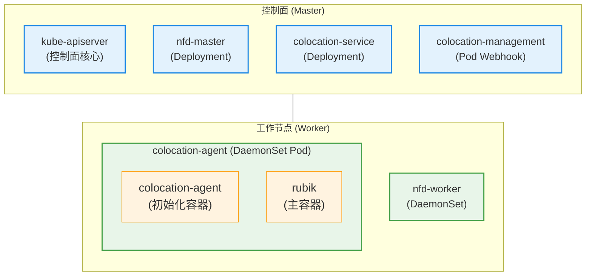
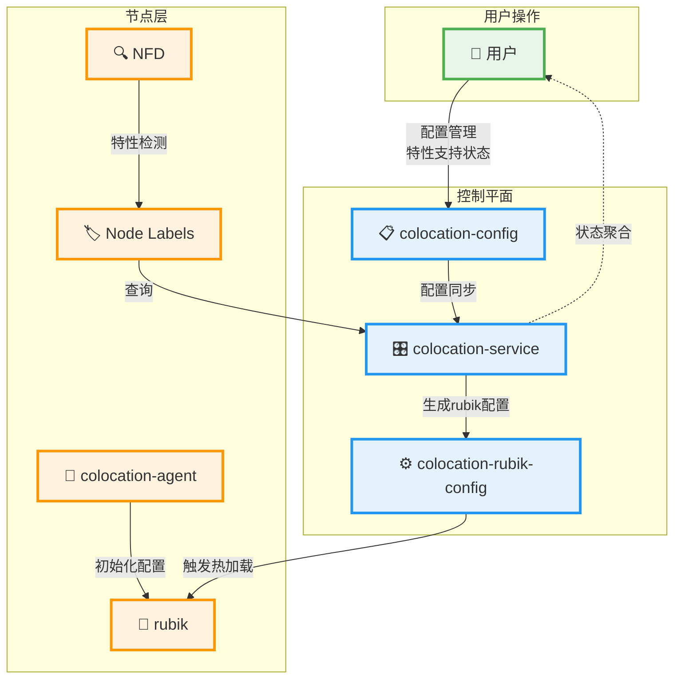
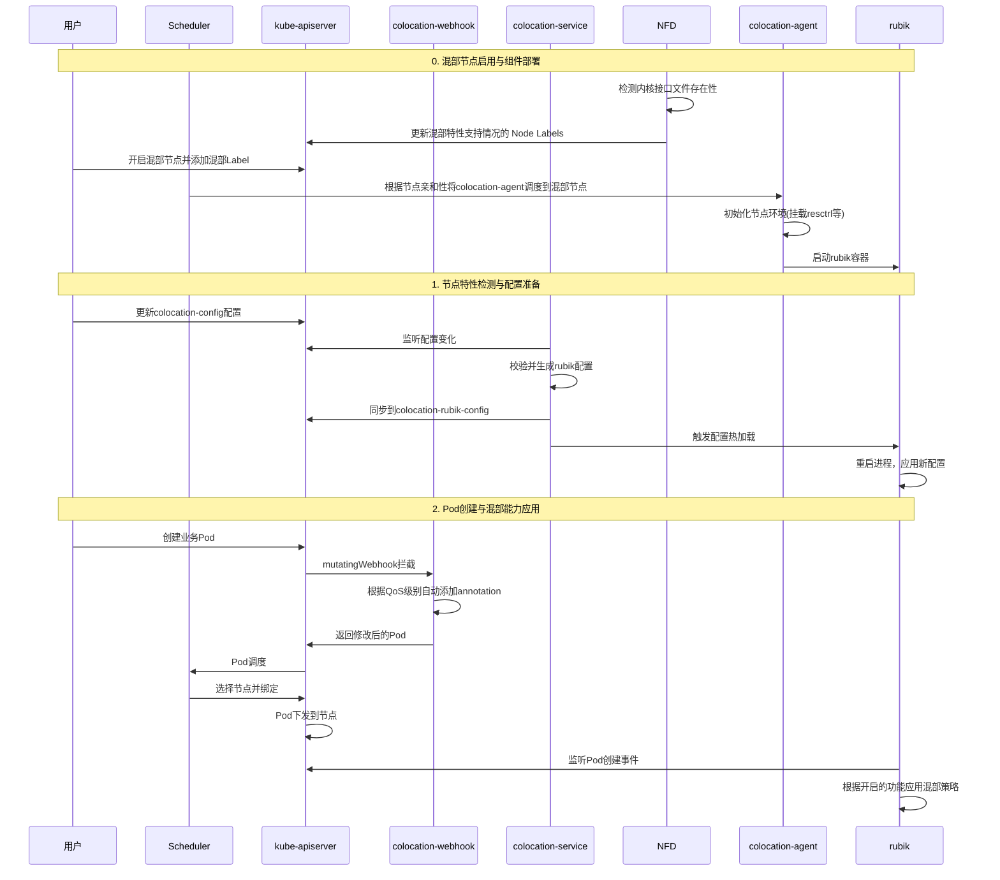

---
# 提案标题
title: 混部组件启用cpu弹性限流等新特性及配置能力增强
# 提案编号
ofep-number: 0010
# 提案作者
authors:
  - "@leoliu600"
  - "@piamposer-li"
# 提案主导SIG
owning-sig: sig-colocation
# 提案协作SIG
participating-sigs:
# 提案状态(初步草案|准备开始实现|已在SIG中实现并合并|提案被暂缓|提案被否决|作者主动撤回提案|被另一个oFEP取代)
status: implementable
# 创建日期
creation-date: 2025-07-14
# 评审人
reviewers:
  - TBD
# 批准人
approvers:
  - TBD
# 相关联的其他oFEP
see-also:
# 当前oFEP替代了哪些已有提案
replaces:
# 当前oFEP被哪些提案替代，当status为replaced时需要填写此字段
replaced-by:
# 此oFEP当前开发阶段
stage: alpha
# 最近一次推进的版本
latest-milestone: "v1.28"
# 各阶段目标版本
milestone:
  alpha: "v1.28"
  beta: "v1.28"
  stable: "v1.28"
# 功能开关及影响组件
feature-gates:
  - name: 提供CPU弹性限流、dynCache访存带宽、dynMemory内存异步分级回收、基于PSI指标的干扰检测的开关和配置
    components:
      - colocation-service
      - colocation-agent
      - rubik
# 是否支持关闭该功能
disable-supported: true
# 该功能引入的监控指标
metrics:
  - my_feature_metric
---
<!--
**注意：**当你的 oFEP 完成时，应删除所有这些注释块。

要开始使用此模板：
- [ ] **选择一个托管 SIG。**
  确保该问题领域是 SIG 感兴趣的。如果没有 SIG 的赞助，oFEP 不应提交。
  -[]**在 openfuyao/ofep 中创建问题**
  提交增强功能跟踪问题时，请务必填写该模板中的所有字段。其中一个字段要求提供指向 oFEP 的链接。你可以留空该字段，直到提交此 oFEP 后再返回到增强功能并添加链接。
- [ ] **复制此模板目录。**
  将此模板复制到所属 SIG 的目录中，并将其命名为“ofep-NNNN-short-descriptive-title”，其中“NNNN”是分配给上述增强功能的问题编号（没有前导零填充）。
- [ ] **尽可能多地填写以上oFEP元数据。**
  至少，你应该填写“标题”、“作者”、“SIG所有者”、“状态”和与日期相关的字段。
- [ ] **请尽可能详细地填写此文件。**
  至少，你应该填写“摘要”和“动机”部分。如果你已经和相关的 SIG 进行过前期沟通和想法验证，那么这两部分应该会很容易完成。
- [ ] **为此 oFEP 创建 PR。**
  将其指派给正在支持该流程的 SIG（特别兴趣小组）成员。
- [ ] **尽早合并并迭代。**
  避免纠结于具体细节，而应致力于明确 oFEP 的目标并快速合并。最好的方法是从概要部分开始，然后在后续的 PR 中逐步完善细节。

oFEP 合并并不意味着它已完成或获得批准。任何标记为“临时”的 oFEP 都是工作文档，可能会发生变更。你可以按以下方式标记正在积极讨论的部分：

编辑 oFEPS 时，请尽量使用范围明确、主题单一的 PR，以保持讨论的集中性。如果你不同意文档中已有的内容，请提交新的 PR 并提出修改建议。

一个 oFEP 对应其整个生命周期内的一项“功能”或“增强”。例如，从 Beta 版升级到 GA 版无需新的 oFEP。如果出现属于 oFEP 的新细节，请编辑 oFEP。一旦某个功能被“实现”，重大变更应该获得新的 oFEP。

最新（以及该文件的可能来源）的规范位置是[0000-ofep-template.md]（/0000-ofep-template.md）。

**注意：**任何将 oFEP 推进为“implementable”状态的 PR，或在标记为“implementable”后的重大更改，都必须得到每个 oFEP 批准人的批准。如果这些批准人均不合适（例如离开社区、角色变更等），则该列表的更改应由其余批准人和/或所属 SIG 批准。
-->
# oFEP-0010：混部组件启用cpu弹性限流等新特性及配置能力增强

<!--
这是你的 oFEP 的标题。请保持简短、简洁且描述性强。一个好的标题可以帮助传达什么是 oFEP，以及有助于审查与追踪。
-->

<!--
目录（TOC）有助于快速跳转到 oFEP 的各个部分，同时突出显示超出标准模板所提供的其他信息。

确保目录已用<code>&lt;!-- toc --&rt;&lt;!-- /toc --&rt;</code>标签，然后用`hack/update-toc.sh`生成。
-->

<!-- toc -->
- [发布签核清单](#release-signoff-checklist)
- [摘要](#summary)
- [动机](#motivation)
  - [目标](#goals)
  - [非目标](#non-goals)
- [提案](#proposal)
  - [用户故事（可选）](#user-stories-optional)
    - [故事 1](#story-1)
    - [故事 2](#story-2)
  - [注释/约束/警告（可选）](#notesconstraintscaveats-optional)
  - [风险与缓解措施](#risks-and-mitigations)
- [设计细节](#design-details)
  - [整体架构设计](#整体架构设计)
  - [节点特性检测](#节点特性检测与状态反馈机制)
  - [统一配置管理设计](#统一配置管理设计)
  - [Webhook增强设计](#webhook增强设计)
  - [各功能技术实现](#各功能技术实现)
  - [测试计划](#test-plan)
      - [先决条件测试更新](#prerequisite-testing-updates)
      - [单元测试](#unit-tests)
      - [集成测试](#integration-tests)
      - [e2e 测试](#e2e-tests)
  - [毕业标准](#graduation-criteria)
  - [升级/降级策略](#upgrade--downgrade-strategy)
  - [版本倾斜策略](#version-skew-strategy)
- [生产准备情况评审问卷](#production-readiness-review-questionnaire)
  - [功能启用和回滚](#feature-enablement-and-rollback)
  - [推出、升级和回滚规划](#rollout-upgrade-and-rollback-planning)
  - [监控要求](#monitoring-requirements)
  - [依赖项](#dependencies)
  - [可扩展性](#scalability)
  - [故障排除](#troubleshooting)
- [实施历史](#implementation-history)
- [缺点](#drawbacks)
- [替代方案](#alternatives)
- [所需基础设施（可选）](#infrastructure-needed-optional)
<!-- /toc -->

## 发布签核清单
<!--
**需要采取的行动：**为了将代码合并到一个版本中，在[openfuyao/ofep]引用此oFEP并在目标版本的[增强冻结]之前瞄准发布里程碑**中必须存在问题。

对于对核心代码或流程/程序进行更改的增强功能，例如：[openfuyao/openfuyao]，我们需要完成以下发布签署清单。

完成后勾选这些，以便发布团队跟踪。为了发布增强，必须更新这些检查表项。
-->

标记有（R）的项目*在达到里程碑/发布*之前是必需的。
- [ ]（R）发布里程碑中的增强问题，链接到 [openfuyao/ofep] 中的 oFEP 目录
- [ ] (R) oFEP 审批者已批准 oFEP 状态为“可实施”
- [ ] (R) 设计细节已适当记录
- [ ]（R）测试计划已到位，并考虑了 SIG 架构和 SIG 测试的输入（包括测试重构）
  - [ ] 针对所有 Beta API 操作（端点）进行 e2e 测试
  - [ ] (R) 确保 GA e2e 测试满足一致性测试的要求
  - [ ] (R) GA e2e 测试至少需要两周时间才能证明测试结果无 flake（不稳定或偶发失败）
- [ ] (R) 毕业标准已设定
  - [ ] (R) 所有 GA 端点必须通过[一致性测试]
- [ ] (R) 生产准备情况审查完成
- [ ] (R) 生产准备情况审查已获批准
- [ ] “实施历史”部分已更新里程碑
- [ ] 面向用户的文档已在 [openfuyao/docs] 创建，以便发布到 [openfuyao.com]
- [ ] 支持文档 - 例如，额外的设计文档、邮件列表讨论/SIG 会议链接、相关 PR/问题、发行说明

<!--
**注意：**此清单是迭代的，每次考虑将此增强功能作为里程碑时都应进行审查和更新。
-->

- [openfuyao.com](https://openfuyao.com/)
- [openfuyao/ofep](https://gitcode.com/openfuyao/ofep)
- [openfuyao/docs](https://gitcode.com/openfuyao/docs)

## 概括
<!--
这部分对于生成高质量、以用户为中心的文档（如发行说明或开发路线图）非常重要。应该在实现开始之前收集这些信息，以避免要求实现者在编写发行说明和实现功能本身之间分散注意力。oFEP 编辑器和SIG文档应该有助于确保“摘要”部分的语气和内容对广泛的受众有用。

好的摘要可能至少有一段长度。

在本节和下一节中，请遵循[文档样式指南]的指导方针。特别是，将代码行包装到合理的长度，使审阅者更容易引用特定的部分，并尽量减少更新的差异。
-->

本提案旨在 openFuyao 混部组件内，全面集成 rubik 引擎最新能力，包括内存异步分级回收、访存带宽隔离、CPU弹性限流、PSI干扰检测等。通过这些能力，显著提升单机节点上在线与离线业务混部时的资源隔离精度和 QoS 保障，确保在线业务稳定的同时提升集群整体资源利用率，并为用户提供统一、便捷的配置和功能支持感知方案。

## 动机
<!--
本节用于明确列出该oFEP的动机、目标和非目标。描述变更的重要性以及对用户的好处。
-->

openFuyao 以 rubik 为混部引擎，先前仅集成了 CPU/Memory 的绝对抢占和基于水位线的驱逐，资源隔离粒度有限，难以应对复杂业务场景。在集成新特性后：

- 能更细致地保障在线业务的资源和性能稳定
- 支持多维度 QoS 策略，提升资源利用率
- 用户可统一配置灵活管控各项混部能力
- 通过自动检测和状态反馈机制，降低配置和环境兼容性风险

### rubik能力与技术实现

rubik 是 openEuler 提供的云原生混部引擎，支持多种内核隔离与资源弹性管控能力：

- CPU弹性限流 (quotaTurbo)

  动态调整 cgroup 的 CPU 配额参数，在资源充足时允许低优先级容器突破限制，资源紧张时及时收敛，实现弹性分配。通过Linux内核提供的CFS bandwidth control能力实现。根据配置动态调整 `cpu.cfs_quota_us`、`cpu.cfs_period_us`、`cpu.stat`

- 内存异步分级回收 (dynMemory)

  基于 `memory.high_async_ratio`，根据内存压力对不同 QoS 容器实施分级回收，优先回收低优先级，保护高优先级。

- 访存带宽限制和LLC限制 (dynCache)

  通过 RDT（X86）或 MPAM（ARM）技术，限制离线业务对 CPU 缓存和内存带宽的占用，保障在线业务性能。

- PSI干扰检测 (psiDetection)

  监控 PSI（Pressure Stall Information）指标，自动识别并驱逐干扰在线业务的离线 Pod。

### 目标
<!--
列出oFEP的具体目标。它想要达到什么目标？我们怎么知道这已经成功了？
-->

+ 集成当前混部引擎rubik的新能力（包括内存异步回收、访存带宽隔离、CPU弹性限流、PSI干扰检测）
+ 提供统一的configmap用以配置上述新增QoS保障能力
+ 使用validationWebhook提供pod的准入校验和更改机制，将openFuyao定义的业务三级QoS映射到使用rubik上述能力时所需要的特定annotation

### 非目标
<!--
什么超出了这个oFEP的范围？列出非目标有助于集中讨论并取得进展。
-->

+ 只集成rubik，不修改rubik原生逻辑

## 提案
<!--
**这是我们真正进入提案具体内容的部分。**  
这一部分应包含足够的细节，使评审人员能清晰理解你到底在提出什么建议，  
但不应涉及 API 设计或具体实现细节。  

请阐明：
- **预期目标是什么？**  
- **我们如何衡量成功？**

请将更详细的设计和实现细节放在下方的 “设计细节” 部分中。
-->

### 用户故事（可选）
<!--
详细说明如果该 oFEP 被实施，用户将能够做哪些事情。请尽可能提供细节，以便人们理解系统将“如何”运作。此部分的目标是：让用户对提案有真实的感受，而不是陷入技术细节的泥淖中。
-->
#### 故事 1

用户在混部集群上希望能充分利用CPU。首先通过configmap设置`highWaterMark=60%`、`alarmWaterMark=80%` 并开启CPU 弹性限流功能，系统会自动为所有LS（在线非绑核）级别的 Pod 添加 `volcano.sh/quota-turbo: "true"` 注解。该类型的POD的CPU会自动进行调节：当负载低于警戒水位且容器受到压制时，缓慢提升其 CPU quota，充分利用CPU；当负载高于高水位时，慢速回调quota值；当负载超过警戒水位时，快速回落该类型容器的CPU quota，确保集群稳定运行。

#### 故事 2

应用用户在部署业务时，只需为 Pod 设置相应的 QoS 标签，系统会自动应用对应的混部策略。例如，用户部署一个标记为 "BE"（离线业务）级别的 Pod，colocation-management 的 Webhook 会自动为该 Pod 添加 `volcano.sh/cache-limit: "low"` 注解，限制其对 CPU 缓存和内存带宽的占用，防止冲击在线业务。同时，该 Pod 会被优先进行内存异步回收，并可能因 PSI 干扰检测而被驱逐，确保在线业务的资源和性能得到保障。用户无需手动配置复杂的混部参数，系统自动完成 QoS 到资源隔离策略的映射。

### 注释/限制/注意事项（可选）
<!--
该提案有哪些注意事项或潜在限制？
有没有上文未能充分表达的重要细节？
请在此处根据需要尽可能详细地展开说明。
这部分也非常适合用于讲解一些核心概念及它们之间的关联关系。
-->

本提案仅集成 rubik 核心混部能力，未引入新的 CRD 或节点级状态管理机制。所有功能开关和参数均通过全局 ConfigMap 进行统一配置和管理。主要原因是 rubik 当前仅支持全局配置，不支持节点级配置，特性无状态感知，且本阶段以最小改动集成 rubik 能力为目标，避免引入额外的复杂性。后续如 rubik 社区支持节点级配置，再考虑扩展 CR 管理能力。
对rubik中具体的功能，在使用前会有一些额外的操作（比如开启内核某些接口，检查硬件兼容性等），这部分具体实践可参考[此文档](https://docs.openeuler.org/zh/docs/22.03_LTS_SP4/docs/rubik/modules.html)

### 风险与缓解措施
<!--
这个提案存在哪些风险？我们将如何加以缓解？请从广泛的角度思考，例如包括安全性问题，以及它可能对更大范围的 openfuyao 生态系统产生的影响。 安全性将由谁进行评审，以及如何评审？用户体验（UX）将由谁进行评审，以及如何评审？建议考虑邀请 SIG 外部或子项目之外的相关人员参与评估。
-->
1. 配置错误风险: 错误的配置可能导致节点资源异常或在线业务SLO受损。
- 缓解措施:
  在colocation-service中实现严格的字段校验和逻辑校验。
  提供配置热加载能力，避免因重启组件导致服务中断。
2. 内核/硬件兼容性风险: 集群中节点环境不一，可能导致部分功能在某些节点上失效。
- 缓解措施:
  本提案设计的节点特性检测机制是该风险的核心缓解手段。
## 设计细节
<!--
本节应包含足够的信息，以便读者能够清楚理解你所提出的变更具体是什么。这可能包括 API 规格说明（虽然并非必须）或代码片段。如果对该提案将如何实施存在任何疑问，应在此处进行详细讨论。
-->

### 整体架构设计

本方案采用中心化配置、节点自治的闭环架构，通过统一的ConfigMap管理rubik各项QoS能力，并使用validationWebhook实现Pod的自动标注和校验，还使用Node feature Discovery来检测节点功能可用性。

**部署视图**


**核心交互视图**



**混部流程图**



**配置与状态资源说明**：
- **colocation-config**：用户修改的统一配置，包含所有混部特性开关和参数
- **colocation-rubik-config**：colocation-service根据用户配置生成的rubik专用配置文件
- **Pod Annotations**：通过Webhook根据QoS级别自动添加的rubik功能注解

**核心功能流程**

1. **特性检测**：
   - NFD检测节点内核接口文件存在性，标记到Node Label

2. **环境初始化**：
   - `colocation-agent`容器负责节点环境初始化（如挂载resctrl等）

3. **配置管理与热加载**：
   - 用户修改`colocation-config`
   - `colocation-service`监听变化并同步到`colocation-rubik-config`
   - `rubik-daemon`监控配置文件变化，重启rubik进程实现热加载

4. **Pod自动标注**：
   - colocation-mangement的Webhook组件会根据QoS级别自动为Pod添加rubik annotation

**rubik-DaemonSet 配置示例**
```yaml
apiVersion: apps/v1
kind: DaemonSet
metadata:
  name: colocation-rubik
  namespace: openfuyao-system
  labels:
    app.kubernetes.io/name: colocation-agent
spec:
  selector:
    matchLabels:
      name: colocation-rubik
      app.kubernetes.io/name: colocation-agent
  template:
    metadata:
      labels:
        name: colocation-rubik
        app.kubernetes.io/name: colocation-agent
    spec:
      affinity:
        nodeAffinity:
          requiredDuringSchedulingIgnoredDuringExecution:
            nodeSelectorTerms:
            - matchExpressions:
              - key: "node.openfuyao.com/colocation"
                operator: "Exists"
      serviceAccountName: colocation-rubik
      hostPID: true
      containers:
      - name: colocation-agent
        image: colocation-agent:latest
        volumeMounts:
        - name: host-proc-sys
          mountPath: /host/proc/sys
      - name: colocation-rubik
        image: rubik:latest
        command:
          - /bin/sh
          - -c
          - |
            /var/lib/rubik/rubik-daemon.sh
        env:
          - name: RUBIK_NODE_NAME
            valueFrom:
              fieldRef:
                fieldPath: spec.nodeName
        securityContext:
          capabilities:
            add: [SYS_ADMIN]
        resources:
          limits:
            memory: 200Mi
          requests:
            cpu: 100m
            memory: 200Mi
        volumeMounts:
        - name: rubiklog
          mountPath: /var/log/rubik
        - name: runrubik
          mountPath: /run/rubik
        - name: sysfs
          mountPath: /sys/fs
        - name: devfs
          mountPath: /dev
        - name: config-volume
          mountPath: /var/lib/rubik
      terminationGracePeriodSeconds: 30
      volumes:
      - name: rubiklog
        hostPath:
          path: /var/log/rubik
      - name: runrubik
        hostPath:
          path: /run/rubik
      - name: sysfs
        hostPath:
          path: /sys/fs
      - name: devfs
        hostPath:
          path: /dev
      - name: config-volume
        configMap:
          name: colocation-rubik-config
          items:
          - key: config.json
            path: config.json
      - name: host-proc-sys
        hostPath:
          path: /proc/sys
          type: DirectoryOrCreate
```

### 节点特性检测

**核心设计思路**：
1. **检测机制**：通过NFD检测内核接口文件和参数是否存在，并将结果标记到Node Label上。作为功能开启的前置条件
2. **结果反馈**：`colocation-service`监听Node Label变化，聚合并提供接口

**NFD特性检测**

NFD负责检测基础内核接口文件的存在性，并将结果标记到Node Label上。

```yaml
# NFD配置示例
apiVersion: v1
kind: ConfigMap
metadata:
  name: nfd-worker-conf
data:
  nfd-worker.conf: |
    sources:
      kernel:
        kernelConfig:
          - "/proc/sys/kernel/sched_cfs_bandwidth_slice_us"  # quotaTurbo检测
          - "/sys/fs/cgroup/memory/memory.high_async_ratio"   # dynMemory检测
          - "/sys/fs/resctrl"                                 # dynCache检测
          - "/proc/pressure"                                  # PSI检测
        labelWhitelist:
          - "colocation.feature.quota-turbo"
          - "colocation.feature.dyn-memory"
          - "colocation.feature.dyn-cache" 
          - "colocation.feature.psi-detection"
```

**colocation-service 聚合特性支持结果**

colocation-service 会定期聚合各节点由 NFD 检测并标记到 Node Label 的特性信息。它监听节点 Label 的变化，并通过统一接口对外提供节点特性状态查询能力。这样，用户或其他组件可以方便地获取集群内各节点对混部相关特性的支持情况，实现配置和调度的自动化与可观测。

**新增守护进程**

由于 rubik 不支持原生热加载，这里通过在 rubik 镜像中加入 shell 环境，新增 `rubik-daemon.sh` 脚本来管理 rubik 的生命周期和配置热加载。

主要功能：
- 生命周期管理：启动并监控 rubik 子进程，在其意外退出时自动重启。
- 智能热加载：监控配置文件，当配置变化时，自动重启 rubik 进程以应用新配置。

### 统一配置管理设计

**ConfigMap结构设计**

```yaml
# colocation-config ConfigMap
apiVersion: v1
kind: ConfigMap
metadata:
  name: colocation-config
  namespace: openfuyao-system
data:
  rubik-options: |-
    {   
      "agent": {
        "enabledFeatures": [
          "eviction", 
          "quotaTurbo",  
          "dynMemory",  
          "dynCache", 
          "psi"
        ]
      },
      "eviction": {
        "enable": true,
        "cpuevict": {
          "threshold": 60
        },
        "memoryevict": {
          "threshold": 60
        }
      },
      "quotaTurbo": {
        "highWaterMark": 60,
        "syncInterval": 100
      },
      "dynMemory": {
        "enable": true
      },
      "dynCache": {
        "defaultLimitMode": "static",
        "adjustInterval": 1000,
        "l3Percent": {
          "low": 20,
          "mid": 30,
          "high": 50
        },
        "memBandPercent": {
          "low": 20,
          "mid": 30,
          "high": 50
        }
      },
      "psi": {
        "interval": 10,
        "resource": ["cpu", "memory"],
        "avg10Threshold": 5.0
      }
    }
```

### Webhook新增策略

colocation-management 是部署在控制面的一个准入控制插件，负责监听集群内 Pod 的创建和变更事件。它会根据业务 QoS 级别自动为 Pod 添加或修改相关的注解（annotation），确保各混部特性按策略生效。
本版本修改后用户无需手动配置，系统会自动完成 QoS 到 rubik 功能的映射，实现资源隔离和弹性管控的一致性。该组件提升了混部能力的易用性和自动化程度。

**功能映射策略**

基于openFuyao三类QoS体系（高优先级在线业务/普通在线业务/离线业务），各功能的映射策略如下：

| QoS  | CPU弹性限流            | 访存带宽限制                | 内存异步回收              | PSI干扰检测 |
| ---- | ---------------------- | --------------------------- | ------------------------- | ----------- |
| HLS  | 关闭 - 资源预留        | 不限制 - 拥有全部硬件能力   | 从不回收 - 内存受保护     | 干扰源识别  |
| LS   | 开启 - 应对突发流量    | 不限制 - 保障缓存性能       | 最后回收 - 极端压力下回收 | 干扰源识别  |
| BE   | 关闭 - 严格限制CPU突发 | 严格限制 - 防止冲击在线业务 | 优先回收 - 首要回收目标   | 被驱逐对象  |

**Annotation映射规则**：
- CPU弹性限流：LS级别Pod自动添加 `volcano.sh/quota-turbo: "true"`
- 访存带宽限制：BE级别Pod自动添加 `volcano.sh/cache-limit: "low"`
- 内存异步回收和PSI干扰检测：无需额外annotation，基于QoS级别自动生效

### 依赖和注意事项

1. **硬件和环境要求**：
   - dynCache功能仅适用于物理机
     - X86平台需要内核启动参数`rdt=l3cat,mba`并挂载/sys/fs/resctrl目录
     - ARM平台需要内核启动参数`mpam=acpi`和BIOS支持MPAM

2. **功能限制**：
   - 容器重启后dynCache无法对PID变化的容器生效
   - 不支持运行时修改dynCache限制级别
   - 动态限制组调控灵敏度受配置参数和Pod数量影响

3. **版本验证情况**：

| 特性 | openEuler22.03LTS | openEuler22.03LTS-SP3 |
|------|------------------|---------------------|
| CPU弹性限流（用户态） | ✓ | ✓ |
| CPU弹性限流（内核态） | ✗ | ✓ |
| dynMemory | ✗ | ✓ |
| dynCache | ✓ | ✓ |
| PSI干扰检测 | ✓ | ✓ |


### 测试计划

<!--
**注意：**在该提案尚未被纳入某个正式版本前，此部分不是必需的。
其目标是确保我们不会接收缺乏充分测试的增强功能。
所有代码都应具备充分的测试（最终也应满足测试覆盖率要求）。在撰写测试计划时，请遵循 openFuyao 测试指南。
-->

[ ] 我/我们理解，相关组件的所有者可能会要求更新已有的测试，以便在提交实现该增强功能所需的更改之前，使代码达到足够稳固的质量标准。

##### 先决条件测试更新
<!--
根据评审者的反馈，描述在实施此项增强功能之前需要补充哪些额外的测试，以确保该增强特性也具备稳固的基础。
-->

##### 单元测试
<!--
原则上，所有新增的代码都应具有完整的单元测试覆盖率，因此列出确切的测试项并不会带来额外价值。
但如果无法实现完整的单元测试覆盖，请说明原因，并解释为何在这种情况下这是可以接受的。
-->

<!--
此外，对于 Alpha 阶段，请尽量列出为了实现该增强功能将涉及的核心包（core package），并提供这些包当前的单元测试覆盖率，格式如下：
- <软件包>: <日期> - <当前测试覆盖率>
这可以帮助我们在扩展生产代码、实施该增强功能之前，识别并推进某些测试覆盖率的改进工作。
-->

- `<软件包>`: `<日期>` - `<测试覆盖率>`

##### 集成测试
<!--
集成测试允许控制用于启动被测二进制文件的配置参数。
这与不允许配置参数的 e2e 测试不同。
这样做可以测试非默认选项以及多个不同的、可能冲突的命令行选项。

如果集成测试不是必要的或有用的，请解释原因。
-->

<!--
当准备将功能纳入某个正式版本时，需要填写此问题。
- 对于 Alpha 阶段，请描述将添加哪些测试，以确保该增强功能具备良好的质量保障。
- 对于 Beta 和 GA 阶段，需要记录测试已经编写、被定期执行，且结果稳定。

你可以通过以下方式提供相关证明：
- 指向 gitcode 源代码的永久链接
- 指向定期测试作业的链接，并按测试名称过滤
- 在 openfuyao 缺陷追踪工具中进行搜索。
-->

- 测试名称

##### e2e 测试
<!--
当该功能计划纳入某个正式版本时，应填写此问题。
- 对于 Alpha 阶段，请描述将添加哪些测试，以确保该增强功能具备良好的质量保障。
- 对于 Beta 和 GA 阶段，需要说明测试已经编写、被定期执行，且结果稳定。

可通过以下方式提供证明材料： 
- 指向 gitcode 源代码的永久链接
- 指向定期测试作业的链接，并按测试名称过滤
- 在 openfuyao 缺陷追踪工具中进行搜索。

作为进入 GA（正式可用）阶段的标准，我们期望过去一个月内不存在任何非基础设施相关的 flaky 测试（不稳定测试）。
如果你认为无需添加端到端测试（e2e），请解释其原因及合理性。
-->

- 测试名称

### 毕业标准
<!--
> **注意：** *在功能尚未计划纳入某个正式版本时，本节无需填写。*
> 请在此处定义该功能的毕业（Graduation）里程碑。
> 毕业条件可以基于 API 成熟度、[Feature Gate] 的推进阶段，或其他方式来定义。此处应保持高层次，重点说明评估是否可以毕业时将参考哪些信号（信心指标）。
> 在制定毕业标准时，请参考以下内容：
> - [成熟度等级（`alpha`、`beta`、`stable`）]
> - [Feature Gate 生命周期][feature gate]
> - [弃用政策][deprecation-policy]
> 请明确说明“毕业”的定义。
> 通常我们倾向于无论功能通过何种方式访问，均采用相同的阶段划分（alpha、beta、GA）。

#### 🔹 Alpha 阶段
- 功能已通过 Feature Gate 实现（默认关闭）  
- 初步的端到端（e2e）测试已完成并启用  
#### 🔸 Beta 阶段
- 收集开发者反馈及用户调研结果  
- 完成核心功能 A、B、C  
- 额外的测试已加入 Testgrid，并在 oFEP 中有链接说明  
- 实现更严格的测试形式，例如降级测试和可扩展性测试  
- 所有功能均已实现  
- 所有安全相关机制均已完备  
- 所有监控要求均已实现  
- 所有测试要求均已满足  
- 所有预发布阶段的问题与缺陷均已修复  

> **注意：** Beta 阶段的评估标准必须包含所有功能、安全性、监控与测试的要求，并解决所有已知问题或差距。

#### 🟢 GA 阶段
- 有 N 个真实生产环境中的使用示例  
- 有 N 次实际安装部署记录  
- 已留出反馈窗口期，收集充分用户反馈  
- 所有在 Beta 阶段反馈的问题与缺陷都已解决  

> **注意：** GA 阶段的毕业标准不得再包含功能、安全性、监控或测试方面的要求，这些应在 Beta 阶段全部完成。
> **注意：** 通常，我们在 Beta 和 GA 之间至少间隔两个版本周期，以便留出时间获取用户反馈和发现潜在问题，避免在连续发布中遗漏反馈环节。
> **对于非可选（默认启用）功能在进入 GA 阶段时，毕业标准必须包含 [一致性测试（Conformance tests）]。**

#### 🧯 弃用（Deprecation）
- 宣布弃用现有功能标志（flag）并说明支持策略  
- 自引入替代功能以来，已过去两个版本（以解决版本偏差问题）  
- 处理来自 gitcode Issues 等反馈渠道中的用法变更或行为差异问题  
- 正式弃用原有标志 （flag）
-->
### 升级/降级策略
<!--
> 指导提案人在功能设计时兼顾向前兼容性、配置迁移、Feature Gate 管理等问题。
-->
<!--
如果适用，该组件在升级和降级时将如何处理？请确保在测试计划中包含这部分内容。

在制定该增强功能的升级/降级策略时，请考虑以下问题：
- 为了保持现有行为不变，集群在升级时是否需要进行调用方式、配置或 API 使用上的任何更改？
- 为了使用该增强功能，集群在升级时是否需要对调用方式、配置或 API 使用做出调整？
-->

### 版本倾斜策略
<!--
确保你的提案在 openfuyao 集群中升级时能够兼容不同版本组件之间的运行差异。
-->
<!--
如果适用，该组件在面对与其他组件的版本不一致（version skew）时将如何处理？有哪些兼容性保证？请确保在测试计划中包括这一部分。

在为此增强功能制定版本偏差应对策略时，请考虑以下问题：
- 该功能是否涉及控制面（Control Plane）与节点（Node）之间的协同行为？
- 当使用该功能时，版本落后三个版本（n-3）的 kubelet 或 kube-proxy 会如何表现？
- 当使用该功能时，版本落后一个版本（n-1）的 kube-controller-manager 或 kube-scheduler 会有何行为？
- 节点上的其他组件是否会发生变更？ 例如，CSI（容器存储接口）、CRI（容器运行时接口）或 CNI（容器网络接口）是否需要在 kubelet 之前被更新？
-->

## 生产可用性审查
<!--
**生产可用性审查（Production Readiness Review，PRR）** 的目的是确保即将合并到 openfuyao 中的功能：
- 可观测（observable）、可扩展（scalable）、可支持（supportable）；
- 能在生产环境中安全运行；
- 在出现故障时能够被禁用或回滚。

**要使 oFEP 进入 `implementable` 状态并被纳入发布版本，必须完成并通过生产可用性审查问卷（PRR Questionnaire）。**

在某些情况下，元数据中也应包含这些问题的答案：
- 这样可以便于自动化工具验证是否进行了审查；
- 同时有助于减少评审负担并降低审查延迟。
-->

### 功能启用和回滚
<!--
当针对 alpha 版本发布时，必须完成此部分。
-->

###### 如何在实时集群中启用/禁用此功能？
<!--
选择其中一个并删除其余的。
-->

- [ ] **功能开关（Feature gate）**（请同时在元数据中填写相应字段）  
  - 功能开关名称：  
  - 依赖该功能开关的组件：
- [ ] **其他机制**  
  - 描述机制实现方式：  
  - 启用/禁用该功能是否会导致控制平面需要停机？  
  - 启用/禁用该功能是否会导致节点需要停机或重新部署（reprovision）？

###### 启用该功能会改变任何默认行为吗？
<!--
任何默认行为的变更都可能让用户感到意外，或破坏现有的自动化流程，因此在这方面必须格外小心。
-->

###### 该功能一旦启用，是否可以禁用（即我们可以回滚启用）？
<!--
**请描述该功能对现有工作负载可能造成的影响**（例如，如果这是一个运行时特性，它是否可能破坏现有应用程序的行为？）。

通常，通过将功能开关（Feature Gate）设置为 `false` 并重启相应组件，即可禁用该功能。除这个操作之外，不应再需要其他变更来完成禁用。

**注意：**在元数据中，也请将 `disable-supported` 字段设置为 `true` 或 `false`。
-->

###### 如果该功能之前已回滚，现在我们重新启用它会发生什么情况？

###### 是否有任何针对功能启用/禁用的测试？
<!--
当前的端到端测试框架（e2e framework）**尚不支持启用或禁用 Feature Gate**。  
然而，对于处理数据的每个组件，必须编写包含**启用和未启用该功能场景的单元测试**。

如果该功能修改了 API 类型，**至少应该考虑添加转换测试（conversion tests）**。

此外，如果该功能引入了新的 API 字段，**还必须编写测试 Feature Gate 开关行为的单元测试**——也就是验证以下情形：  
- “当我先启用 Feature Gate 并写入了包含新字段的对象后，随后将其禁用，会发生什么？”
-->

### 推出、升级和回滚规划
<!--
当该功能计划从 Beta 阶段发布至正式版本时，必须填写本节内容。
-->

###### 部署或回滚为何会失败？这会影响正在运行的工作负载吗？
<!--
**尽可能保持警觉和审慎**——例如，假设在发布过程中某些组件会中途重启，会发生什么？

请务必考虑以下场景：
- **高可用（HA）集群**：在该场景下，功能开关（Feature Flag）可能仅在部分 API Server 上启用，而其他仍为禁用状态；
- **大型集群**：在这种情况下，功能的启用/禁用可能会分批分节点地推进，需考虑该过程中的一致性与兼容性问题。
-->

###### 哪些具体指标应该通知回滚？
<!--
当该功能还处于早期阶段时，用户应关注哪些信号，以便及早发现可能存在的严重问题？
-->

###### 升级和回滚测试了吗？升级->降级->升级的路径测试了吗？
<!--
请描述已完成的手动测试及其结果。
从长远来看，我们可能会要求实施自动化的升级/回滚测试，但目前我们仍缺少相关的机制和工具，因此暂时无法实现。
-->

###### 推出时是否伴随任何功能、API、API 类型的字段、标志等的弃用和/或删除？
<!--
即使应用弃用政策，仍可能会让一些用户感到惊讶。
-->

### 监控要求
<!--
当计划将功能从 Beta 阶段纳入某个正式版本（release）时，必须完成此部分内容。
对于 GA（正式可用）阶段，该部分也是必须填写的：审批人应能够基于实际生产环境中的经验，确认之前各项回答的准确性。
-->

###### 操作员如何确定该功能是否正在被工作负载使用？
<!--
理想情况下，应使用指标（metric）来实现。
通过对 Kubernetes API 的操作（例如检查是否存在设置了字段 X 的对象）应作为最后手段。
请避免将日志或事件用于此目的。
-->

###### 使用此功能的人如何知道它适用于他们的实例？
<!--
例如，如果这是一个与 Pod 相关的功能，则应能够针对每个 Pod 确定该功能是否正常工作。
请从以下选项中选择一项并删除其余内容。
请在下方详细描述所有对最终用户可见的内容，确保他们能够验证该功能是否已正确启用并正常运行。
> 请注意：最终用户通常无法查看组件日志或访问系统指标（metrics）。
-->

- [ ] 事件
  - 事件原因：
- [ ] API .状态
  - 条件名称：
  - 其他领域：
- [ ] 其他（作为最后手段）
  - 细节：

###### 增强的合理 SLO（服务级别目标）是什么？
<!--
这是你定义该功能“正常服务质量”（Quality of Service，QoS）表现的机会。
我们无法提供全面的指导，但从高层角度来看（还需要更精确定义），这些表现可能包括：
- 每天返回 5XX 错误的 API 调用比例 ≤ 1%  
- CronJob 的任务实际创建时间与预期创建时间之差的绝对值在一天内的 99 百分位 ≤ 10%  
- 每天 99.9% 的 `/health` 请求返回 HTTP 200 状态码  

这些目标将有助于你在下一个问题中确定需要衡量的服务指标（SLIs）。
-->

###### 运维人员可以使用哪些服务级别指标（SLIs）来判断服务的健康状况？
<!--
请选择以下选项中的一个，并删除其余内容。
-->

- [ ] 指标
  - 指标名称：
  - [可选] 聚合方法：
  - 暴露指标的组件：
- [ ] 其他（作为最后手段）
  - 细节：

###### 是否存在任何尚未覆盖的指标（metrics），可以用来进一步提升该功能的可观测性？
<!--
请描述这些指标本身，以及未添加它们的原因（例如：成本高、实现复杂等）。
-->

### 依赖项
<!--
当计划将该功能从 Beta 阶段纳入某个正式版本（release）时，必须完成本节内容。
-->

###### 此功能是否依赖于集群中运行的任何特定服务？
<!--
请同时考虑集群级别的服务（例如 metrics-server）以及节点级别的代理（例如某个特定版本的 CRI）。  
重点关注该功能所依赖的 **外部或可选服务**。  
例如，如果该功能依赖云服务商的 API、或外部的软件定义存储（SDS）或网络控制面板等服务，则应明确列出。

对于每一项依赖项，请填写以下内容：
- 当前用户工作负载的运行情况  
- 新建工作负载的创建情况  
- 集群级别的服务（例如 DNS）

填写格式如下：
```
- [依赖项名称]
  - 使用说明：
    - 若该服务发生中断，对该功能的影响：
    - 若该服务性能下降或错误率升高，对该功能的影响：
```
-->

### 可扩展性
<!--
对于 Alpha 阶段，鼓励填写本节内容：评审人员应考虑这些问题，并尝试给出回答。
对于 Beta 阶段，本节为必填项：评审人员必须回答这些问题。
对于 GA（正式发布）阶段，本节同样为必填项：审批人员应能根据实际生产经验，确认之前给出的所有回答。
-->

###### 启用/使用此功能会导致任何新的 API 调用吗？
<!--
**请描述相关 API 调用，包括以下信息：**
- **API 调用类型**（例如：`PATCH pods`）  
- **预估调用频率（吞吐量）**  
- **调用发起组件**（例如：`Kubelet`、`Feature-X-controller`）

重点关注以下场景：
- **组件开始列出（list）或监听（watch）以前未处理的资源**
- **某些 Kubernetes 资源发生变化后，触发新的 API 请求行为**  
  例如：更新对象 X 后又触发了对对象 Y 的修改或创建
- **用于状态对齐（state reconciliation）的定期 API 请求**  
  例如：周期性获取资源状态、心跳上报、领导者选举等
  -->

###### 启用/使用此功能是否会导致引入新的 API 类型？
<!--
请描述它们（指代 API 对象或资源），并提供以下信息：
- **API 类型**（API type）  
- **每个集群支持的最大对象数量**
- **每个命名空间支持的最大对象数量**（仅适用于具备命名空间作用域的对象）
-->

###### 启用/使用此功能是否会导致对云提供商的任何新的 API 调用？
<!--
请进行如下描述：
- **涉及哪些 API：**  
- **预估调用增加量：**
-->

###### 启用/使用此功能是否会导致现有 API 对象的大小或数量增加？
<!--
**请描述新增或受影响的资源对象，提供以下信息：**
- **API 类型（API type(s)）：**  
- **预估对象体积增加量：**（例如：新增注解字段，大小为 32 字节）  
- **预估新增对象数量：**（例如：为每个现有 Pod 创建一个新的对象 X）
-->

###### 启用/使用此功能是否会导致现有 SLI/SLO 所涵盖操作的耗时增加？
<!--
请思考是否会新增额外操作或在现有流程中引入新的中间步骤（例如：为了启动一个容器，现在需要先执行步骤 X 等）。
请在下方详细描述这些新增内容。
-->

###### 启用/使用此功能是否会导致任何组件的资源使用率（CPU、RAM、磁盘、IO 等）不可忽略的增加？
<!--
需要注意的事项包括：
- 增加的内存状态（in-memory state）；
- 新引入的耗时计算操作；
- 频繁的磁盘访问（包括日志量增加）；
- 大量发送或接收的网络数据流量等。

请从小型和大型集群的不同规模角度，**全面评估这些资源消耗**，并结合 Kubernetes 的[支持上限（supported limits）](https://git.k8s.io/community/sig-scalability/configs-and-limits/thresholds.md)进行考量。
-->

###### 启用/使用此功能是否会导致某些节点资源（PID、套接字、inode 等）耗尽？
<!--
**请不要只关注理想情况，更重要的是评估异常或极端情况**，例如：
- 探针响应时间从毫秒级变成分钟级；
- 异常或失败的 Pod 持续占用资源等。

**如果该功能可能会导致某些资源被耗尽**，请说明：
- 如何通过 Kubernetes 已有的资源限制机制进行缓解（例如每节点最大 Pod 数）；
- 或该 oFEP 是否引入了新的限制来控制这些风险。

此外，还请说明：
- **是否已经进行了性能相关测试（或计划进行），用于更好地理解性能特征，并验证所声明的资源使用上限？**
-->

### 故障排除
<!--
**当该功能计划从 Beta 阶段发布至正式版本（release）时，本节必须填写。**

对于 **GA（正式发布）阶段**，本节同样为必填项：审批人员应能够根据实际生产环境中的经验，确认之前的各项回答。

当前的 **“排障（Troubleshooting）” 部分**，在功能发布流程中相当于临时承担了 **“运维手册（Playbook）”** 的角色。  
未来可能会将其拆分为一个专门的 `Playbook` 文档（可能还会包含一些监控信息）。但目前仍将其保留在此处。
-->

###### 如果 API 服务器和/或 etcd 不可用，此功能如何反应？

###### 其他已知故障模式有哪些？
<!--
**对于每种故障模式，请使用以下模板逐项填写信息：**
- **[故障模式简要描述]**  
  - **检测方式（Detection）：**  
    如何通过指标（metrics）检测该问题？换句话说：  
    操作人员**如何在不登录 master 或 worker 节点的情况下排障**？
  - **缓解手段（Mitigations）：**  
    尤其对于已在运行的用户工作负载，可采取哪些措施止血/减缓影响？
  - **诊断信息（Diagnostics）：**  
    有哪些有用的日志消息？其对应的**日志级别**（logging level）是多少？  
    ✅ *注：日志诊断信息在功能进入 Beta 阶段前可不填写。*
  - **测试情况（Testing）：**  
    针对该故障是否有测试用例？若无，请说明原因。
    -->

###### 如果未满足 SLO，应采取哪些步骤来确定问题？

## 实施历史
<!--
**在本节中应记录一个 oFEP 生命周期中的主要里程碑。**

可能包括但不限于以下内容：
- `摘要` 和 `动机` 部分被合并，表示 SIG 已接受该提案  
- `提案` 部分被合并，表示对设计方案达成一致  
- 实现工作的启动日期  
- 首个包含该 oFEP 初始版本的 openfuyao 发布版本  
- 该 oFEP 成功毕业为正式可用（GA）的 openfuyao 版本  
- oFEP 被废弃或被其他提案取代的时间  
-->

## 缺点
<!--
为什么不实施这个 oFEP？从反面角度分析该提案可能带来的负面影响、权衡成本、潜在风险或争议点。
-->

## 替代方案
<!--
**你还考虑过哪些其他方案？为什么将它们排除？**  
这些备选方案不需要像最终提案那样详尽，但应提供足够的信息来阐述其基本思路，并说明为什么它们不可接受。
-->

## 所需基础设施（可选）
<!--
**如果你需要从项目或 SIG 获得资源支持，请在本节中列出。** 例如：
- 请求创建新的子项目（subproject）  
- 新建 gitcode 仓库（repos）  
- 配置 gitcode 相关权限或细节（如 team 成员或 CI 权限等）

提前在这里列出这些需求，有助于 SIG 尽早启动相关流程，加快资源配置效率。
-->