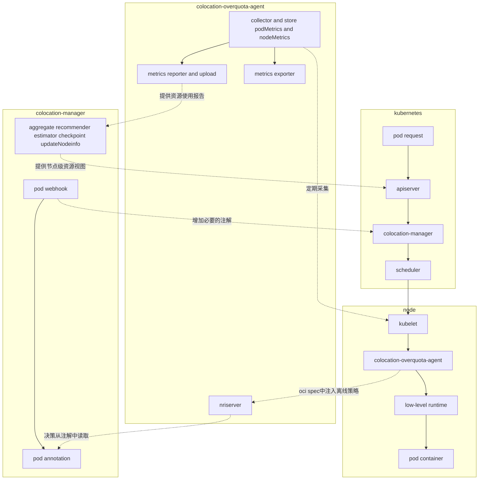

---
# 提案标题
title: oFEP Template
# 提案编号
ofep-number: 0012
# 提案作者
authors:
  - "@guoyx87"
# 提案主导SIG
owning-sig: sig-colocation
# 提案协作SIG
participating-sigs:
status: implementable
# 创建日期
creation-date: 2025-07024
# 评审人
reviewers:
  - TBD
# 批准人
approvers:
  - TBD
# 功能开关及影响组件
feature-gates:
  - name: colocation
    components:
      - opm-agent
      - opm-webhook
      - oss-agent
      - oss-master
# 是否支持关闭该功能
disable-supported: true
---
<!--
**注意：**当你的 oFEP 完成时，应删除所有这些注释块。

要开始使用此模板：
- [ ] **选择一个托管 SIG。**
  确保该问题领域是 SIG 感兴趣的。如果没有 SIG 的赞助，oFEP 不应提交。
  -[]**在 openfuyao/ofep 中创建问题**
  提交增强功能跟踪问题时，请务必填写该模板中的所有字段。其中一个字段要求提供指向 oFEP 的链接。你可以留空该字段，直到提交此 oFEP 后再返回到增强功能并添加链接。
- [ ] **复制此模板目录。**
  将此模板复制到所属 SIG 的目录中，并将其命名为“ofep-NNNN-short-descriptive-title”，其中“NNNN”是分配给上述增强功能的问题编号（没有前导零填充）。
- [ ] **尽可能多地填写以上oFEP元数据。**
  至少，你应该填写“标题”、“作者”、“SIG所有者”、“状态”和与日期相关的字段。
- [ ] **请尽可能详细地填写此文件。**
  至少，你应该填写“摘要”和“动机”部分。如果你已经和相关的 SIG 进行过前期沟通和想法验证，那么这两部分应该会很容易完成。
- [ ] **为此 oFEP 创建 PR。**
  将其指派给正在支持该流程的 SIG（特别兴趣小组）成员。
- [ ] **尽早合并并迭代。**
  避免纠结于具体细节，而应致力于明确 oFEP 的目标并快速合并。最好的方法是从概要部分开始，然后在后续的 PR 中逐步完善细节。

oFEP 合并并不意味着它已完成或获得批准。任何标记为“临时”的 oFEP 都是工作文档，可能会发生变更。你可以按以下方式标记正在积极讨论的部分：

编辑 oFEPS 时，请尽量使用范围明确、主题单一的 PR，以保持讨论的集中性。如果你不同意文档中已有的内容，请提交新的 PR 并提出修改建议。

一个 oFEP 对应其整个生命周期内的一项“功能”或“增强”。例如，从 Beta 版升级到 GA 版无需新的 oFEP。如果出现属于 oFEP 的新细节，请编辑 oFEP。一旦某个功能被“实现”，重大变更应该获得新的 oFEP。

最新（以及该文件的可能来源）的规范位置是[0000-ofep-template.md]（/0000-ofep-template.md）。

**注意：**任何将 oFEP 推进为“implementable”状态的 PR，或在标记为“implementable”后的重大更改，都必须得到每个 oFEP 批准人的批准。如果这些批准人均不合适（例如离开社区、角色变更等），则该列表的更改应由其余批准人和/或所属 SIG 批准。
-->
# oFEP-0012：合并在离线混部仓库，优化在离线混部组件部署结构

<!--
这是你的 oFEP 的标题。请保持简短、简洁且描述性强。一个好的标题可以帮助传达什么是 oFEP，以及有助于审查与追踪。
-->

<!--
目录（TOC）有助于快速跳转到 oFEP 的各个部分，同时突出显示超出标准模板所提供的其他信息。

确保目录已用<code>&lt;!-- toc --&rt;&lt;!-- /toc --&rt;</code>标签，然后用`hack/update-toc.sh`生成。
-->

<!-- toc -->
- [发布签核清单](#release-signoff-checklist)

- [摘要](#summary)

- [动机](#motivation)
  - [目标](#goals)
  - [非目标](#non-goals)
  
- [提案](#proposal)
  
  - [风险与缓解措施](#risks-and-mitigations)
  
- [设计细节](#design-details)
  - [架构优化](#架构优化)
  - [统一配置](#统一配置)
  - [统一日志](#统一日志)
  - [启动优化](#启动优化)
  - [兼容过渡](#兼容过渡)
  
  
  <!-- /toc -->

## 发布签核清单
<!--
**需要采取的行动：**为了将代码合并到一个版本中，在[openfuyao/ofep]引用此oFEP并在目标版本的[增强冻结]之前瞄准发布里程碑**中必须存在问题。

对于对核心代码或流程/程序进行更改的增强功能，例如：[openfuyao/openfuyao]，我们需要完成以下发布签署清单。

完成后勾选这些，以便发布团队跟踪。为了发布增强，必须更新这些检查表项。
-->

标记有（R）的项目*在达到里程碑/发布*之前是必需的。
- [ ]（R）发布里程碑中的增强问题，链接到 [openfuyao/ofep] 中的 oFEP 目录
- [ ] (R) oFEP 审批者已批准 oFEP 状态为“可实施”
- [ ] (R) 设计细节已适当记录
- [ ]（R）测试计划已到位，并考虑了 SIG 架构和 SIG 测试的输入（包括测试重构）
  - [ ] 针对所有 Beta API 操作（端点）进行 e2e 测试
  - [ ] (R) 确保 GA e2e 测试满足一致性测试的要求
  - [ ] (R) GA e2e 测试至少需要两周时间才能证明测试结果无 flake（不稳定或偶发失败）
- [ ] (R) 毕业标准已设定
  - [ ] (R) 所有 GA 端点必须通过[一致性测试]
- [ ] (R) 生产准备情况审查完成
- [ ] (R) 生产准备情况审查已获批准
- [ ] “实施历史”部分已更新里程碑
- [ ] 面向用户的文档已在 [openfuyao/docs] 创建，以便发布到 [openfuyao.com]
- [ ] 支持文档 - 例如，额外的设计文档、邮件列表讨论/SIG 会议链接、相关 PR/问题、发行说明

<!--
**注意：**此清单是迭代的，每次考虑将此增强功能作为里程碑时都应进行审查和更新。
-->

- [openfuyao.com](https://openfuyao.com/)
- [openfuyao/ofep](https://gitcode.com/openfuyao/ofep)
- [openfuyao/docs](https://gitcode.com/openfuyao/docs)

## 概括
将现有的 overquota-resource-management 和 overquota-pod-management 合并为一个统一的仓库，命名为 colocation-management。新仓库将集成两个项目的功能，提供全局超卖资源视图并按节点维度动态计算可供离线容器使用的资源总量。同时，同步合并oss-agent与opm-agent为统一代理组件colocation-overquota-agent，合并oss-master与opm-webhook为统一组件colocation-manager,实现超卖资源管理策略的高效注入，提供一致的资源管理能力，消除功能冗余、重构后的架构显著简化组件交互链路，减少维护的成本。

## 动机
+ 减少功能重叠: 两个项目都围绕资源超分场景设计，存在逻辑交叉，整合后消除冗余，提升代码复用率

+ 降低维护复杂性: 统一维护,处理部分逻辑时不再需要两个项目同步进行改动，维护显著降低调试成本和复杂度，。

+ 优化交互链路: 合并后可简化交互逻辑，不再依赖apiserver和nodeinfo的复杂交互链路，消除跨模块的冗余通信。

+ 避免冲突: 避免资源变化时独立决策可能导致的冲突 
+ 性能优化: 合并后共享informer和缓存 减少apiserver的监听压力

### 目标
+ **统一资源视图**: 提供统一的超卖资源视图，涵盖离线资源已分配、可用、冲突资源的使用情况。

+ **策略与执行一体化**: 通过统一决策实现资源变更的原子化管控，确保策略制定与执行强一致，规避独立决策下可能导致的竞态冲突。

+ **架构简化与性能优化**: 跨组件通信改为模块内通信，资源监听统一化减少apiserver压力，资源变化事件仅触发一次处理流程。

+ **统一日志框架**： 规范日志格式、级别，消除日志输出差异，避免日志分级模糊，导致的日志冗余或关键信息缺失。 

通过合并构建统一的管理，涵盖超分资源管理全流程，集合资源视图聚合、动态超分资源计算、离线资源策略注入功能，实现减少维护成本，降低系统复杂度，消除功能冗余 。

### 非目标
<!--
什么超出了这个oFEP的范围？列出非目标有助于集中讨论并取得进展。
-->

## 提案
<!--
**这是我们真正进入提案具体内容的部分。**  
这一部分应包含足够的细节，使评审人员能清晰理解你到底在提出什么建议，  
但不应涉及 API 设计或具体实现细节。  

请阐明：
- **预期目标是什么？**  
- **我们如何衡量成功？**

请将更详细的设计和实现细节放在下方的 “设计细节” 部分中。
-->

预期的目标：

| 维度     | 当前状态        | 目标状态         |
| -------- | --------------- | ---------------- |
| 组件数量 | 4个             | 2个              |
| 决策延迟 | min级别(跨组件) | <100ms(内部调用) |
| 资源视图 | 分散在两个视图  | 统一视图         |
| 资源     | 4个独立容器     | 2个独立容器      |
| 可靠性   | 决策冲突率0.5%  | 0%               |
| 可维护性 | 代码重复率20%   | 0%               |

初始仓库目录

| 仓库名称                      | 组件        | 功能描述                                           | 关键技术 |
| ----------------------------- | ----------- | -------------------------------------------------- | -------- |
| overquota-resource-management | oss-agent   | 采集节点资源信息、存储pod资源信息、指标暴露和上报  |          |
| overquota-resource-management | oss-master  | 负责离线可用资源计算、在线资源预测、               | 资源画像 |
| overquota-pod-management      | opm-agent   | 注入离线资源管理策略、按需分配离线资源给容器       | NRI机制  |
| overquota-pod-management      | opm-webhook | 对混部超分pod容器进行必要的注解，用于opm-agent决策 |          |

合并后仓库目录

| 仓库名称              | 组件                       | 功能描述                                                     | 关键技术 |
| --------------------- | -------------------------- | ------------------------------------------------------------ | -------- |
| colocation-management | colocation-manager         | 按节点维度预测资源在线资源使用情况，计算可供离线容器使用的资源总量，提供超卖视图给调度器用于离线容器调度，对混部超分pod容器进行必要的注解，用于colocation-overquota-agent决策 | 资源画像 |
| colocation-management | colocation-overquota-agent | 收集节点在离线pod和资源的使用情况，节点的绑核numa信息，本地缓存并上报，提供nriserver服务通过nri机制在容器的生命周期内，不侵入上游的情况下，完成离线资源的管理策略注入 | NRI机制  |


### 风险与缓解措施
<!--
这个提案存在哪些风险？我们将如何加以缓解？请从广泛的角度思考，例如包括安全性问题，以及它可能对更大范围的 openfuyao 生态系统产生的影响。 安全性将由谁进行评审，以及如何评审？用户体验（UX）将由谁进行评审，以及如何评审？建议考虑邀请 SIG 外部或子项目之外的相关人员参与评估。
-->

## 设计细节
<!--
本节应包含足够的信息，以便读者能够清楚理解你所提出的变更具体是什么。这可能包括 API 规格说明（虽然并非必须）或代码片段。如果对该提案将如何实施存在任何疑问，应在此处进行详细讨论。
-->

### 架构优化

合并后仅保留两个组件colocation-manager和colocation-overquota-agent

colocation-manager对已声明的pod进行准入控制， 增加必要的注解,同时接收colocation-overquota-agent定期上报的节点资源使用指标进行汇聚，进行在线预测和离线资源可用量计算，提供资源视图和节点资源可用情况到apiserver

colocation-overquota-agent通过kubelet采集pod node指标，进行存储和上报 提供指标暴露  同时提供nriserver服务通过nri机制注入离线资源的管理策略




### 统一配置

配置项部分需要修改，修改后的内容在最后一列

| 仓库                          | 合并前组件 | 合并后组件                 | 配置项                          | 配置项修改          | 描述                                         | 默认值                                       | 修改(涉及变更)                                               |
| ----------------------------- | ---------- | -------------------------- | ------------------------------- | ------------------- | -------------------------------------------- | -------------------------------------------- | ------------------------------------------------------------ |
| overquota-resource-management | oss-agent  | colocation-overquota-agent | kubeletMetricsPort              |                     | kubeletMetrics端口                           | 10255                                        |                                                              |
| overquota-resource-management | oss-agent  | colocation-overquota-agent | serverAddress                   |                     | 服务启动地址                                 | 无                                           |                                                              |
| overquota-resource-management | oss-agent  | colocation-overquota-agent | metricsScrapePeriod             |                     | 抓取指标的时间间隔                           | 60s                                          |                                                              |
| overquota-resource-management | oss-agent  | colocation-overquota-agent | reportsUploadPeriod             |                     | 指标上报周期                                 | 300s                                         |                                                              |
| overquota-resource-management | oss-agent  | colocation-overquota-agent | kubeletIP                       |                     | kubelet地址                                  | KUBELET_IP环境变量                           |                                                              |
| overquota-resource-management | oss-agent  | colocation-overquota-agent | node                            |                     | 所在nodeName                                 | NODE环境变量                                 |                                                              |
| overquota-resource-management | oss-agent  | colocation-overquota-agent | usageReportAddr                 |                     | oss-master地址                               | oss-master.oss-system.svc.cluster.local:8091 | colocation-manager.openfuyao-colocation.svc.cluster.local:8091 |
| overquota-resource-management | oss-agent  | colocation-overquota-agent | reportsBufCapacity              |                     | 上报缓存容量                                 | 5                                            |                                                              |
| overquota-resource-management | oss-agent  | colocation-overquota-agent | pprofAddr                       |                     | 调试服务地址                                 | 8090                                         |                                                              |
| overquota-resource-management | oss-agent  | colocation-overquota-agent | enablePprof                     |                     | 是否启用pprof性能分析                        | true                                         |                                                              |
| overquota-resource-management | oss-agent  | colocation-overquota-agent | enableIncludeExporter           |                     | 是否暴露内部指标                             | true                                         |                                                              |
| overquota-resource-management | oss-agent  | colocation-overquota-agent | exporterPort                    |                     | 暴露端口                                     | 8090                                         | 8900                                                         |
| overquota-resource-management | oss-agent  | colocation-overquota-agent | exporterPeriod                  |                     | 导出指标的生命周期                           | 30s                                          |                                                              |
| overquota-resource-management | oss-master | colocation-manager         | namespace                       |                     | 命名空间                                     | oss-system                                   | openfuyao-colocation                                         |
| overquota-resource-management | oss-master | colocation-manager         | rest-config-qps                 |                     | Rest config Qps每秒查询数                    | 30                                           |                                                              |
| overquota-resource-management | oss-master | colocation-manager         | rest-config-burst               |                     | Rest config burst突发请求数                  | 50                                           |                                                              |
| overquota-resource-management | oss-master | colocation-manager         | metrics-bind-address            |                     | metrics绑定地址                              | 0（disabled）                                |                                                              |
| overquota-resource-management | oss-master | colocation-manager         | health-probe-addr               |                     | healthz/readyz地址                           | 8081                                         |                                                              |
| overquota-resource-management | oss-master | colocation-manager         | leader-elect                    |                     | controller manager是否开启选举               | false                                        |                                                              |
| overquota-resource-management | oss-master | colocation-manager         | cache-sync-period               |                     | 监控metrics的最小协调频率                    | 120s                                         |                                                              |
| overquota-resource-management | oss-master | colocation-manager         | enable-pprof                    |                     | 开启controllermanager pprof性能分析          | true                                         |                                                              |
| overquota-resource-management | oss-master | colocation-manager         | pprof-addr                      |                     | pprof地址绑定                                | :8090                                        |                                                              |
| overquota-resource-management | oss-master | colocation-manager         | usage-report-addr               |                     | agent上报地址                                | :8091                                        |                                                              |
| overquota-resource-management | oss-master | colocation-manager         | total-usage-buf-capacity        |                     | agent上报buffer大小                          | 2000                                         |                                                              |
| overquota-resource-management | oss-master | colocation-manager         | refresh-nodes-interval          |                     | list node间隔                                | 5min                                         |                                                              |
| overquota-resource-management | oss-master | colocation-manager         | refresh-pods-interval           |                     | list pod间隔                                 | 2min                                         |                                                              |
| overquota-resource-management | oss-master | colocation-manager         | aggregate-state-gc-interval     |                     | 聚合状态垃圾回收时间                         | 1hour                                        |                                                              |
| overquota-resource-management | oss-master | colocation-manager         | recommend-toggle-enabled        |                     | 是否启用推荐更新                             | true                                         |                                                              |
| overquota-resource-management | oss-master | colocation-manager         | estimate-cpu-percentile         |                     | 用于cpu推荐基准的百分数                      | 0.9                                          |                                                              |
| overquota-resource-management | oss-master | colocation-manager         | estimate-memory-percentile      |                     | 用于memory推荐基准的百分数                   | 0.9                                          |                                                              |
| overquota-resource-management | oss-master | colocation-manager         | be-recommend-min-cpu-millicores |                     | be资源最小cpu推荐值豪核                      | 100                                          |                                                              |
| overquota-resource-management | oss-master | colocation-manager         | be-recommend-min-memory-mb      |                     | be资源最小memory推荐值MB                     | 500                                          |                                                              |
| overquota-resource-management | oss-master | colocation-manager         | be-resource-recommend-period    |                     | be资源推荐周期                               | 30s                                          |                                                              |
| overquota-resource-management | oss-master | colocation-manager         | save-checkpoint-period          |                     | 报存容器检查点的周期                         | 5min                                         |                                                              |
| overquota-resource-management | oss-master | colocation-manager         | use-checkpoint                  |                     | 是否定期保存容器检查点                       | true                                         |                                                              |
| overquota-resource-management | oss-master | colocation-manager         | parallel-save-node-count        |                     | 定期并行保存节点检查点的数量                 | 10                                           |                                                              |
| overquota-resource-management | oss-master | colocation-manager         | checkpoint-gc-interval          |                     | 如果pod不存在，从API删除容器状态检查点CR间隔 | 15min                                        |                                                              |
| overquota-pod-management      | opm-agent  | colocation-overquota-agent | logDir                          |                     | 日志目录                                     | /var/log/oversubscription                    | /var/log/colocation                                          |
| overquota-pod-management      | opm-agent  | colocation-overquota-agent | logDriver                       |                     | 日志驱动                                     | 标准输出stdio                                | file                                                         |
| overquota-pod-management      | opm-agent  | colocation-overquota-agent | logLevel                        |                     | 日志级别                                     | Info级别core                                 |                                                              |
| overquota-pod-management      | opm-agent  | colocation-overquota-agent | cgroupRoot                      |                     | Group root路径                               | /sys/fs/cgroup                               |                                                              |
| overquota-pod-management      | opm-agent  | colocation-overquota-agent | cgroupDriver                    |                     | cgroup驱动类型                               | systemd                                      |                                                              |
| overquota-pod-management      | opm-agent  | colocation-overquota-agent | numaAffinityEnabled             |                     | 是否开启numa                                 | false                                        |                                                              |
| overquota-pod-management      | opm-webook | colocation-manager         | port                            | webhookPort         | webhook端口                                  | 443                                          |                                                              |
| overquota-pod-management      | opm-webook | colocation-manager         | tlsCertFile                     | webhookTlsCertFile  | webhook证书路径                              | /etc/webhook/certs/nriServer.pem             |                                                              |
| overquota-pod-management      | opm-webook | colocation-manager         | tlsKeyFile                      | webhookTlsKeyFile   | webhook证书路径                              | /etc/webhook/certs/key.pem                   |                                                              |
| overquota-pod-management      | opm-webook | colocation-manager         | svcNamespace                    | webhookSvcNamespace | webhook暴露服务命名空间                      | openfuyao-colocation                         |                                                              |
| overquota-pod-management      | opm-webook | colocation-manager         | svcName                         | webhookSvcName      | webhook暴露服务名                            | colocation-webhook-svc                       | colocation-manager-svc                                       |


### 统一日志

统一日志等级

| 日志等级            | 数值 | 日志内容                                            | 描述                                                         |
| ------------------- | ---- | --------------------------------------------------- | ------------------------------------------------------------ |
| DefaultLog          | 0    | 默认日志always logged                               | 必须记录的全局事件 如服务启停、关键错误                      |
| BasicDebugLog       | 1    | 重要但非关键路径日志Important but non-critical logs | 重要但非关键路径日志 如外部调用摘要                          |
| GeneralDebugLog     | 2    | 更详细的操作日志more detailed operational logs      | 常规操作日志如 业务状态变更、资源状态变更                    |
| VerboseDebugLog     | 3    | 详细调试日志 精细内部状态granular internal state    | 详细内部状态如文件变更、函数入参出参                         |
| AdvanceDebugLog     | 4    | 高级调试日志 底层详细信息low-level details          | 底层细节如网络重试、缓存命中                                 |
| TraceDebugLog       | 5    | 跟踪调试日志，极其详细extremely verbose             | 极端详细跟踪如复杂循环、高频循环内数据异常、序列化反序列化数据丢失 |
| MicroscopicDebugLog | 6    | 微观调试信息，超细粒度overwhelming detail           | 原子级日志，用于特定诊断如内存分配细节                       |

 

### 启动优化

合并为单一进程

```go
// colocation-overquota-agent
config := apps.NewConfiguration()
config.InitFlags(flag.CommandLine)
flag.Parse()
 if config.EnablePprof {
        go func() {
            if err := http.ListenAndServe(config.PprofAddr, nil); err != nil {
                klog.Fatalf("unable to start pprof. %v", err)
            }
        }()
 }

mgrCfg := ctrl.GetConfigOrDie()

ctx := SetupSignalHandler()

// 初始化log
log.InitConfig（config）

_, err := report.NewMetricsReporter(ctx, mgrCfg, config)
if err != nil {
    klog.Error("create metrics reporter failed. %v", err)
    os.Exit(1)
}

//新增NriManager启动 合并opm-agent
_, err := nriserver.NewNriManager(ctx, mgrCfg, config)
if err != nil {
    klog.Error("create metrics reporter failed. %v", err)
    os.Exit(1)
}

klog.Info("colocation-overquota-agent starting")
var wg sync.WaitGroup
wg.Add(1)
wg.Wait()
```


```go
// colocation-manager
config := apps.NewConfiguration()
config.InitFlags(flag.CommandLine)
flag.Parse()
mgrCfg := ctrl.GetConfigOrDie()
config.SetRestConfig(mgrCfg)
mgrCfg.UserAgent = "colocation-manager"

if config.EnablePprof {
	go func() {
		if err := http.ListenAndServe(config.PprofAddr, nil); err != nil {
			klog.Fatalf("unable to start pprof. %v", err)
		}
	}()
}


ctx := ctrl.SetupSignalHandler()
clusterState := aggregate.NewClusterState(ctx, config)

mgrOpt := ctrl.Options{
	Scheme:                     apps.Scheme,
	Metrics:                    metricsserver.Options{BindAddress: config.MetricsAddr},
	HealthProbeBindAddress:     config.HealthProbeAddr,
	LeaderElection:             config.EnableLeaderElection,
	LeaderElectionID:           "colocation-manager",
	LeaderElectionNamespace:    config.Namespace,
	LeaderElectionResourceLock: resourcelock.LeasesResourceLock,
	Cache:                      cache.Options{SyncPeriod: &config.CacheSyncPeriod},
	Controller:                 ctrlconfig.Controller{MaxConcurrentReconciles: 10},
}

mgr, err := ctrl.NewManager(ctrl.GetConfigOrDie(), mgrOpt)
if err != nil {
	klog.Fatalf("unable to start manager. %v", err)
}
if err := mgr.AddHealthzCheck("healthz", healthz.Ping); err != nil {
	klog.Fatalf("unable to set up health check. %v", err)
}
if err := mgr.AddReadyzCheck("readyz", healthz.Ping); err != nil {
	klog.Fatalf("unable to set up ready check. %v", err)
}

go func() {
	if !mgr.GetCache().WaitForCacheSync(ctx) {
		klog.Fatalf("main: sync controller-manger cache failed.")
	}
	klog.V(3).Infof("main: sync controller-manger cache done")
	utils.NotifySyncDone()
}()

if err := controller.NewPodReconciler(ctx, mgr, clusterState, config.RefreshPodsInterval, config.AggregateStateGCInterval).Run(); err != nil {
	klog.Fatalf("fail to setup Pod controller. %v", err)
}
if err := controller.NewNodeReconciler(ctx, mgr, clusterState, config.RefreshNodesInterval).Run(); err != nil {
	klog.Fatalf("fail to setup Node controller. %v", err)
}
if err := controller.NewContainerCheckpointReconciler(ctx, mgr, clusterState).SetupWithManager(); err != nil {
	klog.Fatalf("fail to setup Checkpoint controller. %v", err)
}

ckptLoaderWriter := checkpoint.NewLoaderWriter(ctx, mgr, config, clusterState)
go ckptLoaderWriter.Run()

usageCollector := report.NewUsageCollector(config, clusterState)
go usageCollector.Run()

recommender := recommend.NewResourceRecommender(ctx, mgr, config, clusterState)
go recommender.Run()

//增加webhook启动 合并oqm-webhook
whsvr := webhook.NewWebHook(ctx,config)
go whsve.Run()

klog.Info("Starting controller runtime manager")
if err := mgr.Start(ctx); err != nil {
	klog.Fatalf("fail to start controller runtime manager. %v", err)
}
```


### 兼容过渡

+ 确保用户能平滑完成升级，不影响运行态服务
+ 实现新旧配置的完全分离，避免参数冲突
+ 升级方式为通过Helm-chart重新安装


#### 方案内容：

##### 版本兼容性

包装全新的Chart包，并保留旧的Chart在仓库中至少2个版本

由于仓库名和组件名全部修改，旧的chart名已经不匹配 封装全新的Chart包

合并前包

| 包名                         | version      |
| ---------------------------- | ------------ |
| overquota-pod-management     | 0.0.0-latest |
| overquota-resource-managment | 0.0.0-latest |

合并后包

| 包名                  | version      |
| --------------------- | ------------ |
| colocation-management | 0.0.0-latest |

##### 

##### 配置分离

新配置使用新的结构标识  

对于overquota-pod-management，由于用户不需要关心配置项，将原有的configmap配置的方式改为启动参数配置

| 仓库                         | values.yaml中配置标识                                        | 是否有configmap | configmap默认name       |
| ---------------------------- | ------------------------------------------------------------ | --------------- | ----------------------- |
| overquota-resource-managment | .Values.master                                               | 否              | 无                      |
| overquota-pod-management     | .Values.configMap                                            | 是              | oversubscription-config |
| colocation-management        | .Values.management.manager.config  与.Values.management.agent.config 分别来控制两个组件的配置 | 否              |                         |

##### 升级路径

+ 平台升级colocation-package到新的版本

##### 检测与升级工具（可选）

可选择提供pre-upgrade和post-upgrade两个hook服务  来进行检测与辅助升级

pre-upgrade工具可以检查新旧版本状态，检查配置兼容性

post-upgrade工具可以提供验证部署服务状态，提供回滚检查点

##### 文档与工具

+ 仓库内补充提供指南文档以及新旧配置描述
+ Chart声明文档中明确要删除的子chart依赖关系
+ 提供values.yaml 升级示例，指导替换

##### 回滚方案

+ 使用页面的回滚功能，回滚到上一个版本

