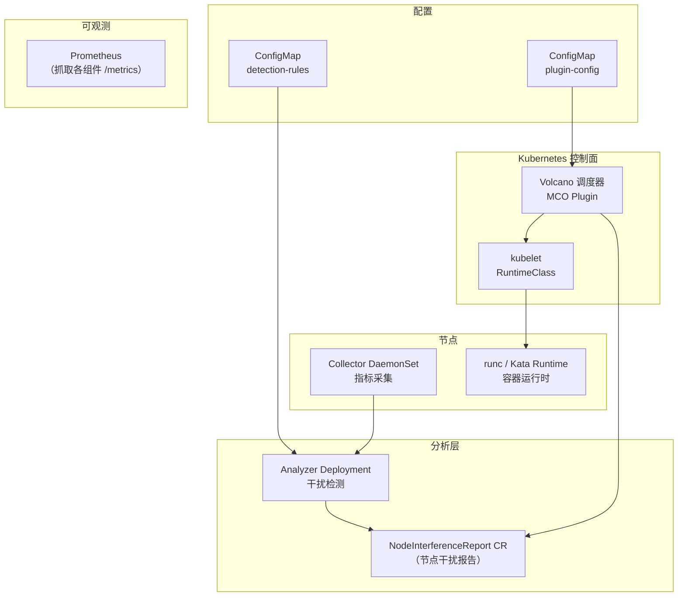
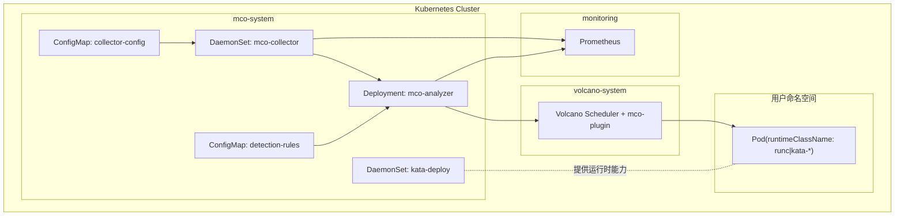
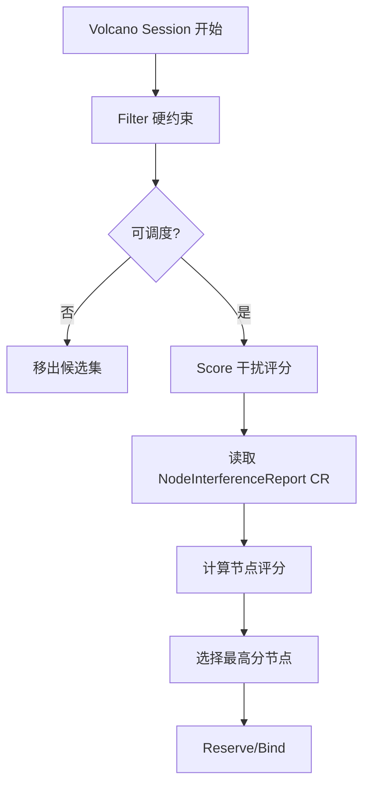
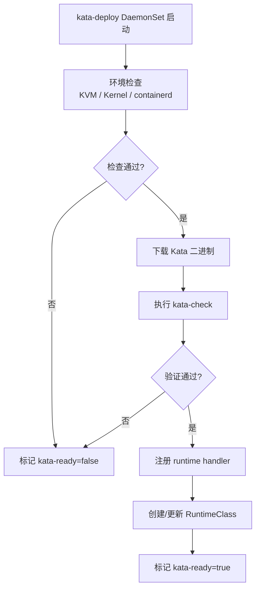

---
title: 众核场景抗干扰隔离与调度优化提案
ofep-number: "0056"
authors:
  - TBD
owning-sig: sig-orchestration-engine
participating-sigs:
status: provisional
creation-date: 2026-04-15
reviewers:
  - TBD
approvers:
  - TBD
stage: alpha
latest-milestone: "v1.0.0"
metrics:
  - mco_node_interference_level
  - mco_scheduler_filter_rejections
  - mco_scheduler_score_distribution
---

# oFEP-0056：众核场景抗干扰隔离与调度优化提案

<!-- toc -->
- [oFEP-0056：众核场景抗干扰隔离与调度优化提案](#ofep-0056众核场景抗干扰隔离与调度优化提案)
  - [1. 发布签核清单](#1-发布签核清单)
  - [2. 概括](#2-概括)
  - [3. 动机](#3-动机)
    - [3.1 背景与干扰机制](#31-背景与干扰机制)
      - [3.1.1 范围界定与关键假设](#311-范围界定与关键假设)
    - [3.2 模拟测试验证](#32-模拟测试验证)
      - [原生调度与 runc 混部下的 SLA 破坏验证](#原生调度与-runc-混部下的-sla-破坏验证)
      - [引入 Kata 虚拟机级隔离的收益验证](#引入-kata-虚拟机级隔离的收益验证)
      - [部署密度增益验证（S7）](#部署密度增益验证s7)
    - [3.3 目标](#33-目标)
    - [3.4 非目标](#34-非目标)
  - [4. 提案](#4-提案)
    - [4.1 用户故事](#41-用户故事)
      - [故事：低改造接入 + 业务质量提升 + 调优可见](#故事低改造接入--业务质量提升--调优可见)
      - [用户视图](#用户视图)
    - [4.2 核心决策](#42-核心决策)
    - [4.3 风险与缓解措施](#43-风险与缓解措施)
  - [5. 设计细节](#5-设计细节)
    - [5.1 总体架构](#51-总体架构)
      - [5.1.1 系统架构图](#511-系统架构图)
      - [5.1.2 部署视图](#512-部署视图)
    - [5.2 接入kata虚拟机隔离](#52-接入kata虚拟机隔离)
      - [5.2.1 快速接入](#521-快速接入)
      - [5.2.2 可选预留字段](#522-可选预留字段)
    - [5.3 指标采集模块（Collector）](#53-指标采集模块collector)
      - [5.3.1 采集架构设计](#531-采集架构设计)
      - [5.3.2 指标清单](#532-指标清单)
      - [5.3.3 Collector 上报机制](#533-collector-上报机制)
      - [5.3.4 采集架构类图](#534-采集架构类图)
      - [5.3.5 采集边界](#535-采集边界)
      - [5.3.6 节点发现与通信](#536-节点发现与通信)
      - [5.3.7 Prometheus /metrics 端点](#537-prometheus-metrics-端点)
      - [5.3.8 PSI 可用性探测与降级采集](#538-psi-可用性探测与降级采集)
    - [5.4 干扰分析引擎（Analyzer）](#54-干扰分析引擎analyzer)
      - [5.4.1 干扰类型与检测](#541-干扰类型与检测)
      - [5.4.2 检测规则配置（DetectionRuleConfig CR）](#542-检测规则配置detectionruleconfig-cr)
      - [5.4.3 干扰检测逻辑与权重计算](#543-干扰检测逻辑与权重计算)
      - [5.4.4 干扰等级计算示例](#544-干扰等级计算示例)
      - [5.4.5 干扰输出格式（NodeInterferenceReport CR）](#545-干扰输出格式nodeinterferencereport-cr)
      - [5.4.6 Analyzer 核心类图](#546-analyzer-核心类图)
      - [5.4.7 Collector→Analyzer gRPC 接口](#547-collectoranalyzer-grpc-接口)
      - [5.4.8 报告存储与 CR 写入](#548-报告存储与-cr-写入)
      - [5.4.9 Prometheus /metrics 端点](#549-prometheus-metrics-端点)
      - [5.4.10 PSI 不可用时的降级评估](#5410-psi-不可用时的降级评估)
    - [5.5 Volcano 调度插件](#55-volcano-调度插件)
      - [5.5.1 插件流程图](#551-插件流程图)
      - [5.5.2 调度流程](#552-调度流程)
      - [5.5.3 Filter 规则](#553-filter-规则)
      - [5.5.4 Score 规则](#554-score-规则)
      - [5.5.5 调度插件类图](#555-调度插件类图)
      - [5.5.6 插件配置示例](#556-插件配置示例)
    - [5.6 Kata 部署与运行时集成](#56-kata-部署与运行时集成)
      - [5.6.1 部署流程图](#561-部署流程图)
      - [5.6.2 关键步骤](#562-关键步骤)
    - [5.7 配置管理](#57-配置管理)
    - [5.8 监控与可观测性](#58-监控与可观测性)
    - [5.9 高可用与降级策略](#59-高可用与降级策略)
    - [5.10 安全设计](#510-安全设计)
      - [5.10.1 RBAC 最小权限](#5101-rbac-最小权限)
      - [5.10.2 NetworkPolicy 约束](#5102-networkpolicy-约束)
      - [5.10.3 Pod 安全上下文建议](#5103-pod-安全上下文建议)
    - [5.11 测试与验收标准](#511-测试与验收标准)
      - [5.11.1 组件验收](#5111-组件验收)
      - [5.11.2 集成验收](#5112-集成验收)
      - [5.11.3 基线预期（基于现有实验）](#5113-基线预期基于现有实验)
  - [6. 分阶段实施计划](#6-分阶段实施计划)
    - [第一阶段：基础能力](#第一阶段基础能力)
    - [第二阶段：策略增强](#第二阶段策略增强)
    - [第三阶段：规模化验证](#第三阶段规模化验证)
  - [7. 附录](#7-附录)
    - [附录 A：部署清单视图](#附录-a部署清单视图)
    - [附录 B：补充说明](#附录-b补充说明)
<!-- /toc -->

## 1. 发布签核清单

标记有（R）的项目在达到里程碑/发布前必须完成。

- [ ]（R）发布里程碑中的增强问题，链接到 openfuyao/ofep 中的 oFEP 目录
- [ ]（R）oFEP 审批者已批准该提案状态为 implementable
- [ ]（R）设计细节已记录并完成 SIG 评审
- [ ]（R）测试计划已覆盖单测、集成测试、e2e 测试
- [ ]（R）毕业标准已设定且可量化
- [ ]（R）生产准备评审（PRR）已完成
- [ ]（R）面向用户文档已在 openfuyao/docs 更新
- [ ]（R）实施历史已记录阶段里程碑与关键 PR

## 2. 概括

本提案面向众核混部场景，提供“宿主机指标采集 -> 干扰分析 -> 干扰感知调度 -> 可选 Kata 隔离”的完整链路，目标是在不修改应用代码的前提下，降低在线业务延迟抖动并提高混部密度。

## 3. 动机

### 3.1 背景与干扰机制

在 64 核至 256 核心等规格的众核服务器中，为了最大化资源利用率，通常将在线延迟敏感型业务（如 Redis、实时推理）和离线吞吐型业务（如批处理、全量查询）混合部署。尽管 Kubernetes 等容器平台通过 Cgroups 提供 CPU 核心和内存大小的限制机制，但在更底层的微架构（Micro-architecture）级别，许多硬件级设施依然是多核共享的全局资源。

以纯内存型在线业务（如 Redis）作为探针对象，由于其排除了应用自身发生阻塞式磁盘 I/O 的干扰，能最直接地暴露离线大吞吐任务在底层链路对在线链路造成的隐式干扰。其核心微观干扰机制主要包含以下三类：

1. **CPU 调度队列积压与软中断抢占 (Hardware Interrupts & SoftIRQs)**：在未做严格中断亲和性（IRQ Affinity）隔离的环境中，离线大吞吐 I/O 任务引发海量块设备硬件中断。Linux 内核在处理网络或磁盘协议栈下半部（如 kworker、ksoftirqd）时会以极高优先级进行调度，强行抢占在线业务工作线程的 CPU 时间片。这引起 `CPU Steal Time` 和调队延迟攀升，直接拉长在线请求响应周期。
2. **最后一级缓存 (LLC) 颠簸与置换 (LLC Thrashing)**：现代处理器的 L3 Cache (LLC) 为全体核心共享。离线 I/O 引发的数据落盘流经 Page Cache，会大面积占据处理器的 LLC 容量并触发频繁的缓存置换（Cache Eviction）。这导致在线业务（如 Redis）刚热入的 Cache Lines 被踢出，寻址被迫向慢速主存 (DRAM) 回源（访存延迟通常由 10~20ns 飙升至 60~100ns 以上），宏观表现为 P99 延迟的成倍恶化。
3. **内存总线与前端控制器拥堵 (Memory Bandwidth Contention)**：物理服务器面临巨大 I/O 压力时，由于 DMA (Direct Memory Access) 直写内存与大量因 CPU 缓存未命中产生的主存拉取请求，将耗尽前端总线和集成内存控制器 (IMC) 的可用带宽。所有在线业务的普通内存读写指令被迫在全局总线上排队，引发单次读写延迟延长甚至压降整体吞吐量 (OPS)。

在这些底层微观机制的叠加影响下，仅基于 CPU 与内存容量配额的静态调度，无法感知节点真实的底层压力死角。这就导致在资源"看似够用"的情况下，在线业务的访问质量依然出现盲调后的劣化后果。

#### 3.1.1 范围界定与关键假设

在上述三类干扰机制中，本提案初始阶段聚焦于 **LLC 缓存颠簸（机制 2）** 和 **I/O/内存带宽竞争（机制 3）** 两类干扰，有如下说明：

1. **CPU 中断抢占（机制 1）纳入后续阶段**：CPU 调度队列积压与软中断抢占是一个独立且重要的干扰维度。但在 I/O 风暴场景下，机制 1 与机制 3 存在强共现关系——高 I/O 负载必然伴随高频率的块设备硬件中断和 ksoftirqd 唤醒。当前通过采集 PSI I/O 和 bio latency P99 指标，可间接反映部分软中断抢占的影响。对 CPU 中断抢占的独立采集（如 CPU steal time、run queue latency、中断率）与独立检测维度，暂不在本阶段开发。

2. **Kata 隔离作为物理切断手段**：除了调度层面的干扰规避，本方案还提供基于 Kata 的虚拟机级隔离，作为对离线业务的物理级串扰切断方案。实验 S4~S6 专门验证 Kata 隔离在限制离线任务污染、保障在线业务 SLA 方面的收益。

3. **阈值与权重均为初始设定**：检测规则中的各阈值（如 `cacheMissRate: 0.20`、`bioLatencyP99Ms: 50`）和干扰等级公式中的维度权重（$I_{cache}:0.30$, $I_{mem}:0.30$, $I_{io}:0.40$）均为基于 S1~S3 实验经验的初始值，不要求在该阶段严格精确。权重和阈值均通过 ConfigMap 管理、支持更新，进入生产环境后可结合实际业务特征持续调优。

**业界参照**：众核混部下的干扰隔离是业界共性难题。Google Borg 系统通过优先级和资源预留机制管理延迟敏感型任务；Alibaba 等厂商在容器混部中大量使用 PSI 和硬件 PMU 计数器作为干扰感知的输入信号；Linux 内核 PSI 子系统自 v4.20 引入后，已成为量化资源竞争程度的标准信号源。本方案的架构设计——"采集→分析→调度决策→虚拟化隔离"——参考了上述业界实践的共性模式。

### 3.2 模拟测试验证

为了充分论证上述干扰机制并支撑本设计，我们在众核环境实施了一系列压测。测试分为两个阶段：阶段一揭示原生 runc 混部下的微架构干扰破坏力；阶段二推演采用 Kata 虚拟机隔离后的收益，以此论证完整解决方案的可行性与必要性。

**测试环境与设计考量**：
- **测试规格配置**：宿主机采用 96 Core ARM 物理机，预留 8C 给系统组件，其余 88C 开放混部，模拟节点综合利用率约 40%~55% 的部署环境。
- **负载构造逻辑**：在线业务使用 Redis（单实例 4C2G）作为纯内存高频低延时的探针；离线业务使用 `stress-ng` 注入极致 I/O 拥塞与 LLC 缓存扫描。

#### 原生调度与 runc 混部下的 SLA 破坏验证

本阶段验证在 Cgroups CPU/内存配额均未超限的条件下，微架构（Micro-architecture）级共享资源竞争对在线业务 SLA 的定量影响。

| 场景设计 | 污染注入方式 | 在线业务 SLA 变化 (P99/吞吐) | 宿主底层指标变化 |
|---|---|---|---|
| **S1: 纯 I/O 干扰** | 叠加 2 个重度 I/O (`--hdd`) 离线容器 | Redis P99 延迟上升 49.4%（5.59ms → 8.35ms） | 节点 PSI I/O (avg10) 由 7.10 升至 16.48 |
| **S2: I/O + Cache 复合干扰** | 并行追加 LLC 数据扫描 (`--stream`) | P99 呈非线性放大，OPS 出现明显下降 | Cache Miss 率与 PSI I/O 指标同时达到高位 |
| **S3: 新业务盲调受损** | 污染持续期间，调度器将新 Redis 实例分配至同节点 | 对比健康节点基线，新业务 P99 劣化 8.4% | 新业务落地时节点 PSI 持续处于 22.88 |

**阶段一结论**：在缺乏微架构级指标感知的情况下，调度器仅基于 CPU/内存余量进行节点选择，将在线业务持续分配至存在底层资源竞争的高干扰节点，造成可复现的 SLA 劣化。这验证了引入干扰感知调度能力的必要性。

#### 引入 Kata 虚拟机级隔离的收益验证

为验证独立内核隔离对微架构资源竞争的切断效应，将离线污染源迁入 Kata 虚拟机（`runtimeClassName: kata-clh`），在同节点持续观测 runc 容器中在线 Redis 的性能变化。测试采用 `redis-benchmark --csv` 对单 Redis Pod 进行压测（50 并发客户端），数据取自 SET/GET 两类操作的平均值，每组采集 10 轮样本。

测试结果验证了 Kata 隔离的明确收益：

- **复合干扰场景（I/O+MEM）**：在较高强度的内存带宽与 I/O 叠加争抢下，Kata 隔离使原有在线 Redis 的 P99 延迟改善约 9%，吞吐提升约 6%；对新部署的 Redis 实例，P99 改善约 11%，吞吐提升约 10%。该结果表明 Kata 的独立 Guest OS 与缓冲协议栈有效阻断了宿主机 Page Cache 污染及块层 I/O 队列拥塞对在线业务的串扰。
- **新业务落地保护**：污染源运行于 Kata 的前提下，新部署的在线 Redis 能够以显著优于 runc 混部环境的延迟基准启动运行，验证了 Kata 隔离对新调度落点的在线业务具备环境净化效应。
- **纯 I/O 场景**：将离线 I/O 负载迁入 Kata 后，同节点在线 Redis 的 P99 与 OPS 与 runc 基准持平，Kata 隔离对在线业务不引入额外性能退化。

#### 部署密度增益验证（S7）

为进一步量化 Kata 隔离对混部密度的提升，设计密度测试 S7：在固定单 Redis QPS 目标（≥50000）下，对比 runc 与 Kata 两种污染形态下节点可承载的最大在线 Redis 副本数。污染源采用等量 I/O+MEM stress-ng（runc 组 4×runc 离线 Pod，Kata 组 4×kata-clh 离线 Pod），在线 Redis 副本数从 1 递增至 15，每档 3 轮，每轮 500000 请求。

| Runtime | 最大达标副本数 | 该档位单 Redis 平均 QPS |
|---|---|---|
| runc 污染 | 2 | 97531.85 |
| Kata 污染 | 11 | 51049.02 |

密度提升：`(11 - 2) / 2 × 100% = 450%`。在等量离线污染源下，将离线任务迁入 Kata 后，在线 Redis 可部署副本数从 2 提升至 11。

**测试整体总结**：
综合两阶段测试数据，验证了本提案技术路线的可行性：

1. **干扰感知调度的必要性（S1~S3）**：在缺乏微架构级指标感知的情况下，调度器仅基于 CPU/内存余量进行节点选择，会将在线业务持续分配至存在底层资源竞争的高干扰节点，造成可复现的 SLA 劣化。引入 LLC Miss、PSI I/O 等微架构指标的实时采集与干扰分析，可为调度决策提供更准确的节点健康度评估。

2. **Kata 隔离的收益（S4~S7）**：Kata 虚拟机级隔离在复合干扰场景下体现明确收益——在线 Redis P99 延迟改善约 9%~11%，吞吐提升约 6%~10%，其独立 Guest OS 与缓冲协议栈有效阻断了宿主机侧的 Page Cache 污染与块层 I/O 队列拥塞。在部署密度维度（S7），将离线污染源迁入 Kata 后，同等 QPS 目标下在线 Redis 可部署副本数从 2 提升至 11（密度增益 450%），验证了 Kata 作为物理级隔离手段对提升混部经济密度的显著价值。

### 3.3 目标

基于上述问题推导与场景结论，本提案设立以下目标：
1. **SLA 维稳目标**：建立直达底层总线层面的干扰采集机制（主要监测 LLC Cache 与块设备 I/O 指标）。从调度层面自动规避高干扰节点，使在线业务能够得到有效改善，显著降低极恶劣混部环境造成的 P99 长尾抖动风险。
2. **调度目标**：调度器优先选择低干扰得分的节点进行分配，且 Analyzer 异常时具备自动回退并降级的能力，不阻断正常业务部署。
3. **Kata 隔离方案提供**：对部分离线业务，无缝集成 Kata 极轻量部署和自动化安装，支持由用户通过指定 `runtimeClassName` 发起更强容器隔离运行，以物理级切断串扰途径。

### 3.4 非目标

1. 不采集 Kata Guest OS 内部指标（仅关注宿主侧物理层共享资源的破坏）。
2. 不引入机器学习推理型调度，只运用基础规则和确定性指标策略。
3. 不修改 Linux 内核或引入定制内核补丁。

## 4. 提案

### 4.1 用户故事

#### 故事：低改造接入 + 业务质量提升 + 调优可见

作为使用者，希望通过 `runtimeClassName` 即可在众核集群接入kata虚拟机隔离。在离线混部时，在线链路的 P99 延迟波动更小、SLA 更稳定，同时保持合理资源利用率。能看到干扰来源、调度决策和关键指标，便于持续调优阈值与策略。

#### 用户视图

<!-- ```plantuml -->
@startuml
left to right direction
skinparam componentStyle rectangle

actor "用户" as Enterprise

rectangle "MCO 众核抗干扰系统" {
  usecase "提交业务 Pod\n(指定 runtimeClassName)" as UC1
  usecase "自动采集宿主机干扰指标" as UC2
  usecase "干扰感知调度与隔离" as UC3
  usecase "查看干扰报告与调度解释" as UC4
  usecase "按观测结果调整策略" as UC5
}

Enterprise --> UC1
UC2 --> UC3
UC1 --> UC3
Enterprise --> UC4
Enterprise --> UC5
@enduml
<!-- ``` -->

### 4.2 核心决策

1. **运行时策略**
   用户自行设置 `spec.runtimeClassName`。插件负责提供可用运行时能力，不做业务类型到运行时的强制映射。

2. **标签预留**
   可选字段 `mco.many-core.io/workload-type`（值：`online`/`offline` 等），当前不纳入调度考虑，供后续基于真实业务需求迭代使用。

3. **调度策略**
   Analyzer 将干扰分析结果写入 NodeInterferenceReport CR；MCO Plugin 通过读取该 CR 获取各节点的 `interference_level` 进行评分；CR 不可用或数据过期时自动回退到基础调度。

### 4.3 风险与缓解措施

1. **风险：用户误选运行时导致性能退化**  
   缓解：提供 runtimeClass 使用建议、基准报告和最佳实践，不做 admission 强拦截。

2. **风险：Analyzer 不可用影响调度质量**  
   缓解：插件参数 `fallbackWhenCROutdated=true`，CR 过期时调度自动降级不中断。

3. **风险：指标短时毛刺导致误判**  
   缓解：采用连续 N 周期阈值判定和窗口平滑，避免单点尖峰触发错误决策。

## 5. 设计细节

### 5.1 总体架构

<!-- ```plantuml -->
@startuml
skinparam componentStyle rectangle
title MCO 总体架构

package "用户命名空间" {
  [Deployment/Pod(runc/kata-*)] as Pod
}

package "节点层" {
  [Collector DaemonSet] as Collector
  [containerd + runc/Kata] as Runtime
}

package "控制层" {
  [Analyzer Deployment] as Analyzer
  [Volcano + MCO Plugin] as Scheduler
  [NodeInterferenceReport CR] as CR
}

package "配置" {
  [ConfigMap: detection-rules] as Rules
  [ConfigMap: plugin-config] as Pcfg
}

package "可观测" {
  [Prometheus] as Prom
}

Pod --> Scheduler : 调度请求
Scheduler --> CR : 读取干扰报告
Scheduler --> Runtime : 创建容器
Collector --> Analyzer : gRPC 流式上报
Analyzer --> CR : 写入干扰报告
Collector --> Prom : HTTP /metrics scrape
Rules --> Analyzer : 规则加载
Pcfg --> Scheduler : 插件参数
Analyzer --> Prom : HTTP /metrics scrape
@enduml
<!-- ``` -->

#### 5.1.1 系统架构图



#### 5.1.2 部署视图



### 5.2 接入kata虚拟机隔离

#### 5.2.1 快速接入

用户只需设置 `runtimeClassName`：

```yaml
apiVersion: v1
kind: Pod
metadata:
  name: infer-online
spec:
  runtimeClassName: runc
  containers:
  - name: app
    image: example/infer:latest
```

```yaml
apiVersion: v1
kind: Pod
metadata:
  name: etl-batch
spec:
  runtimeClassName: kata-clh
  containers:
  - name: job
    image: example/etl:latest
```

#### 5.2.2 可选预留字段

```yaml
metadata:
  labels:
    mco.many-core.io/workload-type: online
```

说明：

- 该标签为可选预留字段，当前不纳入调度决策逻辑。
- 后续当业务需求明确后，可基于此字段迭代更细粒度的调度策略。

### 5.3 指标采集模块（Collector）

Collector 以 DaemonSet 运行，基于 BCC / perf / 内核数据 三种方式采集宿主机指标，并及时推送至 Analyzer。

#### 5.3.1 采集架构设计

- 采集形态：每节点一个 Collector 实例，避免跨节点采集抖动。
- 采集方式：以 BCC (eBPF) + perf + /proc 数据源组合，兼顾细粒度、实时性和兼容性。
- 采集周期：默认 1s，满足调度决策的时间粒度要求。
- 故障保护：采集失败不阻断调度主流程，按降级策略处理。

#### 5.3.2 指标清单

| 指标 | 来源 | 频率 | 用途 | 采集方式 |
|---|---|---|---|---|
| LLC miss rate | PMU/eBPF | 1s | 缓存污染识别 | perf stat -e cache-references,cache-misses -a sleep 1 |
| LLC occupancy | MPAM / PMU | 1s | 缓存竞争识别 | cat /proc/meminfo |
| I/O latency P95/P99 | eBPF block 事件 | 1s | 块层拥塞识别 | BCC - biolatency 1 - 需要平滑处理 |
| PSI io/memory（首选） | /proc/pressure/* | 1s | 系统压力指标（优先路径） | cat /proc/pressure/io, /proc/pressure/memory（需内核启用 PSI，见 5.3.8） |
| 内存可用比率（降级） | /proc/meminfo | 1s | 内存压力替代指标 | cat /proc/meminfo → MemAvailable / MemTotal |
| 页面回收频率（降级） | /proc/vmstat | 1s | 内存回收压力替代指标 | cat /proc/vmstat → pgscan_kswapd + pgscan_direct 变化率 |

#### 5.3.3 Collector 上报机制

- 上报协议：Collector -> Analyzer 使用 gRPC 流式推送。
- 上报内容：时间戳 + 节点指标数据 + 采集状态标记。
- 上报频率：每个采集周期由 Collector 主动推送一次快照。
- 异常处理：网络抖动时自动重试，必要时本地 JSONL 缓存用于排障。

#### 5.3.4 采集架构类图

<!-- ```plantuml -->
@startuml
skinparam classAttributeIconSize 0
skinparam shadowing false
skinparam linetype ortho

top to bottom direction

interface MetricCollector {
  + Name(): String
  + Collect(ctx context.Context, duration, interval time.Duration) MetricResult
}

class LLCMissRateCollector {
  + Name(): String
  + Collect(ctx context.Context, duration, interval time.Duration) MetricResult
}

class LLCOccupancyCollector {
  + Name(): String
  + Collect(ctx context.Context, duration, interval time.Duration) MetricResult
}

class IOLatencyCollector {
  + Name(): String
  + Collect(ctx context.Context, duration, interval time.Duration) MetricResult
}

class PSICollector {
  + Name(): String
  + Collect(ctx context.Context, duration, interval time.Duration) MetricResult
}

class Analyzer {
  + CollectMetrics(MetricCollector): MetricResult
}

' ---- 继承关系 ----
LLCMissRateCollector ..|> MetricCollector
LLCOccupancyCollector ..|> MetricCollector
IOLatencyCollector ..|> MetricCollector
PSICollector ..|> MetricCollector

' ---- 关联关系 ----
Analyzer "1" -- "*" MetricCollector

' ---- 布局控制 ----
MetricCollector -[hidden]right-> Analyzer

@enduml
<!-- ``` -->

#### 5.3.5 采集边界

目前仅采集宿主机指标，不采集 Kata Guest OS 指标，主要基于以下考虑：

1. 调度器关注的是宿主机共享资源竞争（LLC、I/O 队列、PSI）。
2. Guest 内部压力对宿主机调度决策增益有限，优先保证链路简洁可用。

#### 5.3.6 节点发现与通信

**Collector 连接 Analyzer：**

- 服务发现：Analyzer 部署在 `mco-system` 命名空间，通过 Kubernetes DNS 暴露为 `mco-analyzer.mco-system.svc.cluster.local:50051`
- Collector 通过环境变量或 ConfigMap 配置 `ANALYZER_ADDR`，指向该服务地址
- 连接建立后，Collector 持久化 gRPC 流连接，按周期（1s）推送指标快照

**网络隔离：**

- Collector（节点层） -> Analyzer（mco-system）单向调用，通过 NetworkPolicy 白名单允许
- 无反向通信，简化网络模型

#### 5.3.7 Prometheus /metrics 端点

Collector 直接暴露 HTTP `/metrics` 端点（默认端口 `9877`），供 Prometheus 按 DaemonSet Pod 维度抓取节点原始指标，不再经过 Analyzer 中转。

**设计要点：**

| 项目 | 说明 |
|---|---|
| **协议** | HTTP/1.1，Prometheus 标准文本格式 |
| **端口** | `9877`（与 gRPC 上报分离） |
| **指标来源** | Collector 本地采集缓存，每采集周期（1s）刷新 |
| **标签** | 每条指标携带 `node` 标签（取自 `spec.nodeName`），区分不同节点 |
| **服务发现** | Prometheus 通过 `kubernetes_sd_configs` 的 Pod 角色 + `app=mco-collector` 标签过滤，自动发现所有 Collector Pod |

**暴露的 Prometheus 指标：**

| 采集指标 | Prometheus 指标名 | 类型 |
|---|---|---|
| LLC miss rate | `mco_llc_miss_rate_raw{node}` | gauge |
| LLC occupancy | `mco_llc_occupancy_raw{node}` | gauge |
| bio latency P95 | `mco_bio_latency_p95_ms_raw{node}` | gauge |
| bio latency P99 | `mco_bio_latency_p99_ms_raw{node}` | gauge |
| PSI I/O some avg10 | `mco_psi_io_some_avg10_raw{node}` | gauge |
| PSI memory some avg10 | `mco_psi_memory_some_avg10_raw{node}` | gauge |
| 内存可用比率 | `mco_mem_available_ratio_raw{node}` | gauge |
| 页面回收速率 | `mco_pgscan_rate_pages_per_second_raw{node}` | gauge |
| PSI 采集是否可用 | `mco_collector_psi_available{node}` | gauge（值 0 或 1） |
| 快照状态/时间戳 | `mco_snapshot_status{node}` / `mco_snapshot_timestamp_ms{node}` | gauge |

Collector 的 `/metrics` 端点与 gRPC 上报链路独立运行：gRPC 流式推送将指标发往 Analyzer 供干扰分析；`/metrics` 端点直接向 Prometheus 暴露原始采集值，链路更短且不依赖 Analyzer 可用性。

#### 5.3.8 PSI 可用性探测与降级采集

Collector 启动时探测 `/proc/pressure/{io,memory}` 是否可读，确定 `psi_available` 状态（运行时不变）。各节点独立判断，无需集群统一降级。

**PSI 可用时：** 按常规采集 `/proc/pressure/memory` (some/full avg10) 和 `/proc/pressure/io` (some avg10)。

**PSI 不可用时：** 转为降级采集（均通过标准 Linux 接口，无需特殊内核配置）：
- `/proc/meminfo` → `MemAvailable / MemTotal`
- `/proc/vmstat` → `pgscan_kswapd` 和 `pgscan_direct` 为累积计数器，两次采样之差除以采集周期即得变化速率（页/秒）

gRPC `MetricSnapshot` 携带 `psi_available` 标志位，不可用时 PSI 字段填 `-1`。`/metrics` 端点暴露 `mco_collector_psi_available{node} 0|1`。

### 5.4 干扰分析引擎（Analyzer）

Analyzer 是单副本 Deployment，负责干扰检测、等级计算，并将所有节点的干扰报告汇总写入一份集群级 NodeInterferenceReport CR（名为 `cluster`）的 `status.nodes` 列表中。调度插件和用户均可通过 `kubectl get nodeinterferencereport cluster -o yaml` 查看全部节点的干扰等级与检测详情。

#### 5.4.1 干扰类型与检测

| 干扰类型 | 触发指标 | 对在线业务的影响 | 检测方式 |
|---------|---------|----------------|---------|
| **缓存污染** | LLC miss 率升高（>20%）+ LLC 占用率高（>70%） | 热数据驱逐，访存延迟增加 | perf + 内核数据 |
| **内存压力** | PSI memory some > 10% 或 PSI memory full > 0（PSI 不可用时以 meminfo+vmstat 代替） | 内存回收导致延迟增加或进程卡死 | /proc/pressure/memory 或 /proc/meminfo + /proc/vmstat |
| **I/O 队列拥塞** | I/O P99 > 50ms，或 PSI I/O some > 20% | 同节点 I/O 操作被阻塞 | eBPF (bio_latency) / /proc/pressure/io |

#### 5.4.2 检测规则配置（DetectionRuleConfig CR）

干扰检测的阈值、权重与降级参数通过 `DetectionRuleConfig` CR 管理（命名空间 `mco-system`，名称 `cluster`），Analyzer 通过 controller-runtime 控制器监听该 CR 变更并热加载，解析失败时保留上一版有效配置。

默认规则（代码内置）：

```yaml
weights:
  cache: 0.30
  memory: 0.30
  io: 0.40
saturation:
  cacheProduct: 0.175
  psiMemory: 50.0
  bioLatencyP99Ms: 100.0
  psiIo: 20.0
thresholds:
  cacheMissRate: 0.20
  llcOccupancy: 0.70
  bioLatencyP99Ms: 50.0
  psiIo: 20.0
  psiMemorySome: 10.0
  psiMemoryFull: 0.0
  ioPenaltyP99Ms: 50.0
  ioPenaltyPsiIo: 20.0
  memIoPenaltyMemory: 50.0
  memIoPenaltyPsiIo: 20.0
penalties:
  ioMultiplier: 1.2
  memIoMultiplier: 1.1
# 降级路径参数（psi_available = false 时生效）
degradedMemory:
  memAvailableRatioThreshold: 0.30
  pageScanRateThreshold: 10000
```

> **注**：Analyzer 对每个采集周期到达的指标快照做窗口平滑（窗口内样本均值），然后基于平滑后的指标值进行单次检测判定和等级计算。平滑策略替代了提案早期设想的 `consecutiveViolations` 连续违规计数方案。

#### 5.4.3 干扰检测逻辑与权重计算

核心流程：

1. **收集指标**：接收 Collector 上报的周期采样数据。
2. **多维归一化**：按资源维度（Cache / 内存 / I/O）评估破坏效应，计算各项的干扰指数（严格归一化至 `[0, 1]` 区间）。
3. **动态权重与收敛**：结合跨维度的交叉复合压力调整惩罚权重，加权求和后强制收敛，输出节点最终干扰等级 $L \in [0, 1]$。

**1) 各维度干扰指数归一化（均映射至 $[0, 1]$）：**

**缓存污染指数 ($I_{cache}$)：**
缓存缺失率与 LLC 占用率的乘积反映缓存颠簸的复合破坏强度：缺失率越高、缓存越满，驱逐破坏越严重。以 $0.175$ 为饱和阈值（对应典型恶劣工况，如 $CacheMissRate \approx 0.30$ 且 $LLCOccupancy \approx 0.60$ 时逼近极限）：
$$I_{cache} = \min\left(\frac{CacheMissRate \times LLCOccupancy}{0.175},\ 1.0\right)$$

**内存压力指数 ($I_{mem}$)：**
取 `/proc/pressure/memory` 的 `some avg10` 与 `full avg10`（值域 $0.0$~$100.0$）的较大者，以 $50.0$ 为饱和点线性归一：
$$I_{mem} = \min\left(\frac{\max(PsiMemorySomeAvg10,\ PsiMemoryFullAvg10)}{50.0},\ 1.0\right)$$

**I/O 延迟指数 ($I_{io}$)：**
分别从块设备层和系统级两条路径评估 I/O 拥塞，取两者中更恶劣的一方：
$$I_{io}^{block} = \min\left(\frac{BioLatencyP99}{100.0},\ 1.0\right) \quad\text{(饱和点 100ms)}$$
$$I_{io}^{pressure} = \min\left(\frac{PsiIoSomeAvg10}{20.0},\ 1.0\right) \quad\text{(饱和点 20.0，来源 /proc/pressure/io some avg10)}$$
$$I_{io} = \max\left(I_{io}^{block},\ I_{io}^{pressure}\right)$$

**2) 动态权重偏置 ($W_{cache}, W_{mem}, W_{io}$)：**

初始基础权重定义为：$W_{cache} = 0.30$, $W_{mem} = 0.30$, $W_{io} = 0.40$。针对典型的高频并发拥塞现象，进一步施加动态系数偏置：

- **I/O 持续拥塞验证**：若 `PsiIoSomeAvg10 > 20.0` 且 `BioLatencyP99 > 50.0`，表明系统层排队信号与块设备实测卡顿双重验证。加剧 I/O 维度的评判烈度：$W_{io} = W_{io} \times 1.2$。
- **内存 - I/O 恶性循环**：若 `PsiMemorySomeAvg10 > 50.0` 且 `PsiIoSomeAvg10 > 20.0`，表明内存换页或直接回收触发了大量阻塞读写，反向拖长释放队列。双向联合惩罚：$W_{mem} = W_{mem} \times 1.1$，$W_{io} = W_{io} \times 1.1$。

**3) 最终等级收敛：**

求取三个核心控制平面的指数加权和，并在末端引入边界截断 $\min(..., 1.0)$，确保带有动态系数的算式最终结果必须收束并在有效区间界定（避免总系数 $W > 1$ 溢出）：

$$L = \min(W_{cache} \cdot I_{cache} + W_{mem} \cdot I_{mem} + W_{io} \cdot I_{io}, \ 1.0)$$

#### 5.4.4 干扰等级计算示例

**示例输入**：
- LLC miss rate: `0.253`，LLC occupancy: `0.553` (小数模式)
- PSI memory some: `12.0`，PSI memory full: `0.0` (百分比百分数模式)
- bio latency P99: `65.0` (ms)，PSI I/O some: `18.0` (百分比百分数模式)

**演算过程**：
1. **归一化提取**：
   - $I_{cache} = \min(\frac{0.253 \times 0.553}{0.175},\ 1.0) \approx 0.80$
   - $I_{mem} = \min(\frac{\max(12.0,\ 0)}{50.0},\ 1.0) = 0.24$
   - $I_{io}^{block} = \min(\frac{65.0}{100.0},\ 1.0) = 0.65$，$I_{io}^{pressure} = \min(\frac{18.0}{20.0},\ 1.0) = 0.90$，$I_{io} = \max(0.65,\ 0.90) = 0.90$
2. **权重确定**：因触发条件未达至阈（如内存与IO并未形成连环双爆等），因此依然沿用基础权重组分布：`0.30, 0.30, 0.40`
3. **推导收敛**：
   - 累加值：$0.30 \times 0.80 + 0.30 \times 0.24 + 0.40 \times 0.90 = 0.24 + 0.072 + 0.36 = 0.672$
   - 结果收束：$\min(0.672, 1.0) = 0.672$

即该节点得出其宏观系统级的高延干扰评估（0.672 处于中高危险期段）。

#### 5.4.5 干扰输出格式（NodeInterferenceReport CR）

Analyzer 将所有节点的干扰分析结果汇总写入一份集群级 NodeInterferenceReport CR（固定名称 `cluster`）。CR 的 `status.nodes` 为 map（键为节点名），每个条目包含对应节点的干扰等级、原始指标快照和检测明细。调度插件和用户均可通过 `kubectl get nodeinterferencereport cluster -o yaml`（或 `kubectl get nir cluster`）查看。

**CRD 定义（摘要）：**

```yaml
apiVersion: apiextensions.k8s.io/v1
kind: CustomResourceDefinition
metadata:
  name: nodeinterferencereports.mco.many-core.io
spec:
  group: mco.many-core.io
  names:
    kind: NodeInterferenceReport
    singular: nodeinterferencereport
    plural: nodeinterferencereports
    shortNames: [nir]
  scope: Cluster
  versions:
  - name: v1alpha1
    served: true
    storage: true
    subresources:
      status: {}
    schema:
      openAPIV3Schema:
        type: object
        properties:
          status:
            type: object
            properties:
              timestamp:
                type: string
              ruleConfigHash:
                type: string
              ruleConfigLastLoadedTime:
                type: string
              nodes:
                type: object
                additionalProperties:
                  type: object
                  properties:
                    timestamp:         { type: string }
                    interferenceLevel: { type: number }
                    psiAvailable:      { type: boolean }
                    sequence:          { type: integer }
                    sampleCount:       { type: integer }
                    windowSeconds:     { type: number }
                    status:            { type: string }
                    metrics:
                      type: object
                      properties:
                        llcMissRate:       { type: number }
                        llcOccupancy:      { type: number }
                        bioLatencyP95Ms:   { type: number }
                        bioLatencyP99Ms:   { type: number }
                        psiIoSome:         { type: number }
                        psiIoFull:         { type: number }
                        psiMemorySome:     { type: number }
                        psiMemoryFull:     { type: number }
                        memAvailableRatio: { type: number }
                        pageScanRate:      { type: number }
                    detections:
                      type: array
                      items:
                        type: object
                        properties:
                          type:    { type: string }
                          message: { type: string }
                    availability:
                      type: array
                      items:
                        type: object
                        properties:
                          collector: { type: string }
                          metric:    { type: string }
                          available: { type: boolean }
                          status:    { type: string }
                          reason:    { type: string }
```

**CR 实例示例：**

```yaml
apiVersion: mco.many-core.io/v1alpha1
kind: NodeInterferenceReport
metadata:
  name: cluster
status:
  timestamp: "2026-05-30T10:30:00.000000000+08:00"
  ruleConfigHash: "abc123def456"
  nodes:
    worker-01:
      timestamp: "2026-05-30T10:30:00.000000000+08:00"
      interferenceLevel: 0.85
      psiAvailable: true
      sequence: 1800
      sampleCount: 10
      windowSeconds: 10.0
      status: "ok"
      metrics:
        llcMissRate: 0.28
        llcOccupancy: 0.75
        bioLatencyP95Ms: 42.0
        bioLatencyP99Ms: 65.0
        psiIoSome: 25.0
        psiIoFull: 0.0
        psiMemorySome: 12.0
        psiMemoryFull: 0.5
        memAvailableRatio: 0.62
        pageScanRate: 3500.0
      detections:
      - type: cache-pollution
        message: "LLC miss rate 0.28 > 0.20 and LLC occupancy 0.75 > 0.70"
      - type: io-queue-contention
        message: "Bio latency P99 65.00ms > 50.00ms or PSI I/O some 25.00% > 20.00%"
      availability:
      - collector: psi
        metric: psiIoSome
        available: true
        status: ok
    worker-02:
      timestamp: "2026-05-30T10:30:00.000000000+08:00"
      interferenceLevel: 0.12
      psiAvailable: true
      sequence: 1800
      sampleCount: 10
      windowSeconds: 10.0
      status: "ok"
      metrics:
        llcMissRate: 0.05
        llcOccupancy: 0.30
        bioLatencyP95Ms: 5.0
        bioLatencyP99Ms: 8.0
        psiIoSome: 5.0
        psiIoFull: 0.0
        psiMemorySome: 2.0
        psiMemoryFull: 0.0
        memAvailableRatio: 0.85
        pageScanRate: 0.0
      detections: []
      availability:
      - collector: psi
        metric: psiIoSome
        available: true
        status: ok
```

用户可直接 `kubectl get nir cluster` 或 `kubectl describe nir cluster` 查看集群所有节点的干扰等级概览。

#### 5.4.6 Analyzer 核心类图

<!-- ```plantuml -->
@startuml
title Analyzer 核心类图
skinparam classAttributeIconSize 0

interface RuleEngine {
  +Evaluate(metrics NodeMetrics) DetectionResult
}

interface InterferenceCalculator {
  +Compute(metrics NodeMetrics, detections DetectionResult) float64
}

class DefaultRuleEngine
class WeightedCalculator
class AnalyzerService
class NodeStateStore
class DetectionResult
class NodeMetrics
class InterferenceReport
class CRWriter

DefaultRuleEngine ..|> RuleEngine
WeightedCalculator ..|> InterferenceCalculator

AnalyzerService --> RuleEngine : evaluate
AnalyzerService --> InterferenceCalculator : compute
AnalyzerService --> NodeStateStore : read/write
AnalyzerService --> InterferenceReport : generate
AnalyzerService --> CRWriter : write
CRWriter --> InterferenceReport : upsert CR status
RuleEngine --> DetectionResult
InterferenceCalculator --> NodeMetrics
@enduml
<!-- ``` -->

#### 5.4.7 Collector→Analyzer gRPC 接口

Collector 通过 gRPC 流式向 Analyzer 推送指标快照（此接口仅用于 Collector→Analyzer 的数据上报，调度插件不直接调用 Analyzer，而是通过读取 NodeInterferenceReport CR 获取干扰报告）。

```protobuf
service CollectorService {
  rpc PushMetrics(stream MetricSnapshot) returns (PushAck);
}

message MetricSnapshot {
  string node_name = 1;
  int64 timestamp = 2;
  double cache_miss_rate = 3;
  double llc_occupancy = 4;
  double bio_latency_p99_ms = 5;
  double psi_memory_some = 6;       // 降级模式下值为 -1
  double psi_memory_full = 7;       // 降级模式下值为 -1
  double psi_io_some = 8;           // 降级模式下值为 -1
  bool psi_available = 9;           // 该节点 PSI 采集是否可用
}
```

#### 5.4.8 报告存储与 CR 写入

Analyzer 在内存中维护各节点干扰报告缓存，并将所有节点的最新报告汇总写入一份集群级 NodeInterferenceReport CR（固定名称 `cluster`）的 `status.nodes` 列表。

| 方面 | 设计 |
|---|---|
| **内存缓存** | 按节点维度的环形缓冲区，每个节点保留最近 10s 的样本（约 10 条），用于计算平滑值 |
| **CR 写入** | 按 `crFlushInterval`（默认 1s），Analyzer 将所有节点的最新报告全量更新到 `cluster` NodeInterferenceReport CR 的 `status.nodes` |
| **平滑策略** | 对窗口内的原始指标样本取均值，再基于平滑后的指标值进行检测判定和等级计算，避免单点毛刺 |
| **Pod 重启** | 重启后重新初始化缓冲，Collector 快速补齐最新数据（延迟 <2s），CR 中的旧数据保留至下一次更新覆盖 |

**CR 读取方：**

- **调度插件**：通过 Kubernetes informer/list-watch 机制监听 `cluster` NodeInterferenceReport CR 变更，在 Filter/Score 阶段从本地缓存按 `nodeName` 查找对应节点的干扰等级（无需实时 API 调用）
- **用户/运维**：通过 `kubectl get nir cluster -o yaml` 或 `kubectl describe nir cluster` 查看全部节点的干扰等级和检测明细

#### 5.4.9 Prometheus /metrics 端点

Collector 已直接暴露节点原始指标（参见 [5.3.7](#537-prometheus-metrics-端点)），Analyzer 仅暴露自身计算产出和运行状态指标，通过 HTTP `/metrics` 端点（默认端口 `9878`）供 Prometheus scrape。

| Prometheus 指标 | 类型 | 说明 |
|---|---|---|
| `mco_node_interference_level{node}` | gauge | Analyzer 计算的节点干扰等级（0.0~1.0），取自内存缓存最新报告 |
| `mco_analyzer_report_generation_duration_seconds` | histogram | 单次干扰报告生成耗时 |
| `mco_analyzer_cr_updates_total{status}` | counter | CR status 更新次数（status=ok/error） |
| `mco_analyzer_collector_samples_total{node}` | counter | Analyzer 接收的各节点采集样本总数 |
| `mco_analyzer_grpc_requests_total{method,status}` | counter | gRPC 请求统计 |
| `mco_analyzer_rule_reload_total{status}` | counter | 检测规则重载次数（status=success/error） |
| `mco_analyzer_cr_last_success_timestamp_seconds` | gauge | 最近一次成功 CR 写入的 Unix 时间戳 |

职责划分：
- **Collector**：暴露节点级原始采集指标（cache miss、bio latency、PSI 等），端口 `9877`
- **Analyzer**：暴露干扰等级计算结果与自身运行指标，端口 `9878`
- **Scheduler Plugin**：暴露调度行为指标（filter rejections、score distribution），复用 Volcano 现有 metrics 端口

Prometheus 分别抓取以上三类目标，通过 `node` 标签关联。

#### 5.4.10 PSI 不可用时的降级评估

当节点 `psi_available = false` 时，Analyzer 切换至降级路径。各节点独立判断，有 PSI 的节点不受影响。

- 指标归一化（降级路径）

**缓存污染指数：** 与完整路径一致。

$$I_{cache} = \min\left(\frac{CacheMissRate \times LLCOccupancy}{0.175},\ 1.0\right)$$

**内存压力指数：** 由内存可用比率和页面回收速率两因子加权合成。

- 可用比率因子：$F_{avail} = \min\left(\frac{1.0 - MemAvailableRatio}{0.3},\ 1.0\right)$，其中 $MemAvailableRatio = \frac{MemAvailable}{MemTotal}$
- 回收速率因子：$F_{reclaim} = \min\left(\frac{\Delta pgscan_{速率}}{10000},\ 1.0\right)$，其中 $\Delta pgscan_{速率} = \frac{(pgscan\_kswapd + pgscan\_direct)_{当前} - (pgscan\_kswapd + pgscan\_direct)_{上一次}}{采集周期\_秒}$（pgscan 为累积计数器，用差值求变化率）

$$I_{mem} = 0.6 \cdot F_{avail} + 0.4 \cdot F_{reclaim}$$

**I/O 延迟指数：** 仅使用 eBPF bioLatencyP99，跳过 PSI I/O 交叉验证。

$$I_{io} = \min\left(\frac{BioLatencyP99}{100.0},\ 1.0\right)$$

- 权重与动态调整

降级路径使用基础权重（$W_{cache}=0.30$, $W_{mem}=0.30$, $W_{io}=0.40$），跳过依赖 PSI 的动态权重偏置（"I/O 持续拥塞验证" 和 "内存-I/O 恶性循环" 两项条件含 PSI 阈值，无法评估）。

$$L = \min(0.30 \cdot I_{cache} + 0.30 \cdot I_{mem} + 0.40 \cdot I_{io},\ 1.0)$$

- 降级路径计算示例

输入：
- LLC miss rate: 0.15，LLC occupancy: 0.55
- MemAvailable: 75 GB，MemTotal: 100 GB → MemAvailableRatio = 0.75
- pgscan 采样间隔 1s：上一轮 pgscan_kswapd = 1,474,043,327，pgscan_direct = 10,747,480；当前轮 pgscan_kswapd = 1,474,049,527，pgscan_direct = 10,747,680 → Δ = (1,474,049,527+10,747,680) - (1,474,043,327+10,747,480) = 6,400 页/秒
- bio latency P99: 35ms

演算：
1. $I_{cache} = \min(0.15 \times 0.55 / 0.175,\ 1.0) = \min(0.471,\ 1.0) \approx 0.47$
2. $F_{avail} = \min((1.0 - 0.75) / 0.3,\ 1.0) = \min(0.833,\ 1.0) \approx 0.83$；$F_{reclaim} = \min(6400 / 10000,\ 1.0) = 0.64$；$I_{mem} = 0.6 \times 0.83 + 0.4 \times 0.64 = 0.754$
3. $I_{io} = \min(35 / 100,\ 1.0) = 0.35$
4. $L = \min(0.30 \times 0.47 + 0.30 \times 0.754 + 0.40 \times 0.35,\ 1.0) = \min(0.141 + 0.226 + 0.140,\ 1.0) = 0.507$

该节点在降级路径下干扰等级约 0.51（中等水平）。

### 5.5 Volcano 调度插件

#### 5.5.1 插件流程图



#### 5.5.2 调度流程

1. **Filter**：运行时能力与系统压力硬约束。
2. **Score**：干扰等级评分（低干扰高分）。
3. **Reserve/Bind**：按最高分节点落盘并绑定。

#### 5.5.3 Filter 规则

- `runtimeClassName` 需要 Kata 时，节点必须 `mco.many-core.io/kata-ready=true`。
- `psiMemoryFull avg10 > 0` 的节点排除（`psi_available = false` 时跳过）。
- `psiIoSome avg10 > threshold` 的节点排除（`psi_available = false` 时跳过，threshold 可配置）。

#### 5.5.4 Score 规则

调度插件通过 Kubernetes informer 监听 `cluster` NodeInterferenceReport CR，在本地缓存中按 `nodeName` 查找各节点的 `interferenceLevel`。节点评分基于干扰等级：

$$
score = 100 \times (1 - interference\_level)
$$

干扰等级越低（节点拥挤度越低），节点得分越高，调度器优先选择低干扰节点。若某节点在 CR 的 `status.nodes` 中不存在或超过 TTL（默认 30s）未更新，则该节点降级为基础评分（等同于 interference_level=0，即无干扰证据时假设节点健康）。

#### 5.5.5 调度插件类图

<!-- ```plantuml -->
@startuml
title MCO Plugin 类图
skinparam classAttributeIconSize 0

interface NodeFilter {
  +Filter(pod, node, cr) bool
}
interface NodeScorer {
  +Score(pod, node, cr) int
}

class RuntimeConstraintFilter
class PressureFilter
class InterferenceScorer
class CRInformer
class MCIPlugin
class PluginConfig

RuntimeConstraintFilter ..|> NodeFilter
PressureFilter ..|> NodeFilter
InterferenceScorer ..|> NodeScorer

MCIPlugin --> NodeFilter
MCIPlugin --> NodeScorer
MCIPlugin --> CRInformer : list/watch NodeInterferenceReport CR
MCIPlugin --> PluginConfig
@enduml
<!-- ``` -->

#### 5.5.6 插件配置示例

```yaml
pluginConfig:
- name: mco-plugin
  args:
    crName: "cluster"              # NodeInterferenceReport CR 名称（固定）
    crStatusTTLSeconds: 30         # status.nodes 条目过期时间
    hardConstraints:
      psiMemoryFullAvg10: 0.0
      psiIoSomeAvg10Threshold: 20.0
    fallbackWhenCROutdated: true
```

### 5.6 Kata 部署与运行时集成

#### 5.6.1 部署流程图



#### 5.6.2 关键步骤

1. 检查节点虚拟化条件（KVM、kernel、containerd）。
2. 安装 Kata 二进制并执行 `kata-check`。
3. 写入 containerd 配置并注册 runtime handler。
4. 自动创建/更新 RuntimeClass（如 `kata-clh`、`kata-qemu`）。
5. 设置节点标签 `mco.many-core.io/kata-ready=true|false`。


### 5.7 配置管理

| 配置项 | 载体 | 生效方式 | 说明 |
|---|---|---|---|
| analyzer-addr | 环境变量/ConfigMap | Collector 重启生效 | Analyzer gRPC 服务地址，示例：`mco-analyzer.mco-system:50051` |
| detection-rules | ConfigMap | Analyzer 热加载（30s 轮询） | 干扰阈值和权重 |
| plugin-config | ConfigMap | 调度器重载/滚动更新 | Filter/Score 参数、CR 读取超时与降级策略 |
| collector-config | ConfigMap | Collector 重启生效 | 采集周期与指标开关 |
| kata-ready 状态 | Node Label | 实时 | 运行时能力表达 |
| collector-metrics-port | 环境变量 | Collector 重启生效 | Collector Prometheus /metrics 端口，默认 `9877` |
| analyzer-metrics-port | 环境变量 | Analyzer 重启生效 | Analyzer Prometheus /metrics 端口，默认 `9878` |

配置错误策略：

- 解析失败时继续使用上一版有效配置。
- 记录错误事件并暴露告警指标。
- 支持配置回滚（保留最近稳定版本）。

### 5.8 监控与可观测性

```text
# Collector 暴露（端口 9877）
mco_llc_miss_rate_raw{node}                       gauge
mco_llc_occupancy_raw{node}                       gauge
mco_bio_latency_p95_ms_raw{node}                  gauge
mco_bio_latency_p99_ms_raw{node}                  gauge
mco_psi_io_some_avg10_raw{node}                   gauge
mco_psi_memory_some_avg10_raw{node}               gauge
mco_mem_available_ratio_raw{node}                 gauge
mco_pgscan_rate_pages_per_second_raw{node}        gauge
mco_collector_psi_available{node}                 gauge
mco_snapshot_status{node}                         gauge
mco_snapshot_timestamp_ms{node}                   gauge

# Analyzer 暴露（端口 9878）
mco_node_interference_level{node}                 gauge
mco_analyzer_report_generation_duration_seconds   histogram
mco_analyzer_cr_updates_total{status}             counter
mco_analyzer_collector_samples_total{node}        counter
mco_analyzer_grpc_requests_total{method,status}   counter
mco_analyzer_rule_reload_total{status}            counter
mco_analyzer_cr_last_success_timestamp_seconds    gauge

# Scheduler Plugin 暴露（复用 Volcano 端口）
mco_scheduler_filter_rejections{node,reason}      counter
mco_scheduler_score_distribution{node,dimension}  histogram
```

调度解释输出：

- 被过滤原因（如 `psi_memory_full`、`kata_not_ready`）。
- TopN 候选节点得分。
- 关键指标快照（便于排障）。

### 5.9 高可用与降级策略

1. **Analyzer 故障 / CR 未更新**
   插件检测到 `cluster` CR 中某节点条目超过 TTL（默认 30s）未更新时，走 `fallbackWhenCROutdated`，将该节点降级为基础评分（interference_level=0），退回基础调度，不阻断 Pod 创建。Analyzer 完全宕机时 CR 整体过期，所有节点退化为标准 Volcano 调度。

2. **Collector 局部故障**
   对应节点在 CR `status.nodes` 中的条目停止更新并自然过期；超过 TTL 则调度插件对该节点仅参与基础资源调度。

3. **Kata 部署失败**
   节点仅标记 `kata-ready=false`，不影响 runc 工作负载。

### 5.10 安全设计

#### 5.10.1 RBAC 最小权限

- Collector：只读节点与必要 Pod 元数据。
- Analyzer：只读节点/ConfigMap，读写 NodeInterferenceReport CR（`mco.many-core.io`），写 Event。
- Scheduler Plugin：复用 Volcano scheduler 权限，额外只读 NodeInterferenceReport CR。

#### 5.10.2 NetworkPolicy 约束

- 仅允许 Collector 访问 Analyzer 的 gRPC 端口（50051），用于指标上报。
- 仅允许 Prometheus 访问 Collector 的 `/metrics` 端口（9877）和 Analyzer 的 `/metrics` 端口（9878）。
- 调度插件通过 Kubernetes API 读取 NodeInterferenceReport CR，无需直连 Analyzer。
- 明确命名空间与 Pod 标签双条件匹配，避免误放通。

**Collector → Analyzer gRPC：**

```yaml
apiVersion: networking.k8s.io/v1
kind: NetworkPolicy
metadata:
  name: mco-collector-to-analyzer
  namespace: mco-system
spec:
  podSelector:
    matchLabels:
      app: mco-analyzer
  policyTypes:
  - Ingress
  ingress:
  - from:
    - podSelector:
        matchLabels:
          app: mco-collector
    ports:
    - protocol: TCP
      port: 50051
```

**Prometheus scrape Collector /metrics：**

```yaml
apiVersion: networking.k8s.io/v1
kind: NetworkPolicy
metadata:
  name: mci-prometheus-to-collector
  namespace: mco-system
spec:
  podSelector:
    matchLabels:
      app: mco-collector
  policyTypes:
  - Ingress
  ingress:
  - from:
    - namespaceSelector:
        matchLabels:
          kubernetes.io/metadata.name: monitoring
      podSelector:
        matchLabels:
          app: prometheus
    ports:
    - protocol: TCP
      port: 9877
```

**Prometheus scrape Analyzer /metrics：**

```yaml
apiVersion: networking.k8s.io/v1
kind: NetworkPolicy
metadata:
  name: mci-prometheus-to-analyzer
  namespace: mco-system
spec:
  podSelector:
    matchLabels:
      app: mco-analyzer
  policyTypes:
  - Ingress
  ingress:
  - from:
    - namespaceSelector:
        matchLabels:
          kubernetes.io/metadata.name: monitoring
      podSelector:
        matchLabels:
          app: prometheus
    ports:
    - protocol: TCP
      port: 9878
```

#### 5.10.3 Pod 安全上下文建议

- Analyzer 使用非 root、只读根文件系统、禁用特权提升。
- Collector 是否需要特权能力取决于内核和 eBPF 采集模式，需按发行版最小化授权（优先 `CAP_BPF`/`CAP_PERFMON`，避免不必要的 `privileged: true`）。

### 5.11 测试与验收标准

#### 5.11.1 组件验收

| 组件 | 验收项 | 标准 |
|---|---|---|
| Collector | 采集完整性 | 8 类核心指标，间隔 <= 1s |
| Collector | 资源开销 | CPU < 2%，内存 < 100MB |
| Analyzer | 判定准确率 | 高干扰识别率 >= 95% |
| Analyzer | CR 更新及时性 | status.nodes 更新间隔 <= 2s |
| MCO Plugin | 调度开销 | 调度额外延迟 < 200ms |
| kata-deploy | 安装成功率 | 满足虚拟化条件节点通过率 100% |

#### 5.11.2 集成验收

| 场景 | 指标 | 目标 |
|---|---|---|
| 混部压测（SLA 保障） | 在线业务 P99 延迟 | 相比无感知原生调度，恶劣场景下长尾抖动发生率显著下降，P99 延迟劣化控制在 5% 以内（以纯净无干扰基线为参照）。 |
| 混部密度收益 | 节点安全利用水位/部署量提升率 | 在满足上述在线业务 SLA（延迟劣化 < 5%）的前提下，借助干扰指标感知与智能打散调度，单节点可部署的混部容器数量或整机安全 CPU 利用率水位较静态配额调度提升 10% 以上。 |
| 调度行为 | 低干扰节点命中率 | >= 80% |
| 降级能力 | Analyzer 故障后可调度性 | 100% 可继续调度 |
| 隔离效果 | Kata I/O 风暴外溢影响 | 离线任务入驻 Kata 后，对同节点其他 runc 容器的性能冲击下降至 5% 以内。 |

#### 5.11.3 基线预期（基于现有实验）

| 场景 | 在线业务收益（P99） | 离线业务影响 |
|---|---|---|
| I/O 干扰 | 显著消除排队阻塞导致的 P99 恶化（>40%改善） | I/O 吞吐受隔离成本影响下降（Kata 预期性能损耗） |
| Cache/内存带宽冲突 | 消除大量 Cache Miss 导致的回源延迟 | 离线缓存扫描性能收敛于 Cgroup 约束 |

## 6. 分阶段实施计划

### 第一阶段：基础能力

- Collector 与 Analyzer 打通（采集、检测、CR 写入）。
- kata-deploy 安装与 runtimeClass 自动注册。
- MCO Plugin 支持基础 Filter/Score 与故障降级。

### 第二阶段：策略增强

- 增强调度解释和指标看板。
- 完善阈值热更新和回滚流程。

### 第三阶段：规模化验证

- 多场景长稳压测（内存带宽、缓存污染、I/O 拥塞）。
- 节点稳定性与性能回归。
- 编写文档。

## 7. 附录

### 附录 A：部署清单视图

```text
Kubernetes Cluster
├── mco-system
│   ├── DaemonSet/mco-collector
│   ├── Deployment/mco-analyzer
│   ├── DaemonSet/kata-deploy
│   ├── ConfigMap/detection-rules
│   └── ConfigMap/collector-config
├── volcano-system
│   └── volcano-scheduler (+ mco-plugin)
└── user namespaces
    └── Pods(runtimeClassName: runc|kata-*)
```

### 附录 B：补充说明

1. 默认接入路径是 `runtimeClassName + 干扰感知调度 + 可选 Kata`。
2. `workload-type` 标签为可选预留字段，当前不纳入调度考虑。后续基于真实业务需求迭代时再启用。
3. 后续可在不改变主链路的前提下引入更细粒度策略模板和自动化建议能力。
