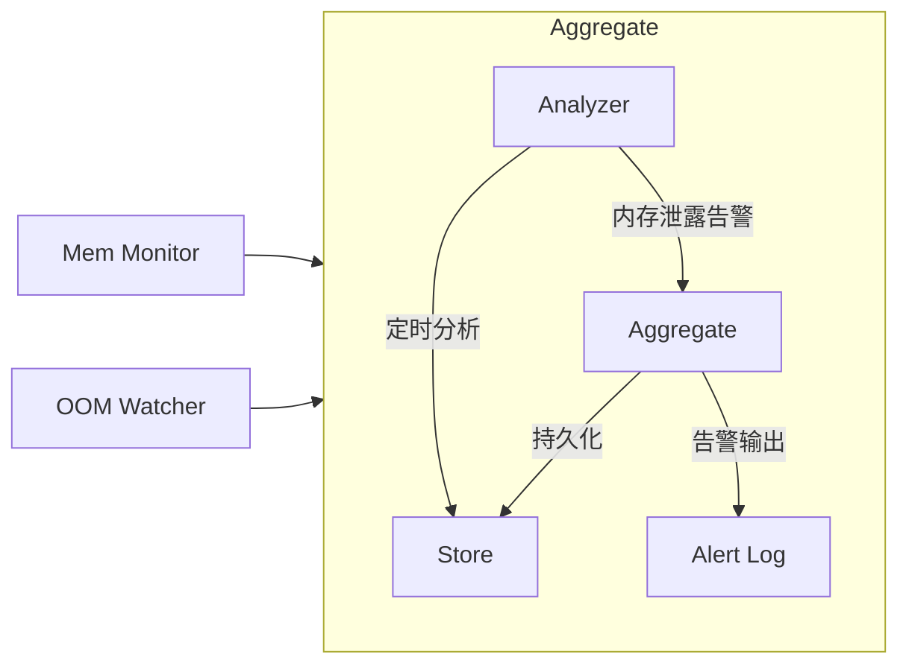

# 内存泄漏监控与 OOM 事件告警工具

## 背景与目标

在长稳压测过程中，需要对 Kubernetes 集群的节点与 Pod 运行状态进行持续监控，以便及时发现以下问题：

1. **集群节点存在内存泄漏趋势**
   典型表现为内存长时间持续上涨且无法回落，可能导致节点 MemoryPressure、Pod 驱逐或应用性能下降。

2. **Pod 发生 OOMKilled 事件**
   OOM 事件表示容器达到内存限制或节点可用内存枯竭，必须在第一时间捕捉并关联到受影响服务。

本工具旨在在压测期间提供稳定的监控能力，包括数据采集、趋势分析及统一告警输出。

## 系统整体架构

工具由三个组件组成：



### 组件说明

| 组件        | 部署方式   | 功能                                                     |
| ----------- | ---------- | -------------------------------------------------------- |
| Mem Monitor | DaemonSet  | 周期性采集 Pod 内存指标，输出到 Analyzer                 |
| OOM Watcher | Deployment | Watch 集群中的 Pod，捕获 OOMKilled 事件，输出到Aggregate |
| Aggregate   | Deployment | 聚合两类输出，进行内存趋势分析，输出日志                 |

## 使用方式

1. 拉去仓库，进入当前目录

2. 部署工具

  ```bash
  kubecl apply -f manifest/
  ```

3. 查看日志

  ```bash
  kubectl logs -n <your namespace> aggregate-xxx-xxx -c alert
  ```

4. 大部分配置项通过manifest文件中，工作负载声明中`containers[].env`字段传入。支持且推荐的配置项：
  - `memory-monitor`: 
    - `INTERVAL`: 内存采集的间隔
  - `aggregate`:
    - `DB_PATH`: Sqlite实例路径
    - `ALERT_PATH`: 告警日志路径
    - `CHECK_INTERVAL`: 进行内存分析的间隔（秒）
    - `WINDOW_SIZE`: 内存采集的历史时间长度（分钟）

## 采集模块设计

### 节点级指标采集（Node Memory）

使用 **kubelet Summary API**：

```
https://kubernetes.default.svc/api/v1/nodes/NODE_NAME/proxy/stats/summary
```

采集字段：

| 指标                        | 描述                   |
| --------------------------- | ---------------------- |
| node.memory.availableBytes  | 节点当前可用内存       |
| node.memory.workingSetBytes | 实际使用的 Working Set |
| node.memory.usageBytes      | 总使用量               |
| node.memory.rssBytes        | 物理内存占用（可选）   |

采集频率：**60 秒**

每次采集输出示例：

```json
{
  "timestamp": 1732020300,
  "node": "node-a",
  "mem_workingset": "${node.memory.workingSetBytes}",
  "mem_available": "${node.memory.availableBytes}",
  "mem_rss": "${node.memory.rssBytes}",
}
```

### 事件采集（OOMKilled 事件）

使用 K8s Watch 机制监听 Pod 事件，捕获 Pod ContainerStatuses 中 OOMKilled 事件：

| 字段      | 描述            |
| --------- | --------------- |
| Pod 名称  | 受影响 Pod      |
| Container | 出现 OOM 的容器 |
| Node      | Pod 所在节点    |
| Time      | OOM 事件时间    |
| Message   | K8s 原始消息    |

示例事件：

```json
{
  "timestamp": 1732020415,
  "node": "node-a",
  "namespace": "ns-a",
  "pod": "worker-12345",
  "container": "worker",
}
```

## 核心模块设计

### sqlite 初始化

通过initContainer创建一个sqlite实例，该实例通过emptyDir volume挂载到相关内部容器，scheme如下：

```sql
CREATE TABLE IF NOT EXISTS memory (
    id INTEGER PRIMARY KEY AUTOINCREMENT,
    timestamp INTEGER,
    node TEXT,
    mem_workingset INTEGER,
    mem_available INTEGER,
    mem_rss INTEGER
);
CREATE TRIGGER limit_rows
AFTER INSERT ON memory
BEGIN
    DELETE FROM memory
    WHERE id NOT IN (
        SELECT id FROM memory
        ORDER BY id DESC
        LIMIT 1440
    );
END;
```

### 聚合 aggregate

Flask实现的RESTful服务器，提供POST接口从采集模块收集消息。

- POST `/memory/stat`: 写入SQLite表 `memory_samples`
  
  ```plain
  {
    "timestamp": "string",
    "node": "string",
    "mem_workingset": "string",
    "mem_available": "string",
    "mem_rss": "string"
  }
  ```

- POST `/memory/alert`：输出内存泄露的告警日志

  ```plain
  {
    "message": "string"
  }
  ```

- POST  `/oom`：直接输出OOMKilled事件告警日志

  ```plain
  {
    "timestamp": "int"/"string",
    "node": "string"
    "namespace": "string"
    "pod": "string"
    "container": "string"
  }
  ```

### 内存趋势分析 Analyzer

间隔一定时间，触发一次内存趋势分析：
1. 从Sqlite实例读取每个节点的最近一段时间的内存数据
2. 分析内存趋势，若判定内存泄漏则输出日志

判定条件：

1. 线性回归斜率 > 节点内存总量 \* 0.1% / 分钟
2. 连续 N（默认 20）个采集周期呈正增长
3. 节点当前使用率 > 阈值（例如：80%）

满足以上任意一条，调用Aggregate /memory/alert接口发送告警信息。

### 告警日志

轻量级容器，通过tail -f持续输出日志文件内容，从而和其他容器中的脚本或应用日志独区分，方方便直接通过kubectl logs查看告警。
