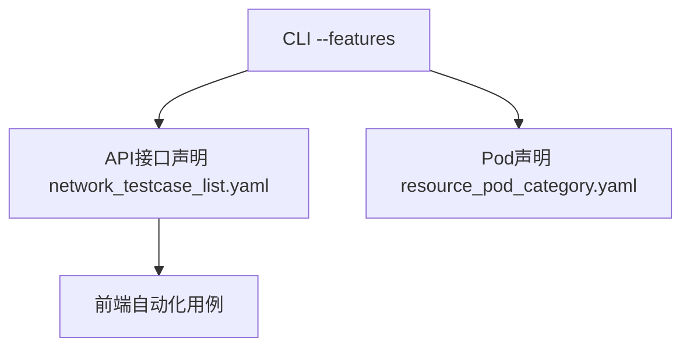

# 自动化性能测试工具使用指南

本项目实现了自动化工具，用于自动化执行openFuyao社区接口性能与资源占用测试。该工具能够同时监控网络请求性能和Kubernetes集群资源使用情况，为系统性能优化提供数据支持。

## 项目结构

```plain
performance/
├── __main__.py                 # 程序入口
├── runner/                     # 核心运行器
│   ├── network_monitor/        # 网络监控模块
│   └── resource_monitor/       # 资源监控模块
└── testcases/                  # 测试用例配置
    ├── network_testcase_list.yaml    # API接口测试对象
    ├── resource_pod_category.yaml    # 资源监控Pod对象
    └── xxx/                    # xxx特性的前端自动化用例
        └── a 
```

目前已支持的特性：

- ✅ 在离线混部
- ✅ NUMA亲和调度
- ⚙️ 安装部署

## 运行指南

本项目以python包形式实现，经过配置后可直接通过命令行运行

### 环境配置

1. 安装 [uv](https://docs.astral.sh/uv/) 后，在项目根目录（含 `pyproject.toml` 与 `uv.lock`）执行：

    ```bash
    uv sync
    uv run playwright install
    ```

    依赖以 `pyproject.toml` 为准，锁定在 `uv.lock`。若你修改了依赖，请再执行 `uv lock` 并提交新的锁文件。若仅能用 pip，可运行 `uv export --format requirements-txt -o requirements.txt` 再 `pip install -r requirements.txt`（不推荐，易与锁文件不一致）。

2. 复制`.env.test.template`为`.env`文件，配置以下参数：

    | 参数名                      | 含义                          | 格式                                                        |
    | --------------------------- | ----------------------------- | ----------------------------------------------------------- |
    | BASE_URL                    | 引导节点地址                  | https://\<ip>:\<port>                                       |
    | TEST_USERNAME               | 登录用户名                    |                                                             |
    | KUBECONFIG_SFTP_HOST        | 用于ssh获取kubeconfig的主机   |                                                             |
    | KUBECONFIG_SFTP_PORT        | 用于ssh获取kubeconfig的端口   | 默认为22                                                    |
    | KUBECONFIG_SFTP_USER        | 用于ssh获取kubeconfig的用户名 |                                                             |
    | KUBECONFIG_SFTP_PASS        | 用于ssh获取kubeconfig的密码   |                                                             |
    | KUBECONFIG_SFTP_REMOTE_PATH | 远端kubeconfig的文件路径      | 默认为`/root/.kube/config`，注意不能使用`~`                 |
    | KUBECONFIG_SFTP_LOCAL_PATH  | kubeconfig本地保存路径        | 默认为`config`。若填写`xxx`，则实际会保存到`.cache/xxx`路径 |

    对于安装部署，还需要提供以下环境变量

    | 参数名              | 含义                        | 格式     |
    | ------------------- | --------------------------- | -------- |
    | TEST_NODE1_NAME     | 测试节点node1的节点名称     |          |
    | TEST_NODE1_IP       | 测试节点node1的ip地址       | ipv4地址 |
    | TEST_NODE1_PORT     | 测试节点node1的ssh端口      |          |
    | TEST_NODE1_NAME     | 测试节点node1的ssh用户名    |          |
    | TEST_NODE1_PASSWORD | 测试节点node1的密码         |          |
    | TEST_NODE2_NAME     | 测试节点node2的节点名称     |          |
    | TEST_NODE2_IP       | 测试节点node2的ip地址       | ipv4地址 |
    | TEST_NODE2_PORT     | 测试节点node2的ssh端口      |          |
    | TEST_NODE2_NAME     | 测试节点node2的ssh用户名    |          |
    | TEST_NODE2_PASSWORD | 测试节点node2的密码         |          |
    | IMAGE_ADDR          | 镜像仓库地址url             |          |
    | IMAGE_IP            | 镜像仓库ip地址              | ipv4地址 |
    | CHART_ADDR          | 离线安装时引导节点Chart仓库 |          |

3. 如需调整环境文件路径，可改 `performance/runner/constants.py` 中的 `ENV_FILE`（默认 `'./.env'`，与第二步中文件名一致即可）。

    `constants.py` 中还有一些测试配置可供修改

    ```python
    # 资源监控延迟启动窗口（hour）；schedule_and_run_all_features(delayed=True) 时使用
    RESOURCE_MONITOR_DELAY_PERIOD = 0
    # 资源监控采集集群数据的间隔时间
    RESOURCE_MONITOR_INTERVAL = 5
    # 资源监控采集失败最大次数，设置为0则无上限
    RESOURCE_MONITOR_FAILED_THRESHOLD = 3
    ```

4. 在项目根目录下启动（`--mode` 必填；浏览器默认无头，调试时加 `--no-headless`）：

   ```bash
   # 网络 + 资源双监控
   uv run python -m performance --mode featured --features colocation,numa

   # 仅资源监控（--duration 0 表示无限运行）
   uv run python -m performance --mode resource --duration 3600 --features colocation
   ```

   可选参数：`--log-level`（文件日志，默认 INFO）、`--console-level`（终端，默认 WARNING）、`--log-dir`（默认 `./performance_log`）、`--log-cdp`（写入网络 CDP 调试 JSONL）。

   若已激活虚拟环境，也可 `python -m performance ...`（包名是 `performance`，不是路径 `./performance`）。

5. 每次运行在 `--log-dir` 下创建独立会话目录 `performance_log-{run_id}/`：

   ```plain
   performance_log/
   └── performance_log-yyyymmdd_hhmmss/
      ├── performance_test.log
      ├── network_monitor/
      │   ├── result.csv
      │   └── {feature}/
      │      ├── step.log
      │      ├── api_timing.jsonl
      │      └── cdp_events/          # --log-cdp 时
      │          └── {case}.jsonl
      └── resource_monitor/
          ├── result.csv
          └── {feature}/
             ├── step.log
             └── pod_resources.jsonl
   ```

   - 人读：`performance_test.log`、`step.log`（文件 INFO，终端默认 WARNING）
   - 机器读：`api_timing.jsonl`、`pod_resources.jsonl`；CSV 由上述 JSONL 汇总生成

6. 运行完成后查看各 `result.csv` 及特性目录下的 JSONL 原始采样数据。

## 测试用例开发

一个特性的一套测试用例包含：前端自动化用例、API对象和Pod对象，并在runner中进行注册。依赖/对应关系如下图



### 添加新特性

特性名通过 `testcases/network_testcase_list.yaml` 与 `testcases/resource_pod_category.yaml` 中的 `category` 字段声明，CLI 通过 `--features` 指定要运行的特性。

### 资源监控Pod配置

测试Pod对象配置文件：`testcases/resource_pod_category.yaml`

由于Pod名称有随机性，使用命名空间+Label进行筛选，同一特性支持多个命名空间，同一命名空间支持多个标签。声明测试Pod对象信息时，按特性分类，特性名称需要与 YAML 中的 `category` 一致。

```yaml
- category: colocation  # 特性分类
  rules:
    - namespace: openfuyao-colocation  # 命名空间
      labelSelectors:  # Pod标签选择器
        - app.kubernetes.io/name=colocation-manager
        - app.kubernetes.io/name=colocation-service
    - namespace: another-namespace
      labelSelectors:
         - xxx=yyy
```

### 前端自动化用例编写

前端自动化用例：`performance/testcases/xxx/*.py`

前端自动化用例用于在测试浏览器上进行前端操作，触发测试接口对象调用。用例使用Playwright for Python开发，每一个用例编写为一个独立的Python函数。将Python文件存放在`performance/testcases/`中以当前特性名称命名的文件夹下，文件夹下Python文件的数量不作限制。

```plain
performance/testcases/
└── colocation/
   ├── colocation_testcases.py
   │   ├── get_colocation_config()
   │   ├── update_colocation_config()
   │   └── ...
   └── another_testcases.py
       └── ...
```

### API对象配置

测试API对象配置文件：`testcases/network_testcase_list.yaml`

测试用例可针对一个或多个接口的测试，在API配置文件中体现测试用例与所测试的接口对应关系。

```yaml
- category: colocation  # 特性分类
  testcases:
    dir: performance/testcases/colocation/  # 测试用例目录
    modules:
      - name: colocation_testcases.py  # 测试模块文件
        functions:
          - name: get_colocation_config  # 测试函数名
            targetAPIs:  # 要监控的API列表
              - path: /rest/colocation/v1/colocation-configs   # API端点
                method: get   # API方法
         - name: get_colocation_monitor
            targetAPIs:
              - path: /rest/colocation/v1/colocation-status
                method: get
              - path: /rest/colocation/v1/colocation-metrics/cluster
                method: get
              - path: /rest/colocation/v1/colocation-metrics/nodes/{node}
                method: get
      - name: another__testcases.py  # 测试模块文件
        functions:
          - name: test_xxx
            targetAPIs:
              - path: /rest/xxx
                method: get
```
