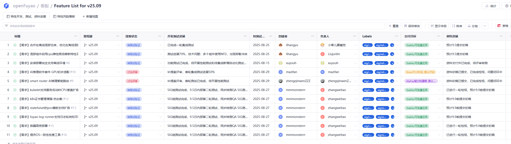
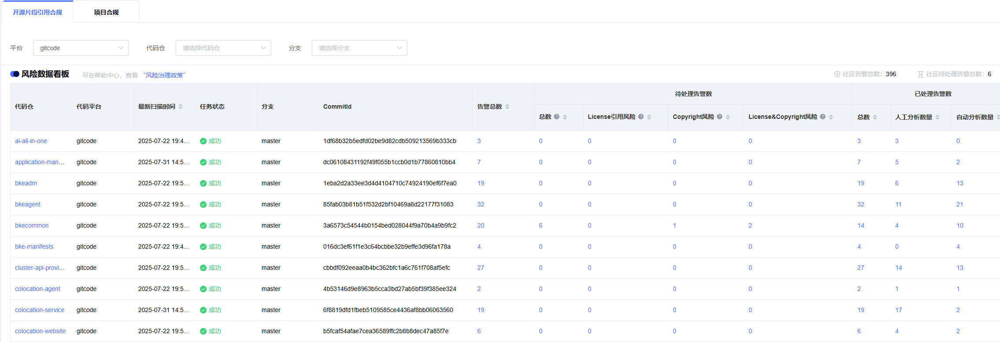
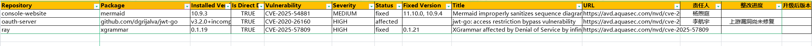

# Development Monthly Report（202508）

**汇报周期**：2025-08-1 至 2025-8-31  
**Release Manager**：@hardbrck  
**participating-sigs**: sig-QA，sig-infra，sig-docs, security-committee

## 版本清单和阶段

| Version | Version Type     | Release Date | Stage | 点灯   |一句话说明                                     |
| ----------------------------- | --------------- | ---------- | ---------- |---------  | ---------------------------------------- |
| v25.09          | 普通版本     |        2025-9-30        | 开发阶段 | 进度正常 | 特性已转测试  |
| v25.12          | LTS版本     |       2025-12-30       | 启动阶段 | 正常 | 已发布需求搜集公告  |
|||||||

## v25.09(developing)

### 特性看板（链接）

**除AI推理软件套件、AI推理只能路由两个特性本次TC汇报，其他特性均已完成开发转测试；**

### 测试看板（链接，**看板建设中**）

1、专题验证进展:

#### 已启动

安全测试：进展50%；性能测试：在离线混部9.5启动；AI推理，进展30%；安装部署9.10;

#### 待启动

长稳测试：9.8启动；兼容性测试：9.10；用户体验测试：9.10开始；升级测试：待补丁功能转测试后启动；

2、issue单清理进展（[链接](https://gitcode.com/org/openFuyao/kanban/30)）

### 发布包变更（链接）

1、新增组件和代码仓清单（还在搜集中）：

|新增代码仓(15个)|归属SIG组|新增组件名|描述|
| ------------- | --------------- | ---------- | ---------- |
|vllm-ascend, ai-inference-integration, balanced-pd, mis-management-website, mis-management, hermes-router, LegaoInfer|sig-ai-inference|待补充||
|node-checker, villus, kubeone, containerd, coredns, etcd|sig-orchestration-engine|待补充||
|bke-console-website, bke-console-service|sig-installation|待补充||
|colocation-management|sig-Colocation|待补充||
|||||

2、开源三方件版本清单

|依赖三方件|25.09版本|类型|所属特性|
| ------------- | --------------- | ---------- | ---------- |
|kubectl|1.33.1|二进制|安装部署|
|kubelet|1.33.1|二进制|安装部署|
|containerd|2.1.1|组合包|安装部署、numa亲和|
|kube-apiserver|1.33.1|镜像|安装部署|
|kube-controller-manager|1.33.1|镜像|安装部署|
|kube-scheduler|1.33.1|镜像|安装部署|
|kube-proxy|1.33.1|镜像|安装部署|
|etcd|3.5.21|镜像|安装部署|
|coredns|v1.10.1|镜像|k8s|
|calico|3.27.3|镜像|安装部署、超大规模集群|
|volcano|1.9.0|镜像|numa亲和、超大规模集群|
|local-harbor|2.7.0|镜像|安装部署|
|ingress-nginx|1.9.4|镜像|安装部署|
|rubik|2.0.1|镜像|在离线混部|
|node-feature-discovery|0.17.3|组合包|在离线混部|
|vllm|0.10.0|代码仓|AI推理|
|vllm-ascend|0.10.0rc1|代码仓|AI推理|
|mooncake|main|代码仓|AI推理|
|CANN|8.2.RC1|镜像|AI推理|
|ray|2.48.0|二进制|AI推理|
|kuberay|1.4.0|二进制|AI推理|
|node-feature-discovery|0.16.4|组合包|NPU Operator|
|||||

### 合规看板（链接）

7月份已完成一轮清理， 计划8月份扫描第二轮，当前还在扫描中，最新的结果尚未出来

### 漏洞看板（看板建设中）

已完成两轮漏洞清理，9月份完成剩余清理

## v25.12(takeoff)

**release plan**：[链接](https://gitcode.com/openFuyao/release-management/blob/main/openFuyao-25.12/release-plan.md)

## 维护版本(NA)

### 问题清单
