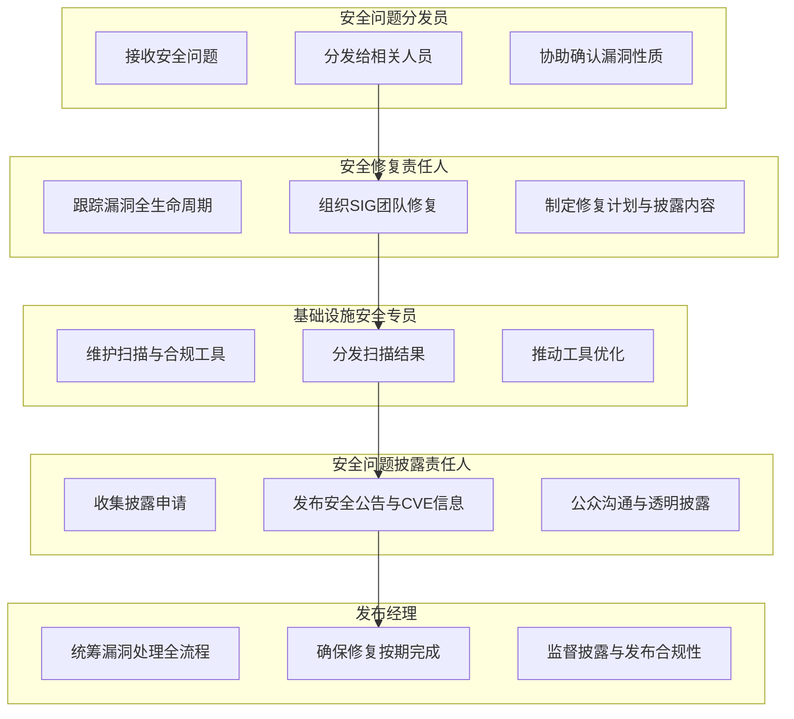

# 安全问题处理和发布流程

openFuyao已经采用本文中描述的安全披露和响应策略，以确保我们及时负责任地处理安全问题。

目录

+ [安全委员会（SC）](#安全委员会sc)
  - [使命和工作职责](#使命和工作职责)
  - [成员角色说明](#成员角色说明)

- [安全问题处理和披露流程](#安全问题处理和披露流程)
  - [安全问题收集](#1安全问题收集)
  - [安全问题确认](#2安全问题确认)
  - [成立修复团队](#3成立修复团队)
  - [制定修复计划](#4制定修复计划)
    - [安全问题影响性评估](#安全问题影响性评估)
    - [安全问题响应说明](#安全问题响应说明)
  - [组织漏洞修复开发](#5组织漏洞修复开发)
  - [修复披露](#6修复披露)
- [安全问题处理和披露流程图示](#安全问题处理和披露流程图示)

## 安全委员会（SC）

### 使命和工作职责

SC的使命和工作职责请参考[README](../../../README.md)

### 成员角色说明

由于安全处理流程涉及到多个环节和对应的职责，SC的成员会被赋予一些特定的角色，以更加明确地承担这些环节的职责。以下是各个角色的定义，这些角色会定期进行轮换，以保证每一个人都有机会了解openFuyao的安全处理机制

**安全问题分发员**  

+ 接收并分发安全问题，确保相关人员及时响应。  
+ 协助确认问题是否属于安全漏洞并进行初步评分。  
+ 在处理分歧时负责协调。  

**安全修复责任人**  

+ **委员会修复负责人**：跟踪和协调漏洞全生命周期，支持各SIG进行分析和修复。  
+ **SIG修复负责人**：由各SIG指定，负责本团队的漏洞处理、修复计划和披露内容。  

**基础设施安全专员**  

+ 维护漏洞扫描和合规工具的正常运行。  
+ 分发和处理工具扫描结果。  
+ 推动工具优化和开发，协助团队避免常见安全问题。  

**安全问题披露责任人**  

+ 收集并提交披露申请。  
+ 发布安全公告、升级文档、日志变更和 CVE 信息。  
+ 向公众解释漏洞严重性并保持透明沟通。  

**发布经理**  

+ 组织漏洞处理全流程，确保修复按期完成。  
+ 监督披露和发布流程的合规性。  

#### **安全问题分发员**

事件触发型或周期型角色，通过主动承担或决策分配产生，随事件处理结束而结束。

+ 确保应该处理问题的人员都已经收到通知
+ 响应还未被确认为安全问题的问题
+ 协助确认安全问题在openFuyao产品的评分
+ 如果开发者在处理安全问题的时候有分歧，也可以视需要上升到问题分发员。

在任的SC成员都会负责该工作，他们会按照上报的顺序响应安全请求的原则。

#### **安全修复责任人**

此角色分为安全委员会的安全修复负责人与各SIG组的安全修复负责人。

+ 安全委员会的安全修复责任人是固定成员，侧重安全问题的跟踪协调，负责感知安全问题的从“生”到“死”，以责任田形式分配相关项目或领域，具体职责是协助漏洞修复：协助各SIG组开展漏洞分析、评估漏洞定级和修复建议等工作。
+ 各SIG组的安全修复责任人由每个SIG团队指定的参与安全活动的SIG成员承担，这个角色应该由希望后继加入SC的成员承担，若SIG暂无此类人员，则该SIG的Maintainer需要承担此责任。他们将负责：

  + 优先处理分发给本SIG团队内的安全问题
  + 成立SIG内漏洞修复开发团队
  + 进行漏洞评分并确定响应时间、修复计划
  + 提供本SIG内项目的安全问题披露内容

#### **基础设施安全专员**

固定角色，这个角色确保漏洞扫描、代码安全合规扫描等配套的安全工具正常工作，包括：

+ 确认工具的正常运行
+ 分发和处理工具扫描的结果。包括确保漏洞扫描发现的问题的正确分发，完成新软件包的合规扫描入库等
+ 分析和提出安全领域工具的优化需求，规划并推动工具开发和应用
+ 和基础设施团队一起，在社区基础设施上构建安全领域的工具解决方案，帮助开发团队避免软件开发过程中的常见陷阱

#### **安全问题披露责任人**

固定角色，周期性执行漏洞披露流程。

+ 按照规则收集披露问题；
+ 向安全委员会提交披露申请，包括安全公告和安全问题；
+ 提供符合披露原则的披露相关公共消息发布。包括相关的披露信息、升级文档、日志变更、向公众解释严重性，将错误通知发送到邮件列表，CVE信息等。

#### **发布经理**

有责任在整个漏洞处理生命周期内组织相关活动的开展，保障漏洞修复顺利按期进行，遵守安全问题处理和披露的流程要求。

## 安全问题处理和披露流程

### 1、安全问题收集

#### CVE例行扫描

+ openFuyao社区会采用Trivy漏洞扫描工具，对社区上使用的上游社区软件包公开披露的漏洞进行例行扫描和同步。
+ 扫描出的漏洞会按照[安全问题模板](../template/template-cve-vulnerability.md)的格式向对应的代码repo推送带有“CVE”标签、security-committee标签以及repo对应SIG组标签的Issue

#### 内部上报

SIG内的bug被团队成员确认为安全漏洞，团队成员将对应的Issue调整成“私有”，同时添加“安全问题”标签，并根据实际情况添加“优先级”标签。安全问题分发员会定期查看此类问题的更新情况。

#### 外部上报

如果您知道一个安全漏洞，不在openFuyao安全团队已经处理的公开安全漏洞的列表之内，烦请立即发送电子邮件至<openfuyao-security@list.openfuyao.cn>通知SC，以便于他们可以启动修复、发布和公告过程。

请采用[安全流程电子邮件模板](../template/template-security-bug.md)，收到上报邮件后，安全问题分发员会在其repository内新建一个私有安全Issue。

如果有需要，SC将询问您是否可以通过负责人的方式秘密披露此问题。如果您反对，我们将采用公开披露的方式。

### 2、安全问题确认

安全问题分发员会完成对新问题的确认，包括：

+ 对于外部上报的安全问题，确定受影响的项目。
+ （包括外部上报问题和CVE问题）联系相关工程师（会优先从项目的Maintainer和Committer中选择），推动尽快确认是否是新的安全问题。确认后将Issue（私有）分发到对应的repo
+ 对于外部上报的安全问题，确认后通知问题上报人。

确认结果记录在Issue的进展内，并调整Issue的状态进入解决阶段。

### 3、成立修复团队

修复责任人将组织修复团队，修复团队包括：

+ 对应的版本或补丁发布经理
+ 受影响项目的SIG成员，优先选择前期已经参与问题分发阶段的团队成员

### 4、制定修复计划

对于每一个漏洞，修复责任人会与修复团队，发布经理进行协调，并负责向社区相关成员发送电子邮件。修复责任人会根据问题的严重性，开发需要的时间和发布经理反馈的版本计划，综合自己最佳的判断来制定问题的修复计划。

#### 安全问题影响性评估

修复责任人和修复团队将使用[CVSS计算器](https://www.first.org/cvss/specification-document#i5)创建一个CVSS。他们会将使用“[严重性评估——我们如何进行漏洞评分](security-rating.md)”来确定错误的影响和严重性。修复责任人对计算出的风险进行最终评估。

+ 如果评估分数低于4.0（严重性分数较低）或评估的风险较低，则修复责任人可以选择半公开进行修复。这意味着PR是直接在公开的对应仓库上进行的，同时可以在公开渠道讨论。同时修复团队可以在特定情况下（比如假期等）放慢发布过程。这些决策必须在安全会议上讨论。
+ 如果评估分数低于7.0（严重程度中等），高于4.0，则安全委员会成员也可以选择半公开进行修复。修复责任人将确定公开处理该修复程序是否会对用户造成伤害，以决定是否将对问题安全性方面的讨论限定在私有渠道。

注意：修复责任人有权对漏洞的严重程度进行分类。

#### 安全问题响应说明

+ 如果处理的是openFuyao社区开发项目的安全问题，则所有的计划时间表会尽快形成。
+ 如果不是，则修复程序依赖于上游社区的披露时间表。修复责任人会通过与上游社区的合作，尽量做到在适应上游社区时间表的同时，最大程度的保护openFuyao社区的用户。
+ 整体漏洞修复时长请参考[严重性评估——我们如何进行漏洞评分--严重等级划分](security-rating.md#严重等级划分)章节

### 5、组织漏洞修复开发

+ 如需要在私有安全仓库进行开发，修复负责人将使修复团队可以访问openFuyaoXXXXXX中的私有安全仓库，以开发修复程序，**上游社区公开披露的CVE不需要此过程**。
+ 修复责任人将向[openFuyao CVE编号颁发机构申请CVE](openfuyao-security@list.openfuyao.cn)，**上游社区公开披露的CVE不需要此过程**。
+ 发布经理根据发布计划组织漏洞issue修复开发
+ 修复团队在完成对安全漏洞issue的对应修复后提交PR，对应SIG的安全联络员和maintainer/committer负责合入到漏洞修复的分支上，并通知发布经理，发布经理将通知修复责任人——修复工作已经完成。

### 6、修复披露

随着修复的开展，修复责任人需要针对更广泛的社区范围提交总体沟通计划。总体沟通启动应该在修复团队制定了修复或缓解措施以后开始，以便可以将可达成的计划传递给用户。

**发行商披露（可选）** （在问题确认后1~14天内完成）

+ 如果问题严重到需要尽早通知发行商，修复负责人将在修复团队的帮助下做出此决定。比如影响严重的“可远程利用”或“特权升级”等问题。否则可以跳过此过程。
+ 修复负责人将补丁程序通过电子邮件发送给distributors-announce@list.openfuyao.cn，以便发行商可以提前准备，并在发行版发布之日向用户提供版本。发行商应订阅发行商披露邮件列表([distributors-announce@list.openfuyao.cn](distributors-announce@list.openfuyao.cn))，阅读[发行商披露须知](private-distributors-list.md)信息，以了解添加到该列表的要求。

**修复发布日**（在问题确认后1~21天内完成）

+ 在即将发布前，至少提前24小时通过电子邮件通知社区开发伙伴，通知信息应包含公共消息，公告的日期。
+ 修复责任人会将修复的PR推送（cherry-pick）到master分支和相关的发行版本分支。修复团队会使用/lgtm和/approve通过
+ 版本的发布经理会尽快merge这些PR。此时不应更改提交内容，以防止与发送给发行商的补丁程序产生不应有的冲突，以及在分支选择patch时发生冲突。
+ 发布经理应确保所有的制品通过构建（镜像/helm-chart/二进制发行包），可公开使用且正常运行。
+ 修复责任人将提供新版本号、CVE编号（如有需要）、严重性和影响以及二进制文件的位置的信息给披露负责人，以支撑更广泛的分发和用户操作。此披露负责人将尽早将公告更新到社区页面，并应包括用户在升级到固定版本之前可以采用的任何缓解措施。公告将通过以下渠道发送

  + <security-committee@list.openfuyao.cn>（当前公开发布漏洞需要订阅的邮件）
  + <openfuyao-security@list.openfuyao.cn>
  + 社区安全页面（敬请期待）
  + 在<https://gitcode.com/openfuyao/issues> 中打开问题，并标记成`area/security`，并以相关CVE ID为前缀（敬请期待）

## 安全问题处理和披露流程图示

