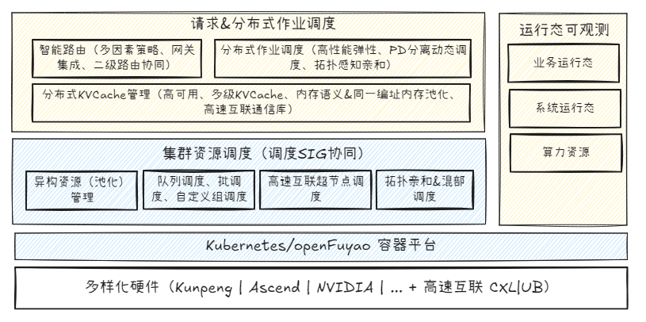

# sig-ai-inference

## SIG Group Goals

The AI Inference SIG aims to build an open, efficient, and future-oriented cloud-native LLM inference acceleration system. By focusing on three core capabilities: intelligent dynamic routing, xPyD compute-memory decoupling, and distributed KVCache, we are committed to systematically breaking through current LLM inference bottlenecks, improving efficiency and deployability in diverse computing scenarios, and driving technological evolution in the open source community in this field

Large Language Model (LLM) inference has become a key link in AGI implementation, but faces severe challenges in actual production deployment:

1. **User experience and resource efficiency bottlenecks**: Current TTFT latency for long-context LLM inference is generally in the hundreds of milliseconds to seconds, and KV cache memory usage grows linearly in long-context scenarios (e.g., Llama2-7B's KV cache reaches 2GB under 4096 context), severely constraining Agent response efficiency and deployment scale; traditional static batching cannot adapt to dynamic loads, causing short requests to be blocked by long requests (head-of-line blocking problem).

2. **Enterprise production-level scenario challenges**: In enterprise production scenarios, there are widespread problems of high inference costs, low utilization of diverse computing power (GPU computing power + domestic computing power), difficulty in guaranteeing SLA, and complexity in production-level scale deployment management.
3. **Cloud-native AI full-stack challenges**: Existing cloud-native scheduling (such as K8s) lacks LLM awareness capabilities and cannot optimize KV cache lifecycle, dynamic batching, and other scenarios.

To systematically address the above challenges, we propose establishing the AI Inference Special Interest Group (AI Inference SIG), dedicated to building a cloud-native LLM inference acceleration system oriented toward diverse computing hardware. This system will focus on three core technical innovation capabilities and drive the evolution and landing of efficient inference technologies through open source community collaboration.

## Overall Architecture

## Project Planning RoadMap (Updated 2026/04/02)

| Planned Component            | Planned Goal                                                                                                  | Planned Release               |
| --------------- | ----------------------------------------------------------------------------------------------------- | ------------------ |
| Hermes-Router   | - Build a mainstream gateway (Envoy Based) compatible gateway routing strategy extension plugin based on K8s IGW framework, with open and easy-to-configure routing strategies; - Provide multi-factor routing strategy enhancement (KV-, request pressure-, resource pressure-, request length-aware) and strategy coordination.                 | 25.09（alpha）/25.12 |
| KVCacheX        | - Implement distributed KVCache management high availability based on open source components (Mooncake);  - Implement direct access/high-performance data transfer for distributed KVCache and multi-level KVCache management targeting high-speed interconnect technology memory sharing and unified memory semantic addressing;   - Explore batch read/write optimization based on KVCache physical location awareness; | 25.12/26.X         |
| PD-Orchestrator | - K8s native distributed job resource management & elastic scaling enhancement, coordinating K8s native & native scheduling extension capabilities, compatible with mainstream inference engines; - Provide dynamic resource ratio and elastic scaling strategy modules based on near real-time metric observability, providing high-performance elastic scaling capabilities through high-performance business migration acceleration & warm-up to meet business SLO challenges                     | 25.12/26.X         |
| EagleEye        | - Implement near real-time monitoring of key metrics at different granularities including business runtime, system runtime, and hardware health, supporting inference scenario dynamic scaling, policy selection, disaster recovery, and other capabilities;   - Provide memory management observability capabilities based on high-speed bus interconnect architecture                                                      | 25.12/26.X         |
| OFIXL-Connector | - Oriented toward high-speed interconnect technology, providing a high-performance communication library compatible with different hardware infrastructures based on memory semantic memory sharing and unified addressing, oriented toward inference KVCache management.                                          | 26.X               |
| LLM-IF-Deployer | - Provide one-click installation and deployment of inference acceleration suite (based on K8s), providing best practice component integration                                                                   | 25.09（alpha）/25.12 |

## Community Meetings

- AI Inference SIG regular meetings are held every Thursday afternoon at 2:30 - 3:30. Please check the community official website meeting system for specific meeting agendas: <https://www.openfuyao.cn/en/meeting/>.
- SIG regular meeting topic application: <https://etherpad.openfuyao.cn/p/sig-ai-inference> Fill in and discuss through online whiteboard.
- Please subscribe to email through the community official website: <ai-inference@list.openfuyao.cn> to get the latest SIG information.

## SIG Maintainer

- QingjunWang [@foxbit](https://gitcode.com/foxbit)

## Proposal Submission & Archiving

AI Inference SIG related proposals (OFEP) should be submitted as PRs to: <https://gitcode.com/openFuyao/ofep/tree/main/ofeps/sig-ai-inference>

## Project List (Updated 2026/4/02)

repository address:

- [hermes-router](https://gitcode.com/openFuyao/hermes-router) - Intelligent routing gateway
- [InferNex](https://gitcode.com/openFuyao/InferNex) - Main integration repository
- [cache-indexer](https://gitcode.com/openFuyao/cache-indexer) - Global KVCache index
- [Elastic-scaler](https://gitcode.com/openFuyao/elastic-scaler) - Elastic scaling (RBG)
- [mooncake](https://github.com/kvcache-ai/Mooncake) - Distributed KVCache (upstream)
- [eagle-eye](https://gitcode.com/openFuyao/eagle-eye) - Inference observability