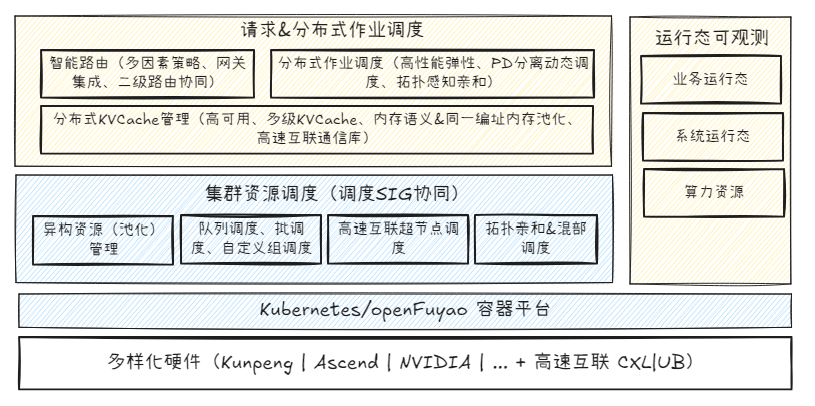

# sig-ai-inference

## SIG组目标

AI Inference SIG旨在构建一个开放、高效、面向未来的云原生LLM推理加速体系。通过聚焦智能动态路由、xPyD计算-显存解耦、分布式KVCache三大核心能力，我们致力于系统性突破当前LLM推理的瓶颈，提升在多样化算力场景下的效率与可部署性，并推动开源社区在该领域的技术演进。

大型语言模型（LLM）推理已成为AGI落地的关键环节，但在实际生产部署中面临严峻挑战：

1. **用户体验与资源效率瓶颈**：当前长上下文LLM推理的TTFT延时普遍在数百毫秒至秒级，且长上下文场景下KV缓存显存占用呈线性增长（如4096上下文下Llama2-7B的KV缓存达2GB），严重制约Agent的响应效率与部署规模；传统静态批处理无法适配动态负载，导致短请求被长请求阻塞（队头阻塞问题）。

2. **企业生产级场景挑战**：企业生产场景，普遍存在高推理成本、多样化算力（GPU算力 + 国产化算力）利用率低、SLA难以保障、生产级规模部署管理复杂等问题。
3. **云原生AI全栈挑战**：现有云原生调度（如K8s）缺乏LLM感知能力，无法优化KV缓存生命周期、动态批处理等场景。

为系统性解决上述挑战，我们提议成立 AI 推理特别兴趣小组（AI Inference SIG），致力于构建一个面向多样化算力硬件的云原生 LLM 推理加速体系。该体系将聚焦三大核心技术创新能力，并通过开源社区协作，推动高效推理技术的演进与落地。

## 总体架构

## 项目规划RoadMap (2026/04/02更新)

| 规划组件            | 规划目标                                                                                                  | 计划发布               |
| --------------- | ----------------------------------------------------------------------------------------------------- | ------------------ |
| Hermes-Router   | - 基于K8s IGW框架构建主流网关（Envoy Based）兼容的网关路由策略扩展插件，路由策略开放易配置； - 提供多因素路由策略增强（KV-，请求压力-，资源压力-，请求长短-aware）和策略协同。                 | 25.09（alpha）/25.12 |
| KVCacheX        | - 基于开源组件（Mooncake），实现分布式KVCache管理高可用； - 针对高速互联技术内存共享和内存语义统一编址，实现分布式KVCache和多级KVCache管理的直访/高性能数据搬移；  - 探索基于KVCache物理位置感知的组批读写优化； | 25.12/26.X         |
| PD-Orchestrator | - K8s原生分布式作业资源管理&弹性伸缩增强，协同K8s原生&原生调度扩展能力，兼容主流推理引擎； - 提供基于近实时指标可观测的动态资源配比和弹性伸缩的策略模块，通过高性能业务迁移加速&预热，提供高性能弹性伸缩能力，满足业务SLO挑战                     | 25.12/26.X         |
| EagleEye        | - 实现业务运行态、系统运行态、硬件健康等不同粒度关键指标的近实时监控，支持推理场景动态扩缩容、策略选择、容灾等能力；  -提供基于高祖总线互联架构内存管理可观测能力                                                      | 25.12/26.X         |
| OFIXL-Connector | - 面向高速互联技术，基于内存语义内存共享、统一编址提供兼容不同硬件基础设施，面向推理KVCache管理的高性能通信库。                                          | 26.X               |
| LLM-IF-Deployer | - 提供推理加速套件一键式安装部署（基于K8s），提供最佳实践组件集成。                                                                   | 25.09（alpha）/25.12 |

## 社区会议

- AI推理SIG例行每周四下午2：30 - 3：30召开，请查看社区官网会议系统获取具体会议议程：<https://www.openfuyao.cn/zh/meeting/>
- SIG例行会议议题申报：<https://etherpad.openfuyao.cn/p/sig-ai-inference>通过在线白板填写、讨论。
- 请通过社区官网订阅邮箱：<ai-inference@list.openfuyao.cn> 获取最新SIG资讯。

## SIG Maintainer

- QingjunWang [@foxbit](https://gitcode.com/foxbit)

## 提案提交&归档

AI推理SIG相关提案(OFEP)请以PR提交至：<https://gitcode.com/openFuyao/ofep/tree/main/ofeps/sig-ai-inference>

## 项目清单(2026/4/02更新)

repository地址：

- [hermes-router](https://gitcode.com/openFuyao/hermes-router) - Intelligent routing gateway
- [InferNex](https://gitcode.com/openFuyao/InferNex) - Main integration repository
- [cache-indexer](https://gitcode.com/openFuyao/cache-indexer) - Global KVCache index
- [Elastic-scaler](https://gitcode.com/openFuyao/elastic-scaler) - Elastic scaling (RBG)
- [mooncake](https://github.com/kvcache-ai/Mooncake) - Distributed KVCache (upstream)
- [eagle-eye](https://gitcode.com/openFuyao/eagle-eye) - Inference observability