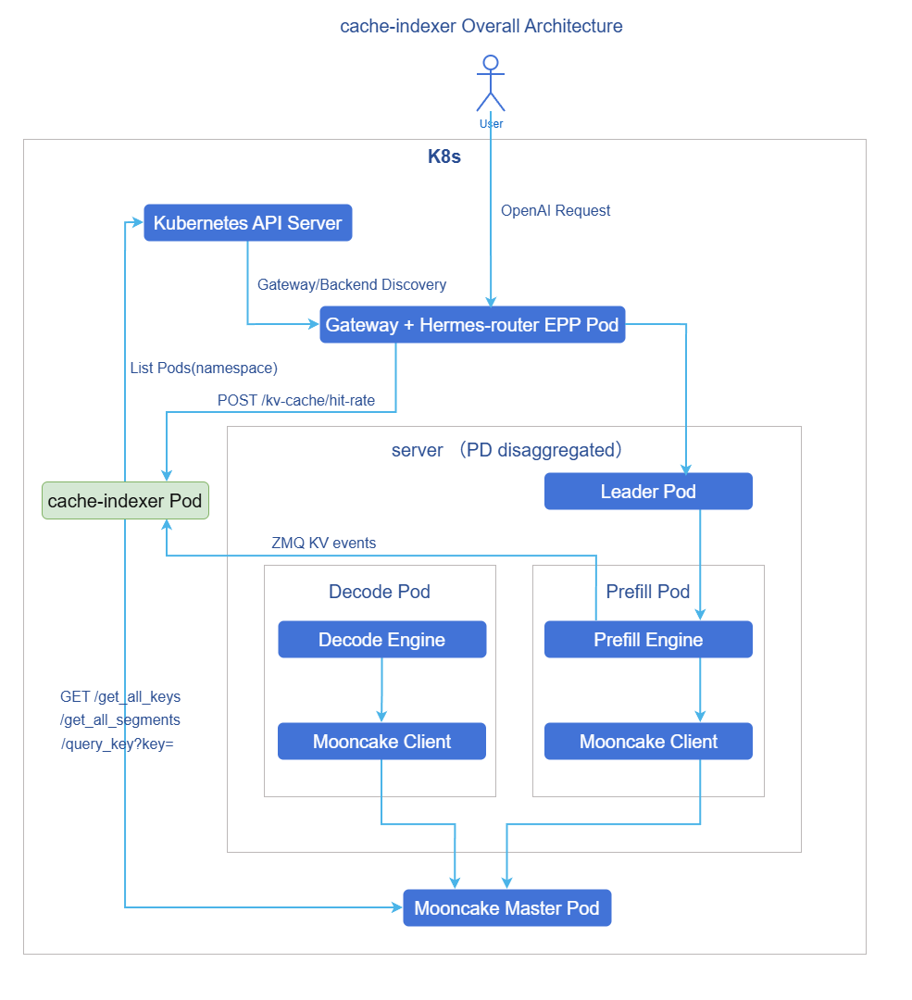

# AI Inference KVCache Index Management

## Feature Overview

cache-indexer is a global KVCache index component designed for large language model inference scenarios. It uniformly maintains a two-layer KVCache view of L1 (local HBM on inference instances) and L3 (memory cache on inference instances). Routing components can call cache-indexer to query the KVCache hit rate of candidate inference instances, enabling more accurate request-level scheduling.

### Application Scenarios

cache-indexer is applicable for deploying large language model inference services in a Kubernetes cluster where request routing needs to be optimized based on KVCache hit conditions.

- Multi-instance inference backend: Multiple vLLM instances serve simultaneously, and the most suitable instance needs to be selected based on request prefix cache hit conditions.
- KVCache-aware routing: Routing components such as Hermes-router need to obtain L1/L3 hit rates for KVCache-aware routing strategies.
- Distributed cache reuse: Inference services use distributed cache management systems such as Mooncake and want to include KVCache that has already been offloaded to memory as a scheduling basis.
- Dynamic scaling scenarios: When inference instances or Mooncake Masters go online or offline, cache-indexer needs to automatically discover and update index collection targets.

### Capability Scope

cache-indexer currently provides the following capabilities:

- Supports dynamic discovery of vLLM Pods and Mooncake Master Pods through Kubernetes Pod labels.
- Supports subscribing to vLLM ZMQ KV-events to maintain L1 KVCache indexes.
- Supports polling Mooncake Master to maintain L3 KVCache indexes.
- Supports querying L1/L3 KVCache hit rates of candidate instances through the `/kv-cache/hit-rate` API.
- Supports independent deployment via Helm Chart, and also supports integrated deployment as an InferNex sub-component.

> **Note:**
> 
> - cache-indexer does not include tokenizer capabilities. Callers need to pass pre-encoded `token_ids` in the request.
> - Since Mooncake V1 has not yet provided an SSD-level KVCache query API, L3 indexes do not include KVCache information on SSD.


### Software Dependencies

The L1/L3 hit rates of cache-indexer depend on the inference engine, distributed cache management system, and its own configuration being consistent. The currently verified combinations are as follows.

**Table 1** cache-indexer dependency components
| Component Category | Currently Verified Version | Description |
|----------|----------------|------|
| Inference Engine (L1) | `vLLM 0.13.0`, `vLLM 0.18.0` | Provides L1 KVCache; requires prefix caching and KV events to be enabled, and block calculation parameters must be consistent with cache-indexer. |
| Distributed Cache Management System (L3) | `Mooncake 0.3.7` | Provides L3 KVCache; requires support for `/get_all_keys`, `/query_key`, `/get_all_segments`. |
| Kubernetes | `1.28+` | cache-indexer performs service discovery through the Kubernetes API and requires `get/list/watch` permissions for `pods`. |

### Key Features

- **L1/L3 dual-layer view**: Simultaneously maintains the local HBM cache view on inference instances and the distributed memory cache view.
- **Unified KVCache block calculation mechanism**: Replicates the vLLM block hash calculation logic, aligning the calculation results on the query side with vLLM events and Mooncake keys.
- **Dynamic service discovery**: Periodically discovers vLLM Pods and Mooncake Master Pods, automatically driving subscription and polling target updates.
- **Lightweight API**: Only accepts necessary inputs such as `token_ids`, `block_size`, and `cache_salt`, without executing a tokenizer within cache-indexer.

### Implementation Principle

cache-indexer is located on the routing decision path. The main workflow is as follows.

1. cache-indexer lists vLLM Pods and Mooncake Master Pods with specific labels through the Kubernetes API Server, constructing a discovery snapshot.
2. For each vLLM Pod, a ZMQ SUB connection is started to subscribe to `BlockStored` / `BlockRemoved` / `AllBlocksCleared` events, writing to the L1 index.
3. For Mooncake Master, periodically calls `GET /get_all_keys` and `GET /query_key` to pull block replica lists, and parses the mapping of vLLM Pod IP addresses to Mooncake client transport endpoints through `GET /get_all_segments`, writing to the L3 index.
4. The routing component calls `POST /kv-cache/hit-rate`, and cache-indexer calculates the longest consecutive prefix hit on both L1/L3 indexes and returns the result.

The overall architecture is as follows.

**Figure 1** cache-indexer overall architecture


## Installation

### Independent Deployment

This section describes deploying cache-indexer independently in a cluster that already has an inference engine and a distributed cache management system.

#### Component Specifications

When deploying cache-indexer independently, companion components are required to provide collectible L1/L3 data.

| Component | Specification Description |
|------|----------|
| Inference Engine | Currently supports vLLM, verified with `vLLM 0.13.0` and `vLLM 0.18.0`; requires prefix caching and KV events to be enabled. |
| Distributed Cache Management System | Currently supports Mooncake, verified with `Mooncake 0.3.7`; requires the Mooncake Master admin HTTP API to be available. |
| cache-indexer | Deployed via Helm chart, default provides ClusterIP Service `cache-indexer-service:8080`. |

> **Note:**
> 
> Without deploying the inference engine and distributed cache management system, the cache-indexer Pod can still start, health checks and query APIs are accessible, but L1/L3 hit rates will both be `0`.

#### Prerequisites

Before starting the installation, ensure the following conditions are met.

- **Environment Requirements**
  - Kubernetes cluster: `1.28+`.
  - Helm tool: for deploying the cache-indexer chart.
  - User has permissions to create Deployment, Service, ConfigMap, ServiceAccount, Role, RoleBinding in the target namespace.

- **Component Requirements**
  - If L1 hit rate is needed, vLLM inference instances must be deployed in the cluster, with labels, environment variables, startup parameters, and ZMQ ports configured as described in the [Inference Engine (vLLM Example)](#inference-engine-vllm-example) section.
  - If L3 hit rate is needed, Mooncake Master and Mooncake client must be deployed in the cluster, with labels, ports, and client parameters configured as described in the [Distributed Cache Management System (Mooncake Example)](#distributed-cache-management-system-mooncake-example) section.
  - If only verifying cache-indexer installation and API connectivity, the inference engine and distributed cache management system can be deployed later.

- **Hardware Requirements**
  - cache-indexer itself has no special hardware requirements and can run on standard CPU nodes.

#### Quick Installation

1. Pull the cache-indexer Helm Chart package.

    ```bash
    helm pull oci://cr.openfuyao.cn/charts/cache-indexer --version 0.0.0-latest
    ```

2. Extract the Chart package.

    ```bash
    tar -xzvf cache-indexer-0.0.0-latest.tgz
    ```

3. Install cache-indexer.

    ```bash
    helm -n <NAMESPACE> install <RELEASE_NAME> ./cache-indexer
    ```

    Parameter descriptions are as follows.

    - `<NAMESPACE>`: The installation namespace for cache-indexer, which is also the default service discovery scope.
    - `<RELEASE_NAME>`: Helm release name, primarily affecting Deployment, ConfigMap, ServiceAccount and other resource names.
    - `--create-namespace` (optional): Used when creating a new namespace.

4. Verify the deployment.

    ```bash
    kubectl -n <NAMESPACE> get pod -l app.kubernetes.io/name=cache-indexer
    kubectl -n <NAMESPACE> get svc cache-indexer-service
    ```

### InferNex Integrated Deployment

This section describes deploying cache-indexer through InferNex integration.

#### Component Specifications

InferNex is an AI inference service software suite provided by the openFuyao community and has now integrated cache-indexer. When deploying via InferNex, at least the following components need to be enabled.

**Table 2** Minimum component set when deploying via InferNex
| Component | Minimum Requirement |
|------|----------|
| `inference-backend` | Must be enabled, for deploying vLLM inference backend; if L3 hit rate is needed, Mooncake Store must be enabled. |
| `cache-indexer` | Must be enabled, for collecting L1/L3 KVCache and providing `/kv-cache/hit-rate`. |
| `hermes-router` | Recommended to enable, for consuming cache-indexer hit rate results and executing KVCache-aware routing. |

In the latest InferNex Chart, key linkage configuration for vLLM, Mooncake, and cache-indexer is exposed in values; during deployment, ensure that `PYTHONHASHSEED`, hash algorithm, ZMQ port name, and Mooncake Master HTTP port name are consistent.

#### Prerequisites

- The Kubernetes cluster can access `oci://cr.openfuyao.cn` or the user has prepared an offline Chart package.
- The user has the inference hardware, image pull permissions, and Helm installation permissions required by InferNex.

#### Quick Installation

1. Pull the InferNex Chart package. The version defaults to `0.0.0-latest`.

    ```bash
    helm pull oci://cr.openfuyao.cn/charts/infernex --version 0.0.0-latest
    ```

2. Extract the Chart package.

    ```bash
    tar -xzvf infernex-0.0.0-latest.tgz
    ```

3. Modify `values.yaml` according to your environment. Confirm at least the following switches and parameters.

    ```yaml
    inference-backend:
      services:
        - enabled: true
          kvTransferConfig:
            mooncake:
              use_store: true

    hermes-router:
      enabled: true

    cache-indexer:
      enabled: true
    ```

4. Install InferNex. The following command uses the release name `infernex` as an example.

    ```bash
    helm install -n <namespace> infernex ./infernex
    ```

For specific deployment methods, gateway, backend, and model configuration, refer to the [InferNex User Guide](../../ai_inference_infernex/user_guide/ai_inference_infernex.md).

## Using the KVCache Hit Rate Query Service

cache-indexer exposes an intra-cluster API `POST /kv-cache/hit-rate`. This API is currently called mainly by intra-cluster routing components such as Hermes-router, and is not directly exposed to external cluster users.

The calling process is as follows.

1. The routing component constructs a list of candidate inference instance IP addresses and calls cache-indexer's `/kv-cache/hit-rate`.

    A request example is as follows.

    ```bash
    curl -X POST http://cache-indexer-service:8080/kv-cache/hit-rate \
      -H 'Content-Type: application/json' \
      -d '{
        "server_ip": ["this.is.pod.ip"],
        "body": {
          "token_ids": [9707, 0, 358, 3900, 374, 1234, 5678, 9012],
          "cache_salt": "",
          "block_size": 128
        }
      }'
    ```

    Request parameter descriptions are as follows.

    **Table 3** Request parameter descriptions
    | Parameter | Description |
    |------|------|
    | `server_ip` | List of candidate inference instance Pod addresses; cache-indexer returns scoring results in input order. |
    | `body.token_ids` | Token ID sequence pre-encoded by the upstream tokenizer. |
    | `body.cache_salt` | Must be consistent with the `cache_salt` actually used by the corresponding vLLM inference request; pass an empty string when not used. |
    | `body.block_size` | KV block size consistent with vLLM `--block-size`; recommended to be a multiple of `128`. |

2. cache-indexer calculates the request block hash sequence based on `token_ids`, `block_size`, and `cache_salt`.
3. cache-indexer queries L1/L3 indexes separately and returns the hit rate for each candidate instance.
    A response example is as follows.

    ```json
    {
      "server_score_list": [
        {
          "server_ip": "this.is.pod.ip",
          "l1_hit_ratio": 1.0,
          "l3_hit_ratio": 1.0
        }
      ],
      "message": "",
      "status": 0
    }
    ```
    Response parameter descriptions are as follows.

    **Table 4** Response parameter descriptions
    | Parameter | Description |
    |------|------|
    | `server_score_list[].server_ip` | Candidate inference instance Pod IP address. |
    | `server_score_list[].l1_hit_ratio` | L1 longest consecutive prefix hit rate, range `[0,1]`. |
    | `server_score_list[].l3_hit_ratio` | L3 longest consecutive prefix hit rate, range `[0,1]`. |
    | `message` | Business prompt information; returns an empty string on success. |
    | `status` | Business status code. Returns `0` on success; in error scenarios, returns the corresponding HTTP status code per the current implementation, including `400` (empty request body, invalid JSON, unknown field, `server_ip` empty or `block_size` less than or equal to `0`), `405` (request method is not `POST`), `413` (request body exceeds size limit), and `500` (hit rate calculation failed). |

## Parameter Configuration Reference

### cache-indexer

The corresponding configuration file is in the cache-indexer `values.yaml`.

```yaml
image:
  repository: "cr.openfuyao.cn/openfuyao/cache-indexer"
  tag: "latest"
  pullPolicy: IfNotPresent

service:
  name: cache-indexer-service
  port: 8080
  targetPort: 28080

resources:
  limits:
    cpu: "1"
    memory: 2Gi
  requests:
    cpu: 100m
    memory: 128Mi

log:
  level: info

http:
  shutdownTimeout: 10s
  readHeaderTimeout: 10s
  readTimeout: 30s
  writeTimeout: 30s
  idleTimeout: 120s
  maxHeaderBytes: 1048576
  maxHitRateBodyBytes: 4194304

blockKey:
  pythonHashSeed: "0"
  prefixCachingHashAlgo: sha256_cbor
  useIntBlockHashes: true

discovery:
  refreshInterval: 10s
  segmentsFetchTimeout: 2s
  labels:
    engineKey: openfuyao.com/engine
    engineValue: vllm
    pdRoleKey: openfuyao.com/pdRole
    pdRoleValue: [prefill, aggregate]
    kvManagerKey: openfuyao.com/kvmanager
    kvManagerValue: mooncake
  vllm:
    zmqPortName: zmq-pub
  mooncakeMaster:
    httpPortName: http
    rpcPortName: rpc
    httpPort: 9003
    rpcPort: 0

ingest:
  l1:
    backoffInitial: 1s
    backoffMax: 30s
  l3:
    scheme: http
    pollInterval: 10s
    httpTimeout: 5s

serviceAccount:
  create: true
  name: ""

podAnnotations: {}
podLabels: {}
nodeSelector: {}
tolerations: []
affinity: {}
```
**Table 5** Helm Chart key parameter descriptions
| Parameter | Description |
|------|------|
| `image.repository` | cache-indexer image repository. |
| `image.tag` | cache-indexer image tag. |
| `image.pullPolicy` | Image pull policy. |
| `service.name` | cache-indexer Service name, accessed by routing components through this name. |
| `service.port` | Service external port. |
| `service.targetPort` | cache-indexer container HTTP listening port. |
| `resources.requests` | Pod resource request values. |
| `resources.limits` | Pod resource limit values. |
| `log.level` | Log level, options: `debug`, `info`, `error`. |
| `http.shutdownTimeout` | HTTP server graceful shutdown timeout. |
| `http.readHeaderTimeout` | HTTP request header read timeout. |
| `http.readTimeout` | HTTP request read timeout. |
| `http.writeTimeout` | HTTP response write timeout. |
| `http.idleTimeout` | HTTP keep-alive idle timeout. |
| `http.maxHeaderBytes` | HTTP request header size limit. |
| `http.maxHitRateBodyBytes` | `/kv-cache/hit-rate` request body size limit. |
| `blockKey.pythonHashSeed` | Must be consistent with vLLM `PYTHONHASHSEED`. |
| `blockKey.prefixCachingHashAlgo` | Must be consistent with vLLM `--prefix-caching-hash-algo`. |
| `blockKey.useIntBlockHashes` | Must be consistent with vLLM `VLLM_KV_EVENTS_USE_INT_BLOCK_HASHES`. |
| `discovery.refreshInterval` | Kubernetes Pod discovery polling period. |
| `discovery.segmentsFetchTimeout` | Timeout for calling Mooncake Master `/get_all_segments`. |
| `discovery.labels.engineKey` / `engineValue` | vLLM Pod discovery labels. |
| `discovery.labels.pdRoleKey` / `pdRoleValue` | Inference role labels participating in hit rate calculation. |
| `discovery.labels.kvManagerKey` / `kvManagerValue` | Mooncake Master discovery labels. |
| `discovery.vllm.zmqPortName` | vLLM KV-event ZMQ port name. |
| `discovery.mooncakeMaster.httpPortName` | Mooncake Master admin HTTP port name; must match the `ports[].name` of the corresponding port in the Mooncake Master Pod. |
| `discovery.mooncakeMaster.rpcPortName` | Mooncake Master RPC port name. |
| `discovery.mooncakeMaster.httpPort` | Fallback port used when the admin HTTP port name is not matched; the value must be consistent with Mooncake `--metrics_port`. |
| `discovery.mooncakeMaster.rpcPort` | Fallback port used when the RPC port name is not matched; `0` means disabled. |
| `ingest.l1.backoffInitial` | L1 ZMQ subscription reconnect initial backoff. |
| `ingest.l1.backoffMax` | L1 ZMQ subscription reconnect maximum backoff. |
| `ingest.l3.scheme` | Protocol used to access Mooncake Master. |
| `ingest.l3.pollInterval` | L3 index refresh period. |
| `ingest.l3.httpTimeout` | Single Mooncake HTTP request timeout. |
| `serviceAccount.create` | Whether to create a ServiceAccount for cache-indexer. |
| `serviceAccount.name` | Specify the ServiceAccount name; when empty, the chart auto-generates it. |
| `podAnnotations` | Annotations attached to the cache-indexer Pod. |
| `podLabels` | Labels attached to the cache-indexer Pod. |
| `nodeSelector` | Pod node selector. |
| `tolerations` | Pod toleration configuration. |
| `affinity` | Pod affinity configuration. |

### Inference Engine (vLLM Example)

The following snippet illustrates the key fields in a vLLM Pod / Deployment that link with cache-indexer. This is not a complete deployment manifest.

```yaml
metadata:
  labels:
    openfuyao.com/engine: vllm
    openfuyao.com/pdRole: aggregate

spec:
  containers:
    - name: vllm
      env:
        - name: PYTHONHASHSEED
          value: "0"
        - name: VLLM_KV_EVENTS_USE_INT_BLOCK_HASHES
          value: "1"
      args:
        - --enable-prefix-caching
        - --block-size=128
        - --prefix-caching-hash-algo=sha256_cbor
        - --kv-events-config={"enable_kv_cache_events":true,"publisher":"zmq","topic":"kv-events"}
      ports:
        - name: zmq-pub
          containerPort: 5557
```

**Table 6** Inference Engine (vLLM) key parameter descriptions
| Parameter | Description |
|------|------|
| `openfuyao.com/engine` | vLLM Pod discovery label, must match `discovery.labels.engineValue`. |
| `openfuyao.com/pdRole` | Inference role label; by default, `prefill` and `aggregate` are included in the candidate set. |
| `PYTHONHASHSEED` | Must be consistent with cache-indexer `blockKey.pythonHashSeed`. |
| `VLLM_KV_EVENTS_USE_INT_BLOCK_HASHES` | Must be consistent with cache-indexer `blockKey.useIntBlockHashes`. |
| `--enable-prefix-caching` | Enables prefix caching; without this, valid prefix hits cannot be formed. |
| `--block-size` | KV block size, must be consistent with the query request `body.block_size`. |
| `--prefix-caching-hash-algo` | Block hash algorithm, must be consistent with cache-indexer `blockKey.prefixCachingHashAlgo`. |
| `--kv-events-config` | Enables vLLM KV-event publishing for cache-indexer to subscribe to L1 events. |
| `ports[].name=zmq-pub` | KV-event ZMQ port name, must be consistent with cache-indexer `discovery.vllm.zmqPortName`. |

### Distributed Cache Management System (Mooncake Example)

The following snippets illustrate the key fields in Mooncake Master Pod / Deployment, Service, and Mooncake client that link with cache-indexer. These are not complete deployment manifests.

#### Mooncake Master Pod/Deployment

```yaml
metadata:
  labels:
    openfuyao.com/kvmanager: mooncake

spec:
  containers:
    - name: mooncake-master
      args:
        - --port=50051
        - --metrics_port=9003
      ports:
        - name: rpc
          containerPort: 50051
        - name: http
          containerPort: 9003
```

**Table 7** Mooncake Master key parameter descriptions
| Parameter | Description |
|------|------|
| `openfuyao.com/kvmanager` | Mooncake Master discovery label, must match cache-indexer `discovery.labels.kvManagerValue`. |
| `--port` | Mooncake Master RPC listening port. |
| `--metrics_port` | Mooncake Master admin HTTP listening port; cache-indexer polls L3 information through this port; the value must be consistent with `discovery.mooncakeMaster.httpPort`. |
| `ports[].name=rpc` | RPC container port name, can be referenced by Service `targetPort`. |
| `ports[].name=http` | admin HTTP container port name, must align with cache-indexer `discovery.mooncakeMaster.httpPortName`; if the actual deployment uses a different port name, this configuration needs to be modified accordingly. |

#### Mooncake Master Service

Mooncake Master needs to expose an admin HTTP Service port externally to support cache-indexer polling for L3 KVCache information.

```yaml
service:
  ports:
    - name: rpc
      port: 30089
      targetPort: rpc
    - name: http
      port: 9003
      targetPort: http
```

**Table 8** Mooncake Service key parameter descriptions
| Parameter | Description |
|------|------|
| `service.ports[].name=rpc` | Mooncake Master RPC Service port name. |
| `service.ports[].port=30089` | Master RPC Service port provided for vLLM / Mooncake client access. |
| `service.ports[].name=http` | Mooncake Master admin HTTP Service port name. |
| `service.ports[].port=9003` | admin HTTP Service port provided for cache-indexer access. |

#### Mooncake Client Configuration

Mooncake client is actually responsible for managing KVCache in local memory and needs to be configured to ensure it can be correctly identified by cache-indexer.

```yaml
mooncake:
  use_store: true
  config: |
    local_hostname: "$POD_IP"
    metadata_server: "redis://redis-service:6379"
    master_server_address: "mooncake-master-service:30089"
    device_name: ""
    protocol: "ascend"
    global_segment_size: 42949672960
    use_ascend_direct: true
```

**Table 9** Mooncake Client key parameter descriptions
| Parameter | Description |
|------|------|
| `mooncake.use_store` | Enables Mooncake Store; only when enabled will L3 KVCache be written to Mooncake. |
| `local_hostname` | Mooncake client local transport endpoint source; recommend using Pod IP address for cache-indexer to reverse-lookup `transport_endpoint` via `/get_all_segments`. |
| `metadata_server` | Mooncake metadata service address, must be consistent with the Redis or other metadata component address in the cluster. |
| `master_server_address` | Mooncake Master RPC Service address, must be consistent with the Mooncake Service RPC port. |
| `device_name` | Device name, configure according to Mooncake backend requirements; when empty, default device selection logic is used. |
| `protocol` | Mooncake data transfer protocol, must be consistent with inference hardware and Mooncake deployment method. |
| `global_segment_size` | Mooncake global segment size, plan according to model scale, concurrency, and cache capacity. |
| `use_ascend_direct` | Whether to enable direct transfer capability in Ascend scenarios, must match runtime environment capabilities. |
