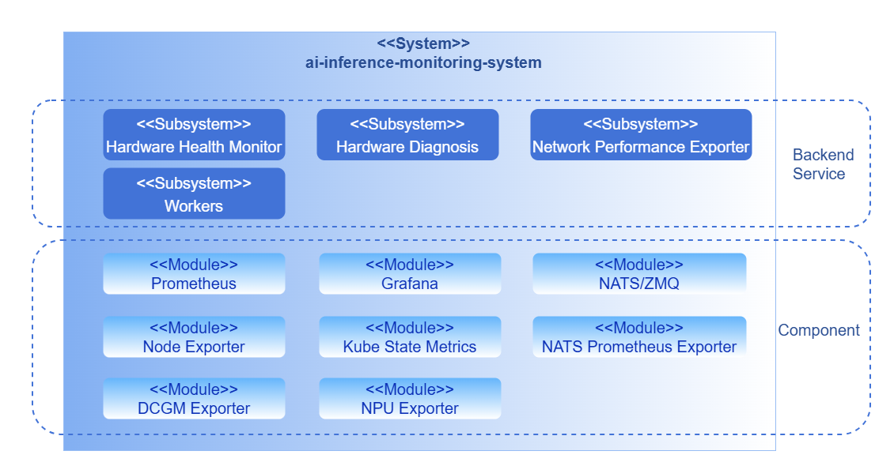
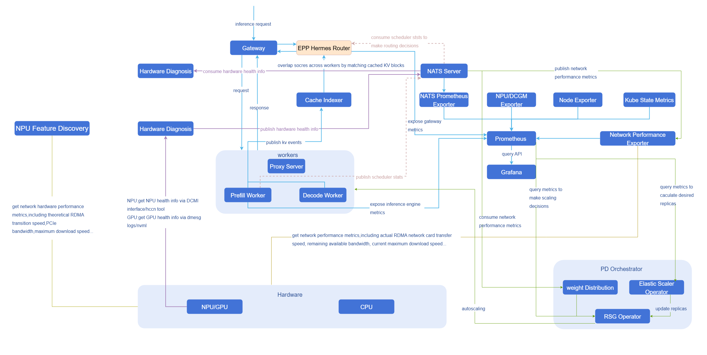
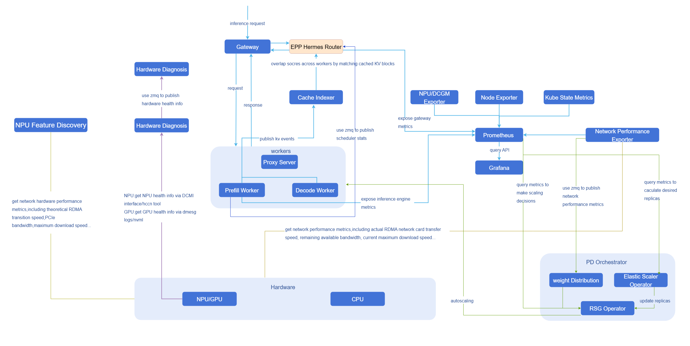
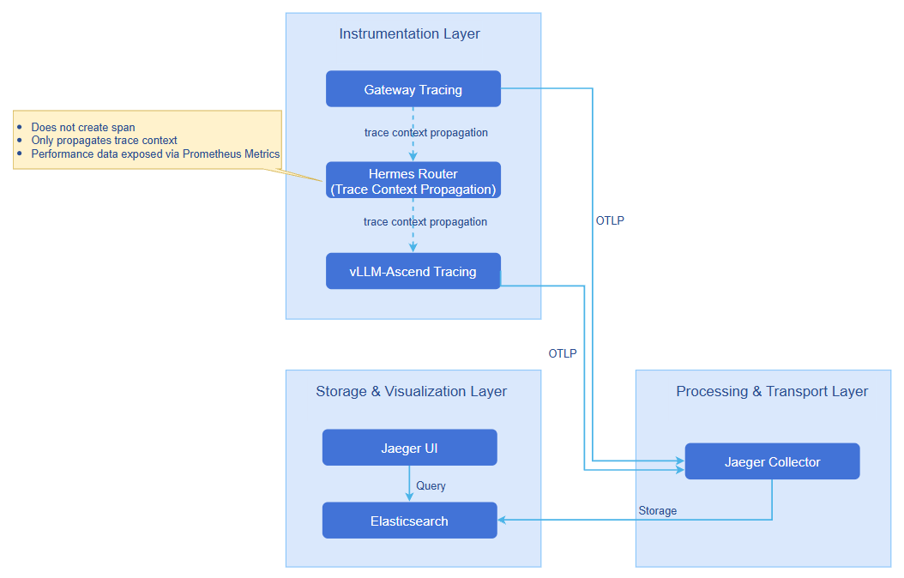

# AI Inference Eagle Eye

## Feature Introduction

Eagle Eye is an **observability system for AI inference scenarios**, providing **full-link metric collection, near-real-time transmission, intelligent diagnosis**, and **end-to-end distributed tracing** capabilities.

**In terms of metric monitoring**, it combines Prometheus's periodic metric collection with a distributed message queue system's low-latency push mechanism, achieving comprehensive observability from **AI gateway**, **inference engine**, **Mooncake** to **infrastructure** (Ray, K8s, hardware). It supports both trend analysis for scaling decisions and the needs of modules with high time-sensitivity requirements (such as intelligent routing) for second-level data updates. Through an independent hardware health diagnosis module, it continuously monitors and identifies anomalies in low-level metrics such as NPU/GPU, temperature, power consumption, and error codes, building a closed-loop monitoring capability of "collection — transmission — diagnosis — assessment".

**In terms of tracing**, based on OpenTelemetry, it provides non-intrusive end-to-end tracing capability, tracking the complete execution path of inference requests from AI gateway to inference engine (vLLM-Ascend), recording the duration and key business attributes of each stage, supporting performance tuning and fault diagnosis.

### Application Scenarios

- **System Resource Health Monitoring**: Real-time monitoring of infrastructure (Ray, K8s, hardware) to ensure the health and stability of system resources, timely detect and resolve resource bottlenecks, and ensure efficient system operation.
- **Inference Process Performance Optimization**: Real-time monitoring of performance metrics (such as latency, throughput) and resource usage at each stage of the inference process (such as prefill, decode), identifying and analyzing performance bottlenecks, optimizing model execution efficiency, and improving the response speed and computational efficiency of inference tasks.
- **Hardware Fault Diagnosis and Repair**: View anomaly analysis reports provided by the hardware diagnosis module, which include fault pattern identification and remediation suggestions, helping to quickly locate and resolve hardware faults. The system can monitor hardware status such as NPU/GPU, temperature, and power consumption in real time, generate detailed fault analysis reports, provide specific fault causes and repair solutions, and ensure hardware stability and reliability.
- **Automatic Scaling Decisions**: Obtain SLA-related metrics (such as throughput rate, latency, etc.) and use this data as the basis for automatic scaling decisions, ensuring that inference services dynamically expand or shrink based on load and performance requirements, achieving the goal of elastic scaling.
- **Intelligent Routing Decisions**: Achieve near-real-time data updates through a distributed message queue system, enabling intelligent routing to make decisions quickly based on the latest data, thereby optimizing response speed during AI inference.
- **Weight Distribution Acceleration Decisions**: Achieve near-real-time data transmission through a distributed message queue system, obtaining real-time network dynamic performance metrics (such as actual transmission rate of node RDMA NICs, remaining available bandwidth, etc.), combined with static metrics (such as theoretical transmission speed of node RDMA NICs, NIC PCIe bandwidth, etc.) attached to nodes as labels by NPU Feature Discovery. Based on these metrics, the module dynamically evaluates node performance and ultimately selects the node with optimal performance for task assignment, thereby ensuring optimal resource utilization and maximizing system stability and processing efficiency.
- **Inference Request Fault Quick Localization**: When inference requests encounter issues such as slow response, timeout, or failure, view the complete call chain through the Jaeger UI to quickly locate whether the bottleneck is at the AI gateway, routing decision, or a specific stage of the inference engine. Analyze the duration and key attributes of each stage (KVCache hit rate, inference execution duration, TTFT (Time to First Token) / ITL (Inter-Token Latency) and other performance metrics) to precisely identify the root cause of the fault.

### Capability Scope

- **Multi-layer Metric Coverage**: Covers AI gateway (such as performance, resource consumption, security and compliance audit, governance policy execution records), inference engine (API Server, model input/output, inference process, inference engine status), Mooncake (Mooncake master, transfer engine, Mooncake client), and infrastructure (Ray, K8s, hardware), achieving full-link observability.
- **Near-real-time Metric Transmission**: For modules with high time-sensitivity requirements, achieves second-level metric push through a distributed message queue system, ensuring that metrics can be promptly perceived and influence decisions.
- **Scaling Decision Support**: Synchronously reports collected system and runtime metrics to Prometheus for periodic computation and trend evaluation.
- **Hardware Health Check and Diagnosis**: Builds an independent hardware health diagnosis module that periodically collects low-level metrics such as NPU/GPU temperature, power consumption, and error codes, and reports them in real time through a distributed message queue system. The diagnosis module subscribes to and analyzes the collected data, combining device model, driver, and firmware information, and based on threshold rules and anomaly metric analysis, identifies typical fault patterns and outputs diagnostic conclusions and remediation suggestions, achieving a closed loop from data collection to health assessment.
- **End-to-end Distributed Tracing**: Based on the OpenTelemetry standard, provides non-intrusive request-level tracing capability from **AI gateway to inference engine (vLLM-Ascend)**, supporting collection, storage, and querying, recording key performance metrics and business attributes.

## Implementation Principle

### Metric Monitoring

#### Logical View

**Figure 1** Level-0 Logical View



The monitoring system is divided into **backend layer** and **component layer** by business hierarchy.

**Backend Layer**

- **Hardware Health Monitor**: The hardware health monitoring module, as an independently running collection component, **actively executes metric collection and reporting as periodic tasks**. During operation, the module calls low-level interfaces (DCMI, NVML) or parses system logs (dmesg) at fixed collection intervals to obtain device running status and health information. Collection results are **published in real time to the diagnosis module** through a distributed message queue system, achieving decoupling of collection and diagnosis.
- **Hardware Diagnosis**: The diagnosis module subscribes to metric data published by the collection module through a distributed message queue system, **combining device model, driver, and firmware information** to perform real-time analysis of hardware health status. The module supports threshold judgment and anomaly detection, identifies typical fault patterns, and outputs diagnostic conclusions and remediation suggestions, achieving a closed loop from data collection to health assessment.

**Component Layer**

The component layer provides underlying metric collection, transmission, and presentation capabilities, covering the following key modules: metric collection (Exporter), high-performance distributed message queue system, metric storage (Prometheus), and presentation (Grafana).

#### Data Flow Diagram

##### NATS

**Figure 2** Data Flow Diagram - NATS



##### ZMQ

**Figure 3** Data Flow Diagram - ZMQ



#### Full Data List

**Table 1** Full Data List

  <table>
    <tbody>
      <tr>
        <td>Observability Dimension</td>
        <td>Observability Category</td>
        <td>Observability Item</td>
        <td>Observability Sub-item</td>
        <td>Specific Metric</td>
        <td>Static/Dynamic</td>
        <td>Metric Source</td>
        <td>Real-time Requirement</td>
        <td>Metric Transport</td>
        <td>Currently Supported</td>
        <td>Remarks</td>
      </tr>
      <tr>
        <td rowspan="13">AI Gateway</td>
        <td rowspan="4">Performance</td>
        <td rowspan="4">-</td>
        <td rowspan="4">-</td>
        <td>QPS</td>
        <td rowspan="4">Dynamic</td>
        <td rowspan="4">EPP</td>
        <td rowspan="4">Low</td>
        <td rowspan="4">Prometheus</td>
        <td rowspan="13">-</td>
        <td>-</td>
      </tr>
      <tr>
        <td>Request success rate</td>
        <td>-</td>
      </tr>
      <tr>
        <td>Overall latency of non-streaming response</td>
        <td>-</td>
      </tr>
      <tr>
        <td>First packet latency of streaming response (TTFT)</td>
        <td>-</td>
      </tr>
      <tr>
        <td rowspan="3">Resource Consumption</td>
        <td rowspan="3">-</td>
        <td rowspan="3">-</td>
        <td>Token consumption count/s</td>
        <td rowspan="3">Dynamic</td>
        <td>EPP</td>
        <td rowspan="3">Low</td>
        <td rowspan="3">Prometheus</td>
        <td rowspan="3">Large model services billed by token</td>
      </tr>
      <tr>
        <td>Token usage statistics by model dimension</td>
        <td>EPP</td>
      </tr>
      <tr>
        <td>Token usage statistics by user dimension</td>
        <td>-</td>
      </tr>
      <tr>
        <td rowspan="3">Security and Compliance Audit</td>
        <td rowspan="3">-</td>
        <td rowspan="3">-</td>
        <td>Content security interception logs</td>
        <td rowspan="6">Dynamic</td>
        <td>-</td>
        <td rowspan="3">Low</td>
        <td rowspan="3">Prometheus</td>
        <td>-</td>
      </tr>
      <tr>
        <td>Risk type statistics</td>
        <td>-</td>
        <td>-</td>
      </tr>
      <tr>
        <td>Risk user statistics</td>
        <td>-</td>
        <td>-</td>
      </tr>
      <tr>
        <td rowspan="3">Governance Policy Execution Records</td>
        <td rowspan="3">-</td>
        <td rowspan="3">-</td>
        <td>Rate limiting statistics</td>
        <td>-</td>
        <td rowspan="3">Low</td>
        <td rowspan="3">Prometheus</td>
        <td>-</td>
      </tr>
      <tr>
        <td>Cache hit status</td>
        <td>EPP</td>
        <td>-</td>
      </tr>
      <tr>
        <td>Fallback success rate</td>
        <td>-</td>
        <td>-</td>
      </tr>
      <tr>
        <td rowspan="25">Inference Engine</td>
        <td rowspan="4">API Server</td>
        <td rowspan="4">-</td>
        <td rowspan="4">-</td>
        <td>Path</td>
        <td rowspan="4">Dynamic</td>
        <td rowspan="4">-</td>
        <td rowspan="4">Low</td>
        <td rowspan="4">Prometheus</td>
        <td rowspan="4">-</td>
        <td>-</td>
      </tr>
      <tr>
        <td>Status code</td>
        <td>-</td>
      </tr>
      <tr>
        <td>Client</td>
        <td>-</td>
      </tr>
      <tr>
        <td>Duration</td>
        <td>-</td>
      </tr>
      <tr>
        <td rowspan="8">Model Input/Output</td>
        <td rowspan="8">-</td>
        <td rowspan="8">-</td>
        <td>Prompt</td>
        <td rowspan="8">Static</td>
        <td>-</td>
        <td rowspan="8">Low</td>
        <td rowspan="8">Prometheus</td>
        <td rowspan="21">✅</td>
        <td rowspan="8">Exposed as OpenTelemetry Trace attributes; needs to be enabled when deploying vLLM.
vllm serve your-model --otlp-traces-endpoint=&quot;http://your-collector:4317&quot; --collect-detailed-traces=all</td>
      </tr>
      <tr>
        <td>Response mode</td>
        <td>-</td>
      </tr>
      <tr>
        <td>Model name</td>
        <td>vLLM</td>
      </tr>
      <tr>
        <td>Max token count</td>
        <td>vLLM</td>
      </tr>
      <tr>
        <td>Temperature</td>
        <td>vLLM</td>
      </tr>
      <tr>
        <td>top-k</td>
        <td>-</td>
      </tr>
      <tr>
        <td>top-p</td>
        <td>vLLM</td>
      </tr>
      <tr>
        <td>N</td>
        <td>vLLM</td>
      </tr>
      <tr>
        <td rowspan="6">Inference Process</td>
        <td rowspan="6">-</td>
        <td rowspan="6">-</td>
        <td>E2E time</td>
        <td rowspan="6">Dynamic</td>
        <td rowspan="6">vLLM</td>
        <td rowspan="6">Low</td>
        <td rowspan="6">Prometheus</td>
        <td>-</td>
      </tr>
      <tr>
        <td>TTFT</td>
        <td>-</td>
      </tr>
      <tr>
        <td>Prefill time</td>
        <td>-</td>
      </tr>
      <tr>
        <td>Decode time</td>
        <td>-</td>
      </tr>
      <tr>
        <td>Time request waits in scheduler</td>
        <td>-</td>
      </tr>
      <tr>
        <td>Token interval time</td>
        <td>-</td>
      </tr>
      <tr>
        <td rowspan="7">Inference Engine Status</td>
        <td rowspan="7">-</td>
        <td rowspan="7">-</td>
        <td>Running request count</td>
        <td rowspan="7">Dynamic</td>
        <td rowspan="7">vLLM</td>
        <td rowspan="7">Low</td>
        <td rowspan="7">Prometheus</td>
        <td>-</td>
      </tr>
      <tr>
        <td>Waiting request count</td>
        <td>-</td>
      </tr>
      <tr>
        <td>Preempted request count</td>
        <td>-</td>
      </tr>
      <tr>
        <td>KV cache usage rate</td>
        <td>-</td>
      </tr>
      <tr>
        <td>Total prompt token count</td>
        <td>-</td>
      </tr>
      <tr>
        <td>Total generated token count</td>
        <td>-</td>
      </tr>
      <tr>
        <td>Successfully processed request count</td>
        <td>-</td>
      </tr>
      <tr>
        <td rowspan="3">Mooncake</td>
        <td>Mooncake master</td>
        <td>-</td>
        <td>-</td>
        <td>-</td>
        <td>Dynamic</td>
        <td rowspan="3">Mooncake</td>
        <td>Low</td>
        <td>Prometheus</td>
        <td rowspan="3">-</td>
        <td rowspan="3">Mooncake master exposes metrics directly to Prometheus via /metrics, while transfer engine and Mooncake client metrics are recorded in logs.</td>
      </tr>
      <tr>
        <td>transfer engine</td>
        <td>-</td>
        <td>-</td>
        <td>-</td>
        <td>Dynamic</td>
        <td>Low</td>
        <td>Prometheus</td>
      </tr>
      <tr>
        <td>Mooncake client</td>
        <td>-</td>
        <td>-</td>
        <td>-</td>
        <td>Dynamic</td>
        <td>Low</td>
        <td>Prometheus</td>
      </tr>
      <tr>
        <td rowspan="116">Infrastructure</td>
        <td>ray</td>
        <td>-</td>
        <td>-</td>
        <td>-</td>
        <td>Dynamic</td>
        <td>ray</td>
        <td>Low</td>
        <td>Prometheus</td>
        <td>-</td>
        <td>-</td>
      </tr>
      <tr>
        <td rowspan="14">kubernetes</td>
        <td>Cluster health</td>
        <td>-</td>
        <td>-</td>
        <td rowspan="14">Dynamic</td>
        <td rowspan="3">kube-state-metrics/node-exporter</td>
        <td rowspan="14">Low</td>
        <td rowspan="3">Prometheus</td>
        <td rowspan="3">✅</td>
        <td>-</td>
      </tr>
      <tr>
        <td>Resource usage</td>
        <td>-</td>
        <td>-</td>
        <td>-</td>
      </tr>
      <tr>
        <td>Workload status</td>
        <td>-</td>
        <td>-</td>
        <td>-</td>
      </tr>
      <tr>
        <td rowspan="11">Scheduling and Elasticity</td>
        <td rowspan="4">Scheduling</td>
        <td>Scheduling queue</td>
        <td rowspan="4">kube-scheduler</td>
        <td rowspan="4">Prometheus</td>
        <td rowspan="4">✅</td>
        <td>-</td>
      </tr>
      <tr>
        <td>Scheduling latency</td>
        <td>-</td>
      </tr>
      <tr>
        <td>Scheduling success/failure rate</td>
        <td>-</td>
      </tr>
      <tr>
        <td>Retry count</td>
        <td>-</td>
      </tr>
      <tr>
        <td rowspan="7">Elasticity</td>
        <td>Desired replica count</td>
        <td rowspan="3">kube-state-metrics</td>
        <td rowspan="7">Prometheus</td>
        <td rowspan="3">✅</td>
        <td>-</td>
      </tr>
      <tr>
        <td>Current replica count</td>
        <td>-</td>
      </tr>
      <tr>
        <td>Ready replica count</td>
        <td>-</td>
      </tr>
      <tr>
        <td>Scaling latency</td>
        <td>-</td>
        <td>-</td>
        <td>-</td>
      </tr>
      <tr>
        <td>Image pull time</td>
        <td>kubelet</td>
        <td>✅</td>
        <td>-</td>
      </tr>
      <tr>
        <td>Weight download time</td>
        <td>-</td>
        <td>-</td>
        <td>-</td>
      </tr>
      <tr>
        <td>Scaling trigger count</td>
        <td>-</td>
        <td>-</td>
        <td>-</td>
      </tr>
      <tr>
        <td rowspan="101">Hardware</td>
        <td rowspan="13">Compute Resources</td>
        <td rowspan="13">-</td>
        <td>machine_npu_nums</td>
        <td rowspan="66">Dynamic</td>
        <td rowspan="66">npu-exporter</td>
        <td rowspan="66">Low</td>
        <td rowspan="66">Prometheus</td>
        <td rowspan="66">✅</td>
        <td>-</td>
      </tr>
      <tr>
        <td>npu_chip_info_utilization</td>
        <td>-</td>
      </tr>
      <tr>
        <td>npu_chip_info_overall_utilization</td>
        <td>-</td>
      </tr>
      <tr>
        <td>npu_chip_info_vector_utilization</td>
        <td>-</td>
      </tr>
      <tr>
        <td>npu_chip_info_temperature</td>
        <td>-</td>
      </tr>
      <tr>
        <td>npu_chip_info_power</td>
        <td>-</td>
      </tr>
      <tr>
        <td>npu_chip_info_voltage</td>
        <td>-</td>
      </tr>
      <tr>
        <td>npu_chip_info_aicore_current_freq</td>
        <td>-</td>
      </tr>
      <tr>
        <td>npu_chip_info_process_info_num</td>
        <td>-</td>
      </tr>
      <tr>
        <td>npu_chip_info_process_info</td>
        <td>-</td>
      </tr>
      <tr>
        <td>container_npu_utilization</td>
        <td>-</td>
      </tr>
      <tr>
        <td>container_npu_total_memory</td>
        <td>-</td>
      </tr>
      <tr>
        <td>container_npu_used_memory</td>
        <td>-</td>
      </tr>
      <tr>
        <td rowspan="14">Memory and HBM</td>
        <td rowspan="12">hbm (910A1/910A2/910A3/910A5)</td>
        <td>npu_chip_info_hbm_used_memory</td>
        <td>-</td>
      </tr>
      <tr>
        <td>npu_chip_info_hbm_total_memory</td>
        <td>-</td>
      </tr>
      <tr>
        <td>npu_chip_info_hbm_utilization</td>
        <td>-</td>
      </tr>
      <tr>
        <td>npu_chip_info_hbm_temperature</td>
        <td>-</td>
      </tr>
      <tr>
        <td>npu_chip_info_hbm_bandwidth_utilization</td>
        <td>-</td>
      </tr>
      <tr>
        <td>npu_chip_info_hbm_ecc_enable_flag</td>
        <td>-</td>
      </tr>
      <tr>
        <td>npu_chip_info_hbm_ecc_single_bit_error_cnt</td>
        <td>-</td>
      </tr>
      <tr>
        <td>npu_chip_info_hbm_ecc_double_bit_error_cnt</td>
        <td>-</td>
      </tr>
      <tr>
        <td>npu_chip_info_hbm_ecc_total_single_bit_error_cnt</td>
        <td>-</td>
      </tr>
      <tr>
        <td>npu_chip_info_hbm_ecc_total_double_bit_error_cnt</td>
        <td>-</td>
      </tr>
      <tr>
        <td>npu_chip_info_hbm_ecc_single_bit_isolated_pages_cnt</td>
        <td>-</td>
      </tr>
      <tr>
        <td>npu_chip_info_hbm_ecc_double_bit_isolated_pages_cnt</td>
        <td>-</td>
      </tr>
      <tr>
        <td rowspan="2">ddr (except 910A2/910A3/910A5)</td>
        <td>npu_chip_info_total_memory</td>
        <td>-</td>
      </tr>
      <tr>
        <td>npu_chip_info_used_memory</td>
        <td>-</td>
      </tr>
      <tr>
        <td rowspan="39">Interconnect and IO</td>
        <td rowspan="4">network (except 310/310B/310P)</td>
        <td>npu_chip_info_bandwidth_tx</td>
        <td>-</td>
      </tr>
      <tr>
        <td>npu_chip_info_bandwidth_rx</td>
        <td>-</td>
      </tr>
      <tr>
        <td>npu_chip_link_speed</td>
        <td>-</td>
      </tr>
      <tr>
        <td>npu_chip_link_up_num</td>
        <td>-</td>
      </tr>
      <tr>
        <td rowspan="6">pcie (910A2)</td>
        <td>npu_chip_info_pcie_rx_p_bw</td>
        <td>-</td>
      </tr>
      <tr>
        <td>npu_chip_info_pcie_rx_np_bw</td>
        <td>-</td>
      </tr>
      <tr>
        <td>npu_chip_info_pcie_rx_cpl_bw</td>
        <td>-</td>
      </tr>
      <tr>
        <td>npu_chip_info_pcie_tx_p_bw</td>
        <td>-</td>
      </tr>
      <tr>
        <td>npu_chip_info_pcie_tx_np_bw</td>
        <td>-</td>
      </tr>
      <tr>
        <td>npu_chip_info_pcie_tx_cpl_bw</td>
        <td>-</td>
      </tr>
      <tr>
        <td rowspan="8">hccs (910A2/910A3)</td>
        <td>npu_chip_info_hccs_statistic_info_tx_cnt_index</td>
        <td>-</td>
      </tr>
      <tr>
        <td>npu_chip_info_hccs_statistic_info_rx_cnt_index</td>
        <td>-</td>
      </tr>
      <tr>
        <td>npu_chip_info_hccs_statistic_info_crc_err_cnt_index</td>
        <td>-</td>
      </tr>
      <tr>
        <td>npu_chip_info_hccs_bandwidth_info_tx_index</td>
        <td>-</td>
      </tr>
      <tr>
        <td>npu_chip_info_hccs_bandwidth_info_rx_index</td>
        <td>-</td>
      </tr>
      <tr>
        <td>npu_chip_info_hccs_bandwidth_info_profiling_time</td>
        <td>-</td>
      </tr>
      <tr>
        <td>npu_chip_info_hccs_bandwidth_info_total_tx</td>
        <td>-</td>
      </tr>
      <tr>
        <td>npu_chip_info_hccs_bandwidth_info_total_rx</td>
        <td>-</td>
      </tr>
      <tr>
        <td rowspan="21">roce (except 310/310B/310P)</td>
        <td>npu_chip_mac_rx_pause_num</td>
        <td>-</td>
      </tr>
      <tr>
        <td>npu_chip_mac_tx_pause_num</td>
        <td>-</td>
      </tr>
      <tr>
        <td>npu_chip_mac_rx_pfc_pkt_num</td>
        <td>-</td>
      </tr>
      <tr>
        <td>npu_chip_mac_tx_pfc_pkt_num</td>
        <td>-</td>
      </tr>
      <tr>
        <td>npu_chip_mac_rx_bad_pkt_num</td>
        <td>-</td>
      </tr>
      <tr>
        <td>npu_chip_mac_tx_bad_pkt_num</td>
        <td>-</td>
      </tr>
      <tr>
        <td>npu_chip_mac_tx_bad_oct_num</td>
        <td>-</td>
      </tr>
      <tr>
        <td>npu_chip_mac_rx_bad_oct_num</td>
        <td>-</td>
      </tr>
      <tr>
        <td>npu_chip_info_rx_fcs_num</td>
        <td>-</td>
      </tr>
      <tr>
        <td>npu_chip_info_rx_ecn_num</td>
        <td>-</td>
      </tr>
      <tr>
        <td>npu_chip_roce_rx_all_pkt_num</td>
        <td>-</td>
      </tr>
      <tr>
        <td>npu_chip_roce_tx_all_pkt_num</td>
        <td>-</td>
      </tr>
      <tr>
        <td>npu_chip_roce_rx_err_pkt_num</td>
        <td>-</td>
      </tr>
      <tr>
        <td>npu_chip_roce_tx_err_pkt_num</td>
        <td>-</td>
      </tr>
      <tr>
        <td>npu_chip_roce_rx_cnp_pkt_num</td>
        <td>-</td>
      </tr>
      <tr>
        <td>npu_chip_roce_tx_cnp_pkt_num</td>
        <td>-</td>
      </tr>
      <tr>
        <td>npu_chip_roce_new_pkt_rty_num</td>
        <td>-</td>
      </tr>
      <tr>
        <td>npu_chip_roce_out_of_order_num</td>
        <td>-</td>
      </tr>
      <tr>
        <td>npu_chip_roce_qp_status_err_num</td>
        <td>-</td>
      </tr>
      <tr>
        <td>npu_chip_roce_unexpected_ack_num</td>
        <td>-</td>
      </tr>
      <tr>
        <td>npu_chip_roce_verification_err_num</td>
        <td>-</td>
      </tr>
      <tr>
        <td rowspan="19">Network Hardware Performance</td>
        <td rowspan="3">-</td>
        <td>Node RDMA NIC theoretical bandwidth upper limit</td>
        <td rowspan="3">Static</td>
        <td rowspan="3">npu-feature-discovery</td>
        <td rowspan="3">Low</td>
        <td rowspan="3">/</td>
        <td rowspan="3">✅</td>
        <td rowspan="3">-</td>
      </tr>
      <tr>
        <td>Node RDMA NIC PCIe bandwidth</td>
      </tr>
      <tr>
        <td>NPU card-side RoCE NIC total bandwidth</td>
      </tr>
      <tr>
        <td rowspan="16">-</td>
        <td>Node RDMA NIC link status</td>
        <td rowspan="16">Dynamic</td>
        <td rowspan="16">network-performace-exporter</td>
        <td rowspan="16">High</td>
        <td rowspan="15">Prometheus
NATS/ZMQ</td>
        <td rowspan="16">✅</td>
        <td rowspan="16">-</td>
      </tr>
      <tr>
        <td>Node RDMA NIC physical link status</td>
      </tr>
      <tr>
        <td>Node RDMA NIC cumulative sent traffic</td>
      </tr>
      <tr>
        <td>Node RDMA NIC cumulative received traffic</td>
      </tr>
      <tr>
        <td>Node RDMA NIC actual send rate</td>
      </tr>
      <tr>
        <td>Node RDMA NIC actual receive rate</td>
      </tr>
      <tr>
        <td>Node RDMA NIC remaining bandwidth in send direction</td>
      </tr>
      <tr>
        <td>Node RDMA NIC remaining bandwidth in receive direction</td>
      </tr>
      <tr>
        <td>NPU card-side RoCE NIC physical link status</td>
      </tr>
      <tr>
        <td>NPU card-side RoCE NIC physical link UP count</td>
      </tr>
      <tr>
        <td>NPU card-side RoCE NIC actual send rate</td>
      </tr>
      <tr>
        <td>NPU card-side RoCE NIC actual receive rate</td>
      </tr>
      <tr>
        <td>NPU card-side RoCE NIC remaining bandwidth in send direction</td>
      </tr>
      <tr>
        <td>NPU card-side RoCE NIC remaining bandwidth in receive direction</td>
      </tr>
      <tr>
        <td>NPU card-side RoCE NIC packet loss rate</td>
      </tr>
      <tr>
        <td>NPU card-side RoCE NIC retransmission rate</td>
      </tr>
      <tr>
        <td rowspan="16">Hardware Health</td>
        <td>Black box error code</td>
        <td>-</td>
        <td rowspan="16">Dynamic</td>
        <td rowspan="16">eagle-eye-hardware-monitor</td>
        <td rowspan="16">High</td>
        <td rowspan="16">NATS/ZMQ</td>
        <td rowspan="16">✅</td>
        <td>-</td>
      </tr>
      <tr>
        <td>Health management fault code</td>
        <td>-</td>
        <td>-</td>
      </tr>
      <tr>
        <td rowspan="4">hbm (910A1/910A2/910A3/910A5)</td>
        <td>npu_chip_info_hbm_temperature</td>
        <td>-</td>
      </tr>
      <tr>
        <td>npu_chip_info_hbm_total_memory</td>
        <td>-</td>
      </tr>
      <tr>
        <td>npu_chip_info_hbm_used_memory</td>
        <td>-</td>
      </tr>
      <tr>
        <td>npu_chip_info_hbm_memory_utilization</td>
        <td>-</td>
      </tr>
      <tr>
        <td>ddr (except 910A2/910A3/910A5)</td>
        <td>npu_chip_info_memory_utilization</td>
        <td>-</td>
      </tr>
      <tr>
        <td rowspan="3">network (except 310/310B/310P)</td>
        <td>npu_chip_info_link_status</td>
        <td>-</td>
      </tr>
      <tr>
        <td>npu_chip_info_bandwidth_rx</td>
        <td>-</td>
      </tr>
      <tr>
        <td>npu_chip_info_bandwidth_tx</td>
        <td>-</td>
      </tr>
      <tr>
        <td rowspan="6">Hardware Status</td>
        <td>npu_chip_info_power</td>
        <td rowspan="4">NPU overload frequency reduction</td>
      </tr>
      <tr>
        <td>npu_chip_info_aicore_freq</td>
      </tr>
      <tr>
        <td>npu_chip_info_aicore_current_freq</td>
      </tr>
      <tr>
        <td>npu_chip_info_temperature</td>
      </tr>
      <tr>
        <td>npu_chip_info_network_status</td>
        <td>-</td>
      </tr>
      <tr>
        <td>npu_chip_info_health_status</td>
        <td>-</td>
      </tr>
    </tbody>
  </table>

>  **Notice:**
> network performance exporter, hardware monitor, hardware diagnosis, and npu exporter all need to enable privileged containers during deployment; otherwise, DCMI cannot be loaded, resulting in data not being correctly collected.

### End-to-End Tracing

#### Logical View

**Figure 4** Level-0 Logical View



#### vLLM-Ascend Span Structure

```
vllm_ascend.request (API process - full request lifecycle)
├─ vllm_ascend.prefill_execution (API process - Prefill phase, created post-hoc)
│  ├─ vllm_ascend.prefill.schedule (Prefill scheduling aggregate statistics, created post-hoc)
│  ├─ vllm_ascend.prefill.kv_cache (Prefill allocation aggregate statistics, created post-hoc)
│  └─ vllm_ascend.prefill.ascend_store (AscendStore save operation, created post-hoc)
└─ vllm_ascend.decode_phase (API process - Decode phase, created post-hoc)
 ├─ vllm_ascend.decode.schedule (Decode scheduling aggregate statistics, created post-hoc)
 ├─ vllm_ascend.decode.kv_cache (Decode allocation aggregate statistics, created post-hoc)
```

#### vLLM-Ascend Span Description

**Table 2** vLLM-Ascend Span Description Table

| Span Name | Parent Span | Key attributes |
|---|---|---|
| `vllm_ascend.request` | None | `request.request_id`<br/>`request.temperature` <br/>`request.top_p` <br/>`request.max_tokens` <br/>`request.n`<br/>`request.latency.e2e`<br>`request.latency.time_in_queue`<br>`request.latency.time_to_first_token`<br>`request.usage.prompt_tokens`<br>`request.usage.completion_tokens` |
| `vllm_ascend.prefill_execution` | request | `prefill.num_tokens`<br>`prefill.total_time_ms` |
| `vllm_ascend.prefill.schedule` | prefill_execution | `schedule.total_calls`<br>`schedule.total_tokens`<br>`schedule.avg_tokens_per_call`<br>`schedule.total_time_ms`<br>`schedule.avg_time_ms`<br>`schedule.avg_queue_length`<br>`schedule.max_queue_length`<br>`schedule.avg_running_count` |
| `vllm_ascend.prefill.kv_cache` | prefill_execution | `kv_cache.total_calls`<br>`kv_cache.total_blocks_allocated`<br>`kv_cache.avg_blocks_per_call`<br>`kv_cache.final_free_blocks`<br>`kv_cache.total_cached_tokens`<br>`kv_cache.cache_hit_rate`<br>`kv_cache.num_external_computed_tokens`<br>`kv_cache.has_external_cache` |
| `vllm_ascend.prefill.ascend_store` | prefill_execution | `store.operation`<br/>`store.save_duration_ms`<br/>`store.status` |
| `vllm_ascend.decode_phase` | request | `decode.num_iterations`<br>`decode.total_time_ms`<br>`decode.avg_time_per_token_ms`<br>`decode.max_time_per_token_ms` |
| `vllm_ascend.decode.schedule` | decode_phase | `schedule.total_calls`<br>`schedule.total_time_ms`<br>`schedule.avg_time_ms`<br>`schedule.max_time_ms`<br>`schedule.avg_queue_length`<br>`schedule.max_queue_length`<br>`schedule.avg_running_count` |
| `vllm_ascend.decode.kv_cache` | decode_phase | `kv_cache.total_calls`<br>`kv_cache.total_blocks_allocated`<br>`kv_cache.avg_blocks_per_call`<br>`kv_cache.final_free_blocks`<br>`kv_cache.min_free_blocks`<br>`kv_cache.avg_free_blocks`<br>`kv_cache.total_preemptions`<br>`kv_cache.preemption_rate` |

## Relationship with Related Features

- **Tracing**: Depends on the inference engine (e.g., vLLM-Ascend 0.18.0).

## Installation
### Prerequisites
#### Hardware Requirements

Eagle Eye itself has no special hardware environment requirements.

#### Software Requirements

Kubernetes v1.33.0 or above.

### Starting Installation

#### openFuyao Platform
1. Log in to the openFuyao management plane.
2. Select "Application Market > Application List" from the left navigation bar to navigate to the "Application List" page.
3. Check "Artificial Intelligence/Machine Learning" under "Scenarios" on the left, and find the "eagle-eye" card. Or enter "eagle-eye" in the search box.
4. Click "Deploy" to enter the "Deploy" page.
5. Enter the application name, select the installation version and namespace. You can choose an existing namespace or create a new one; for creating a namespace, see [Namespace](https://gitcode.com/openFuyao/docs/blob/master/docs/en/user_guide/resource_management/namespaces.md).
6. Configure eagle-eye in the "values.yaml" under parameter configuration.

   >  **Notice:**
   > `networkPerformanceExporter.collectInterval` is used to configure the network-performance-exporter collection interval (in seconds), with a default value of 15s. If this value is set too short, it may cause the next collection round to be triggered before the previous one completes, resulting in incomplete metric data. It is recommended not to go below the default value of 15s.

7. Click "Deploy" to complete the installation.

#### Standalone Deployment
In addition to openFuyao platform installation and deployment, this feature also provides standalone deployment functionality through the following two methods:

- Obtain the project installation package from the openFuyao official image repository.
1. Execute the following command to pull the project installation package.
   ```
   helm pull oci://cr.openfuyao.cn/charts/eagle-eye --version xxx
   ```
   Where `xxx` needs to be replaced with the specific project installation package version, such as `0.0.0-latest`. The obtained installation package is in compressed package form.

2. Execute the following command to extract the installation package.
   ```cd mo 
   tar -zxvf eagle-eye
   ```

3. Install and deploy.

   Execute the following command in the same directory as eagle-eye.
   ```
   helm install eagle-eye -n xxxxxx .
   ```
- Obtain from the openFuyao GitCode repository.

1. Execute the following command to pull the project from the repository.

   ```
   git clone https://gitcode.com/openFuyao/eagle-eye.git
   ```
2. Install and deploy.
   Execute the following command in the same directory as eagle-eye.
   ```
   helm install eagle-eye -n xxxxxx .
   ```
   
## Using Metric Monitoring

### High Real-time Metric Collection and Reporting for Intelligent Routing

#### NATS

To meet the high time-sensitivity requirements of modules such as intelligent routing, the system uses NATS for second-level push of key performance metrics. This enables metrics such as waiting request count and NPU/GPU KVCache utilization to be perceived in real time, thereby dynamically adjusting decisions.

Currently only **vLLM** deployment is supported.

**Prerequisites**

- Kubernetes cluster is deployed and accessible.
- `kubectl` command-line tool is installed with cluster access permissions configured.
- Ascend driver and related dependencies are installed on the nodes.
- NATS is deployed and running normally.

**Deployment Steps**

The **NATS publish/subscribe** model is selected as the metric transmission method. `CustomStatLogger` is a custom statistics data logger implemented in **vLLM** by inheriting from the `StatLoggerBase` abstract class. As a **publisher**, `CustomStatLogger` actively generates structured runtime metric messages after each decode batch ends and publishes them to the specified **NATS** topic; `Router` as a **subscriber** only needs to register a listener on that topic to receive messages the moment they are published and trigger subsequent processing logic.

To avoid losing the first batch of messages, the subscriber (`Router`) must complete connection and subscription before the publisher (`CustomStatLogger`).

1. Router (Subscriber).

   `Router` as a **subscriber** is mainly responsible for receiving published runtime metric messages and triggering corresponding processing logic. Refer to the following code example to implement `Router` and deploy it to the Kubernetes cluster.

   ```
   import logging
   import json
   from nats.aio.client import Client as NATS_Client
   
   logger = logging.getLogger()
   
   class RouterSubscriber:
       def __init__(self, server_address: str, topic: str):
           """
           Initialize RouterSubscriber instance
           :param server_address: NATS server address
           :param topic: Topic to subscribe to
           """
           self.server_address = server_address
           self.topic = topic
           self.client = NATS_Client()
   
       async def connect(self):
           """
           Establish connection with NATS server
           """
           try:
               # Establish NATS persistent connection
               await self.client.connect(self.server_address)
               logger.info("Connected to NATS server at %s", self.server_address)
           except Exception as e:
               logger.error("Failed to connect to NATS server: %s", e)
               raise e
   
       async def subscribe(self, topic: str, message_handler):
           """
           Subscribe to the specified topic and pass received messages to business logic processing
           :param message_handler: Business logic processing function for handling received messages
           """
           try:
               async def on_message(msg):
                   """
                   Message callback function, handles subscribed messages
                   :param msg: NATS message
                   """
                   logger.info("Received message on topic %s", topic)
                   await message_handler(msg)
   
               # Ensure NATS connection
               if not self.client.is_connected:
                   await self.connect()
   
               # Register subscription topic and bind message callback function
               await self.client.subscribe(topic, cb=on_message)
               logger.info("Successfully subscribed to NATS topic %s", topic)
   
           except Exception as e:
               logger.error("Failed to subscribe to NATS topic %s: %s", topic, e)
               raise e
               
       async def message_handler(self, msg) -> None:
           """
           NATS raw callback, responsible for:
           1. Decoding data from msg;
           2. Calling parse_message for JSON deserialization;
           3. Passing parsed structured data to subsequent business logic processing.
           """
           try:
               data = msg.data.decode("utf-8")
           except Exception as exc:
               logger.error("Failed to decode NATS message: %s", exc)
               return
   
           data_dict = self.parse_message(data)
           if not data_dict:
               # Return directly on parse failure to avoid subsequent logic exceptions
               return
   
           # TODO: Handle specific business logic here, e.g., make routing decisions based on metrics
           ...
   
       def parse_message(self, data: str) -> Dict[str, Any]:
           """
           Deserialize NATS message body from JSON string to dictionary.
           Logs and returns empty dictionary on parse failure.
           """
           try:
               return json.loads(data)
           except Exception as exc:
               logger.error("Failed to parse message: %s, raw: %r", exc, data)
               return {}
   
   ```

2. Customstatlogger (Publisher).

   `CustomStatLogger` is the **publisher**, responsible for generating and publishing real-time runtime metric data. After each decode batch ends, `CustomStatLogger` publishes structured metric messages to the specified **NATS** topic (this topic should match the subscriber's topic, currently `eagle_eye.routing_metrics`) for `Router` to subscribe.

   2.1 Package source code.

   Execute the following command in the project root directory to package the source code into a compressed file.

   ```bash
   tar -czf source_code.tar.gz src/ requirements.txt
   ```

   2.2 Create ConfigMap.

   Import the compressed package as a binary file into a ConfigMap.

   ```bash
   # Check if namespace exists, create it if not
   kubectl get namespace ai-inference || kubectl create namespace ai-inference
   
   # If a ConfigMap with the same name already exists, delete it first
   kubectl delete configmap vllm-source-code -n ai-inference --ignore-not-found
   
   # Create new ConfigMap
   kubectl create configmap vllm-source-code \
     --from-file=source_code.tar.gz=source_code.tar.gz \
     -n ai-inference
   ```

   2.3 Deploy the service.

   Apply the deployment YAML file.

   ```bash
   kubectl apply -f ./docs/routing-metrics/vllm_eagle_eye.yaml
   ```

   2.4 Check deployment status.

   ```bash
   # View Pod running status
   kubectl get pods -n ai-inference -l app=vllm-eagle-eye
   
   # View Pod details
   kubectl describe pod -n ai-inference -l app=vllm-eagle-eye
   
   # View Pod logs
   kubectl logs -n ai-inference -l app=vllm-eagle-eye -f
   ```

3. Verification steps.

   3.1 Method 1: Verify using a temporary Pod.

   3.1.1 Get the service Pod IP address.

   ```bash
   kubectl get pod -n ai-inference -l app=vllm-eagle-eye -o wide
   ```

   Record the `IP` address from the output (e.g., `10.244.1.5`).

   3.1.2 Start a temporary test Pod.

   ```bash
   kubectl run curl-test --image=curlimages/curl -n ai-inference -it --rm --restart=Never -- sh
   ```

   3.1.3 Send a test request from the temporary Pod.

   Execute in the temporary Pod's shell (replace `<POD_IP>` with the actual IP address):

   ```bash
   curl -X POST http://<POD_IP>:8000/generate \
     -H "Content-Type: application/json" \
     -d '{"prompt": "Hello AI"}'
   ```

   3.2 Method 2: Verify using port-forward.

   ```bash
   # Port forwarding
   kubectl port-forward -n ai-inference deployment/vllm-eagle-eye 8000:8000
   
   # Send request from another terminal
   curl -X POST http://localhost:8000/generate \
     -H "Content-Type: application/json" \
     -d '{"prompt": "Hello AI"}'
   ```

4. Clean up resources.

   ```bash
   # Delete Deployment
   kubectl delete -f ./docs/routing-metrics/vllm_eagle_eye.yaml
   
   # Delete ConfigMap
   kubectl delete configmap vllm-source-code -n ai-inference
   
   # Delete temporary Pod
   kubectl delete pod -n ai-inference curl-test
   ```

**Common Issues**

1. Pod fails to start.

   ```bash
   # View Pod events
   kubectl describe pod -n ai-inference -l app=vllm-eagle-eye
   
   # View init container logs
   kubectl logs -n ai-inference <pod-name> -c code-extractor
   ```

2. Dependency installation failure.

   If the cluster cannot access the internet, dependencies need to be pre-packaged.

   ```bash
   # Download dependencies locally
   pip download -r requirements.txt -d packages/

   # Include dependencies when packaging
   tar -czf source_code.tar.gz src/ requirements.txt packages/
   ```

## Using Tracing

### vLLM-Ascend Trace Data Reporting Configuration

Eagle Eye automatically installs tracing backend components (Jaeger + Elasticsearch) when deployed via Helm Chart. Users need to configure the OTLP reporting address on the inference engine side to report Trace data to Eagle Eye's Jaeger.

**Prerequisites**

- Kubernetes cluster is deployed and accessible.
- `kubectl` command-line tool is installed with cluster access permissions configured.
- Ascend driver and related dependencies are installed on the nodes.
- Eagle Eye has been successfully deployed via Helm Chart (Eagle Eye tracing backend is enabled by default, including Jaeger and Elasticsearch).
- The inference engine is vLLM-Ascend.

**Deployment Steps**

1. Get the Jaeger service address.

   ```bash
   kubectl get svc -n <release-namespace> | grep eagle-eye-tracing-collector
   ```

   Record the Jaeger Collector service port (default OTLP/gRPC port is `4317`).

2. Modify vLLM-Ascend deployment configuration.

   Add tracing-related configuration to the vLLM-Ascend deployment configuration, including initContainers, environment variables, startup parameters, volume mounts, etc.

   Complete example (replace placeholders with actual values):

   ```yaml
   apiVersion: apps/v1
   kind: Deployment
   metadata:
     name: vllm-ascend
     namespace: ai-inference
   spec:
     template:
       spec:
         # initContainer: copy tracing files to shared directory
         initContainers:
         - name: install-tracing
           image: cr.openfuyao.cn/openfuyao/eagle-eye-tracing:latest
           imagePullPolicy: IfNotPresent
           command: ["cp", "-r", "/tracing-source/.", "/tracing-install/"]
           volumeMounts:
           - name: tracing-install
             mountPath: /tracing-install

         containers:
         - name: vllm
           image: <your-vllm-ascend-image>:<tag>
           imagePullPolicy: IfNotPresent
           command: ["/bin/bash", "-c"]
           args:
           - |
             set -euo pipefail

             # Install tracing files to Python environment
             /tracing-install/install.sh

             # Other initialization commands...

             # Start vLLM, add --otlp-traces-endpoint parameter
             exec vllm serve <model-name> \
               --served-model-name <model-name> \
               --trust-remote-code \
               --otlp-traces-endpoint http://eagle-eye-tracing-collector.<release-namespace>.svc.cluster.local:4317 \
               --port 8000
               # Other parameters...

           # Add environment variables
           env:
           - name: OTEL_SERVICE_NAME
             valueFrom:
               fieldRef:
                 fieldPath: metadata.name
           - name: VLLM_ASCEND_TRACING_ENABLED
             value: "1"
           - name: VLLM_ASCEND_TRACING_LOG_LEVEL
             value: "INFO"

           # Add volume mounts
           volumeMounts:
           - name: tracing-install
             mountPath: /tracing-install
             readOnly: true

         # Add volume definition
         volumes:
         - name: tracing-install
           emptyDir: {}
   ```

   > **Note**: Placeholders such as `<your-vllm-ascend-image>:<tag>`, `<model-name>`, `<release-namespace>` in the configuration need to be replaced with actual values.

   **Configuration Description:**

   **Table 3** vLLM-Ascend Tracing Configuration Description

   | Configuration Item | Description                                 |
   |---|------------------------------------|
   | `initContainers.install-tracing` | Copies files from tracing image to shared volume.           |
   | `--otlp-traces-endpoint` | OTLP receiving address of Jaeger Collector.         |
   | `OTEL_SERVICE_NAME` | OpenTelemetry service name, uses Pod name.         |
   | `VLLM_ASCEND_TRACING_ENABLED` | Enable vLLM-Ascend tracing.                   |
   | `VLLM_ASCEND_TRACING_LOG_LEVEL` | Tracing log level.                            |
   | `/tracing-install/install.sh` | Installs tracing module to Python site-packages. |

3. Apply configuration.

   ```bash
   kubectl apply -f vllm-ascend-deployment.yaml
   ```

   Wait for the Pod to start, check Pod running status:

   ```bash
   kubectl get pods -n ai-inference | grep vllm-ascend
   ```

   Confirm Pod status is `Running` and all initContainers have completed successfully.

### Querying Jaeger UI

1. Confirm tracing-related Pods are running normally.

   ```bash
   kubectl get pods -n <release-namespace> | grep eagle-eye-tracing
   ```

   Confirm all related Pod statuses are `Running`.

2. Send inference requests.

   ```bash
   curl -X POST http://<vllm-service-address>:8000/v1/completions \
     -H "Content-Type: application/json" \
     -d '{
       "model": "<model-name>",
       "prompt": "Hello, how are you?",
       "max_tokens": 50
     }'
   ```

   Replace `<vllm-service-address>` with the actual vLLM service address.

3. Get the Jaeger UI access address.

   ```bash
   kubectl get svc -n <release-namespace> | grep eagle-eye-tracing-query
   ```

   Record the NodePort port number (e.g., `30686`) and node IP address from the output.

4. Access Jaeger UI.

   Access `http://<node-ip>:<node-port>` (e.g., `http://192.168.1.100:30686`) in the browser to enter the Jaeger UI.

5. View Trace data.

   Select `vllm-ascend` from the **Service** drop-down list in the Jaeger UI, click the **Find Traces** button, and confirm that the Trace list is visible.

6. View Trace details.

   Click a Trace to expand and view detailed information, confirming that you can see Spans for each stage:
   - `vllm_ascend.request`: Full request lifecycle.
   - `vllm_ascend.prefill_execution`: Prefill phase.
   - `vllm_ascend.decode_phase`: Decode phase.
   - And sub-Spans for each stage (scheduling, KVCache allocation, etc.).
