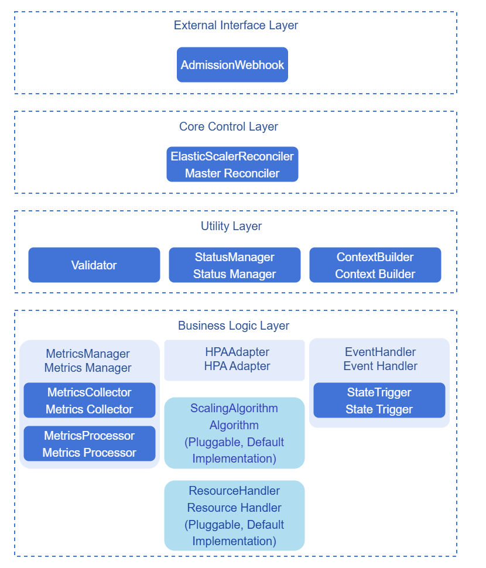
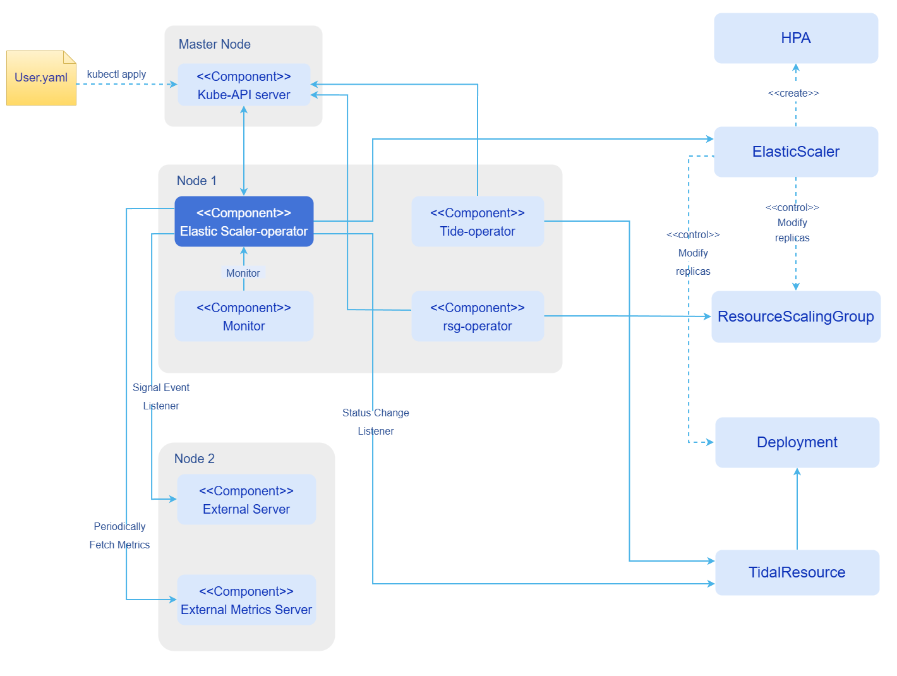

# AI Inference Elastic Scaling

## Feature Introduction

Elastic Scaler is a general scaling decision framework designed to meet scaling decision requirements in different business scenarios.

- Architecturally, Elastic Scaler adopts a plugin mechanism, supporting user-defined scaling decision algorithms and flexible extension of custom resource management logic.
- In terms of capabilities, Elastic Scaler supports both metrics-driven and state-driven scaling semantics, where state-driven scaling primarily serves business scenarios with significant fluctuations or sudden changes in resource demand.

### Application Scenarios

Elastic Scaler is applicable to scenarios where various business services are deployed in a Kubernetes cluster environment and require dynamic resource management, including:

- **Dynamic load scenarios**: Request volume fluctuates significantly over time, requiring dynamic adjustment of the number of service instances based on actual load.
- **Cost optimization scenarios**: Under the premise of ensuring service performance, reducing resource costs and improving resource utilization through intelligent scaling.
- **Mixed load scenarios**: Business scenarios with a mix of long and short requests and varying concurrency, requiring intelligent scaling based on request characteristics and instance state.
- **Multi-tenant scenarios**: Multiple tenants share resources, requiring dynamic resource allocation based on each tenant's SLA requirements.
- **PD separation architecture**: In the Prefill-Decode separation architecture, independent adjustment of P-side and D-side resource ratios is required.
- **Explicit replica count scenarios**: Directly specifying the target replica count based on external state, applicable to scenarios such as tidal traffic or scheduled load switching that require explicit capacity targets.

### Capability Scope

- Supports deployment and usage in K8s clusters.
- Supports metrics-driven scaling (MetricsTrigger); built-in `APA` algorithm, compatible with `HPA` algorithm.
- Supports state-driven scaling (StateTrigger).
- Supports `Resource`, `External`, `ExternalServer`, and `Custom` metric types (the HPA path does not support `ExternalServer`).
- Supports custom scaling algorithm plugin development and registration for invocation.
- Supports custom resource plugin development (via ResourceScalingGroup).
- Compatible with K8s native HPA capabilities.

> **Notice:**
> - When `scalingAlgorithm` is `HPA` under MetricsTrigger, metric types support `Resource`, `External`, and `Custom`, but not `ExternalServer`.
> - When using `External` and `Custom` metrics, the cluster must have the corresponding Metrics API deployed and available (such as `external.metrics.k8s.io`, `custom.metrics.k8s.io`); when using `ExternalServer`, ensure the metric endpoint is reachable and `query` can correctly return a numeric value.

### Highlighted Features

- **Plugin architecture**: Supports plugin-based integration of scaling decision algorithms, enabling users to flexibly define and evolve scaling algorithms based on business characteristics.
- **Multiple trigger modes**: Supports metrics-driven (MetricsTrigger) and state-driven (StateTrigger) scaling semantics.
- **Multi-metric system**: Supports metrics from various sources (Resource, External, ExternalServer, Custom) as scaling decision inputs.
- **Generalized resource management capability**: No longer limited to specific resource types; supports arbitrary custom resource integration into the scaling system through the Resource plugin mechanism.
- **K8s native integration**: Based on K8s HPA (Horizontal Pod Autoscaler) and custom resource extensions, fully compatible with the K8s ecosystem.

### Implementation Principle
**Figure 1** Component Architecture Diagram




**Figure 2** Component Deployment View



Elastic Scaler manages different types of scaling trigger sources through a unified Trigger abstraction. Based on the configured Trigger type, the framework selects different execution paths:

1. **MetricsTrigger (metrics-driven)**: Under the custom algorithm path, `ContextBuilder` assembles metrics and algorithm context, `MetricsManager` completes metric collection and stabilization, and then the scaling algorithm calculates the target replica count and updates the target resource; under the HPA algorithm path, `HPAAdapter` creates and maintains K8s HPA resources, with actual scaling decisions executed by the cluster HPA Controller. The responsibilities and collaboration of the two modules are described in [ContextBuilder Module](#contextbuilder模块) and [MetricsManager Module](#metricsmanager模块) below.
2. **StateTrigger (state-driven)**: Elastic Scaler listens for state changes of external resources, reads the `status.desiredReplicas` field of external resources, and applies this value to the target resource. Applicable to scenarios such as tidal traffic and scheduled load switching.
  The specific flow is as follows:
    1. An external controller (such as Tidal) calculates the desired replica count and writes it to the `status.desiredReplicas` field of the external resource.
    2. The external resource is bound to ElasticScaler via labels (`elasticscaler.io/namespace` and `elasticscaler.io/name`).
    3. Elastic Scaler listens for state changes of the external resource and reads the `status.desiredReplicas` field.
    4. Elastic Scaler applies the desired replica count to the target resource.

From an architectural perspective, Elastic Scaler is divided into the external interface layer, core control layer, coordination tool layer, and business logic layer. `ElasticScalerReconciler` resides in the core control layer, responsible for driving a complete reconciliation cycle; `ContextBuilder` resides in the coordination tool layer, providing unified context for each execution component; `MetricsManager` resides in the business logic layer, specifically responsible for metric collection and stabilization processing in metrics-driven mode. Compared to the earlier approach of exposing `external.metrics.k8s.io` through a standalone `MetricsAdapter`, the current implementation consolidates `MetricsCollector` as an internal framework component, orchestrated uniformly by `MetricsManager`, reducing component responsibility overlap.

#### ContextBuilder Module

<a id="contextbuilder模块"></a>

`ContextBuilder` is the context management service for cross-component interaction, responsible for assembling `ElasticScaler` CR configuration, runtime data, and policy parameters into a unified context object, avoiding direct coupling between the controller, metrics module, and algorithm module.

**Main Responsibilities**

- **Metrics pipeline**: Through `BuildMetricsContext`, it constructs `MetricsContext`, aggregating the Pod list, `ElasticScaler` identifiers (namespace/name), metric specifications from `spec.trigger.metricsTrigger.metrics`, metric processing policies (`MetricsPolicyConfig`), and the current collection time anchor, for `MetricsManager` and its sub-modules to share within the same reconciliation cycle.
- **Algorithm decision**: Through `BuildScalingAlgorithmContext`, it constructs `ScalingAlgorithmContext`, after `MetricsManager` returns stabilized metrics, injecting processed metrics, algorithm name and `algorithmConfig`, replica upper/lower bounds (`minReplicas`/`maxReplicas`), current replica count and last scaling time, etc., for `ScalingAlgorithm` to calculate the desired replica count.

**Metrics Processing Policy (MetricsPolicyConfig)**

Metric stabilization parameters are uniformly parsed and injected into `MetricsContext` by `ContextBuilder` during the `BuildMetricsContext` stage, ensuring consistent `MetricsProcessor` policies within the same reconciliation cycle. Users can configure the following keys in the `metadata.annotations` of the `ElasticScaler` object (when not configured or configured with invalid values, built-in defaults are used):

**Table 1** Metrics Processing Policy Annotation Description

| Annotation Key | Description |
|--------|------|
| `elasticscaler.io/metrics.windowSeconds` | Sliding statistics window length (seconds) |
| `elasticscaler.io/metrics.aggregationType` | Aggregation method within the window |
| `elasticscaler.io/metrics.missingDataPolicy` | Missing sample processing policy |
| `elasticscaler.io/metrics.gcFactor` | Historical sample recycling coefficient, works with window to control memory usage |
| `elasticscaler.io/metrics.enableOutlierFilter` | Whether to enable outlier filtering |
| `elasticscaler.io/metrics.outlierThreshold` | Outlier determination threshold |

#### MetricsManager Module

<a id="metricsmanager模块"></a>

`MetricsManager` is the unified coordination entry point for the metrics pipeline, and only functions under the **MetricsTrigger** path when metric collection and algorithm decisions are completed within the framework (typically the custom algorithm path). It exposes `GetMetrics` externally and internally chains `MetricsCollector` (collection) and `MetricsProcessor` (stabilization) in a fixed sequence, masking the differences in collection implementation across `Resource`, `External`, `ExternalServer`, and `Custom` metric types.

**Sub-module Responsibilities**

- **MetricsCollector**: Concurrently collects raw samples according to the metric specifications in `MetricsContext`. `Resource`/`External`/`Custom` types query via the API Server; `ExternalServer` types access external metric services (such as Prometheus). Collection uses bounded concurrency (default maximum 10 concurrent channels) and per-metric timeout (default 5 seconds) to prevent slow metrics from dragging down the entire reconciliation cycle; results are split into successful samples (`Raw`) and failure details (`Failures`).
- **MetricsProcessor**: Within the `[CollectionTime - WindowSeconds, CollectionTime]` time window, performs time normalization, sliding window aggregation, missing value processing, and optional outlier filtering on raw samples, outputting `ProcessedMetricsValue` (metric name + stabilized value) for algorithm consumption; and recycles long-inactive object-metric keys according to `GCFactor`, preventing unbounded cache growth.

**Collaboration with ContextBuilder and Controller**

During a MetricsTrigger reconciliation, the main metrics-related path is as follows:

1. `ElasticScalerReconciler` calls `ContextBuilder.BuildMetricsContext` to obtain `MetricsContext`.
2. Calls `MetricsManager.GetMetrics(metricsContext)`: internally first `CollectMetrics` then `ProcessMetrics`.
3. If there are collection failures, `GetMetrics` returns processed metrics along with `MetricsDetail.CollectFailures`; the controller updates status accordingly (partial success semantics: successful samples still enter the algorithm, failure items are written to status for troubleshooting).
4. `ContextBuilder.BuildScalingAlgorithmContext` encapsulates processed metrics and replica information into `ScalingAlgorithmContext`.
5. `ScalingAlgorithm` calculates the desired replica count based on this context, which is then applied to the target resource by `ResourceHandler`.

> **Note:**<br/>
> - When using the **HPA** algorithm, scaling decisions are executed by the K8s HPA Controller and do not go through the complete `MetricsManager` → `ScalingAlgorithm` pipeline described above; Elastic Scaler is primarily responsible for HPA resource lifecycle management and status mapping.
> - When using **APA** or other built-in or registered custom algorithms, `MetricsManager` collects and stabilizes metrics, then `AlgorithmManager.CalculateDesiredReplicas` calculates replicas and `ResourceHandler` executes the scaling.

### Relationship with Related Features

- **EagleEye**: Compatible with near-real-time monitoring metrics provided by EagleEye for inference services, including key metrics at different granularities such as business runtime, system runtime, and hardware health. Integration with EagleEye has not yet been implemented in the current version.
- **Tidal**: Compatible with the Tidal component; when using the tidal algorithm, Tidal expresses explicit capacity targets through the `status.desiredReplicas` field, and Elastic Scaler is responsible for execution.
- **ResourceScalingGroup**: Compatible with the ResourceScalingGroup CRD; uses custom resource plugins to integrate into the decision framework for fine-grained AI resource management.

## Installation

This section introduces methods for independently deploying Elastic Scaler in an existing cluster and for deploying Elastic Scaler through the InferNex suite integration.

### Independent Deployment

This section describes how to independently deploy Elastic Scaler in a K8s cluster that already has inference services and monitoring components.

#### Prerequisites

Before starting the installation, ensure the following conditions are met:

- **Environment requirements**:

  - Kubernetes cluster: v1.28.0 or above.
  - Cluster administrator privileges: for installing CRDs and cluster-level resources.
  - Helm tool: for deploying Elastic Scaler and related components.

- **Hardware requirements**:

  - Elastic Scaler itself has no special hardware requirements; as a lightweight controller component, it can run on standard x86 or ARM architecture nodes.

#### Installing Elastic Scaler

Execute the following command to install Elastic Scaler.

```bash
helm install elastic-scaler oci://cr.openfuyao.cn/charts/pd-orchestrator --version 0.0.0-latest
```
Installs the pd-orchestrator chart from the OCI repository. This chart installs ElasticScaler, RSG, and Tidal components by default, and creates a RSG CR and ElasticScaler CR instance configuration by default.

If you only need to deploy the ElasticScaler Controller currently, it is recommended to explicitly disable other components and default example instances:

```bash
helm install elastic-scaler oci://cr.openfuyao.cn/charts/pd-orchestrator --version 0.0.0-latest \
  --set elastic-scaler.enabled=true \
  --set elastic-scaler.elasticScaler.enabled=false \
  --set resourcescalinggroup.enabled=false \
  --set resourcescalinggroup.instanceConfig.enabled=false \
  --set tidal.enabled=false
```

> **Note:**<br/>
> - When deploying Elastic Scaler, the monitoring data source and scaling target must be correctly configured.
> - The ElasticScaler CR needs to be configured with the correct target resource (Deployment, StatefulSet, etc.) and Trigger configuration.
> - For detailed configuration of scaling policies, please refer to the [Configuring Scaling Policies](#configuring-scaling-policies) section.

### InferNex Integrated Deployment

InferNex is a one-click integrated intelligent routing, monitoring, and elastic scaling deployment suite that includes the elastic-scaler component internally.

#### Prerequisites

* Kubernetes v1.28.0 or above.
* At least one inference chip per inference node.
* At least 16GB memory and 4 CPU cores per inference node.
* Online installation requires access to the image repository: oci://cr.openfuyao.cn.
* User has permissions to create RBAC resources.

#### Quick Installation of InferNex

InferNex can be independently deployed in two ways:

- Obtain the project installation package from the openFuyao official artifact repository.

  1. Install from the remote repository.

      ```bash
      helm install infernex oci://cr.openfuyao.cn/charts/infernex --version xxx 
      ```
      Where `xxx` should be replaced with the specific project installation package version, such as `0.21.1`, and `infernex` is the release name.

      Before executing the installation, ensure:
      - The cluster has created the namespaces `istio-system` (Istio Gateway resources must be deployed in this namespace) and `scaling-system`.

- Obtain from the openFuyao GitCode repository.

  1. Pull the project from the repository.

      ```bash
      git clone https://gitcode.com/openFuyao/InferNex.git
      ```

  2. Install and deploy.

      Using the release name `infernex` as an example, execute the following command in the same-level directory as `InferNex`:
      ```bash
      cd InferNex/charts/infernex
      helm dependency build
      helm install -n <namespace> infernex .
      ```

## Configuring Scaling Policies

This section explains how to configure Elastic Scaler scaling policies for different business scenarios.

Regardless of which trigger method is chosen, creating or updating an `ElasticScaler` will go through admission validation (AdmissionWebhook); the controller will also perform supplementary validation (Validator) based on the actual cluster state during the reconciliation process. For specific rules and troubleshooting methods, see [Metrics-Driven Scaling (MetricsTrigger)](#metrics-trigger-admission-validator) and [State-Driven Scaling (StateTrigger)](#state-trigger-admission-validator).

### Metrics-Driven Scaling (MetricsTrigger)

Metrics-driven scaling automatically adjusts the replica count based on real-time metric changes, applicable to continuously running business scenarios with smoothly varying load.

#### Metrics Processing Policy Annotation Configuration

Metric stabilization policies are delivered through `ElasticScaler`'s `metadata.annotations`, parsed and injected into `MetricsContext` by the [ContextBuilder Module](#contextbuilder模块) during the `BuildMetricsContext` stage, for use by `MetricsManager`'s `MetricsProcessor` within the same reconciliation cycle. Annotation key names, meanings, and architectural descriptions are provided in [Metrics Processing Policy (MetricsPolicyConfig)](#contextbuilder模块) above; the YAML below is an **annotation configuration example** (can be used in combination with custom algorithm or HPA configurations; the policy primarily affects the framework's internal metric collection and stabilization pipeline, while under HPA mode actual scaling is still executed by the cluster HPA Controller).

```yaml
apiVersion: elasticscaler.io/v1alpha1
kind: ElasticScaler
metadata:
  name: metrics-policy-example
  namespace: ai-inference
  annotations:
    # Sliding statistics window (seconds), must be a positive integer; defaults to 60 if not configured or invalid
    elasticscaler.io/metrics.windowSeconds: "120"
    # Aggregation method within the window: Average / Max / Min / P90 (case-insensitive)
    elasticscaler.io/metrics.aggregationType: "Max"
    # Missing sample policy: Ignore / TreatAsZero / Fail (case-insensitive)
    elasticscaler.io/metrics.missingDataPolicy: "ignore"
    # Historical sample recycling coefficient, must be a positive integer; defaults to 5 if not configured or invalid
    elasticscaler.io/metrics.gcFactor: "8"
    # Whether to enable outlier filtering: true / false
    elasticscaler.io/metrics.enableOutlierFilter: "true"
    # Outlier determination threshold, must be a positive float; defaults to 1.5 if not configured or invalid
    elasticscaler.io/metrics.outlierThreshold: "2.5"
spec:
  targetRef:
    apiVersion: apps/v1
    kind: Deployment
    name: vllm-inference

  minReplicas: 2
  maxReplicas: 10

  trigger:
    type: MetricsTrigger
    metricsTrigger:
      # Example with built-in APA algorithm; can also be replaced with HPA or other registered algorithm names
      scalingAlgorithm: APA
      metrics:
      - type: Resource
        resource:
          metricsName: cpu
          target:
            type: Utilization
            averageUtilization: 70
```

**Table 2** Metrics Processing Policy Annotation Values and Defaults

| Annotation Key | Value Description | Default |
|--------|----------|--------|
| `elasticscaler.io/metrics.windowSeconds` | Positive integer, sliding window length (seconds) | `60` |
| `elasticscaler.io/metrics.aggregationType` | `Average`, `Max`, `Min`, `P90` (case-insensitive) | `Average` |
| `elasticscaler.io/metrics.missingDataPolicy` | `Ignore`, `TreatAsZero`, `Fail` (case-insensitive) | `Ignore` |
| `elasticscaler.io/metrics.gcFactor` | Positive integer, works with window to recycle long-inactive samples | `5` |
| `elasticscaler.io/metrics.enableOutlierFilter` | `true` or `false` | `false` |
| `elasticscaler.io/metrics.outlierThreshold` | Positive float, effective when outlier filtering is enabled | `1.5` |

> **Note:**<br/>
> - When a single annotation value is invalid, that key is ignored and falls back to the corresponding default value, which does not cause `ElasticScaler` creation failure.
> - When only some annotations are configured, unconfigured items use the defaults from the table above.

#### Using the HPA Algorithm

The HPA algorithm performs scaling based on CPU/memory utilization, leveraging K8s native HPA capabilities.

> **Note:**<br/>
> - Elastic Scaler automatically creates and manages the corresponding Kubernetes HPA resource under HPA algorithm mode.
> - If switching the scaling algorithm from HPA to another mode (such as a custom algorithm), you must first delete the Elastic Scaler instance or manually clean up the generated HPA resource; otherwise, resource management conflicts will occur.
> - Elastic Scaler and the managed resource (Deployment, StatefulSet, etc.) must maintain a one-to-one mapping relationship.
> - Under HPA mode, Elastic Scaler and the managed resource must be deployed in the same namespace.

```yaml
apiVersion: elasticscaler.io/v1alpha1
kind: ElasticScaler
metadata:
  name: hpa-scaling-example
  namespace: ai-inference
spec:
  # Scaling target
  targetRef:
    apiVersion: apps/v1
    kind: Deployment
    name: vllm-inference

  # Minimum/maximum replica count
  minReplicas: 2
  maxReplicas: 10

  # Metrics-driven trigger configuration
  trigger:
    type: MetricsTrigger
    metricsTrigger:
      # Use HPA algorithm
      scalingAlgorithm: HPA

      # Metric configuration
      metrics:
      - type: Resource
        resource:
          metricsName: cpu
          target:
            type: Utilization
            averageUtilization: 70
```

**Table 3** HPA Policy Parameter Description

| Parameter | Type | Description | Default |
|------|------|------|------|
| `type` | string | Trigger type, must be set to `MetricsTrigger`. | - |
| `scalingAlgorithm` | string | Scaling algorithm, set to `HPA` to use K8s native HPA. | - |
| `metrics[].type` | string | Metric type, supports `Resource`, `External`, `Custom`; does not support `ExternalServer`. | - |
| `metrics[].resource.metricsName` | string | Resource metric name (cpu/memory). | - |
| `metrics[].resource.target.type` | string | Target type (Utilization/Value/AverageValue). | - |
| `metrics[].resource.target.averageUtilization` | int | Target average utilization (percentage). | - |

#### Using a Custom Algorithm

When `scalingAlgorithm` is not `HPA`, Elastic Scaler completes metric collection, stabilization, replica calculation, and resource update within the controller, without creating a K8s HPA object. The framework includes the built-in **APA** (Average Pod Autoscaling) algorithm; the algorithm name is case-insensitive; when `scalingAlgorithm` is left empty, `APA` is used by default. Users can also implement the `ScalingAlgorithm` interface and register it with `DefaultAlgorithmManager`, then specify the algorithm name via `scalingAlgorithm` in the CR for invocation.

**Table 4** Common Parameters for Built-in APA Algorithm `algorithmConfig`

| Parameter | Type | Description | Default |
|------|------|------|--------|
| `upTolerance` | float | Utilization upward tolerance for scale-up trigger | `0.1` |
| `downTolerance` | float | Utilization downward tolerance for scale-down trigger | `0.1` |
| `maxScaleUpRate` | float | Maximum scale-up multiplier per cycle (≥1) | `2.0` |
| `maxScaleDownRate` | float | Minimum scale-down multiplier per cycle (≥1) | `2.0` |
| `scaleDownDampingFactor` | float | Scale-down damping factor, value range `[0,1]` | `0.0` |

The following example uses the built-in `APA` algorithm and queries business metrics from Prometheus via `ExternalServer` (the `query` field carries PromQL, consistent with the oFEP-0044 enhanced semantics):

```yaml
apiVersion: elasticscaler.io/v1alpha1
kind: ElasticScaler
metadata:
  name: custom-scaling-example
  namespace: ai-inference
  annotations:
    elasticscaler.io/metrics.windowSeconds: "120"
    elasticscaler.io/metrics.aggregationType: "Max"
spec:
  targetRef:
    apiVersion: apps/v1
    kind: Deployment
    name: vllm-inference

  minReplicas: 2
  maxReplicas: 10

  trigger:
    type: MetricsTrigger
    metricsTrigger:
      scalingAlgorithm: APA
      algorithmConfig:
        upTolerance: "0.1"
        downTolerance: "0.1"
        maxScaleUpRate: "2.0"
        maxScaleDownRate: "2.0"
      metrics:
      - type: ExternalServer
        externalServer:
          metricsName: inference_qps
          target: "100"
          endpoint: "http://prometheus.monitoring.svc:9090/api/v1/query"
          query: "sum(rate(http_requests_total{job=\"vllm\"}[1m]))"
          protocol: http
```

**Table 5** Custom Algorithm (Non-HPA) Policy Parameter Description

| Parameter | Type | Description | Default |
|------|------|------|--------|
| `scalingAlgorithm` | string | Algorithm name; built-in `APA`, or a registered plugin name (case-insensitive). Defaults to `APA` when left empty. | `APA` |
| `algorithmConfig` | map | Algorithm parameters, all keys and values are strings; APA see table above, plugins are custom-defined. | - |
| `metrics[].type` | string | Metric type: `Resource`, `External`, `ExternalServer`, `Custom`. | - |
| `metrics[].resource` | object | Required when `type=Resource`; includes `metricsName` and K8s `MetricTarget`. | - |
| `metrics[].external` | object | Required when `type=External`; includes `metricsName`, `target`, and optional `selector`. | - |
| `metrics[].externalServer` | object | Required when `type=ExternalServer`; includes `metricsName`, `target`, `endpoint`, optional `query` and `protocol`. | - |
| `metrics[].custom` | object | Required when `type=Custom`; interfaces with `custom.metrics.k8s.io`. | - |

<a id="metrics-trigger-admission-validator"></a>

#### AdmissionWebhook and Validator Supplementary Notes

**AdmissionWebhook (during creation/update)**

- When submitting an `ElasticScaler` resource to the cluster using `kubectl apply`, `kubectl create`, or `kubectl edit`, if `spec` validation fails, the API Server will reject the request; the common error message is "admission webhook denied the request". The returned information will provide the specific field path (such as `spec.trigger.metricsTrigger`, `invalid metric at index N`); please modify the `ElasticScaler` CR manifest YAML used to create or update that instance accordingly (i.e., the configuration file submitted via the above commands, not other unrelated manifests in the cluster).
- Specification requirements related to **MetricsTrigger** include:
  - When `spec.trigger.type` is `MetricsTrigger`, only `spec.trigger.metricsTrigger` should be configured; do not also fill in `stateTrigger`.
  - `scalingAlgorithm` must not be empty; `metrics` must contain at least one metric.
  - Each `metrics[]` entry must have only the corresponding sub-structure filled based on `type` (`Resource`/`External`/`ExternalServer`), with all required fields present; if `scalingAlgorithm` is `HPA`, the `ExternalServer` metric type cannot be used, otherwise a message will indicate that a metric entry is invalid.
- The following fields are validated for **all trigger types**: `spec.targetRef`'s `apiVersion`, `kind`, and `name` are required; `minReplicas`/`maxReplicas` values must be valid and `maxReplicas >= minReplicas`; `spec.trigger.type` must be `MetricsTrigger` or `StateTrigger`.

**Validator (during controller runtime)**

- After admission passes, the controller still validates: whether the specified `targetRef` **actually exists** in the cluster; whether **another** `ElasticScaler` is already managing the same `targetRef` (a one-to-one mapping must be maintained).
- If `scalingAlgorithm` is **not** `HPA`, the controller checks whether the algorithm name is **registered** in the running environment; if not registered, the object may be created successfully, but `.status.conditions` will show `Validated=False` with `reason=ValidationFailed`.
- Please execute the command `kubectl describe elasticscalers <name> -n <namespace>` to check the `type=Validated` condition; when validation fails, the `message` field explanation is the reason.

### State-Driven Scaling (StateTrigger)

State-driven scaling is triggered based on external resource state changes, applicable to scenarios such as tidal traffic and scheduled load switching that require explicit capacity targets.
```yaml
apiVersion: tidal.io/v1alpha1
kind: Tidal
metadata:
  name: tidal-frequent-test
  namespace: ai-inference
  labels:
    elasticscaler.io/name: state-scaling-example
    elasticscaler.io/namespace: ai-inference
spec:
  targetRef:
    apiVersion: apps/v1
    kind: Deployment
    name: elastic-scaler-state-test   # Change to the Deployment name you want to scale
    namespace: ai-inference
  triggers:
    times:
      rules:
        - name: time1
          cron: "CRON_TZ=Asia/Shanghai 0 50 16 * * *"
          replicas: 3
          description: time1     
        - name: time2
          cron: "CRON_TZ=Asia/Shanghai 0 0 8 * * *"
          replicas: 5
          description: time2
```
```yaml
apiVersion: elasticscaler.io/v1alpha1
kind: ElasticScaler
metadata:
  name: state-scaling-example
  namespace: ai-inference
spec:
  # Scaling target
  targetRef:
    apiVersion: tidal.io/v1alpha1
    kind: Tidal
    name: tidal-frequent-test

  # State-driven trigger configuration
  trigger:
    type: StateTrigger
    stateTrigger: {}
```

**Table 6** StateTrigger Parameter Description

| Parameter | Type | Description | Default |
|------|------|------|--------|
| `type` | string | Trigger type, must be set to `StateTrigger`. | - |
| `stateTrigger` | object | State-driven configuration, empty object in the current version. | - |

<a id="state-trigger-admission-validator"></a>

#### AdmissionWebhook and Validator Supplementary Notes

**AdmissionWebhook (during creation/update)**

- When `spec.trigger.type` is `StateTrigger`, `spec.trigger.stateTrigger` must be configured (can be written as an empty object `{}`); do not also configure `metricsTrigger`.
- If inconsistent with the above structure, creation or update will be rejected, and the error message will typically contain prompts such as `stateTrigger` or `only stateTrigger`.

**Validator (during controller runtime)**

- In addition to validations common to all modes (the resource pointed to by `targetRef` must exist, and the same `targetRef` can only be managed by one `ElasticScaler`), **StateTrigger** also requires: the resource pointed to by `targetRef` must already have a **`status`** in the cluster, and the `status` must contain at least one of **`replicas`** or **`desiredReplicas`** (for state-driven reading of the desired replica count). If the external controller has not yet written the status, `Validated=False` may appear.
- Similarly, please execute the command `kubectl describe elasticscalers <name> -n <namespace>` to check the `Validated` condition, and troubleshoot based on the `message` field.

## Using Elastic Scaling

This section demonstrates how to view, monitor, and manage Elastic Scaler scaling behavior in the cluster.

### Viewing Scaling Policies

```bash
# View all ElasticScaler resources
kubectl get elasticscalers -n <NAMESPACE>

# View details of a specific ElasticScaler
kubectl describe elasticscalers <SCALER_NAME> -n <NAMESPACE>
```

### Viewing Scaling Events

```bash
# View scaling events
kubectl get events -n <NAMESPACE> --field-selector involvedObject.kind=ElasticScaler

# View controller logs
kubectl logs -n <NAMESPACE> -l control-plane=<RELEASE-NAME>-elastic-scaler-controller-manager -f 
```

### Disabling/Enabling Scaling Policies

Elastic Scaler disables scaling policies by deleting the CR and enables them by creating the CR.

```bash
# Disable scaling policy (delete CR)
kubectl delete elasticscalers <SCALER_NAME> -n <NAMESPACE>

# Enable scaling policy (create CR)
kubectl apply -f <elastic-scaler-config>.yaml
```


### Common Issues

1. **What types of metrics are supported?**

   Under MetricsTrigger, four types of metrics are supported: `Resource` (CPU/memory, etc.), `External` (`external.metrics.k8s.io`), `Custom` (`custom.metrics.k8s.io`), and `ExternalServer` (HTTP/HTTPS access to external metric services, supports `query` carrying PromQL). The HPA algorithm path does not support `ExternalServer`; the non-HPA path (such as built-in `APA`) supports all four types, with specific collection depending on cluster Metrics API or external endpoint availability.

2. **How to debug scaling policies?**

   You can use `kubectl describe elasticscalers` to view conditions such as `Validated`, `MetricsPipeline`, and `ScalingCalculated`, combined with Controller logs and K8s events for troubleshooting. Under the non-HPA path, `MetricsPipeline` reflects whether metric collection is fully successful or partially successful (`MetricsPartialSuccess`).

3. **How does StateTrigger work?**

   Under StateTrigger mode, an external controller (such as Tidal) calculates the desired replica count and writes it to the `status.desiredReplicas` field of the external resource. Elastic Scaler listens for state changes of the external resource, reads this field, and applies it to the target resource. The external resource needs to be bound to ElasticScaler via the labels `elasticscaler.io/namespace` and `elasticscaler.io/name`.

4. **How to develop a custom scaling algorithm?**

   The framework includes the built-in `APA` algorithm; you can directly set `scalingAlgorithm` to `APA` (or leave it empty to use the default). If you need to extend, implement the `ScalingAlgorithm` interface and register it via `DefaultAlgorithmManager.RegisterAlgorithm()`, then fill in the registered name in the `scalingAlgorithm` field of the CR; the controller invokes it via `AlgorithmManager.CalculateDesiredReplicas`. For detailed steps, see the [Plugin Development Guide](../developer_guide/ai_inference_elastic_scaling_plugin_in_development_guide.md).

5. **How to switch between HPA and APA (custom algorithm path)?**

   Custom scaling algorithms need to implement the `ScalingAlgorithm` interface and register the algorithm via the `DefaultRegistry.Register()` method. For detailed development guidance, please refer to the [Plugin Development Guide](../developer_guide/ai_inference_elastic_scaling_plugin_in_development_guide.md).

   Before changing `scalingAlgorithm` from `HPA` to a non-`HPA` algorithm (or vice versa), it is recommended to first delete the `ElasticScaler` instance or manually clean up residual HPA resources to avoid OwnerReference and replica management conflicts. After switching, the non-HPA path will directly update target resource replicas via the controller.

6. **How to support custom resource types?**

   By implementing the `ResourceHandler` interface and using the `RegisterResourceHandler()` method to register, you can support arbitrary custom resource types. Custom resources need to implement methods such as `GetCurrentReplicas()` and `UpdateReplicas()`.
