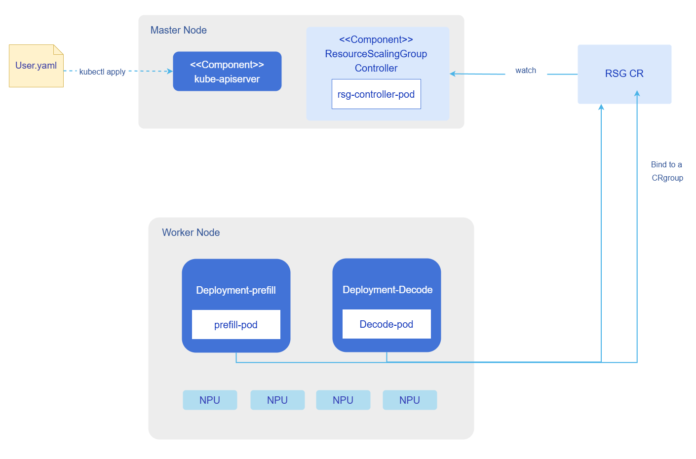
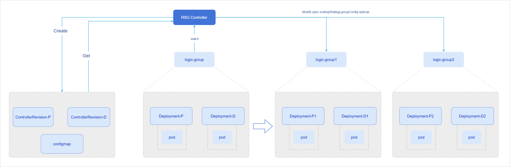
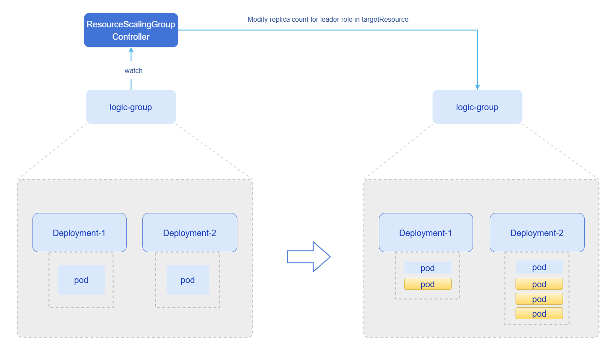
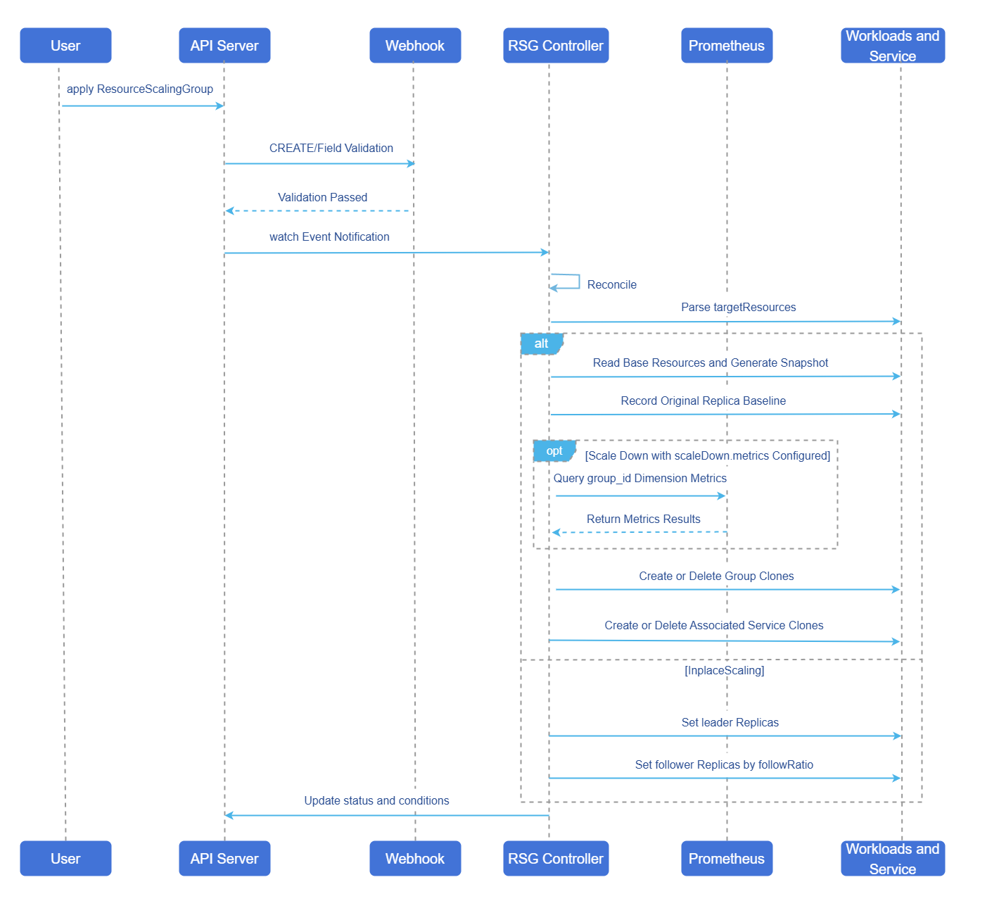

# ResourceScalingGroup - Resource Group Scaling

## Feature Introduction

ResourceScalingGroup (hereafter referred to as RSG) is a controller designed for grouped scaling scenarios of Kubernetes workloads. It abstracts multiple related workloads into a logical group, describes scaling policies through a single custom resource, and enforces these policies on the actual resources. The current implementation provides two scaling strategies:

- `GroupReplication`: Uses a set of base workloads as a template to replicate, restore, and scale down by "group". It is suitable for scenarios that require cloning a complete inference pipeline or grouped scaling under a Prefill-Decode disaggregated architecture.
- `InplaceScaling`: Uses the replicas value of the leader resource as the baseline to proportionally scale the follower resource replicas. It is suitable for scenarios under the Prefill-Decode disaggregated architecture where Prefill-Decode groups scale in a fixed ratio.

RSG operates directly at the resource orchestration layer and does not handle complex business metric decision-making. For the `GroupReplication` scenario, it exposes the standard `scale` sub-resource and can serve as the target object for upper-level policies such as HPA, ElasticScaler, and TidalScheduler. The upper-level policy determines "how many groups to scale to", while RSG executes the intra-group resource orchestration.

### Application Scenarios

- In large model inference pipelines, multiple components such as prefill, decode, and gateway need to be scaled as a group.
- A business unit contains multiple Deployments, StatefulSets, or LeaderWorkerSets, and needs to be replicated into multiple independent instances at once.
- Business replica counts have a proportional relationship — when the leader resource's replica count changes, follower resources need to adjust in a fixed ratio accordingly.
- Need to manage existing business workloads in the cluster, granting scaling capabilities to already deployed resources.
- When business needs to scale down and release compute resources, graceful scaling down based on business metrics minimizes impact on the business.

### Capability Scope

- Manage a group of target resources via the standard CRD ResourceScalingGroup, with at least 1 target resource.
- Support managing Deployment, StatefulSet, and LeaderWorkerSet workloads.
- Support the `GroupReplication` group scaling strategy — scale up and down by "resource group", with automatic management of workload cloning and associated Service cloning.
- Support the `InplaceScaling` in-place scaling strategy — calculate `follower` replicas using `leader.replicas * followRatio`.
- Support integrating Prometheus metrics during group scale-down, selecting groups for priority recycling based on metric values sorted.
- Support degradation logic for scale-down selection when Prometheus is unavailable or metrics are incomplete: first degrade to annotation values, then degrade to the maximum group-id.
- Under the `GroupReplication` strategy, expose the `scale` sub-resource, allowing upper-level controllers such as HPA to drive group count changes through the standard scaling interface.
- Validate common configuration issues through Webhook, including duplicate targets, invalid references, role configuration errors, and leader/follower relationship errors.

### Highlighted Features

- **Treat "resource group" as the scaling object**: Upper-level decision systems do not need to separately operate multiple Deployment or StatefulSet resources; they only need to target a single RSG resource.
- **Cover two typical orchestration patterns simultaneously**: Supports both whole-group resource scaling and Pod count linkage by leader/follower ratio, providing broader coverage than simple replica scaling.
- **Support decoupled composition with upper-level policies**: GroupReplication exposes the scale sub-resource and can be connected to external policies such as HPA, ElasticScaler, and TidalScheduler.
- **Observable and degradation mechanism for scale-down process**: Prioritize Prometheus metrics for scale-down, with automatic degradation on failure, ensuring scale-down does not fail due to a single-point metric issue.

### Implementation Principles

This section explains the implementation principles of ResourceScalingGroup from the perspectives of deployment view, runtime view, and diagrams for the two scaling strategies.

#### Deployment View

**Figure 1** RSG Deployment View



From the component deployment perspective, the RSG controller is deployed as a Deployment. Through an RSG CR resource, it binds Prefill and Decode resources into a group. During scale-up, scaling is performed at the group granularity, creating new Deployment-Prefill and Deployment-Decode resource replicas, as shown in the `GroupReplication` group scaling strategy diagram below:

**Figure 2** GroupReplication Strategy Scaling Diagram



After the controller manages the Prefill and Decode resources, it creates ControllerRevision snapshots for the corresponding resources and a ConfigMap that allows dynamic modification of Pod counts. During scale-up, resource replicas are created based on the snapshot configuration, and the Pod count of new resources should match the Pod count of the original resources. If you need to dynamically modify the Pod count ratio of new resource replicas, you can modify the ConfigMap file configuration. For details, refer to [Related Operations](#groupreplication-Pod-replicas).

> **Note:**<br/>
> In the current version, RSG creates replica resources based on snapshots. If the original resource group configuration is updated, the snapshots will not be updated, and scale-up will still create resources based on the old snapshot. If you need new resource replicas to be configured according to the updated original resource group, you can delete the old ControllerRevision and ConfigMap resources before scaling up.

The `InplaceScaling` in-place scaling strategy diagram is shown below:

**Figure 3** `InplaceScaling` In-place Scaling Strategy Diagram



In this mode, the scaling target is the Pod count of Deployment resources. If Deployment-1 serves as the leader object and Deployment-2 serves as the follower object, modifying the replicas value of Deployment-1 will calculate the follower replicas value via `leader.replicas * followRatio`, achieving linked scaling.

#### Runtime View

The typical runtime flow of RSG consists of four stages:

1. The user submits a ResourceScalingGroup CR resource. The Webhook validates target resources, strategy type, role configuration, and cross-group conflicts.
2. The Controller selects the strategy engine based on `scalingStrategy.type` and resolves the actual workloads for each `targetResources`.
3. If `GroupReplication`, the Controller generates snapshots for base resources, records the original replica baseline, patches group labels and Services, then creates or reduces based on the target group count. If `InplaceScaling`, it directly adjusts the leader and follower replicas to the target values.
4. The Controller writes back `status`. Upper-level policies or operations systems can continue to observe, audit, and trigger actions based on the status.

**Figure 4** RSG Controller Runtime View



### Relationship with Related Features

**ElasticScaler**: RSG is one of the typical scaling targets for ElasticScaler. ElasticScaler can point `targetRef` to `ResourceScalingGroup` to manage the scaling of RSG replicas.

**TidalScheduler**: TidalScheduler can use RSG as a tidal scheduling target, directly adjusting the RSG replica count at specified time points.

**HPA**: Since RSG exposes the standard `scale` sub-resource for `GroupReplication`, HPA resources can directly scale RSG resources.

**Prometheus**: Prometheus is not a hard dependency of RSG. However, if `scaleDown.metric` is configured, RSG will prioritize querying Prometheus for metrics with the `group_id` dimension to determine which groups to prioritize for recycling during scale-down.

## Installation

### Independent Deployment

This section describes how to independently deploy ResourceScalingGroup in a Kubernetes cluster that already has inference services.

#### Prerequisites

Before starting the installation, ensure the following conditions are met:

- **Environment Requirements**:
  - Kubernetes cluster: v1.28.0 or above.
  - Cluster administrator privileges: for installing CRDs and cluster resources.
  - Helm tool: for deploying ResourceScalingGroup and related components.
- **Hardware Requirements**:
  - No special hardware requirements.

#### Installing ResourceScalingGroup

Run the following command to install ResourceScalingGroup.

```bash
helm install rsg oci://cr.openfuyao.cn/charts/pd-orchestrator --version 0.0.0-latest \
--set resourcescalinggroup.namespace.create=true # Default is false. If the cluster does not contain the scaling-system namespace, set this to true.
```

Install the pd-orchestrator chart from the OCI repository. This chart installs ElasticScaler, RSG, and Tidal components by default, and creates a default RSG CR and ElasticScaler CR instance configuration.

If you only need to deploy the RSG Controller currently, it is recommended to explicitly disable other components and default example instances:

```bash
helm install pd-orchestrator oci://cr.openfuyao.cn/charts/pd-orchestrator --version 0.0.0-latest \
  --set elastic-scaler.enabled=false \
  --set resourcescalinggroup.enabled=true \
  --set resourcescalinggroup.instanceConfig.enabled=false \
  --set tidal.enabled=false \
  --set resourcescalinggroup.namespace.create=true # Default is false. If the cluster does not contain the scaling-system namespace, set this to true.
```

#### Key Parameter Description

**Table 1** Helm Package Installation Parameter Description

| Parameter Key | Description |
| --- | --- |
| `resourcescalinggroup.enabled` | Controls whether to deploy the RSG Controller in the orchestrator chart. |
| `resourcescalinggroup.instanceConfig.enabled` | Controls whether to create a default RSG example CR. In production environments, it is recommended to explicitly set this to false. |
| `resourcescalinggroup.namespace.name` | The namespace where the RSG Controller is deployed, default is scaling-system. |
| `resourcescalinggroup.namespace.create` | By default, the scaling-system namespace is not created. If the cluster does not contain the `scaling-system` namespace, set this to true. |
| `resourcescalinggroup.prometheus.url` | Prometheus query address for `scaleDown.metric`, which will be injected as the environment variable `RSG_PROMETHEUS_URL`. |
| `resourcescalinggroup.webhook.enabled` | Controls whether to enable RSG's mutating/validating webhook. |
| `resourcescalinggroup.webhook.failurePolicy` | Webhook failure policy, default is Ignore in the chart. Can be adjusted based on risk preference for production environments. |
| `resourcescalinggroup.replicaCount` | RSG Controller Pod replica count. |
| `elastic-scaler.enabled` | Whether to also deploy ElasticScaler, for using RSG as an upper-level scaling target. |
| `tidal.enabled` | Whether to also deploy TidalScheduler, for adjusting RSG group count by time. |

> **Note:**<br/>
>
> When `resourcescalinggroup.instanceConfig.enabled=true`, the chart will automatically create a default `ResourceScalingGroup` instance. In production environments, it is generally not recommended to keep this default example to avoid unintended operations on existing business resources.

### InferNex Integrated Deployment

InferNex is a one-click integrated intelligent routing, monitoring, and elastic scaling deployment suite that includes the RSG component internally.

#### Prerequisites

* Kubernetes v1.28.0 or above.
* At least one inference chip per inference node.
* At least 16GB memory and 4 CPU cores per inference node.
* Online installation requires access to the image repository: oci://cr.openfuyao.cn.
* User must have permissions to create RBAC resources.

#### Quick Installation of InferNex

InferNex can be independently deployed in the following two ways:

- Obtain the project installation package from the openFuyao official artifact repository.

  1. Install from the remote repository.

      ```bash
      helm install infernex oci://cr.openfuyao.cn/charts/infernex --version xxx 
      ```
      Where `xxx` needs to be replaced with the specific project installation package version, such as `0.21.1`, and `infernex` is the release name.

      Before executing the installation, ensure:
      - The cluster has created the namespaces `istio-system` (Istio Gateway resources must be deployed in this namespace) and `scaling-system`.
  
- Obtain from the openFuyao GitCode repository.

  1. Clone the project from the repository.

      ```bash
      git clone https://gitcode.com/openFuyao/InferNex.git
      ```

  2. Install and deploy.

      Using the release name `infernex` as an example, run the following command in the directory at the same level as `InferNex`:
      ```bash
      cd InferNex/charts/infernex
      helm dependency build
      helm install -n <namespace> infernex .
      ```

#### Verify Deployment

After completing the installation, you can verify whether the RSG Controller is running normally through the following steps.

- Check Pod status.

  ```bash
  kubectl get Pods -n scaling-system | grep -E "resourcescalinggroup|rsg"
  ```

- Check whether CRDs are installed successfully.

  ```bash
  kubectl get crd resourcescalinggroups.autoscaling.openfuyao.com
  ```

- Check Controller logs.

  ```bash
  kubectl get deploy -n scaling-system
  kubectl logs -n scaling-system deploy/<deployment-name>
  ```

- If Webhook is enabled, confirm that the related configuration objects exist.

  ```bash
  kubectl get validatingwebhookconfigurations | grep resourcescalinggroup
  ```

If deployment is abnormal, prioritize checking the following items.

- Whether the namespace is correct and whether images have been pulled successfully.
- Whether the Prometheus URL is reachable.
- Whether the Webhook certificate, caBundle, or cert-manager configuration is correct.
- Whether a default example CR is unintentionally operating on existing business resources.

## Using ResourceScalingGroup

### Prerequisites

- ResourceScalingGroup has been deployed following the [Installation](#installation) steps, and the RSG Controller is running normally.
- The target workloads to be managed already exist in the cluster, and their names and namespaces have been confirmed.
- If using the `GroupReplication` metric-based scale-down capability, Prometheus must contain metrics with the `group_id` label.
- If planning to have ElasticScaler, TidalScheduler, or HPA drive RSG, confirm that the current RSG type is `GroupReplication`.

### Background Information

- RSG's `spec.targetResources` defines a set of managed workloads. Each target uses `name` as a logical reference name for strategy configuration references.
- `GroupReplication` uses `spec.scalingStrategy.groupConfig.replicas` to represent the desired group count. This value is also mapped to the `scale` sub-resource in the CRD, so upper-level controllers can directly treat RSG as a scalable object.
- `InplaceScaling` uses `leaderFollowerConfig` to define the `leader` and `follower` relationship, where the `follower` target replica count is calculated as `leader.replicas * followRatio`.
- For `GroupReplication`, RSG generates `ControllerRevision` snapshots for base resources and uses the `<rsg-name>-replica-config` ConfigMap to save the original replica baseline for each target resource, used for recovering from 0 groups or creating new groups.
- If `scaleDown.metric` is configured, RSG will construct a PromQL similar to the following:

  ```text
  avg by (group_id) (demo_metric)
  sum by (group_id) (rate(demo_counter[window]))
  ```

  > **Note:**<br/>
  > - The default aggregator for Gauge is `avg`.
  > - Counter and Histogram require the `window` field to be configured; the default aggregator is `sum`.
  > - When `metric.type=Gauge`, the calculation logic is `<aggregator> by (group_id) (<expr>)`, i.e., directly aggregating the current value by `group_id`.
  > - When `metric.type=Counter` or `metric.type=Histogram`, the calculation logic is `<aggregator> by (group_id) (rate(<expr>[<window>]))`, i.e., first computing the growth rate within the window, then aggregating by `group_id`.


### Usage Limitations

- The `scale` sub-resource is only meaningful for `GroupReplication`.
- New group resources created by `GroupReplication` follow the naming pattern `<groupName>-<original-resource-name>-<groupID>`, and associated Service names follow `<original-Service-name>-<groupName>-<groupID>`. The controller does not automatically avoid naming conflicts; if resources with the same name already exist in the cluster, creation will fail.
- New resources generated by group replication are created in the **namespace where RSG resides**. If base target resources are in other namespaces, the impact of cross-namespace template replication needs to be evaluated in advance.
- Under the same strategy type, multiple RSGs are not allowed to reference the same target workload simultaneously. The Webhook validates duplicate references, but it is still recommended on the operations side to follow the principle of "one target managed by one RSG".
- When the target group count of `GroupReplication` drops to 0, the controller scales the base resource replicas of `group 0` to 0, rather than deleting the base resource objects.
- When deleting a `GroupReplication` type RSG, the controller defaults to preserving existing business resource instances and only cleans up control plane artifacts such as snapshots and configurations. Deleting the RSG CR does not equal deleting the generated group resources. If you want to completely clean up business resources, users need to **manually reclaim them as needed**.
- During the scale-down selection phase, based on the final value for each `group_id` described above, sorting is executed according to `scaleDown.order`: `ascending` prioritizes recycling groups with smaller values, `descending` prioritizes recycling groups with larger values.
- The type enumeration is `Counter`, `Gauge`, `Histogram`. Writing `guage` will be treated as an invalid value.
- For `scaleDown.metric` to actually work, the data returned by Prometheus must contain the `group_id` label, and the label value must correspond to the group number created by RSG. Without this label, RSG will automatically fall back to the degradation logic instead of scaling down based on metric values. For details, refer to [Related Operations](#groupreplication-scaledown-metric).
- When using `GroupReplication`, even if the original target resources are in other namespaces, new group resources and their cloned Services will still be created in the namespace where the RSG CR resides.

### Operation Steps

#### Using GroupReplication to Manage a Set of Prefill-Decode Instances

1. The following example forms a resource group with prefill and decode Deployments, with an initial group count of 2, and configures scale-down priority based on Prometheus metrics:

   ```yaml
   apiVersion: autoscaling.openfuyao.com/v1alpha1
   kind: ResourceScalingGroup
   metadata:
     name: llm-Prefill-Decode-group
     namespace: scaling-system
   spec:
     targetResources:
       - name: prefill
         resourceRef:
           apiVersion: apps/v1
           kind: Deployment
           name: llm-prefill
           namespace: production
       - name: decode
         resourceRef:
           apiVersion: apps/v1
           kind: Deployment
           name: llm-decode
           namespace: production
     scalingStrategy:
       type: GroupReplication
       groupConfig:
         groupName: Prefill-Decode
         replicas: 2
         scaleDown:
           metric:
             expr: "vllm:num_requests_running"
             type: Gauge
             aggregator: avg
           order: ascending
   ```

    Common field descriptions are as follows:

    **Table 2** RSG CR Field Description

    | Field Path | Required | Description |
    | --- | --- | --- |
    | `metadata.name` | Yes | RSG resource name, unique within the namespace. |
    | `metadata.namespace` | Yes | The namespace where RSG resides, also the default namespace for creating new group resources. |
    | `spec.targetResources[].name` | Yes | Target resource logical name for strategy configuration reference, must be unique within the group. |
    | `spec.targetResources[].resourceRef.apiVersion` | Yes | API version of the target workload. |
    | `spec.targetResources[].resourceRef.kind` | Yes | Target workload type, such as Deployment, StatefulSet, LeaderWorkerSet, RoleBasedGroup. |
    | `spec.targetResources[].resourceRef.name` | Yes | Target workload name. |
    | `spec.targetResources[].resourceRef.namespace` | No | Target workload namespace. When empty, defaults to the namespace where RSG resides. |
    | `spec.scalingStrategy.type` | Yes | Strategy type, values are GroupReplication or InplaceScaling. |
    | `spec.scalingStrategy.groupConfig.groupName` | No | Group name prefix. When empty, defaults to the RSG name. |
    | `spec.scalingStrategy.groupConfig.replicas` | Yes | Desired group count. For GroupReplication, this is also the target value of the scale sub-resource. |
    | `spec.scalingStrategy.groupConfig.scaleDown.metric.expr` | No | Scale-down reference metric expression or metric name. |
    | `spec.scalingStrategy.groupConfig.scaleDown.metric.type` | No | Metric type: Counter, Gauge, Histogram. |
    | `spec.scalingStrategy.groupConfig.scaleDown.metric.window` | Conditionally Required | Required when metric type is Counter or Histogram. |
    | `spec.scalingStrategy.groupConfig.scaleDown.metric.aggregator` | No | Aggregator: sum, avg, max, min. |
    | `spec.scalingStrategy.groupConfig.scaleDown.order` | No | Scale-down sort direction: ascending or descending. |

2. Create the resource.

    ```bash
    kubectl apply -f llm-Prefill-Decode-group.yaml
    ```

3. Check the status.

    ```bash
    kubectl get resourcescalinggroup llm-Prefill-Decode-group -n scaling-system -o yaml
    ```

    Focus on the following status fields:

    - `status.currentReplicas`: The currently observed group count.
    - `status.lastDesiredReplicas`: The target group count desired by the controller in the most recent reconciliation.
    - `status.selector`: The label selector for the `scale` sub-resource.
    - `status.conditions`: `Ready=True`, `Reason=Reconciled` indicates the most recent reconciliation was successful.

4. View the resources created by this group.

    ```bash
    kubectl get deploy -n scaling-system | grep "-Prefill-Decode-"
    ```

5. If you need to manually adjust the group count, you can directly modify the RSG.

    ```bash
    kubectl patch resourcescalinggroup llm-Prefill-Decode-group -n scaling-system \
      --type merge \
      -p '{"spec":{"scalingStrategy":{"groupConfig":{"replicas":3}}}}'
    ```

    If you need upper-level policies to drive the group count, you can point ElasticScaler, TidalScheduler, or HPA to this RSG instead of directly pointing to the Deployments within the group.

#### Using InplaceScaling to Manage Leader / Follower Linked Replicas

The following example uses scheduler as the leader, worker and sidecar as followers. The leader is fixed at 3 replicas, worker follows at 2x ratio, and sidecar follows at 1x ratio:

```yaml
apiVersion: autoscaling.openfuyao.com/v1alpha1
kind: ResourceScalingGroup
metadata:
  name: leader-follower-rsg
  namespace: scaling-system
spec:
  targetResources:
    - name: scheduler
      resourceRef:
        apiVersion: apps/v1
        kind: Deployment
        name: scheduler
        namespace: production
    - name: worker
      resourceRef:
        apiVersion: apps/v1
        kind: Deployment
        name: worker
        namespace: production
    - name: sidecar
      resourceRef:
        apiVersion: apps/v1
        kind: Deployment
        name: sidecar
        namespace: production
  scalingStrategy:
    type: InplaceScaling
    leaderFollowerConfig:
      leader:
        resourceName: scheduler
        replicas: 3
      follower:
        - resourceName: worker
          followRatio: 2
        - resourceName: sidecar
          followRatio: 1
```

Field descriptions are as follows:

**Table 3** leaderFollowerConfig Field Description

| Field Path | Required | Description |
| --- | --- | --- |
| `spec.scalingStrategy.leaderFollowerConfig.leader.resourceName` | Yes | The `targetResources[].name` corresponding to the leader. |
| `spec.scalingStrategy.leaderFollowerConfig.leader.replicas` | Yes | The target replica count for the leader. |
| `spec.scalingStrategy.leaderFollowerConfig.follower[].resourceName` | Yes | The `targetResources[].name` corresponding to the follower. |
| `spec.scalingStrategy.leaderFollowerConfig.follower[].followRatio` | Yes | The follower's replica ratio relative to the leader, minimum value is 1. |

Create the resource.

```bash
kubectl apply -f leader-follower-rsg.yaml
```

Check RSG status.

```bash
kubectl describe resourcescalinggroup leader-follower-rsg -n scaling-system
```

Check target resource replicas.

```bash
kubectl get deploy scheduler worker sidecar -n production
```

In the above example, the expected replica relationships are:

- scheduler = 3
- worker = 6
- sidecar = 3

### Follow-up Operations

- Periodically adjust `groupConfig.replicas`, `scaleDown.metric`, or `leaderFollowerConfig` based on business scale changes.
- If you need to connect RSG to upper-level policies, prefer having the upper-level system target RSG for group adjustments rather than directly modifying resources within the group.
- If you need to disable an RSG, first adjust the group count to the desired value, then evaluate whether to delete the CR. For GroupReplication, clarify whether you need to preserve generated business resources before deletion.

Example of deleting a resource.

```bash
kubectl delete resourcescalinggroup llm-Prefill-Decode-group -n scaling-system
```

### Related Operations

- View all RSG instances.

  ```bash
  kubectl get resourcescalinggroup -A
  ```

- View details of a single instance.

  ```bash
  kubectl describe resourcescalinggroup llm-Prefill-Decode-group -n scaling-system
  ```

- View the scale sub-resource.

  ```bash
  kubectl get --raw "/apis/autoscaling.openfuyao.com/v1alpha1/namespaces/scaling-system/resourcescalinggroups/llm-Prefill-Decode-group/scale"
  ```

- View the replica baseline ConfigMap recorded by the controller.

  ```bash
  kubectl get configmap llm-Prefill-Decode-group-replica-config -n scaling-system -o yaml
  ```

- View base resource snapshots.

  ```bash
  kubectl get controllerrevision -n scaling-system | grep "llm-Prefill-Decode-group"
  ```

- Scale down sorted by annotation values

  If Prometheus metrics cannot be collected, or some groups have missing metrics, the system will fall back to using annotation values for sorted scale-down. If users need to scale down sorted by annotation values, they need to inject an annotation like `autoscaling.rsg.metric.values: "10"` into the `annotations` of the `spec.targetResources[0]` resource. The RSG Controller will perform ascending or descending scale-down based on the values and the `scaleDown.order` strategy. If annotation values are missing, it will fall back to scaling down by `group-id` from largest to smallest. The following is an example.

  ```yaml
  apiVersion: autoscaling.openfuyao.com/v1alpha1
  kind: ResourceScalingGroup
  metadata:
    name: llm-Prefill-Decode-group
    namespace: scaling-system
  spec:
    targetResources:
      - name: prefill
        resourceRef:
          apiVersion: apps/v1
          kind: Deployment
          name: llm-prefill
      - name: decode
        resourceRef:
          apiVersion: apps/v1
          kind: Deployment
          name: llm-decode
    scalingStrategy:
      type: GroupReplication
      groupConfig:
        groupName: Prefill-Decode
        replicas: 1
        scaleDown:
          metric:
            expr: "vllm:num_requests_running"
            type: Gauge
            aggregator: avg
          order: ascending
  ```

  If users need to scale down based on annotation values, they need to inject an annotation like `autoscaling.rsg.metric.values: <specific values>` into the `annotations` field of the `llm-prefill` Deployment and its replica Deployments. As shown below.

  ```yaml
  # llm-prefill Deployment
  metadata: 
    annotations:
      autoscaling.rsg.metric.values: 10
    name: llm-prefill
      
  # llm-prefill-1 Deployment
  metadata: 
    annotations:
      autoscaling.rsg.metric.values: 5
    name: llm-prefill-1

  # llm-prefill-2 Deployment
  metadata: 
    annotations:
      autoscaling.rsg.metric.values: 1
    name: llm-prefill-2
  ```

  At this point, the RSG Controller will scale down in the order of `[llm-prefill-2, llm-prefill-1, llm-prefill]`.

<a id="groupreplication-Pod-replicas"></a>
- Modify the Pod count of new resource replicas

  When you need to modify the Pod count of scaled-up resource replicas, you can modify the `<rsg-name>-replica-config` ConfigMap resource as shown below.

  ```yaml
  apiVersion: v1
  kind: ConfigMap
  metadata:
    name: rsg-demo-replica-config
    namespace: default
    labels:
      rsg.io/name: rsg-demo
  data:
    prefill: "1" 
    decode: "1"
  ```

  At this point, the Pod count of both new replica Deployment-Prefill and Deployment-Decode is 1. If modified to:

  ```yaml
  apiVersion: v1
  kind: ConfigMap
  metadata:
    name: rsg-demo-replica-config
    namespace: default
    labels:
      rsg.io/name: rsg-demo
  data:
    prefill: "2" 
    decode: "2"
  ```

  At this point, the Pod count of both new replica Deployment-Prefill and Deployment-Decode is 2.

<a id="groupreplication-scaledown-metric"></a>
- Prepare Service and ServiceMonitor for `scaleDown.metric`

  If you want RSG to prioritize recycling groups based on business metrics during scale-down, you need to first ensure that the target metrics are being collected by Prometheus normally. For clusters using Prometheus Operator, typically at least the following is needed:

  - The application itself exposes Prometheus-format metrics on a certain port.
  - The application metrics contain the `group_id` label, and its value matches the RSG group number, e.g., 0, 1, 2.
  - Create a Service for the metric endpoint.
  - Create a ServiceMonitor for that Service.

  Here is a complete example. Assume:

  - The business is deployed in the ai-inference namespace.
  - Each group's Pods expose :8000/metrics.
  - The metric name is `vllm:num_requests_running` with a `group_id` label.

  1. Service exposed by the application.

      ```yaml
      apiVersion: v1
      kind: Service
      metadata:
        name: vllm-metrics
        namespace: ai-inference
        labels:
          app: vllm-metrics
      spec:
        selector:
          openfuyao.com/model: qwen-qwen3-8b
          openfuyao.com/engine: vllm
        ports:
        - name: metrics
          port: 8000
          targetPort: 8000
        type: ClusterIP
      ```

  2. ServiceMonitor used by Prometheus Operator.

      ```yaml
      apiVersion: monitoring.coreos.com/v1
      kind: ServiceMonitor
      metadata:
        name: vllm-metrics
        namespace: monitoring
        labels:
          release: kube-prometheus-stack
      spec:
        namespaceSelector:
          matchNames: ["ai-inference"]
        selector:
          matchLabels:
            app: vllm-metrics
        endpoints:
        - port: metrics
          path: /metrics
          interval: 5s
          scrapeTimeout: 4s
          relabelings:
          - action: drop
            regex: ^vllm-metrics;([1-9][0-9]*)$
            sourceLabels: [__meta_kubernetes_service_name;__meta_kubernetes_Pod_label_rsg_io_group_id]
          - action: replace
            sourceLabels: [__meta_kubernetes_Pod_label_group_id]
            regex: (.+)
            targetLabel: group_id
          - action: replace
            sourceLabels: [__meta_kubernetes_Pod_label_rsg_io_group_id]
            regex: (.+)
            targetLabel: group_id
          - action: replace
            sourceLabels: [group_id]
            regex: ^$
            targetLabel: group_id
            replacement: "0"
      ```

      Metric output format reference.

      ```text
      # HELP vllm_num_requests_running Current running requests for a replica group
      # TYPE vllm_num_requests_running gauge
      vllm:num_requests_running{group_id="0"} 3
      vllm:num_requests_running{group_id="1"} 11
      vllm:num_requests_running{group_id="2"} 5
      ```

      With the above example, RSG can be configured as follows.

      ```yaml
      scaleDown:
        metric:
          expr: "vllm:num_requests_running"
          type: Gauge
          aggregator: avg
        order: ascending
      ```

      >  **Note:**<br/>
      >
      > - ServiceMonitor depends on the monitoring.coreos.com/v1 CRD; if the cluster does not have Prometheus Operator installed, you need to use the cluster's existing Prometheus scrape configuration method instead.
      > - The Pods selected by `Service.spec.selector` must cover all groups participating in the scale-down decision, otherwise the metrics will be incomplete.
      > - If some groups do not return `group_id` metrics, RSG will not force decisions based on incomplete data and will fall back to annotation or `group-id` fallback logic.
      > - To avoid confusion between metric names and PromQL expressions, it is recommended to first verify in the Prometheus UI that `avg by (group_id) (vllm_num_requests_running)` returns results normally before writing it into RSG.

### FAQ

The following lists the most common fault phenomena, possible causes, and suggested checks when users use RSG.

**1. RSG has been created, but no new group resources are generated**

Phenomenon description: The RSG resource has been created in the cluster, but the bound resource group has not created new resource replicas.

Possible causes:

- `spec.scalingStrategy.groupConfig.replicas` actual value is not greater than the current group count.
- Target resources do not exist, or `apiVersion`, `kind`, `name`, `namespace` are filled incorrectly.
- New group resource names conflict with existing resources in the cluster.
- Controller lacks access or creation permissions for target resources.

Suggested checks:

```bash
kubectl get resourcescalinggroup llm-Prefill-Decode-group -n scaling-system -o yaml
kubectl describe resourcescalinggroup llm-Prefill-Decode-group -n scaling-system
kubectl logs -n scaling-system deploy/<rsg-controller-deployment>
```

Key confirmations:

- Whether `status.conditions` shows `Ready=False` or an error reason.
- Whether the logs contain keywords such as target resource not found, already exists, forbidden.
- Whether the target resources actually exist:

```bash
kubectl get deploy llm-prefill -n production
kubectl get deploy llm-decode -n production
```

**2. RSG created group resources, but the group count does not match the desired value**

Phenomenon description: The RSG field replicas value does not match the actual replicas count.

Possible causes:

- Still in the reconciliation convergence process; the Controller is still completing missing groups or cleaning up excess groups.
- Some group resources were created successfully, while others failed due to naming conflicts or permission issues.
- Group 0 was previously scaled to 0 and is currently in the recovery and secondary reconciliation phase.

Suggested checks:

```bash
kubectl get resourcescalinggroup llm-Prefill-Decode-group -n scaling-system -o yaml
kubectl get deploy -n scaling-system
kubectl get svc -n scaling-system
kubectl logs -n scaling-system deploy/<rsg-controller-deployment>
```

Key confirmations:

- Whether `status.currentReplicas` and `status.lastDesiredReplicas` remain persistently inconsistent.
- Whether Controller logs repeatedly show requeue for convergence.
- Whether a certain group's resources were only partially created, e.g., the workload was created but the corresponding Service was not created successfully.

**3. `scaleDown.metric` is configured, but scale-down does not execute based on metrics**

Phenomenon description: Scale-down did not follow metric sorting.

Possible causes:

- resourcescalinggroup.prometheus.url is not configured or Prometheus is not accessible.
- expr, type, window, aggregator are configured incorrectly.
- Prometheus returned data does not contain the `group_id` label, or `group_id` values do not match actual group numbers.
- Some candidate groups did not return metrics, and RSG automatically fell back to the degradation logic.

Suggested checks:

```bash
kubectl logs -n scaling-system deploy/<rsg-controller-deployment> | grep -i prometheus
kubectl logs -n scaling-system deploy/<rsg-controller-deployment> | grep -i group_id
```

Verify query results in the Prometheus UI or API:

```promql
avg by (group_id) (vllm_num_requests_running)
```

Key confirmations:

- Whether metric values for all candidate groups can be queried.
- Whether the returned results contain entries like `{group_id="0"}`, `{group_id="1"}`, and all groups have metric collection.
- If using Counter or Histogram, whether the window has been configured.
- If the logs show fallback to annotation or fallback to max group-id, it means the decision was not made based on Prometheus metrics.

**4. ServiceMonitor has been created, but business metrics cannot be found in Prometheus**

Phenomenon description: Checking the Prometheus URL, the reported metric labels lack the group id field or lack business metrics.

Possible causes:

- The cluster does not have Prometheus Operator installed, and the ServiceMonitor is not being consumed.
- ServiceMonitor.metadata.labels do not match the selector requirements of the Prometheus instance.
- `Service.spec.selector` does not select the Pods that actually expose metrics.
- Pods do not actually expose the metrics port or /metrics path.

Suggested checks:

```bash
kubectl get servicemonitor -A
kubectl get svc llm-Prefill-Decode-metrics -n scaling-system -o yaml
kubectl get endpoints llm-Prefill-Decode-metrics -n scaling-system
kubectl describe servicemonitor llm-Prefill-Decode-metrics-monitor -n monitoring
```

Key confirmations:

- Whether the Service is actually associated with backend Pods.
- Whether endpoints are empty; if empty, it means Service.selector cannot match Pods.
- Whether the ServiceMonitor's namespaceSelector and selector.matchLabels match the actual Service.
- Whether the Prometheus instance only scrapes ServiceMonitors with specific labels.

**5. InplaceScaling created successfully, but follower replicas have not changed**

Phenomenon description: RSG resource created successfully, modifying leader resource replica count, follower replica count remains unchanged.

Possible causes:

- `resourceName` in `leaderFollowerConfig` does not match `targetResources[].name`.
- Follower target resources do not exist, or Controller cannot access them.
- Target resources themselves do not support adjusting replicas via `spec.replicas`.

Suggested checks:

```bash
kubectl describe resourcescalinggroup leader-follower-rsg -n scaling-system
kubectl get deploy scheduler worker sidecar -n production
kubectl logs -n scaling-system deploy/<rsg-controller-deployment>
```

Key confirmations:

- Whether both `leader` and `follower` can find corresponding entries in `targetResources`.
- Whether `follower`'s `followRatio` is the expected value.
- Whether the logs show errors such as follower resource not found, patch follower replicas failed.

**6. After deleting RSG, business resources still exist**

This is one of the expected behaviors of the current implementation, especially for `GroupReplication`.

Cause explanation:

- RSG deletion prioritizes preserving business workloads to avoid directly interrupting business due to deleting the control object.
- The controller mainly cleans up control plane artifacts such as snapshots and configurations, and does not default to deleting all generated group resources for the user.

Suggested handling:

- First confirm whether these resources still need to be preserved.
- If no longer needed, batch cleanup by naming pattern:

```bash
kubectl get deploy -n scaling-system | grep "-Prefill-Decode-"
kubectl get svc -n scaling-system | grep -- "-Prefill-Decode-"
```

Confirm and then execute deletion.

**7. Upper-level ElasticScaler, TidalScheduler, or HPA has not driven RSG effectively**

Phenomenon description: HPA modifies the RSG replicas field, but resource replica Pod counts remain unchanged.

Possible causes:

- The current RSG is actually InplaceScaling, which is not suitable as a scale target.
- The upper-level policy's targetRef does not correctly point to ResourceScalingGroup.
- The upper-level controller itself is not running normally.
- RSG's scale sub-resource read/write did not succeed.

Suggested checks:

```bash
kubectl get resourcescalinggroup llm-Prefill-Decode-group -n scaling-system -o yaml
kubectl get --raw "/apis/autoscaling.openfuyao.com/v1alpha1/namespaces/scaling-system/resourcescalinggroups/llm-Prefill-Decode-group/scale"
kubectl logs -n scaling-system deploy/<elastic-scaler-or-tidal-deployment>
```

Key confirmations:

- Whether `spec.scalingStrategy.type` is `GroupReplication`.
- Whether the `spec.replicas` and `status.replicas` returned by the `scale` sub-resource match expectations.
- Whether the upper-level controller logs show errors such as `target not found`, `uPrefill-Decodeate scale failed`.
