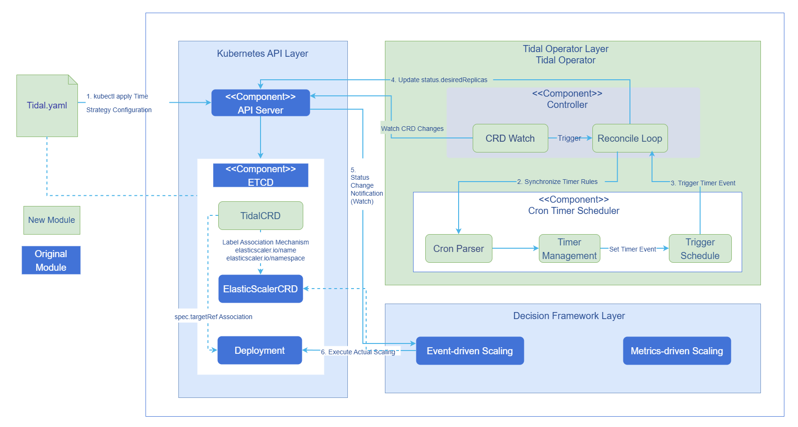
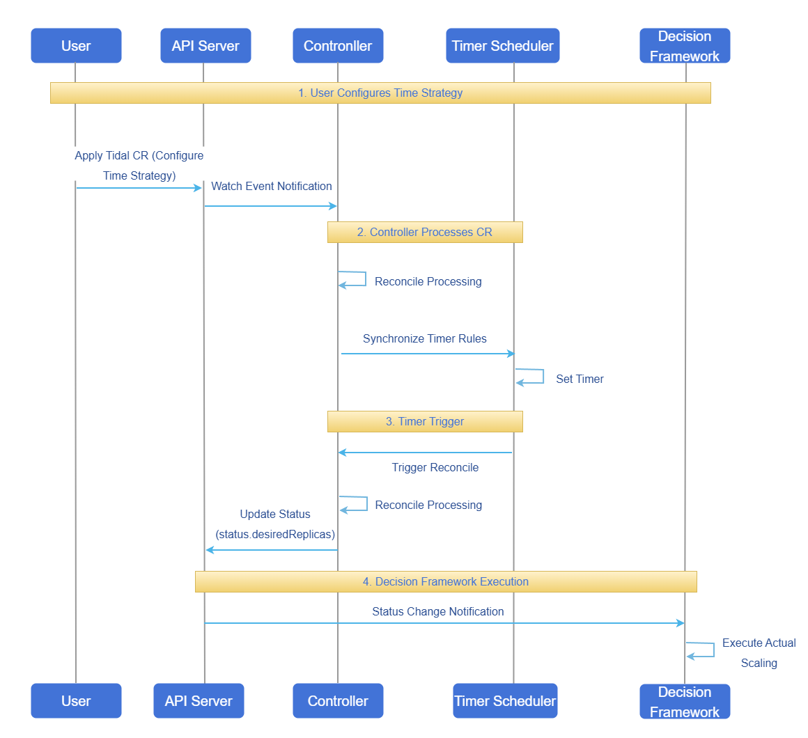

# AI Inference Tidal Algorithm

## Feature Introduction

Tidal is a scheduled scaling algorithm designed for workloads with distinct tidal (periodic peak/off-peak) characteristics. Users write Tidal CRDs to scale scalable target workloads (such as Deployment, StatefulSet, ResourceScalingGroup, etc.) to specified replica counts at designated time points. The current version primarily considers time-based factors, making it suitable for scenarios with clear workload patterns that can be pre-planned through time configuration. The Tidal Controller is only responsible for calculating the desired replicas and writing them into the status field; actual scaling is executed by the general decision framework ElasticScaler. Binding with ElasticScaler resources is achieved through the CRD's `metadata.labels` (`elasticscaler.io/name`, `elasticscaler.io/namespace`), and ElasticScaler uniformly consumes scaling decisions.
> **Note:**<br/>openFuyao defines a custom resource named ResourceScalingGroup (abbreviated as RSG) in Kubernetes. For detailed introduction and usage of this resource, please refer to the documentation: [ResourceScalingGroup - Resource Group Scaling](../../ai_inference_resourcescalinggroup/user_guide/ai_inference_resourcescalinggroup.md). Any subsequent mention of RSG or ResourceScalingGroup in this document refers to this custom resource object.
### Application Scenarios

- Morning/evening peak hours, event days, and other scenarios with clear business time patterns, requiring proactive scaling before peaks and scale-down during off-peak periods.
- Multi-stage resource strategies such as workday/weekend, holidays, warm-up/peak/wrap-up periods, requiring different replica counts set at specific time points.
- Clusters with existing ElasticScaler that want to add time-policy-based scaling capabilities to work alongside existing metric-based policies.

### Capability Scope

- Provides time-driven scaling decisions based on the standard CRD (Tidal), without relying on historical metric prediction, suitable for scenarios with clear business time patterns (such as morning/evening peaks, event days, etc.).
- Supports scalable resources such as Deployment, StatefulSet, ResourceScalingGroup as targets, working with the ElasticScaler framework for unified elastic management.
- Supports combining multiple time rules (rules) to build multi-stage resource strategies for workday/weekend, holidays, warm-up/peak/wrap-up periods.
- Supports 6-field CRON expressions with second-level precision, and enforces timezone configuration to ensure consistent behavior across environments.
- Supports conflict resolution strategy when multiple rules trigger at the same time point (taking the maximum replica count), ensuring business capacity safety even under complex rules.
- Provides observable scaling intent through Status fields (such as `desiredReplicas`, `activeRule`, `lastTriggerTime`, `nextTriggerTime`) for troubleshooting and auditing.

### Highlight Features

- **Focused on "time dimension" tidal scheduling**: Compared to traditional real-time metric-based auto-scaling, it is more suitable for scenarios with clear business calendars (workday/weekend/event periods), enabling proactive scaling before peaks and timely scale-down during off-peak periods.
- **Deep integration with ElasticScaler**: Through the two standard labels `elasticscaler.io/name` and `elasticscaler.io/namespace`, Tidal resources are decoupled and bound to ElasticScaler resources. ElasticScaler is responsible for orchestrating time policies together with other metric-based policies.
- **Strictly constrained timezone + 6-field CRON syntax**: Built-in validation rules prevent time deviation issues caused by missing timezone or 5-field CRON expressions.

### Implementation Principle

This section explains the implementation principle of the tidal algorithm from both logical view and runtime view perspectives.

#### Logical View

The logical view illustrates the core components and their interactions in the time-policy-based tidal scheduling decision algorithm. The system adopts a layered architecture design, consisting of the user layer, Kubernetes API layer, tidal algorithm layer (Tidal Controller and Timer Scheduler), and decision framework integration layer. Each layer interacts through standard Kubernetes API mechanisms (Watch, Reconcile). The Controller is responsible for watching CR changes and coordinating scheduled rules, the Timer Scheduler handles CRON expression parsing and scheduled triggering, and finally integrates with the decision framework through the label mechanism to achieve automatic scaling of the target Deployment.

**Figure 1** Tidal Algorithm Logical View



#### Runtime View

The runtime view shows the complete runtime process from user configuration to final scaling execution through a sequence diagram, which can be divided into four stages overall.

1. The user configures the Tidal CR through YAML and submits it to the APIServer.
2. The Controller senses CR changes through the Watch mechanism, triggers Reconcile processing, and synchronizes time rules to the internal TimerScheduler.
3. The TimerScheduler sets timers based on CRON expressions, and notifies the Controller when the trigger time is reached.
4. The Controller updates Tidal's Status and desired replica count; ElasticScaler and other decision frameworks watch the status changes and execute actual Pod scaling operations.

**Figure 2** Tidal Algorithm Runtime Sequence Diagram


### Relationship with Related Features

**ElasticScaler**: Tidal resources depend on ElasticScaler to complete actual scaling. Tidal resources are only responsible for calculating desired replicas based on time policies and writing them into `status`, without directly modifying target resources; after binding to a specified ElasticScaler resource through `elasticscaler.io/name` and `elasticscaler.io/namespace` in `metadata.labels`, ElasticScaler watches Tidal resource's `status.desiredReplicas` and other statuses through the Watch mechanism, and executes actual scaling on the target resource pointed to by `spec.targetRef`. ElasticScaler must be deployed and configured before using Tidal.

## Installation

### Prerequisites

- An available Kubernetes cluster with `kubectl` and `helm` installed.
- Network environment configured to access `cr.openfuyao.cn`.

### Getting Started with Installation

Create the namespace `scaling-system` (if it does not exist):

```bash
kubectl create namespace scaling-system
```

Two deployment methods are supported: deploying via the pd-orchestrator unified chart (with selectable sub-components), or deploying the Tidal component separately from the source repository.

#### Method 1: Deploy via pd-orchestrator Chart

Installing the pd-orchestrator chart from the OCI repository will install three Controllers by default: **elastic-scaler**, **resourcescalinggroup**, and **tidal**. Since Tidal depends on ElasticScaler to complete actual scaling, **it is recommended to deploy Tidal together with ElasticScaler**; ResourceScalingGroup (RSG) can be selectively deployed as needed.

For full capability (Tidal + ElasticScaler), use the default installation.

```bash
helm install orchestrator oci://cr.openfuyao.cn/charts/pd-orchestrator --version 0.0.0-latest
```

If only the Tidal Controller needs to be deployed, you can enable sub-components on demand through `--set` switches, for example, enabling only the Tidal Controller.

```bash
helm install orchestrator oci://cr.openfuyao.cn/charts/pd-orchestrator --version 0.0.0-latest \
  --set elastic-scaler.enabled=true \
  --set resourcescalinggroup.enabled=false \
  --set tidal.enabled=true
```

> **Note:**<br/> ElasticScaler typically only points to one scaling target. When using tidal, the Tidal resource is associated with a specific ElasticScaler through labels, and that ElasticScaler executes scaling on the same target; if a default ElasticScaler example CR is also created during installation (used for HPA to scale RSG groups), it will conflict or overlap with the ElasticScaler used by tidal. **It is recommended that one scaling target corresponds to only one ElasticScaler resource**, and users should create that ElasticScaler CR themselves and bind it with the Tidal resource's labels; therefore, the default ElasticScaler CR during installation should be disabled. When `resourcescalinggroup.enabled=false`, RSG is not deployed, and `resourcescalinggroup.instanceConfig.enabled` naturally does not take effect; but when `elastic-scaler.enabled=true`, you still need to **separately** set `elastic-scaler.elasticScaler.enabled=false` to avoid creating the default ElasticScaler example CR. Example:

```bash
helm install orchestrator oci://cr.openfuyao.cn/charts/pd-orchestrator --version 0.0.0-latest \
  --set elastic-scaler.enabled=true \
  --set resourcescalinggroup.enabled=false \
  --set tidal.enabled=true \
  --set elastic-scaler.elasticScaler.enabled=false
```

#### Method 2: Standalone Component Deployment (from Source)

After cloning the code from the ElasticScaler repository, navigate to the `charts/elastic-scaler/charts/tidal` path and execute `helm install` in that directory to deploy only the Tidal Controller.

```bash
git clone https://gitcode.com/openFuyao/elastic-scaler.git
cd elastic-scaler/charts/elastic-scaler/charts/tidal
helm install tidal . -n <namespace>
```

This method only installs the Tidal component. If actual scaling capability is needed, ElasticScaler must be deployed separately and the Tidal CR's labels must be correctly bound to the ElasticScaler resource.

<a id="helm-params"></a>
#### Key Parameter Description

**Table 1** Helm Key Parameter Description

| Parameter Key | Description |
| --- | --- |
| `orchestrator` | Helm Release name, can be modified as needed. |
| `--version 0.0.0-latest` | Install the latest version of orchestrator (which includes the three Controllers above). |
| `--set elastic-scaler.enabled` / `--set resourcescalinggroup.enabled` / `--set tidal.enabled` | Set to `true` or `false` as needed to control whether to deploy the corresponding Controller; all are enabled by default when not specified. |
| `--set resourcescalinggroup.instanceConfig.enabled` | Control whether to install the ResourceScalingGroup default example CR. If primarily using Tidal/ElasticScaler for tidal scaling, it is recommended to keep the default value when `--set resourcescalinggroup.enabled=false` (at this point RSG is not deployed, and instanceConfig no longer takes effect). |
| `--set elastic-scaler.elasticScaler.enabled` | Control whether to install the ElasticScaler default example CR. Since ElasticScaler typically only points to one scaling resource, if using Tidal to bind a custom ElasticScaler for tidal scaling, it is recommended to explicitly set this value to `false` to avoid conflicts between the default ElasticScaler example CR and the ElasticScaler in the tidal scenario. |

#### Verifying Deployment

After completing the installation, you can verify whether the Tidal Controller is running normally through the following steps.

- Check Pod status (using namespace `scaling-system` as an example).

  ```bash
  kubectl get pods -n scaling-system | grep tidal
  ```

  You should see Pods with `tidal` in their names and `STATUS` as `Running`.

- Check Controller logs to confirm there are no continuous errors (replace `<pod-name>` or `<deployment-name>` with the actual deployment name).

  ```bash
  # View Pod logs
  kubectl logs -n scaling-system <pod-name>

  # Or view Pod list via Deployment then view logs
  kubectl get deploy -n scaling-system
  kubectl logs -n scaling-system deploy/<deployment-name>
  ```

If Pods are not in Running status or there are many errors in the logs, you can prioritize checking:

- Whether the namespace is correct during Helm installation.
- Whether the cluster's access to `cr.openfuyao.cn` is normal (whether images are pulled successfully).
- Whether there are conflicts with existing ElasticScaler/ResourceScalingGroup deployments in the cluster.

## Using AI Inference Tidal Algorithm

### Prerequisites

- The installation steps described earlier in this guide have been completed, and Tidal Controller and ElasticScaler are running normally.
- During installation, the default ElasticScaler/ResourceScalingGroup example CRs that conflict with the tidal scenario have been disabled as recommended in [Key Parameter Description](#helm-params).
- At least one target workload to be scaled (such as Deployment, StatefulSet, etc.) exists in the cluster.

### Background Information

- Tidal describes time policy rules through CRs, and ElasticScaler watches the `status.desiredReplicas` and other fields of Tidal resources through the Watch mechanism, executing actual scaling on the target resource pointed to by `spec.targetRef`.
- This capability is applicable to scenarios where workloads have distinct time patterns (such as morning/evening peaks, event days, etc.). The current version only considers the time dimension and does not make comprehensive decisions based on real-time metrics.
- Time rules are configured through "timezone prefix + 6-field CRON expression", with the format:

  ```text
  CRON_TZ=<timezone> seconds minutes hours day month weekday
  ```

  Example (weekdays daily 8:00 trigger):

  ```text
  CRON_TZ=Asia/Shanghai 0 0 8 * * 1-5
  └────────────timezone─── ┘ │ │ │ │ │ └─ weekday (1-5 means Monday to Friday)
                        │ │ │ │ └── month
                        │ │ │ └──── day
                        │ │ └────── hour
                        │ └──────── minute
                        └────────── second
  ```

### Usage Limitations

- Currently only supports **fixed replica count setting based on time policies**, not dynamic curve adjustment within time periods.
- A single ElasticScaler resource typically only points to one scaling target; the same target should not be simultaneously controlled by multiple ElasticScaler/Tidal/HPA policies to avoid policy conflicts.
- CRON expressions must use **timezone prefix + 6-field format**, and must include the seconds field; incorrect expressions will cause time policies to not take effect.
- The Tidal Controller is only responsible for calculating desired replicas and writing them to Status, without directly modifying target resources; if ElasticScaler is not correctly deployed or bound, time policies will not actually take effect.

### Operation Steps

1. Write the Tidal CR.

   Below is a Tidal example closer to a real production environment scenario, used to set different replica counts at different time periods.

   - Scale up to 10 replicas before weekday morning peak (8:00).
   - Scale up to 20 replicas for weekday evening peak (20:00).
   - Scale down to 2 replicas at 1:00 AM daily to save resources.

   ```yaml
   apiVersion: tidal.io/v1alpha1
   kind: Tidal
   metadata:
     name: ecommerce-traffic-tidal
     namespace: scaling-system
     labels:
       elasticscaler.io/name: ecommerce-traffic-elasticscaler
       elasticscaler.io/namespace: scaling-system
   spec:
     targetRef:
       apiVersion: apps/v1
       kind: Deployment
       name: ecommerce-frontend
       namespace: production

     triggers:
       times:
         rules:
           - name: workday-morning-base
             cron: "CRON_TZ=Asia/Shanghai 0 0 8 * * 1-5"
             replicas: 10
             description: "Scale up to 10 replicas before weekday morning peak, ensuring daytime traffic"

           - name: workday-evening-peak
             cron: "CRON_TZ=Asia/Shanghai 0 0 20 * * 1-5"
             replicas: 20
             description: "Scale up to 20 replicas for weekday evening peak, handling evening access surge"

           - name: nightly-offpeak
             cron: "CRON_TZ=Asia/Shanghai 0 0 1 * * *"
             replicas: 2
             description: "Scale down to 2 replicas at 1 AM daily, saving resources"
   ```
   **Table 2** Tidal CR Field Description
    
    | Field Path | Required | Description                                                       |
    | --- | --- |----------------------------------------------------------|
    | `metadata.name` | Yes | Tidal resource name, unique within the namespace.                                      |
    | `metadata.namespace` | Yes | Namespace where Tidal resides. It is recommended to keep it consistent with the ElasticScaler namespace or plan according to operational standards.            |
    | `metadata.labels.elasticscaler.io/name` | Yes | Name of the bound ElasticScaler resource; ElasticScaler will watch this Tidal resource's status. |
    | `metadata.labels.elasticscaler.io/namespace` | Yes | Namespace of the bound ElasticScaler resource.                                  |
    | `spec.targetRef.apiVersion` | Yes | APIVersion of the target workload.                                       |
    | `spec.targetRef.kind` | Yes | Target workload type, such as Deployment, StatefulSet, ResourceScalingGroup, etc.  |
    | `spec.targetRef.name` | Yes | Target workload name.                                                |
    | `spec.targetRef.namespace` | Yes | Target workload namespace.                                              |
    | `spec.triggers.times.rules[].name` | Yes | Time rule name, should be unique within the same Tidal resource, used for troubleshooting and identifying the current rule in status.              |
    | `spec.triggers.times.rules[].cron` | Yes | 6-field CRON expression with timezone prefix, controlling rule trigger time.                                |
    | `spec.triggers.times.rules[].replicas` | Yes | Desired target replica count when the rule is triggered.                                         |
    | `spec.triggers.times.rules[].description` | No | Rule description, helping the team understand the business meaning of the rule.                                     |

2. Create the resource.

   ```bash
   kubectl apply -f ecommerce-traffic-tidal.yaml
   ```

3. View and verify the Tidal resource status.

   ```bash
   kubectl get tidal ecommerce-traffic-tidal -n scaling-system -o yaml
   ```

   > **Note:**<br/>
   > `status.desiredReplicas`: Current desired replica count calculated by time strategy.<br/>
   > `status.activeRule`: Name of the currently active time rule.<br/>
   > `status.lastTriggerTime`: Last time rule trigger timestamp.<br/>
   > `status.nextTriggerTime`: Next estimated trigger timestamp.<br/>
   > When a time rule trigger point is reached, `desiredReplicas` and `activeRule` are updated; ElasticScaler watches the state change and executes actual scaling on the `spec.targetRef`-pointed Deployment/StatefulSet etc.

4. Adjust rules based on business needs.

   - You can edit the CR (`kubectl edit tidal ...`) or re-`apply` to update the CRON expressions and replica counts in `rules`.
   - It is recommended to conduct a small-scale drill during low-risk time periods first, and apply to production traffic only after confirming that scaling time points match expectations.

### Follow-up Operations

- Periodically review and adjust Tidal resource time rules based on business changes to avoid long-term retention of historical event rules.
- When a time policy is no longer needed, you can delete the corresponding Tidal CR:

  ```bash
  kubectl delete tidal ecommerce-traffic-tidal -n scaling-system
  ```

### Related Operations

- Run the following command to view all Tidal instances:

  ```bash
  kubectl get tidal -A
  ```

- Run the following command to view details of a single instance:

  ```bash
  kubectl describe tidal ecommerce-traffic-tidal -n scaling-system
  ```