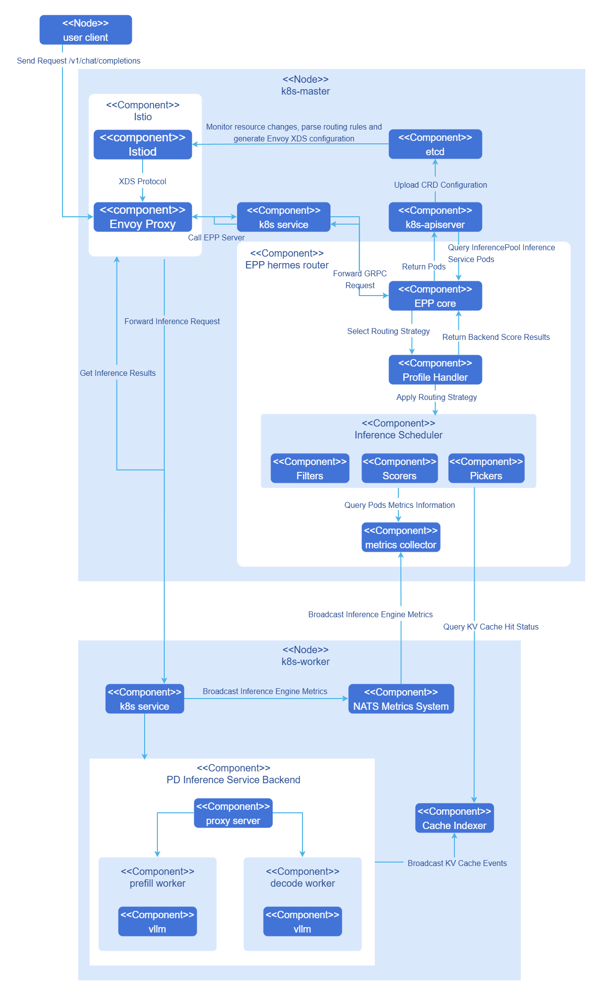
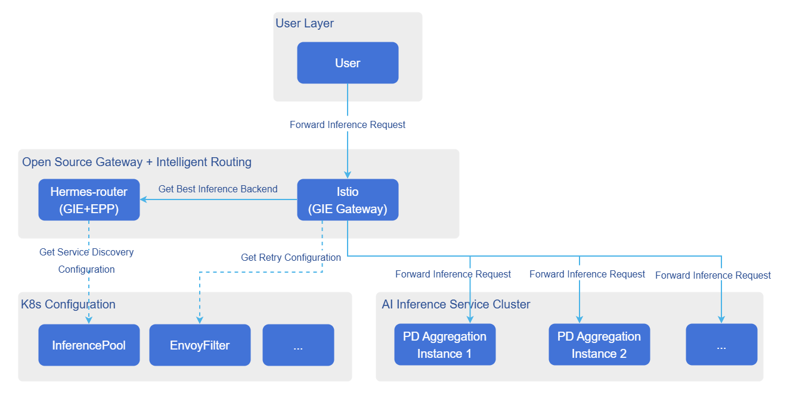
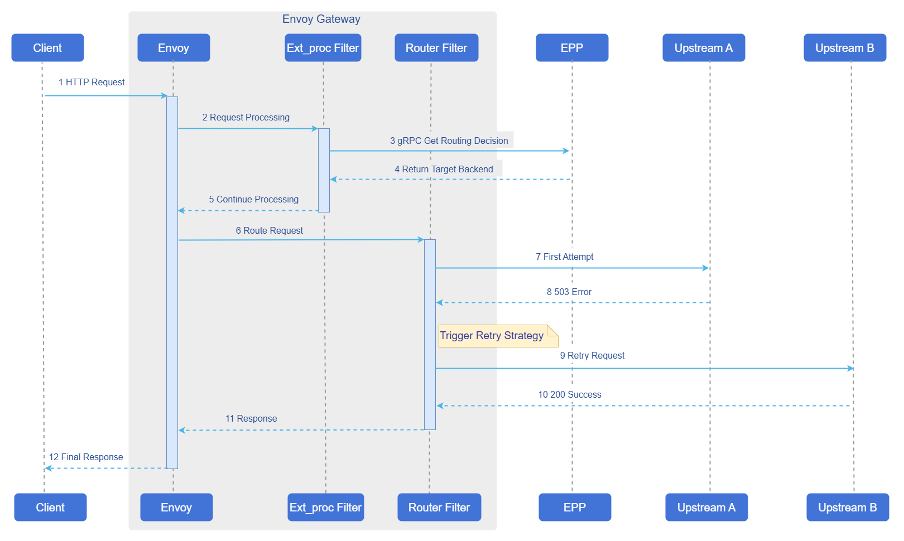

# AI Inference Hermes Routing

## Feature Introduction

Hermes-router is a Kubernetes (K8s) native AI inference intelligent routing solution designed to receive user inference requests and forward them to appropriate inference service backends.

- Architecturally, Hermes-router follows the K8s gateway API inference extension (GIE) framework and serves as a pluggable and extensible EndPointPicker (EPP) component, maximizing compatibility with the K8s ecosystem.
- Capability-wise, Hermes-router provides multiple AI inference routing strategies such as KVCache aware, PD bucket scheduling, and latency prediction, helping users improve AI inference performance, cluster resource utilization, and service stability in various cloud-native scenarios.

### Application Scenarios

Hermes-router is suitable for deploying and running AI inference services in Kubernetes cluster environments, including the following specific scenarios.

- Cloud-native AI inference services: Deploying large language model (LLM) inference services in K8s clusters, requiring intelligent routing capabilities to optimize request distribution and resource utilization.
- Multi-instance inference backends: Intelligently routing inference requests to multiple inference service instances (supporting aggregate architecture or PD separation architecture) to achieve load balancing and performance optimization.
- High concurrency inference scenarios: In business scenarios with mixed long and short requests and medium to high concurrency, requiring intelligent scheduling based on request characteristics and instance load status to improve inference throughput.
- KVCache aware optimization scenarios: In scenarios with many repeated requests, utilizing KVCache hit rate information for routing optimization to improve inference performance and resource utilization.
- Latency prediction optimization scenarios: In scenarios requiring comprehensive consideration of instance load, cache status, and inference latency, selecting better inference backends through latency prediction routing strategies.
- Gateway integration scenarios: Existing K8s gateway infrastructure, requiring the addition of AI inference routing capabilities without affecting the original gateway.
- Lightweight standalone deployment scenarios: No need to deploy additional gateway resources such as Istio or HTTPRoute; inference request forwarding can be completed through the EPP entry point.

### Capability Scope

- Supports deployment and use in K8s clusters in two modes: standalone mode or Gateway mode.
- Supports user configuration of multiple routing strategies for openAI API-style AI inference requests.
- Currently only exposes the following inference interfaces externally: `/v1/chat/completions`, `/v1/completions`. This interface does not involve authentication and log auditing capabilities; related user management capabilities are provided uniformly by the upstream user management plane.

### Software Dependencies

In Gateway-based deployment mode, Hermes-router serves as the EPP component of the GIE framework and needs to be used with open-source gateways that support Gateway API Inference Extension. Table 1 lists the version requirements for optional open-source gateways and their dependent components in Gateway-based deployment mode.

**Table 1** Optional Open-Source Gateways and Dependent Component Versions

| Gateway | Gateway Version | Gateway API | GIE | Kubernetes |
|---------|-----------------|-------------|-----|------------|
| Istio | 1.27+ | 1.4.0+ | 1.0+ | 1.29+ |
| Nginx Gateway Fabric | 2.2+ | 1.3.0+ | 1.0+ | 1.25+ |
| Envoy AI Gateway | 0.4+ | 1.4.0+ | 1.0+ | 1.32+ |
| Kgateway | 2.1+ | 1.3.0+ | 1.0+ | 1.29+ |

>  **Note:**<br>
> The versions in the table are the minimum verified versions. It is recommended to use the latest version of open-source gateways for the best experience. Standalone mode does not require dependencies on open-source gateways.

### Key Features

This section mainly highlights features independent of the GIE framework.

- Feature design follows the GIE framework, naturally supporting the K8s gateway system and integration with multiple open-source gateways. In clusters with existing gateways, it can be added as a pluggable capability, increasing AI inference routing capabilities without affecting the original gateway.
- Provides multiple innovative routing strategies supporting aggregate and PD inference backend architectures, helping users improve performance in various business scenarios.
    - KVCache aware (aggregate/PD): Provides KVCache aware routing strategies that allow user-defined scoring functions, improving inference performance in repeated request scenarios.
    - PD bucket scheduling routing (PD): Provides bucket scheduling strategies that allow user-defined parameters, improving inference throughput in mixed long and short request scenarios with medium to high concurrency.
    - Latency prediction routing strategy (aggregate/PD): Makes routing decisions based on real-time instance metrics, cache status, and latency prediction results, helping users further optimize inference latency and resource utilization.
- Dynamic inference service discovery: Allows users to add/remove inference backends at runtime and flexibly adjust inference resource investment.

### Implementation Principle

**Figure 1** Hermes-router Architecture



Hermes-router integrates into open-source gateways as an EPP component. The following explains the internal principle using a complete inference request in Gateway-based deployment mode as an example.

1. User sends an openAI API request `/v1/chat/completions` to the cluster gateway.
2. Gateway recognizes the request as an inference request and forwards it to the EPP.
3. EPP processes the request according to user-configured routing strategy and selects the most suitable inference backend for handling the inference request.
4. EPP returns the inference backend to the cluster gateway, and the cluster gateway sends the inference request to the target inference backend.
5. Inference backend completes the request and returns it to the gateway, which returns the inference result to the user.

### Relationship with Related Features

- cache-indexer: Required when using KVCache aware and latency prediction type strategies, obtaining KVCache hit rate and related cache information from this component through the `/kv-cache/hit-rate` interface.
- vLLM-ascend: Has the following specific dependencies for this feature.
    - PD proxy service component `proxy-server`: Originally an example component provided by the official vllm for PD separation architecture, acting as a hub to organize P/D instances to complete inference tasks. The openFuyao community has enhanced this component, which now serves as the Leader instance for PD Group to receive gateway inference requests and has the capability to dynamically discover inference service instances based on specified labels.
    - NPU adaptation: When the environment is Ascend NPU, vLLM-ascend needs to be used as the inference engine to start the service.
    - Inference metrics: Depends on the `/metrics` interface provided by vllm to obtain inference service metrics, automatically obtained by the GIE architecture.

## Installation

### EPP Component Standalone Deployment

This section describes how to deploy Hermes-router as an EPP component separately in a Kubernetes cluster. Depending on the integration method, it is divided into standalone mode deployment and Gateway-based EPP deployment.

#### Standalone Mode Deployment

##### Delivery Specification

Hermes-router standalone mode uses a standalone chart for deployment. After deployment is complete, a Pod containing the EPP main container and envoy sidecar will run in the cluster, and the HTTP entry point will be exposed externally through a Service. Users can directly send openAI API-style inference requests to the EPP Service, and the EPP will forward requests to inference backends according to configured routing strategies.

##### Prerequisites

Before starting the installation, ensure the following conditions are met.

- **Environment Requirements**

  - Kubernetes cluster: v1.33.0 or above.
  - Helm tool: Used for deploying Hermes router and related components.

- **Deployment Component Requirements**

  Before deploying Hermes-router, the following components must be installed in the cluster.

  - **Inference backend service**: vLLM or other inference engine services have been deployed in the cluster.
  - **Backend label configuration**: Inference backend instances need to be configured with labels for service discovery. Standalone mode discovers and manages inference backend instances through label selectors.

  > **Note:**<br/>
  > If you need to use KVCache aware or latency prediction routing strategies, please refer to the [Installing Supporting Components](#installing-supporting-components) section to deploy cache-indexer and other related components.

- **Hardware Requirements**

  Hermes-router itself has no special hardware environment requirements. As a lightweight routing component, it can run on standard x86 or ARM architecture nodes.

##### Quick Installation of Hermes Router

Hermes-router standalone mode supports reusing a unified routing strategy configuration file. Users can obtain chart packages and preset routing strategy configuration files from the [openFuyao GitCode repository](https://gitcode.com/openFuyao/hermes-router) according to business scenarios.

1. Clone the project from the repository.

   ```bash
   git clone https://gitcode.com/openFuyao/hermes-router.git
   ```

2. Install and deploy.

   Taking release name `hermes-router` as an example, execute the following command in the `hermes-router` root directory.

   ```bash
   cd hermes-router
   helm dependency build ./charts/standalone
   helm install -n <NAMESPACE> hermes-router ./charts/standalone \
     -f ./examples/profiles/<routing-strategy-file-name> \
     --set inferenceExtension.endpointsServer.createInferencePool=false \
     --set inferenceExtension.endpointsServer.endpointSelector='openfuyao.com/model=qwen-qwen3-8b' \
     --set inferenceExtension.endpointsServer.targetPorts=8000
   ```

   Parameter descriptions are as follows.

   - `<NAMESPACE>`: Target namespace for deployment (e.g., `ai-inference`).
   - `<routing-strategy-file-name>`: Use the strategy files in **Table 2** directly; the repository provides examples in the `examples/profiles/` directory (see [profiles directory](https://gitcode.com/openFuyao/hermes-router/tree/master/examples/profiles)), which can be reused or customized as needed.
   - `inferenceExtension.endpointsServer.endpointSelector`: Label selector for discovering inference backend instances, must match backend Pod labels.
   - `inferenceExtension.endpointsServer.targetPorts`: Port where the inference backend provides services externally, default value is `8000`.

   **Table 2** Preset Routing Strategy List

    | Strategy File | Strategy Name | Applicable Scenarios | Description |
    |---------------|---------------|----------------------|-------------|
    | `aggregate-random.yaml` | Aggregate architecture random routing | Aggregate architecture basic load balancing | Randomly selects inference backend instances in aggregate architecture to achieve basic load balancing. |
    | `aggregate-kv-cache-aware.yaml` | Aggregate architecture KVCache aware routing | Aggregate architecture KVCache optimization | Intelligently selects the best inference service instance by combining KVCache hit rate, XPU cache usage, waiting request count, and in-flight request count. |
    | `aggregate-prediction.yaml` | Aggregate architecture latency prediction routing | Aggregate architecture latency optimization | Selects the best inference backend based on latency prediction results and real-time metrics, suitable for aggregate architecture. |
    | `pd-random.yaml` | PD architecture random routing | PD architecture basic load balancing | Randomly selects inference backend instances by role in PD separation architecture. |
    | `pd-kv-cache-aware.yaml` | PD architecture KVCache aware routing | PD architecture KVCache optimization | Performs routing optimization by combining KVCache hit rate, load, and other information from Prefill and Decode instances. |
    | `pd-bucket.yaml` | PD bucket scheduling routing | Mixed long and short requests, medium to high concurrency scenarios | Scores based on request length bucketing and instance load status, supports TP heterogeneous PD separation architecture. |
    | `pd-prediction.yaml` | PD architecture latency prediction routing | PD architecture latency optimization | Selects the best Prefill/Decode instance based on latency prediction results, prefix cache information, and real-time metrics. |

3. Verify deployment.

   ```bash
   # Check Pod running status
   kubectl get pods -n <NAMESPACE> -l epp=hermes-router

   # Check Service resources
   kubectl get svc -n <NAMESPACE> hermes-router
   ```

    > **Note:**<br/> In standalone mode, the EPP Service exposes port `8081` by default for receiving inference requests. Users can access it directly through this Service in the cluster, or further expose it as NodePort or LoadBalancer type service as needed.

#### Gateway-Based EPP Deployment

##### Delivery Specification

Hermes-router is deployed as a standalone EPP component in the cluster, requiring the cluster to have an Envoy-based Gateway, Gateway API and Inference Extension CRDs, and inference backend services. After deployment, Hermes-router provides multiple AI inference intelligent routing strategies (random routing, KVCache aware, PD bucket scheduling, latency prediction routing, etc.), dynamically discovers and manages inference backends through InferencePool, and integrates with the cluster gateway through HTTPRoute.

##### Prerequisites

Before starting the installation, ensure the following conditions are met.

- **Environment Requirements**

  - Kubernetes cluster: v1.33.0 or above.
  - Cluster administrator permissions: Used for installing CRDs and cluster-level resources.
  - Helm tool: Used for deploying Hermes router and related components.

- **Deployment Component Requirements**

  Before deploying Hermes-router, the following components must be installed in the cluster.

  - **Envoy-based gateway**: A gateway supporting ExtProc protocol has been deployed in the cluster (e.g., Istio, Envoy Gateway, etc.). Hermes-router interacts with the gateway through ExtProc (gRPC).
  - **Gateway API CRDs**: Kubernetes Gateway API core resource definitions have been installed.
  - **Inference Extension CRDs**: Gateway API Inference Extension has been installed, providing inference extension resource definitions such as InferencePool.
  - **Inference backend service**: vLLM or other inference engine services have been deployed in the cluster.

  > **Note:**<br/>
  > If the above components have not been installed in the cluster, please refer to the [Installing Supporting Components](#installing-supporting-components) section to complete the installation.

- **Hardware Requirements**

  Hermes-router itself has no special hardware environment requirements. As a lightweight routing component, it can run on standard x86 or ARM architecture nodes.

##### Quick Installation of Hermes Router

Hermes-router supports multiple routing strategies. Users can obtain chart packages and preset routing strategy configuration files from the [openFuyao GitCode repository](https://gitcode.com/openFuyao/hermes-router) according to business scenarios.

1. Clone the project from the repository.

   ```bash
   git clone https://gitcode.com/openFuyao/hermes-router.git
   ```

2. Install and deploy.

   Taking release name `hermes-router` as an example, execute the following command in the `hermes-router` root directory.

   ```bash
   cd hermes-router
   helm dependency build ./charts/hermes-router
   helm install -n <NAMESPACE> hermes-router ./charts/hermes-router \
     -f ./examples/profiles/<routing-strategy-file-name>
   ```

   Parameter descriptions are as follows.

   - `<NAMESPACE>`: Target namespace for deployment (e.g., `ai-inference`).
   - `<routing-strategy-file-name>`: Use the strategy files in **Table 2** directly; the repository provides examples in the `examples/profiles/` directory, which can be reused or customized as needed.

3. Verify deployment.

   ```bash
   # Check Pod running status
   kubectl get pods -n <NAMESPACE> -l inferencepool=<INFERENCEPOOL_NAME>-epp

   # Check InferencePool resources
   kubectl get inferencepool -n <NAMESPACE>

   # Check HTTPRoute resources
   kubectl get httproute -n <NAMESPACE>
   ```

> **Note:**<br/> The EPP Pod label format is `inferencepool=<INFERENCEPOOL_NAME>-epp`, where `<INFERENCEPOOL_NAME>` is the name of the InferencePool resource.

> **Notice:**<br/>
> When deploying Hermes router, you need to correctly configure HTTPRoute and InferencePool CR.
> - HTTPRoute needs to be associated with the Gateway resource in the cluster through parentRef.
> - InferencePool needs to be configured with the correct label selector (matchLabels) to discover and manage inference backend instances.
> - For detailed configuration of routing strategies, please refer to the [Configuring Routing Strategies](#configuring-routing-strategies) section.

### InferNex Integrated Deployment

This section describes how to deploy Hermes-router through InferNex integration.

#### Delivery Specification

InferNex is a complete AI inference service integrated deployment package that provides one-click deployment of gateway, Hermes-router, HTTPRoute/InferencePool and other K8s resources, as well as inference backend services. It provides an end-to-end AI inference solution, integrating gateway, intelligent routing, and inference services, ready to use out of the box.

When the environment does not have a gateway and inference backend yet and requires out-of-the-box deployment, you can directly use InferNex to complete the integrated deployment. Please refer to [Installation and Configuration Guide](../../ai_inference_infernex/user_guide/ai_inference_infernex.md).

#### Prerequisites

* Kubernetes v1.33.0 or above.
* Kubernetes Gateway API CRDs: Provides core resource definitions for Gateway API.
* Gateway API Inference Extension CRDs: Provides inference extension resource definitions such as InferencePool.
* At least one inference chip per inference node.
* At least 16GB memory and 4 CPU cores per inference node.
* Online installation requires access to the image repository: oci://cr.openfuyao.cn.
* Users need permissions to create RBAC resources.

#### Quick Installation of InferNex

InferNex provides the following two ways for integrated deployment.

- Obtain the project installation package from the openFuyao official image repository.

  1. Pull the project installation package.

      ```bash
      helm pull oci://cr.openfuyao.cn/charts/infernex --version xxx
      ```
      Where `xxx` needs to be replaced with the specific project installation package version, such as `0.21.1`. The pulled installation package is in compressed package format.

  2. Extract the installation package.

      ```bash
      tar -xzvf infernex-xxx.tgz
      ```
        Where `xxx` needs to be replaced with the specific project installation package version, such as `0.21.1`.

  3. Install and deploy.

      Taking release name `infernex` as an example, please ensure the following operations are completed before installation.
      - The cluster has created the namespace `istio-system` (Istio Gateway resources must be deployed in this namespace).
      - Except for gateway-related resources, other components (such as inference-backend, hermes-router, cache-indexer, etc.) will be deployed through the namespace where the Helm release is located, this document uses `ai-inference` as an example.

      Execute the following command in the same level directory as `infernex`.
      ```bash
      helm install -n ai-inference infernex ./infernex
      ```

- Obtain from openFuyao GitCode repository.

  1. Clone the project from the repository.

      ```bash
      git clone https://gitcode.com/openFuyao/InferNex.git
      ```

  2. Install and deploy.
      Taking release name `infernex` as an example, please ensure the cluster has created the namespace `istio-system` before installation. Gateway-related resources will be deployed in the `istio-system` namespace, and other components will be deployed through the namespace where the Helm release is located. Execute the following command in the `InferNex/charts/infernex` directory.
      ```bash
      cd InferNex/charts/infernex
      helm dependency build
      helm install -n ai-inference infernex .
      ```

### Installing Supporting Components

If your cluster has not yet deployed gateways, inference backends, and other supporting components, please complete the installation according to this section.

#### Open-Source Gateway Installation

Hermes-router needs to be used with open-source gateways that support **Kubernetes Gateway API** and **Gateway API Inference Extension**. This document uses **Istio** as an example to introduce the installation and deployment process.

1. Install Istio and enable Gateway API Inference Extension support.

    ```bash
    ISTIO_VERSION=1.28.0
    curl -L https://istio.io/downloadIstio | ISTIO_VERSION=${ISTIO_VERSION} sh -

    ./istio-$ISTIO_VERSION/bin/istioctl install \
      --set values.pilot.env.ENABLE_GATEWAY_API_INFERENCE_EXTENSION=true \
      --set values.gateways.istio-ingressgateway.type=NodePort
    ```
  
    > **Notice:**<br/>
    > Please use an Istio version that supports Inference Extension, and adjust the gateway exposure method according to the cluster network environment.

2. Verify installation.

    Verify Istio installation.

    ```shell
    kubectl get pods -n istio-system
    ```

3. Configure gateway entry resources.

    After completing the infrastructure installation, please create Gateway, GatewayClass, and related entry resources according to the official documentation of the selected open-source gateway, and ensure that HTTPRoute can be associated with the corresponding Gateway through parentRef.
    
Notes on open-source gateways are as follows.

- **Istio version**: Need to use an Istio version that supports Inference Extension.
- **Permission requirements**: Installing CRDs requires cluster administrator permissions.
- **Other open-source gateways**: Besides Istio, users can choose open-source gateways that support Gateway API and Gateway API Inference Extension according to their needs. When configuring, just set `gateway.className` to the corresponding GatewayClass name.

#### Inference Engine Backend Installation

Hermes-router currently supports vLLM inference engine, supporting both aggregate and PD separation architectures. The deployment method for inference backends is related to models, hardware resources, and business forms. It is recommended to refer to the [InferNex User Guide](../../ai_inference_infernex/user_guide/ai_inference_infernex.md) to complete inference backend deployment.

In PD separation architecture, please ensure that the proxy service and backend components can recognize and forward new request headers added by EPP to achieve precise routing to Prefill and Decode instances.

#### Installing cache-indexer (Optional)

When using KVCache aware or latency prediction routing strategies, Hermes-router needs to install the cache-indexer component to obtain global KVCache information. The installation steps are as follows.

1. Obtain the openFuyao cache-indexer component Helm chart deployment package.

    ```shell
    helm fetch oci://cr.openfuyao.cn/charts/cache-indexer --version 0.0.0-latest
    ```

2. Configure cache-indexer to correctly provide global KVCache hit rate calculation service. Open the `charts/cache-indexer/values.yaml` file in the helm chart obtained in the previous step for configuration. The following describes the parameters that must be configured.
    ```yaml
    app:
      serviceDiscovery: # This type of configuration is used to dynamically discover inference service instances and subscribe to kv cache messages
        labelSelector: "openfuyao.com/model=qwen-qwen3-8b" # Dynamically discover inference instance Pods with this label
        portName: "zmq-pub" # Subscribe to kv cache messages from vllm ports with this name;
        refreshInterval: 10 # Subscription interval (s)

    service:
      name: cache-indexer-service # Runtime service resource name, hermes-router requests cache-indexer through this name
      port: 8080 # External port

    # ... other configurations
    ```

3. Deploy cache-indexer.

    ```shell
    helm upgrade --install cache-indexer ./charts/cache-indexer \
        -n ${NAMESPACE} --create-namespace
    ```

4. Check deployment results.

    Confirm that the Pod is running normally and the logs show that the inference service backend instance has been successfully discovered.

## Using AI Inference Services

After deployment is complete, different access paths can be selected according to the deployment method.

### Standalone Mode Access

In standalone mode, users can directly access Pods with the `epp=<RELEASE_NAME>` label. The envoy sidecar in this Pod will receive inference requests on port `8081` and hand them to the EPP to complete routing. The following uses release name `hermes-router` as an example.

1. Execute the following command to get the EPP Pod IP address.

    ```shell
    RELEASE_NAME=hermes-router
    EPP_POD_IP=$(kubectl get pods -n <NAMESPACE> -l epp=${RELEASE_NAME} -o jsonpath='{.items[0].status.podIP}')
    ```

2. Send inference request.

    ```shell
    curl -X POST http://${EPP_POD_IP}:8081/v1/chat/completions \
      -H "Content-Type: application/json" \
      -d '{
        "model": "Qwen/Qwen3-8B",
        "messages": [
          {"role": "user", "content": "Hello"}
        ],
        "max_tokens": 100,
        "temperature": 0.7,
        "stream": false
      }'
    ```

### Gateway-Based Access

In Gateway-based deployment mode, inference requests can be sent to the Inference Gateway in the following two ways.

- LoadBalancer Access

  1. If the cluster supports LoadBalancer, Istio Gateway will automatically create a LoadBalancer type Service.

      ```shell
      # Get External IP
      EXTERNAL_IP=$(kubectl get svc -n istio-system istio-ingressgateway -o jsonpath='{.status.loadBalancer.ingress[0].ip}')
      ```

  2. Send inference request.

      ```shell
      curl -X POST http://${EXTERNAL_IP}/v1/chat/completions \
        -H "Content-Type: application/json" \
        -d '{
          "model": "Qwen/Qwen3-8B",
          "messages": [
            {"role": "user", "content": "Hello"}
          ],
          "max_tokens": 100,
          "temperature": 0.7,
          "stream": false
        }'
      ```

- NodePort Access

  1. Execute the following command to get the node IP address and port.

      ```shell
      kubectl get svc -n istio-system istio-ingressgateway
      ```
      Check the PORT(S) column, for example 80:30080/TCP, where 30080 is the NodePort.

      If there is no ExternalIP, use InternalIP.

      ```shell
      NODE_IP=$(kubectl get nodes -o jsonpath='{.items[0].status.addresses[?(@.type=="InternalIP")].address}')
      NODE_PORT=$(kubectl get svc -n istio-system istio-ingressgateway -o jsonpath='{.spec.ports[?(@.port==80)].nodePort}')
      ```

  2. Send request.

      ```shell
      curl -X POST http://${NODE_IP}:${NODE_PORT}/v1/chat/completions \
        -H "Content-Type: application/json" \
        -d '{
          "model": "Qwen/Qwen3-8B",
          "messages": [
            {"role": "user", "content": "Hello"}
          ],
          "max_tokens": 100,
          "temperature": 0.7,
          "stream": false
        }'
      ```

## Configuring Routing Strategies

Hermes-router's current routing strategies are configured uniformly through `inferenceExtension.routing`. Users need to first determine the deployment mode, then select the corresponding routing strategy type.

**Table 3** Routing Strategy and Deployment Mode Correspondence

| Routing Strategy | Aggregate Architecture | PD Architecture |
|------------------|------------------------|-----------------|
| `random` | Supported | Supported |
| `kv-cache-aware` | Supported | Supported |
| `bucket` | Not Supported | Supported |
| `prediction` | Supported | Supported |

### Basic Configuration Structure

```yaml
inferenceExtension:
  routing:
    deploymentMode: aggregate
    profile: random
```

All routing strategies use `inferenceExtension.routing` as the configuration entry point.

- `deploymentMode`: Declares the deployment mode of inference backends. `aggregate` indicates aggregate architecture, `pd` indicates PD separation architecture.
- `profile`: Declares the type of routing strategy to enable.

Besides these two basic fields, other configuration items are determined by specific strategies. For routing strategies that depend on tokenization or latency prediction capabilities, corresponding sidecar configurations also need to be added under `inferenceExtension`. To avoid repetition in different strategy sections, the following will first explain sidecar-related configurations uniformly, then explain other required configuration items and their functions according to different routing strategies.

### Sidecar Configuration Instructions

The `kv-cache-aware` routing strategy depends on the tokenizer sidecar. The `prediction` routing strategy depends on both tokenizer and prediction sidecars when `predictionMode` is `active`; when `predictionMode` is `shadow`, it only collects prediction training data and the prediction sidecar does not need to be enabled. The following configurations are at the same level as `routing`, both under `inferenceExtension`. When the tokenizer sidecar is enabled, `routing.tokenizer.socketPath` defaults to `inferenceExtension.tokenizer.socketPath`; if either side is customized, both must remain consistent. When the `prediction` routing strategy is enabled and `predictionMode` is `active`, ensure that `targetModel`, `modelVersion`, and the artifact layout in `modelVolume` are consistent.

Common tokenizer sidecar configurations are as follows.

```yaml
inferenceExtension:
  tokenizer:
    enabled: true
    socketPath: /var/run/tokenizer/tokenizer.sock
    provider: huggingface
    extraArgs: []
    extraEnv: []
    volumeMounts:
      - name: tokenizer-cache
        mountPath: /workspace/.cache/huggingface/hub
    volumes:
      - name: tokenizer-cache
        hostPath:
          path: /home/llm_cache/huggingface/hub
          type: Directory
    resources:
      requests:
        cpu: "4"
        memory: 2Gi
      limits:
        cpu: "4"
        memory: 4Gi
```

The meanings of each field are as follows.

- `enabled`: Whether to enable tokenizer sidecar. Should be kept as `true` when enabling `kv-cache-aware` or `prediction` routing strategies.
- `volumeMounts`, `volumes`: Mount cache or model directories separately for the tokenizer sidecar without affecting the main EPP container. During deployment, you usually need to modify the host cache path for your environment: set `volumes[].hostPath.path` to the node directory that stores the Hugging Face tokenizer cache (for example, `/home/llm_cache/huggingface/hub`), and ensure `volumeMounts[].mountPath` matches the cache directory inside the sidecar (for example, `/workspace/.cache/huggingface/hub`). In production environments, `hostPath` can also be replaced with PVC or other persistent mount methods; the `name` in `volumeMounts` and `volumes` must correspond one to one.
- `socketPath`: Unix Socket path where the tokenizer sidecar provides services. After the sidecar is enabled, `routing.tokenizer.socketPath` defaults to this field; if customized, it must remain consistent with `routing.tokenizer.socketPath`.
- `image.repository`, `image.tag`, `image.pullPolicy`: Tokenizer sidecar image address, version, and pull policy. Modify as needed when using a private image registry or a fixed version.
- `provider`: Tokenization service backend type. Currently supports `huggingface` and `modelscope`, with `huggingface` as the default. Change to `modelscope` when the model is hosted on ModelScope Hub, and adjust the cache mount directory accordingly to match the cache layout of that platform.
- `extraArgs`, `extraEnv`: Extra startup parameters and environment variables passed to the tokenizer sidecar. Use only when you need to override the sidecar default behavior. For example, you can set `TOKENIZER_CACHE_DIR` through `extraEnv` to point the cache directory to the same path as `mountPath` in `volumeMounts`.
- `resources`: Resource requests and limits for the tokenizer sidecar. The example configuration applies to most scenarios and usually does not need modification. The sidecar automatically adjusts the tokenizer thread pool size based on `limits.cpu` (one worker per core), so keep `limits.cpu` set as in the example. This sidecar is co-located with the EPP in the same Pod, so node resources must be planned for both together.
- `threadPoolSize`: Optional. Number of tokenizer thread pool workers; when unset, it is automatically derived from `resources.limits.cpu`.

Common prediction sidecar configurations are as follows. Currently the chart defaults `prediction.enabled` to `false`; when enabling the `prediction` routing strategy and `predictionMode` is `active`, it needs to be explicitly changed to `true`.

```yaml
inferenceExtension:
  prediction:
    enabled: false
    socketPath: /var/run/hermes/prediction.sock
    predictionMode: active
    timeout: 1s
    maxBatchSize: 128
    ttftWeight: 0.8
    tpotWeight: 0.2
    kvWeight: 1.0
    queueWeight: 1.0
    prefixWeight: 1.0
    inflightWeight: 1.0
    targetModel: Qwen/Qwen3-8B
    modelVersion: baseline-conversation-data
    resources:
      requests:
        cpu: "2"
        memory: 1Gi
      limits:
        cpu: "4"
        memory: 2Gi
    env:
      - name: OMP_NUM_THREADS
        value: "2"
    modelVolume:
      hostPath:
        path: /path/to/prediction-models
        type: Directory
```

The meanings of each field are as follows.

- `enabled`: Whether to enable prediction sidecar. Must be set to `true` when `predictionMode` is `active` and the `prediction` routing strategy is enabled; can remain `false` when `predictionMode` is `shadow`, in which case no prediction model is loaded, only training data is collected, and routing falls back to snapshot scoring.
- `predictionMode`: Prediction routing mode. Supports `active` and `shadow`, with `active` as the default. `active` routes based on predicted latency and requires the prediction sidecar and prediction model artifacts to be configured; `shadow` only collects `PredictionInput` training data and routes via snapshot fallback logic, and can be paired with `enabled: false` and an empty `modelVolume` to bootstrap a dataset without a sidecar.
- `targetModel`, `modelVersion`, `modelVolume`: Latency prediction model artifact identifiers and mount source. These usually need to be modified for the actual deployment environment. Artifacts are organized under the volume root as `<targetModel>/<modelVersion>/` (must include `manifest.json`), for example `Qwen/Qwen3-8B/baseline-conversation-data/`. `modelVolume` only declares the volume source (`hostPath`, PVC, CSI, etc.); the chart mounts artifacts to a fixed in-pod path and passes them to the sidecar, so `mountPath` does not need to be configured separately. `modelVolume` can be left empty in `shadow` mode.
- `socketPath`: Unix Socket path where the prediction sidecar provides services. EPP initiates latency prediction requests through this path.
- `image.repository`, `image.tag`, `image.pullPolicy`: Prediction sidecar image address, version, and pull policy. Modify as needed when using a private image registry or a fixed version.
- `timeout`: Timeout for a single prediction request.
- `maxBatchSize`: Maximum batch size for prediction sidecar to process at once.
- `ttftWeight`, `tpotWeight`, `kvWeight`, `queueWeight`, `prefixWeight`, `inflightWeight`: Relative weights for each scoring dimension. `ttftWeight` and `tpotWeight` apply to first-token latency (TTFT) and per-token latency (TPOT) on the prediction path; `kvWeight`, `queueWeight`, `prefixWeight`, and `inflightWeight` apply when prediction is unavailable and routing falls back to the snapshot path. Weights must be non-negative, the sum of `ttftWeight` and `tpotWeight` must be greater than 0, and the sum of the last four must also be greater than 0; set a weight to 0 to ignore the corresponding dimension. A larger weight means that dimension has greater influence on scoring.
- `resources`, `env`: Resource requests and limits and environment variables for the prediction sidecar.

### aggregate random

Aggregate random is suitable for basic load balancing scenarios in aggregate architecture, directly selecting instances randomly from candidate inference backends.

```yaml
inferenceExtension:
  routing:
    deploymentMode: aggregate
    profile: random
```

This strategy only needs to configure the following fields.

- `deploymentMode: aggregate`: Indicates that the backend is aggregate architecture.
- `profile: random`: Indicates random routing for candidate inference backends.

### pd random

PD random is suitable for basic load balancing scenarios in PD separation architecture. It first filters candidate instances by PD role and group, then randomly selects backends.

```yaml
inferenceExtension:
  routing:
    deploymentMode: pd
    profile: random
    pd:
      pdLabelName: openfuyao.com/pdRole
      pdGroupLabelName: openfuyao.com/pdGroupID
      prefillValue: prefill
      decodeValue: decode
      leaderValue: leader
```

Besides basic fields, this strategy also needs to configure `routing.pd` to let EPP identify roles and groups in PD architecture. The meanings of each field are as follows.

- `pdLabelName`: PD role label name, EPP identifies `prefill`, `decode`, and `leader` roles through this label, default value is `openfuyao.com/pdRole`.
- `pdGroupLabelName`: PD group label name, EPP associates Prefill and Decode instances belonging to the same group through this label, default value is `openfuyao.com/pdGroupID`.
- `prefillValue`: Prefill role label value corresponding to `pdLabelName`, default value is `prefill`.
- `decodeValue`: Decode role label value corresponding to `pdLabelName`, default value is `decode`.
- `leaderValue`: Leader role label value corresponding to `pdLabelName`, default value is `leader`.

### aggregate kvcache aware

Aggregate KVCache aware is suitable for aggregate architecture scenarios with many repeated requests. It selects instances by comprehensively scoring KVCache hit rate, cache usage, waiting request count, and in-flight request count.

```yaml
inferenceExtension:
  routing:
    deploymentMode: aggregate
    profile: kv-cache-aware
    tokenizer:
      model: Qwen/Qwen3-8B
      socketPath: /var/run/tokenizer/tokenizer.sock
    cacheIndexer:
      address: http://cache-indexer-service:8080
    requestTracking:
      storeName: hermes-inflight
      persistence:
        enabled: false
        flushThreshold: 100
        outputPath: /tmp/hermes-inflight/completed.jsonl
    kvCacheAware:
      kvCacheNotHitRateWeight: 1.0
      xpuCacheUsageWeight: 1.0
      waitingRequestWeight: 1.0
      inflightWeight: 1.0
  tokenizer:
    enabled: true
```

Besides basic fields, this strategy needs to supplement tokenization, cache query, and request in-flight statistics configurations. Required items and their functions are as follows.

- `routing.tokenizer.model`: Model name used by tokenizer, should be consistent with the actual inference model, used for prefix segmentation and KVCache hit rate calculation.
- `routing.tokenizer.socketPath`: Unix Socket path for EPP to communicate with tokenizer sidecar.
- `routing.cacheIndexer.address`: cache-indexer service address, EPP queries global KVCache hit information through this address.
- `routing.requestTracking.storeName`: Storage name for in-flight request statistics, used to record the number of requests currently being processed by each backend.
- `routing.requestTracking.persistence.enabled`: Whether to persist completed request records to disk, usually only enabled for troubleshooting or analysis.
- `routing.requestTracking.persistence.flushThreshold`: Execute a disk flush after accumulating how many records.
- `routing.requestTracking.persistence.outputPath`: Output path for request record files.
- Tokenizer sidecar image, mount, resource, and Socket configurations can refer to the previous "Sidecar Configuration Instructions"; at minimum, `inferenceExtension.tokenizer.enabled` needs to be enabled, and `inferenceExtension.tokenizer.socketPath` should be consistent with `routing.tokenizer.socketPath`.

**Table 4** aggregate kvcache aware Parameter Descriptions

| Parameter | Type | Description | Default Value |
|-----------|------|-------------|---------------|
| `kvCacheNotHitRateWeight` | float | KVCache miss rate weight. | 1.0 |
| `xpuCacheUsageWeight` | float | XPU cache usage weight. | 1.0 |
| `waitingRequestWeight` | float | Waiting request count weight. | 1.0 |
| `inflightWeight` | float | In-flight request count weight. | 1.0 |

Weight parameter descriptions are as follows.

- Increase weight: The metric has greater influence in scoring.
- Decrease weight: The metric has reduced influence in scoring.
- Example: If more attention is paid to KVCache hit rate, `kvCacheNotHitRateWeight` can be increased.

### pd kvcache aware

PD KVCache aware is suitable for repeated request scenarios in PD separation architecture. It scores Prefill and Decode instances separately and completes routing by combining cache hit information.

```yaml
inferenceExtension:
  routing:
    deploymentMode: pd
    profile: kv-cache-aware
    pd:
      pdLabelName: openfuyao.com/pdRole
      pdGroupLabelName: openfuyao.com/pdGroupID
      prefillValue: prefill
      decodeValue: decode
      leaderValue: leader
    tokenizer:
      model: Qwen/Qwen3-8B
      socketPath: /var/run/tokenizer/tokenizer.sock
    cacheIndexer:
      address: http://cache-indexer-service:8080
    requestTracking:
      storeName: hermes-inflight
      persistence:
        enabled: false
        flushThreshold: 100
        outputPath: /tmp/hermes-inflight/completed.jsonl
    kvCacheAware:
      prefillKVUsageWeight: 1.0
      prefillPrefixWeight: 1.0
      prefillQueueWeight: 1.0
      prefillInflightWeight: 1.0
      decodeKVUsageWeight: 1.0
      decodeQueueWeight: 1.0
      decodeInflightWeight: 1.0
      prefillScoreWeight: 1.0
      decodeScoreWeight: 1.0
  tokenizer:
    enabled: true
```

Besides basic fields, this strategy needs to configure PD labels, tokenization, cache query, and request in-flight statistics simultaneously. Required items and their functions are as follows.

- `routing.pd`: Used to identify Prefill, Decode, Leader roles and PD Group; the meanings of each field are consistent with the description in pd random.
- `routing.tokenizer.model`: Model name used by tokenizer, should be consistent with the actual inference model, used for prefix segmentation and KVCache hit rate calculation.
- `routing.tokenizer.socketPath`: Unix Socket path for EPP to communicate with tokenizer sidecar.
- `routing.cacheIndexer.address`: cache-indexer service address, EPP queries global KVCache hit information through this address.
- `routing.requestTracking.storeName`: Storage name for in-flight request statistics, used to record the number of requests currently being processed by Prefill and Decode instances.
- `routing.requestTracking.persistence.enabled`: Whether to persist completed request records to disk, usually only enabled for troubleshooting or analysis.
- `routing.requestTracking.persistence.flushThreshold`: Execute a disk flush after accumulating how many records.
- `routing.requestTracking.persistence.outputPath`: Output path for request record files.
- Tokenizer sidecar image, mount, resource, and Socket configurations can refer to the previous "Sidecar Configuration Instructions"; at minimum, `inferenceExtension.tokenizer.enabled` needs to be enabled, and `inferenceExtension.tokenizer.socketPath` should be consistent with `routing.tokenizer.socketPath`.

**Table 5** pd kvcache aware Parameter Descriptions

| Parameter | Type | Description | Default Value |
|-----------|------|-------------|---------------|
| `prefillKVUsageWeight` | float | Prefill phase KVCache usage weight. | 1.0 |
| `prefillPrefixWeight` | float | Prefill phase prefix hit weight. | 1.0 |
| `prefillQueueWeight` | float | Prefill phase waiting request count weight. | 1.0 |
| `prefillInflightWeight` | float | Prefill phase in-flight request count weight. | 1.0 |
| `decodeKVUsageWeight` | float | Decode phase KVCache usage weight. | 1.0 |
| `decodeQueueWeight` | float | Decode phase waiting request count weight. | 1.0 |
| `decodeInflightWeight` | float | Decode phase in-flight request count weight. | 1.0 |
| `prefillScoreWeight` | float | Prefill phase comprehensive score weight. | 1.0 |
| `decodeScoreWeight` | float | Decode phase comprehensive score weight. | 1.0 |

Parameter adjustment instructions are as follows.

- Prefill-related weights are used to control the scoring influence of Prefill instances.
- Decode-related weights are used to control the scoring influence of Decode instances.
- `prefillScoreWeight` and `decodeScoreWeight` are used to control the influence proportion of Prefill and Decode scoring results in the final decision.

### pd bucket

PD bucket is suitable for mixed long and short request scenarios in PD separation architecture. This strategy buckets requests based on request length and completes scheduling by combining instance load status.

```yaml
inferenceExtension:
  routing:
    deploymentMode: pd
    profile: bucket
    pd:
      pdLabelName: openfuyao.com/pdRole
      pdGroupLabelName: openfuyao.com/pdGroupID
      prefillValue: prefill
      decodeValue: decode
      leaderValue: leader
    requestTracking:
      storeName: hermes-inflight
      persistence:
        enabled: false
        flushThreshold: 100
        outputPath: /tmp/hermes-inflight/completed.jsonl
    bucket:
      alpha: 1.0
      beta: 2.0
      decayFactor: 0.99
      bucketSeparateLength: 200
      tpSizeLabelKey: openfuyao.com/tpSize
```

Besides basic fields, this strategy needs to configure PD labels and request in-flight statistics parameters. Required items and their functions are as follows.

- `routing.pd`: Used to identify Prefill, Decode, Leader roles and PD Group; the meanings of each field are consistent with the description in pd random.
- `routing.requestTracking.storeName`: Storage name for in-flight request statistics, used to accumulate in-flight request information from different instances.
- `routing.requestTracking.persistence.enabled`: Whether to persist completed request records to disk.
- `routing.requestTracking.persistence.flushThreshold`: Execute a disk flush after accumulating how many records.
- `routing.requestTracking.persistence.outputPath`: Output path for request record files.

**Table 6** pd bucket Parameter Descriptions

| Parameter | Type | Description | Default Value |
|-----------|------|-------------|---------------|
| `alpha` | float | Base scoring coefficient. | 1.0 |
| `beta` | float | Request length scoring coefficient. | 2.0 |
| `decayFactor` | float | Load decay factor. | 0.99 |
| `bucketSeparateLength` | int | Bucket threshold for long and short requests. | 200 |
| `tpSizeLabelKey` | string | Tensor Parallel scale label name. | openfuyao.com/tpSize |

Parameter descriptions are as follows.

- `alpha` is used to control the influence of instance current load in scoring.
- `beta` is used to control the influence of request length in scoring.
- The closer `decayFactor` is to 1, the longer the historical load influence is preserved.
- `bucketSeparateLength` is used to distinguish long requests and short requests.

### aggregate prediction

Aggregate prediction is suitable for latency-sensitive scenarios in aggregate architecture. This strategy selects inference backends by combining cache hit status, NPU real-time metrics, and latency prediction results.

```yaml
inferenceExtension:
  routing:
    deploymentMode: aggregate
    profile: prediction
    tokenizer:
      model: Qwen/Qwen3-8B
      socketPath: /var/run/tokenizer/tokenizer.sock
    requestTracking:
      storeName: hermes-inflight
      persistence:
        enabled: false
        flushThreshold: 100
        outputPath: /tmp/hermes-inflight/completed.jsonl
    cacheIndexer:
      address: http://cache-indexer-service:8080
    npuExporter:
      exporterNamespace: npu-exporter
      exporterPodLabelSelector: app=npu-exporter
      exporterPort: 8082
      path: /metrics
      cacheTTL: 500ms
      scrapeTimeout: 1s
      staleAfter: 5s
    prefixCacheFilter:
      threshold: 0.5
  tokenizer:
    enabled: true
  prediction:
    enabled: true
    targetModel: Qwen/Qwen3-8B
    modelVersion: baseline-conversation-data
    modelVolume:
      hostPath:
        path: /path/to/prediction-models
        type: Directory
```

Besides basic fields, this strategy needs to configure tokenization, request in-flight statistics, cache query, NPU metric collection, and prediction sidecar simultaneously. Required items and their functions are as follows.

- `routing.tokenizer.model`: Model name used by tokenizer, should be consistent with the actual inference model, used for request tokenization and prefix analysis.
- `routing.tokenizer.socketPath`: Unix Socket path for EPP to communicate with tokenizer sidecar.
- `routing.requestTracking.storeName`: Storage name for in-flight request statistics, used to include current load information.
- `routing.requestTracking.persistence.enabled`: Whether to persist completed request records to disk.
- `routing.requestTracking.persistence.flushThreshold`: Execute a disk flush after accumulating how many records.
- `routing.requestTracking.persistence.outputPath`: Output path for request record files.
- `routing.cacheIndexer.address`: cache-indexer service address, used to supplement prefix cache hit information.
- `routing.npuExporter.*`: Used to locate NPU exporter service and control metric scraping behavior.
- `routing.prefixCacheFilter.threshold`: Prefix cache filter threshold, cache candidates below this threshold will be filtered out.
- Tokenizer sidecar configuration can refer to the previous [Sidecar Configuration Instructions](#sidecar-configuration-instructions); when enabling this strategy, keep `inferenceExtension.tokenizer.enabled` as `true`, and ensure `inferenceExtension.tokenizer.socketPath` is consistent with `routing.tokenizer.socketPath`.
- Prediction sidecar configuration can refer to the previous [Sidecar Configuration Instructions](#sidecar-configuration-instructions); when enabling this strategy, explicitly set `inferenceExtension.prediction.enabled: true`, and correctly configure `targetModel`, `modelVersion`, and the artifact directory in `modelVolume`.

### pd prediction

PD prediction is suitable for latency-sensitive scenarios in PD separation architecture. This strategy further combines cache hit status, NPU real-time metrics, and latency prediction results to complete routing based on PD label filtering.

```yaml
inferenceExtension:
  routing:
    deploymentMode: pd
    profile: prediction
    pd:
      pdLabelName: openfuyao.com/pdRole
      pdGroupLabelName: openfuyao.com/pdGroupID
      prefillValue: prefill
      decodeValue: decode
      leaderValue: leader
    tokenizer:
      model: Qwen/Qwen3-8B
      socketPath: /var/run/tokenizer/tokenizer.sock
    requestTracking:
      storeName: hermes-inflight
      persistence:
        enabled: false
        flushThreshold: 100
        outputPath: /tmp/hermes-inflight/completed.jsonl
    cacheIndexer:
      address: http://cache-indexer-service:8080
    npuExporter:
      exporterNamespace: npu-exporter
      exporterPodLabelSelector: app=npu-exporter
      exporterPort: 8082
      path: /metrics
      cacheTTL: 500ms
      scrapeTimeout: 1s
      staleAfter: 5s
    prefixCacheFilter:
      threshold: 0.5
  tokenizer:
    enabled: true
  prediction:
    enabled: true
    targetModel: Qwen/Qwen3-8B
    modelVersion: baseline-conversation-data
    modelVolume:
      hostPath:
        path: /path/to/prediction-models
        type: Directory
```

Besides basic fields, `pd prediction` has the same configuration as the previous section `aggregate prediction` in terms of tokenization, request in-flight statistics, cache query, NPU metric collection, and prediction sidecar, and can directly reuse the configuration instructions from the previous section; for tokenizer and prediction sidecar image, mount, and Socket configurations, please refer to the previous [Sidecar Configuration Instructions](#sidecar-configuration-instructions), and ensure that `targetModel`, `modelVersion`, and the artifact directory in `modelVolume` are consistent.

Compared with `aggregate prediction`, `pd prediction` only needs to additionally configure `routing.pd`, which is used to let EPP identify roles and groups in the PD separation architecture before performing latency prediction. The meanings of each field are as follows.

- `pdLabelName`: PD role label name, EPP identifies `prefill`, `decode`, and `leader` roles through this label, default value is `openfuyao.com/pdRole`.
- `pdGroupLabelName`: PD group label name, EPP associates Prefill and Decode instances belonging to the same group through this label, default value is `openfuyao.com/pdGroupID`.
- `prefillValue`: Prefill role label value corresponding to `pdLabelName`, default value is `prefill`.
- `decodeValue`: Decode role label value corresponding to `pdLabelName`, default value is `decode`.
- `leaderValue`: Leader role label value corresponding to `pdLabelName`, default value is `leader`.

Therefore, the core difference between `pd prediction` and `aggregate prediction` is not in prediction itself, but in the need to first rely on these PD labels to correctly group Prefill and Decode instances and identify roles, and then execute the same latency prediction routing logic.

## Configuring Disaster Recovery Capabilities

### Prerequisites
An open-source gateway supporting GIE has been deployed in the K8s environment.

### Background Information
Supported disaster recovery capabilities include automatic traffic switching, fault recovery, and request retry. The purpose is to ensure lossless or low-loss switching of request traffic when inference backends fail or restart, and to automatically retry requests by the gateway according to preset rules when inference requests fail due to various abnormal situations. The disaster recovery capability architecture is shown in the figure below.

**Figure 2** Disaster Recovery Capability Architecture



#### Automatic Traffic Switching
The automatic traffic switching process is as follows.
1. Fault determination: The monitoring system detects backend service business exceptions (such as service not responding for a long time).
2. Trigger exit: Trigger the graceful exit process of the fault handling service.
3. Active offline: Delete the faulty backend service Pod (or trigger Pod automatic termination).
4. Traffic switching:
   - New traffic: After Pod deletion, K8s Endpoint Controller removes the IP address from the Service/InferencePool list, and new traffic is automatically routed to other nodes.
   - In-flight traffic: For requests being sent to faulty Pods, since the Pod terminates or the network is unreachable, the request will fail. At this point, the gateway proxy captures 5xx errors or connection failures, triggers automatic retry, and forwards the request to other healthy backend services.

#### Fault Recovery
The fault recovery process is as follows.
1. Restart service: A new inference backend Pod is pulled up by the K8s cluster or manually by the user.
2. Service discovery warm-up: EPP discovers and waits for the Pod to be ready, and verifies service availability by sending inference requests.
3. Online to receive traffic: After verification passes, EPP adds the new Pod to the available service backend list.

#### Request Retry
The request retry mechanism is used to handle timeout or abnormal inference requests, ensuring system reliability and fault tolerance. In the GIE architecture, the retry mechanism needs to be configured in the gateway data plane. When inference requests are forwarded through the gateway, retry logic is executed directly by the gateway's Envoy proxy. The specific request retry logic is shown in the figure below.

**Figure 3** Disaster Recovery Capability Request Retry Flow



### Usage Limitations
- Current disaster recovery capabilities have been verified on the open-source gateway Istio, and the configurations in this subsection apply to Istio.
- Due to operational logic limitations of the Envoy data plane, when the gateway retries requests, the gateway does not call EPP again, but selects from inference backend Pods in the inferencepool resource pool.
- Since the current retry mechanism requires inference backends to be at Pod resource granularity, it does not support cases where the inferencepool resource pool contains Pods such as Prefill and Decode that do not provide complete inference capabilities. Other disaster recovery capabilities are normally supported. Routing strategies currently not supported by the retry mechanism include: pd KVCache aware, pd bucket, and pd random.

### Operation Steps

Automatic traffic switching and fault recovery capabilities are directly supported as basic capabilities of Hermes-router. Users only need to focus on request retry related configurations.

#### Enabling Disaster Recovery in Gateway-Based EPP Deployment

When deploying EPP based on Gateway, other components required for the inference service (open-source gateway, inference backend, etc.) are all deployed separately by the user. The user needs to add the following configuration in `charts/hermes-router/values.yaml` to enable disaster recovery.

```yaml
provider:
    istio:
      destinationRule:
        trafficPolicy:
          tls:
            mode: SIMPLE         
            insecureSkipVerify: true
      retryConfig:
        enabled: false
        retryOn: "connect-failure,refused-stream,unavailable,cancelled,retriable-status-codes,5xx,reset"
        numRetries: 3
```
The parameter descriptions in the above configuration are shown in the table below.

**Table 8** Disaster Recovery Capability Request Retry Parameters

| Parameter | Description |
|-----------|-------------|
| `enabled` | Whether to enable request retry capability, options: `true`/`false`. |
| `retryOn` | List of error types that trigger retry, typical optional values include: `connect-failure`, `refused-stream`, `unavailable`, `cancelled`, `retriable-status-codes`, `5xx`, `reset`, etc., can be combined as needed. |
| `numRetries` | Maximum number of retries allowed for a single request. |
| `mode` | TLS mode when Istio communicates with backend, options: `DISABLE` (TLS not enabled), `SIMPLE` (one-way TLS), `MUTUAL`/`ISTIO_MUTUAL` (mutual TLS, relies on certificates or identity provided by Istio). |
| `insecureSkipVerify` | Whether to skip backend service certificate verification, options: `true`/`false`; `true` is only recommended for testing/verification environments, production environments should set to `false`. |

When deploying EPP based on Gateway, it is recommended to configure health probes for inference backend Pods to enhance disaster recovery effectiveness.

#### Enabling Disaster Recovery in InferNex Deployment

When deploying through InferNex, disaster recovery configuration is preset in the Helm chart. Users only need to set `provider.istio.retryConfig.enabled` to `true` in `charts/infernex/values.yaml` to enable request retry capability. Retry strategy parameters (such as `retryOn`, `numRetries`) can be adjusted according to business needs, and the configuration method is the same as when deploying EPP based on Gateway.

> **Note:**
> 
> Inference backends in InferNex have health probes configured by default, no additional configuration required.