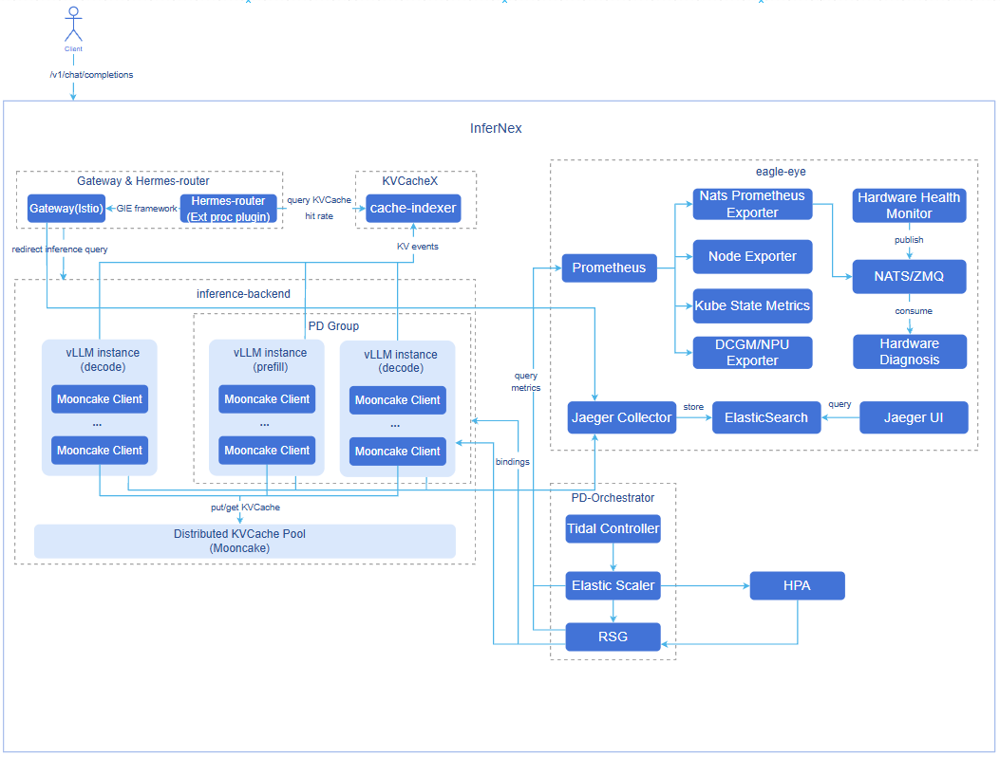

# AI Inference Integrated Deployment

## Feature Introduction

AI Inference Integrated Deployment (InferNex) is an end-to-end integrated deployment solution designed for optimizing AI inference services in cloud-native environments. Built on the Kubernetes Gateway API Inference Extension (GIE) and mainstream LLM technology stacks, it seamlessly integrates core acceleration modules such as open-source gateway, intelligent routing, high-performance inference backend, global KVCache management, scaling decision framework, and inference observability system through Helm Chart. It provides a complete acceleration pipeline from request intake, dynamic routing, inference execution to resource management and monitoring, aiming to improve inference throughput and reduce TTFT/TPOT latency, achieving a one-stop efficient AI service deployment experience.

### Application Scenarios

- **Aggregated Inference Scenario**: Supports aggregated inference architecture, suitable for small-to-medium-scale inference scenarios.
- **PD Disaggregated Inference Scenario**: Supports Prefill-Decode disaggregated inference architecture, suitable for large-scale, high-throughput inference scenarios.
- **AI Inference Software Suite Scenario**: Supports the original AI inference software suite mode, suitable for software deployment in appliance scenarios. For specific feature usage, please refer to the [Guide](#ai-inference-software-suite-mode-deployment).

### Capability Scope

- Supports optional installation of open-source gateway, intelligent routing, KVCache index management, and inference observability components based on scenario requirements.
- Intelligent routing supports integration with multiple open-source gateways; open-source gateways must be GIE-compatible.
- Intelligent routing provides advanced routing strategies such as KVCache-aware, PD bucket scheduling, and latency prediction, supporting optimized inference request scheduling across various scenarios.
- Intelligent routing provides disaster recovery capabilities, including automatic traffic switching, fault awareness, and request retry.
- KVCache index management maintains a two-layer KVCache view: inference instance memory (L1) and external cache management component-managed memory (L3), supporting intelligent routing to obtain comprehensive and accurate request KVCache hit rates.
- Supports deploying aggregated/PD disaggregated inference engines using LeaderWorkerSet (LWS), with configurable inference engine node counts.
- Supports configuring Mooncake as the distributed KVCache management backend.
- Supports retaining common parallelization strategy configurations such as TP, DP, and PP as structured configurations on top of the built-in vLLM startup command, and configuring other model and inference engine tuning parameters consumed only by vLLM/vLLM-Ascend through `extraArgs`, including common configuration items such as model length, batch size, memory utilization, and block size.
- Supports configuring different versions of vLLM inference engines.
- Supports fine-grained resource configuration at the inference engine node level, including CPU limits, memory limits, environment variables, and storage volume mounts.
- Adapts to Huawei Ascend 910B4 chip inference acceleration.
- Supports user-configured inference chips.
- Implements full-link metric collection from AI gateway, inference engine, Mooncake to infrastructure.
    - AI Gateway: performance, resource consumption, security and compliance audit, etc.
    - Inference Engine: API Server, model input/output, inference process, etc.
    - Mooncake: Mooncake Master, Mooncake client, and transfer engine.
    - Infrastructure: Ray, K8s, and hardware.
- Provides a standalone hardware health diagnosis module that periodically collects low-level metrics such as NPU/GPU temperature, power consumption, and error codes, and reports them in real time through a distributed message queue system. The diagnosis module subscribes to and analyzes the collected data, combining device model, driver, and firmware information, and based on threshold rules and anomaly metric analysis, identifies typical fault patterns and outputs diagnostic conclusions and remediation recommendations, achieving a closed loop from data collection to health assessment.
- Provides SLA-related metrics (such as throughput rate, latency, etc.) to support automatic scaling decisions for inference services, achieving load- and performance-based elastic scaling.
- Provides network performance metrics (such as actual transmission rate of node RDMA NICs, remaining available bandwidth, etc.) to support the weight distribution acceleration module in achieving network-performance-based node selection.
- Based on the OpenTelemetry standard, provides end-to-end distributed tracing from AI gateway to inference engine (vLLM-Ascend), supporting collection, storage, and querying of request-level tracing data, recording key performance metrics and business attributes.
- Provides a tidal algorithm that supports starting/deleting business resources during specified time periods.
- Provides a scaling decision framework that supports metric-driven and event-driven scaling of resource replicas, and supports flexible extension of user-defined scaling decision algorithms and custom resource management logic.
- Provides dynamic PD group scaling capability, using abstract resource management objects to manage PD instances, achieving proportional dynamic PD scaling.
- Supports one-click deployment of inference clusters in K8s environments via Helm.
- Currently provides the following inference interfaces: `/v1/chat/completions`, `/v1/completions`. The interfaces do not involve authentication/authorization and log audit capabilities; user management capabilities are uniformly provided by the upstream user management plane. For details, see [External Interface Description](#external-interface-description).

### Highlight Features

- **Component Optional Installation and Decoupling**: Open-source gateway, intelligent routing, KVCache index management, and inference observability components all adopt an optional installation design. Users can enable or disable them as needed and support replacement with self-developed or third-party components with equivalent capabilities.
- **Open-Source Gateway Capability Integration**: Supports integration with GIE-compatible open-source gateways (Istio, Envoy AI Gateway, etc.), providing key gateway capabilities such as service discovery, fault awareness, request retry, and traffic control.
- **KVCache Aware Routing Strategy**: Compared with traditional load balancing, it achieves smarter request routing by sensing the KVCache status of global inference nodes, reducing redundant KVCache computation.
- **PD-Bucket Routing Strategy**: A bucket scheduling strategy under the PD disaggregated architecture, improving inference throughput in long/short request and medium/high concurrency scenarios.
- **Latency Prediction Routing Strategy**: Makes routing decisions based on instance real-time metrics, cache status, and latency prediction results, helping to further optimize inference latency and resource utilization.
- **Prefill-Decode Disaggregated Architecture**: Supports the industry-advanced PD disaggregated architecture, significantly improving LLM inference throughput.
- **LWS Deployment Orchestration**: Inference engines are deployed by LWS, natively supporting multi-DP collaboration, and DP load balancing strategies can be configured through `dataParallelSize` and `dataParallelSizeLocal`.
- **vLLM Mooncake Integration**: The vLLM v1 architecture integrates the Mooncake distributed KVCache management system, providing distributed KVCache pooled storage and cross-instance high-speed KVCache transfer, improving cache reuse efficiency.
- **Second-Level Metric Push**: Integrates the NATS distributed message queue system to achieve efficient second-level metric push. After the collection module obtains hardware health data, it immediately pushes the data to the diagnosis module through NATS. This mechanism ensures that the diagnosis module can quickly receive the latest status information for timely anomaly detection and fault analysis.
- **End-to-End Tracing**: Provides request-level distributed tracing from AI gateway to inference engine, supporting collection, storage, and querying of tracing data, enabling precise identification of performance bottlenecks in the inference pipeline.
- **PD-Orchestrator Feature**: Integrates three major capabilities — tidal algorithm, scaling decision framework, and dynamic PD scaling — covering multiple scenarios such as independent PD instance scaling, proportional PD instance group scaling, metric-driven scaling, and tidal business scheduled scaling, ensuring service availability during traffic surges.
- **One-Click Deployment**: Achieves one-click integrated deployment of the three major components in K8s environments through Helm Chart.

### Implementation Principle

**Figure 1** AI Inference Integration Component Diagram



- **Hermes-router**: Intelligent routing component. Receives user requests and forwards them to the optimal inference backend service based on routing strategies. For implementation principles, see [AI Inference Hermes Routing](../../ai_inference_hermes_routing/user_guide/ai_inference_hermes_routing.md).
- **cache-indexer**: KVCache index management component, provides L1/L3 two-level KVCache hit rate query service for intelligent routing. For implementation principles, see [AI Inference KVCache Index Management](../../ai_inference_cache_indexer/user_guide/ai_inference_cache-indexer.md).
- **inference-backend**: Inference backend component, provides high-performance large model inference services based on vLLM, consisting of 1 ProxyServer instance, n vLLM Prefill inference engine instances, and n vLLM Decode inference engine instances.
- **vLLM**: vLLM inference engine instance.
- **Mooncake**: Distributed KVCache pooled storage and high-speed KVCache P2P transfer between PD instances.
- **eagle-eye**: Provides near-real-time observability metric publish/subscribe mechanism, ensuring millisecond-level latency for key metrics; covers business runtime, system runtime, and hardware health metrics in inference scenarios, and provides hardware fault awareness and diagnosis modules; provides end-to-end distributed tracing from AI gateway to inference engine. For implementation principles, see [AI Inference Eagle Eye](../../ai_inference_eagle_eye/user_guide/eagle_eye_for_ai_inference.md#implementation-principle).
- **PD-Orchestrator**: Consists of three components — Tidal Controller, Elastic Scaler, and RSG — providing tidal scheduled scaling, metric-driven scaling, and multi-resource proportional scaling capabilities. For implementation principles, see [AI Inference Elastic Scaling](../../ai_inference_elastic_scaling_system/ai_inference_elastic_scaling/user_guide/ai_inference_elastic_scaling.md#implementation-principle), [AI Inference Tidal Algorithm](../../ai_inference_elastic_scaling_system/ai_inference_tidal_algorithm/user_guide/ai_inference_tidal_algorithm.md#implementation-principle), [Resource Group Scaling](../../ai_inference_elastic_scaling_system/ai_inference_resourcescalinggroup/user_guide/ai_inference_resourcescalinggroup.md#implementation-principles).

**Component Initialization Flow**:
- Open-source gateway (default Istio):
  1. After the user deploys the Istiod control plane, Istiod starts and begins listening for Kubernetes Gateway API-related CRDs (GatewayClass, Gateway, HTTPRoute, etc.).
  2. Istio automatically creates the GatewayClass resource, declaring itself as the gateway controller.
  3. After the user configures the Gateway CR, Istiod generates the corresponding Envoy configuration, automatically creating the Envoy Proxy Deployment and Service in the target namespace as the actual gateway entry point.
  4. The data plane completes configuration loading, and the gateway starts forwarding external traffic normally.

- Intelligent routing:
  1. Intelligent routing reads configuration.
  2. Starts the inference backend service discovery module (periodically updates the backend list).
  3. Starts the inference backend metric collection module (periodically updates backend load metrics).

- Inference backend:
  1. Deploys vLLM inference engine instances using LWS based on configuration.
  2. vLLM inference engine instances bind hardware devices and load the model.
  3. Each vLLM inference engine instance starts a Mooncake client and registers the memory/SSD storage pool.
  4. Prefill inference engine instances and Decode inference engine instances establish connections with each other's exposed KV connector ports.
  5. In PD disaggregated deployment mode, the ProxyServer component starts and begins automatic discovery of inference engine instances (periodically updates the inference engine instance list).

- KVCache index management:
  1. Loads configuration from ConfigMap, initializes L1/L3 indexers, block hash builder, and scoring service, and starts the HTTP service.
  2. Starts the inference engine instance auto-discovery module, periodically updating the vLLM Pod list and Mooncake Master Pod.
  3. Establishes ZMQ SUB connections for each vLLM Pod, subscribes to KV events, and writes them to the L1 indexer.
  4. Periodically polls Mooncake Master Pod for KVCache information and writes it to the L3 indexer.
  5. Automatically cancels corresponding subscriptions when instances go offline, cleaning up index records of offline instances.

- PD-Orchestrator:
  1. Starts the tidal-scheduler controller, elastic-scaler controller, and ResourceScalingGroup controller based on configuration.
  2. Deploys default ElasticScaler CR instances and ResourceScalingGroup CR instances based on configuration, bound to vLLM inference backends.
  3. Performs PD group scaling for vLLM inference backends based on metrics such as CPU utilization.

- eagle-eye
  1. Starts kube-prometheus-stack, nats, hardware-diagnosis, hardware-monitor, and network-performance-exporter based on the `eagle-eye.enabled` configuration.
  2. After hardware-monitor starts, it periodically collects low-level metrics such as NPU/GPU temperature, power consumption, and error codes, and publishes them to the diagnosis module in real time via nats.
  3. hardware-diagnosis subscribes to the nats message queue, receives collected data, and performs health status analysis combining device model, driver, and firmware information, identifying fault patterns and outputting diagnostic conclusions.
  4. After network-performance-exporter starts, it periodically collects network performance metrics such as actual transmission rate and remaining available bandwidth of node RDMA NICs.
  5. Prometheus begins scraping metric data from various exporters for periodic computation and trend evaluation.
  6. Starts the tracing backend based on the `eagle-eye.tracing.enabled` configuration, deploying Jaeger and Elasticsearch for receiving, storing, and querying tracing data.
  7. Creates EnvoyFilter based on the `global.tracingEnabled` configuration; the open-source gateway (Istio/Envoy) reports tracing data to the tracing backend when forwarding requests; and tracing data reporting is enabled on the inference engine side.

**Request Flow**:

1. **Request Intake**: User requests first reach the GIE open-source gateway Istio.
2. **KVCache Query**: The gateway plugin Hermes-router queries the cache-indexer for the request's KVCache hit rate in the cluster.
3. **Routing Decision**: Hermes-router selects the optimal inference backend service based on KVCache hit status, GPU utilization, and other metrics.
4. **Request Forwarding**: The open-source gateway forwards the request to the selected inference backend service.
5. **KVCache Retrieval**: The Prefill node inference engine attempts to retrieve cached prefix KVCache from the Mooncake KVCache pool.
6. **Prefill Computation**: The Prefill node inference engine performs prefill computation for the token portion that missed the KVCache and writes the newly generated KVCache to the Mooncake KVCache pool.
7. **KVCache Transfer**: The Prefill node inference engine transfers the request's KVCache to the Decode node inference engine at high speed via Mooncake.
8. **Inference Generation**: The Prefill inference engine generates the first token result, and the Decode inference engine continuously generates subsequent tokens based on the received KVCache.
9. **Dynamic Inference Instance Scaling**: When the inference backend service pressure increases/decreases, ElasticScaler monitors the corresponding metrics and calculates the number of replicas to scale up/down, achieving inference backend service scaling up/down.
10. **Result Return**: The inference results generated by the inference engine are returned to the open-source gateway, and then returned to the client.
11. **Global KVCache Management Asynchronous Update**: The Prefill inference engine generates KV Events during the prefill process; cache-indexer subscribes to these KV Events and updates the global KVCache metadata in real time.

### Relationship with Related Features

- The intelligent routing component Hermes-router depends on the inference engine (e.g., vLLM) to provide inference services and metric interfaces.
- The KVCache index management component cache-indexer depends on the inference engine and distributed cache management system (e.g., Mooncake) to provide KVCache storage and removal events.
- The tidal algorithm Tidal-scheduler depends on the elastic scaling framework elastic-scaler to modify the replica count of resource objects that need scheduled scaling.
- eagle-eye end-to-end tracing depends on the native tracing capability of the open-source gateway (Istio).

### Related Examples

InferNex default configuration example: [values.yaml](https://gitcode.com/openFuyao/InferNex/blob/master/charts/infernex/values.yaml)

## Installation

### Prerequisites

#### Hardware Requirements
- At least one inference chip per inference node.
- At least 32GB memory and 4 CPU cores per inference node.

#### Software Requirements
- Kubernetes v1.33.0 or above.
- [npu-operator](https://gitcode.com/openFuyao/npu-operator) component installed.
- LWS component installed: The inference backend is orchestrated and deployed by LWS. LWS CRD and LWS Operator (v0.8.0 or above recommended) must be deployed in the target cluster before installing InferNex; for installation, see the [LWS official installation documentation](https://lws.sigs.k8s.io/docs/installation/).
- InferNex deploys the open-source gateway in one click, using Istio by default; ensure there are no conflicts in the environment.
- InferNex components are not yet installed and deployed in the target namespace: hermes-router, Inference Backend, cache-indexer.
- InferNex components are not yet installed and deployed in the eagle-eye and nats namespaces: eagle-eye.

#### Network Requirements
- Online installation requires access to the image repository: oci://cr.openfuyao.cn.

#### Permission Requirements
- Users must have permissions to create RBAC resources.

### Starting Installation

#### Standalone Deployment

This feature can be independently deployed through the following two methods:

**Obtain Project Installation Package from openFuyao Official Image Repository**

1. Pull the project installation package.
    ```bash
    helm pull oci://cr.openfuyao.cn/charts/infernex --version 0.0.0-latest
    ```
    The pull result is a tgz compressed package. `--version` specifies the installation package version, corresponding one-to-one with InferNex release versions: `0.0.0-latest` represents the latest build of the master branch; for other version numbers, see the [InferNex version list](https://gitcode.com/openFuyao/InferNex/tags).

2. Extract the installation package.
    ```bash
    tar -xzvf infernex-0.0.0-latest.tgz
    ```
    Where `0.0.0-latest` can be replaced with the specific project installation package version.

3. Enter the chart directory.

    ```bash
   cd infernex
   ```

4. Adjust configuration (optional).

    You can modify the `values.yaml` in the current directory; for the meaning of each item and examples, see [Configure AI Inference Integrated Deployment](#configure-ai-inference-integrated-deployment). When using the default configuration, this step can be skipped.

5. Install and deploy.

    Taking namespace `ai-inference` and release name `infernex` as an example, execute the following command in the `infernex` directory:
   ```bash
   helm install -n ai-inference infernex . --create-namespace
   ```

**Obtain Complete Project from openFuyao GitCode Repository**

1. Pull the project from the repository.

   ```bash
   git clone https://gitcode.com/openFuyao/InferNex.git
   ```

2. Enter the chart directory and pull dependency sub-charts.

    ```bash
   cd InferNex/charts/infernex
   helm dependency build
   ```

3. Adjust configuration (optional).

    You can modify the `values.yaml` in the current directory; for the meaning of each item and examples, see [Configure AI Inference Integrated Deployment](#configure-ai-inference-integrated-deployment). When using the default configuration, this step can be skipped.

4. Install and deploy.

    Taking namespace `ai-inference` and release name `infernex` as an example, execute the following command in the `infernex` directory:
   ```bash
   helm install -n ai-inference infernex . --create-namespace
   ```

#### Offline Installation

1. Obtain the InferNex 0.22.2 offline installation package from the openFuyao artifact repository.

   ```bash
   wget https://openfuyao.obs.cn-north-4.myhuaweicloud.com/openFuyao/ext-components/InferNex/openFuyao-infernex-offline-v26.03.tar.gz
   ```

   >  **Note:**<br>
   > If users want to manually create the InferNex offline package, please refer to [Offline Package Creation Guide](#offline-package-creation-guide).

2. Extract the offline installation package.

   ```bash
   tar -xzvf openFuyao-infernex-offline-v26.03.tar.gz
   ```

3. Extract the helm chart installation package, extract images to the local repository, and extract InferNex built-in model cache files.

   ```bash
   cd openFuyao-infernex-offline-v26.03 && bash install.sh
   ```

4. Install and deploy.

   If users want to use custom model files, please refer to [Custom Model Directory Configuration](#custom-model-directory-configuration).

   Taking namespace `ai-inference` and release name `infernex` as an example, execute the following command in the same directory as the chart package file `infernex`:
   ```bash
   helm install -n ai-inference infernex ./infernex --create-namespace
   ```

## Configure AI Inference Integrated Deployment
### Prerequisites
- The [InferNex](https://gitcode.com/openFuyao/InferNex) project files have been obtained.

### Background Information

InferNex is provided as a Helm Chart, with the main Chart integrating multiple sub-Charts (such as intelligent routing, inference backend, KVCache index management, PD-Orchestrator, etc.). During deployment, the main Chart's `values.yaml` takes precedence: configurations filled in it will override the corresponding sub-Chart's default values; fields not written will continue to use the sub-Chart's default configuration.

The "Operation Steps" below provide configuration instructions for each InferNex component. After adding or modifying the corresponding configuration items in `values.yaml` as needed and deploying, the corresponding capabilities can be enabled or adjusted.

### Operation Steps

1. Prepare the `values.yaml` configuration file.

    Refer to [Starting Installation](#starting-installation) to find the `values.yaml` configuration file.

2. Configure global settings.
    - global.image.pullPolicy: Controls the pull policy for all images deployed by InferNex. Defaults to `IfNotPresent` for online deployment, `Never` for offline deployment.
    - global.imagePullSecrets: Secret configuration for the private image repository, used for pulling images from private repositories. Example: `[{"name": "registry-secret"}]`.
    - global.env: Defines default environment variables for all `inference-backend` service instances. These environment variables will be injected into all inference engine containers and cache-indexer containers. Common configurations include HuggingFace offline download switch and HuggingFace access K8s Secret.
    - global.autoDownloadModel: Whether to automatically download **HuggingFace models** through InferNex. If you want to use local non-HuggingFace models or are in an offline environment, set to `false`.
    - global.modelName: Inference model name (required). If `global.modelPath` is not configured, vLLM will load weights via the HuggingFace model name. If `global.modelPath` is configured, vLLM will use this configuration as a model alias for matching the `model` field in inference requests. The default inference model is `"Qwen/Qwen3-8B"`.
    - global.modelPath: Local path to inference model weights (optional). If configured, vLLM starts using the local path; otherwise, it loads the HuggingFace model using the model name configured in `global.modelName`. **This configuration item cannot be used together with the `cache-indexer` component in the current version.** Since model weights are mounted to the container's `/root/.cache` directory via `global.cachePath`, this configuration should be `/root/.cache/{model directory after cachePath}`.
    - global.cachePath: The path on the host for storing `HuggingFace` model cache, structured as `{cache directory}/huggingface/hub/{model directory}`. This path will be mounted to the `/root/.cache` directory of all inference engine containers and cache-indexer containers via `hostPath`. For detailed instructions and examples on custom model directory configuration, please refer to [Custom Model Directory Configuration](#custom-model-directory-configuration). The default host model cache path is `/home/llm_cache`.
    - global.tracingEnabled: Whether to enable tracing for InferNex components, default `false`.
    - global.tracingImage.repository: The image repository address for injecting tracing patches into the inference engine.
    - global.tracingImage.tag: The tracing patch image tag.
    
        Local non-HuggingFace model configuration example: If the host local model path is `/mnt/public/models/my_models/Qwen3-8B-W8A8/`, then InferNex should be configured as:

        ```yaml
        global:
          env:
            - name: HF_HUB_OFFLINE
              value: "0"
          autoDownloadModel: false
          modelName: "Qwen3-8B-W8A8"
          modelPath: "/root/.cache/Qwen3-8B-W8A8/"
          cachePath: "/mnt/public/models/my_models/"
        ```

3. Configure intelligent routing parameters.

    **Configure Gateway Parameters**
    - inferenceGateway.enabled: Open-source gateway switch. `true` to enable, `false` to disable.
    - inferenceGateway.name: Gateway resource name. **Must be consistent with `hermes-router.httpRoute.inferenceGatewayName`**.
    - inferenceGateway.className: Gateway class name. Default `"istio"`, indicating Istio control plane management.
    - inferenceGateway.listeners: Defines listener configuration.
      - `name: http`: Listener name.
      - `port: 80`: Listener port.
      - `protocol: HTTP`: Protocol type.

    **Configure Routing Image Pull**
    - hermes-router.enabled: Intelligent routing switch. `true` to enable, `false` to disable. Note that since intelligent routing is an extension plugin, it cannot be used independently without a gateway.
    - hermes-router.image.repository: Intelligent routing image address.
    - hermes-router.image.tag: Intelligent routing image version.

    **Configure Routing Strategy**
    - hermes-router.inferenceExtension.replicas: Intelligent routing replica count. Default is `1`.
    - hermes-router.inferenceExtension.pluginsConfigFile: Currently recommended to keep as `default-plugins.yaml`, used to load Hermes-router built-in routing strategy configuration.
    - hermes-router.inferenceExtension.routing.deploymentMode: Used to declare the inference backend deployment mode, optional `aggregate` or `pd`.
    - hermes-router.inferenceExtension.routing.profile: Used to declare the routing strategy type, optional `random`, `kv-cache-aware`, `bucket`, `prediction`. `bucket` is only applicable to `pd` deployment mode.
    - Currently supports the following preset routing strategy combinations:
      - `aggregate-random.yaml`: Aggregated architecture random routing.
      - `aggregate-kv-cache-aware.yaml`: Aggregated architecture KVCache-aware routing.
      - `aggregate-prediction.yaml`: Aggregated architecture latency prediction routing.
      - `pd-random.yaml`: PD architecture random routing.
      - `pd-kv-cache-aware.yaml`: PD architecture KVCache-aware routing.
      - `pd-bucket.yaml`: PD bucket scheduling routing.
      - `pd-prediction.yaml`: PD architecture latency prediction routing.
    - For the complete reference configuration of Hermes-router built-in routing strategies, see [hermes-router routing strategy reference configuration](https://gitcode.com/openFuyao/hermes-router/tree/master/examples/profiles).
    - To customize the plugin chain, continue extending the `EndpointPickerConfig` content via `hermes-router.inferenceExtension.pluginsCustomConfig`; in this case, `pluginsConfigFile` should match the custom configuration file name.

    **Configure InferencePool**
    - hermes-router.inferencePool.targetPorts: The actual listening port of each inference service in the InferencePool, used for processing inference traffic. Default inference port is `8000`.
    - hermes-router.inferencePool.modelServerType: Inference engine type. Default is `vllm`.

    **Configure HTTPRoute**
    - hermes-router.httpRoute.inferenceGatewayName: Gateway resource name. **Must be consistent with `inferenceGateway.name`**.

    **Configure Request Retry**
    - hermes-router.provider.istio.retryConfig: Defines request retry configuration.
      - `enabled`: Request retry switch. `true` to enable, `false` to disable. Default `false`.
      - `retryOn`: List of error types that trigger retry. Typical optional values include: `connect-failure`, `refused-stream`, `unavailable`, `cancelled`, `retriable-status-codes`, `5xx`, `reset`, etc., combinable as needed. Default is all selected.
      - `numRetries`: Maximum retry count per single request. Default count is `3`.
    - hermes-router.provider.istio.destinationRule.trafficPolicy.tls: Defines the communication rules between the Istio gateway and inference backend.
      - `mode`: TLS mode for Istio-backend communication, optional: `DISABLE` (TLS not enabled), `SIMPLE` (one-way TLS), `MUTUAL/ISTIO_MUTUAL` (two-way TLS, depends on certificates or Istio-provided identity). Default `SIMPLE`.
      - `insecureSkipVerify`: Whether to skip verification of the backend service certificate, optional: `true` (skip), `false` (do not skip). Default `true`.

4. Configure inference backend parameters.

    **Configure Inference Backend Image Parameters**
    - inference-backend.images.inferenceEngine: Configure inference engine image (repository, tag). InferNex defaults to using `hub.oepkgs.net/openfuyao/ascend/vllm-ascend:v0.18.0` inference engine; **multi-DP scenarios require vLLM version 0.10.0 or above in the image**, to support chart auto-injected hybrid and multi-DP related startup parameters.
    - inference-backend.images.proxyServer: Configure ProxyServer image (repository, tag).

    **Configure Inference Backend Environment Variables**
    - inference-backend.env: Total configuration for inference backend environment variables. These environment variables will be injected into **all inference service inference engine containers (Prefill, Decode) and ProxyServer containers**. Users can configure them as needed, referencing the [vllm-ascend environment variable configuration documentation](https://docs.vllm.ai/projects/ascend/en/latest/user_guide/configuration/env_vars.html).

    **Configure Inference Backend File Mount Parameters**
    - inference-backend.volumeMounts: volumeMounts configuration mounted by all vLLM inference engine Pods launched by LWS. Default configuration includes Ascend device-related volumeMounts. Users can add more detailed mount items as needed; for detailed configuration instructions, see [Inference Backend Default Mount Configuration](#inference-backend-default-mount-configuration).
    - inference-backend.volumes: volumes configuration mounted by all vLLM inference engine Pods launched by LWS. Default configuration includes Ascend device-related volumes. For detailed configuration instructions, see [Inference Backend Default Mount Configuration](#inference-backend-default-mount-configuration).

    **Configure Inference Services**
    - inference-backend.services: Inference service configuration, supports configuring multiple independent vLLM inference services. Each service can independently configure model, deployment mode (aggregated or PD disaggregated), resources, and other parameters, enabling mixed deployment of inference services in multiple deployment forms. The inference engine underlying workload is **LWS**: `mode: pd` corresponds to one LWS each for Prefill and Decode (e.g., `{service-name}-prefill`, `{service-name}-decode`); `mode: aggregated` corresponds to one LWS (e.g., `{service-name}-aggregated`).

      **Basic Configuration**
      - name: Inference service name.
      - enabled: Whether to deploy this service. InferNex requires at least one inference service to be enabled.
      - mode: Inference backend service mode, with `aggregated` and `pd` options, representing aggregated architecture and PD disaggregated architecture respectively; default `pd`.
      - service.port: Service port, default `8000`.
      - pdGroupID: PD mode group ID, needs to be set under PD disaggregated architecture, indicating that all ProxyServer, Prefill, and Decode inference backends of this inference service are within this group, for intelligent routing to discover and filter by labels such as `openfuyao.com/pdGroupID`.

      **Configure Inference Engine Connector**
      - kvTransferConfig.connectorConfig: Configure KVCache Connector, used to define the KVCache reuse method between Prefill and Decode phases. Provides a YAML-format configuration object, which will be automatically converted to JSON format by key-value pairs, and prefill/decode node-specific fields such as `kv_role`, `kv_rank`, `engine_id`, `tp_size`, `dp_size` will be automatically filled without manual configuration (user manual configuration can override auto-fill). For PD disaggregated mode deployment, `kv_connector` recommends using `MultiConnector` (combining `MooncakeConnectorV1` and `AscendStoreConnector`); for aggregated mode deployment, `AscendStoreConnector` is recommended.

        Due to different vllm/vllm-ascend versions, the connector names and detailed configuration items differ. For detailed configuration instructions, please refer to the target vllm/vllm-ascend version documentation. InferNex default configuration uses `vllm-ascend:v0.18.0` inference engine; users can refer to the KV pool and PD disaggregation-related chapters in the [vllm-ascend documentation](https://docs.vllm.ai/projects/ascend/en/v0.18.0/user_guide/feature_guide/kv_pool.html).

      - kvTransferConfig.mooncake.configPath: When using Mooncake as the KVCache management system for the inference engine, the configuration file for the Mooncake client started within the inference engine. Default path is `"/app/mooncake.json"`.
      - kvTransferConfig.mooncake.use_store: When using Mooncake as the KVCache management system for the inference engine, used to control whether to use Mooncake Store mode. If the connector type above uses Mooncake Store type Connector, this configuration needs to be enabled.
      - kvTransferConfig.mooncake.config: Mooncake client configuration file content (yaml format). The initContainer of the inference engine Pod will automatically convert and generate the `mooncake.json` configuration file for the Mooncake client within the inference engine to use directly. For detailed configuration item descriptions, please refer to the [Mooncake documentation](https://kvcache-ai.github.io/Mooncake/deployment/integrations/vllm/kv-cache-storage.html#using-vllm-v1-recommended).

      **Configure Inference Engine Startup Items in PD Disaggregated Mode**
      - pd.prefill.replicas: Prefill-side LWS parallel group set count, default `2`.
      - pd.prefill.cardCount: Used to specify the number of inference cards allocated to the Prefill engine; when not configured, defaults to `tp*pp*dataParallelSizeLocal`.
      - pd.prefill.tensorParallelSize: Prefill engine tensor parallelism.
      - pd.prefill.pipelineParallelSize: Prefill engine pipeline parallelism; currently only supports configuration as 1.
      - pd.prefill.dataParallelSize: Prefill engine data parallelism (total logical DP ranks), default `1`.
      - pd.prefill.dataParallelSizeLocal: Prefill engine local DP rank count per node, default `1`. **`dataParallelSize` is the total DP rank count for the inference service, `dataParallelSizeLocal` is the local rank count per worker on a single inference engine node; the two must be evenly divisible**, and the quotient is the number of workers within the LWS group (inference engine node count). The chart auto-injects vLLM multi-DP startup parameters based on LWS group environment variables; when `dataParallelSizeLocal` is 1, it approximates External DP load balancing, and when equal to `dataParallelSize`, it approximates Internal DP load balancing.
      - pd.prefill.dataParallelRpcPort: Prefill engine DP RPC port; required when `dataParallelSize` is greater than 1, default `12890`.

        ```yaml
        pd:
          prefill:
            replicas: 1                 
            dataParallelSize: 4         
            dataParallelSizeLocal: 2    
            dataParallelRpcPort: 12890
            tensorParallelSize: 1
            pipelineParallelSize: 1
        ```
        Deployment topology (replicas=1): LWS leaderWorkerTemplate.size = 4 / 2 = 2 (2 inference engine nodes).

        Node 0 (LWS_WORKER_INDEX=0): Pod×2 → DP rank 0, 1 (--data-parallel-start-rank=0)

        Node 1 (LWS_WORKER_INDEX=1): Pod×2 → DP rank 2, 3 (--data-parallel-start-rank=2)

      - pd.prefill.env: Prefill engine container environment variable list. Role-specific variables can be appended as needed.
      - pd.prefill.volumeMounts: Prefill engine container volumeMounts list, used to configure special volume mounts needed by this inference service's Prefill inference engine Pod.
      - pd.prefill.volumes: Prefill engine container volumes list, used to configure special volumes needed by this inference service's Prefill inference engine Pod.
      - pd.prefill.extraArgs: Prefill engine additional vLLM startup parameter list. The following are parameters injected by the InferNex default configuration; users can append other vLLM startup parameters on this basis for inference engine optimization, etc. The configured additional items will be appended to the Prefill engine's startup command.
        - `--enable-prefix-caching`/`--no-enable-prefix-caching`: Whether to enable Prefix Cache for the Prefill engine. The Prefill engine defaults to `--enable-prefix-caching`, i.e., enabling Prefix Cache.
        - `--max-model-len`: Prefill engine maximum model length.
        - `--max-num-batched-tokens`: Prefill engine maximum batch token count.
        - `--gpu-memory-utilization`: Prefill engine memory utilization.
        - `--block-size`: Prefill engine KV Cache Block token count.
        - `--trust-remote-code`: Allows the Prefill engine to load custom code from the model repository; confirm the model source is trusted before use.
        - `--disable-access-log-for-endpoints=/health,/metrics`: Filters vLLM access logs for the Prefill engine's `/health` and `/metrics` endpoints, including 4xx/5xx request logs; can be adjusted or removed during debugging.
        >  **Note:**<br>
        > For other startup parameters supported by `extraArgs`, please refer to [vLLM Serve CLI](https://docs.vllm.ai/en/latest/cli/serve/) and [vLLM-Ascend official documentation](https://docs.vllm.ai/projects/ascend/en/latest/). Parameters supported may vary across versions; please refer to the actual inference engine image version in use.
      - pd.decode.replicas: Decode-side LWS parallel group set count, default `2`.
      - pd.decode.cardCount: Used to specify the number of inference cards allocated to the Decode engine; when not configured, defaults to `tp*pp*dataParallelSizeLocal`.
      - pd.decode.tensorParallelSize: Decode engine tensor parallelism.
      - pd.decode.pipelineParallelSize: Decode engine pipeline parallelism; currently only supports configuration as 1.
      - pd.decode.dataParallelSize: Decode engine data parallelism (total logical DP ranks), default `1`.
      - pd.decode.dataParallelSizeLocal: Decode engine local DP rank count per node, default `1`; meaning is the same as `pd.prefill`, see the configuration example above.
      - pd.decode.dataParallelRpcPort: Decode engine DP RPC port; required when `dataParallelSize` is greater than 1, default `12777`.
      - pd.decode.env: Decode engine container environment variable list, used to configure special environment variables needed by this inference service's Decode inference engine Pod.
      - pd.decode.volumeMounts: Decode engine container volumeMounts list, used to configure special volume mounts needed by this inference service's Decode inference engine Pod.
      - pd.decode.volumes: Decode engine container volumes list, used to configure special volumes needed by this inference service's Decode inference engine Pod.
      - pd.decode.extraArgs: Decode engine additional vLLM startup parameter list, functions the same as `pd.prefill.extraArgs`, with the same default injected parameters; the only difference is that the Decode engine Prefix Cache is disabled by default, set to `--no-enable-prefix-caching`.
      - pd.proxyServer.enabled: Whether to deploy the ProxyServer for this inference service, default `true` in PD disaggregated mode. ProxyServer filters by `pdGroupID` when discovering inference backend nodes. When deploying multiple inference services and wanting them managed by one ProxyServer uniformly, set each `inference-backend.services[i].pdGroupID` to the same value, and only one inference service sets `pd.proxyServer.enabled` to `true`.
      - pd.proxyServer.discoveryInterval: ProxyServer inference backend service discovery interval (in seconds), default `10`.
      - pd.proxyServer.accessLog.enabled: Whether to enable ProxyServer HTTP access logs, default `true`; when configured as `false`, all ProxyServer HTTP access logs are disabled.
      - pd.proxyServer.accessLog.excludedEndpoints: List of endpoints for which ProxyServer does not log successful request access logs, default `/health` and `/metrics`; 4xx/5xx requests for corresponding endpoints are still logged. **This configuration only applies to ProxyServer; vLLM engine logs are controlled by `--disable-access-log-for-endpoints` in each node's `extraArgs`.**

      **Configure Inference Engine in Aggregated Mode**
      - aggregated.replicas: Aggregated mode LWS parallel group set count.
      - aggregated.cardCount: Used to specify the number of inference cards allocated to the aggregated mode inference engine; when not configured, defaults to `tp*pp*dataParallelSizeLocal`.
      - aggregated.tensorParallelSize: Aggregated mode inference engine tensor parallelism.
      - aggregated.pipelineParallelSize: Aggregated mode inference engine pipeline parallelism; currently only supports configuration as 1.
      - aggregated.dataParallelSize: Aggregated mode inference engine data parallelism (total logical DP ranks), default `1`; for LWS and multi-DP parameter meanings, see the `pd.prefill` configuration example above.
      - aggregated.dataParallelSizeLocal: Aggregated mode local DP rank count per node, default `1`.
      - aggregated.dataParallelRpcPort: Aggregated mode DP RPC port; required when `dataParallelSize` is greater than 1, default `12890`.
      - aggregated.env: Aggregated mode inference engine container environment variable list, used to configure special environment variables needed by this inference service's inference engine Pod.
      - aggregated.volumeMounts: Aggregated mode inference engine container volumeMounts list, used to configure special volume mounts needed by this inference service's inference engine Pod.
      - aggregated.volumes: Aggregated mode inference engine container volumes list, used to configure special volumes needed by this inference service's inference engine Pod.
      - aggregated.extraArgs: Aggregated mode inference engine additional vLLM startup parameter list, functions and default injected parameters are the same as `pd.prefill.extraArgs`, see above.

      **Configure Inference Engine Resources**
      - resources.requests: Inference engine requested resources. Default example is CPU `4`, memory `64Gi`.
      - resources.limits: Inference engine resource limits. Default example is CPU `8`, memory `128Gi`.

5. Configure KVCache index management parameters. 
    
    **Configure Whether to Enable KVCache Index Management Component**
    - cache-indexer.enabled: cache-indexer is an optional InferNex component, default `true`.

    **Configure KVCache Index Management Component Image Pull**
    - cache-indexer.image.repository: cache-indexer image address.
    - cache-indexer.image.tag: cache-indexer image tag.

    **Configure KVCache Index Management Component Resources**
    - cache-indexer.resources.requests: cache-indexer Pod resource requests, default CPU `100m`, memory `128Mi`.
    - cache-indexer.resources.limits: cache-indexer Pod resource limits, default CPU `1`, memory `2Gi`.

    **Configure KVCache Index Management Component Logs**
    - cache-indexer.log.level: cache-indexer log level, optional `debug`, `info`, `error`, default `info`.

    **Configure K8s Service for KVCache Index Management Component**
    - cache-indexer.service.name: cache-indexer K8s Service name, default `cache-indexer-service`.
    - cache-indexer.service.port: cache-indexer K8s Service port, default `8080`.

    **Configure Inference Backend Service Discovery for KVCache Index Management Component**
    - cache-indexer.discovery.labels.engineKey/engineValue: vLLM Pod discovery labels, default `openfuyao.com/engine=vllm`.
    - cache-indexer.discovery.labels.pdRoleKey/pdRoleValue: Inference role labels participating in hit rate calculation, default `openfuyao.com/pdRole`, values `prefill` and `aggregate`.
    - cache-indexer.discovery.labels.kvManagerKey/kvManagerValue: Mooncake Master discovery labels, default `openfuyao.com/kvmanager=mooncake`.

    **Configure KVCache Index Management Component Block Hash Calculation Parameters**
    - cache-indexer.blockKey.pythonHashSeed: Must be consistent with vLLM `PYTHONHASHSEED`, default `"0"`.
    - cache-indexer.blockKey.prefixCachingHashAlgo: Must be consistent with vLLM `--prefix-caching-hash-algo`, default `sha256_cbor`.
    - cache-indexer.blockKey.useIntBlockHashes: Must be consistent with vLLM `VLLM_KV_EVENTS_USE_INT_BLOCK_HASHES`, default `true`.

6. Configure AI inference observability parameters.

   **Configure Whether to Enable AI Inference Observability**
   - eagle-eye.enabled: Controls whether to enable AI inference observability, default `true`.

   **Configure Hardware Health Monitoring Image Pull**
   - eagle-eye.hardware-monitor.images.core.repository: hardware-monitor image address.
   - eagle-eye.hardware-monitor.images.core.tag: hardware-monitor image tag.
   - eagle-eye.hardware-monitor.images.core.pullPolicy: hardware-monitor image pull policy.

   **Configure Hardware Diagnosis Image Pull**
   - eagle-eye.hardware-diagnosis.images.core.repository: hardware-diagnosis image address.
   - eagle-eye.hardware-diagnosis.images.core.tag: hardware-diagnosis image tag.
   - eagle-eye.hardware-diagnosis.images.core.pullPolicy: hardware-diagnosis image pull policy.

   **Configure Network Performance Collection Component Image Pull**
   - eagle-eye.network-performance-exporter.images.core.repository: network-performance-exporter image address.
   - eagle-eye.network-performance-exporter.images.core.tag: network-performance-exporter image tag.
   - eagle-eye.network-performance-exporter.images.core.pullPolicy: network-performance-exporter image pull policy.

   **Configure Network Performance Collection Component Collection Parameters**
   - eagle-eye.network-performance-exporter.networkPerformanceExporter.metricsPort: network-performance-exporter metric exposure port.
   - eagle-eye.network-performance-exporter.networkPerformanceExporter.collectInterval: network-performance-exporter metric collection interval.

   **Configure Tracing Backend**
   - eagle-eye.tracing.enabled: Controls whether to enable the end-to-end tracing backend, default `false`; when enabled, Jaeger and Elasticsearch will be deployed.
   - eagle-eye.tracing.jaeger.query.service.type: Jaeger query service Service type, default `NodePort`.
   - eagle-eye.tracing.jaeger.query.service.nodePort: Jaeger query interface NodePort port, default `30686`.

7. Configure PD-Orchestrator parameters.

    **Configure Whether to Enable Elastic Scaling Framework**
    - elastic-scaler.enabled: Controls whether to enable the elastic-scaler component.

    **Configure Elastic Scaling Framework Image Pull**
    - elastic-scaler.images.repository: elastic-scaler image address.
    - elastic-scaler.images.tag: elastic-scaler image tag.

    **Configure PD-Orchestrator Component Installation Namespace**
    - elastic-scaler.namespace.name: The namespace where the PD-Orchestrator component controller resides.

    **Configure Elastic Scaling Framework Default CR Instance**
    - elastic-scaler.elasticScaler.enabled: Controls whether to deploy the default ElasticScaler CR instance.
    - elastic-scaler.targetRef.kind: The type of the actual resource object controlled by the default ElasticScaler CR, can be Kubernetes native resources such as `Deployment`, `StatefulSet`, etc. In InferNex configuration, this defaults to `resourcescalinggroup`.
    - elastic-scaler.targetRef.name: The name of the actual resource object controlled by the default ElasticScaler CR. In InferNex configuration, this field needs to correspond to the RSG resource object name. Example: if the RSG resource object is configured as:

      ```yaml
      resourcescalinggroup:
        instanceConfig:
          name: rsg
      ```

      Then this property needs to be configured as `elastic-scaler.targetRef.name: rsg`.

    - elastic-scaler.targetRef.apiVersion: The API version of the actual resource object controlled by the default ElasticScaler CR. In InferNex configuration, this field needs to correspond to the RSG resource object's API version, e.g., `autoscaling.openfuyao.com/v1alpha1`.
    - elastic-scaler.minReplicas: Minimum replica count of the actual resource object controlled by the default ElasticScaler CR.
    - elastic-scaler.maxReplicas: Maximum replica count of the actual resource object controlled by the default ElasticScaler CR.
    - elastic-scaler.trigger.scalingAlgorithm: Algorithm that triggers scaling of the actual resource object, default configured as `apa`.
    - elastic-scaler.trigger.resource.metricsName: Metric name that triggers scaling of the actual resource object, default configured as CPU, indicating that the scaling module will calculate resource replica count based on CPU metrics.
    - elastic-scaler.trigger.resource.targetType: Metric type that triggers scaling of the actual resource object, default is utilization, combined with `elastic-scaler.trigger.resource.metricsName`, indicating CPU utilization is the trigger type for resource object replica scaling.
    - elastic-scaler.trigger.resource.targetValue: Metric threshold that triggers scaling of the actual resource object.

    **Configure Whether to Enable PD Scaling Resource Management Object Component**
    - resourcescalinggroup.enabled: Controls whether to enable the ResourceScalingGroup component.

    **Configure PD Scaling Resource Management Object Component Image Pull**
    - resourcescalinggroup.images.repository: ResourceScalingGroup image address.
    - resourcescalinggroup.images.tag: ResourceScalingGroup image tag.

    **Configure PD Scaling Resource Management Object Component Installation Namespace**
    - resourcescalinggroup.namespace.name: The namespace where the ResourceScalingGroup Controller is deployed, default is `scaling-system`.
    - resourcescalinggroup.namespace.create: Whether to automatically create the namespace specified by `resourcescalinggroup.namespace.name`. If the namespace does not exist in the cluster, it needs to be set to `true`; otherwise, it needs to be created manually in advance. Default is `false`, meaning the namespace is not created.

    **Configure PD Scaling Resource Management Object Component Runtime Parameters**
    - resourcescalinggroup.prometheus.url: Prometheus query address, used by the `scaleDown.metric` scale-down strategy, actually injected as environment variable `RSG_PROMETHEUS_URL`. This feature needs to be used with Prometheus-related configurations; for details, please refer to [Resource Group Scaling](../../ai_inference_elastic_scaling_system/ai_inference_resourcescalinggroup/user_guide/ai_inference_resourcescalinggroup.md#groupreplication-scaledown-metric).

    **Configure PD Scaling Resource Management Object Default CR Instance**
    - ResourceScalingGroup CR instance configuration

      **Basic Configuration**
      - resourcescalinggroup.instanceConfig.enabled: Controls whether to deploy the default ResourceScalingGroup CR instance.
      - resourcescalinggroup.instanceConfig.name: The name of the default ResourceScalingGroup CR instance.     
      - resourcescalinggroup.instanceConfig.scalingStrategy.type: The scaling strategy type used by the default ResourceScalingGroup CR instance, either `GroupReplication` or `InplaceScaling`. Currently defaults to `GroupReplication`; to change to `InplaceScaling` mode, please refer to [Resource Group Scaling](../../ai_inference_elastic_scaling_system/ai_inference_resourcescalinggroup/user_guide/ai_inference_resourcescalinggroup.md#operation-steps).
      - resourcescalinggroup.instanceConfig.scalingStrategy.groupConfig.groupName: Group name prefix of the default ResourceScalingGroup CR instance; defaults to RSG name when empty.
      - resourcescalinggroup.instanceConfig.scalingStrategy.groupConfig.replicas: Desired group count of the default ResourceScalingGroup CR instance, limited by `elastic-scaler.minReplicas` and `elastic-scaler.maxReplicas`. Example: if configured as:

        ```yaml
        elastic-scaler:
          minReplicas: 1
          maxReplicas: 10
        ```
        
        Then the minimum number of resource groups created through APA scaling is 1, and the maximum is 10.

      - resourcescalinggroup.instanceConfig.scalingStrategy.groupConfig.scaleDown.metric.expr: The Prometheus metric expression or metric name referenced for scale-down by the default ResourceScalingGroup CR instance.
      - resourcescalinggroup.instanceConfig.scalingStrategy.groupConfig.scaleDown.metric.type: Scale-down metric type for the default ResourceScalingGroup CR instance, such as `Counter`, `Gauge`, `Histogram`.
      - resourcescalinggroup.instanceConfig.scalingStrategy.groupConfig.scaleDown.metric.window: The statistics window used when the scale-down metric type is `Counter` or `Histogram`.
      - resourcescalinggroup.instanceConfig.scalingStrategy.groupConfig.scaleDown.metric.aggregator: The aggregation method for metric data during scale-down, such as `avg`, `sum`, `max`.
      - resourcescalinggroup.instanceConfig.scalingStrategy.groupConfig.scaleDown.order: Group scale-down order, typically supports `ascending` or `descending`.

      **Scaling Resource Object Configuration**
      - The following shows all related field configurations for `resourcescalinggroup.instanceConfig.targetResources` in InferNex configuration:

        ```yaml
        resourcescalinggroup:
          instanceConfig:
            name: rsg # ResourceScalingGroup CR instance name, needs to match elastic-scaler.targetRef.name
            targetResources:
            - name: prefill # This name can be customized by the user
              resourceRef:
                apiVersion: leaderworkerset.x-k8s.io/v1
                kind: LeaderWorkerSet # Resource type of prefill nodes created by inference backend
                name: qwen3-8b-2p2d-01-prefill # Must correspond to inference-backend.services[].name: {service-name}-prefill
            - name: decode
              resourceRef:
                apiVersion: leaderworkerset.x-k8s.io/v1
                kind: LeaderWorkerSet
                name: qwen3-8b-2p2d-01-decode # Must match {service-name}-decode
        ```

      - resourcescalinggroup.instanceConfig.targetResources.name: Logical name of the target resource within the default ResourceScalingGroup CR instance, used for scaling strategy configuration reference; must be unique within the same resource group.
      - resourcescalinggroup.instanceConfig.targetResources.resourceRef.apiVersion: API version of the target workload in the default ResourceScalingGroup CR instance. In InferNex configuration, since the default configuration object of the inference backend is `Deployment`, the default is `apps/v1`.
      - resourcescalinggroup.instanceConfig.targetResources.resourceRef.kind: Target workload type in the default ResourceScalingGroup CR instance, such as `Deployment`, `StatefulSet`, `LeaderWorkerSet`. In InferNex configuration, the default is `Deployment`; this type needs to match the inference backend resource type created by `inference-backend`.
      - resourcescalinggroup.instanceConfig.targetResources.resourceRef.name: Target workload name in the default ResourceScalingGroup CR instance. In InferNex configuration, it needs to correspond to `inference-backend.services.name`.
      - resourcescalinggroup.instanceConfig.targetResources.resourceRef.namespace: Namespace of the target workload in the default ResourceScalingGroup CR instance; defaults to the RSG namespace when empty.

   **Configure Whether to Enable Tidal Algorithm Component**
   - tidal.enabled: Controls whether to enable the TidalScheduler component, used to adjust target workload replica count or ResourceScalingGroup group count based on time rules.

   **Configure Tidal Algorithm Component Image Configuration**
   - tidal.images.repository: tidal image address.
   - tidal.images.tag: tidal image tag.

   > **Note:**<br/>
   > TidalScheduler is only responsible for calculating the desired replica count based on time rules; actual scaling still depends on ElasticScaler execution. If scaling is primarily through Tidal, it is recommended to keep `elastic-scaler.enabled=true`, and disable the default ElasticScaler and ResourceScalingGroup example CRs as needed to avoid conflicts with business-customized ElasticScaler or ResourceScalingGroup resources.

8. Apply configuration.

    Users refer to the [Installation](#installation) section to deploy and apply the configuration.

## Using AI Inference

### Prerequisites

#### Hardware Requirements
- At least one inference chip per inference node.
- At least 32GB memory and 4 CPU cores per inference node.
- In PD disaggregated scenarios where Mooncake transfers KVCache, if using the HCCS protocol, the host's `/etc/hccn.conf` file must correctly configure the inference device IP address and mask. For an example script configuring device information in the `hccn.conf` file, see [Ascend HCCS Device IP Address Configuration Example](#ascend-hccs-device-ip-address-configuration-example).

#### Software Requirements
- Kubernetes v1.33.0 or above.
- [npu-operator](https://gitcode.com/openFuyao/npu-operator) component installed.
- [LWS](https://lws.sigs.k8s.io/docs/installation/) component installed.
- metrics server v0.8.0 or above installed in the cluster.
- Necessary components included in InferNex already installed: inference-backend, PD-Orchestrator.

#### Network Requirements
- In PD disaggregated scenarios where Mooncake transfers KVCache, if using the HCCS protocol for cross-machine high-speed communication, HCCS devices or RDMA device support is required.

### Background Information
None.

### Usage Restrictions
- Currently only vLLM/vLLM-Ascend inference engines are supported.
- Currently only validated on Ascend910B4 inference chips.
- Currently only AI inference scenarios are supported; AI training scenarios are not supported.

### Operation Steps

Taking release name `infernex` and deployment namespace `ai-inference` as an example:

1. Obtain the service access address.

    1.1 View the hermes-router service access address:
    ```bash
    kubectl get svc -n ai-inference
    ```

    1.2 Record the gateway IP address and port. The hermes-router service name is `inference-gateway-istio`.

2. Send inference requests (using curl as an example).

    2.1 Send a non-streaming inference request:
    ```bash
    curl -X POST http://[routing-service-IP-address]:[routing-service-port]/v1/chat/completions \
      -H "Content-Type: application/json" \
      -d '{
        "model": "Qwen/Qwen3-8B",
        "messages": [{"role": "user", "content": "Please introduce the openFuyao open source community"}],
        "stream": false
      }'
    ```

    2.2 Send a streaming inference request:
    ```bash
    curl -X POST http://[routing-service-IP-address]:[routing-service-port]/v1/chat/completions \
      -H "Content-Type: application/json" \
      -d '{
        "model": "Qwen/Qwen3-8B",
        "messages": [{"role": "user", "content": "Please introduce the openFuyao open source community"}],
        "stream": true
      }'
    ```

3. Receive inference results.

    3.1 Non-streaming response returns the complete result at once.

    3.2 Streaming response returns JSON objects starting with `data:` in chunks.

### Related Operations

Taking release name `infernex` and namespace `ai-inference` as an example:

**View Deployment Status**:
```bash
helm status infernex -n ai-inference
```

**Uninstall System**:
```bash
helm uninstall infernex -n ai-inference
```

**Export Configuration**:
```bash
helm get values infernex -n ai-inference > current-values.yaml
```

**Query Prometheus Metrics**:

InferNex includes the eagle-eye observability component, which collects inference engine, hardware, and other metrics and reports them to Prometheus. Metrics can be queried following these steps.

1. Obtain the Prometheus service access address.

   If the cluster does **not have Prometheus Operator pre-deployed**, enable `eagle-eye.enabled: true` in `values.yaml`; InferNex will automatically deploy kube-prometheus-stack through eagle-eye. Prometheus is deployed in the namespace specified during helm install (taking namespace `ai-inference` and release name `infernex` as an example). The access address can be obtained with:

   ```bash
   kubectl get svc infernex-kube-prometheus-stac-prometheus -n ai-inference
   ```

   If the cluster **already has Prometheus Operator**, find the namespace and Service name of the Prometheus Service:

   ```bash
   kubectl get svc -A | grep prometheus
   ```

   Record the namespace of the Prometheus service and its ClusterIP or NodePort address.

2. Access the Prometheus query interface.

   - If the Prometheus Service type is **NodePort**, directly access `http://<node-IP>:<NodePort-port>` in the browser to enter the Prometheus Web UI.
   - If the Prometheus Service type is **ClusterIP** (default), access via port forwarding:

   ```bash
   kubectl port-forward svc/<prometheus-svc-name> 9090:9090 -n <namespace>
   ```

   Then access `http://localhost:9090` in the browser.

3. Enter the PromQL expression in the query box and click **Execute** to view results.

   **Table 1: Common Inference Engine Metrics (vLLM)**

   | Metric Name | Type | Description                 |
   |--------|------|--------------------|
   | `vllm:num_requests_running` | Gauge | Number of requests currently running.         |
   | `vllm:num_requests_waiting` | Gauge | Number of requests waiting for scheduling.          |
   | `vllm:num_requests_swapped` | Gauge | Number of preempted requests.           |
   | `vllm:gpu_cache_usage_perc` | Gauge | KVCache usage rate.        |
   | `vllm:prompt_tokens_total` | Counter | Cumulative prompt token count.       |
   | `vllm:generation_tokens_total` | Counter | Cumulative generated token count.        |
   | `vllm:request_success_total` | Counter | Total number of successfully processed requests.         |
   | `vllm:e2e_request_latency_seconds` | Histogram | End-to-end request latency.           |
   | `vllm:time_to_first_token_seconds` | Histogram | First token latency (TTFT).    |
   | `vllm:time_per_output_token_seconds` | Histogram | Per output token latency (TPOT). |

   Common PromQL examples:

   ```promql
   # Query the current number of running requests per instance
   vllm:num_requests_running

   # Query P99 TTFT (seconds)
   histogram_quantile(0.99, rate(vllm:time_to_first_token_seconds_bucket[5m]))

   # Query KV Cache usage rate per Pod
   avg by (pod) (vllm:gpu_cache_usage_perc)

   # Aggregate running request count by PD group (for ResourceScalingGroup scale-down decisions)
   avg by (group_id) (vllm:num_requests_running)
   ```

>  **Note:**<br>
> vLLM metric names may vary across versions; it is recommended to refer to the metrics exposed by the actual deployed version, which can be confirmed by accessing the inference engine Pod's `/metrics` endpoint. For detailed descriptions, please refer to the [vLLM official documentation](https://docs.vllm.ai/en/latest/design/metrics.html).

## FAQ

1. **Hermes-router and ProxyServer have error messages during the initial phase.**

    **Symptom Description:** By checking Pod logs, it is found that Hermes-router and ProxyServer initially have many error request messages.

    **Handling Steps:** Normal phenomenon. After initialization, Hermes-router periodically sends inference engine metric query requests to ProxyServer. Since inference engine instances take a long time to load large models during initialization, metric query requests cannot be correctly responded to at this time. This issue will not occur after the inference engine instances have finished starting.

2. **Hermes-router and cache-indexer cannot discover inference services.**

    **Symptom Description:** By checking Pod logs, it is found that Hermes-router and cache-indexer report errors during automatic discovery of inference service instances.

    **Handling Steps:** Possibly due to incorrect service label selector configuration. The `hermes-router.app.discovery.labelSelector.app` and `cache-indexer.app.serviceDiscovery.labelSelector` properties represent the service discovery configuration of hermes-router and cache-indexer for inference backend K8s Service resources, and need to be consistent with the `inference-backend.service.label` property.

3. **Gateway does not work properly after deployment.**

    **Symptom Description:** After installation, the Istio Envoy proxy reports errors or cannot forward requests to backend services, but the backend inference service is running normally.

    **Handling Steps:** Check whether the `parentRef.name` of the `HTTPRoute` resource matches the `Gateway` resource name (needs to match the `inferenceGateway.name` configuration item).

4. **Decode service does not properly use Mooncake for transfer in PD disaggregated mode.**

    **Symptom Description:** After PD disaggregated architecture deployment, the Decode inference service is abnormal or performance is poor.

    **Handling Steps:** Check the Decode inference service's Prefix Cache configuration. In a PD disaggregated architecture using Mooncake for transfer, the Decode inference service should not enable Prefix Cache. Please confirm that `pd.decode.extraArgs` includes `--no-enable-prefix-caching` and does not include `--enable-prefix-caching`.

5. **Decode service keeps computing output tokens in PD disaggregated mode, or inference request results are empty strings.**

    **Symptom Description:** After configuring HCCS for KVCache transfer and PD disaggregated architecture deployment, the Decode node keeps computing and returning tokens, and the output does not stop.
    
    **Handling Steps:** Check whether the host's `hccn.conf` file is mounted, and confirm that the `hccn.conf` file correctly configures the host's inference device IP address and mask. For an example script configuring device information in the `hccn.conf` file, see [Ascend HCCS Device IP Address Configuration Example](#ascend-hccs-device-ip-address-configuration-example).

6. **Using non-HuggingFace models (such as quantized models) causes inference engine Pods to fail deployment.**

    **Symptom Description:** When users use non-HuggingFace models (such as quantized model `Qwen3-8B-W4A8`), the inference backend Pod is in `CrashLoopBackOff` state.

    **Handling Steps:** The current cache-indexer component is not compatible with non-HuggingFace models. Set InferNex's default `cache-indexer.enabled: true` to `cache-indexer.enabled: false`, or change the intelligent routing strategy to a non-`kv-aware` strategy. The inference backend component can normally deploy non-HuggingFace models.

7. **Dense models (such as Qwen3-8B) fail to start inference engine Pods after configuring multi-DP with vllm-ascend 0.14.0+.**

    **Symptom Description:** When using InferNex default inference engine image `vllm-ascend:v0.18.0` to deploy `Qwen/Qwen3-8B` and other **non-MoE dense models**, if `dataParallelSize` is configured to greater than `1` in `values.yaml` (e.g., `dataParallelSize: 4`, `dataParallelSizeLocal: 2`), inference backend Pods repeatedly restart after `helm install`. The logs show errors similar to:

    ```
    ValueError: KV transfer 'decode' config has a conflicting data parallel size. Expected 1, but got 4.
    ```

    **Cause Explanation:** Since vLLM **0.14.0**, **non-MoE models no longer support multi-DP (`dataParallelSize` greater than 1) deployment within a single inference service**; in PD disaggregated scenarios, the DP size on the `decode` side in the KV transfer configuration must match the engine's actual DP, and dense models only support `dataParallelSize: 1`.

    **Handling Steps:** For dense models such as Qwen3-8B, multi-DP deployment and multi-instance deployment are functionally equivalent. Please keep Prefill/Decode (or Aggregated) `dataParallelSize` and `dataParallelSizeLocal` at `1`, and scale inference throughput by increasing `replicas`, for example:

    ```yaml
    inference-backend:
      services:
        - name: qwen3-8b-2p2d-01
          pd:
            prefill:
              replicas: 4
              dataParallelSize: 1
              dataParallelSizeLocal: 1
            decode:
              replicas: 4
              dataParallelSize: 1
              dataParallelSizeLocal: 1
    ```

8. **Resource replicas scaled up using ResourceScalingGroup will not be deleted by helm uninstall.**

   **Symptom Description:** When using ResourceScalingGroup, if new LWS and other resources are scaled up, executing the ```helm uninstall``` command to uninstall components will not delete the scaled-up LWS and other resources.
   
   **Handling Steps:** Before executing the ```helm uninstall``` command, execute the following commands to delete the ResourceScalingGroup CR and the scaled-up LWS resources.
   
   ```bash
   kubectl delete resourcescalinggroup [rsg-name] -n [namespace]
   kubectl delete lws -n [namespace] -l 'rsg.io/name=[rsg-name],rsg.io/group-id!=0'
   ```
   Where `rsg-name` is the CR instance name and `namespace` is the namespace where the instance resides.

9. **Using HPA algorithm to scale ResourceScalingGroup resources cannot scale as expected.**

   **Symptom Description:** When scaling ResourceScalingGroup through the pd-orchestrator's HPA algorithm, the number of managed LWS inference backend instances does not match expectations, for example, scaling is triggered before metrics reach the threshold.

   **Explanation:** ResourceScalingGroup and HPA have inconsistent replica count calculation methods, and currently cannot scale as expected; support is planned for a later version.

10. **Using InferNex to deploy inference on Ascend Atlas 300I (310P).**

    **Deployment Key Points:**

    - Configure the inference card mounted by the inference service in `values.yaml`:
      ```
      inference-backend:
        inferenceDevice: "huawei.com/Ascend310P"
      ```

    - Deploying inference services on Ascend 310P cards requires using the vLLM-Ascend 310P-specific image, such as `quay.io/ascend/vllm-ascend:v0.18.0rc1-310p-openeuler`; please adjust the inference engine image to the corresponding specific version in the `values.yaml` used for deployment.

    - The 310P-specific image of vLLM-Ascend does not include Mooncake and cannot complete direct KVCache transfer between Prefill and Decode in PD disaggregated architecture. InferNex must be deployed in **aggregated mode**; refer to the InferNex repository example [`examples/vllm-aggregated-random-values.yaml`](https://gitcode.com/openFuyao/InferNex/blob/master/examples/Qwen3-8B-vLLM-aggregated-random.yaml). When using this example, delete the `inference-backend.services[0].kvTransferConfig` configuration section to disable Mooncake-related capabilities.
    
    - The 310P card does not support the `bfloat16` data type and the `npu_dynamic_quant` operator. You can add the following parameters to `inference-backend.services[0].aggregated.extraArgs` in `values.yaml`:

      ```yaml
      extraArgs:
        - "--enforce-eager"
        - "--dtype float16"
      ```

    >  **Note:**<br>
    > For complete Ascend 310P usage instructions for the inference engine, please refer to the vLLM-Ascend official documentation: [Atlas 300I Online Inference on NPU](https://docs.vllm.ai/projects/ascend/en/v0.18.0/tutorials/hardwares/310p.html#atlas-300i-duo).

11. **cache-indexer cannot properly subscribe to inference instances when InferNex deploys with LWS+multi-DP.**

    **Symptom Description**: cache-indexer only attempts to subscribe to one instance when discovering multiple instances, or L1 subscription `connection refused` errors occur.

    **Explanation**: The current version of cache-indexer does not support vLLM ZMQ port offset subscription in LWS+DP scenarios. It directly reads the `zmq-pub` port name from the Pod spec and assumes the corresponding port is available, while in multi-DP rank scenarios, the vLLM runtime port increments from the default 5557, offsetting to 5558 and other non-default ports, causing cache-indexer to fail to correctly identify them.

    **Recommendation**: This issue involves InferNex LWS+multi-DP deployment logic and cache-indexer L1 subscription logic adjustments; it is not recommended to enable cache-indexer in LWS+DP scenarios at this time.


## Appendix

### Custom Model Directory Configuration

After downloading a model from `HuggingFace`, the model files can be placed in a custom folder. Simply ensure that the mounted folder format is `huggingface/hub/{model directory}`, and InferNex will correctly identify and use the model. For example, for the model `Qwen/Qwen3-8B`, the custom folder structure should be: `{cache directory}/huggingface/hub/models--Qwen--Qwen3-8B` (note that the `/` in the model name will be converted to `--`). When configuring `global.cachePath`, simply specify up to `{cache directory}`, and the system will automatically recognize the model under the `huggingface/hub` directory.

The following script example downloads the `Qwen/Qwen3-8B` model to the mount directory `/home/llm_cache/`.

```
python3 -c "
  import os
  from transformers import AutoModelForCausalLM, AutoTokenizer

  model_name = \"Qwen/Qwen3-8B\"

  tokenizer = AutoTokenizer.from_pretrained(
      model_name,
      cache_dir='/home/llm_cache/huggingface/hub',  
      force_download=True,  
      resume_download=True  # Resume download
  )

  model = AutoModelForCausalLM.from_pretrained(
      model_name,
      cache_dir='/home/llm_cache/huggingface/hub',  
      force_download=True,
      resume_download=True
  )
"
```

### Inference Backend Default Mount Configuration

InferNex has default volumeMounts and volumes configured for the inference backend, including Ascend device-related mounts. The following are default configuration examples:

**Default volumeMounts**:

```yaml
volumeMounts:
  ascend: # Ascend device-related volumeMounts
    enable: true # Whether to enable Ascend-related volumeMounts
    mounts:
      - name: shm
        mountPath: /dev/shm
      - name: dcmi
        mountPath: /usr/local/dcmi
      - name: npusmi
        mountPath: /usr/local/bin/npu-smi
      - name: lib64
        mountPath: /usr/local/Ascend/driver/lib64
      - name: version
        mountPath: /usr/local/Ascend/driver/version.info
      - name: installinfo
        mountPath: /etc/ascend_install.info
      - name: hccnconf
        mountPath: /etc/hccn.conf
```

**Default volumes**:

```yaml
volumes:
  ascend: # Ascend device-related volumes
    enable: true # Whether to enable Ascend-related volumes
    mounts:
      - name: shm
        emptyDir:
          medium: Memory
          sizeLimit: "24Gi"
      - name: dcmi
        hostPath:
          path: /usr/local/dcmi
      - name: npusmi
        hostPath:
          path: /usr/local/bin/npu-smi
          type: File
      - name: lib64
        hostPath:
          path: /usr/local/Ascend/driver/lib64
      - name: version
        hostPath:
          path: /usr/local/Ascend/driver/version.info
          type: File
      - name: installinfo
        hostPath:
          path: /etc/ascend_install.info
          type: File
      - name: hccnconf
        hostPath:
          path: /etc/hccn.conf
          type: File
```

### Ascend HCCS Device IP Address Configuration Example

The following script example shows how to configure device IP addresses and mask information in `hccn.conf` for multiple Ascend devices, adjustable based on actual device count and network planning:

```bash
#!/bin/bash
for i in {0..7}
do
  hccn_tool -i $i -ip -s address 192.168.102.$i netmask 255.255.255.0
done
```

### Offline Package Creation Guide

1. Obtain the online chart package.

   1.1 Obtain the project installation package from the openFuyao official image repository:

   ```bash
   helm pull oci://cr.openfuyao.cn/charts/infernex --version xxx
   ```
   Where `xxx` needs to be replaced with the specific project installation package version, such as `0.22.1`. The obtained installation package is in compressed package form.

   1.2 Extract the installation package:

   ```bash
   tar -xzvf infernex-xxx.tgz
   ```
   Where `xxx` needs to be replaced with the specific project installation package version, such as `0.22.1`.

2. Modify the `values.yaml` configuration file.

   Find the `values.yaml` file in the extracted chart package file `infernex`, and make the following configuration modifications:
   - Change the value of `global.image.pullPolicy` to `Never`, so the system uses local images instead of pulling from a remote repository.
   - Set the `HF_HUB_OFFLINE` environment variable value in `global.env` to `1`, enabling HuggingFace offline mode to prevent the inference engine from requesting model downloads from Huggingface at startup.
   
3. Add image files.

   Compress the required images into tar.gz format files using the `nerdctl save` command:
   ```bash
   nerdctl save -o xxx.tar.gz xxx
   ```
   
   **InferNex 0.22.1 version** offline package default image list:
   - cr.openfuyao.cn/openfuyao/eagle-eye-hardware-diagnosis:0.22.0
   - cr.openfuyao.cn/openfuyao/eagle-eye-hardware-monitor:0.22.0
   - cr.openfuyao.cn/openfuyao/npu-exporter:v7.2.RC1-of.1
   - cr.openfuyao.cn/openfuyao/hermes-router:0.21.0
   - cr.openfuyao.cn/openfuyao/cache-indexer:0.21.1
   - cr.openfuyao.cn/openfuyao/huggingface-download:0.22.1
   - hub.oepkgs.net/openfuyao/redis:8.6.1
   - hub.oepkgs.net/openfuyao/mikefarah/yq:4.50.1
   - cr.openfuyao.cn/openfuyao/elastic-scaler:0.20.0
   - cr.openfuyao.cn/openfuyao/resource-scaling-group:0.20.0
   - cr.openfuyao.cn/openfuyao/tidal:0.20.0
   - hub.oepkgs.net/openfuyao/alpine/kubectl:1.34.2
   - hub.oepkgs.net/openfuyao/prometheus/node-exporter:v1.8.2
   - hub.oepkgs.net/openfuyao/kube-state-metrics/kube-state-metrics:v2.14.0
   - hub.oepkgs.net/openfuyao/prometheus/alertmanager:v0.28.0
   - hub.oepkgs.net/openfuyao/prometheus-operator/admission-webhook:v0.80.0
   - hub.oepkgs.net/openfuyao/ingress-nginx/kube-webhook-certgen:v1.5.1
   - hub.oepkgs.net/openfuyao/prometheus-operator/prometheus-operator:v0.80.0
   - hub.oepkgs.net/openfuyao/prometheus-operator/prometheus-config-reloader:v0.80.0
   - hub.oepkgs.net/openfuyao/thanos/thanos:v0.37.2
   - hub.oepkgs.net/openfuyao/prometheus/prometheus:v3.1.0
   - hub.oepkgs.net/openfuyao/nats:2.12.1-alpine
   - hub.oepkgs.net/openfuyao/natsio/nats-server-config-reloader:0.20.1
   - hub.oepkgs.net/openfuyao/natsio/prometheus-nats-exporter:0.17.3
   - hub.oepkgs.net/openfuyao/busybox:1.36.1
   - hub.oepkgs.net/openfuyao/istio/pilot:1.28.0
   - hub.oepkgs.net/openfuyao/istio/proxyv2:1.28.0
   - hub.oepkgs.net/openfuyao/ascend/vllm-ascend:v0.13.0

4. Add local model files.

   Download the model files according to [Custom Model Directory Configuration](#custom-model-directory-configuration), and configure the `global.cachePath` parameter to point to the model directory.

5. Create the offline package.

   Package the following contents into an offline installation package:
   - Chart package file: contains the modified `values.yaml` configuration file.
   - Image files: image tar.gz files compressed via `nerdctl save` command.
   - Model cache files: compressed model directory files.

### AI Inference Software Suite Mode Deployment

In openFuyao v26.03, the AI inference software suite-related features have been merged into InferNex and continue to evolve. The AI inference software suite was originally positioned as a lightweight inference software deployment solution for appliance scenarios, enabling one-click installation and deployment through the openFuyao platform application marketplace, supporting Kunpeng, Ascend affinity, and mainstream CPU computing scenarios. After the merger, users can deploy inference engines in aggregated mode through InferNex's configuration items, achieving lightweight inference deployment capabilities equivalent to the original AI inference software suite.

The following provides the core specifications of the original AI inference software suite and a migration guide to InferNex.

#### Original AI Inference Software Suite Specifications Overview

- **Application Scenarios**: Web scenarios and API interface scenarios, supporting calling large model inference capabilities through the openAI API.
- **Deployment Method**: One-click deployment of the `aiaio-installer` application through the openFuyao platform application marketplace.
- **Core Components**: NPU Operator (or GPU Operator), KubeRay Operator.
- **Inference Engine**: Based on vLLM, supports vLLM v1 version.
- **Hardware Support**: Ascend 910B/910B4, NVIDIA V100.
- **Model Support**: Existing HuggingFace models, such as DeepSeek-R1-Distill series (1.5B~70B).
- **API Interface**: Follows openAI API specifications, providing the `/v1/chat/completions` interface.

#### Migration Guide

**Migrating from the AI inference software suite to InferNex mainly involves changes in deployment method and configuration method; the inference API interface remains compatible.**

- **Deployment Method Change**

The original AI inference software suite was deployed through one-click deployment of the `aiaio-installer` application via the openFuyao platform application marketplace. After migration, InferNex Helm Chart is used for deployment. For specific deployment steps, refer to the [Installation](#installation) section.

- **Configuration Parameter Mapping**

The correspondence between the original AI inference software suite's `values.yaml` configuration parameters and InferNex configuration parameters is as follows:

**Table 2** AI Inference Software Suite and InferNex Configuration Parameter Mapping
| Original AI Inference Software Suite Parameter | InferNex Configuration Parameter | Description |
|---------------------|-----------------|------|
| accelerator.NPU / accelerator.GPU | inference-backend.inferenceDevice | Specifies the inference chip type; NPU corresponds to `huawei.com/Ascend910`, GPU is not currently supported. |
| accelerator.type | - | Currently InferNex only supports NPU. |
| accelerator.num | - | InferNex supports automatic calculation of the required number of accelerators. |
| service.model | global.modelName | Inference model name. |
| service.tensor_parallel_size | aggregated.tensorParallelSize | Tensor parallelism. |
| service.pipeline_parallel_size | aggregated.pipelineParallelSize | Pipeline parallelism. |
| service.max_model_len | `--max-model-len` in aggregated.extraArgs | Maximum model sequence length. |
| service.vllm_use_v1 | - | InferNex uses vLLM v1 engine by default. |
| storage.size | - | Currently InferNex supports direct mounting of host directories; no need to fill in. |

- **Model Recommended Configuration Mapping**

The following are configuration examples in InferNex corresponding to the original AI inference software suite model recommended configurations:

**Table 3** AI Inference Software Suite Recommended Configuration and InferNex Configuration Correspondence Table
| Model Size | global.modelName | aggregated.tensorParallelSize | aggregated.pipelineParallelSize | Recommended Storage Size |
|---------|-----------------|------------------------------|-------------------|------------|
| 1.5B | deepseek-ai/DeepSeek-R1-Distill-Qwen-1.5B | 1 | 1 | 10Gi |
| 7B | deepseek-ai/DeepSeek-R1-Distill-Qwen-7B | 1 | 1 | 20Gi |
| 8B | deepseek-ai/DeepSeek-R1-Distill-Llama-8B | 1 | 1 | 25Gi |
| 14B | deepseek-ai/DeepSeek-R1-Distill-Qwen-14B | 2 | 1 | 40Gi |
| 32B | deepseek-ai/DeepSeek-R1-Distill-Qwen-32B | 4 | 1 | 80Gi |
| 70B | deepseek-ai/DeepSeek-R1-Distill-Llama-70B | 8 | 1 | 160Gi |

- **API Interface Compatibility**

After migration, the inference API interface remains compatible and still follows openAI API specifications. Users can access the `/v1/chat/completions` interface through the inference service address deployed by InferNex; the request and response formats are consistent with the original AI inference software suite. For specific usage, please refer to [Using AI Inference](#using-ai-inference).

>  **Note:**<br>
> The `aiaio-installer` application used by the original AI inference software suite is no longer maintained after v26.03. To use the lightweight inference deployment capability for appliance scenarios, please use InferNex aggregated mode deployment.

#### Configuration Example

This section provides the configuration file for deploying DeepSeek-R1-Distill-Qwen-7B using InferNex. This file is also available in the examples/ai_software_suite directory of the openFuyao/InferNex repository.

```yaml
inferenceGateway:
  enabled: false

global:
  image:
    pullPolicy: IfNotPresent
  imagePullSecrets: [] # Secret for private image repository, e.g.: [{"name": "registry-secret"}]

  env:
    - name: HF_HUB_OFFLINE # HuggingFace Hub offline switch (1=offline; 0=online)
      value: "0"

  modelName: "deepseek-ai/DeepSeek-R1-Distill-Qwen-7B" # Inference model name
  cachePath: "/home/llm_cache" # Inference-side cache directory (e.g., HuggingFace / vLLM download and compilation cache)

hermes-router: 
  enabled: false

inference-backend:
  images: 
    inferenceEngine:
      repository: "hub.oepkgs.net/openfuyao/ascend/vllm-ascend"
      tag: "v0.13.0"
    proxyServer:
      repository: "cr.openfuyao.cn/openfuyao/proxy-server"
      tag: "latest"

  inferenceDevice: "huawei.com/Ascend910"

  services:
  - name: vllm-aggregated-tp2-01
    enabled: true
    mode: aggregated # Inference backend uses aggregated mode
    service:
      port: 8000

    aggregated:
      replicas: 1
      tensorParallelSize: 2
      pipelineParallelSize: 1
      dataParallelSize: 1
      # extraArgs are startup parameters for the inference engine vLLM itself (model configuration and inference engine tuning parameters),
      # unrelated to deployment topology; structured fields only retain topology-related configurations such as tensorParallelSize.
      extraArgs:
        - --max-model-len 10000
        - --max-num-batched-tokens 40960
        - --gpu-memory-utilization 0.8
        - --block-size 128
        - --trust-remote-code
        - --enable-prefix-caching
        - --disable-access-log-for-endpoints=/health,/metrics
        # By default, filters vLLM /health and /metrics access logs.
        # This configuration also filters 4xx/5xx request logs for corresponding endpoints; for debugging, adjust or remove this parameter (--disable-access-log-for-endpoints).

    resources: # Aggregated node resource configuration
      requests:
        cpu: "4"
        memory: "32Gi"
      limits:
        cpu: "8"
        memory: "64Gi"

# cache indexer
cache-indexer:
  enabled: false

eagle-eye:
  enabled: false

pd-orchestrator:
  elastic-scaler:
    enabled: false
  resourcescalinggroup:
    enabled: false
  tidal:
    enabled: false
```

### External Interface Description

**Table 4** InferNex External Interface Description
| Interface Address | Access Method | Reason for Inability to Record Operation Logs | Custom Development Operation Log Entry | Other Notes |
|----------------------|------|-----------------------------------------|-----------------------------------------------------|------|
| /v1/completions | POST | InferNex itself does not provide user management capabilities; user information is only available after integrating with the inference service management plane. | Audit traceability: needs to supplement the user field in the request body. Authentication/authorization: needs to be completed via `Authorization: Bearer <API_KEY>` in the HTTP header. | None |
| /v1/chat/completions | POST | InferNex itself does not provide user management capabilities; user information is only available after integrating with the inference service management plane. | Audit traceability: needs to supplement the user field in the request body. Authentication/authorization: needs to be completed via `Authorization: Bearer <API_KEY>` in the HTTP header. | None |
